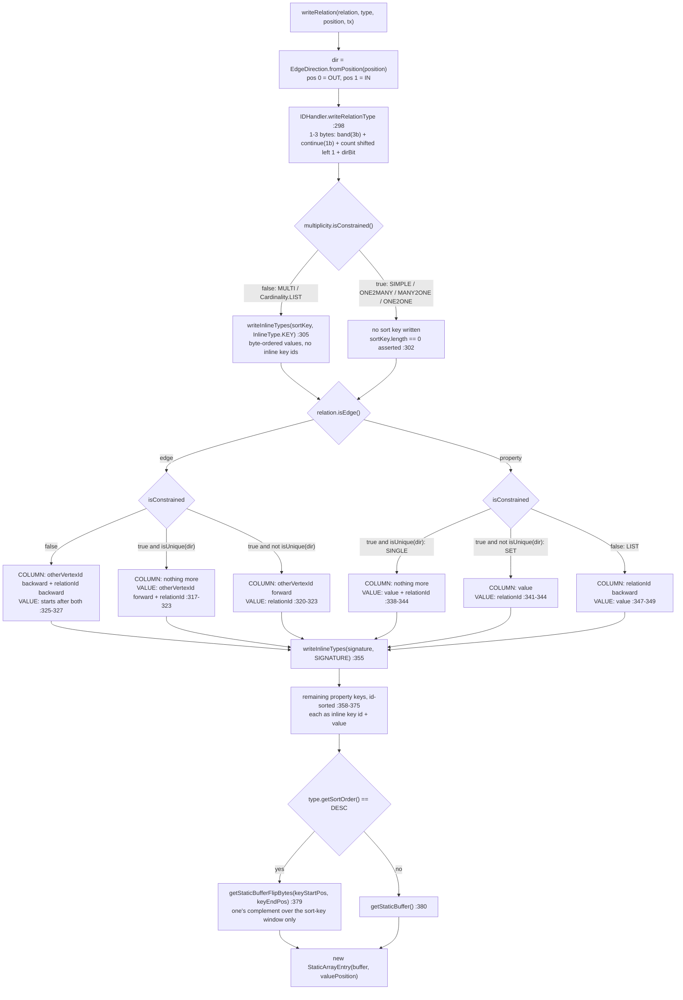
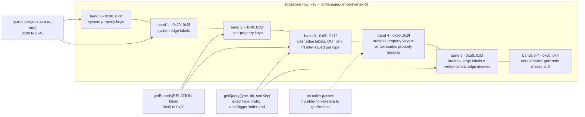

<!--
entry-meta
date: 2026-11-08
type: lesson
track: JanusGraph
lesson: 10
category: Database Internals
title: EdgeSerializer.writeRelation — the column layout of an edge and a property
slug: janusgraph-edge-serializer-column-layout
-->

# `EdgeSerializer.writeRelation` — the column layout of an edge and a property

**2026-11-08 · JanusGraph Track · Lesson 10 of 28**

## Where This Fits

- **Lesson 08** built the vertex id and showed that the id and the edgestore **row key** are two different 64-bit words. **Lesson 09** showed where the `count` inside that id comes from, and found that `ids.authority.conflict-avoidance-tag-bits` is `FIXED` at 4 with a zero tag, so **every count JanusGraph assigns is a multiple of 16**. Both lessons left `TYPE_LEN_RESERVE = 3` and `MAX_PADDING_BITWIDTH = 6` accounted for but unspent. ([lesson 09](../2026-11-07-janusgraph-id-authority-block-allocation/README.md))
- **This lesson spends them.** `EdgeSerializer.writeRelation` is the single method that turns one in-memory `InternalRelation` into one `(column, value)` cell inside the row that lesson 08's `getKey` addressed. It decides five things: which of six **bands** the column lands in, how many bytes the relation-type prefix costs, where the column stops and the value starts, which fields are written **backward** so they can be read from the tail, and whether the sort-key window gets one's-complemented.
- **It sets up** lesson 11 (`parseRelation` reads this layout back, and every decision here is a branch there), lesson 12 (`StandardSerializer` owns the attribute bytes this lesson treats as opaque), lesson 17 (`IndexSerializer` writes the *graphindex* store, which is a different layout entirely), and lesson 20 (`getQuery`, read here as a writer's mirror, is where vertex-centric index selection actually happens).

---

## 1. One method, five decisions

[`EdgeSerializer.java:288-381`](https://github.com/JanusGraph/janusgraph/blob/a59ae8d8024207598eada34998d867617df51adf/janusgraph-core/src/main/java/org/janusgraph/graphdb/database/EdgeSerializer.java#L288-L381) is 94 lines and produces a `StaticArrayEntry` — a single buffer plus one integer, `valuePosition`, that says where the column ends and the value begins. There is no second buffer. **The column and the value are one contiguous write, split by an offset.**

```java
return new StaticArrayEntry(type.getSortOrder() == Order.DESC ?
                            out.getStaticBufferFlipBytes(keyStartPos, keyEndPos) :
                            out.getStaticBuffer(), valuePosition);
```

The whole method is a sequence of writes into one `DataOutput`, with `valuePosition` captured at whichever point the author decided the column should stop. Everything written before that offset participates in the row's sort order; everything after it is payload the backend never interprets.

The signature is `writeRelation(relation, type, position, tx)` — note **`type` is a separate argument from `relation.getType()`**. The one-argument overload at [`:284-286`](https://github.com/JanusGraph/janusgraph/blob/a59ae8d8024207598eada34998d867617df51adf/janusgraph-core/src/main/java/org/janusgraph/graphdb/database/EdgeSerializer.java#L284-L286) passes the relation's own type; the four-argument form lets the caller substitute a **different** type for the same relation, guarded by:

```java
assert type==relation.getType() || (type.getBaseType() != null
        && type.getBaseType().equals(relation.getType()));
```

That `assert` ([`:290-291`](https://github.com/JanusGraph/janusgraph/blob/a59ae8d8024207598eada34998d867617df51adf/janusgraph-core/src/main/java/org/janusgraph/graphdb/database/EdgeSerializer.java#L290-L291) — a bare `assert`, a no-op without `-ea`, which is lesson 08's recurring theme) is the entire mechanism behind vertex-centric indexes. §8 takes it apart.

`position` is an `int`, 0 or 1, converted by [`EdgeDirection.fromPosition`](https://github.com/JanusGraph/janusgraph/blob/a59ae8d8024207598eada34998d867617df51adf/janusgraph-core/src/main/java/org/janusgraph/graphdb/relations/EdgeDirection.java#L32-L43): **0 → OUT, 1 → IN**. The caller loop in `StandardJanusGraph.prepareCommitAddRelationMutations` ([`:1126-1149`](https://github.com/JanusGraph/janusgraph/blob/a59ae8d8024207598eada34998d867617df51adf/janusgraph-core/src/main/java/org/janusgraph/graphdb/database/StandardJanusGraph.java#L1126-L1149)) iterates `pos` over `edge.getArity()` and calls `writeRelation` once per position whose endpoint is the row's vertex — which is where the data-model doc's "each edge has to be stored twice" physically happens.

---

## 2. The relation-type prefix: three bits of band, one bit of direction

Every column starts with the same thing: [`IDHandler.writeRelationType`](https://github.com/JanusGraph/janusgraph/blob/a59ae8d8024207598eada34998d867617df51adf/janusgraph-core/src/main/java/org/janusgraph/graphdb/database/idhandling/IDHandler.java#L130-L135).

```java
long strippedId = (IDManager.stripEntireRelationTypePadding(relationTypeId) << 1) + dirID.getDirectionInt();
VariableLong.writePositiveWithPrefix(out, strippedId,
    dirID.getPrefix(invisible, IDManager.isSystemRelationTypeId(relationTypeId)), PREFIX_BIT_LEN);
```

Three independent things are packed here.

### 2.1 `stripEntireRelationTypePadding` is where `MAX_PADDING_BITWIDTH` is spent

[`IDManager.java:701-704`](https://github.com/JanusGraph/janusgraph/blob/a59ae8d8024207598eada34998d867617df51adf/janusgraph-core/src/main/java/org/janusgraph/graphdb/idmanagement/IDManager.java#L701-L704) is `VertexIDType.UserEdgeLabel.removePadding(id)` — a plain `id >>> 6`, because `UserEdgeLabel.offset() == 6` ([`:272-287`](https://github.com/JanusGraph/janusgraph/blob/a59ae8d8024207598eada34998d867617df51adf/janusgraph-core/src/main/java/org/janusgraph/graphdb/idmanagement/IDManager.java#L272-L287)) and `MAX_PADDING_BITWIDTH` *is* that offset ([`:405`](https://github.com/JanusGraph/janusgraph/blob/a59ae8d8024207598eada34998d867617df51adf/janusgraph-core/src/main/java/org/janusgraph/graphdb/idmanagement/IDManager.java#L405)). All four proper relation-type suffixes are six bits wide — `UserPropertyKey` `000101`, `SystemPropertyKey` `100101`, `UserEdgeLabel` `010101`, `SystemEdgeLabel` `110101` — so one shift strips any of them. The information in those six bits is not lost: it is *reconstructed* on read from the 3-bit band and the 1 direction bit ([`readRelationType:143-155`](https://github.com/JanusGraph/janusgraph/blob/a59ae8d8024207598eada34998d867617df51adf/janusgraph-core/src/main/java/org/janusgraph/graphdb/database/idhandling/IDHandler.java#L143-L155)):

```java
typeId = IDManager.getSchemaId(isSystemType?SystemPropertyKey:UserPropertyKey, typeId);
```

So the six suffix bits are re-derived from four bits of column prefix. **That is the whole trick**: the column never stores the type's padding, only the schema *count*, and `SCHEMA_COUNT_BOUND = 1L << (63 - 6 - 3)` = `1 << 54` ([`:410`](https://github.com/JanusGraph/janusgraph/blob/a59ae8d8024207598eada34998d867617df51adf/janusgraph-core/src/main/java/org/janusgraph/graphdb/idmanagement/IDManager.java#L410)) is sized so that `count << 1` plus the 3-bit prefix still fits a positive long. `TYPE_LEN_RESERVE = 3` ([`:377-380`](https://github.com/JanusGraph/janusgraph/blob/a59ae8d8024207598eada34998d867617df51adf/janusgraph-core/src/main/java/org/janusgraph/graphdb/idmanagement/IDManager.java#L377-L380)) is exactly `PREFIX_BIT_LEN` ([`IDHandler.java:114`](https://github.com/JanusGraph/janusgraph/blob/a59ae8d8024207598eada34998d867617df51adf/janusgraph-core/src/main/java/org/janusgraph/graphdb/database/idhandling/IDHandler.java#L114)), reserved in `IDManager` and consumed in `IDHandler`. **Lesson 08's and 09's loose ends, closed.**

Note that the javadoc comment on `writeRelationType` ([`:120-128`](https://github.com/JanusGraph/janusgraph/blob/a59ae8d8024207598eada34998d867617df51adf/janusgraph-core/src/main/java/org/janusgraph/graphdb/database/idhandling/IDHandler.java#L120-L128)) describes the layout as `[Invisible & System (2 bit) | Relation-Type-ID (1 bit) | Relation-Type-Count (variable) | Direction-ID (1 bit)]`. That is the *logical* field order, not the byte order. Physically the direction bit is the **least significant bit of the variable-length count**, and the 3-bit prefix sits in the **top** of the first byte. This is the "different first-bit convention" that lesson 08 flagged against `getKeyID`'s javadoc at `IDManager.java:523-529`: in a **row key** the high bits are the partition and the low bits are the type suffix; in a **column** the high bits are the band and the low bit of the encoded value is the direction. Same 64-bit vocabulary, opposite ends. Nothing reconciles them because nothing has to — they address different things.

### 2.2 The 3-bit band, and the six bands that exist

[`DirectionID.getPrefix`](https://github.com/JanusGraph/janusgraph/blob/a59ae8d8024207598eada34998d867617df51adf/janusgraph-core/src/main/java/org/janusgraph/graphdb/database/idhandling/IDHandler.java#L93-L96):

```java
private int getPrefix(boolean invisible, boolean systemType) {
    assert !systemType || invisible; // systemType implies invisible
    return ((systemType?0:invisible?2:1)<<1) + getRelationType();
}
```

`getRelationType()` is `id >>> 1` over the `DirectionID` ordinals `PROPERTY_DIR(0)`, `EDGE_OUT_DIR(2)`, `EDGE_IN_DIR(3)` — so **0 for a property, 1 for an edge, and the direction does not affect the band**. The result is six reachable prefixes out of eight, and `getPrefixed` ([`:178-183`](https://github.com/JanusGraph/janusgraph/blob/a59ae8d8024207598eada34998d867617df51adf/janusgraph-core/src/main/java/org/janusgraph/graphdb/database/idhandling/IDHandler.java#L178-L183)) shifts them to the top of a single byte:

| prefix | kind | first byte of every such column | `getBounds` reaches it via |
|---|---|---|---|
| 0 | system property key | `0x00`–`0x1f` | `getBounds(PROPERTY/RELATION, true)` |
| 1 | system edge label | `0x20`–`0x3f` | `getBounds(EDGE/RELATION, true)` |
| 2 | user property key | `0x40`–`0x5f` | `getBounds(PROPERTY/RELATION, false)` |
| 3 | user edge label (OUT **and** IN) | `0x60`–`0x7f` | `getBounds(EDGE/RELATION, false)` |
| 4 | **invisible, non-system** property key | `0x80`–`0x9f` | **nothing** |
| 5 | **invisible, non-system** edge label | `0xa0`–`0xbf` | **nothing** |
| 6–7 | — | `0xc0`–`0xff` | unreachable; `getPrefix` maxes at 5 |

`getBounds` ([`:185-206`](https://github.com/JanusGraph/janusgraph/blob/a59ae8d8024207598eada34998d867617df51adf/janusgraph-core/src/main/java/org/janusgraph/graphdb/database/idhandling/IDHandler.java#L185-L206)) only ever passes the *same* boolean for both arguments — `getPrefix(systemTypes, systemTypes)` — so it can produce `(0,1)` or `(2,3)` and **never `(4,5)`**. Bands 4 and 5 are not an oversight: they are the index-replica bands, and §8 shows why they must sit outside the all-relations slice.

Verified against [`IDManagementTest.testDirectionPrefix:226-237`](https://github.com/JanusGraph/janusgraph/blob/a59ae8d8024207598eada34998d867617df51adf/janusgraph-test/src/test/java/org/janusgraph/graphdb/idmanagement/IDManagementTest.java#L226-L237), which asserts both bounds are exactly **1 byte**, ordered, and strictly below `oneBuffer(1)` (`0xff`) — true for every band including 5, whose exclusive end is `0xc0`.

### 2.3 `writePositiveWithPrefix`: how many bytes the prefix actually costs

[`VariableLong.java:160-186`](https://github.com/JanusGraph/janusgraph/blob/a59ae8d8024207598eada34998d867617df51adf/janusgraph-core/src/main/java/org/janusgraph/graphdb/database/idhandling/VariableLong.java#L160-L186) with `prefixBitLen = 3` gives `deltaLen = 5`, so the first byte is:

```
bit  7 6 5 | 4        | 3 2 1 0
     band  | continue | top 0-4 bits of (count<<1 | dirBit)
```

and any remaining bits go out through `writeUnsigned` ([`:60-70`](https://github.com/JanusGraph/janusgraph/blob/a59ae8d8024207598eada34998d867617df51adf/janusgraph-core/src/main/java/org/janusgraph/graphdb/database/idhandling/VariableLong.java#L60-L70)) in 7-bit blocks with `STOP_MASK` (`0x80`) set on the **last** byte.

Re-implementing those two functions and `getPrefix` exactly as read at the pinned commit gives:

| schema count | reachable at defaults? | `EDGE_OUT` prefix | `EDGE_IN` prefix | `PROPERTY` prefix | bytes |
|---|---|---|---|---|---|
| 1 | no | `62` | `63` | `42` | 1 |
| 7 | no | `6e` | `6f` | `4e` | 1 |
| 8 | no | `70 90` | `70 91` | `50 90` | 2 |
| **16** | **yes — the first one** | `70 a0` | `70 a1` | `50 a0` | 2 |
| 1008 (63rd) | yes | `7f e0` | `7f e1` | `5f e0` | 2 |
| 1024 (64th) | yes | `70 10 80` | `70 10 81` | `50 10 80` | 3 |

Two things fall straight out of lesson 09.

**(a) The first user-defined type in a default graph already costs a 2-byte prefix.** The encoding gives a 1-byte prefix for `count << 1 | dir ≤ 15`, i.e. **count ≤ 7**. Lesson 09 established that the 4-bit conflict-avoidance tag makes every assigned count a multiple of 16, so the smallest schema count a default graph can hand out is 16 and **the 1-byte prefix is unreachable on every JanusGraph graph created with the defaults**. Every edge column and every property column in every row carries one byte more than the variable-length encoding was built to charge. On a 100-million-edge graph with two columns per edge that is ~200 MB of pure prefix padding, caused by a `FIXED` config option whose tag is always zero.

**(b) The 2-byte prefix holds exactly 63 types.** Counts up to 1023 fit in 2 bytes; multiples of 16 in that window are `16, 32, … 1008` — **63 of them**. The 64th relation type a graph defines spills to a 3-byte prefix. Without the tag bits the same window would hold 1023 types.

### 2.4 The prefix is **not** globally order-preserving, and it does not need to be

This matters because the whole adjacency-list design rests on column order. Running the same re-implementation over all counts 1–5000 for `EDGE_OUT_DIR` and comparing encodings byte-wise finds **exactly one** inversion:

```
count 1023 -> 7f fe        count 1024 -> 70 10 80
                                         ^^ 0x10 < 0xfe
```

The cause is structural, not a bug in the arithmetic: `writeUnsigned` sets the stop bit on the **last** byte, so a longer encoding's *second* byte is always `< 0x80` while a 2-byte encoding's second byte is always `≥ 0x80`. Crossing a length boundary therefore inverts the order. Inversions sit at every boundary: `1023 → 1024`, `131071 → 131072`, and so on. Restricted to the reachable multiples of 16, the single inversion in that range is **1008 → 1024** — the 63rd type sorts *after* the 64th.

So: **columns are grouped by relation type, not sorted by relation-type id.** Nothing in the read path depends on the stronger property, and the same stop-bit rule is what makes that safe:

- `getBounds` compares only the first byte's top three bits, so band membership is length-independent.
- `getQuery(type, dir, sortKey)` writes the *same* prefix bytes with the *same* function for both slice ends, so a per-type slice is an exact byte-prefix match, never an ordering question.
- A `Direction.BOTH` slice ([`:443-448`](https://github.com/JanusGraph/janusgraph/blob/a59ae8d8024207598eada34998d867617df51adf/janusgraph-core/src/main/java/org/janusgraph/graphdb/database/EdgeSerializer.java#L443-L448)) spans `[OUT-prefix, nextBigger(IN-prefix))` for one count — `70 a0` to `70 a2` for count 16. A 3-byte prefix sharing the first byte has a second byte `< 0x80`, so it sorts *below* `70 a0` and can never land inside that window. The STOP-bit convention is load-bearing here.

[`IDManagementTest.edgeTypeIDTest:141-201`](https://github.com/JanusGraph/janusgraph/blob/a59ae8d8024207598eada34998d867617df51adf/janusgraph-test/src/test/java/org/janusgraph/graphdb/idmanagement/IDManagementTest.java#L141-L201) runs 1,000,000 random counts from `1` to `SCHEMA_COUNT_BOUND` and asserts, per trial: the `getRelationType` → `readRelationType` round trip, the `DirectionID`, that the buffer is fully consumed, the inline round trip, that `writeRelationType` into a `StandardSerializer` `DataOutput` equals `getRelationType`'s buffer, and that **both** `getBounds(category, false)` and `getBounds(RELATION, false)` bracket the column. It asserts nothing about two *different* counts relative to each other. **The grouped-not-sorted property is unpinned by any test and undocumented.** (PR candidate 15.)

---

## 3. The multiplicity switch: where the column stops

Here is the part of `writeRelation` that actually differs per relation. `valuePosition` is assigned in six places, and each assignment is a different storage contract.



The six layouts, with `P` = relation-type prefix, `S` = byte-ordered sort-key values, `→` = forward-readable, `←` = backward-readable:

| relation | multiplicity / cardinality | `isConstrained` | `isUnique(dir)` | **column** | **value** | lines |
|---|---|---|---|---|---|---|
| edge | `MULTI` | no | — | `P S vid← rid←` | signature + props | [`:325-327`](https://github.com/JanusGraph/janusgraph/blob/a59ae8d8024207598eada34998d867617df51adf/janusgraph-core/src/main/java/org/janusgraph/graphdb/database/EdgeSerializer.java#L324-L328) |
| edge | `SIMPLE` | yes | no | `P vid→` | `rid` + signature + props | [`:320-322`](https://github.com/JanusGraph/janusgraph/blob/a59ae8d8024207598eada34998d867617df51adf/janusgraph-core/src/main/java/org/janusgraph/graphdb/database/EdgeSerializer.java#L315-L323) |
| edge | `MANY2ONE` at OUT, `ONE2MANY` at IN, `ONE2ONE` either | yes | yes | `P` | `vid→ rid` + signature + props | [`:317-318`](https://github.com/JanusGraph/janusgraph/blob/a59ae8d8024207598eada34998d867617df51adf/janusgraph-core/src/main/java/org/janusgraph/graphdb/database/EdgeSerializer.java#L315-L323) |
| property | `SINGLE` → `MANY2ONE` | yes | yes (OUT) | `P` | `value rid` + signature + props | [`:338-339`](https://github.com/JanusGraph/janusgraph/blob/a59ae8d8024207598eada34998d867617df51adf/janusgraph-core/src/main/java/org/janusgraph/graphdb/database/EdgeSerializer.java#L336-L344) |
| property | `SET` → `SIMPLE` | yes | no | `P value` | `rid` + signature + props | [`:341-342`](https://github.com/JanusGraph/janusgraph/blob/a59ae8d8024207598eada34998d867617df51adf/janusgraph-core/src/main/java/org/janusgraph/graphdb/database/EdgeSerializer.java#L336-L344) |
| property | `LIST` → `MULTI` | no | — | `P S rid←` | `value` + signature + props | [`:347-349`](https://github.com/JanusGraph/janusgraph/blob/a59ae8d8024207598eada34998d867617df51adf/janusgraph-core/src/main/java/org/janusgraph/graphdb/database/EdgeSerializer.java#L345-L350) |

The cardinality mapping is [`Multiplicity.convert`](https://github.com/JanusGraph/janusgraph/blob/a59ae8d8024207598eada34998d867617df51adf/janusgraph-core/src/main/java/org/janusgraph/core/Multiplicity.java#L94-L102): `LIST → MULTI`, `SET → SIMPLE`, `SINGLE → MANY2ONE`. `isConstrained()` is just `this != MULTI` ([`:64-66`](https://github.com/JanusGraph/janusgraph/blob/a59ae8d8024207598eada34998d867617df51adf/janusgraph-core/src/main/java/org/janusgraph/core/Multiplicity.java#L64-L66)), and `isUnique(Direction)` ([`:80-90`](https://github.com/JanusGraph/janusgraph/blob/a59ae8d8024207598eada34998d867617df51adf/janusgraph-core/src/main/java/org/janusgraph/core/Multiplicity.java#L80-L90)) is a three-case switch — which is why `MANY2ONE` behaves differently depending on which end of the edge is being written. **The same edge produces two columns with two different shapes**: at the OUT end a `MANY2ONE` edge is a bare-prefix column; at the IN end it is `P vid→`.

### 3.1 Why that shape choice is the uniqueness enforcement

Read the table one more time looking only at the column. A column is the row's unique cell key, so:

- `MANY2ONE` at OUT → column is **just the prefix**. There is physically one cell per `(vertex, type)`. Writing a second out-edge of that label **overwrites** the first. No read, no lock, no check — the uniqueness constraint is the cell key.
- `SET` property → column is `P value`. One cell per distinct value, so writing the same value twice is idempotent and writing a different value adds a cell. That is exactly set semantics, again for free.
- `SINGLE` property → column is `P`. One cell per key, last write wins.
- `MULTI` / `LIST` → the relation id is in the column, so every relation gets its own cell and nothing is ever overwritten.

This is why `isDirectColumnByStartOnlyAllowed` ([`:566-577`](https://github.com/JanusGraph/janusgraph/blob/a59ae8d8024207598eada34998d867617df51adf/janusgraph-core/src/main/java/org/janusgraph/graphdb/database/EdgeSerializer.java#L566-L577)) returns true only for `Cardinality.SINGLE` property keys: those are the only relations whose column is fully determined by the type, so the backend can do a point get instead of a range scan. Note it reads `TypeDefinitionCategory.MULTIPLICITY` out of the definition map directly rather than calling `type.multiplicity()`, and returns `false` for anything that is not a `PropertyKeyVertex` — so a system property key of SINGLE cardinality does not get the optimization.

And it is why `ManagementSystem.buildRelationTypeIndex` refuses to index a constrained direction ([`:348-349`](https://github.com/JanusGraph/janusgraph/blob/a59ae8d8024207598eada34998d867617df51adf/janusgraph-core/src/main/java/org/janusgraph/graphdb/database/management/ManagementSystem.java#L348-L349)): a sort key needs room in the column, and a constrained multiplicity has spent that room on the uniqueness guarantee. The same invariant is asserted three times, independently, in three files:

1. `ManagementSystem.java:348` — `Preconditions.checkArgument(!multiplicity().isUnique(direction))` when building a vertex-centric index.
2. `StandardEdgeLabelMaker.java:103-105` — `!hasSortKey() || !getMultiplicity().isUnique(unidirectionality)`.
3. `EdgeSerializer.java:302` — `assert !multiplicity.isConstrained() || sortKey.length==0`.

Only the third is in the write path, and it is a bare `assert`.

---

## 4. Sort keys, and why everything after them is written backward

The sort-key values are written at [`:303-307`](https://github.com/JanusGraph/janusgraph/blob/a59ae8d8024207598eada34998d867617df51adf/janusgraph-core/src/main/java/org/janusgraph/graphdb/database/EdgeSerializer.java#L303-L307), bracketed by `keyStartPos` and `keyEndPos`:

```java
int keyStartPos = out.getPosition();
if (!multiplicity.isConstrained()) {
    writeInlineTypes(sortKey, relation, out, tx, InlineType.KEY);
}
int keyEndPos = out.getPosition();
```

`InlineType` ([`:383-395`](https://github.com/JanusGraph/janusgraph/blob/a59ae8d8024207598eada34998d867617df51adf/janusgraph-core/src/main/java/org/janusgraph/graphdb/database/EdgeSerializer.java#L383-L395)) is a 3-value enum with two independent booleans:

| `InlineType` | `writeInlineKey()` | `writeByteOrdered()` | used for |
|---|---|---|---|
| `KEY` | false | **true** | sort-key values, in the column |
| `SIGNATURE` | false | false | signature values, in the value |
| `NORMAL` | **true** | false | everything else, in the value |

So sort-key values are written **without their key id** (the type's `getSortKey()` array fixes the order and arity, so the ids are redundant) and **in byte order** via `out.writeObjectByteOrder(value, key.dataType())` ([`writePropertyValue:419-428`](https://github.com/JanusGraph/janusgraph/blob/a59ae8d8024207598eada34998d867617df51adf/janusgraph-core/src/main/java/org/janusgraph/graphdb/database/EdgeSerializer.java#L419-L428)). Signature values are also key-less but *not* byte-ordered — they live past `valuePosition`, where order is irrelevant. Only `NORMAL` pays for an inline key id, via `IDHandler.writeInlineRelationType` ([`:168-171`](https://github.com/JanusGraph/janusgraph/blob/a59ae8d8024207598eada34998d867617df51adf/janusgraph-core/src/main/java/org/janusgraph/graphdb/database/idhandling/IDHandler.java#L168-L171)), which uses `stripRelationTypePadding` — `RelationType.removePadding`, i.e. `>>> 4`, not `>>> 6`. Four bits are kept rather than six because an inline key id has no 3-bit band to rebuild itself from; the two extra bits carry property-vs-edge and user-vs-system directly. One line apart in the same file, two different strip widths, for exactly that reason.

Also note the `assert` at [`:406`](https://github.com/JanusGraph/janusgraph/blob/a59ae8d8024207598eada34998d867617df51adf/janusgraph-core/src/main/java/org/janusgraph/graphdb/database/EdgeSerializer.java#L405-L413): `inlineType.writeInlineKey() || !InternalAttributeUtil.hasGenericDataType(inlineKey)`. A generically typed key (one whose `dataType()` is `Object.class`) is serialized with `writeClassAndObject`, which is neither fixed-width nor order-preserving — so it can only appear as a `NORMAL` inline property, never as a sort key or a signature field.

### The backward writes

Now the structural point. The column must be **byte-order-comparable on its sort-key window**, which means the window must end at a position the reader can find. But what follows it — the adjacent vertex id and the relation id — are variable length. Reading them forward would require knowing where the sort keys ended, which requires parsing every sort-key value first, which is exactly what a header-only parse is trying to avoid.

The answer is to write them **backward**:

```java
IDHandler.writeVertexId(out, otherVertexId, false);     // backward
VariableLong.writePositiveBackward(out, relationId);    // backward
valuePosition = out.getPosition();
```

`VariableLong.writePositiveBackward` ([`:217-220`](https://github.com/JanusGraph/janusgraph/blob/a59ae8d8024207598eada34998d867617df51adf/janusgraph-core/src/main/java/org/janusgraph/graphdb/database/idhandling/VariableLong.java#L217-L220) → `writeUnsignedBackward:258`) lays the 7-bit blocks down so that the stop marker is at the **first** byte written rather than the last, so a reader walking from the tail of the column finds the relation id, then the vertex id, and whatever is left in the middle is the sort-key window — no forward parse needed. `IDHandler.readVertexId` ([`:218-234`](https://github.com/JanusGraph/janusgraph/blob/a59ae8d8024207598eada34998d867617df51adf/janusgraph-core/src/main/java/org/janusgraph/graphdb/database/idhandling/IDHandler.java#L218-L234)) picks its direction from the same `forward` flag and peeks `in.getByte(position - 1)` for the `STRING_ID_MARKER` when reading backward.

And the `forward` flag is not a style choice — it tracks exactly whether the id is in the column or in the value:

- id goes in the **value** (`isUnique(dir)` true) → [`:318`](https://github.com/JanusGraph/janusgraph/blob/a59ae8d8024207598eada34998d867617df51adf/janusgraph-core/src/main/java/org/janusgraph/graphdb/database/EdgeSerializer.java#L315-L323) passes `forward = true`, because the value is always parsed front to back.
- id goes in the **column** → [`:320`](https://github.com/JanusGraph/janusgraph/blob/a59ae8d8024207598eada34998d867617df51adf/janusgraph-core/src/main/java/org/janusgraph/graphdb/database/EdgeSerializer.java#L315-L323) and [`:325`](https://github.com/JanusGraph/janusgraph/blob/a59ae8d8024207598eada34998d867617df51adf/janusgraph-core/src/main/java/org/janusgraph/graphdb/database/EdgeSerializer.java#L324-L328) both pass `false`. The `SIMPLE` and the `MULTI` edge paths write the adjacent vertex id identically; the only difference is whether `valuePosition` lands before or after the relation id that follows. A constrained type has no sort keys, so the backward write buys nothing there — it is uniformity, so that `parseRelation` has exactly one convention: *the adjacent vertex id lives at the tail of the column*.

That tail-reading convention is what makes the `ImplicitKey.ADJACENT_ID` and `ImplicitKey.JANUSGRAPHID` pseudo-sort-keys in `getQuery` ([`:485-492`](https://github.com/JanusGraph/janusgraph/blob/a59ae8d8024207598eada34998d867617df51adf/janusgraph-core/src/main/java/org/janusgraph/graphdb/database/EdgeSerializer.java#L484-L496)) work: they are not real sort keys at all, they are *the backward-written tail fields*, addressable as if they were an extension of the sort key because they sit immediately after it. The assertions at [`:466-471`](https://github.com/JanusGraph/janusgraph/blob/a59ae8d8024207598eada34998d867617df51adf/janusgraph-core/src/main/java/org/janusgraph/graphdb/database/EdgeSerializer.java#L466-L471) pin the only legal positions: `ADJACENT_ID` exactly at `i == sortKeyIDs.length`, `JANUSGRAPHID` at `sortKeyIDs.length` or `sortKeyIDs.length + 1`, and both only for non-unique directions. That is the "extended sort key" the query builder constructs at [`BasicVertexCentricQueryBuilder.java:688`](https://github.com/JanusGraph/janusgraph/blob/a59ae8d8024207598eada34998d867617df51adf/janusgraph-core/src/main/java/org/janusgraph/graphdb/query/vertex/BasicVertexCentricQueryBuilder.java#L683-L690).

### Remaining properties are id-sorted for determinism

[`:357-375`](https://github.com/JanusGraph/janusgraph/blob/a59ae8d8024207598eada34998d867617df51adf/janusgraph-core/src/main/java/org/janusgraph/graphdb/database/EdgeSerializer.java#L357-L375) collects every property key on the relation that is neither an `ImplicitKey` nor already written as a sort key or signature field, sorts the ids with `Arrays.sort`, and writes each as `NORMAL`. The comment says why: *"Sort types before writing to ensure that value is always written the same way."* Without it, two serializations of the same relation could differ byte-for-byte depending on `getPropertyKeysDirect()`'s iteration order — which would break `acquireEdgeLock` ([`StandardJanusGraph.java:900-901`](https://github.com/JanusGraph/janusgraph/blob/a59ae8d8024207598eada34998d867617df51adf/janusgraph-core/src/main/java/org/janusgraph/graphdb/database/StandardJanusGraph.java#L896-L904)), which locks on the serialized entry, and any backend doing value comparison. The `LongHashSet` is sized `sortKey.length + signature.length` and the `LongArrayList` is a flat `8`.

---

## 5. `DESC`: one's complement over exactly the sort-key window

A descending vertex-centric index is implemented by inverting the bytes:

```java
out.getStaticBufferFlipBytes(keyStartPos, keyEndPos)
```

[`WriteByteBuffer.java:146-153`](https://github.com/JanusGraph/janusgraph/blob/a59ae8d8024207598eada34998d867617df51adf/janusgraph-core/src/main/java/org/janusgraph/diskstorage/util/WriteByteBuffer.java#L146-L153):

```java
for (int i=from;i<to;i++) b.put(i,(byte)~b.get(i));
```

A plain one's complement, applied **only** to `[keyStartPos, keyEndPos)` — the sort-key window, after the type prefix and before the backward-written tail. Three consequences worth being explicit about:

- The type prefix is **not** flipped, so a DESC type stays in its band and its per-type slice is still an exact prefix match. Flipping the whole buffer would have moved the column into band 4 or 5.
- The tail (adjacent vertex id, relation id) is **not** flipped, so tail-reading is order-independent of the sort direction.
- For a **constrained** type `keyStartPos == keyEndPos`, so the flip is a no-op over an empty range. `getStaticBuffer()` is itself `getStaticBufferFlipBytes(0,0)` ([`:142`](https://github.com/JanusGraph/janusgraph/blob/a59ae8d8024207598eada34998d867617df51adf/janusgraph-core/src/main/java/org/janusgraph/diskstorage/util/WriteByteBuffer.java#L140-L143)) — the same method with an empty window. The ternary at `:378-380` is therefore cosmetic; both branches reach the same code.

---

## 6. `getQuery`: the slice query that reads this back

[`:436-552`](https://github.com/JanusGraph/janusgraph/blob/a59ae8d8024207598eada34998d867617df51adf/janusgraph-core/src/main/java/org/janusgraph/graphdb/database/EdgeSerializer.java#L436-L552) is the writer read in reverse, and it is the right place to check that the layout is actually queryable.

### 6.1 The no-constraint case, and `nextBiggerBuffer`

With no usable sort-key interval, [`:533-549`](https://github.com/JanusGraph/janusgraph/blob/a59ae8d8024207598eada34998d867617df51adf/janusgraph-core/src/main/java/org/janusgraph/graphdb/database/EdgeSerializer.java#L533-L549) produces `sliceStart` = the type prefix (flipped over `[keyStartPos, keyEndPos)` if DESC, which is empty here) and `sliceEnd = BufferUtil.nextBiggerBuffer(sliceStart)`.

[`BufferUtil.java:193-212`](https://github.com/JanusGraph/janusgraph/blob/a59ae8d8024207598eada34998d867617df51adf/janusgraph-core/src/main/java/org/janusgraph/diskstorage/util/BufferUtil.java#L193-L212) increments the buffer **in place, without changing its length**, carrying right-to-left, and throws on carry-out unless `allowOverflow`. Lesson 08 and 09 both left this to lesson 10, so: **overflow is unreachable for a type prefix.** The first byte's top three bits are the band, which maxes at 5, so the first byte is at most `0b101_11111 = 0xbf` and the carry always stops there. A type prefix can end in `0xff` — count 63 with `EDGE_IN_DIR` gives `70 ff` — and then `nextBiggerBuffer` yields `71 00`, which still has band `011` in its top three bits and is still a correct exclusive bound, because 3-byte prefixes beginning `71` have a second byte `< 0x80` and sort below `71 00`.

`BufferUtil.padBuffer` ([`:180-187`](https://github.com/JanusGraph/janusgraph/blob/a59ae8d8024207598eada34998d867617df51adf/janusgraph-core/src/main/java/org/janusgraph/diskstorage/util/BufferUtil.java#L180-L187)), the other item owed here, turns out not to touch columns at all: its only caller is `OrderedKeyValueStoreAdapter.java:143`, padding **row keys** to a fixed length in the OKVS adapter from lesson 05. It is a key-space tool, not a column-space one.

### 6.2 The missing-value marker, and why it works in both sort orders

For a range whose upper end is open ([`:498-508`](https://github.com/JanusGraph/janusgraph/blob/a59ae8d8024207598eada34998d867617df51adf/janusgraph-core/src/main/java/org/janusgraph/graphdb/database/EdgeSerializer.java#L497-L508)):

```java
} else if (leavesOutMissingValues(propertyKey)) {
    colEnd.putByte((byte) -1);
    endInclusive = false;
}
```

`leavesOutMissingValues` ([`:562-564`](https://github.com/JanusGraph/janusgraph/blob/a59ae8d8024207598eada34998d867617df51adf/janusgraph-core/src/main/java/org/janusgraph/graphdb/database/EdgeSerializer.java#L554-L564)) delegates to [`StandardSerializer.writesMissingValuesLast:264-267`](https://github.com/JanusGraph/janusgraph/blob/a59ae8d8024207598eada34998d867617df51adf/janusgraph-core/src/main/java/org/janusgraph/graphdb/database/serialize/StandardSerializer.java#L264-L267), and [`SerializerTest.java:139-155`](https://github.com/JanusGraph/janusgraph/blob/a59ae8d8024207598eada34998d867617df51adf/janusgraph-test/src/test/java/org/janusgraph/graphdb/serializer/SerializerTest.java#L139-L155) pins the mechanism: for every order-preserving data type, a missing value is written in byte order as the **single byte `0xff`**, strictly greater than every real value. (It also pins the three types that do not get this: `Class`, `Instant`, `byte[]`.)

The interesting check is DESC, where the comment at `:504-505` ("written as -1 **after** the values") is ASC-specific. Trace it:

- **ASC** ([`:511-516`](https://github.com/JanusGraph/janusgraph/blob/a59ae8d8024207598eada34998d867617df51adf/janusgraph-core/src/main/java/org/janusgraph/graphdb/database/EdgeSerializer.java#L510-L527)): `sliceEnd = colEnd` = `[prefix][0xff]`, `endInclusive = false` so no `nextBiggerBuffer`. The slice ends *at* `0xff`, exclusive — missing values excluded. ✅
- **DESC** ([`:518-523`](https://github.com/JanusGraph/janusgraph/blob/a59ae8d8024207598eada34998d867617df51adf/janusgraph-core/src/main/java/org/janusgraph/graphdb/database/EdgeSerializer.java#L510-L527)): `sliceStart = flip(colEnd)` — and the `0xff` marker sits **inside** `[keyStartPos, position)`, so it is flipped to `0x00`. In a DESC index, missing values therefore sort **first**, not last. `if (!endInclusive) sliceStart = nextBiggerBuffer(sliceStart)` bumps the lower bound to `[prefix][0x01]`, which is exactly what excludes them. ✅

Both directions are correct, by the same flip that implements the sort order. The javadoc at [`:554-561`](https://github.com/JanusGraph/janusgraph/blob/a59ae8d8024207598eada34998d867617df51adf/janusgraph-core/src/main/java/org/janusgraph/graphdb/database/EdgeSerializer.java#L554-L561) states the contract in order-neutral terms ("open toward the larger values"), which is right; only the inline comment at `:504-505` is phrased for ASC.

### 6.3 The empty-interval branch is dead code

[`:481-483`](https://github.com/JanusGraph/janusgraph/blob/a59ae8d8024207598eada34998d867617df51adf/janusgraph-core/src/main/java/org/janusgraph/graphdb/database/EdgeSerializer.java#L481-L483):

```java
if (interval == null || interval.isEmpty()) {
    break;
}
```

`RangeInterval.isEmpty()` ([`:110-115`](https://github.com/JanusGraph/janusgraph/blob/a59ae8d8024207598eada34998d867617df51adf/janusgraph-core/src/main/java/org/janusgraph/util/datastructures/RangeInterval.java#L110-L115)) means *unsatisfiable* — `start > end`, or `start == end` with an exclusive bound. Breaking out leaves `sliceStart == null`, which falls into `:533` and produces a slice over the **whole type band**, i.e. the maximum over-read rather than nothing.

It never fires. [`BasicVertexCentricQueryBuilder.java:607-610`](https://github.com/JanusGraph/janusgraph/blob/a59ae8d8024207598eada34998d867617df51adf/janusgraph-core/src/main/java/org/janusgraph/graphdb/query/vertex/BasicVertexCentricQueryBuilder.java#L606-L610) checks every compiled interval and returns `BaseVertexCentricQuery.emptyQuery()` *before* any `getQuery` call:

```java
for (Interval pint : intervalConstraints.values()) {
    //Check if one of the constraints leads to an empty result set
    if (pint.isEmpty()) return BaseVertexCentricQuery.emptyQuery();
}
```

So the serializer's branch is unreachable from the only production caller, and if a future caller did reach it the failure mode is a silent full-type scan. (PR candidate 17.)

---

## 7. Where the columns actually land in the row



Within band 3, the two directions of one type are **adjacent**: count 16 gives `70 a0` for OUT and `70 a1` for IN, because the direction bit is the low bit of the encoded value. That is what makes the `Direction.BOTH` slice a single contiguous range rather than two queries — and also means a vertex's out-edges and in-edges of the same label are physically interleaved, one block per label, not segregated into an out-half and an in-half.

---

## 8. What a vertex-centric index costs, in columns

The `type` parameter of `writeRelation` finally pays off. [`ManagementSystem.buildRelationTypeIndex:340-393`](https://github.com/JanusGraph/janusgraph/blob/a59ae8d8024207598eada34998d867617df51adf/janusgraph-core/src/main/java/org/janusgraph/graphdb/database/management/ManagementSystem.java#L340-L393) does **not** create an auxiliary structure. It creates a **whole new relation type**:

```java
maker.status(canIndexBeEnabled ? SchemaStatus.ENABLED : SchemaStatus.INSTALLED);
maker.invisible();
maker.multiplicity(Multiplicity.MULTI);
maker.sortKey(sortKeys);
maker.sortOrder(sortOrder);
```

with the name `<baseTypeId>:<indexName>` ([`:395-397`](https://github.com/JanusGraph/janusgraph/blob/a59ae8d8024207598eada34998d867617df51adf/janusgraph-core/src/main/java/org/janusgraph/graphdb/database/management/ManagementSystem.java#L395-L397)), linked back to the base type by a `RELATIONTYPE_INDEX` schema edge ([`:387`](https://github.com/JanusGraph/janusgraph/blob/a59ae8d8024207598eada34998d867617df51adf/janusgraph-core/src/main/java/org/janusgraph/graphdb/database/management/ManagementSystem.java#L386-L388)), which is what `RelationTypeVertex.getBaseType()` ([`:101-106`](https://github.com/JanusGraph/janusgraph/blob/a59ae8d8024207598eada34998d867617df51adf/janusgraph-core/src/main/java/org/janusgraph/graphdb/types/vertices/RelationTypeVertex.java#L101-L106)) and `getRelationIndexes()` ([`:109-117`](https://github.com/JanusGraph/janusgraph/blob/a59ae8d8024207598eada34998d867617df51adf/janusgraph-core/src/main/java/org/janusgraph/graphdb/types/vertices/RelationTypeVertex.java#L109-L117)) traverse. `getRelationIndexes()` returns `[this] ++ indexTypes`, so the commit loop:

```java
for (InternalRelationType type : baseType.getRelationIndexes()) {
    if (type.getStatus()== SchemaStatus.DISABLED) continue;
    for (int pos = 0; pos < edge.getArity(); pos++) {
        ...
        additions.add(edgeSerializer.writeRelation(edge, type, pos, tx));
```

writes **one full copy of the relation per index type per covered position**. Five facts follow, all mechanical:

1. **`maker.invisible()` at `:368` is why bands 4 and 5 exist.** Index replicas must be outside `getBounds(RELATION, *)`, or a plain `v.edges()` would return each edge once per index.
2. **It is also structurally required**, not just convenient. `lm.unidirected(direction)` at `:355` can be `Direction.IN`, and [`StandardEdgeLabelMaker.java:106`](https://github.com/JanusGraph/janusgraph/blob/a59ae8d8024207598eada34998d867617df51adf/janusgraph-core/src/main/java/org/janusgraph/graphdb/types/StandardEdgeLabelMaker.java#L103-L110) forbids an IN-only unidirected label unless `INVISIBLE` is set. Invisibility is a precondition of the index type's own shape.
3. **The replica is always `MULTI`** (`:369`), so it always gets the full unconstrained column `P S vid← rid←` — the one layout with room for a sort key.
4. **Each index adds one column per edge**, not two: the unidirected index type fails the `type.isUnidirected(...)` check at [`StandardJanusGraph.java:1127-1128`](https://github.com/JanusGraph/janusgraph/blob/a59ae8d8024207598eada34998d867617df51adf/janusgraph-core/src/main/java/org/janusgraph/graphdb/database/StandardJanusGraph.java#L1126-L1129) for the other position. An edge with *N* vertex-centric indexes is **2 + N columns**, each with its own full prefix, sort-key window, tail ids, signature and inline properties. The signature is deliberately pruned of the sort keys at [`:374-385`](https://github.com/JanusGraph/janusgraph/blob/a59ae8d8024207598eada34998d867617df51adf/janusgraph-core/src/main/java/org/janusgraph/graphdb/database/management/ManagementSystem.java#L373-L385) so those values are not stored twice in the replica.
5. **Each index type consumes a schema count**, which at the default 4 tag bits means 16 counts, and counts in the 2-byte prefix window run out after 63 types — base types and index types drawing on the same pool.

`IndexRepairJob` ([`:211-219`](https://github.com/JanusGraph/janusgraph/blob/a59ae8d8024207598eada34998d867617df51adf/janusgraph-core/src/main/java/org/janusgraph/graphdb/olap/job/IndexRepairJob.java#L211-L219)) re-runs the same loop for an index registered after the data existed, with the same `writeRelation(relation, wrappedType, pos, writeTx)` call — which is why reindexing a vertex-centric index is a pure re-serialization job and needs no new code path.

The `hadoop` reader shows the other side of the same coin: [`JanusGraphVertexDeserializer.java:124-128`](https://github.com/JanusGraph/janusgraph/blob/a59ae8d8024207598eada34998d867617df51adf/janusgraph-hadoop/src/main/java/org/janusgraph/hadoop/formats/util/JanusGraphVertexDeserializer.java#L124-L128) skips system types *and* `isInvisibleType()` types explicitly, because it scans whole rows rather than issuing band-bounded slices and so has to filter bands 4 and 5 in application code.

---

## Hands-On

Three exercises, in increasing order of what they show. All in your fork at `aryanttripathi/janusgraph`; `janusgraph-berkeleyje` is not needed, the in-memory backend is enough.

### 1. Confirm the six layouts exist, with the test that already covers them

[`EdgeSerializerTest.testRelationIsFullyParsedOnce`](https://github.com/JanusGraph/janusgraph/blob/a59ae8d8024207598eada34998d867617df51adf/janusgraph-test/src/test/java/org/janusgraph/graphdb/serializer/EdgeSerializerTest.java#L96-L145) already builds one edge label per `Multiplicity`, one property key per `Cardinality`, a signed label, a signed property key, and both an ASC and a DESC edge index — which is precisely the matrix in §3's table plus §5.

```bash
mvn -q -pl janusgraph-test -am -DskipTests install -o || mvn -q -pl janusgraph-test -am -DskipTests install
mvn -pl janusgraph-test -Dtest='EdgeSerializerTest#testRelationIsFullyParsedOnce' \
    -DfailIfNoSpecifiedTests=false test
```

**What to look for:** set a breakpoint on `EdgeSerializer.writeRelation` and watch `valuePosition` against `out.getPosition()` as the loop walks the label list. For `edgeMANY2ONE` at `position=0` the two are equal right after `writeRelationType` returns; for `edgeMULTI` they diverge by the width of the two backward-written ids. That single integer is the whole column/value split.

### 2. Dump the bytes and read the bands off them

Add a scratch test under `janusgraph-test/src/test/java/org/janusgraph/graphdb/serializer/` (**do not commit it** — it is a probe, not a contribution):

```java
StandardJanusGraph g = (StandardJanusGraph) StorageSetup.getInMemoryGraph();
JanusGraphManagement m = g.openManagement();
PropertyKey weight = m.makePropertyKey("weight").dataType(Integer.class).make();
m.makePropertyKey("single").dataType(String.class).cardinality(Cardinality.SINGLE).make();
m.makePropertyKey("set").dataType(String.class).cardinality(Cardinality.SET).make();
m.makePropertyKey("list").dataType(String.class).cardinality(Cardinality.LIST).make();
EdgeLabel knows = m.makeEdgeLabel("knows").multiplicity(Multiplicity.MULTI).make();
m.buildEdgeIndex(knows, "byWeight", Direction.OUT, Order.desc, weight);
m.makeEdgeLabel("father").multiplicity(Multiplicity.MANY2ONE).make();
m.commit();
// ... create vertices, one relation of each kind, then for each:
StandardJanusGraphTx tx = (StandardJanusGraphTx) g.newTransaction();
EdgeSerializer s = g.getEdgeSerializer();
for (int pos = 0; pos < rel.getArity(); pos++) {
    StaticArrayEntry e = s.writeRelation(rel, (InternalRelationType) rel.getType(), pos, tx);
    System.out.printf("%-22s pos=%d col=%s val=%s%n", rel.getType().name(), pos,
        hex(e.getColumn()), hex(e.getValue()));
}
```

**What to look for, in order:**

- The **first byte** of every column. `0x5x` = user property, `0x7x` = user edge, `0xax` = the `byWeight` index replica. Compare against §2.2's table — you are reading the band directly out of the top three bits.
- The **second byte** is `0xa0` or above for the first few types, never a 1-byte prefix. That is lesson 09's 4 tag bits showing up as a byte of overhead in every cell.
- `single` has `col.length == prefixLength` and its value starts with the serialized string; `set` carries the string **in the column**; `list` carries a backward-written relation id in the column and the string in the value. Three cardinalities, three different cells.
- `father` at `pos=0` has a bare-prefix column; at `pos=1` the column has the adjacent vertex id appended. Same edge, two shapes.
- For `byWeight` with `Order.desc`, flip the sort-key bytes by hand (`~b`) and check you get back the order-preserving encoding of the weight — the window is exactly `[prefixLength, prefixLength + width)`.

### 3. Reproduce the ordering inversion

This is the §2.4 finding, and it needs no graph at all:

```java
long t63 = IDManager.getSchemaId(IDManager.VertexIDType.UserEdgeLabel, 1008);
long t64 = IDManager.getSchemaId(IDManager.VertexIDType.UserEdgeLabel, 1024);
StaticBuffer b63 = IDHandler.getRelationType(t63, IDHandler.DirectionID.EDGE_OUT_DIR, false);
StaticBuffer b64 = IDHandler.getRelationType(t64, IDHandler.DirectionID.EDGE_OUT_DIR, false);
System.out.println(hex(b63) + "  vs  " + hex(b64) + "  cmp=" + b63.compareTo(b64));
```

**What to look for:** `7f e0 vs 70 10 80 cmp=1`. The 63rd type's prefix is byte-wise *greater* than the 64th's. Then re-run [`IDManagementTest#edgeTypeIDTest`](https://github.com/JanusGraph/janusgraph/blob/a59ae8d8024207598eada34998d867617df51adf/janusgraph-test/src/test/java/org/janusgraph/graphdb/idmanagement/IDManagementTest.java#L141-L201) and confirm it still passes — it never compares two different type prefixes, so nothing in the suite notices.

```bash
mvn -pl janusgraph-test -Dtest='IDManagementTest#edgeTypeIDTest' \
    -DfailIfNoSpecifiedTests=false test
```

---

## Where This Breaks Down

- **The column is the uniqueness constraint, so changing a multiplicity rewrites the layout.** Promoting `knows` from `MANY2ONE` to `MULTI` changes the column from `P` to `P S vid← rid←`. Existing cells keep the old shape and the old cell key. There is no migration in `writeRelation`; `ManagementSystem`'s schema-status machinery (lesson 25) is what stands between a user and silently unreadable edges.
- **A bare-prefix column means last-write-wins with no detection.** Two concurrent transactions each adding a `MANY2ONE` out-edge of the same label produce the identical column and one simply overwrites the other, unless `acquireLock` ran. Whether it ran is `StandardJanusGraph.acquireLock(del, pos, acquireLocks)` and the backend's `StoreFeatures` from lesson 03 — the serializer has no opinion.
- **One byte of prefix overhead per cell, unavoidable.** §2.3(a): the 1-byte prefix is unreachable at default config, and `ids.authority.conflict-avoidance-tag-bits` is `ConfigOption.Type.FIXED`, so it cannot be changed on an existing graph. The encoding's cheapest case is dead on arrival.
- **63 relation types before prefixes grow again.** Including one per vertex-centric index. Not a limit anyone hits for correctness, but it means a schema-heavy graph pays 50% more prefix bytes than a small one, and the crossover is not where the encoding suggests.
- **Grouped, not sorted.** Any mental model, tool, or external reader that assumes columns ascend by relation-type id is wrong at every length boundary. Nothing in-tree depends on it; anything out-of-tree scanning raw rows might.
- **Sort keys and constrained multiplicity are mutually exclusive, enforced three times and never in one place.** The write-path check is a bare `assert`. A new caller that bypasses `ManagementSystem` and `StandardEdgeLabelMaker` would write a constrained type with a sort key and produce columns that `parseRelation` cannot interpret, with no error under a normal JVM.
- **Index replicas are full copies.** Each one re-serializes the signature-minus-sort-keys and every inline property. A vertex-centric index on a wide edge is not a thin pointer; it is close to a second edge.
- **`getQuery`'s empty-interval path widens instead of narrowing.** Currently unreachable (§6.3), but it is the wrong default for a branch whose job is to represent "nothing matches".

---

## Further Study

- [`docs/advanced-topics/data-model.md`](https://github.com/JanusGraph/janusgraph/blob/a59ae8d8024207598eada34998d867617df51adf/docs/advanced-topics/data-model.md) — the official picture of the individual edge layout, and the `relationlayout.png` it references. Lines 71-72 ("serialized such that the byte order of the column respects the sort key") and 15-17 are correct but say nothing about the bands.
- [`IDHandler.java`](https://github.com/JanusGraph/janusgraph/blob/a59ae8d8024207598eada34998d867617df51adf/janusgraph-core/src/main/java/org/janusgraph/graphdb/database/idhandling/IDHandler.java) in full — 240 lines, and the smallest file in the tree that repays reading end to end.
- [`VariableLong.java:212-298`](https://github.com/JanusGraph/janusgraph/blob/a59ae8d8024207598eada34998d867617df51adf/janusgraph-core/src/main/java/org/janusgraph/graphdb/database/idhandling/VariableLong.java#L212-L235) — the four backward variants and `unsignedBackwardLength`, which §4 uses but does not dissect.
- [`PointInterval.java`](https://github.com/JanusGraph/janusgraph/blob/a59ae8d8024207598eada34998d867617df51adf/janusgraph-core/src/main/java/org/janusgraph/util/datastructures/PointInterval.java) and [`RangeInterval.java`](https://github.com/JanusGraph/janusgraph/blob/a59ae8d8024207598eada34998d867617df51adf/janusgraph-core/src/main/java/org/janusgraph/util/datastructures/RangeInterval.java) — `isPoints()` on a `RangeInterval` requires both ends equal *and* both inclusive, which is why `getQuery` has separate point and range paths.
- [`SerializerTest.java:157-170`](https://github.com/JanusGraph/janusgraph/blob/a59ae8d8024207598eada34998d867617df51adf/janusgraph-test/src/test/java/org/janusgraph/graphdb/serializer/SerializerTest.java#L157-L170) — every NaN is written in byte order as one value after `+∞`, so that a vertex-centric index slice ending before NaN holds every other double. A good preview of lesson 12.

---

## Next Steps

1. **Lesson 11 (`parseRelation` and `RelationCache`)** inherits every branch in §3. The question to carry in: `readRelation` is called with `parseHeaderOnly` true or false, and `EdgeSerializerTest.testRelationIsFullyParsedOnce` exists because a relation with no properties used to be re-parsed on every read. Find which of the six layouts can be fully parsed from the header alone, and confirm it is exactly the ones whose tail is empty.
2. **Lesson 12 (`StandardSerializer`)** owns `writeObjectByteOrder` vs `writeObject` vs `writeClassAndObject`, the order-preserving serializers, and `writesMissingValuesLast`. Settle there whether every `isOrderPreservingDatatype` is also fixed-width, because a variable-width order-preserving sort key would make the sort-key window's end ambiguous without the backward tail trick.
3. **Lesson 13 (schema storage)** should check whether a schema vertex's own row uses the same six bands. `BaseRelationType.isInvisibleType()` returns an unconditional `true` and `BaseKey`/`BaseLabel` ids are system ids, so schema-definition relations should land in bands 0 and 1 — verify rather than assume.
4. **Lesson 17 (`IndexSerializer`)** is the contrast case: composite indexes go to the *graphindex* store with a different key and column scheme entirely. Carry §8's column arithmetic over so the two index kinds can be costed side by side.
5. **Lesson 20** owns `BasicVertexCentricQueryBuilder` properly, including `constructSliceQueries`' recursion, the candidate scoring at `:683-713`, and `getExtendedSortKey`. §4's `ADJACENT_ID` / `JANUSGRAPHID` assertions are the contract it has to satisfy.
6. **PR candidate 15 — a test for the ordering contract.** `IDManagementTest.edgeTypeIDTest` never compares two type prefixes. Add a case pinning that the prefix encoding is monotone *within* a byte-length class and inverts across one (`1008`/`1024`, `1023`/`1024`), so "grouped, not sorted" is documented in the suite rather than folklore. Same patch can fix `int trails = 1000000` at `:145` (`trails` → `trials`).
7. **PR candidate 16 — one paragraph in `data-model.md`.** The six bands, `getBounds`, and the fact that bands 4-5 hold vertex-centric index replicas, are the single most useful thing to know when reading a raw edgestore row and are documented nowhere. Costs nothing, helps everyone debugging a backend.
8. **PR candidate 17 — `EdgeSerializer.java:481-483`.** Unreachable today; if reached it widens the slice to the whole type band. Either delete it or make the empty case return an empty slice. Needs a maintainer's call on which, so open as an issue first.
9. **Carried from lesson 09, still open:** PR candidates 1-14, of which 5 still needs its experiment run. 1 and 7 (`KCVSProxy.java:67` and the retry-backoff coin flip) remain the two cleanest first patches.
10. **Re-pin decision is due after lesson 13**, at the Part II/III boundary. Not available this run; stayed on `a59ae8d8` with no decision to record.

---

## Sources

Code read this run, all at `a59ae8d8024207598eada34998d867617df51adf`:

- [`EdgeSerializer.java`](https://github.com/JanusGraph/janusgraph/blob/a59ae8d8024207598eada34998d867617df51adf/janusgraph-core/src/main/java/org/janusgraph/graphdb/database/EdgeSerializer.java) (whole, 591 lines)
- [`IDHandler.java`](https://github.com/JanusGraph/janusgraph/blob/a59ae8d8024207598eada34998d867617df51adf/janusgraph-core/src/main/java/org/janusgraph/graphdb/database/idhandling/IDHandler.java) (whole)
- [`VariableLong.java#L56-L235`](https://github.com/JanusGraph/janusgraph/blob/a59ae8d8024207598eada34998d867617df51adf/janusgraph-core/src/main/java/org/janusgraph/graphdb/database/idhandling/VariableLong.java#L56-L235)
- [`EdgeDirection.java`](https://github.com/JanusGraph/janusgraph/blob/a59ae8d8024207598eada34998d867617df51adf/janusgraph-core/src/main/java/org/janusgraph/graphdb/relations/EdgeDirection.java) (whole)
- [`IDManager.java#L60-L340`](https://github.com/JanusGraph/janusgraph/blob/a59ae8d8024207598eada34998d867617df51adf/janusgraph-core/src/main/java/org/janusgraph/graphdb/idmanagement/IDManager.java#L60-L340), [`#L372-L420`](https://github.com/JanusGraph/janusgraph/blob/a59ae8d8024207598eada34998d867617df51adf/janusgraph-core/src/main/java/org/janusgraph/graphdb/idmanagement/IDManager.java#L372-L420), [`#L691-L723`](https://github.com/JanusGraph/janusgraph/blob/a59ae8d8024207598eada34998d867617df51adf/janusgraph-core/src/main/java/org/janusgraph/graphdb/idmanagement/IDManager.java#L691-L723)
- [`Multiplicity.java#L35-L120`](https://github.com/JanusGraph/janusgraph/blob/a59ae8d8024207598eada34998d867617df51adf/janusgraph-core/src/main/java/org/janusgraph/core/Multiplicity.java#L35-L120)
- [`BufferUtil.java#L178-L212`](https://github.com/JanusGraph/janusgraph/blob/a59ae8d8024207598eada34998d867617df51adf/janusgraph-core/src/main/java/org/janusgraph/diskstorage/util/BufferUtil.java#L178-L212)
- [`WriteByteBuffer.java#L140-L154`](https://github.com/JanusGraph/janusgraph/blob/a59ae8d8024207598eada34998d867617df51adf/janusgraph-core/src/main/java/org/janusgraph/diskstorage/util/WriteByteBuffer.java#L140-L154)
- [`StandardJanusGraph.java#L896-L904`](https://github.com/JanusGraph/janusgraph/blob/a59ae8d8024207598eada34998d867617df51adf/janusgraph-core/src/main/java/org/janusgraph/graphdb/database/StandardJanusGraph.java#L896-L904), [`#L999-L1006`](https://github.com/JanusGraph/janusgraph/blob/a59ae8d8024207598eada34998d867617df51adf/janusgraph-core/src/main/java/org/janusgraph/graphdb/database/StandardJanusGraph.java#L999-L1006), [`#L1100-L1156`](https://github.com/JanusGraph/janusgraph/blob/a59ae8d8024207598eada34998d867617df51adf/janusgraph-core/src/main/java/org/janusgraph/graphdb/database/StandardJanusGraph.java#L1100-L1156)
- [`ManagementSystem.java#L330-L400`](https://github.com/JanusGraph/janusgraph/blob/a59ae8d8024207598eada34998d867617df51adf/janusgraph-core/src/main/java/org/janusgraph/graphdb/database/management/ManagementSystem.java#L330-L400)
- [`RelationTypeVertex.java#L54-L117`](https://github.com/JanusGraph/janusgraph/blob/a59ae8d8024207598eada34998d867617df51adf/janusgraph-core/src/main/java/org/janusgraph/graphdb/types/vertices/RelationTypeVertex.java#L54-L117)
- [`StandardEdgeLabelMaker.java#L90-L110`](https://github.com/JanusGraph/janusgraph/blob/a59ae8d8024207598eada34998d867617df51adf/janusgraph-core/src/main/java/org/janusgraph/graphdb/types/StandardEdgeLabelMaker.java#L90-L110)
- [`StandardRelationTypeMaker.java#L61-L67`](https://github.com/JanusGraph/janusgraph/blob/a59ae8d8024207598eada34998d867617df51adf/janusgraph-core/src/main/java/org/janusgraph/graphdb/types/StandardRelationTypeMaker.java#L61-L67), [`#L119-L126`](https://github.com/JanusGraph/janusgraph/blob/a59ae8d8024207598eada34998d867617df51adf/janusgraph-core/src/main/java/org/janusgraph/graphdb/types/StandardRelationTypeMaker.java#L119-L126), [`#L196-L199`](https://github.com/JanusGraph/janusgraph/blob/a59ae8d8024207598eada34998d867617df51adf/janusgraph-core/src/main/java/org/janusgraph/graphdb/types/StandardRelationTypeMaker.java#L196-L199)
- [`TypeDefinitionCategory.java#L40-L86`](https://github.com/JanusGraph/janusgraph/blob/a59ae8d8024207598eada34998d867617df51adf/janusgraph-core/src/main/java/org/janusgraph/graphdb/types/TypeDefinitionCategory.java#L40-L86)
- [`BaseRelationType.java#L59-L68`](https://github.com/JanusGraph/janusgraph/blob/a59ae8d8024207598eada34998d867617df51adf/janusgraph-core/src/main/java/org/janusgraph/graphdb/types/system/BaseRelationType.java#L59-L68), [`ImplicitKey.java#L151-L160`](https://github.com/JanusGraph/janusgraph/blob/a59ae8d8024207598eada34998d867617df51adf/janusgraph-core/src/main/java/org/janusgraph/graphdb/types/system/ImplicitKey.java#L151-L160)
- [`InternalRelationType.java#L30-L38`](https://github.com/JanusGraph/janusgraph/blob/a59ae8d8024207598eada34998d867617df51adf/janusgraph-core/src/main/java/org/janusgraph/graphdb/internal/InternalRelationType.java#L30-L38)
- [`Serializer.java#L38-L44`](https://github.com/JanusGraph/janusgraph/blob/a59ae8d8024207598eada34998d867617df51adf/janusgraph-core/src/main/java/org/janusgraph/graphdb/database/serialize/Serializer.java#L38-L44), [`StandardSerializer.java#L262-L272`](https://github.com/JanusGraph/janusgraph/blob/a59ae8d8024207598eada34998d867617df51adf/janusgraph-core/src/main/java/org/janusgraph/graphdb/database/serialize/StandardSerializer.java#L262-L272)
- [`Interval.java#L23-L41`](https://github.com/JanusGraph/janusgraph/blob/a59ae8d8024207598eada34998d867617df51adf/janusgraph-core/src/main/java/org/janusgraph/util/datastructures/Interval.java#L23-L41), [`PointInterval.java#L33-L106`](https://github.com/JanusGraph/janusgraph/blob/a59ae8d8024207598eada34998d867617df51adf/janusgraph-core/src/main/java/org/janusgraph/util/datastructures/PointInterval.java#L33-L106), [`RangeInterval.java#L34-L118`](https://github.com/JanusGraph/janusgraph/blob/a59ae8d8024207598eada34998d867617df51adf/janusgraph-core/src/main/java/org/janusgraph/util/datastructures/RangeInterval.java#L34-L118)
- [`BasicVertexCentricQueryBuilder.java#L498-L723`](https://github.com/JanusGraph/janusgraph/blob/a59ae8d8024207598eada34998d867617df51adf/janusgraph-core/src/main/java/org/janusgraph/graphdb/query/vertex/BasicVertexCentricQueryBuilder.java#L498-L723)
- [`IndexRepairJob.java#L211-L219`](https://github.com/JanusGraph/janusgraph/blob/a59ae8d8024207598eada34998d867617df51adf/janusgraph-core/src/main/java/org/janusgraph/graphdb/olap/job/IndexRepairJob.java#L211-L219), [`TransactionLogHeader.java#L86-L93`](https://github.com/JanusGraph/janusgraph/blob/a59ae8d8024207598eada34998d867617df51adf/janusgraph-core/src/main/java/org/janusgraph/graphdb/database/log/TransactionLogHeader.java#L86-L93), [`IndexRecordUtil.java#L454-L462`](https://github.com/JanusGraph/janusgraph/blob/a59ae8d8024207598eada34998d867617df51adf/janusgraph-core/src/main/java/org/janusgraph/graphdb/database/util/IndexRecordUtil.java#L454-L462)
- [`AbstractTypedRelation.java#L101-L110`](https://github.com/JanusGraph/janusgraph/blob/a59ae8d8024207598eada34998d867617df51adf/janusgraph-core/src/main/java/org/janusgraph/graphdb/relations/AbstractTypedRelation.java#L101-L110), [`JanusGraphLazyRelation.java#L157-L166`](https://github.com/JanusGraph/janusgraph/blob/a59ae8d8024207598eada34998d867617df51adf/janusgraph-core/src/main/java/org/janusgraph/core/JanusGraphLazyRelation.java#L157-L166)
- [`JanusGraphVertexDeserializer.java#L124-L133`](https://github.com/JanusGraph/janusgraph/blob/a59ae8d8024207598eada34998d867617df51adf/janusgraph-hadoop/src/main/java/org/janusgraph/hadoop/formats/util/JanusGraphVertexDeserializer.java#L124-L133)
- Tests: [`EdgeSerializerTest.java#L55-L262`](https://github.com/JanusGraph/janusgraph/blob/a59ae8d8024207598eada34998d867617df51adf/janusgraph-test/src/test/java/org/janusgraph/graphdb/serializer/EdgeSerializerTest.java#L55-L262), [`IDManagementTest.java#L141-L265`](https://github.com/JanusGraph/janusgraph/blob/a59ae8d8024207598eada34998d867617df51adf/janusgraph-test/src/test/java/org/janusgraph/graphdb/idmanagement/IDManagementTest.java#L141-L265), [`SerializerTest.java#L139-L170`](https://github.com/JanusGraph/janusgraph/blob/a59ae8d8024207598eada34998d867617df51adf/janusgraph-test/src/test/java/org/janusgraph/graphdb/serializer/SerializerTest.java#L139-L170), [`JanusGraphTest.java#L973-L982`](https://github.com/JanusGraph/janusgraph/blob/a59ae8d8024207598eada34998d867617df51adf/janusgraph-backend-testutils/src/main/java/org/janusgraph/graphdb/JanusGraphTest.java#L973-L982)
- Docs: [`docs/advanced-topics/data-model.md`](https://github.com/JanusGraph/janusgraph/blob/a59ae8d8024207598eada34998d867617df51adf/docs/advanced-topics/data-model.md)

**Method note.** Every byte sequence and every count in §2.3 and §2.4 was produced by re-implementing `VariableLong.writeUnsigned`, `VariableLong.writePositiveWithPrefix` and `DirectionID.getPrefix` line-for-line from the sources above and running them, not by running JanusGraph. The encodings are therefore as-read, and exercise 3 is the check against the real `IDHandler`.

---

## Takeaways

- **`writeRelation` writes one buffer and returns one offset.** `valuePosition` is the entire column/value boundary, and the six places it is assigned are six different storage contracts.
- **The column *is* the constraint.** `MANY2ONE` out-edges and `SINGLE` properties get a bare-prefix column, so uniqueness is enforced by the cell key and costs nothing to check. `SET` puts the value in the column, which is set semantics for free. `MULTI`/`LIST` put the relation id in the column, so nothing is ever overwritten.
- **The first byte of every column is a 3-bit band.** Six bands exist: system property, system edge, user property, user edge, and two for invisible non-system types — which is where every vertex-centric index replica lives, deliberately outside `getBounds(RELATION, *)`.
- **`TYPE_LEN_RESERVE = 3` is `PREFIX_BIT_LEN` and `MAX_PADDING_BITWIDTH = 6` is one shift.** The column stores only the schema count; the six suffix bits are reconstructed on read from the band and the direction bit. Lesson 08's and 09's loose ends, spent here.
- **Lesson 09's 4 tag bits cost one byte in every single cell.** The 1-byte prefix needs a count ≤ 7, and the smallest count a default graph can assign is 16. The cheapest case in the encoding is unreachable, permanently, on every default deployment. The 2-byte prefix then holds exactly 63 relation types.
- **Columns are grouped by type, not sorted by type id.** The STOP-bit encoding inverts the order at every byte-length boundary — `1008` sorts after `1024` at default stride. Nothing in the read path depends on the stronger property, and the same stop bit is why per-type and `Direction.BOTH` slices stay exact. No test asserts any of this.
- **Everything the reader needs after the sort keys is written backward.** That is what lets a sort-key window of variable-width values sit in the middle of a column with no length header, and it is what makes `ADJACENT_ID` and `JANUSGRAPHID` addressable as pseudo-sort-keys.
- **`DESC` is a one's complement over exactly `[keyStartPos, keyEndPos)`** — not the prefix, not the tail — which is also why the missing-value `0xff` marker correctly sorts last in ASC and first in DESC, with the exclusive bound applied on the matching side.
- **A vertex-centric index is a whole invisible `MULTI` relation type**, adding one full column per edge, consuming a schema count, and requiring invisibility both to stay out of the all-relations slice and to be allowed an IN-only unidirected label at all.
