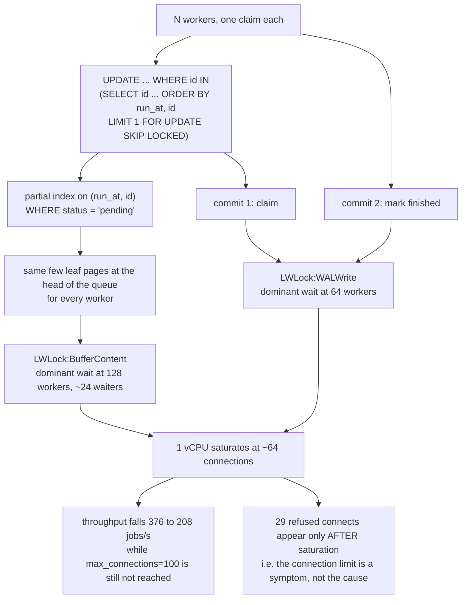

<!--
entry-meta
date: 2026-11-08
type: daily-diff
category: Daily Diff
title: Daily Diff — 2026-11-08
slug: janusgraph-edge-serializer-column-layout
-->

# Daily Diff — 2026-11-08

**2026-11-08 · Daily Diff Digest**

## There is no 2026-11-08 edition, and no 2026-11-07 one either

Checked at ~03:35 UTC on 2026-11-08:

- `https://tdd.cat/` served the **2026-11-06** edition, 52 stories, header dated "Friday, November 6, 2026".
- `https://tdd.cat/archive/` reported **131 editions**, newest **2026-11-06**. November 2026 is listed as `11-01` through `11-06` only — no `11-07`, no `11-08`.
- `https://tdd.cat/2026-11-07/` returned a client error; nothing of the page was retrieved.

So today's edition has not published, and neither has yesterday's. **The 2026-11-06 edition was already digested in full by lesson 09's digest on 2026-11-07** (deep dive: Infino's coordinator-free 128-bit id generation), so re-digesting it would duplicate that document.

Two notes for the running record this log keeps on the site's behaviour:

- **The front page has caught up to the archive.** For the two previous runs the archive led the front page by one and then two days; today both report the same maximum. The rule recorded on 2026-11-05 — *front page authoritative for "newest available", `/archive/` consulted only to notice a larger maximum* — held, and this run is the first time it found no discrepancy.
- **The filter-bar rendering artifact appeared for the fifth time in six runs:** the HN filter bar read "No stories match the selected filters in today's edition" while the header counted 52 and all 52 were present below it. Must-Read / Recommended tags were unreadable again.

## Instead: one item from 2026-11-06 that lesson 09 did not cover

Rather than leave this document a stub, one genuinely uncovered item from the newest available edition, chosen because it sits closest to this log's subject matter. This is the only item covered here, and it is explicitly not a second pass over the edition.

**Item 44 of 52 — "Postgres skip locked queues saturate CPU before connection limits"** (garbagecollected.io). Relevant to the paused PostgreSQL track, and a clean example of a benchmark whose headline conclusion is the opposite of the folklore.

### What was measured

| | |
|---|---|
| Database | PostgreSQL 18 in Docker, **capped at 1 CPU / 1 GB**, `shared_buffers` 256 MB, `max_connections` at the default **100** |
| Schema | `jobs(status, run_at, locked_at, finished_at)` with a **partial index on `(run_at, id) WHERE status = 'pending'`** |
| Claim | `UPDATE` whose subquery uses `FOR UPDATE SKIP LOCKED`, 100 ms simulated work, second `UPDATE` to finish |
| Workers | Python threads in one process **outside** the container, one connection each, doubling 1 → 128 |
| Procedure | queue rebuilt to 500,000 pending rows per step, `VACUUM ANALYZE` + `CHECKPOINT`, 20 s per step, cgroup sampled every 0.5 s, `pg_stat_activity` on a side connection |

### The numbers

One connection per worker:

| Workers | Jobs/s | p50 | p99 | PG CPU | Failed connects |
|---:|---:|---:|---:|---:|---:|
| 1 | 9 | 9.6 ms | 13.2 ms | 6% | 0 |
| 32 | 292 | 7.8 ms | 24.7 ms | 25% | 0 |
| 64 | 376 | 45.2 ms | 393 ms | 86% | 0 |
| 128 | **208** | 318 ms | 1588 ms | **100%** | **29** |

With a shared pool of 20 connections:

| Workers | Jobs/s | p50 | p99 | PG CPU | Failed connects |
|---:|---:|---:|---:|---:|---:|
| 32 | 259 | 13.3 ms | 124 ms | 47% | 0 |
| 64 | 515 | 15.2 ms | 167 ms | 62% | 0 |
| 128 | **652** | 65.6 ms | 360 ms | 98% | 0 |

### The mechanism, and what it actually shows

- **Throughput goes down, not up, past the knee.** 376 jobs/s at 64 workers, 208 at 128 — a 45% regression from adding workers. The ceiling arrives at **64 connections against a `max_connections` of 100**, so the configured connection limit is never the binding constraint; it only shows up afterwards as 29 refused connects once the server is already CPU-saturated.
- **Memory is not it.** The container peaked near 560 MB of 1 GB, mostly page cache. Per-connection memory went from 11 MB at one worker to 183 MB at ~100 connections — roughly **2 MB per backend**, which on a 1 GB box is real but not the wall.
- **At 64 workers the top wait is `LWLock:WALWrite`.** Each job writes WAL **twice** — once to claim, once to finish — and the flushes serialise. This is the part most queue-on-Postgres advice misses: the cost is not the row lock, it is that a two-update claim/complete protocol doubles the commit rate for the same useful work.
- **At 128 workers it shifts to `LWLock:BufferContent`**, with ~24 backends waiting at once. The author attributes it to the **head-of-queue pages**: every worker's `ORDER BY run_at, id LIMIT 1` walks the same end of the same partial index, so `SKIP LOCKED` removes the *logical* contention between workers while leaving all of them pinned to the same few physical buffers. That is the structural point — `SKIP LOCKED` makes the queue correct without making it distributed.
- **Pooling moves the ceiling, it does not remove it.** 20 shared connections at 128 workers gave 3.1× the throughput and cut p99 by 4.4×. But p99 is *worse* than unpooled from 32 workers on, because workers now queue for a connection; and the Python client itself used a full core at 128 workers, so part of the remaining ceiling is client-side and not attributable to Postgres at all.

### Caveats the article states, and one it does not

Stated: a single run per step, treated as indicative; one core and one gigabyte; table bloat from accumulated rows deferred to a follow-up; the recommendation for multi-machine workers is a server-side pooler such as PgBouncer.

Not stated, and worth holding onto: **the article describes `SKIP LOCKED` only behaviourally** — two workers claiming at once ignore each other's rows — and never touches the row-lock or lock-manager internals. So the `BufferContent` attribution is an inference from wait-event names plus the access pattern, not from anything that identifies the page. Confirming it would mean reading `pg_buffercache` or `pg_stat_statements` alongside the wait events, which nothing here does. The paused PostgreSQL track resumes at **lesson 11, the heavyweight lock manager**, which is exactly the layer that would settle it.

## Sources

- https://tdd.cat/ — front page on 2026-11-08, serving the 2026-11-06 edition (52 stories)
- https://tdd.cat/archive/ — 131 editions, newest 2026-11-06
- https://tdd.cat/2026-11-06/ — the 2026-11-06 edition page, 52 stories, no next-edition note
- https://tdd.cat/2026-11-07/ — client error, no edition
- https://garbagecollected.io/posts/postgres-task-queue-where-it-breaks/ — the deep-dive item's source
