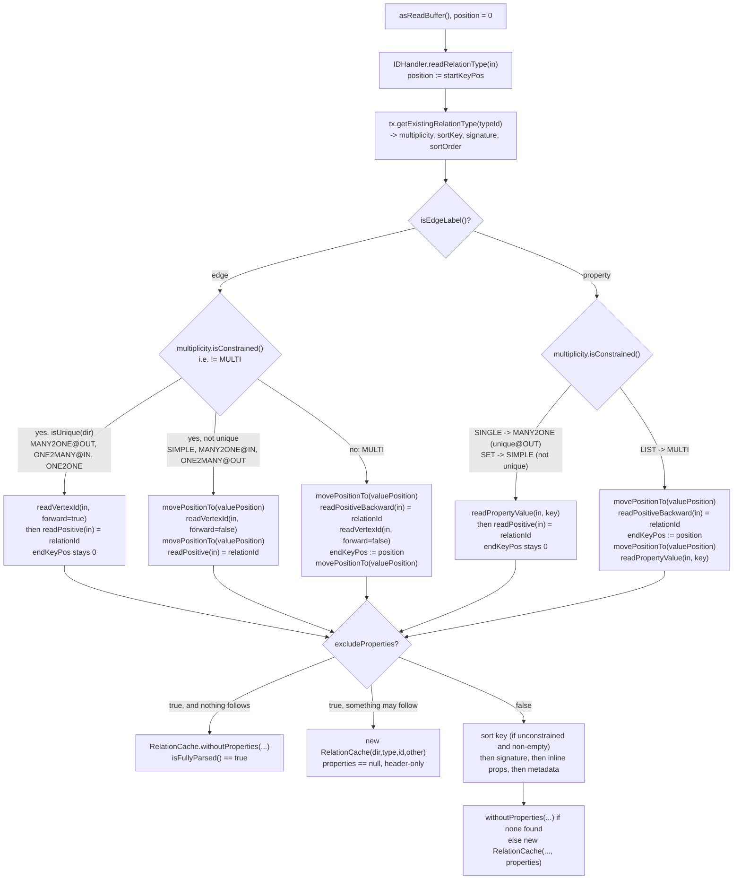
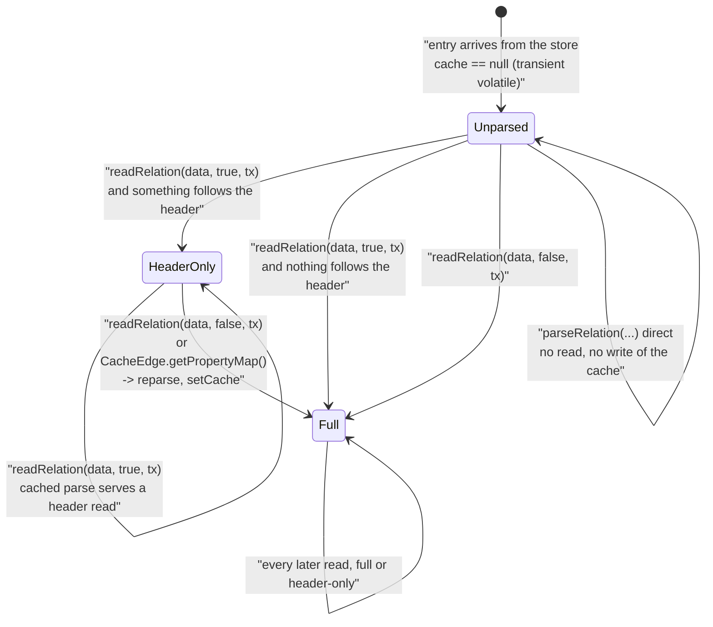

<!--
entry-meta
date: 2026-11-09
type: lesson
track: JanusGraph
lesson: 11
category: Database Internals
title: EdgeSerializer.parseRelation and RelationCache — reading the column backwards
slug: janusgraph-parse-relation-relation-cache
-->

# `EdgeSerializer.parseRelation` and `RelationCache` — reading the column backwards

**2026-11-09 · JanusGraph Track · Lesson 11 of 28**

> All source read at pinned commit [`a59ae8d8`](https://github.com/JanusGraph/janusgraph/tree/a59ae8d8024207598eada34998d867617df51adf) (2026-10-28). Mid-Part, so the re-pin question is not available this run; the next boundary is after lesson 13. **Staying on `a59ae8d8`.**

## Where This Fits

- **Lesson 10** ([`2026-11-08-janusgraph-edge-serializer-column-layout`](../2026-11-08-janusgraph-edge-serializer-column-layout/README.md)) took `writeRelation` apart: one buffer, one `valuePosition`, six storage contracts chosen by multiplicity × direction, the six-band relation-type prefix, `DESC` as a one's complement over `[keyStartPos, keyEndPos)`, and the tail ids written **backward** so a reader walking from the end of the column finds them. It left one question for today, in its `Next Steps` 1: **which of the six layouts can be fully parsed from the header alone?**
- **Today** is lesson 10 read backwards. `parseRelation` ([`EdgeSerializer:104-210`](https://github.com/JanusGraph/janusgraph/blob/a59ae8d8024207598eada34998d867617df51adf/janusgraph-core/src/main/java/org/janusgraph/graphdb/database/EdgeSerializer.java#L104-L210)) is the only code in the tree that has to re-derive a relation from bytes with no length headers to help it, and it does so by **moving a single cursor back and forth across the entry** rather than streaming it. Today also covers `RelationCache`, the parse's output and the per-entry memo that decides whether the parse happens again — rewritten five weeks before the pinned commit, in [`29c0b18a`](https://github.com/JanusGraph/janusgraph/commit/29c0b18aadfbd76a8ab804cea6fdf06d1cf8aef1) (2026-10-02), to fix a reparse bug. Reading the fix is most of the lesson, and auditing it turns up one path it could not reach.
- **Sets up** lesson 12 (`StandardSerializer`), which owns the attribute bytes that `readPropertyValue` treats as opaque here and that the ASC sort-key read, as we'll see, trusts without bounding; and lesson 19/20, where `RelationCache`'s header-only state is what makes lazy adjacency loading possible at all.

Assumed known from lesson 10: the six column layouts, `valuePosition`, the band/prefix encoding, `InlineType`'s two booleans, and that `writeUnsigned` sets its STOP bit on the **last** byte (hence the one order inversion at every length boundary). Assumed known from lesson 09: the default conflict-avoidance tag is 4 bits wide and always zero, so every count JanusGraph assigns is a multiple of 16 and the first `NormalVertex` id in a default graph is 4096.

---

## 1. The shape of the problem: no length headers, two cursors' worth of work, one cursor

An edgestore cell arrives as a single `StaticArrayEntry` — one `byte[]`, with `valuePosition` marking where the column ends and the value begins ([`StaticArrayEntry`](https://github.com/JanusGraph/janusgraph/blob/a59ae8d8024207598eada34998d867617df51adf/janusgraph-core/src/main/java/org/janusgraph/diskstorage/util/StaticArrayEntry.java), built by `of(column, value, handler)` which arraycopies both halves into one array and sets `valuePos = size(column)`). `parseRelation` opens it with `data.asReadBuffer()` and gets a [`ReadArrayBuffer`](https://github.com/JanusGraph/janusgraph/blob/a59ae8d8024207598eada34998d867617df51adf/janusgraph-core/src/main/java/org/janusgraph/diskstorage/util/ReadArrayBuffer.java) — a view over the same array with one mutable `int position`, plus `movePositionTo(int)` and `hasRemaining()`.

That is the whole toolkit. There is no framing anywhere in the cell: no field count, no field lengths, no offset table. Everything is recovered from three sources, in this order:

| Source | What it tells the parser | Cost |
|---|---|---|
| The first 1–3 bytes | relation-type id + direction + system/invisible band, via `IDHandler.readRelationType` | self-delimiting (continue bit) |
| The **schema** (`tx.getExistingRelationType(typeId)`) | multiplicity, sort key ids, signature ids, sort order | a type lookup per cell |
| `data.getValuePosition()` | the single boundary between column and value | free, stored on the entry |

The schema is load-bearing. `parseRelation` cannot know whether byte 3 of a column is the start of a sort key, an adjacent vertex id or a property value until it has looked up the type and asked it for `multiplicity()` and `getSortKey()` ([`:113-116`](https://github.com/JanusGraph/janusgraph/blob/a59ae8d8024207598eada34998d867617df51adf/janusgraph-core/src/main/java/org/janusgraph/graphdb/database/EdgeSerializer.java#L113-L116)). **The bytes are not self-describing; the schema is part of the format.** That is why a schema change to a sort key or a signature is a storage-format change in JanusGraph, and why `ManagementSystem` creates a whole new relation type for a vertex-centric index rather than mutating the base one (lesson 10).

## 2. The cursor walk, branch by branch

Here is the complete control flow of the header parse, with the exact position moves. `startKeyPos` is set at [`:120`](https://github.com/JanusGraph/janusgraph/blob/a59ae8d8024207598eada34998d867617df51adf/janusgraph-core/src/main/java/org/janusgraph/graphdb/database/EdgeSerializer.java#L120) immediately after the prefix; `endKeyPos` starts at 0 and is only ever written on the unconstrained branches.



Three things fall out of this picture that are not obvious from the write side.

**(a) The cursor visits `valuePosition` up to three times.** On the constrained-not-unique edge branch ([`:128-132`](https://github.com/JanusGraph/janusgraph/blob/a59ae8d8024207598eada34998d867617df51adf/janusgraph-core/src/main/java/org/janusgraph/graphdb/database/EdgeSerializer.java#L128-L132)) it jumps there, reads the vertex id **backward** out of the column, jumps back to exactly the same offset, and reads the relation id **forward** out of the value. Two different encodings meeting at one offset, read in opposite directions. That is `valuePosition` doing the work a length header would do in a self-describing format: it is simultaneously the exclusive end of the column and the inclusive start of the value, and the backward reader uses it as its *origin*, not its destination.

**(b) `endKeyPos` is exclusive, and the comment says otherwise.** The comment at [`:169`](https://github.com/JanusGraph/janusgraph/blob/a59ae8d8024207598eada34998d867617df51adf/janusgraph-core/src/main/java/org/janusgraph/graphdb/database/EdgeSerializer.java#L169) reads *"after reading the ids, we are on the last byte of the key"*. We are not: `readUnsignedBackward` ends with `in.movePositionTo(position)` where `position` is the index of the **stop byte of the backward-encoded value**, which is one *past* the last byte of the sort key. The arithmetic is right — `keyLength = endKeyPos - startKeyPos` is exactly the sort-key byte count — and the comment is off by one in its wording. Worth a one-line doc fix, nothing more.

**(c) The six layouts collapse into three parse shapes, not six.** `Multiplicity.isConstrained()` is literally `this != MULTI` ([`Multiplicity`](https://github.com/JanusGraph/janusgraph/blob/a59ae8d8024207598eada34998d867617df51adf/janusgraph-core/src/main/java/org/janusgraph/core/Multiplicity.java)), so **`SIMPLE` is constrained** and `isUnique` is false for it in both directions. Writing lesson 10's table out per direction:

| Type | Written at | Column | Value | `endKeyPos` | Parse shape |
|---|---|---|---|---|---|
| `MANY2ONE` edge | OUT | `P` | `vid→ rid→` | 0 | forward-only |
| `MANY2ONE` edge | IN | `P vid←` | `rid→` | 0 | pivot at `valuePosition` |
| `ONE2MANY` edge | OUT | `P vid←` | `rid→` | 0 | pivot at `valuePosition` |
| `ONE2MANY` edge | IN | `P` | `vid→ rid→` | 0 | forward-only |
| `ONE2ONE` edge | OUT, IN | `P` | `vid→ rid→` | 0 | forward-only |
| `SIMPLE` edge | OUT, IN | `P vid←` | `rid→` | 0 | pivot at `valuePosition` |
| `MULTI` edge | OUT, IN | `P S vid← rid←` | signature + props | set | full backward walk |
| `SINGLE` property (→`MANY2ONE`) | OUT | `P` | `value rid→` | 0 | forward-only |
| `SET` property (→`SIMPLE`) | OUT | `P value` | `rid→` | 0 | forward-only¹ |
| `LIST` property (→`MULTI`) | OUT | `P S rid←` | `value` + props | set | full backward walk |

¹ `SET` is the one case where a constrained relation's parse reads straight *through* `valuePosition` without jumping: [`:147-148`](https://github.com/JanusGraph/janusgraph/blob/a59ae8d8024207598eada34998d867617df51adf/janusgraph-core/src/main/java/org/janusgraph/graphdb/database/EdgeSerializer.java#L147-L148) reads the value out of the column and then the relation id out of the value with a plain `readPositive`, because the two halves are contiguous in one `byte[]`. The column/value split is a storage-engine concept; the parser mostly ignores it and treats the cell as one buffer. The only places it matters are the four `movePositionTo(data.getValuePosition())` calls.

**So the answer to lesson 10's question is: it is not the layout that decides.** The header parse completes the relation for *any* of the ten rows above; what decides whether a header-only parse is *as good as* a full one is the four-way test at [`:201-202`](https://github.com/JanusGraph/janusgraph/blob/a59ae8d8024207598eada34998d867617df51adf/janusgraph-core/src/main/java/org/janusgraph/graphdb/database/EdgeSerializer.java#L201-L202), which is §5. The layout only constrains it in one direction: the two unconstrained rows are the only ones that can carry a sort key, and when they do, they are permanently excluded.

## 3. THE finding: the backward encoding is the only order-preserving varint in the tree, and it costs a hard 3-byte floor

Lesson 10 established *that* the tail ids are written backward, and read it as a readability trick: a reader starting at `valuePosition` and walking left finds the relation id, then the adjacent vertex id, with no length header in between. That is true but it is the smaller half of the reason.

`VariableLong.writeUnsignedBackward` / `readUnsignedBackward` ([`VariableLong`](https://github.com/JanusGraph/janusgraph/blob/a59ae8d8024207598eada34998d867617df51adf/janusgraph-core/src/main/java/org/janusgraph/graphdb/database/idhandling/VariableLong.java)) lay a value out as:

```
byte 0:  [ stop=1 (1 bit) | numBytes-3 (3 bits) | value bits (4) ]
byte 1..n-1: [ 0 (1 bit) | value bits (7) ]
```

The length lives in the **first** byte. Compare `writeUnsigned`, whose STOP bit marks the **last** byte — the structural cause of lesson 10's single order inversion (`1023 → 1024`, `7f fe` vs `70 10 80`) and of one such inversion at every byte-length boundary. Putting the length first inverts that property. I re-implemented `unsignedBackwardLength`, `writeUnsignedBackward` and `readUnsignedBackward` line-for-line from the pinned source and swept them:

- **Round trip and the capacity law hold for every value tested** — all of `0..299999` plus `2^k ± {0,1,2}` for `k = 5..62`: 0 failures, and `unsignedBitLength(v) ≤ 4 + 7·(numBytes−1)` always. The capacity is **`4 + 7·(n−1)`**, not `7n`: byte 0 donates 3 of its 7 payload bits to the length field, and `readUnsignedBackward` masks the first byte with `& 0x0F` to match.
- **Zero order inversions across `0..400000` consecutive values**, comparing the encodings as forward-lexicographic byte strings. The boundary that breaks the forward encoding is exactly the one the backward encoding gets right: `262143 → 262144` encodes as `8f 7f 7f → 90 10 00 00`, and `0x8f < 0x90` because the length field is in the high nibble of byte 0. **The backward encoding is genuinely byte-order preserving; the forward prefix encoding is only grouped.** The javadoc's claim (*"the value is aligned to the left to ensure that this encoding is byte order preserving"*) is correct, and it is the only such claim in the id-handling package that survives a sweep.

That is what licenses `getQuery`'s pseudo-sort-keys. Lesson 10 noted that `ImplicitKey.ADJACENT_ID` and `ImplicitKey.JANUSGRAPHID` are addressable as extended sort-key positions and that `:466-471` pins their only legal slots. **The reason they are addressable is this encoding.** A range over the adjacent vertex id works only because the backward-written `vid←` bytes sort in forward-lexicographic order exactly as the ids order — which the forward encoding would not have given. The tail is not written backward for the reader's convenience; it is written backward so that it can be used as a sort key.

The price, exactly:

```
  value | fwd | bwd | bytes
      0 |   1 |   3 | fwd=80            bwd=80 00 00
     15 |   1 |   3 | fwd=8f            bwd=80 00 0f
    127 |   1 |   3 | fwd=ff            bwd=80 00 7f
    128 |   2 |   3 | fwd=01 80         bwd=80 01 00
   4096 |   2 |   3 | fwd=20 80         bwd=80 20 00      <- first default-graph vertex id
 262143 |   3 |   3 | fwd=0f 7f ff      bwd=8f 7f 7f
 262144 |   3 |   4 | fwd=10 00 80      bwd=90 10 00 00
```

- **A hard 3-byte floor**, from `Math.max(3, ...)` in `unsignedBackwardLength`. Every backward-written value costs at least 3 bytes, where the forward encoding costs 1 for anything under 128.
- Beyond the floor, the 3-bit length field costs **one extra byte for 3 of every 7 bit-lengths** (bitLength ≡ 5, 6, 0 mod 7). Length boundaries sit at bitLength 19, 26, 33, 40, 47, 54, 61 — so a 3-byte backward value covers up to 2^18−1 and a 3-byte forward value up to 2^21−1.
- Chaining onto lesson 09's finding that default counts are multiples of 16: for `NormalVertex` ids at `partitionBits = 5`, counts 16 through 160,000,000 cost **38 bytes backward against 34 forward, +12%**, with the +1 landing at counts 16, 32, 1600 and 160000.
- Concretely, **a plain `MULTI` edge with no sort key is an 8-byte column and an empty value** at the first default ids: 2 bytes of prefix (`70 a0`, from lesson 10) + 3 bytes `vid←` + 3 bytes `rid←`, against a 6-byte forward-encoded ideal. On a 100M-edge graph stored twice, that is ~400 MB of length fields — on top of lesson 10's ~200 MB of prefix padding from the same four tag bits.

`MULTI` is the default multiplicity for `makeEdgeLabel(...).make()`, so **this is the common case, not a corner.** And it is not a regression or an oversight: the extra bytes buy a sort order that vertex-centric queries depend on. It is a deliberate trade that no comment in the file states.

One more structural fact that falls out: `IDHandler.readVertexId(in, forward=false)` peeks `in.getByte(in.getPosition() - 1)` for `STRING_ID_MARKER` (`0x80`) to decide long-vs-string. For a backward-written long, the byte at `position-1` is the **last** byte written, which is `0 | (0x7F & value)` and therefore always `≤ 0x7f` — the stop bit sits at the *low* address, the opposite end from where the peek looks. So the disambiguation can never misfire on a long. It follows that `VariableString.writeBackward` must place a high-bit byte at the **high** address; that is the invariant lesson 12 should verify rather than assume, since custom string vertex ids ride this path.

### A cosmetic one, while we are here

`unsignedBackwardLength` is

```java
return Math.max(3, 1 + (bitLength <= 4 ? 0 : (1 + (bitLength - 5) / 7)));
```

The inner expression returns a value below 3 for **every bitLength from 1 to 11** (11 of 64), so `Math.max(3, ...)` discards it there, and the `bitLength <= 4 ? 0` special case can therefore never change a result. The whole function is `Math.max(3, ceil((bitLength + 3) / 7))` — verified equal for all 64 bit lengths. Dead arithmetic, no behavioural consequence.

## 4. `RelationCache`: a three-state memo whose middle state is a `null`

`parseRelation` returns a [`RelationCache`](https://github.com/JanusGraph/janusgraph/blob/a59ae8d8024207598eada34998d867617df51adf/janusgraph-core/src/main/java/org/janusgraph/graphdb/relations/RelationCache.java) — five fields, of which four are final scalars (`direction`, `typeId`, `relationId`, `other`) and one is `LongObjectHashMap<Object> properties`. The whole design of the reparse fix lives in that last field's **three** possible values:

| `properties` | Produced by | `isFullyParsed()` | `hasProperties()` | Meaning |
|---|---|---|---|---|
| `null` | 4-arg ctor ([`:52-55`](https://github.com/JanusGraph/janusgraph/blob/a59ae8d8024207598eada34998d867617df51adf/janusgraph-core/src/main/java/org/janusgraph/graphdb/relations/RelationCache.java#L52-L55)), from `EdgeSerializer:208` | `false` | `false` | header-only; properties unknown |
| `EMPTY` (shared) | `withoutProperties` ([`:61-64`](https://github.com/JanusGraph/janusgraph/blob/a59ae8d8024207598eada34998d867617df51adf/janusgraph-core/src/main/java/org/janusgraph/graphdb/relations/RelationCache.java#L61-L64)) | `true` | `false` | fully parsed, found none |
| non-empty map | 5-arg ctor, from `EdgeSerializer:200` | `true` | `true` | fully parsed, has properties |

`isFullyParsed()` is `properties != null` ([`:77-79`](https://github.com/JanusGraph/janusgraph/blob/a59ae8d8024207598eada34998d867617df51adf/janusgraph-core/src/main/java/org/janusgraph/graphdb/relations/RelationCache.java#L77-L79)); `hasProperties()` is `properties != null && !properties.isEmpty()` ([`:81-83`](https://github.com/JanusGraph/janusgraph/blob/a59ae8d8024207598eada34998d867617df51adf/janusgraph-core/src/main/java/org/janusgraph/graphdb/relations/RelationCache.java#L81-L83)). **Rows 1 and 2 are indistinguishable through `hasProperties()`, and that was the bug.**

### The bug, as the commit states it

[`29c0b18a`](https://github.com/JanusGraph/janusgraph/commit/29c0b18aadfbd76a8ab804cea6fdf06d1cf8aef1) (2026-10-02, Oleksandr Porunov, fixing #4995) describes the old behaviour precisely: whether the cached parse already held properties was read off `hasProperties()`, which is false for a header-only parse and for a full parse that found none, alike. So a relation **without** properties — a vertex property without meta-properties, an edge without properties — was re-parsed *in full* on every read of its properties. The commit lists the reads that hit it: `properties()` of a vertex property, `property(key)` or `has(key)` on an edge, and every vertex Gremlin Server returns with its properties, because the GraphBinary and GraphSON serializers read each vertex property's meta-properties.

Worth sitting with the shape of this bug, because it is a pattern and not an accident. The sentinel for "absent" and the sentinel for "empty" were the same value, and the cheapest case in the data (no properties — the overwhelming majority of relations) was exactly the case that collided. The fix does not add a boolean; it promotes `null` to a meaningful third state and moves the test from "are there any" to "did we look". The 4-arg constructor's whole purpose is now to produce that `null`.

### Three guards, and that is the entire enforcement

`get(long)` ([`:67-69`](https://github.com/JanusGraph/janusgraph/blob/a59ae8d8024207598eada34998d867617df51adf/janusgraph-core/src/main/java/org/janusgraph/graphdb/relations/RelationCache.java#L67-L69)), `numProperties()` ([`:85-87`](https://github.com/JanusGraph/janusgraph/blob/a59ae8d8024207598eada34998d867617df51adf/janusgraph-core/src/main/java/org/janusgraph/graphdb/relations/RelationCache.java#L85-L87)) and `propertyIterator()` ([`:97-101`](https://github.com/JanusGraph/janusgraph/blob/a59ae8d8024207598eada34998d867617df51adf/janusgraph-core/src/main/java/org/janusgraph/graphdb/relations/RelationCache.java#L97-L101)) all dereference `properties` unguarded. On a header-only cache each one is a bare `NullPointerException` with no message. The javadoc at `:71-76` documents the contract (*"Only a fully parsed cache answers `get(long)`, `numProperties()` and iteration"*), and exactly three call sites enforce it:

1. `EdgeSerializer.readRelation` [`:85`](https://github.com/JanusGraph/janusgraph/blob/a59ae8d8024207598eada34998d867617df51adf/janusgraph-core/src/main/java/org/janusgraph/graphdb/database/EdgeSerializer.java#L85) — `if (map == null || !(parseHeaderOnly || map.isFullyParsed()))`
2. `CacheEdge.getPropertyMap()` — `if (map == null || !map.isFullyParsed()) map = RelationConstructor.readRelationCache(data, tx())`
3. `CacheVertexProperty.getPropertyMap()` — character-for-character the same, under the same comment (the class carries the `//############## Similar code as CacheProperty but be careful when copying` warning that this duplication has earned)

`RelationCacheTest` asserts `isFullyParsed()` and `hasProperties()` on a header-only cache; it does not assert what `get`, `numProperties` or iteration do there. So the invariant is upheld by three hand-written conditions and documented in prose, with no test and no exception message behind it. Making `get`/`numProperties`/`propertyIterator` throw `IllegalStateException("relation was parsed header-only")` is a small, safe hardening change — **PR candidate 19.**

Two smaller observations on the same class:

- The constructor's normalisation `(properties == null || properties.size() > 0) ? properties : EMPTY` ([`:46`](https://github.com/JanusGraph/janusgraph/blob/a59ae8d8024207598eada34998d867617df51adf/janusgraph-core/src/main/java/org/janusgraph/graphdb/relations/RelationCache.java#L46)) has an **unreachable branch from inside `parseRelation`**: `properties` is lazily allocated by the first `put` ([`:236-240`](https://github.com/JanusGraph/janusgraph/blob/a59ae8d8024207598eada34998d867617df51adf/janusgraph-core/src/main/java/org/janusgraph/graphdb/database/EdgeSerializer.java#L236-L240)), so a non-null map always has size ≥ 1 and `:198-200` routes the empty case to `withoutProperties` anyway. The `: EMPTY` arm only fires for external callers passing an allocated-but-empty map.
- `propertyIterator()` returns `Collections.emptyIterator()` rather than iterating `EMPTY`, and the comment gives the real reason: *"Iterating an HPPC map writes its iteration seed, and the empty map is shared by every relation without properties."* `EMPTY` is a single static mutable `LongObjectHashMap` ([`:32`](https://github.com/JanusGraph/janusgraph/blob/a59ae8d8024207598eada34998d867617df51adf/janusgraph-core/src/main/java/org/janusgraph/graphdb/relations/RelationCache.java#L32)) shared across every property-less relation in the JVM; HPPC's hash-order mixing writes instance state on `iterator()`, so iterating it from many threads would be a (benign but real) data race. This is the kind of detail that only shows up when a shared immutable sentinel turns out not to be immutable.

### The cache lifecycle



The condition at `:85` is worth checking against all four quadrants, because it is terse: `map == null || !(parseHeaderOnly || map.isFullyParsed())`.

| cached state | caller wants | reparse? | correct? |
|---|---|---|---|
| `null` | either | yes | yes |
| header-only | header | no | yes — the header fields are already there |
| header-only | full | yes | yes — properties unknown |
| full | header | no | yes — a full cache is a superset |
| full | full | no | yes |

Sound. Note that the **self-transition on `Unparsed` is the hole**: `parseRelation` neither reads nor writes `data.setCache(...)`. Only `readRelation` memoises. That is §6.

## 5. The four-way completeness test, and what the sort key does to it

The header-only branch returns a *fully parsed* cache when, and only when, all four of these hold ([`:201-202`](https://github.com/JanusGraph/janusgraph/blob/a59ae8d8024207598eada34998d867617df51adf/janusgraph-core/src/main/java/org/janusgraph/graphdb/database/EdgeSerializer.java#L201-L202)):

```java
} else if (!in.hasRemaining() && keySignature.length == 0 && def.getSignature().length == 0
    && !hasPropertyMetaData(data)) {
```

Each clause rules out one thing a full parse would have read:

1. **`!in.hasRemaining()`** — no inline properties. After the header parse the cursor sits wherever that branch left it, and in all ten rows of §2's table that position is the start of the signature-and-inline-properties region. Verify this per branch: the forward-only branches end after `readPositive(relationId)` in the value; the pivot branches end at the same place; the two backward branches end with an explicit `movePositionTo(valuePosition)`. In every case, `hasRemaining()` is asking the right question.
2. **`keySignature.length == 0`** — no sort key. For the three constrained parse shapes this is *guaranteed* by the write-side `assert !multiplicity.isConstrained() || sortKey.length==0` at `EdgeSerializer:302` (lesson 10: one of the three places "sort key ⟺ unconstrained multiplicity" is enforced, and the only one in the write path). For the unconstrained shapes it is a real test.
3. **`def.getSignature().length == 0`** — no signature. A signature field is written after the header *even when the relation has no value for it*, because `writeInlineTypes` emits one `writePropertyValue` per signature id unconditionally. So a signature type can never be complete at the header, with or without properties.
4. **`!hasPropertyMetaData(data)`** — no entry metadata that a full parse turns into a property. Note this is **not** `data.hasMetaData()`: [`:212-224`](https://github.com/JanusGraph/janusgraph/blob/a59ae8d8024207598eada34998d867617df51adf/janusgraph-core/src/main/java/org/janusgraph/graphdb/database/EdgeSerializer.java#L212-L224) checks membership in `ImplicitKey.MetaData2ImplicitKey`, so a `TIMESTAMP` or `TTL` keeps the parse header-only while a `ROW_KEY` — which a grouped CQL multi-key read attaches, and which stands for no property — does not. This distinction is the subtlest part of the fix and the part the test spends the most assertions on.

**The consequence for vertex-centric indexes is permanent.** Lesson 10 established that `buildRelationTypeIndex` creates a new `Multiplicity.MULTI` relation type carrying the sort keys, and that an edge with *N* vertex-centric indexes is `2 + N` full columns. Clause 2 means **every one of those N index-replica columns fails the completeness test by construction** — a sort key is the whole point of an index type — so every index replica is parsed header-only on load and parsed *again* on the first property read. The #4995 fix helps the base columns and cannot help the replicas. That is not a defect; it is the shape of the trade, and it is the reason the benchmark below stresses property-less *base* relations.

`EdgeSerializerTest.testRelationIsFullyParsedOnce` pins the arithmetic exactly ([`EdgeSerializerTest`](https://github.com/JanusGraph/janusgraph/blob/a59ae8d8024207598eada34998d867617df51adf/janusgraph-test/src/test/java/org/janusgraph/graphdb/serializer/EdgeSerializerTest.java)):

```java
assertEquals(8 * 2 * 2 + 2 * 2 * 2 + 4 * 2 + 2, seen.entries);   // 50
assertEquals(seen.entries / 2, seen.withProperties);             // 25
assertEquals(7 * 2 + 3, seen.completeAtTheHeader);               // 17
```

Reconstructing those numbers is the fastest way to check you have the model right:

- **50 entries.** 8 edge labels (5 multiplicities + `signed` + `indexedasc` + `indexeddesc`) × 2 (with and without a property) × 2 positions = 32 base edge entries; plus the 2 indexed labels × 2 × 2 positions × 1 index type each = 8 replica entries; plus 4 property keys (3 cardinalities + `signedProperty`) × 2 × 1 position = 8 base property entries; plus the `LIST` key's 1 property index × 2 = 2. Total 50.
- **17 complete at the header.** Of the 8 labels, `signed` has a signature and is out by clause 3; the other 7, at both positions, in their without-a-property variant = 14. Of the 4 keys, `signedProperty` is out by clause 3; the other 3 = 3. Every replica entry is passed `completeAtTheHeader = false` by the caller, correctly, by clause 2. 14 + 3 = 17.
- Note that `indexedasc` and `indexeddesc` *base* entries **are** among the 17: the base type has no sort key, only its index type does.

And the metadata block at the end of `checkParsedOnce` is the only test in the tree that pins clause 4: a `TIMESTAMP` makes a header parse incomplete and shows up as `ImplicitKey.TIMESTAMP` after the full parse; a `ROW_KEY` does not; and a `ROW_KEY` set *beside* a `TIMESTAMP` does not hide it.

## 6. Second finding: the OLAP path cannot reach the cache at all, and parses every column twice

`RelationCache` is memoised on the entry — `private transient volatile RelationCache cache` in `StaticArrayEntry`, with `getCache()`/`setCache()`. But the memo is applied by `EdgeSerializer.readRelation`, and **`readRelation` is not on the `RelationReader` interface.** [`RelationReader`](https://github.com/JanusGraph/janusgraph/blob/a59ae8d8024207598eada34998d867617df51adf/janusgraph-core/src/main/java/org/janusgraph/graphdb/database/RelationReader.java) declares exactly one method:

```java
RelationCache parseRelation(Entry data, boolean parseHeaderOnly, TypeInspector tx);
```

Its javadoc was updated by the same commit to document the header-only-can-be-complete rule. The caching wrapper was not added to it.

The consumers split accordingly:

| Consumer | Entry point | Cache? |
|---|---|---|
| `RelationConstructor.readRelation(...)` (the OLTP read path) | `tx.getEdgeSerializer().readRelation(data, true/false, tx)` | yes |
| `RelationConstructor.readRelationCache(data, tx)` | `readRelation(data, false, tx)` | yes |
| `ModificationDeserializer.parseRelation(...)` (transaction-log replay) | `tx.getEdgeSerializer().readRelation(relEntry, false, tx)` | yes |
| `JanusGraphVertexDeserializer.readHadoopVertex(...)` (Hadoop/Spark OLAP) | `setup.getRelationReader().parseRelation(data, false, typeManager)` | **no** |

[`JanusGraphVertexDeserializer`](https://github.com/JanusGraph/janusgraph/blob/a59ae8d8024207598eada34998d867617df51adf/janusgraph-hadoop/src/main/java/org/janusgraph/hadoop/formats/util/JanusGraphVertexDeserializer.java) holds a `RelationReader` from `setup.getRelationReader()`, so it has no `readRelation` to call. And it iterates the same `Iterable<Entry>` **twice**:

- the first loop walks every entry to find the vertex-label relation, calling `parseRelation(data, false, typeManager)` and then reading only `relation.typeId` and `relation.getOtherVertexId()`;
- the second loop walks every entry again, calling `parseRelation(data, false, typeManager)` a second time, and builds the `StarGraph` vertex.

So for every edgestore column in an OLAP scan: **two full parses, zero memoisation.** Both are avoidable, independently:

1. The first loop needs only the type id and, for the one matching column, the other end. `parseRelation(data, true, typeManager)` would serve it — and for the type id alone, `EdgeSerializer.parseTypeId(data)` already exists and reads only the 1–3 header bytes. Today the loop does a full parse of *every* column, including the sort key, the signature and every inline property, to find one vertex-label column.
2. The second parse is precisely what #4995 was about. It is unreachable from here only because the memo lives on a method the interface does not expose.

Hoisting `readRelation` onto `RelationReader` (default method delegating to `parseRelation` for implementations without an entry cache) and switching the label-finding loop to a header-only parse would make an OLAP scan parse each column once instead of twice, and parse the label-finding pass's columns from 1–3 bytes instead of all of them. The cost is one interface change in `janusgraph-core` plus the `janusgraph-hadoop` call sites. **PR candidate 18**, and the most substantial one this lesson turned up.

Worth being careful about one thing before writing that patch: `decodeProperties` guards on `relation.hasProperties()`, which returns `false` for a header-only cache *without* throwing. If the label-finding loop is switched to a header-only parse and the result were ever reused for `decodeProperties`, properties would be silently dropped. In the current code the two loops hold separate local `relation` variables, so there is no such reuse — but it is exactly the kind of coupling that makes the `hasProperties()`-as-completeness-proxy mistake recur, which is the argument for PR candidate 19 (make the header-only cache throw) landing first.

Also checked, and *not* a bug: `ModificationDeserializer`'s `relCache.hasProperties()` sits after an explicit `readRelation(relEntry, false, tx)`, so it is asking "are there any", which is what it means. It is now redundant with `propertyIterator()`'s own empty-map short circuit, nothing worse.

## 7. Third finding: the ASC sort-key read is unbounded, the DESC read is not

The sort-key block ([`:165-175`](https://github.com/JanusGraph/janusgraph/blob/a59ae8d8024207598eada34998d867617df51adf/janusgraph-core/src/main/java/org/janusgraph/graphdb/database/EdgeSerializer.java#L165-L175)) is four lines of position juggling with an asymmetry hiding in it:

```java
int currentPos = in.getPosition();
assert endKeyPos > startKeyPos;
int keyLength = endKeyPos - startKeyPos;
in.movePositionTo(startKeyPos);
ReadBuffer inKey = in;
if (def.getSortOrder() == Order.DESC) inKey = in.subrange(keyLength, true);
properties = readInlineTypes(keySignature, properties, inKey, tx, InlineType.KEY);
in.movePositionTo(currentPos);
```

- **ASC** reads the sort keys **in place**, out of `in` itself, then restores the position. `inKey == in`.
- **DESC** reads them out of a fresh buffer. `ReadArrayBuffer.subrange(length, invert)` delegates to `StaticArrayBuffer.subrange(position, length, invert)`, and with `invert == true` that branch **allocates**: `new byte[length]`, an `arraycopy`, a `(byte)~b` loop, a new `StaticArrayBuffer`, then `.asReadBuffer()` wraps it in a new `ReadArrayBuffer`. Three objects and a copy per DESC relation parse. This is the exact inverse of `WriteByteBuffer.getStaticBufferFlipBytes(keyStartPos, keyEndPos)` on the write side (lesson 10), and like it, it touches only the sort-key window — never the prefix, never the tail.

The asymmetry that matters is not the allocation, it is the **bound**. The DESC buffer's `limit` is exactly `startKeyPos + keyLength`, and `StaticArrayBuffer.require(position, size)` throws `ArrayIndexOutOfBoundsException` past the limit. So if a sort-key serializer ever consumes more bytes than were written — a changed `dataType()`, a serializer version skew, lesson 12's territory — the **DESC path fails loudly** and the **ASC path reads straight into the `vid←`/`rid←` tail region and returns silently wrong sort-key values**, because `in.movePositionTo(currentPos)` at the end discards the evidence. Nothing compares the bytes consumed against `keyLength`.

The fix is one line and allocation-free: `subrange(position, length, false)` returns a **view** (`new StaticArrayBuffer(array, offset+position, offset+position+length)`) with no byte copy, so

```java
ReadBuffer inKey = in.subrange(keyLength, def.getSortOrder() == Order.DESC);
```

would bound the ASC read exactly as the DESC read is bounded, at the cost of two small short-lived objects where ASC currently allocates none. Whether that trade is worth it is a judgement call for the maintainers, but the asymmetry itself is undocumented and untested: `EdgeSerializerTest` builds both an `Order.asc` and an `Order.desc` edge index and asserts parse completeness for both, and asserts nothing about the window bound. **PR candidate 20**, smaller and more arguable than 18.

## 8. Hands-On

All three of these run against `janusgraph-inmemory`, already built from lesson 02. Nothing here needs a backend.

### 8.1 Watch the reparse disappear (the tightest loop)

```bash
cd ~/janusgraph
mvn -pl janusgraph-test -am -DskipTests install -q
mvn -pl janusgraph-test -Dtest=EdgeSerializerTest#testRelationIsFullyParsedOnce test
```

**What to look for:** it should pass. Now break it deliberately, which is the actual exercise. In `RelationCache.java`, change

```java
public boolean isFullyParsed() {
    return properties != null;
}
```

to `return hasProperties();` — i.e. reintroduce the #4995 bug exactly — and re-run. Read the failure messages rather than the count: `checkParsedOnce` builds its `what` string as `relation + " written as " + type + " at position " + position`, so each failure names the layout. You should see `assertSame(full, serializer.readRelation(readFully, true, tx))` fail for every property-less relation, and `assertSame(header, completed)` fail for the 17 that are complete at the header. Revert before moving on.

Then try the *other* plausible-looking fix: leave `isFullyParsed()` alone but change `withoutProperties` to pass `null` instead of `EMPTY`. The test fails differently — `assertTrue(full.isFullyParsed())` now fails for property-less relations even on the full-parse path — which is the clearest demonstration that the fix needed a third state and not a cleverer predicate.

### 8.2 Measure the two reads the fix was about

```bash
mvn -pl janusgraph-benchmark -am -DskipTests install -q
java -jar janusgraph-benchmark/target/benchmarks.jar RelationReparseBenchmark -f 1 -wi 3 -i 5
```

[`RelationReparseBenchmark`](https://github.com/JanusGraph/janusgraph/blob/a59ae8d8024207598eada34998d867617df51adf/janusgraph-benchmark/src/main/java/org/janusgraph/RelationReparseBenchmark.java) builds one in-memory vertex with `properties` ∈ {10, 100} single-cardinality properties and 100 `knows` edges, none of them carrying a property, and exposes four reads:

| Benchmark | What it exercises |
|---|---|
| `detachVertexWithProperties` | `DetachedFactory.detach(v, true)` — what Gremlin Server's GraphBinary/GraphSON serializers do |
| `metaPropertiesOfEveryVertexProperty` | `vp.properties().hasNext()` per vertex property |
| `propertyOfEveryEdge` | `edge.property("weight").isPresent()` per edge |
| `propertyOfEveryEdgeTwice` | the same read twice, as `outE().hasNot("weight").valueMap()` does |

**What to look for:** the ratio between `propertyOfEveryEdge` and `propertyOfEveryEdgeTwice`. With the fix in place the second read is a cache hit, so the two should be close. Apply the 8.1 mutation (`isFullyParsed()` → `hasProperties()`) and re-run: `propertyOfEveryEdgeTwice` should now cost roughly twice `propertyOfEveryEdge`, because every read re-parses. The benchmark's own javadoc states the pre-1.2.0 behaviour — *"parsed twice by its first read … and again on every later read"* — so this measures exactly the claim.

### 8.3 See the backward encoding's floor and its order, in-tree

The byte sequences in §3 came from a line-for-line re-implementation of `unsignedBackwardLength`/`writeUnsignedBackward`/`readUnsignedBackward`, which is legitimate for pure functions but is not the real code. Pin it with a throwaway test in `janusgraph-core`:

```java
// src/test/java/org/janusgraph/graphdb/database/idhandling/BackwardScratchTest.java
@Test
public void backwardEncodingIsOrderPreservingAndFloorsAtThree() {
    StaticBuffer prev = null;
    for (long v = 0; v < 400_000; v++) {
        WriteByteBuffer out = new WriteByteBuffer(VariableLong.positiveBackwardLength(v));
        VariableLong.writePositiveBackward(out, v);
        StaticBuffer cur = out.getStaticBuffer();
        assertTrue(cur.length() >= 3, "floor at " + v);
        assertEquals(VariableLong.positiveBackwardLength(v), cur.length(), "length at " + v);
        if (prev != null) assertTrue(prev.compareTo(cur) < 0, "inversion at " + v);
        ReadBuffer in = cur.asReadBuffer();
        in.movePositionTo(cur.length());
        assertEquals(v, VariableLong.readPositiveBackward(in));
        assertEquals(0, in.getPosition(), "did not consume exactly at " + v);
        prev = cur;
    }
}
```

**What to look for:** three separate claims, each of which can fail on its own — the 3-byte floor, zero inversions, and that `readPositiveBackward` lands the cursor back on byte 0 (which is what makes it composable with the `vid←` read that follows it in a `MULTI` column). Then print the hex at the boundary and compare against §3:

```java
for (long v : new long[]{0, 15, 127, 128, 4096, 262143, 262144}) {
    WriteByteBuffer out = new WriteByteBuffer(VariableLong.positiveBackwardLength(v));
    VariableLong.writePositiveBackward(out, v);
    System.out.printf("%8d bwd=%s fwd=%s%n", v,
        out.getStaticBuffer(), VariableLong.positiveBuffer(v));
}
```

`4096` should print `bwd=0x802000 fwd=0x2080` — 3 bytes against 2, for the first vertex id a default graph assigns. Delete the file afterwards; it is a scratch probe, not a contribution.

## 9. Where This Breaks Down

- **The schema is part of the format, with no version in the bytes.** A cell is undecodable without the type definition that wrote it, and nothing in the cell says which definition that was. Change a sort key's `dataType()`, reorder a signature, and old cells decode to garbage — silently on ASC (§7), loudly on DESC. The single `TypeInspector` lookup per cell is also a hard floor on parse throughput that no amount of byte-level tuning removes.
- **The 3-byte floor is unrecoverable.** It is not a tunable; it is the price of putting the length in the first byte, which is the price of the sort order that vertex-centric queries need. Combined with lesson 09's four always-zero tag bits, a default graph pays both the prefix padding *and* the length-field padding on every `MULTI` column.
- **The header-only shortcut helps the common case and cannot help the indexed case.** Clause 2 of §5 excludes every vertex-centric index replica permanently. A graph whose read path is mostly index-driven gets the double parse back, on `2 + N` columns per edge.
- **The memo is per-entry and per-`Entry`-object.** `cache` is `transient volatile` on `StaticArrayEntry`; it dies with the entry. Two transactions reading the same cell from the database-level cache may or may not share the `Entry`, so the memo's hit rate is a property of the caching layers from lesson 07, not of the serializer.
- **One `volatile` write per parse, and a benign race.** `setCache` writes a volatile field with no CAS, so two threads parsing the same entry both parse and one write wins. Harmless (the values are equal and the object is immutable), and it means the "parsed once" guarantee is really "parsed once per thread that races".
- **Three hand-written guards stand between a header-only cache and an NPE** (§4), with no test and no message. Add a fourth consumer that forgets the `isFullyParsed()` check and the failure is a bare `NullPointerException` from `properties.get(key)`.

## 10. Further Study

- [`29c0b18a` — *Parse a relation without properties once instead of on every property read*](https://github.com/JanusGraph/janusgraph/commit/29c0b18aadfbd76a8ab804cea6fdf06d1cf8aef1): the commit message is the best single document on this code. Read it alongside §4 before reading the diff.
- [`EdgeSerializer.java` at `a59ae8d8`](https://github.com/JanusGraph/janusgraph/blob/a59ae8d8024207598eada34998d867617df51adf/janusgraph-core/src/main/java/org/janusgraph/graphdb/database/EdgeSerializer.java): read `parseRelation` ([`:104-210`](https://github.com/JanusGraph/janusgraph/blob/a59ae8d8024207598eada34998d867617df51adf/janusgraph-core/src/main/java/org/janusgraph/graphdb/database/EdgeSerializer.java#L104-L210)) and `writeRelation` side by side in a split window; every branch in one is a branch in the other.
- [`VariableLong.java`](https://github.com/JanusGraph/janusgraph/blob/a59ae8d8024207598eada34998d867617df51adf/janusgraph-core/src/main/java/org/janusgraph/graphdb/database/idhandling/VariableLong.java): the javadoc above `writeUnsignedBackward` is the only place in the package that explains *why* an encoding is shaped the way it is. Worth comparing against `writePositiveWithPrefix` two sections above it.
- [`RelationReader.java`](https://github.com/JanusGraph/janusgraph/blob/a59ae8d8024207598eada34998d867617df51adf/janusgraph-core/src/main/java/org/janusgraph/graphdb/database/RelationReader.java): a 10-line interface worth reading for what it *doesn't* declare (§6).

## 11. Next Steps

1. **Carry into lesson 12 (`StandardSerializer`):** the ASC/DESC bound asymmetry of §7 is only exploitable if an order-preserving serializer can consume a different number of bytes than it wrote. Check whether any `readObjectByteOrder` implementation is length-ambiguous, and whether `VariableString.writeBackward` really does place its high-bit marker at the **high** address, as `readVertexId(in, false)`'s peek requires (§3).
2. **Carry into lesson 13 (schema persistence):** `parseRelation` calls `tx.getExistingRelationType(typeId)` before it knows anything else about the cell, so schema vertices must be decodable without that lookup bottoming out recursively. Find where that recursion terminates — it is the one place the format *is* self-describing.
3. **Carry into lesson 19/20 (the read path):** `RelationCache`'s header-only state is what `tx.getConfiguration().isLazyLoadRelations()` and `JanusGraphLazyRelationConstructor` trade on (`RelationConstructor`'s entry iterator branches on it). Establish which Gremlin steps settle for a header and which force a full parse; §5's 17-of-50 is the static answer, and the dynamic one belongs to lesson 20.
4. **Write up PR candidate 18** (hoist `readRelation` onto `RelationReader`; make `JanusGraphVertexDeserializer`'s label-finding loop header-only). Before filing, check whether an open issue already covers OLAP scan cost, and confirm there is no second `RelationReader` implementation that would break on a default method.
5. **Write up PR candidate 19** (`get`/`numProperties`/`propertyIterator` throw `IllegalStateException` on a header-only cache, with a `RelationCacheTest` case each). Smallest of the three, and it is the guard that makes 18 safe.
6. **Park PR candidate 20** (bound the ASC sort-key read) until lesson 12 answers whether the failure mode is reachable. If no serializer can over-read, it is a style change and not worth a PR.

## 12. Sources

Read this run with `get_file_contents` at pinned commit `a59ae8d8024207598eada34998d867617df51adf`:

- [`janusgraph-core/.../graphdb/database/EdgeSerializer.java`](https://github.com/JanusGraph/janusgraph/blob/a59ae8d8024207598eada34998d867617df51adf/janusgraph-core/src/main/java/org/janusgraph/graphdb/database/EdgeSerializer.java) (whole, 591 lines)
- [`janusgraph-core/.../graphdb/relations/RelationCache.java`](https://github.com/JanusGraph/janusgraph/blob/a59ae8d8024207598eada34998d867617df51adf/janusgraph-core/src/main/java/org/janusgraph/graphdb/relations/RelationCache.java) (whole)
- [`janusgraph-core/.../graphdb/database/RelationReader.java`](https://github.com/JanusGraph/janusgraph/blob/a59ae8d8024207598eada34998d867617df51adf/janusgraph-core/src/main/java/org/janusgraph/graphdb/database/RelationReader.java) (whole)
- [`janusgraph-core/.../graphdb/database/idhandling/VariableLong.java`](https://github.com/JanusGraph/janusgraph/blob/a59ae8d8024207598eada34998d867617df51adf/janusgraph-core/src/main/java/org/janusgraph/graphdb/database/idhandling/VariableLong.java) (whole)
- [`janusgraph-core/.../graphdb/database/idhandling/IDHandler.java`](https://github.com/JanusGraph/janusgraph/blob/a59ae8d8024207598eada34998d867617df51adf/janusgraph-core/src/main/java/org/janusgraph/graphdb/database/idhandling/IDHandler.java) (whole)
- [`janusgraph-core/.../diskstorage/util/StaticArrayEntry.java`](https://github.com/JanusGraph/janusgraph/blob/a59ae8d8024207598eada34998d867617df51adf/janusgraph-core/src/main/java/org/janusgraph/diskstorage/util/StaticArrayEntry.java) (whole)
- [`janusgraph-core/.../diskstorage/util/StaticArrayBuffer.java`](https://github.com/JanusGraph/janusgraph/blob/a59ae8d8024207598eada34998d867617df51adf/janusgraph-core/src/main/java/org/janusgraph/diskstorage/util/StaticArrayBuffer.java) (whole)
- [`janusgraph-core/.../diskstorage/util/ReadArrayBuffer.java`](https://github.com/JanusGraph/janusgraph/blob/a59ae8d8024207598eada34998d867617df51adf/janusgraph-core/src/main/java/org/janusgraph/diskstorage/util/ReadArrayBuffer.java) (whole)
- [`janusgraph-core/.../graphdb/relations/CacheEdge.java`](https://github.com/JanusGraph/janusgraph/blob/a59ae8d8024207598eada34998d867617df51adf/janusgraph-core/src/main/java/org/janusgraph/graphdb/relations/CacheEdge.java) (whole)
- [`janusgraph-core/.../graphdb/transaction/RelationConstructor.java`](https://github.com/JanusGraph/janusgraph/blob/a59ae8d8024207598eada34998d867617df51adf/janusgraph-core/src/main/java/org/janusgraph/graphdb/transaction/RelationConstructor.java) (whole)
- [`janusgraph-core/.../graphdb/log/ModificationDeserializer.java`](https://github.com/JanusGraph/janusgraph/blob/a59ae8d8024207598eada34998d867617df51adf/janusgraph-core/src/main/java/org/janusgraph/graphdb/log/ModificationDeserializer.java) (whole)
- [`janusgraph-core/.../core/Multiplicity.java`](https://github.com/JanusGraph/janusgraph/blob/a59ae8d8024207598eada34998d867617df51adf/janusgraph-core/src/main/java/org/janusgraph/core/Multiplicity.java) (whole)
- [`janusgraph-hadoop/.../hadoop/formats/util/JanusGraphVertexDeserializer.java`](https://github.com/JanusGraph/janusgraph/blob/a59ae8d8024207598eada34998d867617df51adf/janusgraph-hadoop/src/main/java/org/janusgraph/hadoop/formats/util/JanusGraphVertexDeserializer.java) (whole)
- [`janusgraph-test/.../graphdb/serializer/EdgeSerializerTest.java`](https://github.com/JanusGraph/janusgraph/blob/a59ae8d8024207598eada34998d867617df51adf/janusgraph-test/src/test/java/org/janusgraph/graphdb/serializer/EdgeSerializerTest.java) (whole)
- [`janusgraph-benchmark/.../RelationReparseBenchmark.java`](https://github.com/JanusGraph/janusgraph/blob/a59ae8d8024207598eada34998d867617df51adf/janusgraph-benchmark/src/main/java/org/janusgraph/RelationReparseBenchmark.java) (whole)

Commit history:

- [`29c0b18aadfbd76a8ab804cea6fdf06d1cf8aef1`](https://github.com/JanusGraph/janusgraph/commit/29c0b18aadfbd76a8ab804cea6fdf06d1cf8aef1) — *Parse a relation without properties once instead of on every property read* (2026-10-02), the most recent functional change to `RelationCache.java`; it names issue #4995.

Read in fragments via code search at the same ref, and cited by name only: `CacheVertexProperty.java`, `RelationCacheTest.java` (`janusgraph-test/src/test/java/org/janusgraph/util/datastructures/`).

Byte sequences, inversion sweeps and byte-count totals in §3 were produced by a line-for-line re-implementation of `unsignedBackwardLength`, `writeUnsignedBackward`, `readUnsignedBackward`, `writeUnsigned` and `numVariableBlocks` from the pinned sources above, run over `0..400000` plus `2^k ± {0,1,2}` for `k = 5..62`; Hands-On 8.3 pins the same claims against the real code.

## 13. Takeaways

- **The tail ids are written backward so they can be sorted, not so they can be read.** The backward encoding puts its length in the *first* byte and is the only order-preserving varint in the id-handling package — zero inversions in 400,000 consecutive values, against the forward prefix encoding's one at every length boundary. That is what makes `ADJACENT_ID` and `JANUSGRAPHID` legal sort-key positions.
- **It costs a hard 3-byte floor**, and the first vertex id a default graph assigns (4096) is exactly a case that pays it: 3 bytes backward, 2 forward. A plain `MULTI` edge is an 8-byte column against a 6-byte forward-encoded ideal — on top of lesson 09's four always-zero tag bits and lesson 10's prefix padding.
- **The bytes are not self-describing; the schema is part of the format.** `parseRelation` cannot classify byte 3 of a column without `tx.getExistingRelationType(typeId)`, and nothing in the cell records which schema version wrote it.
- **The answer to lesson 10's carried question: the layout doesn't decide, the four-way test at `:201-202` does** — nothing after the header, no sort key, no signature, no property-bearing metadata. `EdgeSerializerTest` pins it at 17 of 50 entries, and clause 2 excludes every vertex-centric index replica permanently.
- **#4995 was a collision between "absent" and "empty", and the fix was a third state, not a better predicate.** `properties == null` means header-only, shared `EMPTY` means fully parsed with none. Three hand-written `isFullyParsed()` guards are the entire enforcement, with no test and no exception message behind them.
- **The OLAP path cannot reach the memo at all**, because `readRelation` is not on the `RelationReader` interface — so `JanusGraphVertexDeserializer` fully parses every edgestore column twice per vertex row, and the first pass needs only the header. The most substantial PR candidate this lesson produced.
- **The ASC sort-key read is unbounded and the DESC read is not**, because only DESC goes through an inverting `subrange`. ASC over-reads into the tail silently; DESC throws. Undocumented, untested, and only exploitable if lesson 12 finds a length-ambiguous order-preserving serializer.
