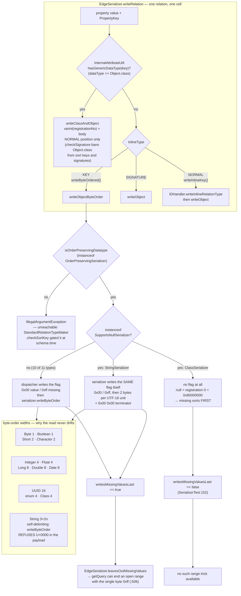

<!--
entry-meta
date: 2026-11-10
type: lesson
track: JanusGraph
lesson: 12
category: Database Internals
title: StandardSerializer — the attribute bytes, and the one flag byte that keeps 0xff from meaning two things
slug: janusgraph-standard-serializer-attribute-encodings
-->

# `StandardSerializer` — the attribute bytes, and the one flag byte that keeps `0xff` from meaning two things

**2026-11-10 · JanusGraph Track · Lesson 12 of 28**

Reading `JanusGraph/janusgraph` at commit [`a59ae8d8`](https://github.com/JanusGraph/janusgraph/tree/a59ae8d8024207598eada34998d867617df51adf) (2026-10-28). **Mid-Part, so the re-pin question is not available this run; staying on `a59ae8d8`.** The next boundary where re-pinning is allowed is Part II/III, after lesson 13 — the next run.

## Where This Fits

- **Lesson 10** built the column: a relation becomes `[type prefix][sort key][value?][vid←][rid←]`, and the single integer `valuePosition` is the boundary between what the backend sorts on and what it never interprets. **Lesson 11** read that column back and established that the backward tail encoding is the only genuinely order-preserving varint in the tree. Both lessons treated the sort-key window and the value as **opaque bytes handed to `serializer`** — [`EdgeSerializer`](https://github.com/JanusGraph/janusgraph/blob/a59ae8d8024207598eada34998d867617df51adf/janusgraph-core/src/main/java/org/janusgraph/graphdb/database/EdgeSerializer.java) calls into it and never looks inside. ([lesson 10](../2026-11-08-janusgraph-edge-serializer-column-layout/README.md), [lesson 11](../2026-11-09-janusgraph-parse-relation-relation-cache/README.md))
- **This lesson opens them.** `StandardSerializer` is the registry and dispatcher; the 51 `AttributeSerializer` implementations behind it are the actual encodings. The structural question is not "how is a `Long` written" but **why the same `Long` is written two different ways in the same cell**, and the answer is a three-valued enum, `InlineType`, 400 lines away in `EdgeSerializer`.
- **It also settles two debts and kills a PR candidate.** Lesson 11 owed lesson 12 the question *is any `readObjectByteOrder` length-ambiguous?* — because that is the only way its unbounded ASC sort-key read becomes a reachable bug. The answer is **no, not with any in-tree serializer**, and the reason is more interesting than the answer. Lesson 11 also assumed, without checking, that `VariableString.writeBackward` puts its marker at the high address; it does.
- **It sets up lesson 13** (schema persistence), which is the same dispatcher pointed at `TypeDefinitionDescription` and seventeen `EnumSerializer`s, and **lessons 17 and 21** — composite and mixed indexes compare values with a *different* comparator than the one the bytes implement, and this lesson finds where the two diverge.

---

## 1. One value, three positions, three encodings

The first thing to get right is that `StandardSerializer` has **three public write entry points**, not one, and `EdgeSerializer` picks between them by *where in the column the value is going* — not by what type it is.

The selector is a private three-valued enum, [`EdgeSerializer:383-394`](https://github.com/JanusGraph/janusgraph/blob/a59ae8d8024207598eada34998d867617df51adf/janusgraph-core/src/main/java/org/janusgraph/graphdb/database/EdgeSerializer.java#L383-L394):

```java
private enum InlineType {
    KEY, SIGNATURE, NORMAL;
    public boolean writeInlineKey()   { return this==NORMAL; }
    public boolean writeByteOrdered() { return this==KEY;    }
}
```

Two independent booleans over three cases, which gives exactly three live combinations:

| Position | `writeInlineKey()` | `writeByteOrdered()` | What is written | Where it lands |
|---|---|---|---|---|
| **`KEY`** — a sort key | `false` | `true` | `writeObjectByteOrder(value, dataType)` | inside the sort-key window, before `valuePosition` |
| **`SIGNATURE`** — a signature key | `false` | `false` | `writeObject(value, dataType)` | after `valuePosition`, position implies which key |
| **`NORMAL`** — any remaining property | `true` | `false` | inline relation-type id, then `writeObject(...)` | after the signature block, self-describing |

`writeInlineKey()` is the cheap half: a sort key and a signature key are both *positional* — the schema's `getSortKey()` / `getSignature()` arrays say which key sits where, so the id is redundant. A remaining property has no reserved position, so it pays an `IDHandler.writeInlineRelationType` prefix. That is [`writeInline` at `:405-413`](https://github.com/JanusGraph/janusgraph/blob/a59ae8d8024207598eada34998d867617df51adf/janusgraph-core/src/main/java/org/janusgraph/graphdb/database/EdgeSerializer.java#L405-L413).

`writeByteOrdered()` is the expensive half, and the whole subject of this lesson. [`writePropertyValue:419-427`](https://github.com/JanusGraph/janusgraph/blob/a59ae8d8024207598eada34998d867617df51adf/janusgraph-core/src/main/java/org/janusgraph/graphdb/database/EdgeSerializer.java#L419-L427):

```java
private void writePropertyValue(DataOutput out, PropertyKey key, Object value, InlineType inlineType) {
    if (InternalAttributeUtil.hasGenericDataType(key)) {
        assert !inlineType.writeByteOrdered();
        out.writeClassAndObject(value);
    } else {
        assert value==null || value.getClass().equals(key.dataType());
        if (inlineType.writeByteOrdered()) out.writeObjectByteOrder(value, key.dataType());
        else out.writeObject(value, key.dataType());
    }
}
```

and its exact mirror, [`readPropertyValue:250-259`](https://github.com/JanusGraph/janusgraph/blob/a59ae8d8024207598eada34998d867617df51adf/janusgraph-core/src/main/java/org/janusgraph/graphdb/database/EdgeSerializer.java#L250-L259). So:

- **`writeClassAndObject`** is the fourth entry point, reached only for a `PropertyKey` whose declared type is `Object.class` — [`InternalAttributeUtil.hasGenericDataType`](https://github.com/JanusGraph/janusgraph/blob/a59ae8d8024207598eada34998d867617df51adf/janusgraph-core/src/main/java/org/janusgraph/graphdb/database/serialize/InternalAttributeUtil.java) is a one-liner, `key.dataType().equals(Object.class)`. It writes `VariableLong.writePositive(registrationNo)` and then the value, so the bytes carry their own type tag.
- The `assert !inlineType.writeByteOrdered()` is not defensive: [`StandardRelationTypeMaker.checkSignature`](https://github.com/JanusGraph/janusgraph/blob/a59ae8d8024207598eada34998d867617df51adf/janusgraph-core/src/main/java/org/janusgraph/graphdb/types/StandardRelationTypeMaker.java) rejects `Object.class` from **both** sort keys and signatures — *"Signature and sort keys must have a proper declared datatype"* — so a generic key can only ever occupy a `NORMAL` position. `writeClassAndObject` is structurally unreachable from a sort key, which is why `readObjectByteOrder` never has to deal with an untyped value.

The gate on a sort key is one `checkArgument`, and it is the *only* one:

```java
private long[] checkSortKey(List<PropertyKey> sig) {
    for (PropertyKey key : sig) {
        Preconditions.checkArgument(attributeHandler.isOrderPreservingDatatype(key.dataType()),
                "Key must have an order-preserving data type to be used as sort key: %s", key);
    }
    return checkSignature(sig);
}
```

Nothing checks width, nothing checks that the read consumes what the write produced, nothing checks a value. Hold that thought until §6.

*(Aside, cosmetic: `makeDefinition()` calls `checkGeneralArguments()`, which calls `checkSortKey(sortKey)` and `checkSignature(signature)`, and then immediately calls both again to build the `TypeDefinitionMap` — and `checkSortKey` calls `checkSignature` itself. Each list is validated twice, the sort key's signature check three times. Pure waste at schema-definition time, which is not a hot path.)*

---

## 2. The registration table: 51 slots used, 28 left, and a ceiling that may never move

[`StandardSerializer`](https://github.com/JanusGraph/janusgraph/blob/a59ae8d8024207598eada34998d867617df51adf/janusgraph-core/src/main/java/org/janusgraph/graphdb/database/serialize/StandardSerializer.java) is a constructor with fifty `registerClassInternal` calls and two maps:

```java
private final BiMap<Integer,Class> registrations;   // HashBiMap.create(60)
private final Map<Class,AttributeSerializer> handlers;  // new HashMap<>(60)
```

The `registrationNo` is the **persisted** identity of a datatype — it is what `writeClassAndObject` writes into the cell — so it is append-only forever. Counting the ids actually in use:

| Band | Ids | Count | Contents |
|---|---|---|---|
| Setup | `1` | 1 | `Object` → `ObjectSerializer` |
| Primitives | `10`–`21` | 12 | `Byte Short Integer Long Character Boolean Date Geoshape String Float Double UUID` |
| Arrays | `22`–`30` | 9 | `byte[] short[] int[] long[] float[] double[] char[] boolean[] String[]` |
| JanusGraph enums | `41`–`57` | 17 | all via `new EnumSerializer<>(…)` |
| Schema / logging | `60`–`71` | 12 | `Class Parameter Parameter[] TypeDefinitionDescription Duration Instant StandardTransactionId TraverserSet HashMap GraphCacheEvictionAction ObjectNode ArrayNode` |
| **Total** | | **51** | gaps at `2`–`9`, `31`–`40`, `58`–`59` |

And then the line that fixes the budget:

```java
/**
 * ... It must be ensured that this number is LARGER than any internally used
 * registration number.
 * This value may NEVER EVER be changed or compatibility to older versions breaks
 */
private static final int CLASS_REGISTRATION_OFFSET = 100;
private static final int MAX_REGISTRATION_NO = 100000;
```

`registerClass(n, …)` stores at `100 + n`, with `n ∈ [0, 100000)`. The highest internal id is `71`. **So JanusGraph has exactly 28 internal registration slots left — 72 through 99 — before the offset it has promised never to change would collide with user attribute 0.** The three gaps (`2`–`9`, `31`–`40`, `58`–`59`) are presumably reserved for more primitives, more arrays and more schema types respectively, and are part of those 28. That is a hard, dated number worth knowing before proposing a new built-in datatype.

Two small things in the same constructor:

- `new HashMap<>(60)` for 51 entries **still rehashes during construction.** `HashMap(60)` rounds the table to 64 and sets its threshold to `64 × 0.75 = 48`; the 49th registration resizes it to 128. You would need an initial capacity of at least 68 to avoid it. `HashBiMap.create(60)` does not have the problem — Guava sizes its closed table at load factor 1.0, so 51 fits in 64. One-time cost at graph open, not worth a PR on its own, but it is the kind of thing that gets bundled.
- `normalizeDataType` has a **dead branch**:

```java
private static Class normalizeDataType(Class datatype) {
    Class superClass = datatype.getSuperclass();
    if (null != superClass && superClass.isEnum()) return superClass;
    if (Instant.class.equals(datatype)) return Instant.class;
    return datatype;
}
```

  The first branch is load-bearing — an enum constant with a body is an anonymous subclass, so `TimeUnit.SECONDS.getClass()` is not `TimeUnit.class`, and this is what maps it back. The second is a no-op twice over: it returns exactly the value the fallthrough would return, and `java.time.Instant` is `final`, so no subclass can exist for the `isAssignableFrom` check that was presumably meant. **11 of 64** bit-lengths' worth of dead code, in lesson 11's idiom.

### 2.1 `getSerializer` builds a fresh one every call

[`GraphDatabaseConfiguration:1971`](https://github.com/JanusGraph/janusgraph/blob/a59ae8d8024207598eada34998d867617df51adf/janusgraph-core/src/main/java/org/janusgraph/graphdb/configuration/GraphDatabaseConfiguration.java#L1971):

```java
public static Serializer getSerializer(Configuration configuration) {
    Serializer serializer = new StandardSerializer();
    List<RegisteredAttributeClass<?>> registeredAttributeClasses =
        RegisteredAttributeClassesConverter.getInstance().convert(configuration);
    for (RegisteredAttributeClass<?> clazz : registeredAttributeClasses) {
        clazz.registerWith(serializer);
    }
    return serializer;
}
```

Fifty `registerClassInternal` calls, each with four `Preconditions` and two map puts, plus `Class.forName` per custom attribute, on every invocation. The instance method `getSerializer()` at `:1967` just delegates to the static. At graph-open frequency this is irrelevant; it is worth knowing only because it means **the serializer is not a singleton**, so a custom `AttributeSerializer` instance is shared by every property of its type within one graph but not across graphs — and `SerializerInjected.setSerializer` is called on it at registration time, which is why a stateful serializer is a problem (see `DateSerializer is not thread-safe`, [#2429](https://github.com/JanusGraph/janusgraph/issues/2429), closed).

---

## 3. THE finding: the flag byte is about order, not about null

Here is the shape of the dispatcher. From [`StandardSerializer`](https://github.com/JanusGraph/janusgraph/blob/a59ae8d8024207598eada34998d867617df51adf/janusgraph-core/src/main/java/org/janusgraph/graphdb/database/serialize/StandardSerializer.java), `writeObjectInternal`:

```java
private DataOutput writeObjectInternal(Object object, Class type, boolean byteOrder) {
    if (supportsNullSerialization(type)) {
        AttributeSerializer s = getSerializer(type);
        if (byteOrder) ensureOrderPreserving(s,type).writeByteOrder(this,object);
        else s.write(this, object);
    } else {
        //write flag for null or not
        if (object==null) {
            putByte((byte)-1);
        } else {
            putByte((byte)0);
            writeObjectNotNullInternal(object,byteOrder);
        }
    }
    return this;
}
```

Read naively, that is null handling: a serializer that can represent null does it itself; one that cannot gets a `0` / `-1` flag byte in front. [`SupportsNullSerializer`](https://github.com/JanusGraph/janusgraph/blob/a59ae8d8024207598eada34998d867617df51adf/janusgraph-core/src/main/java/org/janusgraph/graphdb/database/serialize/SupportsNullSerializer.java) is an empty marker interface and the javadoc says exactly that.

**It is not only null handling. In a sort-key position the flag byte is what makes the encoding correct at all.**

`ByteSerializer.writeByteOrder` is `out.putByte((byte)(object - Byte.MIN_VALUE))`. For `Byte.MAX_VALUE`:

```
127 - (-128) = 255 → (byte) 255 = -1 → 0xff
```

**The byte-order encoding of `Byte.MAX_VALUE` is the single byte `0xff` — byte-identical to the missing-value marker** that lesson 10 found `EdgeSerializer` writing at [`:504-507`](https://github.com/JanusGraph/janusgraph/blob/a59ae8d8024207598eada34998d867617df51adf/janusgraph-core/src/main/java/org/janusgraph/graphdb/database/EdgeSerializer.java#L504-L507) to end a half-open sort-key range before the relations that have no value of that key:

```java
} else if (leavesOutMissingValues(propertyKey)) {
    //The range ends before the relations without a value of the key, whose missing value is
    //written as -1 after the values (see writesMissingValuesLast), as no range holds them
    colEnd.putByte((byte) -1);
    endInclusive = false;
}
```

So without the flag byte, a vertex-centric index on a `Byte` sort key would place every relation whose value is `127` at exactly the same column position as every relation with **no value**, and an open-ended range `between(5, null)` would either include or exclude both together. The same collision exists at the top of every one of the fixed-width types — `Short.MAX_VALUE` is `0xffff`, `Long.MAX_VALUE` is eight `0xff`s, `Double.NaN` (see §4.3) is `fff8…`, `new UUID(-1,-1)` is sixteen `0xff`s. The leading `0x00` is what keeps all of them strictly below a one-byte `0xff`.

Verified by re-implementing all eleven byte-order encodings line-for-line from the pinned sources and comparing:

```
all 11 types: every value's byte-order form < the 1-byte missing marker 0xff -> 0 violations
Byte.MAX_VALUE body alone is  ff  == the missing marker
with the flag:                00ff
```

That is also the key to the method whose condition looks arbitrary on first reading:

```java
/**
 * The data types whose serializer doesn't write null itself are written after a flag, 0 for a value and -1 for
 * null, and StringSerializer writes the same flags itself
 */
@Override
public boolean writesMissingValuesLast(Class<?> datatype) {
    return isOrderPreservingDatatype(datatype)
        && (!supportsNullSerialization(datatype) || getSerializer(datatype) instanceof StringSerializer);
}
```

Against the `Serializer` interface's own contract, [`Serializer.java`](https://github.com/JanusGraph/janusgraph/blob/a59ae8d8024207598eada34998d867617df51adf/janusgraph-core/src/main/java/org/janusgraph/graphdb/database/serialize/Serializer.java) — *"Whether `DataOutput#writeObjectByteOrder` writes a missing value of the data type as the single byte -1, and every value of it after a smaller first byte"* — the condition decomposes exactly:

- `isOrderPreservingDatatype` — otherwise there is no sort-key position to begin with.
- `!supportsNullSerialization` — the dispatcher supplies the flag.
- `|| instanceof StringSerializer` — the one serializer that supplies the *same* flag itself. [`StringSerializer.writeByteOrder`](https://github.com/JanusGraph/janusgraph/blob/a59ae8d8024207598eada34998d867617df51adf/janusgraph-core/src/main/java/org/janusgraph/graphdb/database/serialize/attribute/StringSerializer.java) opens with `putByte((byte)-1)` for null and `putByte((byte)0)` otherwise, then the characters. Byte-for-byte the same discipline.

And the clause exists to exclude **exactly one serializer in the whole tree**: the private inner `ClassSerializer`, which is `OrderPreservingSerializer<Class>` *and* `SupportsNullSerializer` *and* is not `StringSerializer`. Its `writeByteOrder` is `ints.writeByteOrder(buffer, attribute == null ? 0 : getDataTypeRegistration(attribute))` — null becomes registration `0`, which in the biased 4-byte integer encoding is `80000000`, strictly **below** every real registration (`13` → `8000000d`). A `Class` sort key's missing values sort **first**, not last. Excluding it is correct, and `SerializerTest:152-154` pins it:

```java
//A class is written as the number of its registration, 0 where it's missing, and an instant and an array keep
//no order
assertFalse(serialize.writesMissingValuesLast(Class.class));
assertFalse(serialize.writesMissingValuesLast(Instant.class));
assertFalse(serialize.writesMissingValuesLast(byte[].class));
```

Three types, three different reasons: `Class` writes its own non-conforming flag, `Instant` is not order-preserving at all (§5), `byte[]` is not either.

So the single-sentence version: **`writesMissingValuesLast` is not a property of the attribute type. It is the question "does the first byte of this encoding come from the two-valued flag protocol?", and the answer is yes for every order-preserving type except the private `Class` serializer.**

---

## 4. Every order-preserving encoding, byte for byte

[`OrderPreservingSerializer`](https://github.com/JanusGraph/janusgraph/blob/a59ae8d8024207598eada34998d867617df51adf/janusgraph-core/src/main/java/org/janusgraph/graphdb/database/serialize/OrderPreservingSerializer.java) adds exactly two methods to `AttributeSerializer` and states the contract:

> the order of the elements (as given by its `Comparable` implementation) corresponds to the natural order of the serialized byte representation

Thirteen classes in the tree implement it: `ByteSerializer`, `ShortSerializer`, `IntegerSerializer`, `LongSerializer`, `CharacterSerializer`, `BooleanSerializer`, `DateSerializer`, `FloatSerializer`, `DoubleSerializer`, `StringSerializer`, `UUIDSerializer`, `EnumSerializer<E>` and the private `ClassSerializer`. Against the registration table that is **29 of the 51 registered datatypes** (12 concrete classes + 17 enums).

`SerializerTest:595-603` fixes the user-facing count from the other direction:

```java
final Map<Class,Factory> sortTypes = new HashMap<>();
for (Map.Entry<Class,Factory> entry : TYPES.entrySet()) {
    if (serialize.isOrderPreservingDatatype(entry.getKey()))
        sortTypes.put(entry.getKey(),entry.getValue());
}
assertEquals(10,sortTypes.size());
```

`TYPES` at `:763` holds 21 entries — nine scalars, `Geoshape`, `String`, nine array types, and the test's own `TClass1`. Ten are order-preserving, so **`Geoshape`, all nine array types and a plain custom serializer are not** — pinned by a count, which is a fragile but real assertion. Then 3,000,000 random trials assert `signum(c1.compareTo(c2)) == signum(s1.compareTo(s2))` and a round trip.

### 4.1 The whole-number family: a bias, and nothing else

| Serializer | `writeByteOrder` | Bytes | Transform |
|---|---|---|---|
| `ByteSerializer` | `putByte((byte)(v - Byte.MIN_VALUE))` | 1 | `+128` |
| `ShortSerializer` | `putShort((short)(v - Short.MIN_VALUE))` | 2 | `+32768` |
| `IntegerSerializer` | `putInt(v - Integer.MIN_VALUE)` | 4 | `+2³¹` |
| `LongSerializer` | `putLong(v - Long.MIN_VALUE)` | 8 | `+2⁶³` |

Every one is "add the bias, write big-endian", which is the standard signed→unsigned flip (equivalently, invert the sign bit), and `readByteOrder` adds the bias back. `Byte`, `Short` and `Long` implement `readByteOrder`/`writeByteOrder` as literal delegations to `read`/`write` — their ordinary encoding is already order-preserving.

**`IntegerSerializer` is the one that is not.** Its `read`/`write` pair uses `VariableLong`:

```java
public Integer read(ScanBuffer buffer) {
    final long l = VariableLong.read(buffer);
    Preconditions.checkArgument(l >= Integer.MIN_VALUE && l <= Integer.MAX_VALUE, "Invalid serialization [%s]", l);
    return (int)l;
}
public void write(WriteBuffer out, Integer attribute) { VariableLong.write(out,attribute); }

public Integer readByteOrder(ScanBuffer buffer)  { return buffer.getInt() + Integer.MIN_VALUE; }
public void writeByteOrder(WriteBuffer out, Integer attribute) { out.putInt(attribute - Integer.MIN_VALUE); }
```

So `Integer` is **1–5 bytes in a value position and always 4 in a sort key**, while `Long` is 8 in both. [`VariableLong.write`](https://github.com/JanusGraph/janusgraph/blob/a59ae8d8024207598eada34998d867617df51adf/janusgraph-core/src/main/java/org/janusgraph/graphdb/database/idhandling/VariableLong.java) uses a **sign-magnitude** zig-zag, `Math.abs(value) << 1 | (value < 0 ? 1 : 0)`, not the usual `(v << 1) ^ (v >> 63)`:

```
VariableLong.write(Integer) lengths: {0: 1, 63: 1, 64: 2, -64: 2, 8191: 2, 8192: 3, 2147483647: 5, -2147483648: 5}
```

Two incidental consequences of that choice, neither reachable from the serializers: the mapping is **not** a bijection — unsigned `0` and unsigned `1` both decode to `0`, and `write` only ever emits `0`, so one codepoint is dead; and `convert2Unsigned` asserts `value > Long.MIN_VALUE`, because `Math.abs(Long.MIN_VALUE)` is itself. `LongSerializer` never touches `VariableLong`, and `IntegerSerializer` can only hand it values in int range, so the assertion is unreachable through the attribute path.

`BooleanSerializer` is a plain `0` / `1` byte, unbiased, with a `decode` that throws on anything else — so `false < true` and both sit below `0xff`. `CharacterSerializer` is the cute one:

```java
public static short char2short(char c) { return (short) (((int) c) + Short.MIN_VALUE); }
// then ShortSerializer.write: putShort((short)(object - Short.MIN_VALUE))
```

The two biases annihilate. **A `Character` in byte order is the raw UTF-16 code unit, big-endian, unbiased** — `putShort((short) c)`. Which matters in §5, because `'\u0000'` therefore encodes as `00 00`, exactly the string terminator.

### 4.2 `Date` yes, `Instant` no

[`DateSerializer`](https://github.com/JanusGraph/janusgraph/blob/a59ae8d8024207598eada34998d867617df51adf/janusgraph-core/src/main/java/org/janusgraph/graphdb/database/serialize/attribute/DateSerializer.java) is `OrderPreservingSerializer<Date>` over `LongSerializer.INSTANCE` on `attribute.getTime()` — 8 bytes, biased, identical to a `Long`. Its `convert` is the only elaborate part (a lenient ISO formatter, an RFC 1123 fallback, and `Longs.tryParse` first, which is the fix for [#1558](https://github.com/JanusGraph/janusgraph/issues/1558)).

[`InstantSerializer`](https://github.com/JanusGraph/janusgraph/blob/a59ae8d8024207598eada34998d867617df51adf/janusgraph-core/src/main/java/org/janusgraph/graphdb/database/serialize/attribute/InstantSerializer.java) is **`AttributeSerializer<Instant>` and nothing else**:

```java
public class InstantSerializer implements AttributeSerializer<Instant> {
    private final LongSerializer secondsSerializer = new LongSerializer();
    private final IntegerSerializer nanosSerializer = new IntegerSerializer();
    public Instant read(ScanBuffer buffer) { ... }
    public void write(WriteBuffer buffer, Instant attribute) {
        secondsSerializer.write(buffer, attribute.getEpochSecond());
        nanosSerializer.write(buffer,attribute.getNano());
    }
}
```

**You cannot build a vertex-centric index ordered by an `Instant` property.** `checkSortKey` rejects it with *"Key must have an order-preserving data type to be used as sort key"*. And this is not an abstract limitation — it directly contradicts the javadoc on the very method that would set it up, [`StandardRelationTypeMaker.sortKey`](https://github.com/JanusGraph/janusgraph/blob/a59ae8d8024207598eada34998d867617df51adf/janusgraph-core/src/main/java/org/janusgraph/graphdb/types/StandardRelationTypeMaker.java):

> For instance, if the edge label *friend* has the sort key (*since*), which is a property key **with a timestamp data type**, then one can efficiently retrieve all edges with label *friend* in a specified time interval…

The canonical example in the API documentation fails if you reach for the canonical Java timestamp type. The workaround is `Long` (epoch millis or nanos) or `Date`, and nothing says so.

The encoding would also need work, not just a marker interface: `write` is `[8-byte biased seconds][1..5-byte zig-zag nanos]`, and the nanos part is **not** order-preserving on its own (zig-zag with the stop bit on the last byte, lesson 10's inversion), so a byte-order form would have to be `[8-byte biased seconds][4-byte biased nanos]` — a new 12-byte encoding, not a delegation. `DurationSerializer` has the identical shape and the identical absence.

### 4.3 `Float`/`Double`: Lucene's bit flip, and where NaN goes

```java
public Double readByteOrder(ScanBuffer buffer)  { return NumericUtils.sortableLongToDouble(longs.readByteOrder(buffer)); }
public void writeByteOrder(WriteBuffer buffer, Double attribute) { longs.writeByteOrder(buffer, NumericUtils.doubleToSortableLong(attribute)); }
```

[`NumericUtils`](https://github.com/JanusGraph/janusgraph/blob/a59ae8d8024207598eada34998d867617df51adf/janusgraph-core/src/main/java/org/janusgraph/util/encoding/NumericUtils.java) is marked *"copied verbatim from Apache Lucene"* and is two self-inverse lines:

```java
public static long sortableDoubleBits(long bits) { return bits ^ (bits >> 63) & 0x7fffffffffffffffL; }
public static int  sortableFloatBits(int bits)   { return bits ^ (bits >> 31) & 0x7fffffff; }
```

For a non-negative double the sign bit is 0, so `bits >> 63` is 0 and the value is unchanged; for a negative one it is all-ones, so the 63 magnitude bits are inverted — turning IEEE-754's sign-magnitude into a monotone two's-complement-like integer. Then `LongSerializer.writeByteOrder` adds the `2⁶³` bias on top. `Float` goes through `IntegerSerializer.writeByteOrder`, so both the float and double paths are **fixed width (4 and 8) in byte order**, while `read`/`write` are `putFloat`/`putDouble`, also fixed.

The NaN behaviour, which `SerializerTest:158-173` documents and asserts, is **not** in `NumericUtils`:

```java
/**
 * Every NaN, whatever its sign and payload, is written in byte order as the same value, after +∞, so that the slice
 * of a vertex-centric index which ends before NaN holds every other value, and that of NaN every NaN
 */
```

The collapse happens one call earlier: `doubleToSortableLong` calls `Double.doubleToLongBits`, which by specification canonicalises **every** NaN bit pattern to `0x7ff8000000000000` (`doubleToRawLongBits` would not). Verified over the four payloads the test uses:

```
Double.doubleToLongBits collapses every NaN to 0x7ff8000000000000 -> one encoding: 00fff8000000000000
  +inf: 00fff0000000000000   +inf < NaN: True
Float:  00ffc00000           +inf: 00ff800000
-0.0 -> 007fffffffffffffff   0.0 -> 008000000000000000   strictly ordered: True
```

So the stored order is `−∞ < … < −0.0 < 0.0 < … < +∞ < NaN`, which is exactly `Double.compare`'s total order and therefore conforms to the interface contract. **But note `-0.0 < 0.0` strictly, in the bytes.** `Double.compare(-0.0, 0.0)` is `-1`, so the contract holds — while `AttributeUtils.compare`, the *other* comparator (§6.2), takes the `an.doubleValue()==bn.doubleValue()` branch, finds them equal, and falls through to `Long.compare(0L, 0L)` = `0`. Two in-tree comparators that disagree with each other and with the bytes on one value. Flagged for lesson 21, where index selection decides which one answers a range.

### 4.4 Enums: ordinals, which is a schema-evolution trap

```java
public E readByteOrder(ScanBuffer buffer) { return getValue(ints.readByteOrder(buffer)); }
public void writeByteOrder(WriteBuffer buffer, E attribute) { ints.writeByteOrder(buffer,attribute.ordinal()); }
public E read(ScanBuffer buffer) { return getValue(VariableLong.readPositive(buffer)); }
public void write(WriteBuffer out, E object) { VariableLong.writePositive(out, object.ordinal()); }
```

Same asymmetry as `Integer`: **1 byte in a value position for any ordinal below 128, always 4 in a sort key.** And the sort order of an enum sort key is **declaration order**, which nothing in the format records. Seventeen JanusGraph enums are persisted this way, `Multiplicity`, `Cardinality`, `SchemaStatus`, `ConsistencyModifier` among them — so **reordering the constants of any of those enums silently reinterprets every schema vertex already on disk.** `getValue` bounds-checks `ordinal < values.length`, which catches a *removal*, loudly, with `"Invalid ordinal number (max %s)"`. It cannot catch a swap.

`EnumSerializer` also overrides neither `verifyAttribute` nor `convert`, so it inherits [`AttributeSerializer`](https://github.com/JanusGraph/janusgraph/blob/a59ae8d8024207598eada34998d867617df51adf/janusgraph-core/src/main/java/org/janusgraph/core/attribute/AttributeSerializer.java)'s defaults — a null check and a bare `(V) value` cast in a `try`/`catch (ClassCastException)` that, because of erasure, does not actually throw at that cast. Setting a property of enum type from a `String` name therefore returns the string, unconverted, rather than the constant. Contrast `StringSerializer.convert`, which handles `Namifiable` and falls back to `toString()`.

---

## 5. `String`: the only variable-width order-preserving encoding, and it has two of them

`StringSerializer` is `OrderPreservingSerializer<String>` **and** `SupportsNullSerializer`, and it has two completely different encodings that share no code.

### 5.1 The byte-order form: UTF-16BE code units, NUL-terminated

```java
public void writeByteOrder(WriteBuffer buffer, String attribute) {
    if (attribute==null) { buffer.putByte((byte)-1); return; } else { buffer.putByte((byte)0); }
    for (int i = 0; i < attribute.length(); i++) {
        char c = attribute.charAt(i);
        Preconditions.checkArgument(((int) c) > 0, "No null characters allowed in string @ position %s: %s", i, attribute);
        cs.writeByteOrder(buffer, c);
    }
    cs.writeByteOrder(buffer, (char) 0);
}
public String readByteOrder(ScanBuffer buffer) {
    byte prefix = buffer.getByte();
    if (prefix==-1) return null;
    assert prefix==0;
    StringBuilder s = new StringBuilder();
    while (true) {
        char c = cs.readByteOrder(buffer);
        if (((int) c) > 0) s.append(c); else break;
    }
    return s.toString();
}
```

With §4.1's result that `CharacterSerializer` in byte order is the raw big-endian code unit, the layout is:

```
[0x00 flag] [2 bytes per UTF-16 code unit] [0x00 0x00 terminator]     = 3 + 2n bytes
```

```
''        -> 000000              (3 bytes)
'a'       -> 0000610000          (5 bytes)
'ab'      -> 00006100620000      (7 bytes)
'￿'  -> 00ffff0000          (5 bytes)
```

Four things fall out, all verified:

1. **It is exactly `String.compareTo` order.** 73,606 random strings (UTF-16 units `1`–`FFFF`, length 0–12) sorted by `compareTo` give **0** inversions in the byte encoding. The write-time `0x00` flag matters here too: without it, `"￿…"` would begin with `0xff` and sort at or above the missing-value marker — `ffff0000 >= ff` is `true`.
2. **It is not code-point order.** `String.compareTo` compares UTF-16 code units, and the surrogate range `D800`–`DFFF` sits below `E000`–`FFFF`. So `U+1F600` (`00 d83d de00 0000`) sorts **before** `U+FFFF` (`00 ffff 0000`), and `U+10000` before `U+E000`. The serializer is faithful to its interface contract and still disagrees with Elasticsearch, Solr and anything else that sorts by code point — which is the same class of mismatch as the UUID bug in §6.1, waiting in a different type.
3. **It is 3 + 2n bytes always** — no compression in the byte-order path, no ASCII shortcut, no length header. A 5-character ASCII sort key costs 13 bytes.
4. **It is self-delimiting**, and the write side is what guarantees the read side stays inside the window: the `Preconditions.checkArgument(c > 0)` is the only thing standing between `readByteOrder`'s unbounded terminator scan and lesson 11's `vid←`/`rid←` tail. Verified: `readByteOrder` consumed exactly `writeByteOrder`'s byte count over 20,000 strings, **always**.

But `verifyAttribute` is only `Preconditions.checkArgument(value.length()<=MAX_LENGTH)` — it does **not** check for `U+0000`. And the ordinary `write` path handles a NUL fine: `StringEncoding.isAsciiString` returns false for `c <= 0`, so such a string takes the full-UTF branch, where `c <= 0x007F` writes `(byte) 0` and `read`'s `case 0:` reads it back. **So a String property containing `U+0000` is storable as a value and throws `IllegalArgumentException` at serialization time if the key is a sort key** — not at property-set time, and not documented anywhere. An undocumented restriction rather than a bug (the check has to be at write time; neither `verifyAttribute` nor `checkSortKey` can see both the value and the position), but it belongs in the `sortKey` javadoc.

### 5.2 The value form: a 4-bit-tagged length header and three bodies

```java
private static final long COMPRESSOR_BIT_LEN = 3;       // 8 possible compressors
private static final long COMPRESSOR_BIT_MASK = 7;
private static final long NO_COMPRESSION_OFFSET = 4;    // COMPRESSOR_BIT_LEN + 1
public static final int LONG_COMPRESSION_THRESHOLD = 16000;
public static final int TEXT_COMPRESSION_THRESHOLD = 48;
```

`write` emits one `VariableLong.writePositive` header whose low 3 bits are the compressor id, bit 3 the "full UTF" flag, and the rest a length-or-marker, then the body:

| Form | Condition | Header value | Header bytes | Body |
|---|---|---|---|---|
| empty ASCII | `isAsciiString`, `length()==0` | `1 << 4` = 16 | 1 | none |
| ASCII | `isAsciiString`, non-empty | `2 << 4` = 32 | 1 | `n` bytes, `0x80` on the last |
| full UTF | not ASCII | `(n << 4) | 8` | 1 for `n ≤ 7`, 2 for `n ≤ 1023`, 3 beyond | 1–3 bytes per char |
| GZIP | `length() > 16000` | `(byteLen << 3) | 1` | varint | GZIP of WTF-8 |

So the ASCII form stores **no length at all** — it is recovered from the stop bit, exactly `IDHandler`'s trick — and `read` throws `IllegalArgumentException("Invalid ASCII encoding offset: " + length)` for any marker other than 1 or 2, so the ASCII marker space has precisely two legal values. The UTF form stores the **char count**, not the byte count, while the GZIP form stores the byte count; the branch that distinguishes them is one bit.

Three observations:

- **`TEXT_COMPRESSION_THRESHOLD = 48` is `public static final` and `StringSerializer` never reads it.** `write` compares only against `LONG_COMPRESSION_THRESHOLD`. Its only in-tree reader is `SerializerTest`'s `STRING_FACTORY`, which uses it to size random strings. A leftover from a second compressor that no longer exists — `CompressionType` has two constants, `NO_COMPRESSION` and `GZIP`, in a field 3 bits wide (8 slots).
- `'alice'` costs **6 bytes** as a value (`20 61 6c 69 63 e5`, where `0xe5` is `'e' | 0x80`) and **13 bytes** as a sort key. 2.17×, and the gap widens linearly.
- The GZIP path encodes **WTF-8**, not UTF-8, with a long javadoc explaining why: `String#getBytes` replaces an unpaired surrogate with `?`, so a round trip would lose data, and the fix gives an unpaired surrogate the three bytes UTF-8 would give its code point. `decodeWtf8` then scans for `ED` followed by `A0`–`BF`, which UTF-8 never produces, and reconstructs the surrogate. Five tests cover it (`testLongStringsKeepUnpairedSurrogates`, `…WrittenAsTheirCodePoints`, `…WrittenBeforeAreReadAsBefore`, a random one, and `testStringCompression`), which is the right amount of care for a format change.

### 5.3 And a third ASCII codec, in a different package

[`VariableString`](https://github.com/JanusGraph/janusgraph/blob/a59ae8d8024207598eada34998d867617df51adf/janusgraph-core/src/main/java/org/janusgraph/graphdb/database/idhandling/VariableString.java) exists for custom string vertex ids, and its class javadoc says *"This class uses `StringSerializer` as a reference."* [`StringEncoding.writeAsciiString`](https://github.com/JanusGraph/janusgraph/blob/a59ae8d8024207598eada34998d867617df51adf/janusgraph-core/src/main/java/org/janusgraph/util/encoding/StringEncoding.java) is a fourth, and its comment says *"Similar to `{@link StringSerializer}`"* — inside a `//` comment, where the javadoc link does not render. All three encode printable ASCII with `0x80` as a stop bit, and all three disagree on the details:

| | Marker | Empty string | Stop bit at |
|---|---|---|---|
| `StringSerializer.write` (ASCII) | header `2 << 4`; `1 << 4` for empty | header-only, no body | last byte |
| `StringEncoding.writeAsciiString` | none | a lone `0x80` byte | last byte |
| `VariableString.write` | leading `STRING_ID_MARKER` | **rejected** (`checkAsciiPrintableString`) | last byte |

**Lesson 11's second open question, answered.** `VariableString.writeBackward` writes the characters in reverse and then the marker, so the marker lands at the **high** address:

```java
public static void writeBackward(WriteBuffer out, final String value) {
    checkAsciiPrintableString(value);
    for (int i = value.length() - 1; i >= 0; i--) {
        int c = value.charAt(i);
        byte b = (byte)c;
        if (i == value.length() - 1) b |= STOP_MASK; //End marker
        out.putByte(b);
    }
    out.putByte(STRING_ID_MARKER);
}
```

Address order is `[char(n-1)|0x80] [char(n-2)] … [char(0)] [MARKER]`, and `readBackward` checks `in.getByte(--position) == STRING_ID_MARKER` first — so the peek at `position-1` that lesson 11 validated for the long case is correct for the string case too, and it appends `char(0)` first and walks down to the stop bit, producing the string in the right order with no reversal. Lesson 11's assumption holds; it was worth checking, because the stop bit and the marker sit at *opposite* ends.

---

## 6. Lesson 11's question: is any `readObjectByteOrder` length-ambiguous?

This is the one that decided a PR. Lesson 11 found that `parseRelation` reads an ASC sort key **in place** out of the cell, with nothing comparing the bytes consumed against `keyLength`, while DESC goes through a bounded `subrange`:

```java
int keyLength = endKeyPos - startKeyPos; //after reading the ids, we are on the last byte of the key
in.movePositionTo(startKeyPos);
ReadBuffer inKey = in;
if (def.getSortOrder() == Order.DESC) inKey = in.subrange(keyLength, true);
properties = readInlineTypes(keySignature, properties, inKey, tx, InlineType.KEY);
in.movePositionTo(currentPos);
```

An over-reading serializer would walk into the `vid←`/`rid←` tail, and `in.movePositionTo(currentPos)` would discard the evidence — silently wrong values on ASC, a loud exception on DESC. The question was whether that is reachable.

**Verdict: not with any in-tree serializer, and the conclusion is structural rather than empirical.** Ten of the eleven order-preserving datatypes are **fixed width** in byte order, so `readByteOrder` consumes a constant and cannot drift:

```
Byte 1  Boolean 1  Short 2  Character 2  Integer 4  Float 4  Long 8  Double 8  Date 8  UUID 16
```

The eleventh, `String`, is variable but **self-delimiting at both ends by the same byte**: the terminator is `00 00`, and the only way a payload could contain `00 00` is a `U+0000` code unit, which `writeByteOrder` refuses with a `Preconditions.checkArgument` *before writing a single character*. Verified over 20,000 strings: read length equals write length, every time, and `3 + 2n` exactly.

So **PR candidate 20 should be downgraded.** The failure mode lesson 11 described is unreachable through the schema path as it stands. What survives is narrower and still worth filing, because the trigger is a documented extension point:

- `checkSortKey`'s only gate is `isOrderPreservingDatatype`, i.e. `instanceof OrderPreservingSerializer`. A **custom** serializer registered through `attributes.custom.attribute[X].serializer-class` can implement that interface, be accepted as a sort key, and read a different number of bytes than it wrote — and then ASC silently corrupts while DESC throws.
- The fix is still one line, `in.subrange(keyLength, def.getSortOrder() == Order.DESC)`, and the non-inverting `subrange` returns a **view** with no byte copy, so the cost is two short-lived objects where ASC currently allocates none.
- The honest framing for a PR is therefore *"bound the ASC sort-key read as the DESC read is bounded, so a third-party `OrderPreservingSerializer` cannot read past the sort-key window"*, not *"fix silent corruption"*. Low priority, trivially reviewable, no behaviour change for any in-tree type.

### 6.1 `UUID`: order-preserving against a different `Comparable`

`UUIDSerializer` is the one in-tree serializer that **knowingly violates the `OrderPreservingSerializer` javadoc**, and says so in its own:

> Writes a UUID as its two halves, the most significant first, each as eight bytes, in byte order too. So the storage backend holds UUIDs which are sort keys by their bits as unsigned numbers, which is the order of their string forms, and in which JanusGraph compares them (`AttributeUtils#compareValues`), rather than in that of `UUID#compareTo`, which compares each half as a signed number.

Both `write` and `writeByteOrder` are two raw `putLong`s — **no bias**, unlike every other type in §4.1. So the bytes sort by the unsigned value of the bits, while `UUID.compareTo` compares each half signed. Measured over 20,000 random pairs:

```
UUID over 20000 pairs: disagrees with string order in 0; with UUID.compareTo in 10070 (50.3%)
```

Half. `new UUID(0,0)` is sixteen `00`s and `new UUID(-1,-1)` is sixteen `ff`s, but `compareTo` reads the most significant halves as `0` and `-1` and puts the second **first**.

Which is why `UUID` is **absent from `SerializerTest`'s `TYPES` map**, and therefore from `testSerializedOrder`'s 3,000,000-trial check: that test asserts `signum(c1.compareTo(c2)) == signum(s1.compareTo(s2))`, and `UUID` would fail it on half the pairs *by design*. Its ordering is covered instead by [`UUIDSerializerTest.testByteOrderIsTheOrderOfTheStringForms`](https://github.com/JanusGraph/janusgraph/blob/a59ae8d8024207598eada34998d867617df51adf/janusgraph-test/src/test/java/org/janusgraph/graphdb/database/serialize/attribute/UUIDSerializerTest.java), 20,000 pairs with a fixed seed, asserting against `u1.toString().compareTo(u2.toString())` and `AttributeUtils.compareValues`. Two tests, two incompatible notions of correctness, and the only thing telling you which applies to `UUID` is which file it lives in.

The history is a nice arc, and it is five weeks old. [#948](https://github.com/JanusGraph/janusgraph/issues/948) added `OrderPreservingSerializer` to `UUIDSerializer` in March 2018, with the reasoning in the commit message: *"As far as I can tell, supporting 'native sort order', as described in the docs, simply means implementing `Comparable`, which `UUID` certainly does."* That was wrong in a way that took eight years to surface. Commit [`46f9d249`](https://github.com/JanusGraph/janusgraph/commit/46f9d249c514d1dc98bb874b8cdff2e5abe09862) (authored 2026-10-15, merged 2026-10-21, Oleksandr Porunov, *Fixes #5087*) fixed the other side instead — it introduced `AttributeUtils.compareValues` and `compareUnsigned` and pointed `OrderList`, `RelationComparator`, `RangeInterval` and `Cmp` at them, rather than changing the on-disk bytes. Its message lists what was broken: a range whose ends were ordered only as unsigned found nothing; one ordered only as signed asked the backend for a slice whose start came after its end; and on Solr, a transaction's own added elements were merged into the wrong places of the index result.

The residue, in the committer's own words, is that TinkerPop's comparisons still use `UUID.compareTo` wherever JanusGraph does not fold the step — so keyset paging over a UUID key with an unfolded `order()` can still skip elements. That is lesson 23–24 territory.

### 6.2 Two comparators, three if you count `RelationComparator`

[`AttributeUtils`](https://github.com/JanusGraph/janusgraph/blob/a59ae8d8024207598eada34998d867617df51adf/janusgraph-driver/src/main/java/org/janusgraph/graphdb/database/serialize/AttributeUtils.java) lives in **`janusgraph-driver`**, not `janusgraph-core` — worth knowing, because it is not where the rest of `org.janusgraph.graphdb.database.serialize` is, and a `find` in core will not turn it up. It holds two different comparators:

```java
public static int compareValues(Object a, Object b) {
    if (a instanceof UUID && b instanceof UUID) return compareUnsigned((UUID) a, (UUID) b);
    return ((Comparable<Object>) a).compareTo(b);
}
```

— strict, throws `ClassCastException` across types, and is the one the bytes implement (modulo §4.3's `-0.0`) — and

```java
public static Integer compare(Object a, Object b) {
    if (a==b) return 0;
    if (a==null || b==null) return null;
    if (a instanceof Number && b instanceof Number) { ... }
    else { try { return compareValues(a, b); } catch (Throwable e) { return null; } }
}
```

— lenient, returns `null` for "incomparable", compares a `Long` against an `Integer` via `doubleValue()`, and returns `null` when exactly one of two numbers is NaN. Three divergences from the stored order, all verified by reading: `-0.0` vs `0.0` (0 here, strictly ordered in the bytes), one-NaN pairs (`null` here, NaN last in the bytes), and cross-numeric-type comparison (works here, `ClassCastException` in `compareValues`). Whether any of that is reachable depends on which comparator answers which predicate, which is lesson 21's job.

---

## 7. Custom serializers: what the extension point can and cannot do

The registration path, end to end:

```
attributes.custom.attribute10.attribute-class  = com.example.SpecialInt      (GLOBAL_OFFLINE)
attributes.custom.attribute10.serializer-class = com.example.SpecialIntSerializer
        │
        ├─ RegisteredAttributeClassesConverter.convert
        │     position   = Integer.parseInt("attribute10".substring(9))  = 10
        │     clazz      = Class.forName(attribute-class)
        │     serializer = Class.forName(serializer-class).newInstance()
        │     duplicate check: all.contains(reg), where equals compares ONLY type
        │
        ├─ RegisteredAttributeClass.registerWith  →  Serializer.registerClass(10, clazz, serializer)
        │
        └─ StandardSerializer.registerClass  →  registerClassInternal(100 + 10, …)
```

Both config options are [`ConfigOption.Type.GLOBAL_OFFLINE`](https://github.com/JanusGraph/janusgraph/blob/a59ae8d8024207598eada34998d867617df51adf/janusgraph-core/src/main/java/org/janusgraph/graphdb/configuration/GraphDatabaseConfiguration.java#L1365-L1375) — every instance must be shut down to change them. The persisted registration number is the reason.

Four things the docs do not say:

1. **You can add types; you cannot replace one.** `registerClassInternal` opens with `Preconditions.checkArgument(!handlers.containsKey(datatype), "DataType has already been registered: %s", datatype)`. There is no way to supply a better `StringSerializer` or an order-preserving `InstantSerializer` through configuration — the registry refuses. **With exactly one hard-coded exception**, at the top of `registerClass`:

```java
if (datatype == HashMap.class) {
    final Integer hashMapRegNo = registrations.inverse().get(normalizeDataType(HashMap.class));
    if (hashMapRegNo != null) {
        // Remove the default HashMap serializer so we can replace it with the custom one
        registrations.remove(hashMapRegNo);
        handlers.remove(datatype);
    }
}
```

   `HashMap` is special-cased because of [#306](https://github.com/JanusGraph/janusgraph/issues/306) — graphs migrated from Titan already had a `HashMap` serializer registered and collided with registration 68. One escape hatch, one class, named in code.

2. **A custom serializer can be an `OrderPreservingSerializer` and nothing validates the claim.** This is §6's conclusion from the other side: the interface is a marker, `checkSortKey` trusts it, and the only safety net for an implementation that lies about width is the DESC path's `subrange`.

3. **`newInstance()` is the deprecated reflective form.** `Class.forName(serializerName).newInstance()` has been deprecated since Java 9; `getDeclaredConstructor().newInstance()` is the replacement. It matters beyond style: `Class.newInstance` propagates any exception the constructor throws *without* wrapping it, and the catch here is only `InstantiationException | IllegalAccessException`, so a serializer whose no-arg constructor fails produces a raw stack trace with no mention of which `attributes.custom.attribute[X]` caused it. Two-line fix, bundle it with the next cleanup.

4. **`RegisteredAttributeClassesConverter.getInstance()` is an unsynchronised lazy singleton** on a non-`volatile` static field. The class is stateless so the race is harmless — two callers may each build one — but it is the textbook shape, and the whole singleton buys nothing over a static method.

### 7.1 The docs describe a validation that does not exist

[`docs/advanced-topics/serializer.md`](https://github.com/JanusGraph/janusgraph/blob/a59ae8d8024207598eada34998d867617df51adf/docs/advanced-topics/serializer.md), section *Custom Object Serialization*:

> JanusGraph supports arbitrary objects as property attributes and can serialize such objects to disk. For this default serializer to work for a custom class, the following conditions must be fulfilled: the class must implement `AttributeSerializer`; the class must have a no-argument constructor; the class must implement the `equals(Object)` method. The last requirement is needed because **JanusGraph will test both serialization and deserialization of a custom class before persisting data to disk.**

Reading the whole path above: there is no such test. `registerWith` calls `registerClass` calls `registerClassInternal`, which validates the registration number, the non-nullity of the type and the serializer, and the absence of a collision — and then puts two map entries. No instance is constructed, nothing is round-tripped, `equals` is never called. The no-argument-constructor requirement is real (it is `newInstance()`), but it applies to the *serializer*, not the attribute class, which the paragraph conflates. The `equals` requirement and its stated justification are both stale.

There is also no "default serializer for arbitrary objects" in the sense implied. Registration 1 maps `Object.class` to [`ObjectSerializer`](https://github.com/JanusGraph/janusgraph/blob/a59ae8d8024207598eada34998d867617df51adf/janusgraph-core/src/main/java/org/janusgraph/graphdb/database/serialize/attribute/ObjectSerializer.java), which is:

```java
public Object read(ScanBuffer buffer) {
    Preconditions.checkArgument(buffer.getByte()==1,"Invalid serialization state");
    return new Object();
}
public void write(WriteBuffer buffer, Object attribute) { buffer.putByte((byte)1); }
```

One byte out, a **brand-new `Object`** back. It is a placeholder for the generic-datatype marker, not a serializer, and it is never actually reached for a property value — `hasGenericDataType` diverts those to `writeClassAndObject`. The thing the docs' paragraph is probably describing is [`SerializableSerializer`](https://github.com/JanusGraph/janusgraph/blob/a59ae8d8024207598eada34998d867617df51adf/janusgraph-core/src/main/java/org/janusgraph/graphdb/database/serialize/attribute/SerializableSerializer.java), registered for `TraverserSet` (67) and `HashMap` (68), which is Java native serialization through `commons-lang3 SerializationUtils` stored as a `byte[]` — so a `HashMap` property value is an `ObjectInputStream` payload in the edgestore, opaque to every index and not portable across class changes. That is also why `HashMap` is the one class with a replace hatch.

A doc-only PR — correcting the claim, splitting the serializer/attribute-class requirements, and noting that built-in types cannot be overridden — is about as safe a first contribution as this area offers.

---

## 8. The cost of a sort key

Putting §1's three positions together with §4's widths, for the same value in the same cell:

| Datatype | Sort key (`KEY`) | Signature (`SIGNATURE`) | Remaining property (`NORMAL`) |
|---|---|---|---|
| `Byte`, `Boolean` | 1 + 1 = **2** | 1 + 1 = **2** | type prefix + 2 |
| `Short`, `Character` | 1 + 2 = **3** | 1 + 2 = **3** | type prefix + 3 |
| `Integer` | 1 + 4 = **5** | 1 + 1…5 = **2…6** | type prefix + 2…6 |
| `Float` | 1 + 4 = **5** | 1 + 4 = **5** | type prefix + 5 |
| `Long`, `Double`, `Date` | 1 + 8 = **9** | 1 + 8 = **9** | type prefix + 9 |
| `UUID` | 1 + 16 = **17** | 1 + 16 = **17** | type prefix + 17 |
| `String` (n ASCII chars) | **3 + 2n** | **1 + n** | type prefix + 1 + n |
| enum | 1 + 4 = **5** | 1 + 1…5 | type prefix + 1…5 |

The flag byte appears in both columns because none of these implement `SupportsNullSerializer` — `String` is the exception, which writes its own.

So the sort-key premium is **zero for the fixed-width whole numbers, floats, dates and UUIDs**, and lands on exactly the two types with a variable value encoding:

- **`Integer`**: 5 bytes as a sort key against 2 for any `|v| ≤ 63`. 2.5× on small counters, which is the common case for a `since`/`seq`/`rank` sort key.
- **`String`**: `3 + 2n` against `1 + n`. `'alice'` is **13 bytes** as a sort key against **6** as a value — and that cost lands in the *column*, which lesson 10 established is the part the backend sorts, caches and (for a vertex-centric index) stores a second full copy of. An edge label with a 20-character string sort key and two vertex-centric indexes carries 43 bytes of sort key in each of 3 columns, twice over for the two endpoint rows: **258 bytes of sort key for one edge.**

The practical reading: if you have a choice of sort-key type, `Long` and `Date` are free relative to their value form; `Integer` costs 3 bytes a cell; `String` roughly doubles and adds 3. And `Instant` is not a choice at all (§4.2).

---

## 9. The whole dispatch, as one picture



---

## Hands-On

Four exercises, each of which runs real JanusGraph code and prints bytes. The first three need only `janusgraph-inmemory`, already built from lesson 01; the fourth needs nothing but `mvn`.

### H1 — Print the three encodings of one value

The most direct way to see §1 and §8 is to call the serializer yourself. Put this in `janusgraph-test/src/test/java/org/janusgraph/graphdb/serializer/Lesson12Scratch.java` in your clone:

```java
package org.janusgraph.graphdb.serializer;

import org.janusgraph.diskstorage.StaticBuffer;
import org.janusgraph.graphdb.database.serialize.DataOutput;
import org.janusgraph.graphdb.database.serialize.StandardSerializer;
import org.junit.jupiter.api.Test;
import java.util.Date;
import java.util.UUID;

public class Lesson12Scratch {

    private final StandardSerializer s = new StandardSerializer();

    private String hex(StaticBuffer b) {
        StringBuilder sb = new StringBuilder();
        for (int i = 0; i < b.length(); i++) sb.append(String.format("%02x ", b.getByte(i)));
        return sb.toString().trim() + "   (" + b.length() + " bytes)";
    }

    private void show(Object v, Class<?> type) {
        DataOutput bo = s.getDataOutput(64);
        bo.writeObjectByteOrder(v, type);
        DataOutput wo = s.getDataOutput(64);
        wo.writeObject(v, type);
        System.out.printf("%-12s %-22s sortkey: %-46s value: %s%n",
            type.getSimpleName(), String.valueOf(v), hex(bo.getStaticBuffer()), hex(wo.getStaticBuffer()));
    }

    @Test
    public void printEncodings() {
        show((byte) 127, Byte.class);          // the 0xff collision
        show(null, Byte.class);                // the missing marker
        show(7, Integer.class);                // 4 bytes vs 2
        show(Integer.MAX_VALUE, Integer.class);
        show(7L, Long.class);                  // 8 bytes vs 9
        show(-0.0d, Double.class);
        show(0.0d, Double.class);
        show(Double.NaN, Double.class);
        show(Double.POSITIVE_INFINITY, Double.class);
        show("alice", String.class);           // 13 vs 6
        show("", String.class);
        show(new UUID(0, 0), UUID.class);
        show(new UUID(-1, -1), UUID.class);
        show(new Date(0), Date.class);
        System.out.println("writesMissingValuesLast: Byte=" + s.writesMissingValuesLast(Byte.class)
            + " String=" + s.writesMissingValuesLast(String.class)
            + " Class=" + s.writesMissingValuesLast(Class.class)
            + " Instant=" + s.writesMissingValuesLast(java.time.Instant.class));
        System.out.println("isOrderPreserving: Date=" + s.isOrderPreservingDatatype(Date.class)
            + " Instant=" + s.isOrderPreservingDatatype(java.time.Instant.class));
    }
}
```

```bash
mvn -pl janusgraph-test -am -q -DskipTests install
mvn -pl janusgraph-test -q -Dtest=Lesson12Scratch#printEncodings -DfailIfNoTests=false test
```

**What to look for.** `Byte 127` prints `00 ff` as a sort key and `null` prints `ff` — the flag byte is the whole difference, which is §3. `Integer 7` is `80 00 00 07` (4 bytes) as a sort key and `00 0e` (2) as a value — note `0x0e` is `7 << 1`, the sign-magnitude zig-zag. `Long 7` is **9 bytes as a value and 9 as a sort key**: the fixed `putLong` plus a flag either way. `-0.0` and `0.0` differ (`7f ff…` vs `80 00…`). Every NaN prints `ff f8 00 …`, strictly above `+∞`'s `ff f0 00 …`. `"alice"` is 13 against 6, and the 6-byte form ends in `e5` — `'e' | 0x80`.

### H2 — Watch `Instant` get rejected as a sort key

```java
@Test
public void instantCannotBeASortKey() {
    JanusGraph graph = JanusGraphFactory.open("inmemory");
    JanusGraphManagement mgmt = graph.openManagement();
    PropertyKey asInstant = mgmt.makePropertyKey("atInstant").dataType(java.time.Instant.class)
        .cardinality(Cardinality.SINGLE).make();
    PropertyKey asDate = mgmt.makePropertyKey("atDate").dataType(java.util.Date.class)
        .cardinality(Cardinality.SINGLE).make();
    EdgeLabel ok = mgmt.makeEdgeLabel("visitedOn").multiplicity(Multiplicity.MULTI).make();
    mgmt.buildEdgeIndex(ok, "byDate", Direction.OUT, Order.DESC, asDate);   // fine
    EdgeLabel bad = mgmt.makeEdgeLabel("visitedAt").multiplicity(Multiplicity.MULTI).make();
    try {
        mgmt.buildEdgeIndex(bad, "byInstant", Direction.OUT, Order.DESC, asInstant);
        mgmt.commit();
        System.out.println("UNEXPECTED: Instant was accepted");
    } catch (IllegalArgumentException e) {
        System.out.println("rejected as expected: " + e.getMessage());
        mgmt.rollback();
    }
    graph.close();
}
```

**What to look for.** The message is `Key must have an order-preserving data type to be used as sort key: atInstant`, from `StandardRelationTypeMaker.checkSortKey`. The `Date` index builds without complaint. Then re-read the `sortKey` javadoc's *"a property key with a timestamp data type"* and notice that the API documentation's own example is the case that fails.

### H3 — The missing-value range trick, through a real query

```java
@Test
public void openRangeExcludesRelationsWithoutTheSortKey() {
    JanusGraph graph = JanusGraphFactory.open("inmemory");
    JanusGraphManagement mgmt = graph.openManagement();
    PropertyKey since = mgmt.makePropertyKey("since").dataType(Long.class).cardinality(Cardinality.SINGLE).make();
    EdgeLabel friend = mgmt.makeEdgeLabel("friend").multiplicity(Multiplicity.MULTI).make();
    mgmt.buildEdgeIndex(friend, "bySince", Direction.OUT, Order.ASC, since);
    mgmt.commit();

    JanusGraphTransaction tx = graph.newTransaction();
    JanusGraphVertex a = tx.addVertex();
    for (long t : new long[]{10L, 20L, 30L}) a.addEdge("friend", tx.addVertex(), "since", t);
    a.addEdge("friend", tx.addVertex());            // no 'since' at all
    tx.commit();

    tx = graph.newTransaction();
    JanusGraphVertex av = tx.getVertex(a.longId());
    System.out.println("all friend edges        = " + Iterables.size(av.query().labels("friend").edges()));
    System.out.println("since >= 15 (open end)  = " + Iterables.size(
        av.query().labels("friend").interval("since", 15L, Long.MAX_VALUE).edges()));
    tx.rollback();
    graph.close();
}
```

**What to look for.** Four edges in total, and the open-ended interval returns the two with `since` 20 and 30 — **not** the one with no `since`. That exclusion is `leavesOutMissingValues` → `writesMissingValuesLast(Long.class)` → the single `colEnd.putByte((byte) -1)` at `EdgeSerializer:506`, which is only sound because §3's flag byte keeps every real `Long` encoding strictly below `0xff`. Now change `since`'s type to `Byte.class` and the values to `100`, `120`, `127`: the `127` edge still appears in an open range, because `00 7f < ff`. Delete the flag byte in your working copy and it would not.

### H4 — Reproduce the order sweeps without JanusGraph

The byte sequences in §3–§6 came from re-implementing the eleven `writeByteOrder` bodies line-for-line from the pinned sources and running them, which is the method lessons 10 and 11 used and which this lesson keeps. The useful half is that the verification is independent of the build:

```bash
python3 - <<'PY'
import struct, random, functools
def s16(v): return ((v+0x8000)&0xFFFF)-0x8000
ps=lambda v: struct.pack('>h',s16(v))
b_char=lambda c: ps(s16(c+(-32768))-(-32768))          # CharacterSerializer via ShortSerializer
def b_string(units):                                    # StringSerializer.writeByteOrder
    out=bytes([0])
    for c in units:
        assert c>0, "writeByteOrder refuses U+0000"
        out+=b_char(c)
    return out+b_char(0)
def java_cmp(a,b): return (a>b)-(a<b)                   # String.compareTo == UTF-16 unit order
random.seed(17)
pool={tuple(random.randint(1,0xFFFF) for _ in range(random.randint(0,12))) for _ in range(80000)}
rs=sorted(pool)
print(len(rs), "strings;", sum(1 for a,b in zip(rs,rs[1:]) if not b_string(a)<b_string(b)), "inversions")
print("3+2n exactly:", all(len(b_string(u))==3+2*len(u) for u in rs))
print("U+1F600 before U+FFFF:", b_string((0xD83D,0xDE00)) < b_string((0xFFFF,)))
PY
```

**What to look for.** Zero inversions, `3 + 2n` exactly, and `True` on the last line — the byte order is `String.compareTo`'s and therefore **not** code-point order. Then pair it with H1's `show("alice", String.class)` so the in-tree code and the model agree on a value you can read.

---

## Where This Breaks Down

- **The sort-key gate is a marker interface, and that is the whole guarantee.** `isOrderPreservingDatatype` is `instanceof OrderPreservingSerializer`. Nothing verifies that `writeByteOrder` is monotone, that `readByteOrder` consumes what it wrote, or that either agrees with `Comparable` — and `UUIDSerializer` demonstrates in-tree that the last of those can be deliberately false. A third-party serializer that gets any of it wrong corrupts a vertex-centric index silently on ASC and loudly on DESC. The 3,000,000-trial `testSerializedOrder` loop is the only monotonicity check in the tree and it runs over a hard-coded map of ten types.
- **`assertEquals(10, sortTypes.size())` is the load-bearing assertion for the set of order-preserving types,** and it is a count, not a list. Adding `OrderPreservingSerializer` to an eleventh type in `TYPES` breaks it with a message that says nothing about what changed; adding one to a type *not* in `TYPES` (as `UUID` is not) does not break it at all, and the new type goes untested for order.
- **A sort key costs what its byte-order encoding costs, in a column the backend keeps a second full copy of per vertex-centric index.** §8's `String` arithmetic is the worst case and it is not exotic: a 20-character string sort key on an edge label with two vertex-centric indexes is 258 bytes of sort key per edge once both endpoint rows are counted. There is no prefix truncation, no dictionary, no compression in the byte-order path — `LONG_COMPRESSION_THRESHOLD` applies only to `write`.
- **Enum sort keys are ordered by declaration order and nothing records it.** Reordering the constants of any of the seventeen internal enums silently reinterprets stored schema; the bounds check in `getValue` catches only a shortened enum. This is a specific case of lesson 11's general finding that the bytes are not self-describing and the schema is part of the format.
- **`Instant` and `Duration` cannot be sort keys**, and fixing that is a new 12-byte encoding rather than adding a marker, because the nanos field currently rides on `VariableLong`'s non-order-preserving zig-zag.
- **The three comparators disagree.** The bytes implement `compareValues` (with `-0.0` as the exception); `AttributeUtils.compare` is lenient and returns `0` for `-0.0` vs `0.0`, `null` for a one-NaN pair, and works across numeric types where `compareValues` throws; `RelationComparator.compareValues` is a third entry point. Which one answers a given predicate is not visible from here.
- **The custom-serializer extension point is add-only.** No built-in type can be overridden through configuration (one hard-coded `HashMap` exception), and both options are `GLOBAL_OFFLINE`, so there is no way to improve a built-in encoding for an existing graph.
- **`writeClassAndObject` is the only self-describing form, and it is unavailable where it would help most.** A generic `Object.class` key cannot be a sort key or a signature key, so every positional value depends entirely on the schema being readable first — lesson 11's `getExistingRelationType` lookup at `parseRelation:113`, which lesson 13 has to show bottoms out.

---

## Further Study

- [`StandardSerializer.java`](https://github.com/JanusGraph/janusgraph/blob/a59ae8d8024207598eada34998d867617df51adf/janusgraph-core/src/main/java/org/janusgraph/graphdb/database/serialize/StandardSerializer.java) — read the constructor as a schema document: the registration numbers are an on-disk format, and the gaps are the roadmap.
- [`OrderPreservingSerializer.java`](https://github.com/JanusGraph/janusgraph/blob/a59ae8d8024207598eada34998d867617df51adf/janusgraph-core/src/main/java/org/janusgraph/graphdb/database/serialize/OrderPreservingSerializer.java) and [`Serializer.java`](https://github.com/JanusGraph/janusgraph/blob/a59ae8d8024207598eada34998d867617df51adf/janusgraph-core/src/main/java/org/janusgraph/graphdb/database/serialize/Serializer.java) — 50 lines each, and between them the entire contract the rest of this lesson is about.
- [`NumericUtils.java`](https://github.com/JanusGraph/janusgraph/blob/a59ae8d8024207598eada34998d867617df51adf/janusgraph-core/src/main/java/org/janusgraph/util/encoding/NumericUtils.java) — two lines copied from Lucene, and the cleanest float-ordering trick in the tree.
- [`AttributeUtils.java`](https://github.com/JanusGraph/janusgraph/blob/a59ae8d8024207598eada34998d867617df51adf/janusgraph-driver/src/main/java/org/janusgraph/graphdb/database/serialize/AttributeUtils.java) in `janusgraph-driver` — the comparator side of the same problem, and the file a `find` in core will miss.
- Commit [`46f9d249`](https://github.com/JanusGraph/janusgraph/commit/46f9d249c514d1dc98bb874b8cdff2e5abe09862) (*Fixes #5087*) — one of the best commit messages in the repository. It enumerates every surface a comparator mismatch broke and says explicitly what it did **not** fix.
- Issue [#948](https://github.com/JanusGraph/janusgraph/issues/948) alongside it — the 2018 change whose stated reasoning ("supporting native sort order simply means implementing `Comparable`") is exactly the assumption the 2026 fix had to undo.
- [`UUIDSerializerTest.java`](https://github.com/JanusGraph/janusgraph/blob/a59ae8d8024207598eada34998d867617df51adf/janusgraph-test/src/test/java/org/janusgraph/graphdb/database/serialize/attribute/UUIDSerializerTest.java) — how you test a serializer whose order is deliberately not `Comparable`'s.
- [`docs/advanced-topics/serializer.md`](https://github.com/JanusGraph/janusgraph/blob/a59ae8d8024207598eada34998d867617df51adf/docs/advanced-topics/serializer.md) — short, and the *Custom Object Serialization* half is wrong in three ways (§7.1).
- Issue [#5120](https://github.com/JanusGraph/janusgraph/issues/5120) — a mixed index given an order by a TEXT key no backend can sort by. The same shape of problem one layer up, for lessons 21 and 26.

---

## Next Steps

1. **PR candidate 20, downgraded and rewritten** (§6). The silent-corruption framing is unreachable in-tree; file it as *"bound the ASC sort-key read as the DESC read is bounded"* with the third-party-serializer rationale, one line in `EdgeSerializer:170-173`, and a test that registers a deliberately over-reading `OrderPreservingSerializer` and asserts the exception instead of garbage. If reviewers prefer, drop it entirely — record that decision rather than leaving it open a fourth lesson.
2. **PR candidate 21 (new, doc-only, smallest first contribution this track has found): fix `docs/advanced-topics/serializer.md`'s *Custom Object Serialization* section.** Remove the claim that JanusGraph round-trips a custom class before persisting (no such code exists), separate the serializer's no-arg-constructor requirement from the attribute class, drop the stale `equals` requirement, and add the two facts the page omits — that built-in types cannot be overridden (with the `HashMap` exception) and that both options are `GLOBAL_OFFLINE`. No code risk, and it forces a maintainer to confirm §7.1, which is the point.
3. **PR candidate 22 (new): document the sort-key datatype restrictions where they are discoverable.** `StandardRelationTypeMaker.sortKey`'s javadoc currently gives *"a property key with a timestamp data type"* as its example, which `Instant` fails. Replace the example with `Long`/`Date`, list the eleven permitted types, and note that a `String` sort key forbids `U+0000`. Pair it with the `TEXT_COMPRESSION_THRESHOLD` removal and `normalizeDataType`'s dead `Instant` branch as a single cleanup commit, or keep them separate if reviewers prefer one concern per PR.
4. **PR candidate 23 (new): make `InstantSerializer` and `DurationSerializer` order-preserving.** Larger than the rest and genuinely useful — it is the type users reach for first. The encoding has to be `[8-byte biased seconds][4-byte biased nanos]` in byte order, 12 bytes, with the existing `write`/`read` untouched for compatibility, plus entries in `SerializerTest`'s `TYPES` (which moves the `assertEquals(10, …)` to 12) and in `testMissingValuesOfTheTypesWhichWriteThemLastComeAfterTheirValues`. Check for an existing issue first; #948 is the precedent for how such a request is framed.
5. **Carry to lesson 13**: `writeClassAndObject`'s self-describing form, `TypeDefinitionDescriptionSerializer`, and the seventeen `EnumSerializer`s are how a schema vertex is persisted. The §4.4 ordinal hazard applies to every one of them, so lesson 13 should establish which `TypeDefinitionCategory` values are stored by ordinal and whether any migration path exists. And lesson 11's debt stands: find where `getExistingRelationType` bottoms out.
6. **Carry to lesson 21**: §4.3 and §6.2's three comparators. Establish which one answers a `Cmp` range, which one `GraphCentricQueryBuilder` uses to score an index, and whether `-0.0`, a one-NaN pair, or a cross-numeric-type comparison is reachable from a user query. That is where the inconsistency becomes a bug or stops being one.
7. **Re-pin decision is due next run.** Lesson 13 closes Part II, so the Part II/III boundary is available for the first time since lesson 08 declined it. Either re-pin and record the new commit in `TRACK.md`'s front-matter, or state explicitly that it is staying.

---

## Sources

All source files read this run with `mcp__github__get_file_contents` at pinned commit `a59ae8d8024207598eada34998d867617df51adf`.

**The serializer core**
- [`StandardSerializer.java`](https://github.com/JanusGraph/janusgraph/blob/a59ae8d8024207598eada34998d867617df51adf/janusgraph-core/src/main/java/org/janusgraph/graphdb/database/serialize/StandardSerializer.java)
- [`Serializer.java`](https://github.com/JanusGraph/janusgraph/blob/a59ae8d8024207598eada34998d867617df51adf/janusgraph-core/src/main/java/org/janusgraph/graphdb/database/serialize/Serializer.java)
- [`OrderPreservingSerializer.java`](https://github.com/JanusGraph/janusgraph/blob/a59ae8d8024207598eada34998d867617df51adf/janusgraph-core/src/main/java/org/janusgraph/graphdb/database/serialize/OrderPreservingSerializer.java)
- [`SupportsNullSerializer.java`](https://github.com/JanusGraph/janusgraph/blob/a59ae8d8024207598eada34998d867617df51adf/janusgraph-core/src/main/java/org/janusgraph/graphdb/database/serialize/SupportsNullSerializer.java)
- [`InternalAttributeUtil.java`](https://github.com/JanusGraph/janusgraph/blob/a59ae8d8024207598eada34998d867617df51adf/janusgraph-core/src/main/java/org/janusgraph/graphdb/database/serialize/InternalAttributeUtil.java)
- [`AttributeSerializer.java`](https://github.com/JanusGraph/janusgraph/blob/a59ae8d8024207598eada34998d867617df51adf/janusgraph-core/src/main/java/org/janusgraph/core/attribute/AttributeSerializer.java)
- [`AttributeUtils.java`](https://github.com/JanusGraph/janusgraph/blob/a59ae8d8024207598eada34998d867617df51adf/janusgraph-driver/src/main/java/org/janusgraph/graphdb/database/serialize/AttributeUtils.java) (in `janusgraph-driver`)

**The attribute serializers**
- [`ByteSerializer.java`](https://github.com/JanusGraph/janusgraph/blob/a59ae8d8024207598eada34998d867617df51adf/janusgraph-core/src/main/java/org/janusgraph/graphdb/database/serialize/attribute/ByteSerializer.java) · [`ShortSerializer.java`](https://github.com/JanusGraph/janusgraph/blob/a59ae8d8024207598eada34998d867617df51adf/janusgraph-core/src/main/java/org/janusgraph/graphdb/database/serialize/attribute/ShortSerializer.java) · [`IntegerSerializer.java`](https://github.com/JanusGraph/janusgraph/blob/a59ae8d8024207598eada34998d867617df51adf/janusgraph-core/src/main/java/org/janusgraph/graphdb/database/serialize/attribute/IntegerSerializer.java) · [`LongSerializer.java`](https://github.com/JanusGraph/janusgraph/blob/a59ae8d8024207598eada34998d867617df51adf/janusgraph-core/src/main/java/org/janusgraph/graphdb/database/serialize/attribute/LongSerializer.java)
- [`CharacterSerializer.java`](https://github.com/JanusGraph/janusgraph/blob/a59ae8d8024207598eada34998d867617df51adf/janusgraph-core/src/main/java/org/janusgraph/graphdb/database/serialize/attribute/CharacterSerializer.java) · [`BooleanSerializer.java`](https://github.com/JanusGraph/janusgraph/blob/a59ae8d8024207598eada34998d867617df51adf/janusgraph-core/src/main/java/org/janusgraph/graphdb/database/serialize/attribute/BooleanSerializer.java)
- [`FloatSerializer.java`](https://github.com/JanusGraph/janusgraph/blob/a59ae8d8024207598eada34998d867617df51adf/janusgraph-core/src/main/java/org/janusgraph/graphdb/database/serialize/attribute/FloatSerializer.java) · [`DoubleSerializer.java`](https://github.com/JanusGraph/janusgraph/blob/a59ae8d8024207598eada34998d867617df51adf/janusgraph-core/src/main/java/org/janusgraph/graphdb/database/serialize/attribute/DoubleSerializer.java)
- [`DateSerializer.java`](https://github.com/JanusGraph/janusgraph/blob/a59ae8d8024207598eada34998d867617df51adf/janusgraph-core/src/main/java/org/janusgraph/graphdb/database/serialize/attribute/DateSerializer.java) · [`InstantSerializer.java`](https://github.com/JanusGraph/janusgraph/blob/a59ae8d8024207598eada34998d867617df51adf/janusgraph-core/src/main/java/org/janusgraph/graphdb/database/serialize/attribute/InstantSerializer.java) · [`DurationSerializer.java`](https://github.com/JanusGraph/janusgraph/blob/a59ae8d8024207598eada34998d867617df51adf/janusgraph-core/src/main/java/org/janusgraph/graphdb/database/serialize/attribute/DurationSerializer.java)
- [`UUIDSerializer.java`](https://github.com/JanusGraph/janusgraph/blob/a59ae8d8024207598eada34998d867617df51adf/janusgraph-core/src/main/java/org/janusgraph/graphdb/database/serialize/attribute/UUIDSerializer.java) · [`EnumSerializer.java`](https://github.com/JanusGraph/janusgraph/blob/a59ae8d8024207598eada34998d867617df51adf/janusgraph-core/src/main/java/org/janusgraph/graphdb/database/serialize/attribute/EnumSerializer.java)
- [`StringSerializer.java`](https://github.com/JanusGraph/janusgraph/blob/a59ae8d8024207598eada34998d867617df51adf/janusgraph-core/src/main/java/org/janusgraph/graphdb/database/serialize/attribute/StringSerializer.java)
- [`ObjectSerializer.java`](https://github.com/JanusGraph/janusgraph/blob/a59ae8d8024207598eada34998d867617df51adf/janusgraph-core/src/main/java/org/janusgraph/graphdb/database/serialize/attribute/ObjectSerializer.java) · [`ArraySerializer.java`](https://github.com/JanusGraph/janusgraph/blob/a59ae8d8024207598eada34998d867617df51adf/janusgraph-core/src/main/java/org/janusgraph/graphdb/database/serialize/attribute/ArraySerializer.java) · [`SerializableSerializer.java`](https://github.com/JanusGraph/janusgraph/blob/a59ae8d8024207598eada34998d867617df51adf/janusgraph-core/src/main/java/org/janusgraph/graphdb/database/serialize/attribute/SerializableSerializer.java)

**Encodings and call sites**
- [`NumericUtils.java`](https://github.com/JanusGraph/janusgraph/blob/a59ae8d8024207598eada34998d867617df51adf/janusgraph-core/src/main/java/org/janusgraph/util/encoding/NumericUtils.java) · [`StringEncoding.java`](https://github.com/JanusGraph/janusgraph/blob/a59ae8d8024207598eada34998d867617df51adf/janusgraph-core/src/main/java/org/janusgraph/util/encoding/StringEncoding.java)
- [`VariableLong.java`](https://github.com/JanusGraph/janusgraph/blob/a59ae8d8024207598eada34998d867617df51adf/janusgraph-core/src/main/java/org/janusgraph/graphdb/database/idhandling/VariableLong.java) · [`VariableString.java`](https://github.com/JanusGraph/janusgraph/blob/a59ae8d8024207598eada34998d867617df51adf/janusgraph-core/src/main/java/org/janusgraph/graphdb/database/idhandling/VariableString.java)
- [`EdgeSerializer.java`](https://github.com/JanusGraph/janusgraph/blob/a59ae8d8024207598eada34998d867617df51adf/janusgraph-core/src/main/java/org/janusgraph/graphdb/database/EdgeSerializer.java) — [`InlineType:383-394`](https://github.com/JanusGraph/janusgraph/blob/a59ae8d8024207598eada34998d867617df51adf/janusgraph-core/src/main/java/org/janusgraph/graphdb/database/EdgeSerializer.java#L383-L394), [`writeInline:405-413`](https://github.com/JanusGraph/janusgraph/blob/a59ae8d8024207598eada34998d867617df51adf/janusgraph-core/src/main/java/org/janusgraph/graphdb/database/EdgeSerializer.java#L405-L413), [`writePropertyValue:419-427`](https://github.com/JanusGraph/janusgraph/blob/a59ae8d8024207598eada34998d867617df51adf/janusgraph-core/src/main/java/org/janusgraph/graphdb/database/EdgeSerializer.java#L419-L427), [`readPropertyValue:250-259`](https://github.com/JanusGraph/janusgraph/blob/a59ae8d8024207598eada34998d867617df51adf/janusgraph-core/src/main/java/org/janusgraph/graphdb/database/EdgeSerializer.java#L250-L259), [`:504-507`](https://github.com/JanusGraph/janusgraph/blob/a59ae8d8024207598eada34998d867617df51adf/janusgraph-core/src/main/java/org/janusgraph/graphdb/database/EdgeSerializer.java#L504-L507), [`leavesOutMissingValues:562`](https://github.com/JanusGraph/janusgraph/blob/a59ae8d8024207598eada34998d867617df51adf/janusgraph-core/src/main/java/org/janusgraph/graphdb/database/EdgeSerializer.java#L562), [`:169-174`](https://github.com/JanusGraph/janusgraph/blob/a59ae8d8024207598eada34998d867617df51adf/janusgraph-core/src/main/java/org/janusgraph/graphdb/database/EdgeSerializer.java#L169-L174)
- [`StandardRelationTypeMaker.java`](https://github.com/JanusGraph/janusgraph/blob/a59ae8d8024207598eada34998d867617df51adf/janusgraph-core/src/main/java/org/janusgraph/graphdb/types/StandardRelationTypeMaker.java)

**Configuration and registration**
- [`GraphDatabaseConfiguration.java`](https://github.com/JanusGraph/janusgraph/blob/a59ae8d8024207598eada34998d867617df51adf/janusgraph-core/src/main/java/org/janusgraph/graphdb/configuration/GraphDatabaseConfiguration.java) — [`CUSTOM_ATTRIBUTE_NS:1365-1375`](https://github.com/JanusGraph/janusgraph/blob/a59ae8d8024207598eada34998d867617df51adf/janusgraph-core/src/main/java/org/janusgraph/graphdb/configuration/GraphDatabaseConfiguration.java#L1365-L1375), [`getSerializer:1967-1980`](https://github.com/JanusGraph/janusgraph/blob/a59ae8d8024207598eada34998d867617df51adf/janusgraph-core/src/main/java/org/janusgraph/graphdb/configuration/GraphDatabaseConfiguration.java#L1967-L1980)
- [`RegisteredAttributeClass.java`](https://github.com/JanusGraph/janusgraph/blob/a59ae8d8024207598eada34998d867617df51adf/janusgraph-core/src/main/java/org/janusgraph/graphdb/configuration/RegisteredAttributeClass.java) · [`RegisteredAttributeClassesConverter.java`](https://github.com/JanusGraph/janusgraph/blob/a59ae8d8024207598eada34998d867617df51adf/janusgraph-core/src/main/java/org/janusgraph/graphdb/configuration/converter/RegisteredAttributeClassesConverter.java)

**Tests and docs**
- [`SerializerTest.java`](https://github.com/JanusGraph/janusgraph/blob/a59ae8d8024207598eada34998d867617df51adf/janusgraph-test/src/test/java/org/janusgraph/graphdb/serializer/SerializerTest.java) — [`:125-156`](https://github.com/JanusGraph/janusgraph/blob/a59ae8d8024207598eada34998d867617df51adf/janusgraph-test/src/test/java/org/janusgraph/graphdb/serializer/SerializerTest.java#L125-L156), [`:158-173`](https://github.com/JanusGraph/janusgraph/blob/a59ae8d8024207598eada34998d867617df51adf/janusgraph-test/src/test/java/org/janusgraph/graphdb/serializer/SerializerTest.java#L158-L173), [`byteOrder:175-179`](https://github.com/JanusGraph/janusgraph/blob/a59ae8d8024207598eada34998d867617df51adf/janusgraph-test/src/test/java/org/janusgraph/graphdb/serializer/SerializerTest.java#L175-L179), [`testSerializedOrder:595-621`](https://github.com/JanusGraph/janusgraph/blob/a59ae8d8024207598eada34998d867617df51adf/janusgraph-test/src/test/java/org/janusgraph/graphdb/serializer/SerializerTest.java#L595-L621), [`TYPES:763-793`](https://github.com/JanusGraph/janusgraph/blob/a59ae8d8024207598eada34998d867617df51adf/janusgraph-test/src/test/java/org/janusgraph/graphdb/serializer/SerializerTest.java#L763-L793)
- [`UUIDSerializerTest.java`](https://github.com/JanusGraph/janusgraph/blob/a59ae8d8024207598eada34998d867617df51adf/janusgraph-test/src/test/java/org/janusgraph/graphdb/database/serialize/attribute/UUIDSerializerTest.java)
- [`docs/advanced-topics/serializer.md`](https://github.com/JanusGraph/janusgraph/blob/a59ae8d8024207598eada34998d867617df51adf/docs/advanced-topics/serializer.md)

**History**
- Commit [`46f9d249`](https://github.com/JanusGraph/janusgraph/commit/46f9d249c514d1dc98bb874b8cdff2e5abe09862) — *Compare UUIDs as their string forms, as the indexes and storage do* (Fixes #5087), authored 2026-10-15, merged 2026-10-21
- Issues [#948](https://github.com/JanusGraph/janusgraph/issues/948), [#1248](https://github.com/JanusGraph/janusgraph/issues/1248), [#306](https://github.com/JanusGraph/janusgraph/issues/306), [#1558](https://github.com/JanusGraph/janusgraph/issues/1558), [#2429](https://github.com/JanusGraph/janusgraph/issues/2429), [#5120](https://github.com/JanusGraph/janusgraph/issues/5120)

**Method note.** All byte sequences, widths, order sweeps and cost figures in §3–§6 and §8 came from re-implementing the eleven `writeByteOrder` bodies, `readByteOrder` for `String`, `NumericUtils`, and `VariableLong`'s forward encodings line-for-line from the pinned sources and running them — the method lessons 10 and 11 used. Totals: **0** order inversions over ~1.07 million values of the eight fixed-width types and 73,606 strings; **0** violations of the missing-marker bound over all eleven types; `3 + 2n` string length and exact read/write symmetry over 20,000 strings; **10,070 of 20,000** UUID pairs disagreeing with `UUID.compareTo` and **0** with string order. Hands-On §H1–§H3 are the in-tree half that runs the real code.

---

## Takeaways

- **`StandardSerializer` has four write entry points and `EdgeSerializer` picks between them by position, not by type.** `InlineType.KEY` → `writeObjectByteOrder`, `SIGNATURE` → `writeObject`, `NORMAL` → inline type id + `writeObject`, and `Object.class` → `writeClassAndObject`, which `checkSignature` bans from the first two.
- **The `0x00` flag byte is load-bearing for order, not just for null.** `ByteSerializer.writeByteOrder(Byte.MAX_VALUE)` is the single byte `0xff`, byte-identical to the missing-value marker `EdgeSerializer` uses to end an open sort-key range. The flag is the only thing distinguishing "the largest value" from "no value" — at the top of every fixed-width type.
- **`writesMissingValuesLast` is therefore a question about the first byte, not about the datatype**, and its odd-looking second clause exists to exclude exactly one serializer: the private `ClassSerializer`, which writes no flag and sorts its missing values *first*.
- **Ten of the eleven order-preserving datatypes are fixed-width in byte order; the eleventh is self-delimiting by a terminator its own writer refuses to let into the payload.** So lesson 11's unbounded ASC sort-key read cannot be reached by any in-tree serializer, and PR candidate 20 drops from "silent corruption" to a one-line hardening against third-party serializers.
- **`Date` is order-preserving and `Instant` is not** — so you cannot build a vertex-centric index ordered by the canonical Java timestamp type, and the `sortKey` javadoc's own example is *"a property key with a timestamp data type"*.
- **`UUID` is order-preserving against a different comparator on purpose**, disagreeing with `UUID.compareTo` on half of all pairs, which is why it is absent from the 3,000,000-trial order test and has its own. An eight-year-old one-line change based on "it implements `Comparable`" took until commit `46f9d249`, five weeks ago, to finish fixing.
- **Enum sort keys are ordered by declaration order and the format does not record it** — reordering any of the seventeen persisted internal enums silently reinterprets stored schema.
- **The sort-key premium is zero for fixed-width types and lands entirely on `Integer` (5 vs 2 bytes for small values) and `String` (3 + 2n vs 1 + n)** — in the column, which a vertex-centric index stores a second full copy of, in each of two endpoint rows.
- **The custom-serializer extension point can add types but not replace them**, with `HashMap` as the one hard-coded exception, and both config options `GLOBAL_OFFLINE`. The validation its documentation promises — a serialize/deserialize round trip before persisting — does not exist anywhere in the registration path.
