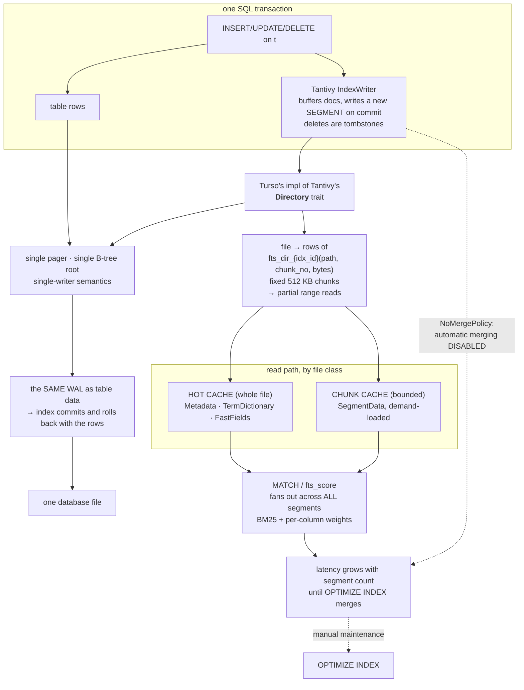

<!--
entry-meta
date: 2026-11-10
type: daily-diff
category: Daily Diff
title: Daily Diff — 2026-11-10
slug: janusgraph-standard-serializer-attribute-encodings
-->

# Daily Diff — 2026-11-10

**2026-11-10 · Daily Diff Digest**

**Edition covered: [2026-11-09](https://tdd.cat/2026-11-09/), 50 stories.** The front page served the 2026-11-09 edition at 09:05 IST and [`/archive/`](https://tdd.cat/archive/) confirms it is the newest of 134 — the November 10 cell is not linked, so **no 2026-11-10 edition exists yet**. Lesson 11's run digested 2026-11-08, so 2026-11-09 is uncovered and is today's edition.

---

## What was in it

Fifty items, and the distribution is lopsided: roughly half are AI-infrastructure, and the inference-engine-from-scratch genre has clearly become a category of its own.

**Storage and databases**
- **Native transactional full-text search in TursoDB** — Tantivy's index stored inside Turso's own B-tree rather than the filesystem, committed in the same transaction as the table. [Deep dive below.](#deep-dive-turso-puts-a-tantivy-index-inside-its-own-b-tree)
- **Fast search joins eliminate the need to denormalize schemas** ([paradedb.com](https://www.paradedb.com/blog/joins)) — the argument that a good join implementation removes the usual reason to flatten a schema for search. Directly relevant to lesson 10's finding that a vertex-centric index is a *whole extra relation type* and costs `2 + N` full columns per edge: the same denormalisation tradeoff, in a graph store.
- **Predicting query costs between Phoenix and ClickHouse** ([alnovis.io](https://alnovis.io/blog/phoenix-vs-clickhouse)) — cross-engine cost modelling. Phoenix is a SQL layer over HBase, i.e. the same key → sorted-columns substrate JanusGraph's CQL and HBase backends sit on.
- **Optimized C beats Rust in SQLite number parsing** ([simonwillison.net](https://simonwillison.net/2026/Nov/8/sqlite-parse-number-c-vs-rust/)) — a narrow benchmark with a wide comment section. Worth a look if only because the SQLite track spent 33 lessons in that file's neighbourhood.
- **Sandisk and Kioxia diverge on high-bandwidth flash** ([blocksandfiles.com](https://www.blocksandfiles.com/flash/2026/11/03/same-fab-different-paths-kioxia-and-sandisk-diverge-on-hbf/5307156)) — same fab, two HBF roadmaps. Matters for anyone costing a storage tier two years out.

**Systems and kernel**
- **Remounting sysfs fixes slow sequential reads on containerized NFS** ([peng.fyi](https://peng.fyi/post/sysfs-superblock-race/)) — a superblock race, which is the better kind of bug report: a specific mechanism, not a tuning knob.
- **A single tar archive that extracts eight different ways** ([stoppels.ch](https://stoppels.ch/2026/11/07/the-hardest-tarball.html)) — format-ambiguity craftsmanship. Sits oddly well beside today's lesson: a format whose readers disagree is a format with an under-specified length field.
- **AWS Nitro sandboxes: hardware-enforced isolation for EKS pods** ([aws.amazon.com](https://aws.amazon.com/blogs/containers/aws-nitro-sandboxes-hardware-enforced-workload-isolation-on-amazon-eks/)).
- **Keep the agent's packets out of the host kernel** ([kunalkushwaha.github.io](https://kunalkushwaha.github.io/2026/11/09/keep-agent-packets-out-of-host-kernel/)) and **systemd adopts Rust for leaf binaries** ([amutable.com](https://amutable.com/blog/systemd-loves-rust)) — note *leaf binaries, not shared libraries*, which is the interesting constraint.
- **Running Redox OS as a cloud hypervisor guest** ([redox-os.org](https://www.redox-os.org/news/virtualized-redox/)) and **an independent kernel that runs Linux userspace** ([zenodo](https://zenodo.org/records/23682548)).
- **Terminal visibility reports** ([rockorager.dev](https://rockorager.dev/misc/visibility-reports/)) — don't render what nobody is looking at.

**Security, and one that should worry you**
- **Approving Claude Code commands leaks credentials to repositories** ([blog.gitguardian.com](https://blog.gitguardian.com/claude-code-settings-local-json-secrets-docker-hub/)) — `settings.local.json` capturing secrets from approved commands and then being committed. If you use the tool, read this one today.
- **Google Gemini routes personal Drive files to human annotators** ([github.com](https://github.com/thisisme6598/gemini_files/)).
- **Thought injection compromises reasoning agents by mimicking internal deliberation** ([arXiv 2611.08811](https://arxiv.org/abs/2611.08811)) and **cross-document synthesis in agent memory leaks confidential parent secrets** ([github.com](https://github.com/harishbalasubramanian/sentinel-eval)) — two independent papers on the same class of failure: the agent cannot tell its own reasoning from injected text.

**AI infrastructure** (the bulk of the edition)
- Three separate memory-constrained MoE inference projects: **120B MoE under strict memory budgets** ([mitln.github.io](https://mitln.github.io/moe-inference-engine/)), **MoEShift under 10 GB** ([github.com](https://github.com/davide-troiani/moeshift)), and **SonicBoom beating llama.cpp on consumer GPUs via compiler optimizations** ([github.com](https://github.com/hardenedlinux/SonicBoom)).
- **Together's continual compilation** ([together.ai](https://www.together.ai/blog/together-compiler-continual-compilation-for-ai-inference)) — recompile as the workload shifts, which is a database query-plan-cache idea wearing different clothes.
- **Pathways: single-controller distributed training** ([developers.googleblog.com](https://developers.googleblog.com/what-is-pathways-single-controller-training-for-large-models/)).
- **Next-concept modeling for coarse-to-fine parallel generation** ([hazyresearch](https://hazyresearch.stanford.edu/blog/2026-10-12-ncm)) and **E-means, 10× faster clustering at equal loss** ([e-means.github.io](https://e-means.github.io/)).
- **Turning codebases into formal knowledge graphs for AI agents** ([github.com](https://github.com/AxiomCodeAI/axiomcodegraph)) — a property graph of code, which is the use case JanusGraph is usually pitched at.
- **Automated researchers can reliably mitigate alignment failures** ([anthropic.com](https://www.anthropic.com/research/automated-researchers-mitigate-alignment-failures)) and **safely scaling multi-agent teams** ([claude.dev](https://claude.dev/blog/safely-scaling-multi-agent-teams-with-fable-5-2/)).
- **AI coding agents verify less code for patch releases** ([developer.microsoft.com](https://developer.microsoft.com/blog/do-ai-coding-agents-care-about-semver/)) — agents reading semver as a risk signal, which is either sensible or exactly backwards.
- **Catch silent LLM regressions with deterministic assertions** ([evalshift.dev](https://www.evalshift.dev/blog/llm-regression-testing-model-upgrade)).

**Languages and runtimes**
- **CheerpJ 5.0: modern Java and WasmGC in the browser** ([labs.leaningtech.com](https://labs.leaningtech.com/blog/cheerpj-5.0)).
- **PeachQ, an open-source q** ([peachq.org](https://peachq.org/)) — an array language with a column store attached, which is a more interesting thing to read than most.
- **Rewriting crypto libraries in Rust with AI** ([moq.dev](https://moq.dev/blog/rind/)) and **reading shared cache data in PHP without copying** ([github.com](https://github.com/chrfritsch/nocopy)).
- **What breaking a Rust actor cluster on purpose taught us** ([heikoseeberger.de](https://heikoseeberger.de/2026-11-09-chaos-verifier/)).

---

## Deep dive: Turso puts a Tantivy index inside its own B-tree

Source followed: [turso.tech/blog/beyond-fts5](https://turso.tech/blog/beyond-fts5).

**What it is.** Turso is adding native full-text search built on [Tantivy](https://github.com/quickwit-oss/tantivy), the Rust search library, rather than reimplementing or wrapping SQLite's FTS5. It is experimental — behind `--experimental-index-method` on `main` in the CLI — and targeted at Turso v0.5.

The surface is deliberately not FTS5's virtual-table shape:

```sql
CREATE INDEX idx ON t USING fts (title, body)
  WITH (tokenizer = 'default', weights = 'title=2.0,body=1.0');

SELECT *, fts_score(t) FROM t WHERE (title, body) MATCH 'storage engine';
SELECT fts_highlight(body, '<b>', '</b>') FROM t WHERE (title, body) MATCH 'storage';
OPTIMIZE INDEX idx;
```

Postgres-style `USING fts (…) WITH (…)`, five tokenizers (`default`, `raw`, `simple`, `whitespace`, `ngram`), BM25 with per-column weights.

### The mechanism worth reading: `Directory`

Tantivy expects a filesystem. Its on-disk format is a directory of immutable per-segment files plus metadata, and it reaches them through a `Directory` trait. **Turso implements that trait against its own B-tree**, so the index never touches the filesystem:

- Each FTS index is backed by a table shaped roughly `fts_dir_{idx_id}(path TEXT, chunk_no INTEGER, bytes BLOB)`.
- Each Tantivy file is split into fixed **512 KB** chunks keyed by `(path, chunk_no)` — so a read of bytes `[600 KB, 700 KB)` of a segment file becomes a point lookup on `(path, 1)` rather than a scan of the whole blob.
- File *class* drives caching, not file size: **Metadata**, **TermDictionary** and **FastFields** are held whole in a hot cache; **SegmentData** is demand-loaded through a bounded chunk cache. The catalog stays resident.

This is the same move JanusGraph makes at the layer below, and it is worth stating side by side. Lesson 05 read `OrderedKeyValueStoreManagerAdapter`, which **manufactures a column dimension** on a flat ordered key-value store by concatenating the row key onto every column — and lesson 05's central finding was that the correctness of a prefix range scan over `key ‖ column` depends entirely on whether keys are **fixed-width**. Turso's `(path, chunk_no)` key is the same construction with the same property: a fixed-width integer chunk number appended to a variable-width path, so a range scan over one file's chunks is exact and never bleeds into the next path. Turso gets to choose both halves of the key; JanusGraph had to patch the variable-width case with a trailing 2-byte length and an `equalKey` predicate.



### Why it matters: the transaction is the point

Funnelling index persistence through the same pager and the same WAL as the table buys the thing FTS5 cannot give you cheaply: **the index write is in the transaction**. Commit and the index moves with the rows; roll back and it does not exist; crash and WAL recovery restores both consistently. One database file, one backup, one replica.

### The cost, stated honestly, and it is the interesting part

Tantivy's write model is immutable segments plus background merges. Turso runs it with **`NoMergePolicy` — automatic merging switched off entirely** — and the reasoning is the sharpest thing in the post: a background merge would either run *outside* the SQL transaction (breaking the guarantee above) or hold a write transaction open for the duration of the merge (blocking every writer, since the storage layer is single-writer). Neither is acceptable, so merging becomes explicit maintenance via `OPTIMIZE INDEX`.

The consequence is a knob the operator now owns:

- Segment count grows monotonically with writes.
- A query fans out across every segment, so **read latency degrades with write volume** until someone runs `OPTIMIZE INDEX`.
- Deletes are tombstones until a merge removes them, so deleted documents keep costing storage and fan-out.

That is the same tradeoff shape as JanusGraph's mixed indexes, from the other side. JanusGraph pushes the index into Elasticsearch/Solr, so index writes are **outside** the graph transaction — which is exactly why there is a transaction log, a CDC path, and stale-index repair (lesson 28 on the syllabus). Turso pulls the index inside the transaction and pays by giving up background compaction. **Nobody gets both**: either the index is in your transaction and you compact it by hand, or it compacts itself and you own a reconciliation story.

The post is honest about what it does not have. There are **no latency, throughput or index-size benchmarks** — the only numbers are the 512 KB chunk size, the default tokenizer's 40-character limit, the `ngram` tokenizer's 2–3 character range, and two illustrative BM25 scores (2.91 and 2.10) under `title=2.0,body=1.0`. It also does not describe posting-list encoding, because it does not have to: that is Tantivy's existing format, unchanged. And while it says the single-pager design gives single-writer semantics, it does not discuss MVCC, which is where the next question lives — whether a long-running read transaction sees a consistent segment set while a writer is appending new ones.

**What I would want measured before using it:** segments created per 1,000 inserts, query latency as a function of segment count between `OPTIMIZE INDEX` runs, and the duration and write-blocking behaviour of `OPTIMIZE INDEX` on a realistically sized index. Those three numbers decide whether "merging is manual" is a footnote or the whole operational story.

---

## Sources

- [The Daily Diff](https://tdd.cat/) — front page, served the 2026-11-09 edition
- [The Daily Diff — 2026-11-09](https://tdd.cat/2026-11-09/) — the edition covered
- [The Daily Diff archive](https://tdd.cat/archive/) — 134 editions, newest 2026-11-09; no 2026-11-10 edition listed
- [Beyond FTS5: Native Full-Text Search in Turso](https://turso.tech/blog/beyond-fts5) — the deep-dive item, source link followed
