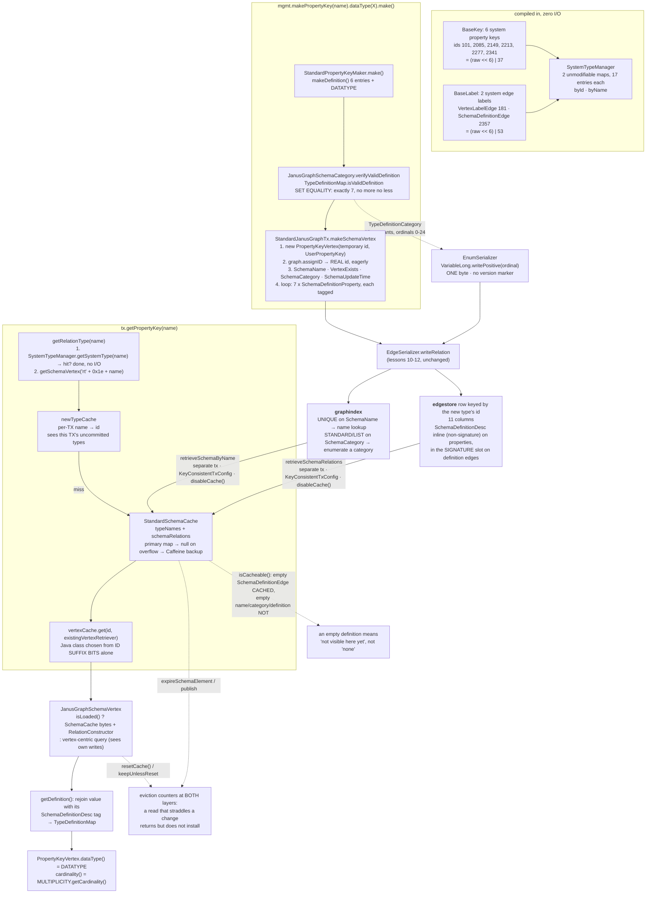

<!--
entry-meta
date: 2026-11-11
type: lesson
track: JanusGraph
lesson: 13
category: Database Internals
title: System types and schema storage — the schema is a subgraph, and six property keys hold all of it
slug: janusgraph-system-types-schema-storage
-->

# System types and schema storage — the schema is a subgraph, and six property keys hold all of it

**2026-11-11 · JanusGraph Track · Lesson 13 of 28**

Reading `JanusGraph/janusgraph` at commit [`a59ae8d8`](https://github.com/JanusGraph/janusgraph/tree/a59ae8d8024207598eada34998d867617df51adf) (2026-10-28). **Part II closes here.** The Part II/III boundary — the first re-pin opportunity since lesson 08 declined one — is settled below in §10: `a59ae8d8` is still the tip of `master`, so there is nothing to re-pin to, and the decision is recorded rather than deferred a fourth time.

## Where This Fits

- **Lessons 08–09** fixed the ID space: `IDManager` bit layout, `VertexIDType` suffixes, and block allocation. **Lessons 10–11** built and parsed the edgestore column. **Lesson 12** opened the attribute bytes and named the three dispatch entry points. All four treated *relation types* as given — something `EdgeSerializer` is handed, with an id, a sort key, a signature and a datatype. ([lesson 10](../2026-11-08-janusgraph-edge-serializer-column-layout/README.md), [lesson 11](../2026-11-09-janusgraph-parse-relation-relation-cache/README.md), [lesson 12](../2026-11-10-janusgraph-standard-serializer-attribute-encodings/README.md))
- **This lesson is where relation types come from.** The answer is that they are vertices in the same edgestore, written by the same `EdgeSerializer`, read back by the same `parseRelation`. A property key named `name` is a row in `edgestore` with eleven columns, and every one of those columns is keyed by one of **six** hard-coded system property keys. There is no catalog table, no separate metadata store, no bootstrap file.
- **It settles both debts lesson 12 carried forward.** §9 answers *which `TypeDefinitionCategory` values are stored by ordinal* (all of them, one byte each) and §8 answers lesson 11's *where does `getExistingRelationType` bottom out* (a static 17-entry `HashMap`, or the ID-bit dispatch in the vertex constructor).
- **It sets up Part III.** Lesson 14 opens `StandardJanusGraph`'s constructor, which cannot read a single configuration value out of `system_properties` without the machinery in §1–§3 already existing in Java. Lessons 17, 25 and 26 are all about what hangs off the second system edge label, `SchemaDefinitionEdge`.

---

## 1. There is no catalog: five system keys, two system labels, one subgraph

[`BaseKey`](https://github.com/JanusGraph/janusgraph/blob/a59ae8d8024207598eada34998d867617df51adf/janusgraph-core/src/main/java/org/janusgraph/graphdb/types/system/BaseKey.java#L41-L58) declares exactly six property keys, and [`BaseLabel`](https://github.com/JanusGraph/janusgraph/blob/a59ae8d8024207598eada34998d867617df51adf/janusgraph-core/src/main/java/org/janusgraph/graphdb/types/system/BaseLabel.java) exactly two. That is the whole vocabulary in which JanusGraph describes itself.

| Constant | Raw id | Datatype | Cardinality | Index | Role |
|---|---|---|---|---|---|
| `BaseKey.VertexExists` | 1 | `Boolean` | SINGLE | NONE | existence marker on **every** vertex |
| `BaseKey.SchemaName` | 32 | `String` | SINGLE | **UNIQUE** | the prefixed name; name → id lookups |
| `BaseKey.SchemaDefinitionProperty` | 33 | `Object` | **LIST** | NONE | one column per definition entry |
| `BaseKey.SchemaCategory` | 34 | `JanusGraphSchemaCategory` | SINGLE | **STANDARD** | what kind of schema element this is |
| `BaseKey.SchemaDefinitionDesc` | 35 | `TypeDefinitionDescription` | SINGLE | NONE | meta-property: *which* entry this is |
| `BaseKey.SchemaUpdateTime` | 36 | `Long` | SINGLE | NONE | last schema change, for eviction |
| `BaseLabel.VertexLabelEdge` | 2 | — | MANY2ONE, OUT | — | user vertex → its vertex label |
| `BaseLabel.SchemaDefinitionEdge` | 36 | — | MULTI, BOTH | — | schema element → schema element |

Three things in that table are load-bearing and easy to read past:

- **`SchemaDefinitionProperty` has datatype `Object.class` and cardinality `LIST`.** `LIST` is what lets one schema vertex carry seven of them; `Object.class` is what routes every definition value through `writeClassAndObject` — lesson 12's self-describing form, the only one that can hold a `Boolean`, a `long[]`, an `Order`, a `Multiplicity` and a `Class` in the same key. The schema format is dynamically typed on purpose.
- **`SchemaDefinitionDesc` is a property *of a property*.** It is the tag that says what the untyped value in the sibling column means. Nothing else in JanusGraph's data model needs meta-properties this way.
- **The comment above `VertexExists`** — *"We rely on the vertex-existence property to be the smallest (in byte-order) when iterating over the entire graph"* — is an invariant about §2's arithmetic, and it holds: id 1 is the smallest raw id of any system key.

### 1.1 Why `VertexExists` is in this file at all

It is not schema. It is on every vertex, user or schema, written by both [`addVertex`](https://github.com/JanusGraph/janusgraph/blob/a59ae8d8024207598eada34998d867617df51adf/janusgraph-core/src/main/java/org/janusgraph/graphdb/transaction/StandardJanusGraphTx.java#L692) and [`makeSchemaVertex`](https://github.com/JanusGraph/janusgraph/blob/a59ae8d8024207598eada34998d867617df51adf/janusgraph-core/src/main/java/org/janusgraph/graphdb/transaction/StandardJanusGraphTx.java#L1101). It lives with the schema keys because it is a *system* key, and because `StandardJanusGraph` builds one `SliceQuery` out of it at construction time and keeps it forever:

```java
// StandardJanusGraph:306
this.vertexExistenceQuery =
    edgeSerializer.getQuery(BaseKey.VertexExists, Direction.OUT, new EdgeSerializer.TypedInterval[0]).setLimit(1);
```

That single prebuilt query is the entire implementation of "does this vertex exist" ([`:632`](https://github.com/JanusGraph/janusgraph/blob/a59ae8d8024207598eada34998d867617df51adf/janusgraph-core/src/main/java/org/janusgraph/graphdb/database/StandardJanusGraph.java#L632)) and the start key for a full graph scan ([`getVertexIDs:646-657`](https://github.com/JanusGraph/janusgraph/blob/a59ae8d8024207598eada34998d867617df51adf/janusgraph-core/src/main/java/org/janusgraph/graphdb/database/StandardJanusGraph.java#L646-L657)). "Smallest in byte order" is what makes `limit(1)` on an *ordered* scan cheap: the existence column is the first one in the row.

---

## 2. The bootstrap that isn't: system type ids are computed, not stored

If relation types are vertices, and reading a vertex requires knowing the relation types in its columns, the obvious problem is circular. JanusGraph breaks the circle by making the eight system types **pure Java constants with ids derived arithmetically**, never read from storage.

[`BaseRelationType`](https://github.com/JanusGraph/janusgraph/blob/a59ae8d8024207598eada34998d867617df51adf/janusgraph-core/src/main/java/org/janusgraph/graphdb/types/system/BaseRelationType.java) does it in the constructor:

```java
BaseRelationType(String name, long id, JanusGraphSchemaCategory type) {
    this.name = Token.systemETprefix + name;
    this.id   = getSystemTypeId(id, type);      // IDManager.getSchemaId(SystemPropertyKey|SystemEdgeLabel, id)
}
```

`IDManager.getSchemaId` is just `type.addPadding(count)` = `(count << offset()) | suffix()` ([`IDManager:345-349`](https://github.com/JanusGraph/janusgraph/blob/a59ae8d8024207598eada34998d867617df51adf/janusgraph-core/src/main/java/org/janusgraph/graphdb/idmanagement/IDManager.java#L345-L349), [`:691-694`](https://github.com/JanusGraph/janusgraph/blob/a59ae8d8024207598eada34998d867617df51adf/janusgraph-core/src/main/java/org/janusgraph/graphdb/idmanagement/IDManager.java#L691-L694)). With the suffixes from lesson 08:

| `VertexIDType` | offset | suffix | bits |
|---|---|---|---|
| `UserPropertyKey` | 6 | 5 | `000101` |
| `SystemPropertyKey` | 6 | **37** | `100101` |
| `UserEdgeLabel` | 6 | 21 | `010101` |
| `SystemEdgeLabel` | 6 | **53** | `110101` |
| `GenericSchemaType` | 4 | 9 | `1001` |

So the eight system types have these actual ids, every time, on every instance, with no I/O:

| Constant | computation | id |
|---|---|---|
| `VertexExists` | `(1 << 6) \| 37` | **101** |
| `VertexLabelEdge` | `(2 << 6) \| 53` | **181** |
| `SchemaName` | `(32 << 6) \| 37` | **2085** |
| `SchemaDefinitionProperty` | `(33 << 6) \| 37` | **2149** |
| `SchemaCategory` | `(34 << 6) \| 37` | **2213** |
| `SchemaDefinitionDesc` | `(35 << 6) \| 37` | **2277** |
| `SchemaUpdateTime` | `(36 << 6) \| 37` | **2341** |
| `SchemaDefinitionEdge` | `(36 << 6) \| 53` | **2357** |

**Note the raw-id collision that isn't one.** `SchemaUpdateTime` and `SchemaDefinitionEdge` are both declared with raw id `36`. They do not collide because the six-bit suffix differs: 37 vs 53. The raw number is only unique *within* a `VertexIDType`, which is why the two declaration lists can be written independently in two files.

[`SystemTypeManager`](https://github.com/JanusGraph/janusgraph/blob/a59ae8d8024207598eada34998d867617df51adf/janusgraph-core/src/main/java/org/janusgraph/graphdb/types/system/SystemTypeManager.java) puts all eight plus the nine `ImplicitKey`s into two unmodifiable maps in a static initialiser, and asserts the count twice:

```java
assert SYSTEM_TYPES_BY_ID.size()==17;
assert SYSTEM_TYPES_BY_NAME.size()==17;
```

That is the whole bootstrap. There is no "system catalog" row, no magic vertex id 0, no schema version file. The reader of the first byte of the first row already has every type it needs to interpret it.

---

## 3. Names: two bytes of prefix, one separator, and a namespace property keys share with edge labels

[`JanusGraphSchemaCategory.getSchemaName`](https://github.com/JanusGraph/janusgraph/blob/a59ae8d8024207598eada34998d867617df51adf/janusgraph-core/src/main/java/org/janusgraph/graphdb/internal/JanusGraphSchemaCategory.java) is three lines of prefix logic and one `Token.getSeparatedName`:

| Category | prefix | stored `SchemaName` for `"name"` |
|---|---|---|
| `PROPERTYKEY` | `rt` | `rt` `0x1e` `name` |
| `EDGELABEL` | `rt` | `rt` `0x1e` `name` |
| `VERTEXLABEL` | `vl` | `vl` `0x1e` `name` |
| `GRAPHINDEX` | `gi` | `gi` `0x1e` `name` |
| `TYPE_MODIFIER` | — | `hasName()` is `false`; no name stored at all |

The separator is `Token.SEPARATOR_CHAR = 0x1e` (ASCII record separator), and `Token.verifyName` rejects any name containing it.

**Property keys and edge labels share the `rt` prefix, and that is the mechanism, not an accident.** `SchemaName` carries a UNIQUE composite index, so one stored name maps to one id — which means *a property key and an edge label can never share a name*. And the lookup exploits it:

```java
// StandardJanusGraphTx:1231-1239
public RelationType getRelationType(String name) {
    RelationType type = SystemTypeManager.getSystemType(name);
    if (type!=null) return type;
    return (RelationType)getSchemaVertex(JanusGraphSchemaCategory.getRelationTypeName(name));
}
```

`getRelationTypeName` is hard-coded to `EDGELABEL.getSchemaName(name)` — it asks for the `rt` namespace and gets back whichever of the two kinds exists. `getPropertyKey` and `getEdgeLabel` then just check `isPropertyKey()` on the result and throw if it is the wrong kind. One storage lookup serves both APIs because the namespace was deliberately merged.

The system namespace itself is `Token.systemETprefix = Graph.Hidden.hide("T$")` — TinkerPop's hidden prefix applied to `T$`, so the stored names are `~T$VertexExists`, `~T$SchemaName` and so on. (TinkerPop's `Graph.Hidden` is a dependency, not read at this pinned commit.) And note that `getRelationType` checks `SystemTypeManager.getSystemType(name)` against those full names — so `~T$SchemaName` resolves as a relation type by name, with no storage read, from any transaction.

### 3.1 A reachability bug in the name guard

[`SystemTypeManager.throwIfSystemName`](https://github.com/JanusGraph/janusgraph/blob/a59ae8d8024207598eada34998d867617df51adf/janusgraph-core/src/main/java/org/janusgraph/graphdb/types/system/SystemTypeManager.java) is the only validation a user-supplied type name passes through — `StandardRelationTypeMaker.name()` calls it on every `makePropertyKey`/`makeEdgeLabel`:

```java
if (SystemTypeManager.isSystemType(name.toLowerCase(Locale.ROOT)) || Token.isSystemName(name))
    throw new IllegalArgumentException("Name cannot be in protected namespace: "+name);
```

`isSystemType` is `SYSTEM_TYPES_BY_NAME.containsKey(name) || ADDITIONAL_RESERVED_NAMES.contains(name)`. The keys of `SYSTEM_TYPES_BY_NAME` are mixed-case (`~T$VertexExists`), and the argument has been lowercased, so **the first disjunct can never match from this call site**. `ADDITIONAL_RESERVED_NAMES` — `key`, `vertex`, `edge`, `element`, `property`, `label` — is all lowercase, so the second disjunct is the only one that ever fires.

This is not exploitable: `Token.isSystemName(name)` catches the `~` prefix, so every system name is still rejected, by the other half of the `||`. But the `isSystemType` half is dead code from its only call site that a repository-wide code search surfaces, and the lowercasing silently changes what the first disjunct means. A reader of this line reasonably concludes that the system-type map protects the namespace; it does not.

---

## 4. What a property-key definition *is*: 25 categories, and a set-equality check

The definition of any schema element is a `TypeDefinitionMap` — an `EnumMap<TypeDefinitionCategory,Object>` ([`TypeDefinitionMap`](https://github.com/JanusGraph/janusgraph/blob/a59ae8d8024207598eada34998d867617df51adf/janusgraph-core/src/main/java/org/janusgraph/graphdb/types/TypeDefinitionMap.java)). The key space is [`TypeDefinitionCategory`](https://github.com/JanusGraph/janusgraph/blob/a59ae8d8024207598eada34998d867617df51adf/janusgraph-core/src/main/java/org/janusgraph/graphdb/types/TypeDefinitionCategory.java#L41-L79): 25 constants, in a list whose first line is a warning.

```java
public enum TypeDefinitionCategory {
    //Don't change the order because it breaks backward compatibility.
```

Each constant is either a **property** category (it has a datatype; it becomes a `SchemaDefinitionProperty` column) or an **edge** category (no datatype, or a datatype used as an edge *modifier*; it becomes a `SchemaDefinitionEdge`):

| ordinal | category | datatype | kind |
|---|---|---|---|
| 0 | `INVISIBLE` | `Boolean` | property |
| 1 | `SORT_KEY` | `long[]` | property |
| 2 | `SORT_ORDER` | `Order` | property |
| 3 | `SIGNATURE` | `long[]` | property |
| 4 | `MULTIPLICITY` | `Multiplicity` | property |
| 5 | `DATATYPE` | `Class` | property |
| 6 | `UNIDIRECTIONAL` | `Direction` | property |
| 7 | `STATUS` | `SchemaStatus` | property |
| 8–12 | `ELEMENT_CATEGORY`, `INDEX_CARDINALITY`, `INTERNAL_INDEX`, `BACKING_INDEX`, `INDEXSTORE_NAME` | various | property |
| 13 | `CONSISTENCY_LEVEL` | `ConsistencyModifier` | property |
| 14 | `TTL` | `Integer` | property |
| 15–16 | `PARTITIONED`, `STATIC` | `Boolean` | property |
| 17–18 | `RELATIONTYPE_INDEX`, `TYPE_MODIFIER` | — | **edge** |
| 19 | `INDEX_FIELD` | `Parameter[]` | **edge** (with modifier) |
| 20–21 | `INDEX_SCHEMA_CONSTRAINT`, `PROPERTY_KEY_EDGE` | — | **edge** |
| 22 | `CONNECTION_EDGE` | `String` | **edge** (with modifier) |
| 23–24 | `UPDATE_CONNECTION_EDGE`, `INDEX_INLINE_KEY` | — | **edge** |

Which categories a given element must carry is a `Set`, and the check is **set equality, not containment** ([`TypeDefinitionMap.isValidDefinition`](https://github.com/JanusGraph/janusgraph/blob/a59ae8d8024207598eada34998d867617df51adf/janusgraph-core/src/main/java/org/janusgraph/graphdb/types/TypeDefinitionMap.java)):

```java
for (TypeDefinitionCategory type : requiredTypes)
    Preconditions.checkArgument(keys.contains(type), "%s not in %s", type, this);
Preconditions.checkArgument(keys.size() == requiredTypes.size(), "Found irrelevant definitions in: %s", this);
```

| element | required set | size |
|---|---|---|
| `PROPERTYKEY` | `STATUS, INVISIBLE, SORT_KEY, SORT_ORDER, SIGNATURE, MULTIPLICITY, DATATYPE` | **7** |
| `EDGELABEL` | `STATUS, INVISIBLE, SORT_KEY, SORT_ORDER, SIGNATURE, MULTIPLICITY, UNIDIRECTIONAL` | **7** |
| `GRAPHINDEX` | `STATUS, ELEMENT_CATEGORY, INDEX_CARDINALITY, INTERNAL_INDEX, BACKING_INDEX, INDEXSTORE_NAME` | **6** |
| `VERTEXLABEL` | `PARTITIONED, STATIC` | **2** |
| `TYPE_MODIFIER` | exactly one of `ModifierType`'s categories | **1** |

So a property key's stored definition is **exactly seven columns** — never six, never eight. `CONSISTENCY_LEVEL` and `TTL` are conspicuously absent from every list: they are type *modifiers*, stored on a separate `TYPE_MODIFIER` schema vertex reachable by a definition edge, which is why `TYPE_MODIFIER_DEFINITION_CATEGORIES` is built from `ModifierType.values()` and why `hasName()` is false for it. Lesson 18 is where that matters.

### 4.1 `VERTEXLABEL` has no `STATUS`, and that is why defaults exist

`TypeDefinitionMap.getValue` falls through to `type.defaultValue(this)` when a category is absent, and `TypeDefinitionCategory.defaultValue` has exactly two cases:

```java
case SORT_ORDER: return Order.ASC;
case STATUS:     return SchemaStatus.ENABLED;
```

`JanusGraphSchemaVertex.getStatus()` reads `getDefinition().getValue(STATUS, SchemaStatus.class)` unconditionally — on a vertex label, where `STATUS` is not in the required set and therefore not stored, that returns `ENABLED` from the default. The `SORT_ORDER` default, by contrast, is **dead for relation types**: `StandardRelationTypeMaker.makeDefinition()` always calls `def.setValue(SORT_ORDER, sortOrder)` even when the sort key is empty, so an `Order.ASC` is written to storage for every property key and edge label in existence. Same for `SORT_KEY` and `SIGNATURE`, which are persisted as `long[0]`.

### 4.2 Where a property key's seven entries come from

Two files, and the split is exactly the inheritance boundary:

```java
// StandardRelationTypeMaker.makeDefinition() — the six shared by keys and labels
def.setValue(INVISIBLE, isInvisible);                  // false
def.setValue(SORT_KEY, checkSortKey(sortKey));         // long[0]
def.setValue(SORT_ORDER, sortOrder);                   // Order.ASC
def.setValue(SIGNATURE, checkSignature(signature));    // long[0]
def.setValue(MULTIPLICITY, multiplicity);              // Multiplicity.convert(cardinality)
def.setValue(STATUS, status);                          // SchemaStatus.ENABLED

// StandardPropertyKeyMaker.make() — the seventh
definition.setValue(DATATYPE, dataType);
return tx.makePropertyKey(getName(), definition);
```

Note what `StandardPropertyKeyMaker` does *not* store: there is no `CARDINALITY` category. `cardinality(Cardinality)` is converted to a `Multiplicity` on the way in (`super.multiplicity(Multiplicity.convert(cardinality))`) and converted back on the way out (`PropertyKeyVertex.cardinality()` returns `super.multiplicity().getCardinality()`). Cardinality is a view over a stored multiplicity; only one of the two is a persisted concept.

Also note `cardinalityIsSet`: the constructor calls `cardinality(Cardinality.SINGLE)` and then resets the flag to `false`, so a `DefaultSchemaMaker` can tell "the user explicitly asked for SINGLE" from "nobody said". That distinction exists only in the maker, never in storage.

---

## 5. `makeSchemaVertex`: eleven columns, in one transaction, with a real id before the first write

[`StandardJanusGraphTx.makeSchemaVertex:1080-1112`](https://github.com/JanusGraph/janusgraph/blob/a59ae8d8024207598eada34998d867617df51adf/janusgraph-core/src/main/java/org/janusgraph/graphdb/transaction/StandardJanusGraphTx.java#L1080-L1112) is the whole write path, and it is short enough to read as a spec:

```java
schemaCategory.verifyValidDefinition(definition);                       // §4's set-equality check
// construct with a TEMPORARY id of the right VertexIDType
schemaVertex = new PropertyKeyVertex(this,
    IDManager.getTemporaryVertexID(IDManager.VertexIDType.UserPropertyKey, temporaryIds.nextID()),
    ElementLifeCycle.New);
graph.assignID(schemaVertex, BaseVertexLabel.DEFAULT_VERTEXLABEL);      // real id, NOW
Preconditions.checkArgument(schemaVertex.longId() > 0);
if (schemaCategory.hasName()) addProperty(schemaVertex, BaseKey.SchemaName, schemaCategory.getSchemaName(name));
addProperty(schemaVertex, BaseKey.VertexExists, Boolean.TRUE);
addProperty(schemaVertex, BaseKey.SchemaCategory, schemaCategory);
updateSchemaVertex(schemaVertex);                                       // SchemaUpdateTime
for (Map.Entry<TypeDefinitionCategory,Object> def : definition.entrySet()) {
    JanusGraphVertexProperty p = addProperty(schemaVertex, BaseKey.SchemaDefinitionProperty, def.getValue());
    p.property(BaseKey.SchemaDefinitionDesc.name(), TypeDefinitionDescription.of(def.getKey()));
}
vertexCache.add(schemaVertex, schemaVertex.longId());
if (schemaCategory.hasName()) newTypeCache.put(schemaCategory.getSchemaName(name), schemaVertex.longId());
```

Four observations worth the reading:

1. **The ID is assigned eagerly, unconditionally.** A user vertex gets its real id lazily — `addVertex` only calls `graph.assignID` if `config.hasAssignIDsImmediately()` or the label is partitioned ([`:686-688`](https://github.com/JanusGraph/janusgraph/blob/a59ae8d8024207598eada34998d867617df51adf/janusgraph-core/src/main/java/org/janusgraph/graphdb/transaction/StandardJanusGraphTx.java#L686-L688)). A schema vertex never can be lazy: `SIGNATURE` and `SORT_KEY` store `key.longId()` values, so any type that references another type needs that other type's final id at definition time. The eager `assignID` plus `checkArgument(longId() > 0)` is that constraint made explicit.
2. **The temporary id already carries the right `VertexIDType`.** `getTemporaryVertexID(UserPropertyKey, …)` means even the pre-assignment id has suffix `000101`, so the ID-bit dispatch in §8 works on a vertex that has not been assigned yet.
3. **`SchemaCategory` is written as an enum attribute**, which §9 shows means one byte of ordinal. The *category* of a schema element costs one byte; the *name* costs `3 + 2n` (lesson 12's `String` byte-order encoding) in the graphindex key.
4. **`newTypeCache` is a per-transaction name → id map.** It is checked *before* the global schema cache in `getSchemaVertex` ([`:1216-1224`](https://github.com/JanusGraph/janusgraph/blob/a59ae8d8024207598eada34998d867617df51adf/janusgraph-core/src/main/java/org/janusgraph/graphdb/transaction/StandardJanusGraphTx.java#L1216-L1224)), which is how a type created earlier in the same uncommitted transaction is findable by name. On close the transaction swaps it for `Collections.emptyMap()` ([`:2209`](https://github.com/JanusGraph/janusgraph/blob/a59ae8d8024207598eada34998d867617df51adf/janusgraph-core/src/main/java/org/janusgraph/graphdb/transaction/StandardJanusGraphTx.java#L2209)) — the same pattern as the `EmptyVertexCache` swap one line above it.

### 5.1 The row, column by column

For `mgmt.makePropertyKey("name").dataType(String.class).make()`, the edgestore row keyed by the new key's id holds **eleven columns**:

| # | relation type (id) | what the value holds |
|---|---|---|
| 1 | `VertexExists` (101) | `Boolean.TRUE` |
| 2 | `SchemaName` (2085) | `rt` `0x1e` `name` |
| 3 | `SchemaCategory` (2213) | `PROPERTYKEY` — one ordinal byte |
| 4 | `SchemaUpdateTime` (2341) | `times.getTime(...)` as `Long` |
| 5–11 | `SchemaDefinitionProperty` (2149) ×7 | `INVISIBLE=false`, `SORT_KEY=long[0]`, `SORT_ORDER=ASC`, `SIGNATURE=long[0]`, `MULTIPLICITY=…`, `STATUS=ENABLED`, `DATATYPE=String.class` — each tagged with its own `SchemaDefinitionDesc` meta-property |

Plus, in the **graphindex** store, two entries: one for the UNIQUE index on `SchemaName` and one for the STANDARD (LIST) index on `SchemaCategory`.

### 5.2 Where the meta-property goes in the bytes — and why it differs between properties and edges

This is the one place lessons 10–12 pay off directly. Lesson 10 established that a relation's column/value split puts **signature** properties compressed in the value's fixed prefix and **all other** properties in the uncompressed tail with an inline type id.

- [`EmptyRelationType.getSignature()`](https://github.com/JanusGraph/janusgraph/blob/a59ae8d8024207598eada34998d867617df51adf/janusgraph-core/src/main/java/org/janusgraph/graphdb/types/system/EmptyRelationType.java) returns `new long[0]`, and `BaseKey` does not override it. So on a `SchemaDefinitionProperty` column, the `SchemaDefinitionDesc` meta-property is a **non-signature** property: inline type id (2277, varint) followed by its value.
- [`BaseLabel.SchemaDefinitionEdge`](https://github.com/JanusGraph/janusgraph/blob/a59ae8d8024207598eada34998d867617df51adf/janusgraph-core/src/main/java/org/janusgraph/graphdb/types/system/BaseLabel.java) **does** override it:

```java
@Override
public long[] getSignature() {
    return new long[]{(long) BaseKey.SchemaDefinitionDesc.id()};
}
```

So on a definition *edge*, the same `SchemaDefinitionDesc` is the single signature property — written into the value's fixed slot with no inline type id. The one override is the only reason the two carriers of the same tag have different byte layouts, and it is a size optimisation: there is exactly one definition edge type and it always carries exactly one description, so the id is redundant.

### 5.3 The description itself is two bytes

[`TypeDefinitionDescriptionSerializer`](https://github.com/JanusGraph/janusgraph/blob/a59ae8d8024207598eada34998d867617df51adf/janusgraph-core/src/main/java/org/janusgraph/graphdb/database/serialize/attribute/TypeDefinitionDescriptionSerializer.java) is five lines of body:

```java
public void write(WriteBuffer buffer, TypeDefinitionDescription attribute) {
    DataOutput out = (DataOutput)buffer;
    out.writeObjectNotNull(attribute.getCategory());   // EnumSerializer → VariableLong ordinal
    out.writeClassAndObject(attribute.getModifier());  // registration no + payload, or 0 for null
}
```

[`TypeDefinitionDescription`](https://github.com/JanusGraph/janusgraph/blob/a59ae8d8024207598eada34998d867617df51adf/janusgraph-core/src/main/java/org/janusgraph/graphdb/types/TypeDefinitionDescription.java)'s constructor forbids a modifier whenever the category is a property one, and `of(category)` is the null-modifier factory that `makeSchemaVertex` uses. Since all 25 ordinals fit in a single `VariableLong.writePositive` byte, and a null modifier is `writePositive(0)` — also one byte — **every one of a property key's seven definition tags is exactly two bytes: `[ordinal][0x00]`**. Only definition edges with a modifier (`INDEX_FIELD` with `Parameter[]`, `CONNECTION_EDGE` with a `String`) pay more.

---

## 6. Reading it back: one class, two code paths, and a reset counter

[`JanusGraphSchemaVertex`](https://github.com/JanusGraph/janusgraph/blob/a59ae8d8024207598eada34998d867617df51adf/janusgraph-core/src/main/java/org/janusgraph/graphdb/types/vertices/JanusGraphSchemaVertex.java) extends `CacheVertex` and implements [`SchemaSource`](https://github.com/JanusGraph/janusgraph/blob/a59ae8d8024207598eada34998d867617df51adf/janusgraph-core/src/main/java/org/janusgraph/graphdb/types/SchemaSource.java). `getDefinition()` is the inverse of §5's loop:

```java
for (JanusGraphVertexProperty property : ps) {
    TypeDefinitionDescription desc = property.valueOrNull(BaseKey.SchemaDefinitionDesc);
    Preconditions.checkArgument(desc!=null && desc.getCategory().isProperty());
    def.setValue(desc.getCategory(), property.value());
}
assert def.size()>0;
```

The untyped value and its tag are rejoined into the `EnumMap`. The `isProperty()` assertion is what guarantees §4's invariant from the read side: a property category never arrives on an edge and vice versa.

**Every accessor here has two paths, and the branch is `isLoaded()`:**

```java
if (isLoaded()) {
    ps = RelationConstructor.readRelation(this,
        tx.getGraph().getSchemaCache().getSchemaRelations(longId(), BaseKey.SchemaDefinitionProperty, Direction.OUT), tx);
} else {
    ps = query().type(BaseKey.SchemaDefinitionProperty).properties();
}
```

A **loaded** schema vertex goes to the cross-transaction `SchemaCache` and gets back raw `EntryList` bytes, which `RelationConstructor.readRelation` turns into relations — lesson 11's `parseRelation` path, driven from cached bytes instead of a fresh slice. A **new or modified** one goes through the ordinary vertex-centric query so it sees the transaction's own uncommitted writes. `name()`, `hasDefinition()`, `getDefinition()` and `loadRelated()` all branch the same way; `getEdges()` — the filtered variant used by `ManagementSystem` — only has the query path.

### 6.1 The `resets` counter

The four cached fields (`name`, `definition`, `outRelations`, `inRelations`) are `volatile` and guarded by an `AtomicLong resets`, with a protocol the class documents at length:

```java
final long resetsBefore = cacheResets();
def = /* load */;
keepUnlessReset(resetsBefore, def, value -> definition = value);
...
protected final <V> void keepUnlessReset(long resetsBefore, V value, Consumer<V> field) {
    if (resets.get() != resetsBefore) return;
    field.accept(value);
    if (resets.get() != resetsBefore) field.accept(null);
}
```

`resetCache()` increments **before** clearing anything, so a read that began before a concurrent schema change and finishes after it does not install its stale value. The read that loaded it still *returns* it — it began before the change — but a later read reloads. This is the same double-check shape as `StandardSchemaCache.publish` in §7, one layer up, and the two were clearly written together.

---

## 7. `StandardSchemaCache`: three bits of key packing and a deliberate asymmetry

[`StandardSchemaCache`](https://github.com/JanusGraph/janusgraph/blob/a59ae8d8024207598eada34998d867617df51adf/janusgraph-core/src/main/java/org/janusgraph/graphdb/database/cache/StandardSchemaCache.java) is the cross-transaction, per-`StandardJanusGraph` schema cache. It holds two things: name → id (`typeNames`) and (schema id, system type, direction) → raw `EntryList` (`schemaRelations`). Sizes: `MAX_CACHED_TYPES_DEFAULT = 10000`, and `maxCachedRelations = maxCachedTypes * CACHE_RELATION_MULTIPLIER` with `CACHE_RELATION_MULTIPLIER = 3`, commented *"1) type-name, 2) type-definitions, 3) modifying edges [index, lock]"*.

Each map has a `volatile` primary (`ConcurrentHashMap` / `NonBlockingHashMapLong`) and a bounded Caffeine `*Backup`. When the primary exceeds its bound it is set to `null` — permanently, for the life of the graph — and every subsequent lookup falls through to the bounded cache. Unbounded-until-it-isn't, then bounded forever.

**The relation key packs three fields into one `long`:**

```java
long typeId = (schemaId >>> SCHEMAID_BACK_SHIFT);     // 2 — strip the Schema padding
int systemTypeId;                                      // 2 bits
if      (type == BaseLabel.SchemaDefinitionEdge)       systemTypeId = 0;
else if (type == BaseKey.SchemaName)                   systemTypeId = 1;
else if (type == BaseKey.SchemaCategory)               systemTypeId = 2;
else if (type == BaseKey.SchemaDefinitionProperty)     systemTypeId = 3;
else throw new AssertionError(...);
return (((typeId << 2) + systemTypeId) << 1) + edgeDir; // 1 bit of direction
```

So **only four of the eight system relation types are cacheable at all** — `SchemaUpdateTime`, `VertexLabelEdge`, `VertexExists` and `SchemaDefinitionDesc` hit the `AssertionError`. That is correct by construction (nothing asks the schema cache for them) but it is a hard-coded four-way switch with a two-bit field, so adding a fifth cacheable system type means changing `SCHEMAID_TOTALFORW_SHIFT` and invalidating the key encoding. `SCHEMAID_BACK_SHIFT = 2` is the `VertexIDType.Schema` padding width, asserted in a static block:

```java
assert IDManager.VertexIDType.Schema.removePadding(1L<<SCHEMAID_BACK_SHIFT)==1;
```

### 7.1 The asymmetry: which empty answers get remembered

```java
private static boolean isCacheable(final BaseRelationType type, final EntryList entries) {
    return !entries.isEmpty() || type == BaseLabel.SchemaDefinitionEdge;
}
```

An empty `SchemaDefinitionEdge` result **is** cached; an empty `SchemaName`, `SchemaCategory` or `SchemaDefinitionProperty` result is **not**. The javadoc gives the reason, and it is the sharpest thing in the file: every existing schema vertex necessarily *has* a category and definition properties, so an empty answer for those does not mean "none" — it means *this schema element is not visible to this instance yet*, and must be re-read. Definition edges, on the other hand, are legitimately absent for most schema elements and are the most frequently asked question in the tree, so that answer has to be served from memory.

Get this wrong in either direction and you get a specific bug: cache the empty definition and a type created on another instance stays permanently empty until an eviction; refuse to cache the empty edge list and every index-selection decision pays a storage round trip.

### 7.2 The eviction race, and how the name lookup actually reaches storage

`publish` is the same double-check as §6.1:

```java
private <K,V> void publish(ConcurrentMap<K,V> cache, K key, V value, long evictionsBefore) {
    if (evictions.get() != evictionsBefore) return;
    cache.put(key, value);
    if (evictions.get() != evictionsBefore) cache.remove(key, value);
}
```

`expireSchemaElement` increments `evictions` **before** removing anything, and removes relation keys by prefix (`key >>> SCHEMAID_TOTALFORW_SHIFT == cutTypeId`) and name keys by value.

The misses go to [`StandardJanusGraph.typeCacheRetrieval`](https://github.com/JanusGraph/janusgraph/blob/a59ae8d8024207598eada34998d867617df51adf/janusgraph-core/src/main/java/org/janusgraph/graphdb/database/StandardJanusGraph.java#L611-L643), and the two retrievals read **different stores**:

| retrieval | store | how |
|---|---|---|
| `retrieveSchemaByName` | **graphindex** | `QueryUtil.getVertices(consistentTx, BaseKey.SchemaName, typeName)` — the UNIQUE composite index |
| `retrieveSchemaRelations` | **edgestore** | `edgeQuery(schemaId, queryCache.getQuery(type,dir), consistentTx.getTxHandle())` |

Both open a *separate* transaction with `backend.getStoreFeatures().getKeyConsistentTxConfig()` and call `consistentTx.getTxHandle().disableCache()`, then roll it back in a `finally`. Lesson 07 read `getKeyConsistentTxConfig`; this is its main consumer. Schema reads deliberately bypass the KCVS cache and use the backend's strongest consistency level — on Cassandra, `QUORUM` rather than the configured default — because a stale schema read is not a stale data read: it reinterprets every byte that follows.

That also means **"list all property keys" is one graphindex row read**, not a scan. `BaseKey.SchemaCategory`'s index has `Cardinality.LIST`, so all `PROPERTYKEY` schema vertices share one index key, and both `ManagementSystem.getGraphIndexes` and `JanusGraphHadoopSetupImpl.getTypeInspector` enumerate the schema with `QueryUtil.getVertices(tx, BaseKey.SchemaCategory, <category>)`. The `Index.STANDARD` on one line of `BaseKey` is the entire implementation of schema enumeration.

---

## 8. Lesson 11's debt, settled: where `getExistingRelationType` bottoms out

Lesson 11 left this open and lesson 12 carried it. The answer is a two-way branch on the ID bits, in a method whose own comment says it is a critical path:

```java
// StandardJanusGraphTx:1252-1262
// this is critical path we can't allow anything heavier than assertion in here
public RelationType getExistingRelationType(long typeId) {
    assert idInspector.isRelationTypeId(typeId);
    if (IDManager.isSystemRelationTypeId(typeId)) {
        return SystemTypeManager.getSystemType(typeId);     // static 17-entry HashMap, no I/O
    } else {
        InternalVertex v = getInternalVertex(typeId);        // vertexCache + internalVertexRetriever
        return (RelationType) v;
    }
}
```

`IDManager.isSystemRelationTypeId` is `SystemEdgeLabel.is(id) || SystemPropertyKey.is(id)` — a mask-and-compare on the low six bits. For a system type the lookup is a hash map get and nothing else, which is what makes it safe on the parse path lesson 11 traced.

For a user type it goes through `vertexCache.get(typeId, internalVertexRetriever)`, and the retriever's constructor ([`:641-664`](https://github.com/JanusGraph/janusgraph/blob/a59ae8d8024207598eada34998d867617df51adf/janusgraph-core/src/main/java/org/janusgraph/graphdb/transaction/StandardJanusGraphTx.java#L641-L664)) picks the Java class purely from the ID bits — never from stored data:

```java
if (idInspector.isRelationTypeId(vertexId)) {
    if (idInspector.isPropertyKeyId(vertexId)) {
        vertex = IDManager.isSystemRelationTypeId(vertexId)
            ? SystemTypeManager.getSystemType(((Number) vertexId).longValue())
            : new PropertyKeyVertex(…);
    } else { /* EdgeLabelVertex or system */ }
} else if (idInspector.isVertexLabelVertexId(vertexId)) { vertex = new VertexLabelVertex(…); }
else if (idInspector.isGenericSchemaVertexId(vertexId)) { vertex = new JanusGraphSchemaVertex(…); }
else if (idInspector.isUserVertexId(vertexId))          { vertex = new CacheVertex(…) /* or PreloadedVertex */; }
else throw new IllegalArgumentException("ID could not be recognized");
```

**That is the real answer to the debt**, and it is a bigger statement than the method itself: *the Java type of every vertex in JanusGraph is decided by the suffix bits of its id, before a single byte of its row is read.* `PropertyKeyVertex` vs `EdgeLabelVertex` vs `VertexLabelVertex` vs `JanusGraphSchemaVertex` vs `CacheVertex` is a switch on `VertexIDType`. `SchemaCategory` is stored anyway — for the graphindex enumeration in §7.2, not for dispatch.

`getOrLoadRelationTypeById` ([`:488-497`](https://github.com/JanusGraph/janusgraph/blob/a59ae8d8024207598eada34998d867617df51adf/janusgraph-core/src/main/java/org/janusgraph/graphdb/transaction/StandardJanusGraphTx.java#L488-L497)) wraps it with a per-transaction `relTypeCache` and `TypeUtil.getBaseType`, which is the layer that collapses a relation-type index back to its base type.

---

## 9. Lesson 12's debt, settled: every category is an ordinal, one byte, no migration path

Lesson 12 asked which `TypeDefinitionCategory` values are stored by ordinal and whether any migration path exists. Both halves have clean answers.

[`StandardSerializer`](https://github.com/JanusGraph/janusgraph/blob/a59ae8d8024207598eada34998d867617df51adf/janusgraph-core/src/main/java/org/janusgraph/graphdb/database/serialize/StandardSerializer.java) registers it at slot **41**, the first of seventeen consecutive `EnumSerializer` registrations (41–57, plus 69):

```java
registerClassInternal(41, TypeDefinitionCategory.class, new EnumSerializer<>(TypeDefinitionCategory.class));
registerClassInternal(42, JanusGraphSchemaCategory.class, new EnumSerializer<>(JanusGraphSchemaCategory.class));
...
registerClassInternal(63, TypeDefinitionDescription.class, new TypeDefinitionDescriptionSerializer());
```

And [`EnumSerializer`](https://github.com/JanusGraph/janusgraph/blob/a59ae8d8024207598eada34998d867617df51adf/janusgraph-core/src/main/java/org/janusgraph/graphdb/database/serialize/attribute/EnumSerializer.java) is unambiguous:

```java
public void write(WriteBuffer out, E object) { VariableLong.writePositive(out, object.ordinal()); }
public E read(ScanBuffer buffer)             { return getValue(VariableLong.readPositive(buffer)); }
private E getValue(long ordinal) {
    E[] values = datatype.getEnumConstants();
    Preconditions.checkArgument(ordinal>=0 && ordinal<values.length, "Invalid ordinal number (max %s): %s", values.length, ordinal);
    return values[(int)ordinal];
}
```

- **Every category is stored as its declaration-order ordinal**, as a positive varint — one byte for all 25, and for every one of the seventeen registered enums whose constant count is under 128.
- **There is no migration path, and no version marker.** `getValue` validates only the *range*. Insert a constant anywhere but the end of the list and every stored byte above that point silently decodes to a different category: a `SIGNATURE` reads as a `SORT_ORDER`, and `TypeDefinitionMap.setValue`'s `assert type.verifyAttribute(value)` is an `assert` — disabled in production. Delete a constant and stored data above it shifts too, with the last ordinal now out of range and throwing. The only protection in the tree is the comment on line 41 and the fact that `SchemaStatus`, `Multiplicity`, `Order`, `Direction`, `ElementCategory` and the rest are all equally exposed.
- **The registration numbers are the versioned part, and only they.** `CLASS_REGISTRATION_OFFSET = 100` reserves 1–99 for internal types with the comment *"This value may NEVER EVER be changed or compatibility to older versions breaks"* — so `writeClassAndObject` is forward-compatible at the *type* level while the enum payloads inside it are not compatible at the *value* level.

This is the concrete answer to §4's warning comment. "Don't change the order because it breaks backward compatibility" is not stylistic: the ordinal *is* the on-disk representation of a schema field name.

---

## 10. The re-pin decision, made

TRACK.md's rule is *"Re-pin only at a Part boundary, and record the new commit here."* Lesson 13 closes Part II, so the boundary is available. Checking `master` this run:

```
a59ae8d8  Restore 1.3.0-SNAPSHOT version CTR    2026-10-28  ← tip of master
9a30ff14  Restore 1.2.1-SNAPSHOT version ...    2026-10-28
5e3e7bc7  JanusGraph release 1.2.0 ...          2026-10-24
```

**`a59ae8d8` is still the tip of `master`.** There is nothing to re-pin to — the pin is current, not stale. Recorded in `TRACK.md`: stay on `a59ae8d8`, and re-check at the Part III/IV boundary after lesson 18. This closes the item lessons 08, 10, 11 and 12 each deferred.

---

## 11. The whole thing, as one picture



---

## Hands-On

Three exercises, in the order that makes the internals visible fastest. All at `a59ae8d8`; module paths are from the pinned tree.

### H1 — The caching asymmetry, in the real test

[`StandardSchemaCacheTest`](https://github.com/JanusGraph/janusgraph/blob/a59ae8d8024207598eada34998d867617df51adf/janusgraph-core/src/test/java/org/janusgraph/graphdb/database/cache/StandardSchemaCacheTest.java) exists for exactly §7.1 and §7.2, with `CACHE_SIZE = 1` so the primary map overflows after three relation lookups.

```bash
mvn -pl janusgraph-core -am -DskipTests install          # once, if not already built
mvn -pl janusgraph-core -Dtest=StandardSchemaCacheTest test
```

Then read the two pairs side by side:

- `emptyDefinitionEdgesAreCachedInPrimaryMode` asserts **1** retrieval for two identical empty `SchemaDefinitionEdge` lookups.
- `emptyDefinitionPropertiesAreNotCachedInPrimaryMode` asserts **3** retrievals for three identical empty `SchemaDefinitionProperty` lookups — then, after the type becomes visible, **1** for the next three.

**What to look for:** `overflowPrimaryRelationMap` loops to `RELATION_CAPACITY + 2 = 5`, which is what sets `schemaRelations = null` for the rest of the cache's life. The `*AfterFallingBackToBoundedCache` variants prove the asymmetry survives that one-way transition. And `aRelationLookupWhichRacesAnEvictionIsNotCachedInPrimaryMode` uses `PausingRetriever` to hold a lookup *between* reading storage and returning — that is the only way to exercise `publish`'s second `if`. Set a breakpoint on `StandardSchemaCache.publish` and watch `evictions` move while the thread is parked.

Run it with assertions on (`-DargLine="-ea"`) and then without, and note that nothing in these tests depends on it — but §9's `TypeDefinitionMap.setValue` check does.

### H2 — Dump a property key's eleven columns

Add a throwaway test under `janusgraph-test/src/test/java/org/janusgraph/graphdb/` (the module that already has `StandardJanusGraphTxGraphQueryTest` using `JanusGraphFactory.open("inmemory")`). The public surface you need is `StandardJanusGraph.getSchemaCache()` and `getIDManager()`; no `SliceQuery` construction required, because `getSchemaRelations` returns the raw `EntryList`.

```java
StandardJanusGraph graph = (StandardJanusGraph) JanusGraphFactory.open("inmemory");
JanusGraphManagement mgmt = graph.openManagement();
PropertyKey k = mgmt.makePropertyKey("name").dataType(String.class).make();
long id = k.longId();
mgmt.commit();

System.out.printf("id=%d  suffix=%d  count=%d%n",
    id, id & 0b111111, IDManager.VertexIDType.UserPropertyKey.removePadding(id));

for (BaseRelationType t : new BaseRelationType[]{
        BaseKey.SchemaName, BaseKey.SchemaCategory, BaseKey.SchemaDefinitionProperty}) {
    EntryList es = graph.getSchemaCache().getSchemaRelations(id, t, Direction.OUT);
    System.out.printf("%-28s id=%-6d entries=%d%n", t.name(), t.longId(), es.size());
    for (Entry e : es)
        System.out.printf("   col=%s val=%s%n",
            Hex.encodeHexString(e.getColumn().asByteBuffer()), Hex.encodeHexString(e.getValue().asByteBuffer()));
}
```

**What to look for, in order:**

1. `suffix` is **5** (`000101`) and `count` is whatever the ID pool handed out — §2's arithmetic, from the other direction.
2. `SchemaName` returns **1** entry, `SchemaCategory` **1**, `SchemaDefinitionProperty` **7**. If the last number is not 7, re-read §4: the set-equality check makes it impossible for a property key.
3. In each `SchemaDefinitionProperty` value, find the **two-byte** `[ordinal][0x00]` description (§5.3) preceded by the inline type id for `2277`. The seven ordinals you should see are `0, 1, 2, 3, 4, 5, 7` — `DATATYPE` is 5 and `UNIDIRECTIONAL` (6) is absent, because this is a key and not a label.
4. Ask for `BaseKey.SchemaUpdateTime` and watch the `AssertionError` from `getIdentifier` (§7). That is the two-bit `systemTypeId` field refusing a fifth type.
5. Make an edge label instead and diff: the ordinal set becomes `0, 1, 2, 3, 4, 6, 7`. One byte, in one of seven columns, is the entire difference between a property key and an edge label on disk.

Delete the test when you are done; it is a probe, not a contribution.

### H3 — Break the ordinal contract on purpose

In your fork, insert a constant into the middle of `TypeDefinitionCategory` — say a `DUMMY(Boolean.class)` between `SORT_ORDER` and `SIGNATURE` — then run H2's script in two phases: write the key with the *unmodified* enum, stop, rebuild with the modified enum, and read.

```bash
mvn -pl janusgraph-core -am -DskipTests install && mvn -pl janusgraph-test -Dtest=YourProbe test
```

**What to look for:** with assertions **off**, you get a `TypeDefinitionMap` in which a `long[]` sits under `MULTIPLICITY`, and the failure surfaces much later as a `ClassCastException` in `PropertyKeyVertex.dataType()` or `RelationTypeVertex.multiplicity()`. With `-ea`, `TypeDefinitionMap.setValue`'s `assert type.verifyAttribute(value)` catches it at read time. That gap — the only type check on the schema read path is an `assert` — is §9's finding made tangible, and it is the argument for the `Next Steps` item below. Revert the enum change; an in-memory graph makes this safe, a BerkeleyJE one leaves a corrupt directory.

---

## Where This Breaks Down

- **Enum ordinals are the schema format, with no version field.** A reordered or inserted constant in any of the seventeen registered enums silently reinterprets stored schema, and the only guard is a disabled-by-default `assert`. There is no magic number, no schema epoch, no `getValue` cross-check against the expected datatype. The comment on `TypeDefinitionCategory:41` is the entire mitigation.
- **The `systemTypeId` field in the schema cache key is two bits wide and the switch is a hard-coded if-else chain.** Four cacheable system types is the ceiling; a fifth requires changing `SCHEMAID_TOTALFORW_SHIFT`, which changes every cache key, which is fine (the cache is in-memory) but easy to get wrong because `expireSchemaElement` shifts by the same constant to do prefix removal.
- **The primary cache maps are one-way.** Exceed `maxCachedTypes` once — at any point in the process's life, for any reason — and `typeNames` becomes `null` permanently, so every lookup thereafter goes through a bounded Caffeine cache with eviction. A graph with 10,001 types does not get a bigger map; it gets a different caching regime, silently, forever. The comment calls this "a VERY rare event".
- **Every schema cache miss costs a full transaction.** `retrieveSchemaByName` and `retrieveSchemaRelations` each build a `StandardTransactionBuilder`, open a transaction, disable its cache, read, and roll back. That is the right call for consistency and a real cost on a cold instance with many types: a first-touch of *N* types is *N* separate key-consistent transactions, each at the backend's strongest consistency level.
- **`SchemaName` uniqueness is enforced by a lock, not by the store.** `BaseKey`'s internal index declares `ConsistencyModifier.LOCK` and `getBackingIndexName() == Token.INTERNAL_INDEX_NAME`. On an eventually consistent backend, "one name, one type" rests entirely on `ConsistentKeyLocker` — lesson 18. Two instances creating the same property key concurrently is exactly the case that machinery exists for.
- **`throwIfSystemName`'s first disjunct is unreachable** (§3.1). No exploit, because `Token.isSystemName` covers the namespace, but the code reads as though two independent checks protect it and only one does.
- **The schema has no size discipline.** `SchemaDefinitionProperty` is `LIST` cardinality on an `Object.class` key, so a definition is an unbounded list of untyped columns in one row. Nothing bounds how many definition edges a schema element accumulates either — a vertex label with thousands of connection constraints is one wide row, read whole on every `getRelated` miss.

---

## Further Study

- [`REPACK` in PostgreSQL 19](https://www.postgresql.org/docs/19/sql-repack.html) — today's Daily Diff deep dive, and a useful contrast: a system whose catalog *is* a set of tables, which therefore cannot repack its own catalog (`REPACK (CONCURRENTLY)` refuses system catalog and TOAST relations). JanusGraph's schema is in the same store as the data and gets the same compaction for free; the price is §9.
- [JanusGraph docs — Schema and Data Modeling](https://docs.janusgraph.org/schema/) — the user-facing view of §4. Note that it documents `cardinality()` as the property-key concept and never mentions `Multiplicity`, which is the thing actually stored.
- [JanusGraph docs — JanusGraph Data Model](https://docs.janusgraph.org/advanced-topics/data-model/) — the edgestore row/column layout. Re-read with §5.2 in hand: the page's "signature properties in compressed form, plus any other properties in uncompressed form" is exactly the distinction `BaseLabel.SchemaDefinitionEdge.getSignature()` exploits.

---

## Next Steps

1. **PR candidate 24 (new, smallest of the lot): fix the dead disjunct in `SystemTypeManager.throwIfSystemName`** (§3.1). Either drop the `isSystemType` call, or compare case-insensitively against the system names and keep it meaningful. Add a test that `makePropertyKey("~T$SchemaName")` throws (it already does, via `Token.isSystemName`) *and* one that documents which check catches it. Small, verifiable, and it forces a maintainer to confirm the reading.
2. **PR candidate 25 (new): make the enum-ordinal contract enforceable rather than commented.** The cheap version is a test that pins the ordinal of every constant in all seventeen registered enums — a golden list in `SerializerTest` or a new `PersistedEnumOrdinalTest` — so that inserting a constant mid-list fails CI instead of corrupting a graph. The expensive version (a version field, or name-based encoding) is a format change and almost certainly out of scope; propose the test first and say so.
3. **Carry to lesson 14**: `StandardJanusGraph`'s constructor sets `schemaCache = configuration.getTypeCache(typeCacheRetrieval)` at `:308`, and `typeCacheRetrieval` opens transactions — so the cache is wired before the graph is usable. Establish the exact ordering: which of `Backend`, `IDManager`, `EdgeSerializer`, `indexSerializer` and `schemaCache` must exist before `system_properties` can be read, and whether `MetricInstrumentedSchemaCache` changes any of §7's behaviour or only counts.
4. **Carry to lesson 17/25**: `SchemaDefinitionEdge` and the eight edge categories (`RELATIONTYPE_INDEX`, `TYPE_MODIFIER`, `INDEX_FIELD`, `INDEX_SCHEMA_CONSTRAINT`, `PROPERTY_KEY_EDGE`, `CONNECTION_EDGE`, `UPDATE_CONNECTION_EDGE`, `INDEX_INLINE_KEY`). §5.2 established that the description rides in the signature slot; lesson 17 should establish which of the eight actually carry a modifier and what `CompositeIndexTypeWrapper`/`MixedIndexTypeWrapper` read out of `getRelated`.
5. **Carry to lesson 18**: §7.2 and the "Breaks Down" item on `SchemaName`. `ConsistencyModifier.LOCK` plus `Token.INTERNAL_INDEX_NAME` is the whole uniqueness story; establish what `ExpectedValueCheckingStore` does with an internal index key and whether a concurrent duplicate `makePropertyKey` fails cleanly or leaves two ids under one name.
6. **Lesson 12's PR candidates 20–23 are unchanged by today's reading.** 21 (the `serializer.md` doc fix) remains the smallest first contribution this track has found; it has now been open for two lessons. Either open it or record a decision not to.

---

## Sources

All source files read this run with `mcp__github__get_file_contents` at pinned commit `a59ae8d8024207598eada34998d867617df51adf`.

**System types**
- [`BaseKey.java`](https://github.com/JanusGraph/janusgraph/blob/a59ae8d8024207598eada34998d867617df51adf/janusgraph-core/src/main/java/org/janusgraph/graphdb/types/system/BaseKey.java) — [the six keys, `:41-58`](https://github.com/JanusGraph/janusgraph/blob/a59ae8d8024207598eada34998d867617df51adf/janusgraph-core/src/main/java/org/janusgraph/graphdb/types/system/BaseKey.java#L41-L58)
- [`BaseLabel.java`](https://github.com/JanusGraph/janusgraph/blob/a59ae8d8024207598eada34998d867617df51adf/janusgraph-core/src/main/java/org/janusgraph/graphdb/types/system/BaseLabel.java) · [`BaseRelationType.java`](https://github.com/JanusGraph/janusgraph/blob/a59ae8d8024207598eada34998d867617df51adf/janusgraph-core/src/main/java/org/janusgraph/graphdb/types/system/BaseRelationType.java) · [`EmptyRelationType.java`](https://github.com/JanusGraph/janusgraph/blob/a59ae8d8024207598eada34998d867617df51adf/janusgraph-core/src/main/java/org/janusgraph/graphdb/types/system/EmptyRelationType.java)
- [`SystemTypeManager.java`](https://github.com/JanusGraph/janusgraph/blob/a59ae8d8024207598eada34998d867617df51adf/janusgraph-core/src/main/java/org/janusgraph/graphdb/types/system/SystemTypeManager.java)
- [`Token.java`](https://github.com/JanusGraph/janusgraph/blob/a59ae8d8024207598eada34998d867617df51adf/janusgraph-core/src/main/java/org/janusgraph/graphdb/internal/Token.java) · [`JanusGraphSchemaCategory.java`](https://github.com/JanusGraph/janusgraph/blob/a59ae8d8024207598eada34998d867617df51adf/janusgraph-core/src/main/java/org/janusgraph/graphdb/internal/JanusGraphSchemaCategory.java)

**The definition model**
- [`TypeDefinitionCategory.java`](https://github.com/JanusGraph/janusgraph/blob/a59ae8d8024207598eada34998d867617df51adf/janusgraph-core/src/main/java/org/janusgraph/graphdb/types/TypeDefinitionCategory.java) — [the 25 constants, `:41-79`](https://github.com/JanusGraph/janusgraph/blob/a59ae8d8024207598eada34998d867617df51adf/janusgraph-core/src/main/java/org/janusgraph/graphdb/types/TypeDefinitionCategory.java#L41-L79)
- [`TypeDefinitionMap.java`](https://github.com/JanusGraph/janusgraph/blob/a59ae8d8024207598eada34998d867617df51adf/janusgraph-core/src/main/java/org/janusgraph/graphdb/types/TypeDefinitionMap.java) · [`TypeDefinitionDescription.java`](https://github.com/JanusGraph/janusgraph/blob/a59ae8d8024207598eada34998d867617df51adf/janusgraph-core/src/main/java/org/janusgraph/graphdb/types/TypeDefinitionDescription.java) · [`SchemaSource.java`](https://github.com/JanusGraph/janusgraph/blob/a59ae8d8024207598eada34998d867617df51adf/janusgraph-core/src/main/java/org/janusgraph/graphdb/types/SchemaSource.java)
- [`StandardRelationTypeMaker.java`](https://github.com/JanusGraph/janusgraph/blob/a59ae8d8024207598eada34998d867617df51adf/janusgraph-core/src/main/java/org/janusgraph/graphdb/types/StandardRelationTypeMaker.java) · [`StandardPropertyKeyMaker.java`](https://github.com/JanusGraph/janusgraph/blob/a59ae8d8024207598eada34998d867617df51adf/janusgraph-core/src/main/java/org/janusgraph/graphdb/types/StandardPropertyKeyMaker.java)

**Write and read paths**
- [`StandardJanusGraphTx.java`](https://github.com/JanusGraph/janusgraph/blob/a59ae8d8024207598eada34998d867617df51adf/janusgraph-core/src/main/java/org/janusgraph/graphdb/transaction/StandardJanusGraphTx.java) — [`makeSchemaVertex:1080-1112`](https://github.com/JanusGraph/janusgraph/blob/a59ae8d8024207598eada34998d867617df51adf/janusgraph-core/src/main/java/org/janusgraph/graphdb/transaction/StandardJanusGraphTx.java#L1080-L1112), [`updateSchemaVertex:1114-1116`](https://github.com/JanusGraph/janusgraph/blob/a59ae8d8024207598eada34998d867617df51adf/janusgraph-core/src/main/java/org/janusgraph/graphdb/transaction/StandardJanusGraphTx.java#L1114-L1116), [`getSchemaVertex:1216-1224`](https://github.com/JanusGraph/janusgraph/blob/a59ae8d8024207598eada34998d867617df51adf/janusgraph-core/src/main/java/org/janusgraph/graphdb/transaction/StandardJanusGraphTx.java#L1216-L1224), [`getRelationType:1231-1239`](https://github.com/JanusGraph/janusgraph/blob/a59ae8d8024207598eada34998d867617df51adf/janusgraph-core/src/main/java/org/janusgraph/graphdb/transaction/StandardJanusGraphTx.java#L1231-L1239), [`getExistingRelationType:1252-1262`](https://github.com/JanusGraph/janusgraph/blob/a59ae8d8024207598eada34998d867617df51adf/janusgraph-core/src/main/java/org/janusgraph/graphdb/transaction/StandardJanusGraphTx.java#L1252-L1262), [vertex constructor `:641-664`](https://github.com/JanusGraph/janusgraph/blob/a59ae8d8024207598eada34998d867617df51adf/janusgraph-core/src/main/java/org/janusgraph/graphdb/transaction/StandardJanusGraphTx.java#L641-L664), [`getOrLoadRelationTypeById:488-497`](https://github.com/JanusGraph/janusgraph/blob/a59ae8d8024207598eada34998d867617df51adf/janusgraph-core/src/main/java/org/janusgraph/graphdb/transaction/StandardJanusGraphTx.java#L488-L497), [`expireSchemaElement:2253-2275`](https://github.com/JanusGraph/janusgraph/blob/a59ae8d8024207598eada34998d867617df51adf/janusgraph-core/src/main/java/org/janusgraph/graphdb/transaction/StandardJanusGraphTx.java#L2253-L2275)
- [`JanusGraphSchemaVertex.java`](https://github.com/JanusGraph/janusgraph/blob/a59ae8d8024207598eada34998d867617df51adf/janusgraph-core/src/main/java/org/janusgraph/graphdb/types/vertices/JanusGraphSchemaVertex.java) · [`PropertyKeyVertex.java`](https://github.com/JanusGraph/janusgraph/blob/a59ae8d8024207598eada34998d867617df51adf/janusgraph-core/src/main/java/org/janusgraph/graphdb/types/vertices/PropertyKeyVertex.java)
- [`StandardJanusGraph.java`](https://github.com/JanusGraph/janusgraph/blob/a59ae8d8024207598eada34998d867617df51adf/janusgraph-core/src/main/java/org/janusgraph/graphdb/database/StandardJanusGraph.java) — [`typeCacheRetrieval:611-643`](https://github.com/JanusGraph/janusgraph/blob/a59ae8d8024207598eada34998d867617df51adf/janusgraph-core/src/main/java/org/janusgraph/graphdb/database/StandardJanusGraph.java#L611-L643), [`vertexExistenceQuery:306`](https://github.com/JanusGraph/janusgraph/blob/a59ae8d8024207598eada34998d867617df51adf/janusgraph-core/src/main/java/org/janusgraph/graphdb/database/StandardJanusGraph.java#L306), [`getSchemaCache:554-556`](https://github.com/JanusGraph/janusgraph/blob/a59ae8d8024207598eada34998d867617df51adf/janusgraph-core/src/main/java/org/janusgraph/graphdb/database/StandardJanusGraph.java#L554-L556), [`edgeQuery:682-685`](https://github.com/JanusGraph/janusgraph/blob/a59ae8d8024207598eada34998d867617df51adf/janusgraph-core/src/main/java/org/janusgraph/graphdb/database/StandardJanusGraph.java#L682-L685)

**Caching and ids**
- [`StandardSchemaCache.java`](https://github.com/JanusGraph/janusgraph/blob/a59ae8d8024207598eada34998d867617df51adf/janusgraph-core/src/main/java/org/janusgraph/graphdb/database/cache/StandardSchemaCache.java)
- [`IDManager.java`](https://github.com/JanusGraph/janusgraph/blob/a59ae8d8024207598eada34998d867617df51adf/janusgraph-core/src/main/java/org/janusgraph/graphdb/idmanagement/IDManager.java) — [bit-mask doc `:36-62`](https://github.com/JanusGraph/janusgraph/blob/a59ae8d8024207598eada34998d867617df51adf/janusgraph-core/src/main/java/org/janusgraph/graphdb/idmanagement/IDManager.java#L36-L62), [`UserPropertyKey:224-239`](https://github.com/JanusGraph/janusgraph/blob/a59ae8d8024207598eada34998d867617df51adf/janusgraph-core/src/main/java/org/janusgraph/graphdb/idmanagement/IDManager.java#L224-L239), [`SystemPropertyKey:240-255`](https://github.com/JanusGraph/janusgraph/blob/a59ae8d8024207598eada34998d867617df51adf/janusgraph-core/src/main/java/org/janusgraph/graphdb/idmanagement/IDManager.java#L240-L255), [`addPadding:345-353`](https://github.com/JanusGraph/janusgraph/blob/a59ae8d8024207598eada34998d867617df51adf/janusgraph-core/src/main/java/org/janusgraph/graphdb/idmanagement/IDManager.java#L345-L353), [`getSchemaId:691-694`](https://github.com/JanusGraph/janusgraph/blob/a59ae8d8024207598eada34998d867617df51adf/janusgraph-core/src/main/java/org/janusgraph/graphdb/idmanagement/IDManager.java#L691-L694), [`isSystemRelationTypeId:717-719`](https://github.com/JanusGraph/janusgraph/blob/a59ae8d8024207598eada34998d867617df51adf/janusgraph-core/src/main/java/org/janusgraph/graphdb/idmanagement/IDManager.java#L717-L719)

**Serialization (lesson 12's files, re-read for the schema path)**
- [`StandardSerializer.java`](https://github.com/JanusGraph/janusgraph/blob/a59ae8d8024207598eada34998d867617df51adf/janusgraph-core/src/main/java/org/janusgraph/graphdb/database/serialize/StandardSerializer.java) · [`EnumSerializer.java`](https://github.com/JanusGraph/janusgraph/blob/a59ae8d8024207598eada34998d867617df51adf/janusgraph-core/src/main/java/org/janusgraph/graphdb/database/serialize/attribute/EnumSerializer.java) · [`TypeDefinitionDescriptionSerializer.java`](https://github.com/JanusGraph/janusgraph/blob/a59ae8d8024207598eada34998d867617df51adf/janusgraph-core/src/main/java/org/janusgraph/graphdb/database/serialize/attribute/TypeDefinitionDescriptionSerializer.java)

**Tests and call sites**
- [`StandardSchemaCacheTest.java`](https://github.com/JanusGraph/janusgraph/blob/a59ae8d8024207598eada34998d867617df51adf/janusgraph-core/src/test/java/org/janusgraph/graphdb/database/cache/StandardSchemaCacheTest.java)
- [`StandardJanusGraphTxGraphQueryTest.java`](https://github.com/JanusGraph/janusgraph/blob/a59ae8d8024207598eada34998d867617df51adf/janusgraph-test/src/test/java/org/janusgraph/graphdb/transaction/StandardJanusGraphTxGraphQueryTest.java) · [`JanusGraphFactoryShorthandTest.java`](https://github.com/JanusGraph/janusgraph/blob/a59ae8d8024207598eada34998d867617df51adf/janusgraph-test/src/test/java/org/janusgraph/graphdb/JanusGraphFactoryShorthandTest.java) — the `JanusGraphFactory.open("inmemory")` precedent for H2
- `ManagementSystem.getGraphIndexes` and `JanusGraphHadoopSetupImpl.getTypeInspector` — the two `QueryUtil.getVertices(tx, BaseKey.SchemaCategory, …)` call sites, located by repository code search this run

**History and docs**
- `master` tip this run: [`a59ae8d8`](https://github.com/JanusGraph/janusgraph/commit/a59ae8d8024207598eada34998d867617df51adf) *Restore 1.3.0-SNAPSHOT version CTR* (2026-10-28), above [`9a30ff14`](https://github.com/JanusGraph/janusgraph/commit/9a30ff149a7a11a7ed564c695046287f36fb1681) and [`5e3e7bc7`](https://github.com/JanusGraph/janusgraph/commit/5e3e7bc76e3a1db983cd55475a9bc51e09bcaf23) *JanusGraph release 1.2.0*
- [JanusGraph docs — Schema and Data Modeling](https://docs.janusgraph.org/schema/) · [JanusGraph docs — Data Model](https://docs.janusgraph.org/advanced-topics/data-model/)

**Method note.** The eight system-type ids in §2 were computed from the `offset()`/`suffix()` values read in `IDManager` this run and `addPadding`'s `(count << offset()) | suffix()`, not taken from any document. The ordinals in §4 and the "seven columns, exactly" count in §5.1 follow from `TypeDefinitionCategory`'s declaration order and `PROPERTYKEY_DEFINITION_CATEGORIES` combined with `isValidDefinition`'s set-equality check. The two-byte description in §5.3 follows from `TypeDefinitionDescriptionSerializer.write` plus `EnumSerializer.write` plus `writeClassAndObject(null)`; the `0x00` for a null modifier and the single-byte ordinal both assume `VariableLong.writePositive` is one byte below 128, which lesson 12 established. §3.1's unreachability claim rests on a repository-wide code search for `SystemTypeManager.isSystemType` returning that one call site; a search can miss an unqualified call from within the same package.

---

## Takeaways

- **JanusGraph has no catalog.** The schema is a subgraph in the same `edgestore`, written by the same `EdgeSerializer`, read back by the same `parseRelation`, and described entirely by six system property keys and two system edge labels.
- **The bootstrap is arithmetic, not I/O.** `BaseRelationType`'s constructor computes each system type's id as `(raw << offset) | suffix`, so `VertexExists` is always 101 and `SchemaName` always 2085, on every instance, before any byte is read. `SystemTypeManager` asserts the count is 17, twice.
- **Property keys and edge labels share one namespace on purpose.** Both store `rt` `0x1e` `name`, `SchemaName` is UNIQUE-indexed, and `getRelationType` hard-codes `EDGELABEL.getSchemaName(name)` — so one lookup serves both APIs and the two kinds can never share a name.
- **A property key's definition is exactly seven columns**, enforced by set *equality* in `isValidDefinition`, and one of those seven bytes — ordinal 5 (`DATATYPE`) vs ordinal 6 (`UNIDIRECTIONAL`) — is the entire on-disk difference between a property key and an edge label.
- **Cardinality is not stored; multiplicity is.** `StandardPropertyKeyMaker` converts in, `PropertyKeyVertex.cardinality()` converts out, and `cardinalityIsSet` exists only so the `DefaultSchemaMaker` can distinguish "the user said SINGLE" from "nobody said".
- **The same meta-property has two byte layouts, because of one override.** `BaseLabel.SchemaDefinitionEdge.getSignature()` returns `{SchemaDefinitionDesc.id()}`, so on a definition edge the tag is a signature property in the value's fixed slot; on a definition property it is an ordinary inline property with a type id. Every tag on a property key's definition is exactly two bytes: `[ordinal][0x00]`.
- **A vertex's Java class comes from its id's suffix bits, not from its data.** `PropertyKeyVertex`, `EdgeLabelVertex`, `VertexLabelVertex`, `JanusGraphSchemaVertex` and `CacheVertex` are selected by `VertexIDType` before the row is read. `SchemaCategory` is stored for the graphindex enumeration, not for dispatch — which settles lesson 11's debt about `getExistingRelationType`.
- **Enum ordinals *are* the schema format, with no version marker and only an `assert` for type safety.** `TypeDefinitionCategory`'s *"Don't change the order"* comment is the whole mitigation, and it applies to seventeen registered enums, not one.
- **The schema cache's empty-result asymmetry is the most carefully reasoned twelve lines in the file.** An empty `SchemaDefinitionEdge` means "none"; an empty definition means "not visible here yet". Caching the second would leave a type created elsewhere permanently empty.
- **Both cache layers use the same counter trick** — increment before clearing, re-check after storing — so a read that straddles a schema change returns what it read and installs nothing.
- **Every schema cache miss is a whole key-consistent transaction** with its KCVS cache disabled, by design: a stale schema read does not return stale data, it reinterprets every byte that follows.
