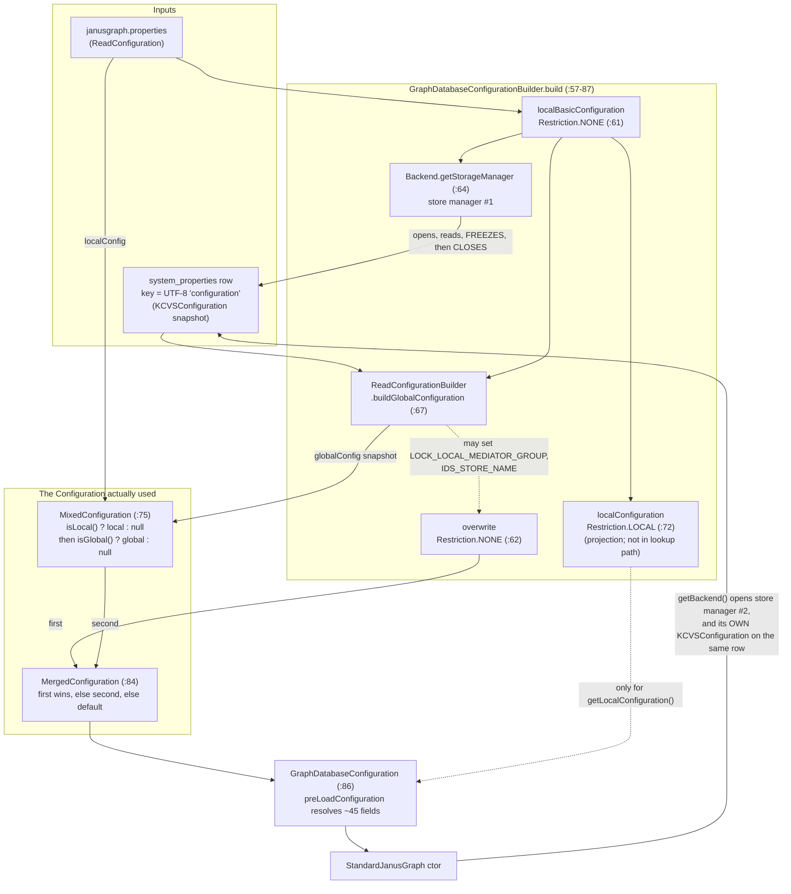
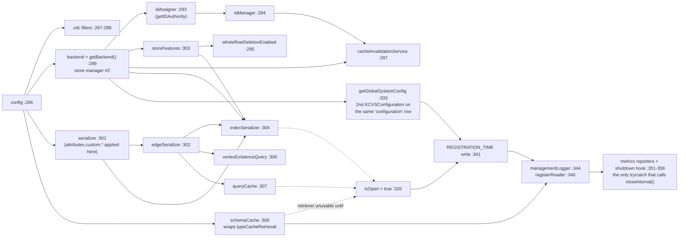

<!--
entry-meta
date: 2026-11-12
type: lesson
track: JanusGraph
lesson: 14
category: Database Internals
title: The open path — how a properties file, a row in system_properties, and five ConfigOption types become one Configuration
slug: janusgraph-open-path-config-merge
-->

# The open path — how a properties file, a row in `system_properties`, and five `ConfigOption` types become one `Configuration`

**2026-11-12 · JanusGraph Track · Lesson 14 of 28**

## Where This Fits

- **Lesson 13 closed Part II** by showing that the schema is an ordinary subgraph in the `edgestore`, written by the same `EdgeSerializer` and read back through `StandardJanusGraph`'s `typeCacheRetrieval`, which opens its own key-consistent transactions and rolls them back in a `finally` ([`2026-11-11-janusgraph-system-types-schema-storage/README.md`](../2026-11-11-janusgraph-system-types-schema-storage/README.md)). It left lesson 14 three explicit obligations: establish the **construction order** in `StandardJanusGraph`'s constructor; pin down what **FIXED**, **GLOBAL_OFFLINE**, **GLOBAL** and **MASKABLE** actually do differently at open time; and say whether `MetricInstrumentedSchemaCache` changes lesson 13 §7's behaviour or only counts it.
- **This lesson opens Part III (the write path)** with the one item in it that is reference material rather than mechanism — except that it is not. The open path has a mechanism, and it is not the one the configuration-reference page implies: there is no "configuration object" that merges a file with the database. There is a **three-layer stack of `Configuration` decorators**, a **single edgestore row** called `configuration` in the `system_properties` store, a **one-way freeze**, and a **store manager that is created, used, and closed before the real one is opened**. All three obligations are discharged below, plus one correction to lesson 12's note.
- **It sets up lessons 15–18.** Lesson 15 (`StandardJanusGraphTx`) needs the construction order established here, because `newTransaction` is unusable until `isOpen` is set at `:320` — which is *after* `schemaCache` is wired at `:308`. Lesson 17 (composite indexes on write) needs `indexSerializer`'s construction at `:304` and the `getCdcBackingIndexNames` branch at `:267`. Lesson 18 (locking) needs the fact that **`KCVSConfiguration.set` with an expected value is the only caller of `store.acquireLock` outside the graph write path** — the config row is itself locked exactly the way a composite index entry is.

---

## 1. The open path, end to end

Nine frames, three of which do real work. Everything below is at `a59ae8d8`.

| # | Frame | What it actually does |
|---|---|---|
| 1 | [`JanusGraphFactory.open(String)`](https://github.com/JanusGraph/janusgraph/blob/a59ae8d8024207598eada34998d867617df51adf/janusgraph-core/src/main/java/org/janusgraph/core/JanusGraphFactory.java#L92-L94) | File or shorthand → `ReadConfiguration`. The shorthand parser accepts only `STORAGE_DIRECTORY`, `STORAGE_CONF_FILE` or `STORAGE_HOSTS` and throws on anything else |
| 2 | [`getLocalConfiguration(File)`](https://github.com/JanusGraph/janusgraph/blob/a59ae8d8024207598eada34998d867617df51adf/janusgraph-core/src/main/java/org/janusgraph/core/JanusGraphFactory.java#L336-L400) | Loads the `.properties`, then **rewrites relative paths** for keys matching one regex over `storage.*{directory,conf-file}` and `index.*{directory,conf-file}`, making them relative to the config file rather than the JVM cwd. The source carries its own `// TODO this mangling logic is a relic from the hardcoded string days` |
| 3 | [`open(ReadConfiguration, String)`](https://github.com/JanusGraph/janusgraph/blob/a59ae8d8024207598eada34998d867617df51adf/janusgraph-core/src/main/java/org/janusgraph/core/JanusGraphFactory.java#L160-L179) | Reads `graph.graphname`; with a name, delegates to `JanusGraphManager.openGraph`, otherwise logs a warning and proceeds |
| 4 | [`GraphFactoryUtils.defineSchemaAndStart`](https://github.com/JanusGraph/janusgraph/blob/a59ae8d8024207598eada34998d867617df51adf/janusgraph-core/src/main/java/org/janusgraph/core/util/GraphFactoryUtils.java#L26-L29) | Two lines: build the `GraphDatabaseConfiguration`, then hand it to `SchemaInitializationManager` |
| 5 | **[`GraphDatabaseConfigurationBuilder.build`](https://github.com/JanusGraph/janusgraph/blob/a59ae8d8024207598eada34998d867617df51adf/janusgraph-core/src/main/java/org/janusgraph/graphdb/configuration/builder/GraphDatabaseConfigurationBuilder.java#L57-L87)** | **The merge.** §6 below |
| 6 | **[`ReadConfigurationBuilder.buildGlobalConfiguration`](https://github.com/JanusGraph/janusgraph/blob/a59ae8d8024207598eada34998d867617df51adf/janusgraph-core/src/main/java/org/janusgraph/diskstorage/configuration/builder/ReadConfigurationBuilder.java#L63-L106)** | **The freeze and the checks.** §4, §5 below |
| 7 | [`GraphDatabaseConfiguration` ctor + `preLoadConfiguration`](https://github.com/JanusGraph/janusgraph/blob/a59ae8d8024207598eada34998d867617df51adf/janusgraph-core/src/main/java/org/janusgraph/graphdb/configuration/GraphDatabaseConfiguration.java#L1667-L1674) | Stores four references, then eagerly resolves ~45 fields out of the merged configuration in one pass ([`:2034-2120`](https://github.com/JanusGraph/janusgraph/blob/a59ae8d8024207598eada34998d867617df51adf/janusgraph-core/src/main/java/org/janusgraph/graphdb/configuration/GraphDatabaseConfiguration.java#L2034-L2120)) |
| 8 | [`SchemaInitializationManager.initializeSchemaAndStart`](https://github.com/JanusGraph/janusgraph/blob/a59ae8d8024207598eada34998d867617df51adf/janusgraph-core/src/main/java/org/janusgraph/core/schema/SchemaInitializationManager.java#L42-L76) | Optional drop, then a strategy (`none` / `json` / a reflectively loaded class), then `new StandardJanusGraph(...)` if the strategy returned `null` |
| 9 | **[`new StandardJanusGraph(gdc)`](https://github.com/JanusGraph/janusgraph/blob/a59ae8d8024207598eada34998d867617df51adf/janusgraph-core/src/main/java/org/janusgraph/graphdb/database/StandardJanusGraph.java#L264-L360)** | **The construction order.** §8 below |

Two things to notice before the detail.

**`isDropSchemaBeforeInit` constructs a whole graph just to destroy it.** [`SchemaInitializationManager:48`](https://github.com/JanusGraph/janusgraph/blob/a59ae8d8024207598eada34998d867617df51adf/janusgraph-core/src/main/java/org/janusgraph/core/schema/SchemaInitializationManager.java#L48) is `JanusGraphFactory.drop(new StandardJanusGraph(graphDatabaseConfiguration))`, and [`JanusGraphFactory.drop:228`](https://github.com/JanusGraph/janusgraph/blob/a59ae8d8024207598eada34998d867617df51adf/janusgraph-core/src/main/java/org/janusgraph/core/JanusGraphFactory.java#L228) then calls `config.getBackend()` — a **third** `Backend`, after the one the dropped graph already opened at `:289` and closed. That is PR candidate 5's `getBackend()` question reached from a second call site, and it is on the default-configuration path whenever `schema.drop-before-init` is on.

**The same `GraphDatabaseConfiguration` object can construct more than one `StandardJanusGraph`.** [`getBackend()`](https://github.com/JanusGraph/janusgraph/blob/a59ae8d8024207598eada34998d867617df51adf/janusgraph-core/src/main/java/org/janusgraph/graphdb/configuration/GraphDatabaseConfiguration.java#L1951-L1956) is three lines — `new Backend`, `initialize`, cache `storeFeatures` — with no memoisation and no guard. Every call opens a new storage connection.

---

## 2. There is no config file in the database. There is one row.

The "global" configuration is a **single row in the `system_properties` key-column-value store**, read and written by [`KCVSConfiguration`](https://github.com/JanusGraph/janusgraph/blob/a59ae8d8024207598eada34998d867617df51adf/janusgraph-core/src/main/java/org/janusgraph/diskstorage/configuration/backend/KCVSConfiguration.java).

| Piece | Value | Where |
|---|---|---|
| Store name | `system_properties` | [`GraphDatabaseConfiguration:1607`](https://github.com/JanusGraph/janusgraph/blob/a59ae8d8024207598eada34998d867617df51adf/janusgraph-core/src/main/java/org/janusgraph/graphdb/configuration/GraphDatabaseConfiguration.java#L1607) |
| Row key | UTF-8 `"configuration"` — **13 bytes**, no id encoding, no `IDHandler` | [`KCVSConfiguration:74`](https://github.com/JanusGraph/janusgraph/blob/a59ae8d8024207598eada34998d867617df51adf/janusgraph-core/src/main/java/org/janusgraph/diskstorage/configuration/backend/KCVSConfiguration.java#L74), identifier from [`:1608`](https://github.com/JanusGraph/janusgraph/blob/a59ae8d8024207598eada34998d867617df51adf/janusgraph-core/src/main/java/org/janusgraph/graphdb/configuration/GraphDatabaseConfiguration.java#L1608) |
| Column | the option's **full dotted path**, UTF-8, verbatim — `graph.storage-version`, `ids.authority.conflict-avoidance-tag-bits` | `string2StaticBuffer` |
| Value | `writeClassAndObject` — `VariableLong.writePositive(registrationNo)` then the serializer body | [`:250`](https://github.com/JanusGraph/janusgraph/blob/a59ae8d8024207598eada34998d867617df51adf/janusgraph-core/src/main/java/org/janusgraph/diskstorage/configuration/backend/KCVSConfiguration.java#L250) |
| Second row, same store | UTF-8 `"userconfig"` — `Graph.Variables` | [`Backend:412`](https://github.com/JanusGraph/janusgraph/blob/a59ae8d8024207598eada34998d867617df51adf/janusgraph-core/src/main/java/org/janusgraph/diskstorage/Backend.java#L412) |

### 2.1 Every config value's registration byte is exactly one byte

[`ConfigOption.ACCEPTED_DATATYPES`](https://github.com/JanusGraph/janusgraph/blob/a59ae8d8024207598eada34998d867617df51adf/janusgraph-core/src/main/java/org/janusgraph/diskstorage/configuration/ConfigOption.java#L77-L91) is a closed set of **13 classes**, and the class's static initializer [`:96-98`](https://github.com/JanusGraph/janusgraph/blob/a59ae8d8024207598eada34998d867617df51adf/janusgraph-core/src/main/java/org/janusgraph/diskstorage/configuration/ConfigOption.java#L96-L98) constructs a bare `new StandardSerializer()` and refuses to let the class load if any of the 13 is not `validDataType`. Line them up against the registration table read this run at [`StandardSerializer:113-171`](https://github.com/JanusGraph/janusgraph/blob/a59ae8d8024207598eada34998d867617df51adf/janusgraph-core/src/main/java/org/janusgraph/graphdb/database/serialize/StandardSerializer.java#L113-L171):

| Datatype | Registration no. |
|---|---|
| `Byte` | 10 |
| `Short` | 11 |
| `Integer` | 12 |
| `Long` | 13 |
| `Boolean` | 15 |
| `String` | 18 |
| `Float` | 19 |
| `Double` | 20 |
| `String[]` | 30 |
| `TimestampProviders` | 54 |
| `ConflictAvoidanceMode` | 57 |
| `Duration` | 64 |
| `Instant` | 65 |

Maximum 65, every one below 128, so `VariableLong.writePositive` emits **one byte** for all of them. **Every entry in the config row is `[1-byte registration][serializer body]`** — there is no two-byte case and cannot be one unless a 14th datatype is added above 127.

That closed set also explains a pattern that looks like sloppiness in `GraphDatabaseConfiguration` and is not: options whose values are conceptually enums — `query.batch.has-step-mode`, `repeat-step-mode`, `schema.default`, the index-selection strategy — are declared `ConfigOption<String>` and converted at load time by [`selectExactConfig`](https://github.com/JanusGraph/janusgraph/blob/a59ae8d8024207598eada34998d867617df51adf/janusgraph-core/src/main/java/org/janusgraph/graphdb/configuration/GraphDatabaseConfiguration.java#L2122-L2126), which linear-scans the enum constants matching on `getConfigName()`. Only the two enums actually in `ACCEPTED_DATATYPES` get to be typed options. Adding a new enum-typed option means either adding its class to `ACCEPTED_DATATYPES` *and* `StandardSerializer`'s table, or taking the `String` + `selectExactConfig` route. Worth knowing before proposing one.

### 2.2 The config store has its own serializer, and it is not the graph's

[`KCVSConfiguration:75`](https://github.com/JanusGraph/janusgraph/blob/a59ae8d8024207598eada34998d867617df51adf/janusgraph-core/src/main/java/org/janusgraph/diskstorage/configuration/backend/KCVSConfiguration.java#L75) is `this.serializer = new StandardSerializer();` — a fresh, un-extended instance. `attributes.custom.[X].attribute-class` registrations never reach it. They are applied only in [`GraphDatabaseConfiguration.getSerializer`](https://github.com/JanusGraph/janusgraph/blob/a59ae8d8024207598eada34998d867617df51adf/janusgraph-core/src/main/java/org/janusgraph/graphdb/configuration/GraphDatabaseConfiguration.java#L1971-L1981), which builds the *graph's* serializer. This is the honest reason `ACCEPTED_DATATYPES` is closed: **the config row has to be readable before the thing that knows about custom serializers exists.** It is a bootstrap constraint, not an arbitrary allowlist.

### 2.3 Reads are whole-row snapshots; writes are per-column

Two read paths, and the difference matters:

- [`get(key, dataType)`](https://github.com/JanusGraph/janusgraph/blob/a59ae8d8024207598eada34998d867617df51adf/janusgraph-core/src/main/java/org/janusgraph/diskstorage/configuration/backend/KCVSConfiguration.java#L93-L112) issues a one-column `KeySliceQuery(rowKey, column, nextBiggerBuffer(column))` — a point lookup, one round trip per option.
- [`toMap()`](https://github.com/JanusGraph/janusgraph/blob/a59ae8d8024207598eada34998d867617df51adf/janusgraph-core/src/main/java/org/janusgraph/diskstorage/configuration/backend/KCVSConfiguration.java#L175-L195) slices `[zeroBuffer(1), oneBuffer(128))` — from a single `0x00` byte to 128 bytes of `0xFF`. Since every column is UTF-8 and UTF-8 never contains `0xFF`, that upper bound is effectively unbounded for any legal key. `asReadConfiguration()` calls `toMap()` **once** and closes over the resulting `HashMap`.

So the `globalConfig` that `GraphDatabaseConfigurationBuilder` passes down the stack is a **point-in-time snapshot taken during open**. Nothing re-reads it for the life of the graph. A `ManagementSystem` change made by another instance reaches this one through the management log (`ManagementLogger`, wired at `StandardJanusGraph:344`), not by re-reading the row — which is exactly why `GLOBAL_OFFLINE` has to force a shutdown and `FIXED` has to be refused outright.

Writes go through [`set(key, value, expectedValue, checkExpectedValue)`](https://github.com/JanusGraph/janusgraph/blob/a59ae8d8024207598eada34998d867617df51adf/janusgraph-core/src/main/java/org/janusgraph/diskstorage/configuration/backend/KCVSConfiguration.java#L128-L170), and when `checkExpectedValue` is set, [`:153`](https://github.com/JanusGraph/janusgraph/blob/a59ae8d8024207598eada34998d867617df51adf/janusgraph-core/src/main/java/org/janusgraph/diskstorage/configuration/backend/KCVSConfiguration.java#L153) calls `store.acquireLock(rowKey, column, expectedValueBuffer, txh)` before `store.mutate`. That is the `acquireLock` from lesson 02's `KeyColumnValueStore` contract, used here on a non-graph row. **Lesson 18 should start here**: the compare-and-set on a config column and the uniqueness check on a `SchemaName` graphindex entry are the same primitive.

---

## 3. Five types, three predicates

[`ConfigOption.Type`](https://github.com/JanusGraph/janusgraph/blob/a59ae8d8024207598eada34998d867617df51adf/janusgraph-core/src/main/java/org/janusgraph/diskstorage/configuration/ConfigOption.java#L41-L66) has five constants. Nothing in the codebase switches on the constant except two places. Everything else goes through three predicates:

```java
public boolean isGlobal()  { return type==FIXED || type==GLOBAL_OFFLINE || type==GLOBAL || type==MASKABLE; }  // :182
public boolean isManaged() { return managedTypes.contains(type); }   // managedTypes = {FIXED, GLOBAL_OFFLINE, GLOBAL}  :71, :194
public boolean isLocal()   { return type==MASKABLE || type==LOCAL; } // :202
```

The whole type system is this 5×3 table:

| Type | `isGlobal()` | `isManaged()` | `isLocal()` | Count in `GraphDatabaseConfiguration` |
|---|---|---|---|---|
| `FIXED` | ✅ | ✅ | ❌ | **6** |
| `GLOBAL_OFFLINE` | ✅ | ✅ | ❌ | **15** |
| `GLOBAL` | ✅ | ✅ | ❌ | **8** |
| `MASKABLE` | ✅ | ❌ | ✅ | **88** |
| `LOCAL` | ❌ | ❌ | ✅ | **34** |

(Counts are of `ConfigOption.Type.X` occurrences in `GraphDatabaseConfiguration.java` at the pinned commit; backend modules declare more.)

**`MASKABLE` is in both columns.** That is not a quirk, it is the definition — "global but overridable locally" needs `isGlobal()` for the fallback read and `isLocal()` for the override. But it has a consequence almost nobody expects, in §4.2.

### 3.1 The six FIXED options, named

| Option | Path | Declared |
|---|---|---|
| `TIMESTAMP_PROVIDER` | `graph.timestamps` | [`:140-148`](https://github.com/JanusGraph/janusgraph/blob/a59ae8d8024207598eada34998d867617df51adf/janusgraph-core/src/main/java/org/janusgraph/graphdb/configuration/GraphDatabaseConfiguration.java#L140-L148) |
| `INITIAL_JANUSGRAPH_VERSION` | `graph.janusgraph-version` (`.hide()`) | [`:164-166`](https://github.com/JanusGraph/janusgraph/blob/a59ae8d8024207598eada34998d867617df51adf/janusgraph-core/src/main/java/org/janusgraph/graphdb/configuration/GraphDatabaseConfiguration.java#L164-L166) |
| `INITIAL_STORAGE_VERSION` | `graph.storage-version` | [`:168-171`](https://github.com/JanusGraph/janusgraph/blob/a59ae8d8024207598eada34998d867617df51adf/janusgraph-core/src/main/java/org/janusgraph/graphdb/configuration/GraphDatabaseConfiguration.java#L168-L171) |
| `TITAN_COMPATIBLE_VERSIONS` | `graph.titan-version` (`.hide()`) | [`:187-189`](https://github.com/JanusGraph/janusgraph/blob/a59ae8d8024207598eada34998d867617df51adf/janusgraph-core/src/main/java/org/janusgraph/graphdb/configuration/GraphDatabaseConfiguration.java#L187-L189) |
| `CLUSTER_MAX_PARTITIONS` | `cluster.max-partitions` (default 32, must be a power of 2 > 1) | [`:1027-1030`](https://github.com/JanusGraph/janusgraph/blob/a59ae8d8024207598eada34998d867617df51adf/janusgraph-core/src/main/java/org/janusgraph/graphdb/configuration/GraphDatabaseConfiguration.java#L1027-L1030) |
| `IDAUTHORITY_CAV_BITS` | `ids.authority.conflict-avoidance-tag-bits` (default 4, range 0–16) | [`:1157-1159`](https://github.com/JanusGraph/janusgraph/blob/a59ae8d8024207598eada34998d867617df51adf/janusgraph-core/src/main/java/org/janusgraph/graphdb/configuration/GraphDatabaseConfiguration.java#L1157-L1159) |

Three of those six are escapable. [`JanusGraphConstants.UPGRADEABLE_FIXED`](https://github.com/JanusGraph/janusgraph/blob/a59ae8d8024207598eada34998d867617df51adf/janusgraph-core/src/main/java/org/janusgraph/graphdb/configuration/JanusGraphConstants.java#L66-L96) is not a code constant at all — it is parsed at class-load time out of a properties resource baked into the jar:

```properties
janusgraph.storage-version=2
janusgraph.upgradeable-fixed=storage-version,janusgraph-version,titan-version
```
— [`janusgraph.internal.properties`](https://github.com/JanusGraph/janusgraph/blob/a59ae8d8024207598eada34998d867617df51adf/janusgraph-core/src/main/resources/org/janusgraph/graphdb/configuration/janusgraph.internal.properties)

So **`STORAGE_VERSION` is `2`** at this commit, and the three version options can be changed after freeze when `graph.allow-upgrade=true`. **`graph.timestamps`, `cluster.max-partitions` and `ids.authority.conflict-avoidance-tag-bits` cannot be changed by anything, ever, short of a new graph.** Note the matching is on `option.getName()` — the *leaf* name, not the path — so a backend option named `storage-version` in some other namespace would also slip through. Nothing like that exists today.

### 3.2 The two places that switch on the constant

Exactly two, and both are *after* open:

1. [`ModifiableConfiguration.set:37-44`](https://github.com/JanusGraph/janusgraph/blob/a59ae8d8024207598eada34998d867617df51adf/janusgraph-core/src/main/java/org/janusgraph/diskstorage/configuration/ModifiableConfiguration.java#L37-L44) — `hasUpgradeableFixed(name) || !option.isFixed() || !isFrozen()`.
2. [`ManagementSystem`'s `configVerifier:190-207`](https://github.com/JanusGraph/janusgraph/blob/a59ae8d8024207598eada34998d867617df51adf/janusgraph-core/src/main/java/org/janusgraph/graphdb/database/management/ManagementSystem.java#L190-L207) — the only code in the tree that reads `ConfigOption.Type.GLOBAL_OFFLINE`:

```java
Preconditions.checkArgument(graph.getConfiguration().isUpgradeAllowed(option.getName()) ||
                            option.getType() != ConfigOption.Type.FIXED, "Cannot change the fixed configuration option: %s", option);
Preconditions.checkArgument(option.getType() != ConfigOption.Type.LOCAL, "Cannot change the local configuration option: %s", option);
if (option.getType() == ConfigOption.Type.GLOBAL_OFFLINE) {
    Set<String> openInstances = getOpenInstancesInternal();
    assert openInstances.size() > 0;
    Preconditions.checkArgument(openInstances.size() < 2, "Cannot change offline config option [%s] since multiple instances are currently open: %s", option, openInstances);
    Preconditions.checkArgument(openInstances.contains(graph.getConfiguration().getUniqueGraphId()), ...);
    graphShutdownRequired = true;   // :204
}
```

`getOpenInstancesInternal` is [`:209-213`](https://github.com/JanusGraph/janusgraph/blob/a59ae8d8024207598eada34998d867617df51adf/janusgraph-core/src/main/java/org/janusgraph/graphdb/database/management/ManagementSystem.java#L209-L213) — `modifyConfig.getContainedNamespaces(REGISTRATION_NS)`, i.e. the open-instance set is read **out of the same `system_properties` config row**, from the `graph.instance.[uid].startup-time` entries that `StandardJanusGraph:341` writes. There is no separate instance registry. The "no other instance is open" guard for `GLOBAL_OFFLINE` is a slice of the config row, and it is only as accurate as the last instance's clean shutdown — which is why `forceCloseInstance` and `MANAGEMENT_AUTO_CLOSE_STALE_INSTANCES` exist.

### 3.3 The answer to obligation (b), stated plainly

**At open time, `FIXED`, `GLOBAL_OFFLINE` and `GLOBAL` are indistinguishable.** Every open-path call site uses `isGlobal()`, `isManaged()` or `isLocal()`; none of them separates the three. Their differences are enforced entirely *later*, by `ModifiableConfiguration.set` and `ManagementSystem`'s verifier — i.e. the three types are a contract about **who may change the value and when**, not about how it is loaded. The only type distinction that exists at open time is the `MASKABLE`/not-`MASKABLE` split, and it shows up in exactly two places: `MixedConfiguration.get`'s precedence (§6) and `getManagedSubset`'s exclusion from the discrepancy check (§5).

---

## 4. First open vs. every later open

[`ReadConfigurationBuilder.buildGlobalConfiguration:63-106`](https://github.com/JanusGraph/janusgraph/blob/a59ae8d8024207598eada34998d867617df51adf/janusgraph-core/src/main/java/org/janusgraph/diskstorage/configuration/builder/ReadConfigurationBuilder.java#L63-L106) has one `if` and the two branches share almost nothing.

The pivot is [`BasicConfiguration.isFrozen()`](https://github.com/JanusGraph/janusgraph/blob/a59ae8d8024207598eada34998d867617df51adf/janusgraph-core/src/main/java/org/janusgraph/diskstorage/configuration/BasicConfiguration.java#L103-L108), which reads the literal key **`hidden.frozen`** ([`:37`](https://github.com/JanusGraph/janusgraph/blob/a59ae8d8024207598eada34998d867617df51adf/janusgraph-core/src/main/java/org/janusgraph/diskstorage/configuration/BasicConfiguration.java#L37)) and memoises the answer in a `Boolean` field. `hidden.frozen` is a column in the same `configuration` row — it does not parse as a `ConfigElement` path, so [`getAll():87-101`](https://github.com/JanusGraph/janusgraph/blob/a59ae8d8024207598eada34998d867617df51adf/janusgraph-core/src/main/java/org/janusgraph/diskstorage/configuration/BasicConfiguration.java#L87-L101) catches the `IllegalArgumentException` and logs it at **debug**. The freeze marker rides in the same namespace as the data and is excluded by a swallowed parse failure.

### 4.1 Branch A — not frozen (first open of this graph)

```
globalWrite.setAll(getGlobalSubset(localBasicConfiguration.getAll()));   // :83
setupJanusGraphVersion(globalWrite);        // :85  → graph.janusgraph-version = VERSION
setupStorageVersion(globalWrite);           // :86  → graph.storage-version = "2"
setupTimestampProvider(globalWrite, ...);   // :87  → backend preference, else MICRO
globalWrite.freezeConfiguration();          // :89
```

`globalWrite` is a `ModifiableConfiguration` with `Restriction.GLOBAL` ([`ModifiableConfigurationBuilder:29-31`](https://github.com/JanusGraph/janusgraph/blob/a59ae8d8024207598eada34998d867617df51adf/janusgraph-core/src/main/java/org/janusgraph/diskstorage/configuration/builder/ModifiableConfigurationBuilder.java#L29-L31)), so [`verifyOption:51-56`](https://github.com/JanusGraph/janusgraph/blob/a59ae8d8024207598eada34998d867617df51adf/janusgraph-core/src/main/java/org/janusgraph/diskstorage/configuration/BasicConfiguration.java#L51-L56) rejects anything that is not `isGlobal()`. Writes land straight in the KCVS row, one `store.mutate` per option.

`setupJanusGraphVersion` and `setupStorageVersion` both open with `Preconditions.checkArgument(!globalWrite.has(...), "Database has already been initialized but not frozen")` — a guard against the one state this design cannot express: a row that has version entries but no `hidden.frozen`. That state is reachable if the process dies between `:83` and `:89`, because **the sequence is not atomic**. Each `set` is its own `BackendOperation.execute` with its own transaction. A crash mid-copy leaves a partially written, unfrozen config row, and the next open fails on that precondition rather than repairing it.

`setupTimestampProvider` [`:148-168`](https://github.com/JanusGraph/janusgraph/blob/a59ae8d8024207598eada34998d867617df51adf/janusgraph-core/src/main/java/org/janusgraph/diskstorage/configuration/builder/ReadConfigurationBuilder.java#L148-L168) is the only place a `StoreFeatures` preference is baked permanently into a graph: if the properties file is silent and the backend declares `hasTimestamps() && getPreferredTimestamps() != null`, the backend's choice is written to a `FIXED` option and frozen. Change backends later and that value, not the new backend's preference, is what you get.

### 4.2 The MASKABLE surprise

`getGlobalSubset` [`:172-178`](https://github.com/JanusGraph/janusgraph/blob/a59ae8d8024207598eada34998d867617df51adf/janusgraph-core/src/main/java/org/janusgraph/diskstorage/configuration/builder/ReadConfigurationBuilder.java#L172-L178) filters on **`isGlobal()`**, which includes `MASKABLE`. So on first open, **every `MASKABLE` option present in the properties file is persisted into the `configuration` row**, and `freezeConfiguration()` is the last thing that happens to it.

After that:

- The persisted copy is **never updated**. `getGlobalSubset` only runs in the not-frozen branch.
- The persisted copy is **not discrepancy-checked**, because `getManagedSubset` ([`:180-186`](https://github.com/JanusGraph/janusgraph/blob/a59ae8d8024207598eada34998d867617df51adf/janusgraph-core/src/main/java/org/janusgraph/diskstorage/configuration/builder/ReadConfigurationBuilder.java#L180-L186)) filters on `isManaged()`, which excludes `MASKABLE`.
- The persisted copy **is** what `MixedConfiguration.get` falls back to when an instance does not set the option locally ([`MixedConfiguration:55-57`](https://github.com/JanusGraph/janusgraph/blob/a59ae8d8024207598eada34998d867617df51adf/janusgraph-core/src/main/java/org/janusgraph/diskstorage/configuration/MixedConfiguration.java#L55-L57)).

Concretely: instance A creates the graph with `cache.db-cache-size = 0.5` in its properties file. Instance B, months later, has no `cache.db-cache-size` line at all. B does **not** get the code default — it gets `0.5`, because A's first-open local value was frozen into the global row and B's `MixedConfiguration` finds nothing locally and falls through to it. There is no log line, no warning, and nothing in the docs that says a `MASKABLE` option behaves this way. **PR candidate 26.**

### 4.3 Branch B — frozen (every subsequent open)

```
String graphName = localConfig.get(GRAPH_NAME.toStringWithoutRoot(), String.class);   // :92
boolean upgradeAllowed = isUpgradeAllowed(globalWrite, localBasicConfiguration);      // :93
if (upgradeAllowed) setupUpgradeConfiguration(graphName, globalWrite);                // :96
else                checkJanusGraphStorageVersionEquality(globalWrite, graphName);    // :98
checkJanusGraphVersion(...);                                                          // :101
checkOptionsWithDiscrepancies(...);                                                   // :102
```

The upgrade ladder in [`setupUpgradeConfiguration:108-131`](https://github.com/JanusGraph/janusgraph/blob/a59ae8d8024207598eada34998d867617df51adf/janusgraph-core/src/main/java/org/janusgraph/diskstorage/configuration/builder/ReadConfigurationBuilder.java#L108-L131) has three outcomes against `STORAGE_VERSION = 2`:

| Stored `graph.storage-version` | `allow-upgrade=true` | `allow-upgrade=false` |
|---|---|---|
| absent | upgrade to 2, log info | `JanusGraphException` (reports stored version as `"1"`) |
| `< 2` | upgrade to 2, log info | `JanusGraphException` |
| `== 2` | **`log.warn` telling you to turn `allow-upgrade` off** | pass |
| `> 2` | `JanusGraphException` (BACKLEVEL) | `JanusGraphException` |

`janusGraphVersionsWithDisallowedUpgrade` [`:132-137`](https://github.com/JanusGraph/janusgraph/blob/a59ae8d8024207598eada34998d867617df51adf/janusgraph-core/src/main/java/org/janusgraph/diskstorage/configuration/builder/ReadConfigurationBuilder.java#L132-L137) writes all four of `janusgraph-version`, `titan-version`, `storage-version` and `allow-upgrade=false` into the global row. So a successful upgrade **turns itself off in the database**, and the `log.warn` on the equal-version path is how it tells you the local file still says otherwise. That is a well-built self-disarming switch, and worth copying.

Note which three of the six FIXED options those are: exactly `UPGRADEABLE_FIXED`. The set in the properties file and the set `janusGraphVersionsWithDisallowedUpgrade` writes are the same three, maintained in two places with nothing enforcing the correspondence.

---

## 5. The discrepancy check

[`getOptionsWithDiscrepancies:251-290`](https://github.com/JanusGraph/janusgraph/blob/a59ae8d8024207598eada34998d867617df51adf/janusgraph-core/src/main/java/org/janusgraph/diskstorage/configuration/builder/ReadConfigurationBuilder.java#L251-L290) is the one place a local file is compared against the database. Per managed option present locally:

```
storeValue = globalWrite.has(opt) ? globalWrite.get(opt) : opt.getDefaultValue();   // :262-267
if (overwrite.has(opt)) storeValue = overwrite.get(opt);                            // :270-273
match = Objects.equals(localValue, storeValue);                                     // :276
```

and on mismatch it logs at `error` (or `warn` when `graph.allow-stale-config=true`) and adds the full path to a set. [`checkOptionsWithDiscrepancies:225-233`](https://github.com/JanusGraph/janusgraph/blob/a59ae8d8024207598eada34998d867617df51adf/janusgraph-core/src/main/java/org/janusgraph/diskstorage/configuration/builder/ReadConfigurationBuilder.java#L225-L233) then throws `JanusGraphConfigurationException` unless stale config is allowed.

Three things this does that the docs do not say:

- **It compares against the default when the row has no entry.** So setting a managed option locally to a non-default value, on a graph where it was never set, is an error even though no one ever chose a conflicting value. The check is "would this line have an effect?", not "does this line contradict the database?".
- **`overwrite` wins the comparison**, which is why `LOCK_LOCAL_MEDIATOR_GROUP` (set into `overwrite` at [`:75`](https://github.com/JanusGraph/janusgraph/blob/a59ae8d8024207598eada34998d867617df51adf/janusgraph-core/src/main/java/org/janusgraph/diskstorage/configuration/builder/ReadConfigurationBuilder.java#L75) from `storeManager.getName()`) does not trip it.
- **`allow-stale-config` is itself read local-first, then global, then default** ([`isManagedOverwritesAllowed:236-243`](https://github.com/JanusGraph/janusgraph/blob/a59ae8d8024207598eada34998d867617df51adf/janusgraph-core/src/main/java/org/janusgraph/diskstorage/configuration/builder/ReadConfigurationBuilder.java#L236-L243)), the same three-step ladder as `allow-upgrade` at [`:245-251`](https://github.com/JanusGraph/janusgraph/blob/a59ae8d8024207598eada34998d867617df51adf/janusgraph-core/src/main/java/org/janusgraph/diskstorage/configuration/builder/ReadConfigurationBuilder.java#L245-L251). Both are hand-rolled rather than going through `MixedConfiguration`, because at that point in the sequence `MixedConfiguration` does not exist yet.

---

## 6. The three-layer stack

[`GraphDatabaseConfigurationBuilder.build:57-87`](https://github.com/JanusGraph/janusgraph/blob/a59ae8d8024207598eada34998d867617df51adf/janusgraph-core/src/main/java/org/janusgraph/graphdb/configuration/builder/GraphDatabaseConfigurationBuilder.java#L57-L87) assembles this and nothing else holds configuration state:

```
MergedConfiguration                      (:84)
├── first:  overwrite            ModifiableConfiguration over an in-memory CommonsConfiguration, Restriction.NONE
└── second: MixedConfiguration   (:75)
            ├── global: ReadConfiguration — the snapshot HashMap from the "configuration" row
            └── local:  ReadConfiguration — the parsed .properties
```

Resolution, exactly:

```java
// MergedConfiguration:39-47
if (first.has(opt))  return first.get(opt);     // overwrite
if (second.has(opt)) return second.get(opt);    // MixedConfiguration
return opt.getDefaultValue();

// MixedConfiguration:49-58
Object result = null;
if (opt.isLocal())                 result = local.get(key, opt.getDatatype());
if (result == null && opt.isGlobal()) result = global.get(key, opt.getDatatype());
return opt.get(result);            // ConfigOption.get applies the default and runs verificationFct
```

Which collapses to:

| Type | Lookup order |
|---|---|
| `FIXED`, `GLOBAL_OFFLINE`, `GLOBAL` | overwrite → **global row** → default. *The local file is never consulted.* |
| `MASKABLE` | overwrite → **local file** → global row → default |
| `LOCAL` | overwrite → **local file** → default. *The global row is never consulted.* |

That three-row table is the entire semantics of the type system at read time, and it is produced by two `if`s and a predicate pair.

Two details worth holding:

- **`overwrite` is not user-settable.** It is populated by exactly four things: `LOCK_LOCAL_MEDIATOR_GROUP`, `UNIQUE_INSTANCE_ID` ([`:79`](https://github.com/JanusGraph/janusgraph/blob/a59ae8d8024207598eada34998d867617df51adf/janusgraph-core/src/main/java/org/janusgraph/graphdb/configuration/builder/GraphDatabaseConfigurationBuilder.java#L79)), the transaction/management log forcings ([`:96-125`](https://github.com/JanusGraph/janusgraph/blob/a59ae8d8024207598eada34998d867617df51adf/janusgraph-core/src/main/java/org/janusgraph/graphdb/configuration/builder/GraphDatabaseConfigurationBuilder.java#L96-L125)), and the Titan id-store fallback. Those log forcings are `Preconditions.checkArgument` + `overwrite.set` pairs: `log.[tx].send-delay` and `log.[mgmt].send-delay` must be zero, the mgmt log must be key-consistent and fixed-partition, and both must use the default backend — the code checks you have not contradicted it, then sets it anyway.
- **`localConfiguration` at [`:72-73`](https://github.com/JanusGraph/janusgraph/blob/a59ae8d8024207598eada34998d867617df51adf/janusgraph-core/src/main/java/org/janusgraph/graphdb/configuration/builder/GraphDatabaseConfigurationBuilder.java#L72-L73) is a fourth object and is not in the lookup path at all.** It is an `isLocal()`-filtered copy (so `MASKABLE` + `LOCAL`), kept only so [`getLocalConfiguration()`](https://github.com/JanusGraph/janusgraph/blob/a59ae8d8024207598eada34998d867617df51adf/janusgraph-core/src/main/java/org/janusgraph/graphdb/configuration/GraphDatabaseConfiguration.java#L1988-L1992) can hand TinkerPop a `Configuration` with `gremlin.graph` set. Reading it as "the local config" when debugging is a trap: it is a *projection* of the file, with the `LOCAL`-and-`MASKABLE` rows only.



---

## 7. A whole store manager is opened and closed before the real one

This is the part of the open path that is invisible from the outside and obvious once you follow the `close()` chain.

1. [`GraphDatabaseConfigurationBuilder:64`](https://github.com/JanusGraph/janusgraph/blob/a59ae8d8024207598eada34998d867617df51adf/janusgraph-core/src/main/java/org/janusgraph/graphdb/configuration/builder/GraphDatabaseConfigurationBuilder.java#L64) — `Backend.getStorageManager(localBasicConfiguration)` instantiates the backend's `StoreManager` by reflection ([`Backend:522-545`](https://github.com/JanusGraph/janusgraph/blob/a59ae8d8024207598eada34998d867617df51adf/janusgraph-core/src/main/java/org/janusgraph/diskstorage/Backend.java#L522-L545)), wrapping an `OrderedKeyValueStoreManager` in lesson 05's `OrderedKeyValueStoreManagerAdapter` with the three 8-byte key lengths. For BerkeleyJE this **opens the JE `Environment`**.
2. [`KCVSConfigurationBuilder.buildStandaloneGlobalConfiguration:38-55`](https://github.com/JanusGraph/janusgraph/blob/a59ae8d8024207598eada34998d867617df51adf/janusgraph-core/src/main/java/org/janusgraph/diskstorage/configuration/backend/builder/KCVSConfigurationBuilder.java#L38-L55) opens `system_properties` on it and wraps it in a `KCVSConfiguration` whose `TransactionalProvider.close()` is **`manager.close()`** ([`:49`](https://github.com/JanusGraph/janusgraph/blob/a59ae8d8024207598eada34998d867617df51adf/janusgraph-core/src/main/java/org/janusgraph/diskstorage/configuration/backend/builder/KCVSConfigurationBuilder.java#L49)).
3. `buildGlobalConfiguration` holds it in a **try-with-resources** ([`ReadConfigurationBuilder:70-71`](https://github.com/JanusGraph/janusgraph/blob/a59ae8d8024207598eada34998d867617df51adf/janusgraph-core/src/main/java/org/janusgraph/diskstorage/configuration/builder/ReadConfigurationBuilder.java#L70-L71)). On exit, [`KCVSConfiguration.close():225-234`](https://github.com/JanusGraph/janusgraph/blob/a59ae8d8024207598eada34998d867617df51adf/janusgraph-core/src/main/java/org/janusgraph/diskstorage/configuration/backend/KCVSConfiguration.java#L225-L234) closes the store **and** the txProvider — so **store manager #1 is closed**.
4. Later, [`GraphDatabaseConfiguration.getBackend():1951-1956`](https://github.com/JanusGraph/janusgraph/blob/a59ae8d8024207598eada34998d867617df51adf/janusgraph-core/src/main/java/org/janusgraph/graphdb/configuration/GraphDatabaseConfiguration.java#L1951-L1956) builds **store manager #2** inside a new `Backend`, and [`Backend.initialize:384-399`](https://github.com/JanusGraph/janusgraph/blob/a59ae8d8024207598eada34998d867617df51adf/janusgraph-core/src/main/java/org/janusgraph/diskstorage/Backend.java#L384-L399) opens `system_properties` **again** and builds a **second `KCVSConfiguration` on the same `"configuration"` row** — this one through `storeManagerLocking`, and with a `close()` that deliberately does nothing (`//Do nothing, storeManager is closed explicitly by Backend`).

So opening a graph touches `system_properties` through two different `KCVSConfiguration` instances, on two different store managers, one of which is dead by the time the second exists. The split is not an accident: the global config has to be readable to decide whether `cache.db-cache` is on, whether the store needs `ExpectedValueCheckingStoreManager` wrapping, what the id-store is called — all of which are inputs to constructing the real `Backend`. You cannot read the config through the `Backend` you are about to configure from it.

It does have consequences. The first manager is created from `localBasicConfiguration` only — `Restriction.NONE` over the raw file, before any global value is known. Any `MASKABLE` or `GLOBAL` storage option whose authoritative value lives in the row is therefore **not applied to the manager that reads the row**. For an embedded backend that means the environment is opened twice per `JanusGraphFactory.open` and, on BerkeleyJE, the second open depends on the first having closed cleanly.

---

## 8. The `StandardJanusGraph` constructor, in order — obligation (a)

[`:264-360`](https://github.com/JanusGraph/janusgraph/blob/a59ae8d8024207598eada34998d867617df51adf/janusgraph-core/src/main/java/org/janusgraph/graphdb/database/StandardJanusGraph.java#L264-L360). The dependency structure, not just the sequence:

| Line | Assignment | Needs |
|---|---|---|
| `:266` | `config` | — |
| `:267-288` | `cdcOnlyBackingIndexes`, the two `IndexAppliesToFunction` filters, and a `log.warn` if cdc-only indexes are configured | `configuration.getConfiguration()` only |
| **`:289`** | **`backend = configuration.getBackend()`** | **store manager #2 opens here; everything below depends on it** |
| `:291` | `name` | `getConfigurationAtOpen()` |
| `:293-294` | `idAssigner`, `idManager` | `backend.getIDAuthority()`, `backend.getStoreFeatures()` |
| `:295` | `wholeRowDeletionEnabled` | `storeFeatures.hasOptimizedWholeRowDeletion()` |
| `:297` | `cacheInvalidationService` | `backend.getEdgeStoreCache()`, `getIndexStoreCache()`, `idManager` |
| `:301` | `serializer` | config — **this is where `attributes.custom.*` is applied** |
| `:302` | `edgeSerializer` | `serializer` |
| `:304` | `indexSerializer` | `edgeSerializer`, `serializer`, `backend.getIndexInformation()`, `storeFeatures` |
| `:306` | `vertexExistenceQuery` | `edgeSerializer` + `BaseKey.VertexExists` |
| `:307` | `queryCache` | `edgeSerializer` |
| **`:308`** | **`schemaCache = configuration.getTypeCache(typeCacheRetrieval)`** | the retriever field, already initialized |
| `:309-310` | `times`, `indexSelector` | config |
| `:312-318` | `scriptEngine` | config |
| **`:320`** | **`isOpen = true`** | — |
| `:321-322` | `txCounter`, `openTransactions` | — |
| `:326-329` | `computerJobs`, three management timeouts | config |
| `:332-341` | instance registration: `getGlobalSystemConfig(backend)`, `REGISTRATION_TIME` write | `backend`, `times` |
| `:343-346` | `managementLogger`, `managementLog.registerReader` | `backend.getSystemMgmtLog()`, `schemaCache`, `times` |
| `:351-358` | metrics reporters, shutdown hook — in a `try` whose `catch` calls `closeInternal()` and rethrows | everything |



Solid arrows are `needs the value of`; dotted arrows are ordering constraints with no data dependency.

### 8.1 Why `:308` before `:320` is safe, and barely

`typeCacheRetrieval` is a **field initializer**, declared at [`:611-644`](https://github.com/JanusGraph/janusgraph/blob/a59ae8d8024207598eada34998d867617df51adf/janusgraph-core/src/main/java/org/janusgraph/graphdb/database/StandardJanusGraph.java#L611-L644) — 300 lines *below* the constructor in the source. That placement is irrelevant to when it runs: instance field initializers execute in textual order as a group, after `super()` and before the constructor body, wherever the constructor happens to sit among them. So the anonymous `SchemaCache.StoreRetrieval` exists before `:266`. Constructing it captures only `StandardJanusGraph.this` and dereferences nothing, so storing it at `:308` is safe no matter what is or is not initialized yet.

What matters is when it is **invoked**. Both methods start with `StandardJanusGraph.this.newTransaction(...)`, and [`newTransaction:588-598`](https://github.com/JanusGraph/janusgraph/blob/a59ae8d8024207598eada34998d867617df51adf/janusgraph-core/src/main/java/org/janusgraph/graphdb/database/StandardJanusGraph.java#L588-L598) opens with `if (!isOpen()) ExceptionFactory.graphShutdown();` and then needs `indexSerializer` (`:601`), `backend` (`:602`), and — for `retrieveSchemaRelations` — `queryCache` (`:631`). Every one of those is set before `:320`, and `isOpen` is set at `:320`. **A schema-cache miss between `:308` and `:320` would throw `graphShutdown`.** Nothing in that window touches the cache, so the invariant holds, but it holds by ordering alone: there is no assertion, no comment, and no test pinning it. The first code that *can* invoke the retriever is `managementLog.registerReader` at `:346`, which starts a reader thread that opens transactions of its own.

**So the answer to obligation (a):** nothing in the constructor needs to read `system_properties` through the schema cache, because the config row is never read that way. `system_properties` is reachable with nothing but a `KeyColumnValueStoreManager` — that is the whole point of `KCVSConfiguration`, and why §7's first manager can do the job alone. The graph-level reader (`getGlobalSystemConfig(backend)`, [`:745-749`](https://github.com/JanusGraph/janusgraph/blob/a59ae8d8024207598eada34998d867617df51adf/janusgraph-core/src/main/java/org/janusgraph/graphdb/database/StandardJanusGraph.java#L745-L749)) is needed only from `:333`, for instance registration, and it is a `ModifiableConfiguration` with `Restriction.GLOBAL` over `backend.getGlobalSystemConfig()` — the second `KCVSConfiguration`, not the first.

### 8.2 The ordering comments are load-bearing

Three of them, all worth reading as design notes:

- `:324-325` — *"Before the instance registers, so that an invalid option fails the open without leaving the instance among the open ones; the executor starts without threads."* `FulgoraGraphComputer.newJobExecutor` validates its options; doing it after `:341` would strand a `REGISTRATION_TIME` entry.
- `:331-341` — registration is a **compare against `REGISTRATION_TIME` for this uid**, then an unconditional write. `graph.replace-instance-if-exists` turns the `JanusGraphException` into a `log.debug`. This is the entry §3.2's `GLOBAL_OFFLINE` guard later counts.
- `:348-350` — *"Last, so that a graph which fails to open holds no claim; one which opens gives them back when it closes."* The metrics-reporter claims and the shutdown hook are the only two resources acquired inside a `try`/`catch (RuntimeException | Error)` that calls `closeInternal()` and rethrows. Everything acquired before `:351` — including the `Backend` at `:289` — is **not** cleaned up if the constructor throws between `:290` and `:350`. A failed open past `:289` leaks a store manager.

---

## 9. `MetricInstrumentedSchemaCache` — obligation (c)

It counts. It does not change behaviour. The whole class is 74 lines and the mechanism is one constructor:

```java
// MetricInstrumentedSchemaCache:36-53
public MetricInstrumentedSchemaCache(final StoreRetrieval retriever) {
    cache = new StandardSchemaCache(new StoreRetrieval() {
        public Long retrieveSchemaByName(String typeName) {
            incAction(METRICS_TYPENAME, CacheMetricsAction.MISS);
            return retriever.retrieveSchemaByName(typeName);
        }
        public EntryList retrieveSchemaRelations(long schemaId, BaseRelationType type, Direction dir) {
            incAction(METRICS_RELATIONS, CacheMetricsAction.MISS);
            return retriever.retrieveSchemaRelations(schemaId, type, dir);
        }
    });
}
```

It is a `StandardSchemaCache` with a decorated retriever, selected by `metrics.enabled` at [`GraphDatabaseConfiguration.getTypeCache:1983-1986`](https://github.com/JanusGraph/janusgraph/blob/a59ae8d8024207598eada34998d867617df51adf/janusgraph-core/src/main/java/org/janusgraph/graphdb/configuration/GraphDatabaseConfiguration.java#L1983-L1986). Everything lesson 13 §7 established is untouched: the two `volatile` primary maps plus Caffeine backups, the permanent `null` past `MAX_CACHED_TYPES_DEFAULT`, the two-bit `systemTypeId` in the relation key, the four cacheable system types, the counter protocol in `publish`, and the `isCacheable` asymmetry that caches an empty `SchemaDefinitionEdge` result but not an empty name/category/definition one. Nothing is overridden — `expireSchemaElement` ([`:69-71`](https://github.com/JanusGraph/janusgraph/blob/a59ae8d8024207598eada34998d867617df51adf/janusgraph-core/src/main/java/org/janusgraph/graphdb/database/cache/MetricInstrumentedSchemaCache.java#L69-L71)) is a bare delegate.

Three things about the counters that matter if you ever read them:

- **There is no HIT counter.** `getSchemaId`/`getSchemaRelations` increment `RETRIEVAL`; the wrapped retriever increments `MISS`. Hits are `RETRIEVAL − MISS`, computed by whoever reads the metrics.
- **`MISS` is incremented before the store call, so a failed retrieval counts as a miss.** An exception from `retrieveSchemaByName` leaves the counter bumped.
- **For the three non-cacheable empty-result cases, `MISS` tracks `RETRIEVAL` exactly, forever.** Lesson 13's `isCacheable` asymmetry means an empty name lookup is never stored, so every repeat of it is another `MISS`. A 100% miss rate on `schemacache.name` is the expected reading for a workload that repeatedly asks for a type that does not exist — not a sign of cache misconfiguration. That is the one thing the metric can genuinely mislead you about, and it is a property of lesson 13's cache, not of this wrapper.
- `expireSchemaElement` is uncounted, so eviction storms driven by the management log are invisible in these metrics.

Also note the name: `incAction` reports under `METRICS_SYSTEM_PREFIX_DEFAULT`, not the graph's `metrics.prefix`. Schema-cache counters are global to the JVM, not per graph — two graphs in one process share them.

---

## 10. Corrections to earlier entries

- **`attributes.custom.*` is `GLOBAL_OFFLINE`, not `FIXED`.** Lesson 13's "Notes For The Next Run" listed `ids.authority.conflict-avoidance-tag-bits` and `attributes.custom.*` together as `FIXED` options that had bitten lessons 09 and 12. `CUSTOM_ATTRIBUTE_CLASS` and `CUSTOM_SERIALIZER_CLASS` are declared at [`GraphDatabaseConfiguration:1369-1375`](https://github.com/JanusGraph/janusgraph/blob/a59ae8d8024207598eada34998d867617df51adf/janusgraph-core/src/main/java/org/janusgraph/graphdb/configuration/GraphDatabaseConfiguration.java#L1369-L1375) as `ConfigOption.Type.GLOBAL_OFFLINE`. The practical difference is real: a custom attribute registration **can** be changed through `ManagementSystem` with all other instances shut down, and doing so forces a shutdown of the one that changed it. It is not unchangeable. The `FIXED` list is exactly the six in §3.1.
- **Lesson 07's "`getBackend()` can be called twice" has a second in-tree call site.** `JanusGraphFactory.drop:228` reaches it, and `SchemaInitializationManager:45-53` reaches `drop` on the default path when `schema.drop-before-init=true`. PR candidate 5's experiment is now worth more than it was: the leak, if it is one, is reachable from configuration rather than only from test code.

---

## Hands-On

Three exercises, in order of how much they teach per minute. All at `a59ae8d8` in your fork.

### 1. Run the test that already pins §3–§5 (2 minutes)

```bash
mvn -pl janusgraph-test -am -DskipTests install -q          # once, if you have not built the module
mvn -pl janusgraph-test -Dtest=ReadConfigurationBuilderTest -DfailIfNoTests=false test
```

[`ReadConfigurationBuilderTest`](https://github.com/JanusGraph/janusgraph/blob/a59ae8d8024207598eada34998d867617df51adf/janusgraph-test/src/test/java/org/janusgraph/diskstorage/configuration/builder/ReadConfigurationBuilderTest.java) is pure Mockito — no backend, no disk, sub-second. **What to look for:** it declares the managed set explicitly at [`:106-112`](https://github.com/JanusGraph/janusgraph/blob/a59ae8d8024207598eada34998d867617df51adf/janusgraph-test/src/test/java/org/janusgraph/diskstorage/configuration/builder/ReadConfigurationBuilderTest.java#L106-L112) as `{FIXED, GLOBAL_OFFLINE, GLOBAL}` and derives `notManagedConfigOptionTypes()` by subtraction at [`:114-117`](https://github.com/JanusGraph/janusgraph/blob/a59ae8d8024207598eada34998d867617df51adf/janusgraph-test/src/test/java/org/janusgraph/diskstorage/configuration/builder/ReadConfigurationBuilderTest.java#L114-L117), then runs the same discrepancy scenario across both sets as `@ParameterizedTest`. Read `shouldThrowExceptionOnDisallowedManagedOverwritesWithDiscrepanciesOptions` ([`:301`](https://github.com/JanusGraph/janusgraph/blob/a59ae8d8024207598eada34998d867617df51adf/janusgraph-test/src/test/java/org/janusgraph/diskstorage/configuration/builder/ReadConfigurationBuilderTest.java#L301)) against `shouldPassOnDisallowedManagedOverwritesWithNoDiscrepanciesOptions` ([`:328`](https://github.com/JanusGraph/janusgraph/blob/a59ae8d8024207598eada34998d867617df51adf/janusgraph-test/src/test/java/org/janusgraph/diskstorage/configuration/builder/ReadConfigurationBuilderTest.java#L328)) — the same body, opposite assertion, chosen only by the `isManaged()` predicate. That pair is §3's table in executable form, and it is the test to extend for PR candidate 26.

### 2. Dump the `configuration` row and read its bytes (15 minutes)

Build a throwaway BerkeleyJE graph, then read `system_properties` directly through the storage layer — not through `JanusGraph` — so you see the row as §2 describes it.

```java
// scratch test in janusgraph-berkeleyje, or a main() with the module on the classpath
ModifiableConfiguration cfg = GraphDatabaseConfiguration.buildGraphConfiguration()
        .set(GraphDatabaseConfiguration.STORAGE_BACKEND, "berkeleyje")
        .set(GraphDatabaseConfiguration.STORAGE_DIRECTORY, dir.getAbsolutePath())
        .set(GraphDatabaseConfiguration.DB_CACHE, true);          // a MASKABLE option, deliberately
JanusGraph g = JanusGraphFactory.open(cfg);
g.close();

// now reopen the store manager by hand and slice the row
KeyColumnValueStoreManager mgr = Backend.getStorageManager(
        new BasicConfiguration(GraphDatabaseConfiguration.ROOT_NS, cfg.getConfiguration(),
                               BasicConfiguration.Restriction.NONE));
KeyColumnValueStore sp = mgr.openDatabase(GraphDatabaseConfiguration.SYSTEM_PROPERTIES_STORE_NAME);
StaticBuffer row = StaticArrayBuffer.of("configuration".getBytes(StandardCharsets.UTF_8));
StoreTransaction tx = mgr.beginTransaction(StandardBaseTransactionConfig.of(TimestampProviders.MICRO));
for (Entry e : sp.getSlice(new KeySliceQuery(row, BufferUtil.zeroBuffer(1), BufferUtil.oneBuffer(128)), tx)) {
    byte[] col = e.getColumnAs(StaticBuffer.ARRAY_FACTORY);
    byte[] val = e.getValueAs(StaticBuffer.ARRAY_FACTORY);
    System.out.printf("%-50s reg=%-3d valBytes=%s%n",
        new String(col, StandardCharsets.UTF_8), val[0] & 0x7f, Hex.encodeHexString(val));
}
tx.rollback(); sp.close(); mgr.close();
```

**What to look for, in this order:**

1. **`hidden.frozen` is in the listing**, alongside the real options. It is the freeze marker from §4, living in the same namespace as the data.
2. **`graph.storage-version` has first byte `18`** (`String`), and its decoded value is `"2"`, matching [`janusgraph.internal.properties`](https://github.com/JanusGraph/janusgraph/blob/a59ae8d8024207598eada34998d867617df51adf/janusgraph-core/src/main/resources/org/janusgraph/graphdb/configuration/janusgraph.internal.properties). `graph.timestamps` has first byte `54` (`TimestampProviders`) and a one-byte `EnumSerializer` ordinal after it — lesson 13's `EnumSerializer` on a config value. **Every value's first byte is one of the 13 numbers in §2.1.**
3. **`cache.db-cache` is in the row** even though it is `MASKABLE`. That is §4.2. Now reopen the same directory with a properties file that omits `cache.db-cache` entirely and assert `graph.getConfiguration().getConfiguration().get(DB_CACHE)` — it is `true`, not the code default. That assertion, written against a temp directory, is the regression test PR candidate 26 needs.
4. **`graph.instance.[uid].startup-time`** entries. Count them before and after an unclean kill (`kill -9` between open and close) and you have reproduced the stale-instance condition that blocks every `GLOBAL_OFFLINE` change.

### 3. Prove §7's double open (10 minutes)

Put a breakpoint on `BerkeleyJEStoreManager`'s constructor and another on its `close()`, then call `JanusGraphFactory.open` once. **What to look for:** two constructor hits and one close hit, with the close landing *between* them. On the JVM, `jcmd <pid> VM.native_memory` or simply `lsof +D <storage.directory>` across the two breakpoints shows the JE `Environment` opened, closed, and reopened. If you instead see the first manager never closing, that is a bug worth an issue — but the try-with-resources at [`ReadConfigurationBuilder:70`](https://github.com/JanusGraph/janusgraph/blob/a59ae8d8024207598eada34998d867617df51adf/janusgraph-core/src/main/java/org/janusgraph/diskstorage/configuration/builder/ReadConfigurationBuilder.java#L70) and `manager.close()` at [`KCVSConfigurationBuilder:49`](https://github.com/JanusGraph/janusgraph/blob/a59ae8d8024207598eada34998d867617df51adf/janusgraph-core/src/main/java/org/janusgraph/diskstorage/configuration/backend/builder/KCVSConfigurationBuilder.java#L49) say it should.

---

## Where This Breaks Down

- **The freeze is not atomic and has no repair path.** `getGlobalSubset` → three `setup*` calls → `freezeConfiguration()` is N+4 independent `BackendOperation.execute` calls, each its own transaction. A crash in the middle leaves a row with some options and no `hidden.frozen`, and the next open hits `Preconditions.checkArgument(!globalWrite.has(INITIAL_JANUSGRAPH_VERSION), "Database has already been initialized but not frozen")` — an `IllegalArgumentException` with no recovery instructions. The only fix is to clear the store. For a first open on an empty keyspace that is tolerable; it is still the only place in JanusGraph where a crash produces a state the code names but cannot handle.
- **Discrepancy detection compares against defaults, so it cries wolf.** Setting any managed option locally to a non-default value on a graph where that option was never written fails the open, even with no actual conflict. The standard workaround — `graph.allow-stale-config=true` — downgrades *all* discrepancy errors to warnings, including the ones that are real. There is no per-option escape.
- **`MASKABLE` values leak from the first instance to every later one** (§4.2), silently, with no log line and no doc. This is the sharpest edge in the whole open path.
- **The config row is read once and never re-read.** Any `GLOBAL` change made by another instance after this one opened is invisible until restart, unless something explicitly routes it through the management log. `ManagementSystem` writes to the row and sends log messages; nothing re-snapshots.
- **`toMap()`'s upper bound is 128 bytes of `0xFF`.** Safe for UTF-8 keys today, and silently wrong the day someone stores a binary column in that row.
- **Two store managers per open, and the first is configured from the local file alone.** A storage option whose authoritative value is in the row does not apply to the manager that reads the row. For embedded backends this is also a real open-latency cost paid on every `JanusGraphFactory.open`.
- **A constructor failure after `:289` leaks the `Backend`.** The `try`/`catch` at `:351-358` covers only the last two acquisitions.
- **`getBackend()` has no memoisation or guard** and is reachable from three call sites, one of them (`drop`) on a configuration-driven default path.

---

## Further Study

- [Configuration — JanusGraph docs](https://docs.janusgraph.org/basics/configuration/) — the user-facing model this lesson is the implementation of; note it does not mention §4.2.
- [Configuration Reference](https://docs.janusgraph.org/basics/configuration-reference/) — the per-option table, generated from the `ConfigOption` declarations read above; the "Mutability" column is the `Type` constant.
- [`databasearchitects.blogspot.com` — *Next-level benchmarking: overfitting*](https://databasearchitects.blogspot.com/2026/11/next-level-benchmarking-overfitting.html) — today's Daily Diff deep-dive; the "physical design tuned to the queries" failure mode is the same shape as a frozen `FIXED` option: a decision made once at setup time that the measurement never re-examines.

---

## Next Steps

1. **Lesson 15 (`StandardJanusGraphTx`)** inherits the constructor ordering above. Specifically: `newTransaction` is callable only after `:320`, `StandardTransactionBuilder` is constructed from `getConfiguration()` (the `GraphDatabaseConfiguration`, not the `Configuration`), and `tx.setBackendTransaction(openBackendTransaction(tx))` at `:592` runs *after* the `StandardJanusGraphTx` object exists — so the transaction is briefly alive with no backend handle. Check whether anything in `StandardJanusGraphTx`'s own constructor can touch the backend.
2. **Lesson 17 (composite indexes on write)** should pick up `indexSerializer`'s construction at `:304` and the `cdcOnlyBackingIndexes`/`commitIndexAppliesToFilter` pair at `:267-275`, which is a config-driven filter that silently disables synchronous index maintenance. The `log.warn` at `:281-287` is the only signal.
3. **Lesson 18 (locking)** owns the unanswered half of §2.3: `KCVSConfiguration.set(key, value, expectedValue, true)` calls `store.acquireLock` on the config row. Establish who calls that overload (`ManagementSystem`'s `TransactionalConfiguration`?) and whether the config row therefore participates in `ConsistentKeyLocker` the same way a `SchemaName` graphindex entry does.
4. **Carried question for lesson 18 or 25:** `getOpenInstancesInternal` reads the open-instance set from `getContainedNamespaces(REGISTRATION_NS)` on the config row. What happens to a `GLOBAL_OFFLINE` change when two instances register concurrently — is the `size() < 2` check racing a `set`, and does `acquireLock` cover the registration write at `StandardJanusGraph:341`? It goes through `ModifiableConfiguration.set`, which is the *non*-expected-value overload, so provisionally: no lock. Confirm.
5. **Settle PR candidate 5** with the §7 breakpoint exercise. Now that `drop` is a confirmed second call site reached from `schema.drop-before-init`, the answer changes whether this is a test-only wart or a user-reachable leak.
6. **Re-pin review is due after lesson 18**, at the Part III/IV boundary. Run `list_commits` on `JanusGraph/janusgraph` `master` then; do not raise it before.

---

## Sources

All source files read this run with `get_file_contents` at the pinned commit `a59ae8d8024207598eada34998d867617df51adf`; line numbers are from those files.

- [`janusgraph-core/.../core/JanusGraphFactory.java`](https://github.com/JanusGraph/janusgraph/blob/a59ae8d8024207598eada34998d867617df51adf/janusgraph-core/src/main/java/org/janusgraph/core/JanusGraphFactory.java)
- [`janusgraph-core/.../core/util/GraphFactoryUtils.java`](https://github.com/JanusGraph/janusgraph/blob/a59ae8d8024207598eada34998d867617df51adf/janusgraph-core/src/main/java/org/janusgraph/core/util/GraphFactoryUtils.java)
- [`janusgraph-core/.../core/schema/SchemaInitializationManager.java`](https://github.com/JanusGraph/janusgraph/blob/a59ae8d8024207598eada34998d867617df51adf/janusgraph-core/src/main/java/org/janusgraph/core/schema/SchemaInitializationManager.java)
- [`janusgraph-core/.../graphdb/configuration/builder/GraphDatabaseConfigurationBuilder.java`](https://github.com/JanusGraph/janusgraph/blob/a59ae8d8024207598eada34998d867617df51adf/janusgraph-core/src/main/java/org/janusgraph/graphdb/configuration/builder/GraphDatabaseConfigurationBuilder.java)
- [`janusgraph-core/.../graphdb/configuration/GraphDatabaseConfiguration.java`](https://github.com/JanusGraph/janusgraph/blob/a59ae8d8024207598eada34998d867617df51adf/janusgraph-core/src/main/java/org/janusgraph/graphdb/configuration/GraphDatabaseConfiguration.java)
- [`janusgraph-core/.../graphdb/configuration/JanusGraphConstants.java`](https://github.com/JanusGraph/janusgraph/blob/a59ae8d8024207598eada34998d867617df51adf/janusgraph-core/src/main/java/org/janusgraph/graphdb/configuration/JanusGraphConstants.java)
- [`janusgraph-core/src/main/resources/.../janusgraph.internal.properties`](https://github.com/JanusGraph/janusgraph/blob/a59ae8d8024207598eada34998d867617df51adf/janusgraph-core/src/main/resources/org/janusgraph/graphdb/configuration/janusgraph.internal.properties)
- [`janusgraph-core/.../diskstorage/configuration/builder/ReadConfigurationBuilder.java`](https://github.com/JanusGraph/janusgraph/blob/a59ae8d8024207598eada34998d867617df51adf/janusgraph-core/src/main/java/org/janusgraph/diskstorage/configuration/builder/ReadConfigurationBuilder.java)
- [`janusgraph-core/.../diskstorage/configuration/builder/ModifiableConfigurationBuilder.java`](https://github.com/JanusGraph/janusgraph/blob/a59ae8d8024207598eada34998d867617df51adf/janusgraph-core/src/main/java/org/janusgraph/diskstorage/configuration/builder/ModifiableConfigurationBuilder.java)
- [`janusgraph-core/.../diskstorage/configuration/ConfigOption.java`](https://github.com/JanusGraph/janusgraph/blob/a59ae8d8024207598eada34998d867617df51adf/janusgraph-core/src/main/java/org/janusgraph/diskstorage/configuration/ConfigOption.java)
- [`janusgraph-core/.../diskstorage/configuration/BasicConfiguration.java`](https://github.com/JanusGraph/janusgraph/blob/a59ae8d8024207598eada34998d867617df51adf/janusgraph-core/src/main/java/org/janusgraph/diskstorage/configuration/BasicConfiguration.java)
- [`janusgraph-core/.../diskstorage/configuration/ModifiableConfiguration.java`](https://github.com/JanusGraph/janusgraph/blob/a59ae8d8024207598eada34998d867617df51adf/janusgraph-core/src/main/java/org/janusgraph/diskstorage/configuration/ModifiableConfiguration.java)
- [`janusgraph-core/.../diskstorage/configuration/MixedConfiguration.java`](https://github.com/JanusGraph/janusgraph/blob/a59ae8d8024207598eada34998d867617df51adf/janusgraph-core/src/main/java/org/janusgraph/diskstorage/configuration/MixedConfiguration.java)
- [`janusgraph-core/.../diskstorage/configuration/MergedConfiguration.java`](https://github.com/JanusGraph/janusgraph/blob/a59ae8d8024207598eada34998d867617df51adf/janusgraph-core/src/main/java/org/janusgraph/diskstorage/configuration/MergedConfiguration.java)
- [`janusgraph-core/.../diskstorage/configuration/backend/KCVSConfiguration.java`](https://github.com/JanusGraph/janusgraph/blob/a59ae8d8024207598eada34998d867617df51adf/janusgraph-core/src/main/java/org/janusgraph/diskstorage/configuration/backend/KCVSConfiguration.java)
- [`janusgraph-core/.../diskstorage/configuration/backend/builder/KCVSConfigurationBuilder.java`](https://github.com/JanusGraph/janusgraph/blob/a59ae8d8024207598eada34998d867617df51adf/janusgraph-core/src/main/java/org/janusgraph/diskstorage/configuration/backend/builder/KCVSConfigurationBuilder.java)
- [`janusgraph-core/.../diskstorage/Backend.java`](https://github.com/JanusGraph/janusgraph/blob/a59ae8d8024207598eada34998d867617df51adf/janusgraph-core/src/main/java/org/janusgraph/diskstorage/Backend.java)
- [`janusgraph-core/.../graphdb/database/StandardJanusGraph.java`](https://github.com/JanusGraph/janusgraph/blob/a59ae8d8024207598eada34998d867617df51adf/janusgraph-core/src/main/java/org/janusgraph/graphdb/database/StandardJanusGraph.java)
- [`janusgraph-core/.../graphdb/database/cache/MetricInstrumentedSchemaCache.java`](https://github.com/JanusGraph/janusgraph/blob/a59ae8d8024207598eada34998d867617df51adf/janusgraph-core/src/main/java/org/janusgraph/graphdb/database/cache/MetricInstrumentedSchemaCache.java)
- [`janusgraph-core/.../graphdb/database/management/ManagementSystem.java`](https://github.com/JanusGraph/janusgraph/blob/a59ae8d8024207598eada34998d867617df51adf/janusgraph-core/src/main/java/org/janusgraph/graphdb/database/management/ManagementSystem.java)
- [`janusgraph-core/.../graphdb/database/serialize/StandardSerializer.java`](https://github.com/JanusGraph/janusgraph/blob/a59ae8d8024207598eada34998d867617df51adf/janusgraph-core/src/main/java/org/janusgraph/graphdb/database/serialize/StandardSerializer.java)
- [`janusgraph-test/.../diskstorage/configuration/builder/ReadConfigurationBuilderTest.java`](https://github.com/JanusGraph/janusgraph/blob/a59ae8d8024207598eada34998d867617df51adf/janusgraph-test/src/test/java/org/janusgraph/diskstorage/configuration/builder/ReadConfigurationBuilderTest.java)
- [Configuration — JanusGraph docs](https://docs.janusgraph.org/basics/configuration/)
- [Configuration Reference — JanusGraph docs](https://docs.janusgraph.org/basics/configuration-reference/)

---

## Takeaways

- **The global configuration is one `edgestore`-shaped row** — key UTF-8 `"configuration"` in `system_properties`, columns are dotted option paths, values are `[1-byte registration][body]`, and `hidden.frozen` is a column in it. The freeze marker lives in the data.
- **Every config value's registration byte is one byte**, because `ConfigOption.ACCEPTED_DATATYPES` is a closed set of 13 classes whose registration numbers top out at 65. The set is closed because `KCVSConfiguration` builds its own bare `StandardSerializer` — the row must be readable before custom attribute serializers exist.
- **The five `ConfigOption.Type` constants reduce to three predicates.** `isGlobal()` = everything but `LOCAL`; `isManaged()` = `FIXED|GLOBAL_OFFLINE|GLOBAL`; `isLocal()` = `MASKABLE|LOCAL`. **At open time `FIXED`, `GLOBAL_OFFLINE` and `GLOBAL` are indistinguishable** — their differences are enforced only by `ModifiableConfiguration.set` and `ManagementSystem`'s `configVerifier`, the only two places in the tree that switch on the constant.
- **Lookup order is three rows wide:** managed → overwrite, global, default (file ignored); `MASKABLE` → overwrite, file, global, default; `LOCAL` → overwrite, file, default. Produced by `MergedConfiguration.get`'s two `if`s over `MixedConfiguration.get`'s two `if`s.
- **`MASKABLE` options from the first instance's properties file are frozen into the global row and never updated or checked.** A later instance that omits the option inherits the first one's value, not the code default. Silently. **PR candidate 26.**
- **Six options are `FIXED`; three of them (`storage-version`, `janusgraph-version`, `titan-version`) are escapable via `graph.allow-upgrade`, from a list parsed out of a jar resource.** `graph.timestamps`, `cluster.max-partitions` and `ids.authority.conflict-avoidance-tag-bits` are not escapable by anything. A successful upgrade writes `allow-upgrade=false` into the database, disarming itself.
- **Opening a graph opens two store managers and two `KCVSConfiguration`s on the same row.** The first is created from the local file alone, reads and freezes the config, and is closed by try-with-resources before the real `Backend` exists.
- **The construction order holds by sequence, not by assertion.** `schemaCache` is wired at `:308` but the retriever cannot run until `isOpen` is set at `:320`; a cache miss in that window would throw `graphShutdown`. Nothing tests it.
- **`MetricInstrumentedSchemaCache` is a `StandardSchemaCache` with a counting retriever — behaviour is identical.** There is no HIT counter, `MISS` increments before the store call so failures count, `expireSchemaElement` is uncounted, and lesson 13's `isCacheable` asymmetry means a permanent 100% miss rate on repeated lookups of a non-existent type is correct, not a misconfiguration.
- **Correction:** `attributes.custom.*` is `GLOBAL_OFFLINE`, not `FIXED`. It can be changed through `ManagementSystem` with all other instances closed.
