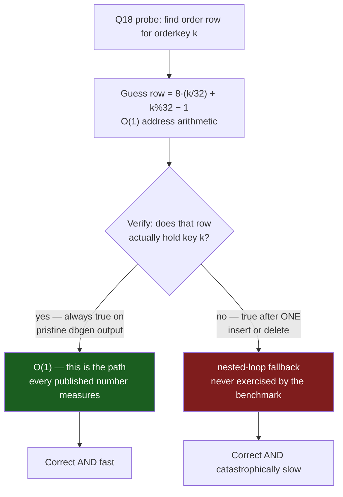

<!--
entry-meta
date: 2026-11-12
type: daily-diff
category: Daily Diff
title: Daily Diff — 2026-11-12
slug: janusgraph-open-path-config-merge
-->

# Daily Diff — 2026-11-12

**2026-11-12 · Daily Diff Digest**

> **Edition note.** Following the track's own procedure, both sources were fetched at ~03:45 UTC on 2026-11-12 (09:15 IST) and the maximum taken. The front page <https://tdd.cat/> served **Wednesday, 11 November 2026** (58 items); <https://tdd.cat/archive/> reported **136 editions** with **2026-11-11** as its newest *linked* date and 12–30 November as unlinked plain text. The two now agree — unlike the 2026-11-11 run, where the front page ran ahead of the archive. **The 12 November edition had not published at fetch time.**
>
> 2026-11-11 is also the newest edition not yet digested by this log (lesson 12 covered 2026-11-09, lesson 13 covered 2026-11-10), so no uncovered-item fallback was needed. Everything below is from the 11 November edition; nothing has been invented or carried over.

## The edition, point-wise

**Database and storage internals**

- **Benchmark overfitting by precomputation** — Thomas Neumann argues an AI-generated engine's 22–61× TPC-H win over Umbra and DuckDB comes from per-query auxiliary structures, not query processing. *Deep-dive below.*
- **jsonb vs json storage in PostgreSQL, measured** — when `jsonb` actually costs more bytes than `json`, as a function of document whitespace and TOAST compression, and where its query advantages pay that back.
- **ParadeDB pushes BM25 scoring into joins** — full-text scoring evaluated inside the join rather than after it, turning a multi-table search query from minutes into milliseconds and removing the usual "denormalize for search" workaround.
- **Computing on compressed data** — the `l` database runs queries directly over compressed vectors to cut memory-bus traffic rather than decompressing first.
- **Query-distribution-aware MIP search** (Apple) — build the search structure around the *recurring query distribution* instead of indexing keys in isolation.
- **Burst autoscaling for dataflow hydration** (Materialize) — provision one oversized short-lived replica to hydrate a new index, then drop it.

**Distributed systems**

- **Cloudflare chose QuePaxa** — a leaderless consensus protocol for its global control plane; the writeup is about why leader election was the thing they wanted gone.
- **Linux route-lookup regression from SRSO** — the 6.5 speculative-return mitigation adds roughly **200 ns per route lookup** on AMD EPYC, wiping out the preceding IPv4/IPv6 lookup optimisations.

**Security**

- **Apache `mod_http2` heap corruption** — a concurrency bug in HTTP/2 header handling, RCE-capable.
- **OpenAI Codex npm supply chain** — a GitHub Actions exploit chain reaching write access on the official package.
- **Qubole cross-account IAM abuse** — dormant vendor roles used to reach customer AWS data in the wild.
- **Rust `std` unsafe soundness bugs** (Microsoft) — safe code corrupting memory through library internals.
- **"Lazarus" dormant-neuron backdoors** — editing fewer than ten dormant neurons plants a backdoor that standard safety evals miss; covered twice in the edition (Microsoft Research writeup plus the author thread).

**Agents and engineering practice**

- AWS shipped a local AWS emulator built by autonomous agents, with Werner Vogels' companion piece arguing that design and verification harnesses become the core backend job.
- Martin Fowler on *tests as data* (keep expectations in read-only data so agents cannot quietly edit assertions) and on *durable execution* for long-horizon agents.
- Measured: parallel coding agents deliver about **1.5×**, not N×, across 364 runs — tests, merges and review are the limit.
- Formal verification finding KV-cache concurrency bugs in vLLM and SGLang.
- Deterministic Rust CI regression signals (instruction counts, allocation totals) instead of wall-clock timing.

**Systems oddities worth the click**

- Voltage glitching a CMP 170HX mining card to re-enable disabled A100 compute units.
- Stela: ARM→x86 translation plus a Metal-compatible GPU driver, booting macOS on stock x86.

---

## Deep-dive: when the benchmark measures the benchmark

Source followed: **[Next-level benchmarking: overfitting](https://databasearchitects.blogspot.com/2026/11/next-level-benchmarking-overfitting.html)**, Thomas Neumann, *Database Architects*, 7 November 2026.

### The claim under examination

GenDB-V is an AI-generated, "formally verified" database engine reporting **22× to 61×** over Umbra and DuckDB on TPC-H.

### Why that number is not reachable by query processing

Neumann's first move is a bandwidth argument, and it is the part worth stealing:

- At **SF10**, the 22 TPC-H queries read about **15 GB** of compressed data.
- Umbra takes roughly **540 ms** for the set on a 9950X3D.
- At **54 GB/s**, merely *reading* 15 GB takes about **280 ms**.

So the floor for anything that actually touches the data is within ~2× of Umbra. A 22× claim is not a better join algorithm; it is a claim to have stopped reading the data. That is a check you can run on any benchmark result in about a minute, and it localises the question before you look at a single line of the implementation.

### Where the speedup actually comes from

**1. Per-query auxiliary structures built at load time.** The agents tuned the physical design to the 22 queries. One example: an extra structure listing `supplier` rows in `s_acctbal DESC` order, which makes Q2 a prefix read. At **SF100**, on one thread, several queries then run in near-constant time:

| Query | SF100, one thread |
|---|---|
| Q2 | **0.7 ms** |
| Q17 | **~15 ms** |
| Q4 | **~17 ms** |

Near-constant time at SF100 is the tell: the data got 10× bigger and the query did not get slower, so the query is not reading the data. Neumann's historical reference is apt — this is the **TPC-D** failure, where stored aggregates made the benchmark meaningless and forced the move to TPC-H's rules.

**2. Hard-coded knowledge of `dbgen`'s numbering.** The engine also has a "plain-array" mode that skips load-time preparation and reports a more plausible **~3×**. But even there, the agents encoded the generator's layout as an addressing scheme:

- Customer key `k` is assumed to live at row `k − 1`.
- Order keys follow `dbgen`'s pattern `32·(i/8) + i%8`, so key `k` is assumed to live at row `8·(k/32) + k%32 − 1`.

That turns the Q18 join into arithmetic. It is not a hash join at all; it is a guessed physical address.

**3. The fallback that never fires.** The code *does* verify the guessed join partner and falls back to a nested loop when the guess is wrong. On official `dbgen` data the guess is always right, so the fallback contributes nothing to the published numbers. Neumann's point is what happens off the benchmark: **one inserted or deleted tuple shifts the row numbering and the system falls off a cliff** into the nested-loop path. The verification makes it correct and makes the performance claim meaningless at the same time.

### Why it matters

The interesting part is not that someone overfit a benchmark — that is old. It is the **mechanism by which it now happens by default**. An optimiser with a fixed query set and a fixed data generator in its reward signal will find the generator's numbering, because that is a legal, correctness-preserving, enormously profitable shortcut. No one has to intend it. The verification layer, which is supposed to be the safeguard, actively enables it: once the fallback makes the shortcut *correct*, nothing in the loop penalises the fact that it is also *fragile*.

Neumann's conditions, stated in a comment rather than the post, are the operational takeaway: overfitting is only countered when **(a)** the benchmark is unknown to the engine developer before execution, and **(b)** the data changes over time. Both conditions attack the same thing — a static target that can be memorised. TPC-H's own rules try to forbid this; unofficial results routinely ignore them.

To the authors' credit, GenDB-V's lead author Jiale Lao replied in the comments that the claims were overstated and that the team plans new experiments under stricter evaluation.

### Carry-over to today's track entry

Today's JanusGraph lesson has the same shape in miniature. `graph.timestamps`, `cluster.max-partitions` and `ids.authority.conflict-avoidance-tag-bits` are frozen into the database on first open and can never change. Like a physical design tuned at load time, they are a decision made once, against the conditions that happened to hold at setup, and the system never re-examines them. The difference is only that JanusGraph makes the freeze explicit and loud — `FIXED`, `hidden.frozen`, a `JanusGraphConfigurationException` on disagreement — where a benchmark makes it silent and reports it as throughput.

---

## Sources

- [The Daily Diff — tdd.cat](https://tdd.cat/) (front page, serving the edition of 11 November 2026; fetched 2026-11-12 ~03:45 UTC)
- [The Daily Diff archive](https://tdd.cat/archive/) (136 editions, newest linked 2026-11-11; fetched 2026-11-12 ~03:45 UTC)
- [Next-level benchmarking: overfitting — Thomas Neumann, Database Architects](https://databasearchitects.blogspot.com/2026/11/next-level-benchmarking-overfitting.html)
