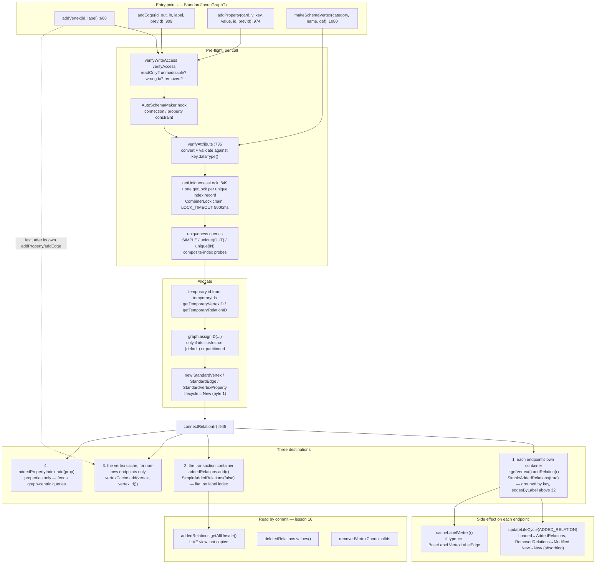
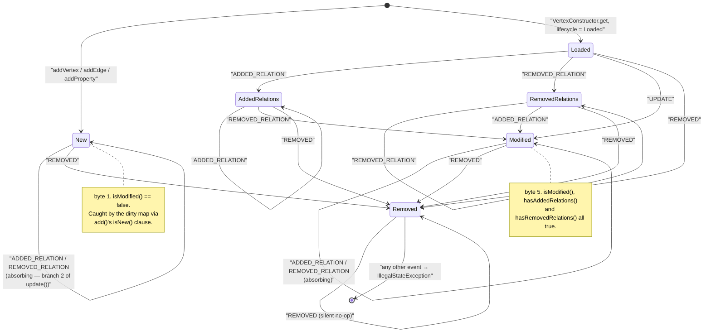

<!--
entry-meta
date: 2026-11-13
type: lesson
track: JanusGraph
lesson: 15
category: Database Internals
title: StandardJanusGraphTx — addVertex, addEdge, property writes, the added/deleted containers, and the vertex cache
slug: janusgraph-tx-write-path-containers
-->

# `StandardJanusGraphTx`: the write path, the two relation containers, and the vertex cache

**2026-11-13 · JanusGraph Track · Lesson 15 of 28**

## Where This Fits

- **Lesson 14** ([`2026-11-12-janusgraph-open-path-config-merge`](../../11/2026-11-12-janusgraph-open-path-config-merge/README.md)) walked the nine-frame open path and ended at `new StandardJanusGraph` — the construction order `:264-360`, the frozen config row, and the handoff point `newTransaction` at [`StandardJanusGraph:588-598`](https://github.com/JanusGraph/janusgraph/blob/a59ae8d8024207598eada34998d867617df51adf/janusgraph-core/src/main/java/org/janusgraph/graphdb/database/StandardJanusGraph.java#L588-L598). It handed this lesson three explicit obligations, all three discharged below.
- **This lesson** is the in-memory write buffer: what `addVertex`, `addEdge` and `addProperty` actually construct, where the new relation is filed (it goes into **three** places, not one), how the `ElementLifeCycle` byte decides which of those places keep it, and why the per-transaction and per-vertex relation containers are the same Java class configured in opposite directions.
- **It sets up lesson 16** (`StandardJanusGraph.commit`/`prepareCommit`). Everything commit reads is produced here: `addedRelations.getAllUnsafe()`, `deletedRelations.values()`, and the `removedVertexCanonicalIds` set. Lesson 16 can start from the two collections this lesson hands it rather than re-deriving them.
- **It also pays a debt forward to lesson 18** (locking): the `TransactionLock` machinery in this file is the *transaction-local* half of uniqueness. The storage-level half (`ConsistentKeyLocker`) is lesson 18's. This lesson draws the line precisely.

---

## 1. Obligation (a), settled: what the constructor can reach before the backend exists

Lesson 14 flagged a window. `newTransaction` builds the transaction object and only then attaches a backend handle:

```java
// StandardJanusGraph.java:588-598
public StandardJanusGraphTx newTransaction(final TransactionConfiguration configuration) {
    if (!isOpen()) ExceptionFactory.graphShutdown();
    try {
        StandardJanusGraphTx tx = new StandardJanusGraphTx(this, configuration);
        tx.setBackendTransaction(openBackendTransaction(tx));
        openTransactions.add(tx);
        return tx;
    } catch (BackendException e) {
        throw new JanusGraphException("Could not start new transaction", e);
    }
}
```

**Answer: nothing in the constructor can reach the backend, and the reason is structural rather than defensive.** Every field the constructor reads off `graph` is an already-constructed object handed over by reference ([`StandardJanusGraphTx:304-375`](https://github.com/JanusGraph/janusgraph/blob/a59ae8d8024207598eada34998d867617df51adf/janusgraph-core/src/main/java/org/janusgraph/graphdb/transaction/StandardJanusGraphTx.java#L304-L375)):

| Line | Reads | Built at (lesson 14's order) |
|---|---|---|
| `:308` | `graph.getConfiguration().getTimestampProvider()` | `:266` / `:309` |
| `:309` | `graph.getConfiguration().allowCustomVertexIdType()` | `:266` |
| `:312-313` | `graph.getIDManager()` | `:294` |
| `:314` | `graph.getDataSerializer()` | `:301` |
| `:315` | `graph.getEdgeSerializer()` | `:302` |
| `:316` | `graph.getIndexSerializer()` | `:304` |
| `:317` | `graph.getIndexSelector()` | `:310` |

`txHandle` is the only backend-facing field and it is declared **non-final** (`:220`) precisely so it can be filled in afterwards. `setBackendTransaction` (`:381-384`) asserts the one-shot contract:

```java
Preconditions.checkArgument(this.txHandle==null && txHandle!=null);
```

Three consequences worth carrying:

1. **The guard at the top of the constructor is `graph.isOpen()`, not a backend check** (`:306`: `Preconditions.checkArgument(graph.isOpen())`). Combined with lesson 14's finding that `isOpen = true` is set at `StandardJanusGraph:320` — *after* `schemaCache` at `:308` — the ordering that protects the schema cache also protects every transaction: no transaction can be constructed before the graph finishes wiring itself.
2. **A transaction whose backend transaction fails to open is never registered.** `openTransactions.add(tx)` is at `:593`, *after* `setBackendTransaction`. If `openBackendTransaction` (`:600-603` — `indexSerializer.getIndexInfoRetriever(tx)` then `backend.beginTransaction(...)`) throws, the half-built `StandardJanusGraphTx` is unreachable and `graph.close()` will never roll it back. It also never acquired a backend handle, so there is nothing to roll back at the storage layer — but any index transactions `backend.beginTransaction` had already opened are not visibly cleaned up on that path.
3. **Nothing in the constructor would notice a null `txHandle` anyway**, because the constructor does no I/O at all. It allocates: four containers, three `VertexConstructor` instances, one `IDPool`, and (conditionally) two metrics wrappers. That is the whole of it.

### What `StandardTransactionBuilder` reads out of the `GraphDatabaseConfiguration`

The second half of obligation (a). The builder is constructed at `StandardJanusGraph:579` (`buildTransaction()`), and its private constructor ([`StandardTransactionBuilder:107-133`](https://github.com/JanusGraph/janusgraph/blob/a59ae8d8024207598eada34998d867617df51adf/janusgraph-core/src/main/java/org/janusgraph/graphdb/transaction/StandardTransactionBuilder.java#L107-L133)) reads **fourteen** values off the `GraphDatabaseConfiguration` object — not off a `Configuration`:

```java
if (graphConfig.isReadOnly()) readOnly();                       // :110
if (graphConfig.isBatchLoading()) enableBatchLoading();         // :111
this.defaultSchemaMaker          = graphConfig.getDefaultSchemaMaker();          // :113
this.hasDisabledSchemaConstraints= graphConfig.hasDisabledSchemaConstraints();   // :114
this.assignIDsImmediately        = graphConfig.hasFlushIDs();                    // :115
this.forceIndexUsage             = graphConfig.hasForceIndexUsage();             // :116
this.groupName                   = graphConfig.getMetricsPrefix();               // :117
this.propertyPrefetching         = graphConfig.hasPropertyPrefetching();         // :119
this.multiQuery                  = graphConfig.useMultiQuery();                  // :120
this.hasStepStrategyMode         = graphConfig.hasStepStrategyMode();            // :121
this.propertiesStrategyMode      = graphConfig.propertiesStrategyMode();         // :122
this.labelStepStrategyMode       = graphConfig.labelStepStrategyMode();          // :123
this.dropStepStrategyMode        = graphConfig.dropStepStrategyMode();           // :124
vertexCacheSize(graphConfig.getTxVertexCacheSize());                             // :131
dirtyVertexSize(graphConfig.getTxDirtyVertexSize());                             // :132
```

All fifteen of those are **pre-resolved fields** on `GraphDatabaseConfiguration`, filled by `preLoadConfiguration` (lesson 14: ~45 fields resolved eagerly in the constructor). So building a transaction reads no config row, consults no `MixedConfiguration` ladder, and cannot fail on a missing option. The only live `Configuration` the builder keeps is `customOptions`, a `MergedConfiguration(writableCustomOptions, graphConfig.getConfiguration())` (`:127`) that is passed straight through to `StandardBaseTransactionConfig` (`:576-580`) for the *storage* layer, not read by the transaction itself.

Two things are worth knowing about those two cache sizes, because they are the only numbers in the whole transaction that come from user configuration:

- **`cache.tx-cache-size`** — [`GraphDatabaseConfiguration:668-670`](https://github.com/JanusGraph/janusgraph/blob/a59ae8d8024207598eada34998d867617df51adf/janusgraph-core/src/main/java/org/janusgraph/graphdb/configuration/GraphDatabaseConfiguration.java#L668-L670), `MASKABLE`, **default 20000**, read into `txVertexCacheSize` at `:2058`.
- **`cache.tx-dirty-size`** — `:680-684`, `MASKABLE`, declared as `ConfigOption<Integer>` **with no default**. The fallback is computed at `:2060-2066` and depends on batch loading: `TX_DIRTY_SIZE_DEFAULT_WITH_BATCH = 4096` (`:698`) or `TX_DIRTY_SIZE_DEFAULT_WITHOUT_BATCH = 32` (`:691`). This is the one transaction-level number whose default is a function of another option.

And one non-obvious coupling: `vertexCacheSize(int size)` also sets `indexCacheWeight = size / 2` (`StandardTransactionBuilder:197-201`). Setting `cache.tx-cache-size` therefore silently halves-and-sets the subquery cache weight too. `readOnlyOLAP()` (`:159-166`) zeroes both `vertexCacheSize` and `dirtyVertexSize`, which matters in section 5.

---

## 2. What the constructor allocates, and the single branch that shapes everything

`StandardJanusGraphTx`'s constructor has exactly one meaningful decision in it, and it is made four times on the same predicate ([`:334-342`](https://github.com/JanusGraph/janusgraph/blob/a59ae8d8024207598eada34998d867617df51adf/janusgraph-core/src/main/java/org/janusgraph/graphdb/transaction/StandardJanusGraphTx.java#L334-L342)):

```java
if (config.isSingleThreaded()) {
    addedRelations      = new SimpleAddedRelations(false);
    newTypeCache        = new HashMap<>();
    addedPropertyIndex  = new SimpleIndexCache(addedRelations);
} else {
    addedRelations      = new ConcurrentAddedRelations(false);
    newTypeCache        = new NonBlockingHashMap<>();
    addedPropertyIndex  = new ConcurrentIndexCache(addedRelations);
}
```

`isSingleThreaded` is set only by `threadBound()` (`StandardTransactionBuilder:146-150`, which sets *both* `threadBound` and `singleThreaded`). So the rule is blunt and worth internalising:

> **`graph.tx()` / `graph.addVertex(...)` → thread-bound → single-threaded → unsynchronised containers and `FakeLock`. `graph.newTransaction()` / `createThreadedTx()` → not single-threaded → synchronised containers and real `ReentrantTransactionLock`s.**

`isSingleThreaded` governs five more sites in this file: `getLock` returns `FakeLock.INSTANCE` immediately (`:831`), and the lazy initialisation of `deletedRelations` (`:784-792`), `removedVertexCanonicalIds` (`:808-816`) and `uniqueLocks` (`:832-840`) each pick a plain `HashMap`/`HashSet` or a `ConcurrentHashMap`/`newKeySet` on it. It is the only concurrency knob in the class.

### The lazily-initialised fields, and their sentinels

Four fields start as a sentinel and are only allocated on first write. This is not micro-optimisation theatre — a read-only or read-mostly transaction allocates none of them.

| Field | Sentinel | Allocated in | Allocated as |
|---|---|---|---|
| `deletedRelations` | `EMPTY_DELETED_RELATIONS` = `Collections.emptyMap()` (`:197`) | `removeRelation` `:784-792` | `HashMap` / `ConcurrentHashMap` |
| `removedVertexCanonicalIds` | `null` (`:255`) | `recordRemovedVertex` `:808-816` | `HashSet` / `ConcurrentHashMap.newKeySet()` |
| `uniqueLocks` | `UNINITIALIZED_LOCKS` = `null` (`:198`) | `getLock` `:832-840` | `ConcurrentHashMap` |
| `relTypeCache` | `null` unless `isLazyLoadRelations()` (`:357-361`) | constructor | `ConcurrentHashMap<>(30)` |

Note the shape of all three double-checked blocks — e.g. `removeRelation`:

```java
Map<Long, InternalRelation> result = deletedRelations;
if (result == EMPTY_DELETED_RELATIONS) {
    if (config.isSingleThreaded()) {
        deletedRelations = result = new HashMap<>();
    } else {
        synchronized (this) {
            result = deletedRelations;
            if (result == EMPTY_DELETED_RELATIONS)
                deletedRelations = result = new ConcurrentHashMap<>();
        }
    }
}
result.put(relation.longId(), relation);
```

The field is `volatile` (`:250`), the synchronisation monitor is `this` — the same monitor `commit()`, `rollback()` and `rollbackIfOpen()` hold (`:2137`, `:2166`, `:2192`, all `synchronized`). So a commit cannot interleave with the *allocation* of `deletedRelations`, though it certainly can interleave with a `put` into it. That is what `getAllUnsafe`'s name is about; section 6.

### `temporaryIds` is a counter, not a pool

```java
// :320-332
temporaryIds = new IDPool() {
    private final AtomicLong counter = new AtomicLong(1);
    @Override public long nextID() { return counter.getAndIncrement(); }
    @Override public void close() { /* Do nothing */ }
};
```

An anonymous `IDPool` starting at **1**, shared by every new vertex *and* every new relation in the transaction, never released. It has nothing to do with the `VertexIDAssigner` block allocation from lesson 09 — that machinery is reached only through `graph.assignID`. This counter exists purely so that in-memory objects have distinct identities before they get real ids.

---

## 3. `addVertex`: eleven checks, one allocation, and an ordering that matters

[`StandardJanusGraphTx:668-699`](https://github.com/JanusGraph/janusgraph/blob/a59ae8d8024207598eada34998d867617df51adf/janusgraph-core/src/main/java/org/janusgraph/graphdb/transaction/StandardJanusGraphTx.java#L668-L699) is the only place a user vertex is born. Read in order:

```java
public JanusGraphVertex addVertex(Object vertexId, VertexLabel label) {
    verifyWriteAccess();                                                      // :669
    if (label==null) label=BaseVertexLabel.DEFAULT_VERTEXLABEL;               // :670
    if (vertexId != null && !graph.getConfiguration().allowVertexIdSetting()) {
        log.info("Provided vertex id [{}] is ignored because vertex id setting is not enabled", vertexId);
        vertexId = null;                                                      // :673
    }
    Preconditions.checkArgument(vertexId != null || !graph.getConfiguration().allowVertexIdSetting(),
                                "Must provide vertex id");                    // :676
    // ... four more Preconditions and two string-id checks ...
    StandardVertex vertex = new StandardVertex(this,
        IDManager.getTemporaryVertexID(IDManager.VertexIDType.NormalVertex, temporaryIds.nextID()),
        ElementLifeCycle.New);                                                // :686
    if (vertexId != null) {
        vertex.setId(vertexId);                                               // :688
    } else if (config.hasAssignIDsImmediately() || label.isPartitioned()) {
        graph.assignID(vertex,label);                                         // :690
    }
    addProperty(vertex, BaseKey.VertexExists, Boolean.TRUE);                  // :692
    if (label!=BaseVertexLabel.DEFAULT_VERTEXLABEL) {
        Preconditions.checkArgument(label instanceof VertexLabelVertex);
        addEdge(vertex, label, BaseLabel.VertexLabelEdge);                    // :695
    }
    vertexCache.add(vertex, vertex.id());                                     // :697
    return vertex;
}
```

### Obligation (b), settled: can a user vertex carry a temporary id past creation?

**Yes, but only when `ids.flush=false`, and that is not the default.** `IDS_FLUSH` is [`GraphDatabaseConfiguration:1064-1067`](https://github.com/JanusGraph/janusgraph/blob/a59ae8d8024207598eada34998d867617df51adf/janusgraph-core/src/main/java/org/janusgraph/graphdb/configuration/GraphDatabaseConfiguration.java#L1064-L1067), `MASKABLE`, **default `true`**. So out of the box:

- `config.hasAssignIDsImmediately()` is true → `:690` runs → `graph.assignID(vertex, label)` → `idAssigner.assignID(vertex, label)` ([`StandardJanusGraph:757-759`](https://github.com/JanusGraph/janusgraph/blob/a59ae8d8024207598eada34998d867617df51adf/janusgraph-core/src/main/java/org/janusgraph/graphdb/database/StandardJanusGraph.java#L757-L759)) → the lesson-09 block allocator → a final id.
- The temporary id's lifetime is therefore **the three statements between `:686` and `:690`**. Nothing observes it.

With `ids.flush=false` the temporary id survives until commit, where `idAssigner.assignIDs(addedRelations)` at [`StandardJanusGraph:1226`](https://github.com/JanusGraph/janusgraph/blob/a59ae8d8024207598eada34998d867617df51adf/janusgraph-core/src/main/java/org/janusgraph/graphdb/database/StandardJanusGraph.java#L1226) does the work in bulk — **and note what it is handed: the relation collection, not a vertex collection.** Vertices are reached through their relations. A new vertex with no relations at all cannot exist, which is exactly why `:692` unconditionally adds the `VertexExists` property.

**The contrast with a schema vertex holds, and lesson 13 called it correctly.** `makeSchemaVertex` ([`:1080-1111`](https://github.com/JanusGraph/janusgraph/blob/a59ae8d8024207598eada34998d867617df51adf/janusgraph-core/src/main/java/org/janusgraph/graphdb/transaction/StandardJanusGraphTx.java#L1080-L1111)) calls `graph.assignID(schemaVertex, BaseVertexLabel.DEFAULT_VERTEXLABEL)` at `:1098` with **no condition at all**, then asserts `schemaVertex.longId() > 0` at `:1099`. A schema vertex can never carry a temporary id past creation, whatever `ids.flush` says. A user vertex can.

And a partitioned vertex is a third case: `label.isPartitioned()` at `:689` forces immediate assignment even with `ids.flush=false`, because the partition bits are part of the id and the write path needs them before it can route anything.

### Why `vertexCache.add` comes *last*

This looks like a bug on first read: the vertex is published to the cache at `:697`, after two calls (`:692`, `:695`) that themselves reach into `vertexCache`. It is not. `connectRelation` only touches the cache for vertices that are **not** new:

```java
// :945-960
private void connectRelation(InternalRelation r) {
    for (int i = 0; i < r.getLen(); i++) {
        boolean success = r.getVertex(i).addRelation(r);
        if (!success) throw new AssertionError("Could not connect relation: " + r);
    }
    addedRelations.add(r);
    for (int pos = 0; pos < r.getLen(); pos++) {
        InternalVertex vertex = r.getVertex(pos);
        if (!vertex.isNew()) {
            vertexCache.add(vertex, vertex.id());
        }
    }
    if (r instanceof JanusGraphVertexProperty) {
        addedPropertyIndex.add((JanusGraphVertexProperty) r);
    }
}
```

So during `addVertex` the new vertex is skipped by the `!vertex.isNew()` guard every time, and `:697` is the single publication point. Doing it in the other order would be *harmless but wasteful*: `CaffeineVertexCache.add` would be called three times instead of once for the same vertex.

The real reason the order matters is the key. `vertexCache.add(vertex, vertex.id())` uses **whatever id the vertex has at that moment**. With `ids.flush=true` that is the final id. With `ids.flush=false` it is the temporary id, and the cache is keyed by a temporary id for the rest of the transaction — which is fine only because the cache is discarded wholesale at `releaseTransaction` (section 7) and `getVertices(...)` rejects temporary ids earlier, at `isValidVertexId` (`:506-523`).

### `verifyWriteAccess` and the unmodifiable-vertex rule

```java
// :390-398
private void verifyWriteAccess(JanusGraphVertex... vertices) {
    if (config.isReadOnly())
        throw new ReadOnlyTransactionException("Cannot create new entities in read-only transaction");
    for (JanusGraphVertex v : vertices) {
        if (v.hasId() && idInspector.isUnmodifiableVertex(v.id()) && !v.isNew())
            throw new SchemaViolationException("Cannot modify unmodifiable vertex: "+v);
    }
    verifyAccess(vertices);
}
```

Note the three-clause guard: `hasId() && isUnmodifiableVertex(id) && !isNew()`. The `!isNew()` is what lets `makeSchemaVertex` write properties onto a schema vertex whose id already has schema suffix bits (lesson 08's layout, lesson 13's `getSchemaId`) — it is new, so the rule does not bite. Once committed, the same vertex becomes unwritable through this path forever; schema changes have to go through `ManagementSystem`, which is lesson 25.

`verifyAccess` (`:400-409`) then enforces transaction affinity: `this != ((InternalVertex) v).tx()` throws, **with one exception** — `v instanceof SystemRelationType`. System types are singletons from `SystemTypeManager` (lesson 13's eight ids) and belong to no transaction, so they get a pass.

---

## 4. `addEdge` and `addProperty`: the same skeleton, two different consistency problems

Both methods have the identical five-step shape:

1. `verifyWriteAccess(...)`, then resolve each vertex through `.it()` to this transaction's representative.
2. Auto-schema hook — `checkConnectionConstraintOrCreateConnectionConstraint` (`:888-903`) for edges, `checkPropertyConstraintForVertexOrCreatePropertyConstraint` (`:870-877`) for properties. Both return immediately if `config.hasDisabledSchemaConstraints()`, and otherwise may **create schema inside a data write** via `config.getAutoSchemaMaker()`.
3. Compute a `TransactionLock` and take it, with `LOCK_TIMEOUT = Duration.ofMillis(5000L)` (`:199`) — a hardcoded five seconds, not configurable.
4. Inside the lock: uniqueness checks, construct the relation, maybe assign an id, maybe delete what it replaces.
5. `connectRelation(...)`, `finally { uniqueLock.unlock(); }`.

### `addEdge` (`:909-942`)

```java
long edgeId = id == null ? IDManager.getTemporaryRelationID(temporaryIds.nextID()) : id;
StandardEdge edge = new StandardEdge(edgeId, label, (InternalVertex) outVertex, (InternalVertex) inVertex,
                                     ElementLifeCycle.New);
if (previousId > 0) edge.setPreviousID(previousId);
if (config.hasAssignIDsImmediately() && id == null) graph.assignID(edge);
connectRelation(edge);
```

The uniqueness block above it (`:919-932`) is **three independent checks driven by `Multiplicity`**, and each one is a real query:

| Multiplicity | Check | Query issued |
|---|---|---|
| `SIMPLE` | an edge with this label already between this pair | `query(outVertex).type(label).direction(OUT).adjacent(inVertex).edges()` |
| `isUnique(OUT)` (`ONE2MANY`, `ONE2ONE`) | any such edge on the out-vertex | `query(outVertex).type(label).direction(OUT).edges()` |
| `isUnique(IN)` (`MANY2ONE`, `ONE2ONE`) | any such edge on the in-vertex | `query(inVertex).type(label).direction(IN).edges()` |

All three are gated on `config.hasVerifyUniqueness()`, which `enableBatchLoading()` turns off (`StandardTransactionBuilder:169-173` calls `consistencyChecks(false)`, which sets **both** `verifyUniqueness` and `acquireLocks` to false, `:222-227`). So `graph.allow-batch-loading` does not merely skip a flag check — it removes up to three storage reads per edge *and* stops the storage-level lock from ever being requested. That is where most of the batch-loading speedup comes from.

`getUniquenessLock` (`:849-868`) is the transaction-local half:

```java
if (config.hasVerifyUniqueness() && multiplicity.isConstrained()) {
    uniqueLock = null;
    if (multiplicity==Multiplicity.SIMPLE) {
        uniqueLock = getLock(out, type, in);
    } else {
        for (Direction dir : Direction.proper) {
            if (multiplicity.isUnique(dir)) {
                TransactionLock lock = getLock(dir == Direction.OUT ? out : in, type, dir);
                if (uniqueLock==null) uniqueLock=lock;
                else uniqueLock=new CombinerLock(uniqueLock,lock,times);
            }
        }
    }
}
```

The lock *tuple* is the interesting part. For `SIMPLE` it is `(out, type, in)` — three elements, the full edge identity. For a direction-unique multiplicity it is `(vertex, type, direction)` — the vertex on the constrained end plus the direction, deliberately *not* the other endpoint, because the constraint is "at most one, whoever it points at". `ONE2ONE` produces two locks combined by `CombinerLock`, so a `ONE2ONE` edge insert takes two transaction-local locks and does three storage queries.

`getLock` (`:832-845`) has a `putIfAbsent` race-free body but allocates a `ReentrantTransactionLock` on **every** call and discards the loser — and carries an explicit upstream TODO:

```java
//TODO: clean out no longer used locks from uniqueLocks when it grows to large
//      (use ReadWriteLock to protect against race conditions)
TransactionLock lock = new ReentrantTransactionLock();
TransactionLock existingLock = result.putIfAbsent(la, lock);
return (existingLock == null)?lock:existingLock;
```

`uniqueLocks` is therefore **monotonically growing for the life of the transaction**: one entry per distinct lock tuple ever taken, never evicted. A multi-threaded transaction that inserts a million `SIMPLE` edges holds a million `LockTuple → ReentrantTransactionLock` entries. Section 8.

### `addProperty` (`:974-1052`): the blind-overwrite optimisation

Properties have a second, harder consistency problem: composite index uniqueness. The lock set is built from two sources (`:1053` down to `:995`):

```java
final List<IndexLockTuple> uniqueIndexTuples = new ArrayList<>();
for (CompositeIndexType index : TypeUtil.getUniqueIndexes(key)) {
    IndexRecords matches = IndexRecordUtil.indexMatches(vertex, index, key, normalizedValue);
    for (Object[] match : matches.getRecordValues()) uniqueIndexTuples.add(new IndexLockTuple(index,match));
}
TransactionLock uniqueLock = getUniquenessLock(vertex, (InternalRelationType) key, normalizedValue);
for (IndexLockTuple lockTuple : uniqueIndexTuples) uniqueLock = new CombinerLock(uniqueLock,getLock(lockTuple),times);
uniqueLock.lock(LOCK_TIMEOUT);
```

So one property write can end up holding a `CombinerLock` chain of (1 multiplicity lock) + (one lock per unique composite index record it would occupy). Lesson 17 owns `IndexSerializer` and the graphindex entries; what matters here is that the *lock identity* is the index record, not the key.

Then the part that is genuinely clever, and genuinely sharp-edged (`:1024-1042`):

```java
if (cardinality==VertexProperty.Cardinality.single || cardinality==VertexProperty.Cardinality.set) {
    Consumer<JanusGraphVertexProperty> propertyRemover =
        JanusGraphVertexProperty.getRemover(cardinality, normalizedValue);

    if ( (!config.hasVerifyUniqueness() || ((InternalRelationType)key).getConsistencyModifier()!=ConsistencyModifier.LOCK) &&
            !TypeUtil.hasAnyIndex(key) && cardinality==keyCardinality.convert()) {
        //Only delete in-memory so as to not trigger a read from the database
        ((InternalVertex) vertex).getDuplicatedAddedRelation(key, normalizedValue)
            .forEach(p -> propertyRemover.accept((JanusGraphVertexProperty) p));
        prop.setUpsert(true);
    } else {
        vertex.properties(key.name()).forEachRemaining(p -> propertyRemover.accept((JanusGraphVertexProperty) p));
    }
}
```

**Three conditions must all hold to take the cheap path**, and the code comment enumerates them:

1. no locking on this key — either `verifyUniqueness` is off, or the key's `ConsistencyModifier` is not `LOCK`;
2. `!TypeUtil.hasAnyIndex(key)` — the key backs no index of any kind;
3. `cardinality==keyCardinality.convert()` — the requested cardinality matches the key's declared one (overwriting a `SET` with `single` needs to read the other values in order to delete them).

When all three hold, JanusGraph **does not read the old value at all**. It removes only duplicates it can see in its own in-memory container — `getDuplicatedAddedRelation`, which is a per-vertex lookup, not a query — and marks the new property `upsert`. The `setUpsert(true)` flag is the promise it makes to the commit path: *if this property is ever deleted, you must also go read the database to find and delete the old value, because I never looked.* Lesson 16 inherits that flag.

When any of the three fails, `vertex.properties(key.name())` is called, and for a loaded vertex that is a real slice query. **So the cost of `v.property("name", x)` differs by a storage read depending on whether `name` is indexed** — a fact that explains a lot of otherwise mysterious write-throughput cliffs when someone adds an index.

`verifyAttribute` (`:735-759`) runs *before* any of this and is where lesson 12's serializer registry is consulted: if `key.dataType()` is `Object.class` only `validDataType` is checked; otherwise a mismatched class is handed to `attributeHandler.convert(datatype, attribute)` and a null result becomes a `SchemaViolationException`. Conversion happens once, up front, so everything downstream sees the normalised value.

---

## 5. The vertex cache: one Caffeine cache, one unbounded dirty map

[`CaffeineVertexCache`](https://github.com/JanusGraph/janusgraph/blob/a59ae8d8024207598eada34998d867617df51adf/janusgraph-core/src/main/java/org/janusgraph/graphdb/transaction/vertexcache/CaffeineVertexCache.java) is two fields, and the whole design is in the relationship between them:

```java
private final ConcurrentMap<Object, InternalVertex> volatileVertices;   // the dirty map — UNBOUNDED
private final Cache<Object, InternalVertex> cache;                      // bounded by maximumSize
```

- `volatileVertices` is a `NonBlockingHashMap<>(initialDirtySize)` — jctools, lock-free, **and it has no maximum**. `cache.tx-dirty-size` is an initial capacity hint only, exactly as the javadoc at `GraphDatabaseConfiguration:675-679` says.
- `cache` is `Caffeine.newBuilder().maximumSize(maxCacheSize)` with `.executor(Runnable::run)` — eviction and the removal listener run **on the calling thread**, not on a pool. The inline comment points at [caffeine discussion #757](https://github.com/ben-manes/caffeine/discussions/757) as the justification.

The removal listener is the bridge:

```java
.removalListener((key, v, removalCause) -> {
    if (removalCause == RemovalCause.EXPLICIT) {
        assert volatileVertices.isEmpty();
        return;
    }
    assert (removalCause == RemovalCause.SIZE || removalCause == RemovalCause.REPLACED) : "Cause: " + removalCause;
    if (((AbstractVertex) v).isTxOpen() && (v.isModified() || v.isRemoved())) {
        volatileVertices.putIfAbsent(key, v);
    }
})
```

So: **a vertex evicted from the bounded cache for size is rescued into the unbounded dirty map if and only if it is modified or removed and its transaction is still open.** Clean, merely-read vertices are allowed to fall out and be re-fetched. That is the entire eviction policy, and it is why `cache.tx-cache-size` is a *read* cache tuning knob with no correctness consequence, while the dirty map's size is a function of your write volume and nothing else.

`add` writes to both, conditionally:

```java
public void add(InternalVertex vertex, Object id) {
    Preconditions.checkNotNull(vertex);
    Preconditions.checkArgument(!(id instanceof Number) || (long) id != 0);
    cache.put(id, vertex);
    if (vertex.isNew() || vertex.hasAddedRelations())
        volatileVertices.put(id, vertex);
}
```

`isNew() || hasAddedRelations()` — note it is **not** `isModified()`. A loaded vertex that only had relations *removed* (`lifecycle == RemovedRelations`) does not get into the dirty map through `add`; it gets there through the removal listener, whose predicate is the broader `isModified() || isRemoved()`. This is why `removeRelation` (`:761-795`) calls `vertexCache.add(vertex, vertex.id())` for every non-new endpoint at `:770-773`: the `add` path would skip a remove-only vertex, so the explicit call re-asserts its cache residency and the listener catches it if it is later evicted.

`get` is a three-tier lookup, and the tiers are ordered the only way they can be:

```java
InternalVertex vertex = cache.getIfPresent(id);          // 1. bounded cache
if (vertex == null) {
    InternalVertex newVertex = volatileVertices.get(id);  // 2. dirty map — an evicted-but-dirty vertex
    if (newVertex == null) {
        newVertex = retriever.get(id);                    // 3. construct (and maybe hit storage)
    }
    vertex = cache.get(id, (k) -> v);                     // re-publish into tier 1
}
```

Tier 2 before tier 3 is the correctness-critical ordering: a modified vertex that fell out of the bounded cache must come back as *the same object*, or its added-relations container would be lost. `contains(id)` checks both tiers for the same reason (`cache.getIfPresent(id) != null || volatileVertices.containsKey(id)`).

### `MIN_VERTEX_CACHE_SIZE`, and a comment that points at the wrong issue

```java
// StandardJanusGraphTx:201-206
/**
 * This is a workaround for #893.  Cache sizes small relative to the level
 * of thread parallelism can lead to JanusGraph generating multiple copies of
 * a single vertex in a single transaction.
 */
private static final long MIN_VERTEX_CACHE_SIZE = 100L;
```

applied at `:350-355`:

```java
long effectiveVertexCacheSize = config.getVertexCacheSize();
if (!config.isReadOnly()) {
    effectiveVertexCacheSize = Math.max(MIN_VERTEX_CACHE_SIZE, effectiveVertexCacheSize);
    log.debug("Caffeine vertex cache size: requested={} effective={} (min={})", ...);
}
```

Two observations.

**First, the mechanism is real and the floor only half-fixes it.** The duplicate-vertex hazard comes from `get`'s non-atomic tier-2/tier-3 sequence: two threads in the same multi-threaded transaction can both miss tiers 1 and 2, both call `retriever.get(id)`, and both construct a `CacheVertex`. Only one wins `cache.get(id, k -> v)`, but the loser's object has already been handed back to its caller by the *other* thread's stack — and if that caller has already called `addRelation` on it, those relations live on an object the cache no longer holds. A larger cache makes the tier-1 miss rarer; it does not make the sequence atomic. The floor is a probability reduction, not a fix.

**Second, `#893` does not refer to what the comment implies.** Reading [JanusGraph/janusgraph#893](https://github.com/JanusGraph/janusgraph/pull/893) at the source: it is a pull request opened 2018-01-17 by `davidclement90`, titled *"Remove TTL support for Elasticsearch in documentation."*, closed 2018-01-18, milestone `Release v0.2.1`. It has nothing to do with vertex caches or thread parallelism. The number is almost certainly a carried-over **Titan** issue id from the pre-fork code, and anyone who follows the comment lands on an unrelated 2018 doc change. That is a one-line documentation fix and a genuine small-PR candidate (see Next Steps).

### Obligation (c), settled: the vertex cache and `newTypeCache`

They are two different caches that cooperate in exactly one method, `getSchemaVertex` (`:1216-1225`):

```java
public JanusGraphSchemaVertex getSchemaVertex(String schemaName) {
    Long schemaId = newTypeCache.get(schemaName);                       // 1. this transaction's new types
    if (schemaId==null) schemaId=graph.getSchemaCache().getSchemaId(schemaName);  // 2. the graph-wide cache
    if (schemaId != null) {
        InternalVertex typeVertex = vertexCache.get(schemaId, existingVertexRetriever);  // 3. name→id done; now id→object
        assert typeVertex!=null;
        return (JanusGraphSchemaVertex)typeVertex;
    } else return null;
}
```

Lesson 13's reading was right: `newTypeCache` (a `Map<String, Long>`, `:282`) is checked **before** the global `StandardSchemaCache`, and it is populated only by `makeSchemaVertex`'s last line (`:1109`):

```java
if (schemaCategory.hasName()) newTypeCache.put(schemaCategory.getSchemaName(name), schemaVertex.longId());
```

The division of labour is clean: **`newTypeCache` resolves name → id, `vertexCache` resolves id → object.** `newTypeCache` never holds a vertex, and `vertexCache` never holds a name. A type created in this transaction is invisible to `graph.getSchemaCache()` (it is not committed), so without `newTypeCache` the second `getOrCreatePropertyKey("foo")` in the same transaction would create a *second* `foo`. With it, the first call's id is found and `vertexCache.get(schemaId, existingVertexRetriever)` returns the same `PropertyKeyVertex` that `makeSchemaVertex` put there at `:1108`.

Note the retriever used: `existingVertexRetriever` = `new VertexConstructor(false, preloadedData)` (`:347`), i.e. `verifyExistence == false`. It must be — the schema vertex it is looking up may not be in storage yet.

`newTypeCache` is swapped for `Collections.emptyMap()` at `releaseTransaction` (`:2206`), as lesson 13 recorded.

---

## 6. The two relation containers: one class, opposite configurations

This is the part of the file that rewards precision, because the same class does two different jobs.

```
Transaction level:   StandardJanusGraphTx:336/340   new SimpleAddedRelations(false)
                                                    new ConcurrentAddedRelations(false)
Per-vertex level:    StandardVertex.addRelation     new SimpleAddedRelations(true)
                                                    new ConcurrentAddedRelations(true)
```

The flag is [`groupPropertiesByKey`](https://github.com/JanusGraph/janusgraph/blob/a59ae8d8024207598eada34998d867617df51adf/janusgraph-core/src/main/java/org/janusgraph/graphdb/transaction/addedrelations/SimpleAddedRelations.java), and it switches which of two parallel property stores is used:

```java
} else if (relation.isProperty()) {
    if (groupPropertiesByKey) {
        addProperty(relation);          // → propertiesMap, keyed by relation.getType().name()
    } else {
        propertiesContainer.add(relation);   // → a flat hppc ObjectHashSet
    }
}
```

Trace the consequences and you get a table that is not in any doc:

| | Transaction container (`false`) | Per-vertex container (`true`) |
|---|---|---|
| Properties live in | `propertiesContainer` (`ObjectHashSet`, default capacity) | `propertiesMap` (`HashMap<String, AddedPropertiesValue>`) |
| `propertiesContainer` | the only property store | allocated with capacity **0**, never written |
| `propertiesSize` | **always 0** (only `addProperty`/`removeProperty` touch it, and they never run) | the real property count |
| `edgesByLabel` | **never built** (the build is guarded by `groupPropertiesByKey`) | built once `edgesContainer.size() > MAX_EDGES_WITHOUT_LABEL_INDEX` (= **32**) |
| `getView(types, filter)` | `types` is **ignored** — `!groupPropertiesByKey` short-circuits to the full iterator | honours `types` via `iterator(Set<RelationType>)` |
| Used by | `commit`, `hasModifications`, `hasChangedProperties` | `v.properties(...)`, `v.edges(...)`, `getDuplicatedAddedRelation` |

Several things follow that are easy to get wrong:

- **`isEmpty()` means different things in the two.** The implementation is `edgesContainer.isEmpty() && propertiesContainer.isEmpty() && propertiesSize == 0`. At transaction level the third clause is vacuous; at vertex level the second is. Each container only ever exercises two of the three.
- **`getAllUnsafe().size()` is `propertiesSize + propertiesContainer.size() + edgesContainer.size()`** — a sum over all three stores, which is correct for either configuration precisely because the unused store is always zero.
- **The label index only exists where it can pay off.** A transaction-level view is always scanned whole (commit wants everything anyway), so indexing it by label would be pure overhead. A vertex-level view is queried by label constantly — `v.out("knows")` — so above 32 edges it is worth a `LongObjectHashMap<ObjectHashSet<InternalRelation>>`. The threshold is a package-private constant, not a config option.
- **Properties are grouped by key *name*, a `String`** — and the javadoc on `getView(Set, Predicate)` says so explicitly: *"Properties are grouped by the name of their key, which a transaction that renames the key changes under this one."* Renaming a property key in a transaction that has also added properties for it moves the bucket out from under the lookup. The upstream comment acknowledges the hazard rather than preventing it.

### The three `AddedPropertiesValue` strategies

`addProperty` picks one per key from the key's `Cardinality`:

| Cardinality | Class | Backing store | `addValue` returns | `isNull()` |
|---|---|---|---|---|
| `SINGLE` | `AddedPropertiesSingleValue` | one `InternalRelation` field | **always `1`** | `internalRelation == null` |
| `SET` | `AddedPropertiesSetValue` | `HashMap<Object value, InternalRelation>` | map-size delta | **always `false`** |
| `LIST` | `AddedPropertiesListValue` | `LinkedHashSet<InternalRelation>(20)` | set-size delta | **always `false`** |

Two asymmetries here, both verifiable by reading the three files side by side:

**(1) `AddedPropertiesSingleValue` does not count what it stores.**

```java
public int addValue(InternalRelation internalRelation) {
    this.internalRelation = internalRelation;
    return 1;
}
public int removeValue(InternalRelation internalRelation) {
    this.internalRelation = null;
    return 1;
}
```

`addValue` overwrites and returns 1 regardless; `removeValue` nulls the slot and returns 1 regardless, **without checking that the relation passed in is the one stored**. The `SET` and `LIST` implementations both return a true size delta. So `propertiesSize` stays correct for a `SINGLE` key only because `StandardJanusGraphTx.addProperty` guarantees the previous value is removed before the new one is connected: the `cardinality == single` branch at `:1024` always runs a remover, `removeProperty` decrements by 1 and then `propertiesMap.remove(key)` fires because `isNull()` is now true, and the subsequent `computeIfAbsent` builds a fresh strategy object. The accounting balances *because of the caller*, not because of the class. Any future call site that adds a second `SINGLE` value without removing the first leaves `propertiesSize` one too high; today the only call site is `SimpleAddedRelations.addProperty`.

**(2) `SET` and `LIST` entries are never pruned from `propertiesMap`.** Both return `false` from `isNull()` unconditionally, so `removeProperty`'s cleanup

```java
if (propertiesValue.isNull()) {
    propertiesMap.remove(key);
}
```

can never fire for them. Remove every `SET`-cardinality property of a key from a vertex and you are left with an empty `AddedPropertiesSetValue` wrapping an empty `HashMap`, keyed by the key's name, for the rest of the transaction. It is a bounded leak — one entry per key name ever written — but it is a real asymmetry with `SINGLE`, and `getAllProperties()` pays for it by concatenating an empty iterator per dead key on every full view.

### `ConcurrentAddedRelations`: synchronised, copying — except once

[`ConcurrentAddedRelations`](https://github.com/JanusGraph/janusgraph/blob/a59ae8d8024207598eada34998d867617df51adf/janusgraph-core/src/main/java/org/janusgraph/graphdb/transaction/addedrelations/ConcurrentAddedRelations.java) extends `SimpleAddedRelations` and does two things: marks every method `synchronized`, and wraps most of the view methods in `copyView`, which materialises the lazy `Iterables.filter` into an `ArrayList` while still holding the monitor.

**The exception is the one that matters.** `getAllUnsafe()` is `synchronized` but is *not* passed through `copyView`:

```java
@Override
public synchronized Collection<InternalRelation> getAllUnsafe() {
    return super.getAllUnsafe();
}
```

and `SimpleAddedRelations.getAllUnsafe()` returns an `AbstractCollection` whose `iterator()` delegates to the live `SimpleAddedRelations.this.iterator()`. So the `synchronized` protects the *construction* of a lazy wrapper, and then the caller iterates it **outside** the monitor. The interface javadoc states the contract that makes this sound:

> *"This method returns all relations in this container. It may only be invoked at the end of the transaction after there are no additional changes. Otherwise the behavior is non deterministic."*

That is the whole meaning of the `Unsafe` suffix, and it is why `commit()` is `synchronized` on the transaction: `graph.commit(addedRelations.getAllUnsafe(), deletedRelations.values(), this)` (`:2145`) hands the commit path two live views, and the only thing keeping them stable is that nothing else may write. In a multi-threaded transaction, a thread still calling `addVertex` while another calls `commit` is outside the contract — `hppc`'s `ObjectHashSet` has no fail-fast iterator, so the failure mode is silent, not a `ConcurrentModificationException`. Lesson 16 should keep this in mind when it reads `prepareCommit`.

### Two different "empty" containers

Easy to conflate, so pin them down:

- **`AddedRelationsContainer.EMPTY`** — the interface's anonymous constant. Its `add`/`remove` **throw `UnsupportedOperationException`**; all views return `Collections.emptyList()`. It is the per-vertex sentinel: `StandardVertex.addedRelations` starts as `EMPTY` and is replaced on first `addRelation`. Throwing is right there, because reaching `add` on it would mean the lazy-init double-check failed.
- **`EmptyAddedRelations.getInstance()`** — swapped into `StandardJanusGraphTx.addedRelations` by `releaseTransaction` (`:2205`). This one is a *closed* transaction's container, and section 7 explains why its contract differs.

---

## 7. The lifecycle byte, and the state machine that drives everything

[`ElementLifeCycle`](https://github.com/JanusGraph/janusgraph/blob/a59ae8d8024207598eada34998d867617df51adf/janusgraph-core/src/main/java/org/janusgraph/graphdb/internal/ElementLifeCycle.java) is a single `byte` with six values, three of them `private`:

| Value | Byte | Visibility | Meaning |
|---|---|---|---|
| `New` | 1 | public | created in this transaction, not persisted |
| `Loaded` | 2 | public | read from storage, unchanged |
| `AddedRelations` | 3 | **private** | loaded, then gained relations |
| `RemovedRelations` | 4 | **private** | loaded, then lost relations |
| `Modified` | 5 | **private** | loaded, then both |
| `Removed` | 6 | public | deleted in this transaction, not yet erased |

The three private constants are reachable only through the predicates, and the predicates are **range tests on the numeric ordering**, which is why the ordering is not arbitrary:

```java
public static boolean isModified(byte lifecycle)        { return lifecycle>=AddedRelations && lifecycle<=Modified; }
public static boolean hasRemovedRelations(byte lifecycle){ return lifecycle==RemovedRelations || lifecycle==Modified; }
public static boolean hasAddedRelations(byte lifecycle)  { return lifecycle==AddedRelations  || lifecycle==Modified; }
public static boolean isValid(byte lifecycle)            { return lifecycle>=New && lifecycle<=Removed; }
```

`isModified()` is `3..5` — so a `New` vertex is **not** "modified" and a `Removed` vertex is **not** "modified" either. Both facts have teeth in the cache's removal listener, whose predicate is `v.isModified() || v.isRemoved()`: the `|| isRemoved()` is there precisely because `isModified()` excludes 6, and `New` is caught separately by `add`'s `vertex.isNew() ||` clause. Three predicates covering three disjoint reasons to be dirty.

The transition function (`update(byte, Event)`) has a branch order that is itself load-bearing:

```java
Preconditions.checkArgument(isValid(lifecycle), "Invalid element state: %d", lifecycle);
if (event==Event.REMOVED) return Removed;                  // (1) unconditional
else if (lifecycle==New || lifecycle==Modified) return lifecycle;   // (2) absorbing
else if (lifecycle==Removed) throw new IllegalStateException(...);  // (3)
else if (event==Event.REMOVED_RELATION) { ... }
else if (event==Event.ADDED_RELATION)   { ... }
else if (event==Event.UPDATE) return Modified;
```

Read the first three branches carefully:

1. **`REMOVED` wins from any valid state, including `Removed` itself.** Removing an already-removed element is a silent no-op, not an error — which is what makes `StandardVertex.remove()` idempotent.
2. **`New` and `Modified` are absorbing for relation events.** A `New` vertex that gains a thousand relations stays at byte 1 forever; it never becomes `AddedRelations`. This is *the* reason `connectRelation` guards its `vertexCache.add` with `!vertex.isNew()` — `hasAddedRelations()` is false for a new vertex, so the `add` path's `isNew() || hasAddedRelations()` test relies on the first clause, and re-adding on every relation would be redundant.
3. **Branch (3) is unreachable for `REMOVED`** because branch (1) already returned. So the "No event can occur on deleted vertices" exception fires only for `REMOVED_RELATION`, `ADDED_RELATION` or `UPDATE` on an already-removed element.

`StandardVertex` holds the byte `volatile` and mutates it under a dedicated monitor:

```java
private final Object lifecycleMutex = new Object();
private volatile byte lifecycle;

public final void updateLifeCycle(ElementLifeCycle.Event event) {
    synchronized (lifecycleMutex) {
        this.lifecycle = ElementLifeCycle.update(lifecycle, event);
    }
}
```

A **private** mutex, not `this` — deliberately, because `StandardVertex.remove()` and `remove(Iterable)` are themselves `synchronized` on `this`, and `addRelation`'s lazy container init also synchronises on `this`. Separating the lifecycle monitor keeps a lifecycle update from blocking behind a container allocation.

### `StandardVertex.properties(...)`: the new-vertex shortcut

```java
public <V> Iterator<VertexProperty<V>> properties(String... keys) {
    if (isNew()) {
        return addedRelations.getViewOfProperties(keys)
            .stream()
            .filter(i -> (keys.length != 0 || !i.isInvisible()) && ((JanusGraphVertexProperty) i).value() != null)
            .map(i -> (VertexProperty<V>) i)
            .iterator();
    } else {
        return super.properties(keys);
    }
}
```

A new vertex answers property reads **entirely from its own container** — no query, no `SliceQuery`, no backend. The filter is the subtle bit: with no keys requested, invisible (system) properties are hidden, so `v.properties()` on a brand-new vertex does **not** show the `VertexExists` property that `addVertex:692` just added; ask for it by name and it appears. `loadRelations` makes the same shortcut structural:

```java
public EntryList loadRelations(SliceQuery query, Retriever<SliceQuery, EntryList> lookup) {
    return (isNew()) ? EntryList.EMPTY_LIST : lookup.get(query);
}
```

A new vertex's row does not exist, so there is nothing to slice. `hasLoadedRelations(query)` returns a flat `false` for the same reason.

### Whole-row deletion: `recordRemovedVertex`

`:804-818` is a newer addition and worth noting because lesson 16 needs it:

```java
public void recordRemovedVertex(InternalVertex vertex) {
    if (vertex.isNew()) return;
    final Object canonicalId = idInspector.isPartitionedVertex(vertex.id())
        ? idManager.getCanonicalVertexId(((Number) vertex.id()).longValue())
        : vertex.id();
    // ... lazy-init removedVertexCanonicalIds ...
    result.add(canonicalId);
}
```

Keyed by **canonical** id, so every partition representative of a partitioned vertex collapses to one entry. `if (vertex.isNew()) return` — a vertex created and removed in the same transaction never touched storage, so there is no row to delete. `isVertexFullyRemoved(canonicalId)` (`:824-826`) is the query commit uses to decide between a single whole-row deletion and per-column deletes. Lesson 14 recorded `wholeRowDeletionEnabled` being resolved at `StandardJanusGraph:295`; this is the set that feature consumes.

### `releaseTransaction`: eight fields, eight empty singletons

```java
// :2200-2211
private void releaseTransaction() {
    isOpen = false;
    graph.closeTransaction(this);
    vertexCache         = EmptyVertexCache.getInstance();
    indexCache          = EmptySubqueryCache.getInstance();
    addedRelations      = EmptyAddedRelations.getInstance();
    deletedRelations    = Collections.emptyMap();
    uniqueLocks         = Collections.emptyMap();
    addedPropertyIndex  = EmptyIndexCache.getInstance();
    newTypeCache        = Collections.emptyMap();
}
```

`isOpen = false` **first**, then deregistration, then eight field swaps. This is a deliberate release-to-GC: a committed transaction that is still referenced by application code holds no vertices, no relations, no locks. It is also a race window with a known mitigation in this very file — `getVertices` ends with

```java
//Filter out potentially removed vertices. A concurrent transaction release (e.g. graph.close() on
//another thread) can swap the vertexCache to an EmptyVertexCache whose get() returns null after this
//method has already passed verifyOpen(), so guard against null entries the same way getVertex() does.
result.removeIf(v -> v == null || v.isRemoved());
```

so the upstream code knows a reader can be mid-method when the swap happens, and defends at the point of use rather than by locking. `verifyOpen()` is a check, not a guarantee.

Note which fields are *not* reset: `txHandle`, `config`, `graph`, `edgeSerializer`, `temporaryIds`, `relTypeCache`. `txHandle` in particular stays, which is why `rollbackIfOpen()` can still work and why `expireSchemaElement` (`:2252-2277`) can reach `txHandle.getIndexTransaction(store)` — though it guards on `vertexCache.contains(id)` first, which an `EmptyVertexCache` answers `false` to, so on a closed transaction it is a no-op.

---

## 8. The whole write path, in one picture

Every data write in JanusGraph funnels through `connectRelation`, and `connectRelation` fans out to exactly three destinations. This is the structure to hold in your head:



The three-destination fan-out is the single most useful thing to remember about this file. A relation is simultaneously:

- **an edge in the local graph**, reachable from either endpoint (`D1`);
- **a row in the transaction's change log**, which is what gets persisted (`D2`);
- **and a reason for its endpoints to stay resident** in the dirty map until commit (`D3`).

Lose any one of the three and a different thing breaks: lose `D1` and `v.out("knows")` misses uncommitted edges; lose `D2` and the write is never persisted; lose `D3` and a vertex evicted under cache pressure comes back as a fresh object with an empty container.

### The lifecycle state machine



Four facts fall straight out of the diagram:

- There are exactly **two entry states**: `New` (constructed by a write) and `Loaded` (constructed by `VertexConstructor.get`, which sets `Loaded` at `:628` and downgrades to `Removed` at `:631` if `verifyExistence` finds no row).
- `Modified` is reachable **three ways** — `AddedRelations + REMOVED_RELATION`, `RemovedRelations + ADDED_RELATION`, or `Loaded + UPDATE`. The `UPDATE` event is the only one that jumps the lattice in a single step.
- Both absorbing states (`New`, `Modified`) are absorbing for the *same* reason: the byte already records everything a downstream consumer needs. Nothing distinguishes "new with one relation" from "new with a thousand".
- `Removed` has a self-loop for `REMOVED` only. That single asymmetry is what `StandardVertex.remove()` relies on, and it is why the regression test in section 9 can call `remove()` on a stale cross-transaction reference without an exception.

---

## 9. Hands-On

Three exercises, in increasing order of what they show. All run against `janusgraph-inmemory`, which needs no backend, and all names below were read off the tree at `a59ae8d8`.

### 9a. Run the test that already pins this lesson's newest mechanism

[`RemovedVertexTrackingTest`](https://github.com/JanusGraph/janusgraph/blob/a59ae8d8024207598eada34998d867617df51adf/janusgraph-inmemory/src/test/java/org/janusgraph/graphdb/inmemory/RemovedVertexTrackingTest.java) is the only test in the tree that casts to `StandardJanusGraphTx` and asserts on `isVertexFullyRemoved` directly:

```bash
mvn -pl janusgraph-inmemory -am -DskipTests=false \
    -Dtest=RemovedVertexTrackingTest test
```

and then the two methods separately:

```bash
mvn -pl janusgraph-inmemory -Dtest=RemovedVertexTrackingTest#removedVertexIsTracked test
mvn -pl janusgraph-inmemory -Dtest=RemovedVertexTrackingTest#removeViaStaleCrossTransactionReferenceDoesNotThrow test
```

**What to look for.** `removedVertexIsTracked` asserts `isVertexFullyRemoved(id)` is false *before* `v.remove()` and true after — i.e. it pins the `recordRemovedVertex` path from section 7. `removeViaStaleCrossTransactionReferenceDoesNotThrow` is the more interesting one: its comment names the exact failure it guards against —

> *"recordRemovedVertex must not re-resolve `it()` after the lifecycle has been flipped to REMOVED"*

— which is why `StandardVertex.remove()` resolves `final StandardVertex vertex = (StandardVertex) it();` **once**, before `updateLifeCycle`, and passes that reference to `tx().recordRemovedVertex(vertex)`. Reorder those two lines locally and watch the second test fail: `it()` goes through `getNextTx().getVertex(id)`, which throws on a removed vertex. That is the cheapest possible demonstration that the lifecycle byte is read by code you would not expect to read it.

### 9b. Make the `ids.flush` fork visible

Default config assigns ids immediately, so the temporary id is invisible. Force the other branch. In a scratch JUnit test under `janusgraph-inmemory/src/test/java/org/janusgraph/graphdb/inmemory/`:

```java
JanusGraph g = JanusGraphFactory.build()
    .set("storage.backend", "inmemory")
    .set("ids.flush", false)          // the branch at StandardJanusGraphTx:689
    .open();
StandardJanusGraphTx tx = (StandardJanusGraphTx) g.newTransaction();
JanusGraphVertex v = tx.addVertex();
System.out.println("pre-commit id  = " + v.id() + "  isNew=" + v.isNew());
tx.commit();
System.out.println("post-commit id = " + v.id());
```

Run it, then flip `ids.flush` to `true` and run again.

**What to look for.** With `ids.flush=false` the pre-commit id is a **temporary** id — produced by `IDManager.getTemporaryVertexID(VertexIDType.NormalVertex, 1)` with the `temporaryIds` counter at its initial value of 1 — and it changes after `commit()`, because `StandardJanusGraph.commit:1226` calls `idAssigner.assignIDs(addedRelations)`. With `ids.flush=true` the pre-commit and post-commit ids are **identical**, because `:690` already went through the lesson-09 block allocator. Print `v.id()` in both runs and compare against lesson 08's bit layout: the temporary id will not decode as a valid partitioned vertex id, which is exactly why `isValidVertexId` (`:506`) rejects it and `g.V(tempId)` finds nothing.

### 9c. Watch the per-vertex container flip to a label index

The threshold is `SimpleAddedRelations.MAX_EDGES_WITHOUT_LABEL_INDEX = 32`, package-private, so a test in the same package can read it. Or observe it behaviourally — add 32 edges to one new vertex, then a 33rd, and compare the cost of a labelled traversal:

```java
JanusGraph g = JanusGraphFactory.build().set("storage.backend", "inmemory").open();
JanusGraphTransaction tx = g.newTransaction();     // NOT thread-bound → ConcurrentAddedRelations
JanusGraphVertex hub = tx.addVertex();
for (int i = 0; i < 40; i++) {
    hub.addEdge(i % 2 == 0 ? "knows" : "likes", tx.addVertex());
}
System.out.println("knows = " + IteratorUtils.count(hub.edges(Direction.OUT, "knows")));
```

**What to look for.** Set a breakpoint on `SimpleAddedRelations.edgesOfLabel` and on the `edgesByLabel = new LongObjectHashMap<>()` line inside `add`. The map is built **once**, on the 33rd edge, and the existing 32 are back-filled into it in that same call. Then set a breakpoint on `SimpleAddedRelations.iterator(Set<? extends RelationType>)` and confirm that after the flip the `"knows"` traversal takes the `edgesByLabel.get(type.longId())` branch and reads ~20 edges instead of all 40. Before the flip, the same code path takes the `else if (!allEdges)` branch and reads the whole `edgesContainer`.

Then run the *same* code with `g.tx()` instead of `g.newTransaction()` and set a breakpoint on `StandardJanusGraphTx.getLock`. In the thread-bound case it returns `FakeLock.INSTANCE` on line 831 without ever touching `uniqueLocks`; in the `newTransaction` case it allocates a `ReentrantTransactionLock` per call. That one breakpoint is the clearest demonstration of how much the `isSingleThreaded` flag changes.

**Keep every temporary log line and breakpoint out of your commits.** `-Dtest=` plus a breakpoint is enough; nothing here needs a code change that would survive the session.

---

## 10. Where This Breaks Down

**The `get`/construct sequence in the vertex cache is not atomic, and the fix is a constant.** Section 5 traced it: two threads of one multi-threaded transaction can both construct a vertex for the same id. `MIN_VERTEX_CACHE_SIZE = 100` lowers the probability by keeping tier 1 populated; it does not serialise the sequence. Caffeine offers `cache.get(key, mappingFunction)` with compute-once semantics, and `get` *does* use it — but only for the final publication, after `retriever.get(id)` has already run outside it. Moving the retrieval inside the mapping function would make it atomic, at the cost of running backend I/O while holding a per-key compute lock. That trade-off is why it has not been done, and the comment at `:201-205` is the whole of the documentation for it.

**`uniqueLocks` never shrinks.** One `LockTuple → ReentrantTransactionLock` entry per distinct lock tuple ever taken, for the life of the transaction, with an upstream `TODO` admitting it (`:841-842`). A long-running multi-threaded transaction doing constrained-multiplicity writes has an unbounded map that no config option caps. The practical mitigation is the one JanusGraph's docs already recommend — keep transactions short, and use `createThreadedTx()` for bursts rather than one long-lived threaded transaction.

**`getAllUnsafe()` is a live view, and nothing enforces its contract.** `commit()` being `synchronized` stops a *second commit*, not a concurrent `addVertex`. `hppc`'s `ObjectHashSet` iterator is not fail-fast, so the consequence of violating the javadoc is a partially-persisted transaction or a skipped relation, with no exception. This is the sharpest edge in the file and it is documented only as a method name.

**The blind-overwrite path trades a read for a conditional read later.** `prop.setUpsert(true)` defers the cost: if the property is subsequently deleted, the commit path has to read the database to find the old value. For a write-then-delete workload on an unindexed single-cardinality key, the optimisation is a pessimisation. And the three-condition guard is brittle in a specific way — adding *any* index to a key silently moves every write of that key from the in-memory path to a full `vertex.properties(key.name())` query. There is no log line and no metric that says so.

**Auto-schema creation happens inside a data write, holding no schema lock.** `checkPropertyConstraintForVertexOrCreatePropertyConstraint` and `checkConnectionConstraintOrCreateConnectionConstraint` call `config.getAutoSchemaMaker()` mid-`addProperty`/`addEdge`. The new schema vertex goes through `makeSchemaVertex`, gets an eager id, and lands in `newTypeCache` — all inside a transaction that is also writing data. Two concurrent transactions both auto-creating the same property key will both succeed locally and both write a schema vertex; the uniqueness of `SchemaName` in the graphindex (lesson 13's two index entries per key) is what ultimately rejects one, at the storage layer, at commit. That is lesson 18's `ConsistentKeyLocker` territory, and it is why `schema.default=none` is the recommendation for production.

**Properties are grouped by key *name*.** A `String`, re-read on every `add`. Rename a property key in a transaction that has already buffered properties for it and the bucket is orphaned — the upstream javadoc says so without preventing it.

**`AddedPropertiesSetValue` and `AddedPropertiesListValue` never report themselves empty.** `isNull()` is a hardcoded `false` in both, so `propertiesMap` accumulates one dead entry per key name whose properties were all removed, and `getAllProperties()` concatenates an empty iterator for each on every full view. Bounded by the number of distinct keys, so it is a wart rather than a leak — but it is an inconsistency with `AddedPropertiesSingleValue`, which does prune.

**`LOCK_TIMEOUT` is hardcoded.** `Duration.ofMillis(5000L)` at `:199`, applied to every `uniqueLock.lock(...)` in `addEdge` and `addProperty`. There is no `ConfigOption` for it. A transaction contending on a hot lock tuple fails after exactly five seconds, every time, and the only way to change that is to recompile.

**A constructor failure in `newTransaction` leaks whatever `backend.beginTransaction` had opened.** `StandardJanusGraph:588-598` has no `try`/`catch` around the *object* construction and no cleanup path for a `setBackendTransaction` that never happens; the transaction is added to `openTransactions` only after both succeed. Same shape as lesson 14's finding that a `StandardJanusGraph` constructor failure after `:289` leaks the `Backend` — the pattern repeats one level down.

**The `#893` reference is wrong.** Verified this run: [JanusGraph/janusgraph#893](https://github.com/JanusGraph/janusgraph/pull/893) is a 2018 documentation PR removing Elasticsearch TTL docs, not a vertex-cache bug. Anyone trying to understand why `MIN_VERTEX_CACHE_SIZE` exists follows the comment into unrelated history.

---

## Further Study

- [JanusGraph docs — Transaction Handling](https://docs.janusgraph.org/basics/transactions/) — the user-facing contract for everything above: thread-bound vs. `createThreadedTx()`, the `TransactionBuilder` options (`setVertexCacheSize`, `checkExternalVertexExistence`, `checkInternalVertexExistence`, `consistencyChecks`, `skipDBCacheRead`, `lazyLoadRelations`), and the `PermanentLockingException` recovery advice. Worth reading against section 1's table to see which documented option maps to which field.
- [`StandardJanusGraphTx.java` at `a59ae8d8`](https://github.com/JanusGraph/janusgraph/blob/a59ae8d8024207598eada34998d867617df51adf/janusgraph-core/src/main/java/org/janusgraph/graphdb/transaction/StandardJanusGraphTx.java) — 2278 lines; this lesson covered roughly `:193-1135` and `:2137-2278`. The two `QueryExecutor` anonymous classes (`:1471-1576` for vertex-centric, `:1596-1985` for graph-centric) are lessons 20-22.
- [`caffeine` discussion #757](https://github.com/ben-manes/caffeine/discussions/757) — cited inline at `CaffeineVertexCache` as the reason for `.executor(Runnable::run)`.
- [`InMemoryGraphThreadsTest.java`](https://github.com/JanusGraph/janusgraph/blob/a59ae8d8024207598eada34998d867617df51adf/janusgraph-inmemory/src/test/java/org/janusgraph/graphdb/inmemory/) — at ~15 KB, the largest multi-threaded test in the in-memory module, and the natural place to look for existing coverage of the `isSingleThreaded == false` paths before writing new tests for them.

## Next Steps

1. **Lesson 16 (`commit`/`prepareCommit`) starts from three collections, not from scratch:** `addedRelations.getAllUnsafe()` (a live view over the flat transaction container), `deletedRelations.values()` (a `Map<Long, InternalRelation>` keyed by `longId()`), and `removedVertexCanonicalIds`. It should settle three things this lesson could not: (a) what `ChangedSchemaVertices.of(addedRelations, deletedRelations)` at `StandardJanusGraph:1236` extracts and why schema changes need separate handling; (b) how the `upsert` flag set at `StandardJanusGraphTx:1035` changes the delete path; (c) the exact emission order of deletes vs. additions, which the syllabus names explicitly.
2. **Lesson 17 (composite indexes on write) inherits the lock identity.** `IndexLockTuple(index, match)` is built from `IndexRecordUtil.indexMatches(vertex, index, key, normalizedValue)` at `:997-1000`, and one property write can take one lock per index record. Lesson 17 should explain what a *record* is in that sentence before explaining the graphindex entries, and can cite lesson 13's "11 edgestore columns + 2 graphindex entries per property key" as the cost baseline.
3. **Lesson 18 (locking) has a clean starting line now.** Everything in this file is *transaction-local*: `getLock`, `LockTuple`, `ReentrantTransactionLock`, `CombinerLock`, `FakeLock`, `LOCK_TIMEOUT`. None of it survives the transaction, and none of it coordinates between JVMs. Lesson 18 picks up at `ConsistencyModifier.LOCK` — which this file reads at `:1030` purely to decide whether the blind-overwrite path is allowed — and at `ExpectedValueCheckingStore`. Lesson 14 already pointed it at `KCVSConfiguration.set`'s `acquireLock` call as the smallest example of the same primitive.
4. **Lesson 19 (`StandardVertex`/`CacheVertex`, lazy adjacency) owes two follow-ups from here:** why `StandardVertex.hasLoadedRelations` is a flat `false` while `CacheVertex` must answer truthfully, and what `relTypeCache` (`:239`, allocated only when `isLazyLoadRelations()`) actually caches — it is a `Map<Long, InternalRelationType>` populated by `getOrLoadRelationTypeById` (`:486-496`) and documented as used "only in `JanusGraphLazyRelation`".
5. **PR candidate 29 — fix the `#893` reference.** A one-line comment change at `StandardJanusGraphTx:202`. The number resolves to an unrelated 2018 documentation PR; the real issue is almost certainly a Titan-era id. Low risk, no behaviour change, and the kind of change that is easy to land as a first contribution. Before opening it, search the upstream issue tracker for the actual duplicate-vertex report so the replacement reference is right — do not substitute one wrong number for another.
6. **PR candidate 30 — make `AddedPropertiesSetValue.isNull()` and `AddedPropertiesListValue.isNull()` honest.** Both return a hardcoded `false`, so `SimpleAddedRelations.removeProperty`'s `propertiesMap.remove(key)` cleanup is dead code for `SET` and `LIST` keys. Returning `internalRelationMap.isEmpty()` / `internalRelationSet.isEmpty()` would make the three strategies consistent and let the map shrink. This needs a test first — `SimpleAddedRelations` has no dedicated unit test in the tree, so the test is the larger half of the PR.
7. **Carried from lesson 04's reading sessions, still open and now partly answered.** Session 02's "what does `getSlice` return when the end column equals the start column" was settled in lesson 04. Still outstanding from sessions 01-04: the `StoreFeatures` question about which core branches read `hasLocking()` (lesson 18 will have to answer it), and session 03's question about `KeyColumnValueStoreManager.openDatabase` naming. Neither is blocking.
8. **The re-pin decision stays closed until after lesson 18**, per lesson 13's rule and lesson 14's confirmation. This run is mid-Part III, so `list_commits` was deliberately **not** run and `a59ae8d8` was not re-examined. The next review is the Part III/IV boundary, after lesson 18, and it must re-run `list_commits` rather than assume either answer.

## Sources

Read at pinned commit `a59ae8d8024207598eada34998d867617df51adf` this run, with `get_file_contents`:

- [`janusgraph-core/.../graphdb/transaction/StandardJanusGraphTx.java`](https://github.com/JanusGraph/janusgraph/blob/a59ae8d8024207598eada34998d867617df51adf/janusgraph-core/src/main/java/org/janusgraph/graphdb/transaction/StandardJanusGraphTx.java) — whole file (2278 lines); cited at [`:193-420`](https://github.com/JanusGraph/janusgraph/blob/a59ae8d8024207598eada34998d867617df51adf/janusgraph-core/src/main/java/org/janusgraph/graphdb/transaction/StandardJanusGraphTx.java#L193-L420), [`:486-760`](https://github.com/JanusGraph/janusgraph/blob/a59ae8d8024207598eada34998d867617df51adf/janusgraph-core/src/main/java/org/janusgraph/graphdb/transaction/StandardJanusGraphTx.java#L486-L760), [`:760-1060`](https://github.com/JanusGraph/janusgraph/blob/a59ae8d8024207598eada34998d867617df51adf/janusgraph-core/src/main/java/org/janusgraph/graphdb/transaction/StandardJanusGraphTx.java#L760-L1060), [`:1080-1135`](https://github.com/JanusGraph/janusgraph/blob/a59ae8d8024207598eada34998d867617df51adf/janusgraph-core/src/main/java/org/janusgraph/graphdb/transaction/StandardJanusGraphTx.java#L1080-L1135), [`:1216-1270`](https://github.com/JanusGraph/janusgraph/blob/a59ae8d8024207598eada34998d867617df51adf/janusgraph-core/src/main/java/org/janusgraph/graphdb/transaction/StandardJanusGraphTx.java#L1216-L1270), [`:2137-2278`](https://github.com/JanusGraph/janusgraph/blob/a59ae8d8024207598eada34998d867617df51adf/janusgraph-core/src/main/java/org/janusgraph/graphdb/transaction/StandardJanusGraphTx.java#L2137-L2278)
- [`janusgraph-core/.../graphdb/transaction/StandardTransactionBuilder.java`](https://github.com/JanusGraph/janusgraph/blob/a59ae8d8024207598eada34998d867617df51adf/janusgraph-core/src/main/java/org/janusgraph/graphdb/transaction/StandardTransactionBuilder.java) — whole file (759 lines); cited at [`:60-200`](https://github.com/JanusGraph/janusgraph/blob/a59ae8d8024207598eada34998d867617df51adf/janusgraph-core/src/main/java/org/janusgraph/graphdb/transaction/StandardTransactionBuilder.java#L60-L200) and [`:300-320`](https://github.com/JanusGraph/janusgraph/blob/a59ae8d8024207598eada34998d867617df51adf/janusgraph-core/src/main/java/org/janusgraph/graphdb/transaction/StandardTransactionBuilder.java#L300-L320)
- [`janusgraph-core/.../graphdb/database/StandardJanusGraph.java`](https://github.com/JanusGraph/janusgraph/blob/a59ae8d8024207598eada34998d867617df51adf/janusgraph-core/src/main/java/org/janusgraph/graphdb/database/StandardJanusGraph.java) — whole file (1490 lines); cited at [`:570-612`](https://github.com/JanusGraph/janusgraph/blob/a59ae8d8024207598eada34998d867617df51adf/janusgraph-core/src/main/java/org/janusgraph/graphdb/database/StandardJanusGraph.java#L570-L612), [`:750-762`](https://github.com/JanusGraph/janusgraph/blob/a59ae8d8024207598eada34998d867617df51adf/janusgraph-core/src/main/java/org/janusgraph/graphdb/database/StandardJanusGraph.java#L750-L762), [`:1215-1240`](https://github.com/JanusGraph/janusgraph/blob/a59ae8d8024207598eada34998d867617df51adf/janusgraph-core/src/main/java/org/janusgraph/graphdb/database/StandardJanusGraph.java#L1215-L1240)
- [`janusgraph-core/.../graphdb/configuration/GraphDatabaseConfiguration.java`](https://github.com/JanusGraph/janusgraph/blob/a59ae8d8024207598eada34998d867617df51adf/janusgraph-core/src/main/java/org/janusgraph/graphdb/configuration/GraphDatabaseConfiguration.java) — whole file (2192 lines); cited at [`:115-132`](https://github.com/JanusGraph/janusgraph/blob/a59ae8d8024207598eada34998d867617df51adf/janusgraph-core/src/main/java/org/janusgraph/graphdb/configuration/GraphDatabaseConfiguration.java#L115-L132), [`:664-700`](https://github.com/JanusGraph/janusgraph/blob/a59ae8d8024207598eada34998d867617df51adf/janusgraph-core/src/main/java/org/janusgraph/graphdb/configuration/GraphDatabaseConfiguration.java#L664-L700), [`:1060-1070`](https://github.com/JanusGraph/janusgraph/blob/a59ae8d8024207598eada34998d867617df51adf/janusgraph-core/src/main/java/org/janusgraph/graphdb/configuration/GraphDatabaseConfiguration.java#L1060-L1070), [`:2055-2070`](https://github.com/JanusGraph/janusgraph/blob/a59ae8d8024207598eada34998d867617df51adf/janusgraph-core/src/main/java/org/janusgraph/graphdb/configuration/GraphDatabaseConfiguration.java#L2055-L2070)
- [`janusgraph-core/.../graphdb/internal/ElementLifeCycle.java`](https://github.com/JanusGraph/janusgraph/blob/a59ae8d8024207598eada34998d867617df51adf/janusgraph-core/src/main/java/org/janusgraph/graphdb/internal/ElementLifeCycle.java) — whole file
- [`janusgraph-core/.../graphdb/vertices/StandardVertex.java`](https://github.com/JanusGraph/janusgraph/blob/a59ae8d8024207598eada34998d867617df51adf/janusgraph-core/src/main/java/org/janusgraph/graphdb/vertices/StandardVertex.java) — whole file
- [`janusgraph-core/.../transaction/vertexcache/CaffeineVertexCache.java`](https://github.com/JanusGraph/janusgraph/blob/a59ae8d8024207598eada34998d867617df51adf/janusgraph-core/src/main/java/org/janusgraph/graphdb/transaction/vertexcache/CaffeineVertexCache.java) — whole file
- [`janusgraph-core/.../transaction/addedrelations/SimpleAddedRelations.java`](https://github.com/JanusGraph/janusgraph/blob/a59ae8d8024207598eada34998d867617df51adf/janusgraph-core/src/main/java/org/janusgraph/graphdb/transaction/addedrelations/SimpleAddedRelations.java) — whole file
- [`.../addedrelations/ConcurrentAddedRelations.java`](https://github.com/JanusGraph/janusgraph/blob/a59ae8d8024207598eada34998d867617df51adf/janusgraph-core/src/main/java/org/janusgraph/graphdb/transaction/addedrelations/ConcurrentAddedRelations.java) — whole file
- [`.../addedrelations/AddedRelationsContainer.java`](https://github.com/JanusGraph/janusgraph/blob/a59ae8d8024207598eada34998d867617df51adf/janusgraph-core/src/main/java/org/janusgraph/graphdb/transaction/addedrelations/AddedRelationsContainer.java) — whole file
- [`.../addedrelations/AddedPropertiesSingleValue.java`](https://github.com/JanusGraph/janusgraph/blob/a59ae8d8024207598eada34998d867617df51adf/janusgraph-core/src/main/java/org/janusgraph/graphdb/transaction/addedrelations/AddedPropertiesSingleValue.java) — whole file
- [`.../addedrelations/AddedPropertiesSetValue.java`](https://github.com/JanusGraph/janusgraph/blob/a59ae8d8024207598eada34998d867617df51adf/janusgraph-core/src/main/java/org/janusgraph/graphdb/transaction/addedrelations/AddedPropertiesSetValue.java) — whole file
- [`.../addedrelations/AddedPropertiesListValue.java`](https://github.com/JanusGraph/janusgraph/blob/a59ae8d8024207598eada34998d867617df51adf/janusgraph-core/src/main/java/org/janusgraph/graphdb/transaction/addedrelations/AddedPropertiesListValue.java) — whole file
- [`janusgraph-inmemory/.../inmemory/RemovedVertexTrackingTest.java`](https://github.com/JanusGraph/janusgraph/blob/a59ae8d8024207598eada34998d867617df51adf/janusgraph-inmemory/src/test/java/org/janusgraph/graphdb/inmemory/RemovedVertexTrackingTest.java) — whole file
- Directory listings read this run: [`graphdb/transaction/`](https://github.com/JanusGraph/janusgraph/tree/a59ae8d8024207598eada34998d867617df51adf/janusgraph-core/src/main/java/org/janusgraph/graphdb/transaction), [`graphdb/transaction/addedrelations/`](https://github.com/JanusGraph/janusgraph/tree/a59ae8d8024207598eada34998d867617df51adf/janusgraph-core/src/main/java/org/janusgraph/graphdb/transaction/addedrelations), [`graphdb/transaction/vertexcache/`](https://github.com/JanusGraph/janusgraph/tree/a59ae8d8024207598eada34998d867617df51adf/janusgraph-core/src/main/java/org/janusgraph/graphdb/transaction/vertexcache), [`graphdb/vertices/`](https://github.com/JanusGraph/janusgraph/tree/a59ae8d8024207598eada34998d867617df51adf/janusgraph-core/src/main/java/org/janusgraph/graphdb/vertices), [`janusgraph-inmemory/.../graphdb/inmemory/`](https://github.com/JanusGraph/janusgraph/tree/a59ae8d8024207598eada34998d867617df51adf/janusgraph-inmemory/src/test/java/org/janusgraph/graphdb/inmemory)

Other sources seen this run:

- [JanusGraph/janusgraph#893](https://github.com/JanusGraph/janusgraph/pull/893) — read with `issue_read`; the PR the `MIN_VERTEX_CACHE_SIZE` comment points at
- [JanusGraph docs — Transaction Handling](https://docs.janusgraph.org/basics/transactions/) — fetched this run
- [`https://docs.janusgraph.org/interactions/transactions/`](https://docs.janusgraph.org/interactions/transactions/) — fetched this run; it is a `noindex` redirect stub whose canonical link points at the page above. Noted so a future run does not fetch it again.
- [caffeine discussions #757](https://github.com/ben-manes/caffeine/discussions/757) — the URL cited inline in `CaffeineVertexCache`; linked, not fetched

## Takeaways

- **`connectRelation` is the only door, and it opens onto three rooms.** Every data write ends at `:945`, which files the relation into each endpoint's own container, into the transaction's flat container, and — for non-new endpoints only — into the vertex cache. Internalise that fan-out and the rest of the file reads itself.
- **One class, two configurations, opposite jobs.** `SimpleAddedRelations(false)` is the transaction's change log: flat, always scanned whole, `propertiesSize` permanently 0, no label index. `SimpleAddedRelations(true)` is a vertex's local adjacency: properties bucketed by key name, `propertiesContainer` permanently empty, a label index above 32 edges.
- **`isSingleThreaded` is the only concurrency knob**, it comes from `threadBound()` alone, and it decides six things: both container classes, the index cache class, the `newTypeCache` map class, whether `getLock` returns `FakeLock`, and which map type the three lazily-initialised fields get.
- **`ids.flush` defaults to `true`, so temporary ids are normally invisible** — alive for three statements in `addVertex`. Schema vertices never have one past creation (`makeSchemaVertex:1098` assigns unconditionally); partitioned vertices never do either. Only `ids.flush=false` keeps one until commit, where `assignIDs` is handed the *relations*, not the vertices.
- **The lifecycle byte is a six-state machine with two absorbing states, and the numeric ordering is part of the API.** `isModified()` is the range `3..5`, which excludes both `New` and `Removed` — which is exactly why the cache's dirty-map predicates need three separate clauses to cover three disjoint reasons to be dirty.
- **The in-memory half of uniqueness is complete and self-contained here**, and it coordinates nothing beyond this transaction. `getLock`, `LockTuple`, `CombinerLock`, `FakeLock`, a hardcoded 5000 ms timeout, and a map that never shrinks. The durable half is lesson 18.
- **Adding an index to a property key silently changes its write path**, from an in-memory duplicate scan plus an `upsert` flag to a real `vertex.properties(key.name())` query. Three conditions gate the cheap path and an index breaks all three in one move; nothing logs it.
