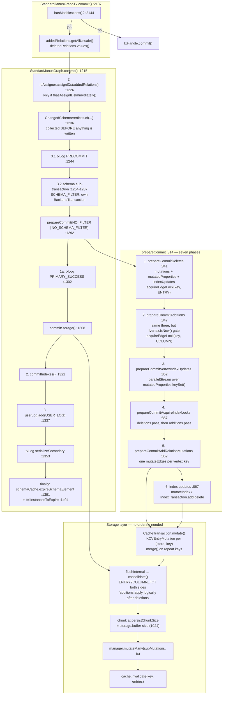

<!--
entry-meta
date: 2026-11-14
type: lesson
track: JanusGraph
lesson: 16
category: Database Internals
title: StandardJanusGraph.commit and prepareCommit — deletes, additions, mutations, and the order they are emitted in
slug: janusgraph-commit-prepare-commit-order
-->

# `StandardJanusGraph.commit` and `prepareCommit`: deletes, additions, and the order they reach storage

**2026-11-14 · JanusGraph Track · Lesson 16 of 28**

## Where This Fits

- **Lesson 15** ([`2026-11-13-janusgraph-tx-write-path-containers`](../../11/2026-11-13-janusgraph-tx-write-path-containers/README.md)) built the in-memory write buffer: `connectRelation`'s three-destination fan-out, the two configurations of `SimpleAddedRelations`, the `ElementLifeCycle` byte, and the three collections it handed forward — `addedRelations.getAllUnsafe()` (a live, uncopied view), `deletedRelations.values()` (a `Map<Long, InternalRelation>` keyed by `longId()`), and `removedVertexCanonicalIds`.
- **This lesson** spends those collections. It walks [`StandardJanusGraph.commit`](https://github.com/JanusGraph/janusgraph/blob/a59ae8d8024207598eada34998d867617df51adf/janusgraph-core/src/main/java/org/janusgraph/graphdb/database/StandardJanusGraph.java#L1215-L1409) and the seven phases of `prepareCommit`, and answers the syllabus question directly: **the emission order of deletes versus additions is not decided in the commit path at all.** `prepareCommit` collects deletes first and additions second, then hands both to the storage layer *in the same per-key mutation object*, where `Mutation.consolidate()` and the `KeyColumnValueStore` contract — "additions apply logically after deletions" — decide what actually happens.
- It also settles the other two obligations lesson 15 recorded. `ChangedSchemaVertices` turns out to be about **cache invalidation**, not persistence, and runs in a `finally` block. And the `upsert` flag is **not a commit-path mechanism**: nothing in `StandardJanusGraph` reads it. Lesson 15's framing was wrong about where it lives, and §9 shows the single place it is consumed.
- **It sets up lesson 17** (composite indexes on write). Every `IndexUpdate` in this lesson is produced by one of three `indexSerializer.getIndexUpdates(...)` call sites and consumed by `prepareCommitIndexUpdatesAndCheckIfAnyMixedIndexUsed`; this lesson establishes *when* they are generated, locked and written, and deliberately does not open `IndexSerializer`. **And lesson 18** (locking): `acquireEdgeLock` and `acquireIndexLock` are called from exactly four places, all of them here, and §6 nails down the asymmetry between them that lesson 10 flagged a month ago.

---

## 1. Two methods, and the entry point above them

`StandardJanusGraphTx.commit()` ([`:2137-2164`](https://github.com/JanusGraph/janusgraph/blob/a59ae8d8024207598eada34998d867617df51adf/janusgraph-core/src/main/java/org/janusgraph/graphdb/transaction/StandardJanusGraphTx.java#L2137-L2164)) is eight lines of real work:

```java
// StandardJanusGraphTx.java:2137-2164
@Override
public synchronized void commit() {
    Preconditions.checkArgument(isOpen(), "The transaction has already been closed");
    boolean success = false;
    if (null != config.getGroupName()) {
        MetricManager.INSTANCE.getCounter(config.getGroupName(), "tx", "commit").inc();
    }
    try {
        if (hasModifications()) {
            graph.commit(addedRelations.getAllUnsafe(), deletedRelations.values(), this);
        } else {
            txHandle.commit();
        }
        success = true;
    } catch (Exception e) {
        try {
            txHandle.rollback();
        } catch (BackendException e1) {
            throw new JanusGraphException("Could not rollback after a failed commit", e);
        }
        throw new JanusGraphException("Could not commit transaction due to exception during persistence", e);
    } finally {
        releaseTransaction();
        if (null != config.getGroupName() && !success) {
            MetricManager.INSTANCE.getCounter(config.getGroupName(), "tx", "commit.exceptions").inc();
        }
    }
}
```

Four things to read off it:

| Fact | Where | Consequence |
|---|---|---|
| `synchronized` on the transaction | `:2137` | `commit`, `rollback` and `rollbackIfOpen` hold the same monitor, so a concurrent `close()` cannot interleave with the swap in `releaseTransaction` (lesson 15 §7) |
| `hasModifications()` is `!addedRelations.isEmpty() \|\| !deletedRelations.isEmpty()` | [`:2223-2225`](https://github.com/JanusGraph/janusgraph/blob/a59ae8d8024207598eada34998d867617df51adf/janusgraph-core/src/main/java/org/janusgraph/graphdb/transaction/StandardJanusGraphTx.java#L2223-L2225) | A read-only transaction goes straight to `txHandle.commit()` and `graph.commit` is never entered. It checks the **two transaction-level containers only** — not `removedVertexCanonicalIds`, which cannot be non-empty without a `deletedRelations` entry or an `addedRelations` removal |
| `getAllUnsafe()` is passed, not a copy | `:2145` | Lesson 15's finding stands and now matters: `ConcurrentAddedRelations.getAllUnsafe()` is the one view method not routed through `copyView`, so on a multi-threaded transaction `prepareCommit` iterates a **live `hppc` collection with non-fail-fast iterators** |
| Failure rolls back the *backend* handle and rethrows wrapped | `:2151-2158` | And `releaseTransaction()` runs in the `finally` regardless, so a failed commit still empties the containers — there is no retry-this-transaction path |

`graph.commit(...)` is the orchestrator. `prepareCommit(...)` is the translator. The split is not cosmetic: **`prepareCommit` is called either once or twice per commit**, and the second call exists only because some backends have no transactional isolation (§7).

## 2. `prepareCommit`'s seven phases

[`:814-874`](https://github.com/JanusGraph/janusgraph/blob/a59ae8d8024207598eada34998d867617df51adf/janusgraph-core/src/main/java/org/janusgraph/graphdb/database/StandardJanusGraph.java#L814-L874). The method body is almost entirely a sequence of calls to six private helpers, interleaved with numbered debug lines:

```java
// StandardJanusGraph.java:814-874 (structure)
public ModificationSummary prepareCommit(final Collection<InternalRelation> addedRelations,
                                         final Collection<InternalRelation> deletedRelations,
                                         final Predicate<InternalRelation> filter,
                                         final BackendTransaction mutator,
                                         final StandardJanusGraphTx tx,
                                         final boolean acquireLocks) throws BackendException {

    ListMultimap<Object, InternalRelation>         mutations         = ArrayListMultimap.create();
    ListMultimap<InternalVertex, InternalRelation> mutatedProperties = ArrayListMultimap.create();
    List<IndexUpdate>                              indexUpdates      = new ArrayList<>();
    ...
    prepareCommitDeletes(...);                                   // 1
    prepareCommitAdditions(...);                                 // 2
    prepareCommitVertexIndexUpdates(...);                        // 3
    prepareCommitAcquireIndexLocks(...);                         // 4
    prepareCommitAddRelationMutations(...);                      // 5
    boolean has2iMods = prepareCommitIndexUpdatesAndCheckIfAnyMixedIndexUsed(...); // 6
    ...                                                          // 7 (timing log only)
    return new ModificationSummary(!mutations.isEmpty(), has2iMods);
}
```

Three accumulators, and **who writes which one is the whole shape of the method**:

| Accumulator | Type | Written by | Read by |
|---|---|---|---|
| `mutations` | `ListMultimap<Object vertexId, InternalRelation>` | phases 1 and 2 | phase 5 — one `mutateEdges` per key |
| `mutatedProperties` | `ListMultimap<InternalVertex, InternalRelation>` | phases 1 and 2, **properties only** | phase 3 — vertex-level index updates |
| `indexUpdates` | `List<IndexUpdate>` | phases 1, 2 and 3 | phases 4 and 6 |

So phases 1 and 2 are pure collection — they touch storage only to *take locks* — and phases 5 and 6 are the only ones that enqueue data. `ModificationSummary` ([`:803-812`](https://github.com/JanusGraph/janusgraph/blob/a59ae8d8024207598eada34998d867617df51adf/janusgraph-core/src/main/java/org/janusgraph/graphdb/database/StandardJanusGraph.java#L803-L812)) is a two-boolean carrier: `hasModifications` is `!mutations.isEmpty()`, i.e. *did anything reach the edgestore*, and `has2iModifications` is *did anything reach a mixed index*.

### The numbered log lines, and the gate on them

```java
// StandardJanusGraph.java:826-829
int totalMutations = addedRelations.size() + deletedRelations.size();
boolean isBigDataSetLoggingEnabled = logForPrepareCommit.isDebugEnabled()
    && totalMutations >= backend.getBufferSize();
```

- The logger is a **child logger**, `org.janusgraph.graphdb.database.StandardJanusGraph.prepareCommit` ([`:162-163`](https://github.com/JanusGraph/janusgraph/blob/a59ae8d8024207598eada34998d867617df51adf/janusgraph-core/src/main/java/org/janusgraph/graphdb/database/StandardJanusGraph.java#L162-L163)), separate from the class's own `log`. You can turn the phase trace on without turning on everything else `StandardJanusGraph` says at debug.
- The second clause is the one that bites: `backend.getBufferSize()` returns the configured `storage.buffer-size`, whose default is **1024** ([`GraphDatabaseConfiguration:780-782`](https://github.com/JanusGraph/janusgraph/blob/a59ae8d8024207598eada34998d867617df51adf/janusgraph-core/src/main/java/org/janusgraph/graphdb/configuration/GraphDatabaseConfiguration.java#L780-L782), MASKABLE, `positiveInt()`). **A transaction with fewer than 1024 added-plus-deleted relations logs nothing at all**, no matter how the logger is configured. That is the trap in §10a. (`Backend.getBufferSize()` is a plain getter over the `bufferSize` field; that body was read this run as a code-search fragment rather than a file read, so no line range is cited for it.)
- `totalMutations` counts **relations**, not storage operations. One edge is two columns in two rows; one property key creation was lesson 13's eleven columns. So the threshold is crossed well before 1024 storage writes.
- Phase 7 is not a phase. It is one timing line, `duration` plus `mutations.size()` — and `ListMultimap.size()` is the **total number of values**, not the number of distinct keys, so the message's `mutated vertex count=` is mislabelled: it is the number of (vertex, relation) pairs. Minor, and it is in the PR-candidate list below.

## 3. Phase 1 — deletes

[`prepareCommitDeletes`, `:879-921`](https://github.com/JanusGraph/janusgraph/blob/a59ae8d8024207598eada34998d867617df51adf/janusgraph-core/src/main/java/org/janusgraph/graphdb/database/StandardJanusGraph.java#L879-L921).

```java
for (InternalRelation del : deletedRelations) {
    if (!filter.test(del)) continue;
    Preconditions.checkArgument(del.isRemoved());
    for (int pos = 0; pos < del.getLen(); pos++) {
        InternalVertex vertex = del.getVertex(pos);
        if (pos == 0 || !del.isLoop()) {
            if (del.isProperty()) mutatedProperties.put(vertex, del);
            mutations.put(vertex.id(), del);
        }
        if (acquireLock(del, pos, acquireLocks)) {
            Entry entry = edgeSerializer.writeRelation(del, pos, tx);
            mutator.acquireEdgeLock(idManager.getKey(vertex.id()), entry);
        }
    }
    final IndexAppliesToFunction deletionFilter = ... ;
    indexUpdates.addAll(indexSerializer.getIndexUpdates(del, deletionFilter, tx));
}
```

Point by point:

- **`getLen()`, not `getArity()`.** `getLen()` is the number of *distinct* endpoint positions a relation actually occupies; `getArity()` is the declared arity. Loops are then handled again by `pos == 0 || !del.isLoop()`, so a self-loop files **one** mutation entry, not two — otherwise a self-edge would be enqueued twice against the same row and `Mutation.merge` would carry a duplicate column all the way to the backend.
- **`Preconditions.checkArgument(del.isRemoved())` is live, not an `assert`.** Every member of `deletedRelations` must be at lifecycle byte 6. Lesson 15 established that `ElementLifeCycle.update` lets `REMOVED` win from any state including `Removed`, so a double-`remove()` is a silent no-op and the map holds the relation once — this precondition is what would catch a relation that got into the map without passing through `removeRelation`.
- **Properties go into `mutatedProperties` as well as `mutations`.** Deletions and additions both contribute, which is why phase 3 can compute a vertex's *net* index state from one multimap rather than diffing two.
- **The lock is taken with the full `Entry`.** `acquireEdgeLock(key, entry)` ([`BackendTransaction`](https://github.com/JanusGraph/janusgraph/blob/a59ae8d8024207598eada34998d867617df51adf/janusgraph-core/src/main/java/org/janusgraph/diskstorage/BackendTransaction.java)) forwards `entry.getColumnAs(...)` *and* `entry.getValueAs(...)`, so the expected value is the serialized relation. On the addition side (§4) only the column is passed and the expected value is `null`. §6 reads that asymmetry properly.
- **`del.getLen()` is iterated for the lock even where no mutation is filed.** The `pos == 0 || !isLoop()` guard wraps only the two `put`s; the `acquireLock` block is outside it. For a self-loop with `ConsistencyModifier.LOCK` that means two lock acquisitions on the same key and column — idempotent, since `BackendTransaction`'s javadoc states that repeated `acquireLock` on the same key-column pair in one transaction ignores all but the first.

### `acquireLock`, the static predicate

```java
// StandardJanusGraph.java:761-766
public static boolean acquireLock(InternalRelation relation, int pos, boolean acquireLocksConfig) {
    InternalRelationType type = (InternalRelationType)relation.getType();
    return acquireLocksConfig && type.getConsistencyModifier()== ConsistencyModifier.LOCK &&
            ( type.multiplicity().isUnique(EdgeDirection.fromPosition(pos))
                    || pos==0 && type.multiplicity()== Multiplicity.SIMPLE);
}
```

Three conjuncts, and all three must hold:

1. `acquireLocksConfig` — `tx.getConfiguration().hasAcquireLocks()`, which lesson 15 established is set false by `enableBatchLoading()` via `consistencyChecks(false)`.
2. The type's `ConsistencyModifier` is `LOCK`. This is lesson 13's `TYPE_MODIFIER` vertex reached by a definition edge, and it is **the second of exactly two places in the tree that read that constant** — the first being `StandardJanusGraphTx:1030`'s blind-overwrite gate.
3. The multiplicity constrains *this position*, or the type is `SIMPLE` and this is the out-vertex. So a `MULTI` edge never takes a storage lock regardless of consistency modifier, and a `SIMPLE` edge takes exactly one, at `pos == 0`.

The composite-index sibling ([`:768-771`](https://github.com/JanusGraph/janusgraph/blob/a59ae8d8024207598eada34998d867617df51adf/janusgraph-core/src/main/java/org/janusgraph/graphdb/database/StandardJanusGraph.java#L768-L771)) is the same shape with `index.getCardinality() != Cardinality.LIST` in place of the multiplicity test — a LIST index never collides, so there is nothing to lock.

### The cdc-only deletion filter

Lines `915-918` are the newest machinery in the method and the part most likely to confuse a first read:

```java
final IndexAppliesToFunction deletionFilter =
    cdcOnlyBackingIndexes.isEmpty() || cdcCanIdentifyDeletedRelation(del, tx)
        || replacedRelationIds.contains(del.longId())
        ? commitIndexAppliesToFilter : commitDeletionIndexAppliesToFilter;
```

- `cdcOnlyBackingIndexes` ([`:191`](https://github.com/JanusGraph/janusgraph/blob/a59ae8d8024207598eada34998d867617df51adf/janusgraph-core/src/main/java/org/janusgraph/graphdb/database/StandardJanusGraph.java#L191), built at [`:267-268`](https://github.com/JanusGraph/janusgraph/blob/a59ae8d8024207598eada34998d867617df51adf/janusgraph-core/src/main/java/org/janusgraph/graphdb/database/StandardJanusGraph.java#L267-L268)) is the set of mixed-index backends configured `index.[X].cdc.enabled=true` with `cdc.synchronous=false`. **On a default graph it is empty**, both filters collapse to `IndexRecordUtil.FULL_INDEX_APPLIES_TO_FILTER` ([`:269-275`](https://github.com/JanusGraph/janusgraph/blob/a59ae8d8024207598eada34998d867617df51adf/janusgraph-core/src/main/java/org/janusgraph/graphdb/database/StandardJanusGraph.java#L269-L275)), and every branch in this paragraph short-circuits on its first disjunct. Read it once and then forget it until lesson 26.
- `replacedRelationIds` ([`:839-840`](https://github.com/JanusGraph/janusgraph/blob/a59ae8d8024207598eada34998d867617df51adf/janusgraph-core/src/main/java/org/janusgraph/graphdb/database/StandardJanusGraph.java#L839-L840)) is computed **only when cdc-only indexes exist and there is at least one deletion** — `collectRelationIds` ([`:925-937`](https://github.com/JanusGraph/janusgraph/blob/a59ae8d8024207598eada34998d867617df51adf/janusgraph-core/src/main/java/org/janusgraph/graphdb/database/StandardJanusGraph.java#L925-L937)) otherwise never runs. It exists to recognise a *delete-then-re-add of the same relation id*, which is what a property update looks like unless the type is `ConsistencyModifier.FORK`.
- `cdcCanIdentifyDeletedRelation` ([`:955-980`](https://github.com/JanusGraph/janusgraph/blob/a59ae8d8024207598eada34998d867617df51adf/janusgraph-core/src/main/java/org/janusgraph/graphdb/database/StandardJanusGraph.java#L955-L980)) is worth reading even on a default graph, because it is the clearest statement in the tree of **what a tombstone can and cannot tell you** — and it is a direct consequence of lesson 10's column layout:

| Case | Does a tombstone carry the relation identity? | Why |
|---|---|---|
| `MULTI` edge, at least one endpoint surviving | **Yes** | Lesson 10: a `MULTI` edge puts the relation id **in the column**, so the surviving endpoint's row gets an ordinary column tombstone from which the full `RelationIdentifier` is reconstructible |
| Constrained multiplicity (`SIMPLE`, `MANY2ONE`, `ONE2ONE`, …) | No | Lesson 10 again: the relation id lives in the **value** region, and a Cassandra tombstone carries no value bytes |
| Vertex property | No | Same reason — `isEdge()` is the first guard, `:956-958` |
| Unidirected edge | No | Only the out-vertex holds a copy; there is no mirror |
| Every copy-holding endpoint fully removed | No | Either one partition tombstone with no columns (whole-row deletion, §5) or column tombstones indistinguishable behind the same removal |

The method's own javadoc says it is **deliberately independent of `wholeRowDeletionEnabled`**, so that an index guarantee never depends on a storage feature flag. That is an architectural decision stated in a comment, and it is the kind of thing worth noticing: the code could have been one condition shorter and chose not to be.

## 4. Phase 2 — additions, and the three differences from deletes

[`prepareCommitAdditions`, `:983-1010`](https://github.com/JanusGraph/janusgraph/blob/a59ae8d8024207598eada34998d867617df51adf/janusgraph-core/src/main/java/org/janusgraph/graphdb/database/StandardJanusGraph.java#L983-L1010). Structurally identical to phase 1. The differences are exactly three, and each is load-bearing:

| | Deletes (`:879-921`) | Additions (`:983-1010`) |
|---|---|---|
| Precondition | `del.isRemoved()` | `add.isNew()` |
| Lock guard | `acquireLock(del, pos, acquireLocks)` | `!vertex.isNew() && acquireLock(add, pos, acquireLocks)` |
| Lock argument | `acquireEdgeLock(key, entry)` — column **and value** | `acquireEdgeLock(key, entry.getColumn())` — column only |
| Index filter | per-relation `deletionFilter` | always `commitIndexAppliesToFilter` |

- **`!vertex.isNew()`** ([`:1002`](https://github.com/JanusGraph/janusgraph/blob/a59ae8d8024207598eada34998d867617df51adf/janusgraph-core/src/main/java/org/janusgraph/graphdb/database/StandardJanusGraph.java#L1002)) is the optimisation that matters at load time. A relation whose endpoint is a brand-new vertex cannot collide with anything, because nobody else can have a reference to a row key that was assigned seconds ago in this transaction. So a bulk insert of fresh vertices takes **zero** storage locks even with `ConsistencyModifier.LOCK` set and `acquireLocks` true. Note the ordering: `!vertex.isNew()` is evaluated first, so the `acquireLock` call — and the `writeRelation` serialization behind it — is skipped entirely rather than computed and discarded.
- **Column-only versus column-and-value** is the asymmetry lesson 10 flagged. It is correct, and the reason is in the semantics of `acquireLock`'s `expectedValue` parameter, which `BackendTransaction`'s javadoc states is "the value expected to match the value at the time the lock is acquired (**or null if it is expected that the key-column pair does not exist**)". Deleting a relation asserts *this exact cell exists with this exact content*; adding one asserts *this cell does not exist*. Both assertions are checked by `ExpectedValueCheckingTransaction` at the first `mutate` — lesson 18's territory — and the addition's assertion is the uniqueness constraint. **This also explains why lesson 10's remaining-properties sort in `EdgeSerializer` is a correctness requirement:** the delete-side expected value is a byte comparison against whatever is on disk, so two writers must serialize the same relation to the same bytes.

## 5. Phase 5 — per-key row assembly, and whole-row deletion

Phases 3 and 4 are index work (§8); phase 5 is where the edgestore writes are built. [`prepareCommitAddRelationMutations`, `:1102-1156`](https://github.com/JanusGraph/janusgraph/blob/a59ae8d8024207598eada34998d867617df51adf/janusgraph-core/src/main/java/org/janusgraph/graphdb/database/StandardJanusGraph.java#L1102-L1156).

One iteration per **distinct vertex id** in `mutations`:

```java
for (Object vertexId : mutations.keySet()) {
    IDUtils.checkId(vertexId);
    final List<InternalRelation> edges = mutations.get(vertexId);

    final Object canonicalId = idManager.isPartitionedVertex(vertexId)
        ? idManager.getCanonicalVertexId(((Number) vertexId).longValue())
        : vertexId;
    final boolean wholeRowDeletion = wholeRowDeletionEnabled && tx.isVertexFullyRemoved(canonicalId);

    final List<Entry> additions = new ArrayList<>(wholeRowDeletion ? 0 : edges.size());
    final List<Entry> deletions = new ArrayList<>(wholeRowDeletion ? 0 : Math.max(10, edges.size() / 10));
    ...
    StaticBuffer vertexKey = idManager.getKey(vertexId);
    mutator.mutateEdges(vertexKey, additions, deletions, wholeRowDeletion);
}
```

- **`additions` and `deletions` are separate lists, built in one pass over the same relation list** — the loop branches on `edge.isRemoved()` at `:1131`. So within one key there is no ordering between them at all: both lists are handed to `mutateEdges` together and the ordering question moves one layer down (§6).
- **The presizing is asymmetric and deliberate.** `additions` is sized `edges.size()`; `deletions` is sized `max(10, edges.size()/10)`. The 1-in-10 guess encodes an assumption that a typical transaction is mostly insertions. Under whole-row deletion both go to capacity **0**, with a comment naming super-node removal as the reason: no point allocating a 100,000-element backing array for lists that stay empty.
- **`canonicalId`** is lesson 08's partitioned-vertex machinery meeting lesson 15's `recordRemovedVertex`. A partitioned vertex has up to `2^partitionBits` representative rows; `removedVertexCanonicalIds` holds **canonical** ids, so the lookup has to collapse the representative before asking. Note the `((Number) vertexId).longValue()` cast — custom vertex id types (`graph.allow-custom-vertex-id-types`) are never partitioned, so the cast is safe only because `isPartitionedVertex` is false for them.
- **`wholeRowDeletionEnabled`** ([`:295-296`](https://github.com/JanusGraph/janusgraph/blob/a59ae8d8024207598eada34998d867617df51adf/janusgraph-core/src/main/java/org/janusgraph/graphdb/database/StandardJanusGraph.java#L295-L296)) is `configuration.getDropWholeRowOnVertexRemoval() && backend.getStoreFeatures().hasOptimizedWholeRowDeletion()` — a **config AND a feature**. `storage.drop-whole-row-on-vertex-removal` is MASKABLE and **defaults to `true`** ([`GraphDatabaseConfiguration:755-761`](https://github.com/JanusGraph/janusgraph/blob/a59ae8d8024207598eada34998d867617df51adf/janusgraph-core/src/main/java/org/janusgraph/graphdb/configuration/GraphDatabaseConfiguration.java#L755-L761)), so on a backend that advertises the capability this path is on by default. Lesson 03's finding applies: the feature boolean is the backend's own claim about itself and nothing verifies it.

### The inner loop: `getRelationIndexes()` is where vertex-centric indexes get written

```java
for (final InternalRelation edge : edges) {
    final InternalRelationType baseType = (InternalRelationType) edge.getType();
    assert baseType.getBaseType()==null;

    for (InternalRelationType type : baseType.getRelationIndexes()) {
        if (type.getStatus()== SchemaStatus.DISABLED) continue;
        for (int pos = 0; pos < edge.getArity(); pos++) {
            if (!type.isUnidirected(Direction.BOTH) && !type.isUnidirected(EdgeDirection.fromPosition(pos)))
                continue; //Directionality is not covered
            if (edge.getVertex(pos).id().equals(vertexId)) {
                if (edge.isRemoved()) {
                    if (!wholeRowDeletion) {
                        deletions.add(edgeSerializer.writeRelation(edge, type, pos, tx));
                    }
                } else {
                    Preconditions.checkArgument(edge.isNew());
                    StaticArrayEntry entry = edgeSerializer.writeRelation(edge, type, pos, tx);
                    int ttl = getTTL(edge);
                    if (ttl > 0) entry.setMetaData(EntryMetaData.TTL, ttl);
                    additions.add(entry);
                }
            }
        }
    }
}
```

This is lesson 10's "2 + N columns per edge" arithmetic, in code:

- `baseType.getRelationIndexes()` yields the base type **plus one invisible relation type per vertex-centric index** — lesson 10 established that a vertex-centric index *is* a whole new invisible `MULTI` relation type living in prefix bands 4-5. So a `knows` edge with two vertex-centric indexes writes three columns per endpoint row, each a complete independent `writeRelation`.
- **`SchemaStatus.DISABLED` is checked here and nowhere else on the write path** (`:1125`). A disabled index stops receiving writes immediately; this is the write-side half of lesson 25's `INSTALLED → REGISTERED → ENABLED → DISABLED` lifecycle. Note there is no `ENABLED` check — `INSTALLED` and `REGISTERED` index types *do* receive writes, which is exactly what makes a reindex job able to finish.
- The directionality guard is the same predicate `cdcCanIdentifyDeletedRelation` uses — one place, two consumers, identical expression. That is how you know the "a storage copy exists at this position iff the type covers its direction" rule is the real invariant rather than an incidental condition.
- **`getTTL`** ([`:781-800`](https://github.com/JanusGraph/janusgraph/blob/a59ae8d8024207598eada34998d867617df51adf/janusgraph-core/src/main/java/org/janusgraph/graphdb/database/StandardJanusGraph.java#L781-L800)) is the **minimum** of the relation type's TTL and the TTLs of every endpoint vertex label, with `0` meaning none; it is applied as `EntryMetaData.TTL` on the addition entry only. `getTTL(InternalVertex)` returns non-zero only for an `UnmodifiableVertex` id — which lesson 08 established is a suffix code — and asserts `v.isNew()`, with the comment "Should not be able to add relations to existing static vertices".
- **Whole-row deletion skips `writeRelation` entirely** (`:1136-1138`). The comment is explicit that this is a CPU-and-allocation saving, not a correctness one: a backend without the capability serializes every incident edge's deletion column and loses no data. For a 100,000-edge super-node that is 100,000 `writeRelation` calls and 100,000 `StaticArrayEntry` allocations avoided per endpoint row.

## 6. Where the delete-before-add ordering actually lives

The syllabus item asks for "the order they are emitted in". The honest answer has three layers, and only the third is an ordering guarantee.

**Layer 1 — `prepareCommit` collects deletes first.** Phase 1 before phase 2, and phase 4 takes composite-index deletion locks before addition locks ([`:1080-1099`](https://github.com/JanusGraph/janusgraph/blob/a59ae8d8024207598eada34998d867617df51adf/janusgraph-core/src/main/java/org/janusgraph/graphdb/database/StandardJanusGraph.java#L1080-L1099) — two full passes over `indexUpdates`, `isDeletion()` first, the method's own javadoc says "deletions first"). But this is *collection* order, not write order. Nothing is sent to storage in phases 1-4 except lock requests.

**Layer 2 — within one key, there is no order.** Phase 5 hands `additions` and `deletions` to the same `mutateEdges` call. [`BackendTransaction.mutateEdges`](https://github.com/JanusGraph/janusgraph/blob/a59ae8d8024207598eada34998d867617df51adf/janusgraph-core/src/main/java/org/janusgraph/diskstorage/BackendTransaction.java) forwards to `edgeStore.mutateEntries(key, additions, deletions, wholeRowDeletion, storeTx)`, which lands in [`CacheTransaction.mutate`](https://github.com/JanusGraph/janusgraph/blob/a59ae8d8024207598eada34998d867617df51adf/janusgraph-core/src/main/java/org/janusgraph/diskstorage/keycolumnvalue/cache/CacheTransaction.java) and becomes a `KCVEntryMutation` — **one object holding both lists**.

**Layer 3 — the ordering is a contract, enforced by consolidation.** [`Mutation.consolidate`](https://github.com/JanusGraph/janusgraph/blob/a59ae8d8024207598eada34998d867617df51adf/janusgraph-core/src/main/java/org/janusgraph/diskstorage/Mutation.java):

```java
public<V> void consolidate(Function<E,V> convertAdditions, Function<K,V> convertDeletions) {
    if (hasDeletions() && hasAdditions()) {
        Set<V> adds = new HashSet<>(additions.size());
        for (final E add : additions) adds.add(convertAdditions.apply(add));
        deletions.removeIf(k -> adds.contains(convertDeletions.apply(k)));
    }
}
```

and its javadoc states the rule in one sentence: *"A deletion is considered redundant if it is identical to some addition under the provided conversion functions **since we consider additions to apply logically after deletions**."*

- [`KCVEntryMutation`](https://github.com/JanusGraph/janusgraph/blob/a59ae8d8024207598eada34998d867617df51adf/janusgraph-core/src/main/java/org/janusgraph/diskstorage/keycolumnvalue/cache/KCVEntryMutation.java) supplies `ENTRY2COLUMN_FCT = Entry::getColumn` for **both** conversions. So "identical" means **same column**, with the value ignored entirely. A delete-then-re-add of the same column at a different value drops the deletion and keeps the addition — which is precisely the overwrite semantics lesson 10 derived from the column layout, re-derived one layer down.
- `Mutation.merge`'s javadoc is the counterpart: it concatenates both lists and "does not remove duplicates if such exist — this needs to be ensured by the caller". The caller is `flushInternal`, which calls `consolidate()` on every mutation before persisting, with the comment *"Consolidate all mutations prior to persistence to ensure that no addition accidentally gets swallowed by a delete"*.
- `wholeRowDeletion` merges as `this.wholeRowDeletion || m.wholeRowDeletion` — **sticky**. Two `mutateEdges` calls against the same key in one transaction, one of them whole-row, produce a whole-row mutation. And `Mutation.hasWholeRowDeletion`'s javadoc states the backend "deletes all columns for the key in a single operation **before applying any additions**", which is why the sticky merge is safe rather than catastrophic: additions survive a whole-row delete in the same mutation.
- `getTotalMutations()` counts `additions + deletions + (wholeRowDeletion ? 1 : 0)`, so a whole-row delete with no columns still counts as one mutation and `CacheTransaction.mutate`'s early return (`additions.isEmpty() && deletions.isEmpty() && !wholeRowDeletion`) correctly lets it through.

So: **the commit path emits deletes and additions together, per key, and relies on a documented store contract that additions win.** That is a stronger design than ordering the writes, because it survives a backend that reorders within a batch — which lesson 02 already recorded as the `KeyColumnValueStore` promise ("a `mutate` applies its deletions strictly before its additions"). Lesson 02 read that contract from the interface javadoc; this is the code that depends on it.

### `CacheTransaction`, and the one case where mutations reach storage before `commit`



[`CacheTransaction.commit()`](https://github.com/JanusGraph/janusgraph/blob/a59ae8d8024207598eada34998d867617df51adf/janusgraph-core/src/main/java/org/janusgraph/diskstorage/keycolumnvalue/cache/CacheTransaction.java) is `flushInternal(); tx.commit();` — two statements. Everything phases 5 and 6 enqueued sits in a `Map<KCVSCache, Map<StaticBuffer, KCVEntryMutation>>` until then. **Except under batch loading:**

```java
numMutations += m.getTotalMutations();
if (batchLoading && numMutations >= persistChunkSize) {
    log.debug("Flushing mutations to storage numMutations={}, persistChunkSize={}", numMutations, persistChunkSize);
    flushInternal();
}
```

That `batchLoading &&` is what every `[FAILURE]` comment in `commit` means by "nothing has been persisted **unless batch-loading**". With `storage.batch-loading=true` ([`GraphDatabaseConfiguration:751-753`](https://github.com/JanusGraph/janusgraph/blob/a59ae8d8024207598eada34998d867617df51adf/janusgraph-core/src/main/java/org/janusgraph/graphdb/configuration/GraphDatabaseConfiguration.java#L751-L753), LOCAL, default false), storage writes leave the process **while `prepareCommit` is still running**, in 1024-mutation chunks, and a failure in phase 6 leaves a partially written graph. That is the real cost of batch loading, and it is a different cost from the one lesson 15 recorded (locks and uniqueness checks disabled).

Two more things in `flushInternal` worth naming:

- `numMutationsParallelThreshold` — `storage.num-mutations-parallel-threshold`, MASKABLE, default **100** ([`:789-794`](https://github.com/JanusGraph/janusgraph/blob/a59ae8d8024207598eada34998d867617df51adf/janusgraph-core/src/main/java/org/janusgraph/graphdb/configuration/GraphDatabaseConfiguration.java#L789-L794)) — switches consolidation from a serial loop to `mutations.values().parallelStream()`. Above 100 mutations, consolidation runs on the common fork-join pool.
- The cache invalidation pass at the end of `flushInternal` is lesson 07's finding in situ: it calls `cache.invalidate(key, entries)` per key, which marks rather than evicts.

## 7. `commit`'s ten stages, and the failure ladder

[`:1215-1409`](https://github.com/JanusGraph/janusgraph/blob/a59ae8d8024207598eada34998d867617df51adf/janusgraph-core/src/main/java/org/janusgraph/graphdb/database/StandardJanusGraph.java#L1215-L1409). The method is 195 lines and the comments number themselves 1, 2, 3, 3.1, 3.2, 1a, 1, 2, 3, 4, 5 — the numbering restarts inside the `commitSummary.hasModifications` branch, which is confusing on a first read. Here it is linearised:

| # | Line | What | Failure behaviour (from the `[FAILURE]` comments) |
|---|---|---|---|
| 0 | `:1217` | `if (addedRelations.isEmpty() && deletedRelations.isEmpty()) return;` | — a second guard behind `hasModifications()` |
| 1 | `:1220-1222` | commit timestamp (`times.getTime()` if unset) + `transactionId = txCounter.incrementAndGet()` | — |
| 2 | `:1225-1226` | `idAssigner.assignIDs(addedRelations)` unless `hasAssignIDsImmediately()` | — |
| 3 | `:1229-1236` | resolve `mutator`, `acquireLocks`, `hasTxIsolation`, `logTransaction`, `txLog`, header; **collect `ChangedSchemaVertices`** | — |
| 3.1 | `:1242-1245` | WAL `PRECOMMIT` record with the full relation set | escalates: an unloggable transaction fails, on the theory that the log's unavailability means primary storage is unavailable too |
| 3.2 | `:1254-1287` | schema elements in their own `BackendTransaction`, if `hasSchemaElements && !hasTxIsolation` | prepare throws → `schemaMutator.rollback()` and rethrow; commit throws → log, rollback, rethrow. Locks stay held in the local mediator and in the lock store until they expire |
| 4 | `:1292` | the real `prepareCommit` | nothing persisted unless batch-loading |
| 5 | `:1302-1305` | WAL `PRIMARY_SUCCESS` or `COMPLETE_SUCCESS`, through `mutator.getTxLogPersistor()` | "should not throw since the mutations are just cached" |
| 6 | `:1308` | `mutator.commitStorage()` → `storeTx.commit()` | log and rethrow — abort |
| 7 | `:1322` | `mutator.commitIndexes()` | **all exceptions collected, logged, and swallowed**; status becomes `SECONDARY_FAILURE` |
| 8 | `:1330-1345` | user log event, if `logIdentifier != null` | recorded, not escalated |
| 9 | `:1353` | WAL `SECONDARY_SUCCESS`/`SECONDARY_FAILURE` with the failed index names | logged, not escalated; "tx considered success and needs to be cleaned up later" |
| 10 | `:1377-1406` | `finally`: expire schema cache entries locally and in other open transactions, then broadcast | never escalates |

Key readings:

- **`transactionId` is per-JVM and starts at zero.** `txCounter = new AtomicLong(0)` in the constructor ([`:321`](https://github.com/JanusGraph/janusgraph/blob/a59ae8d8024207598eada34998d867617df51adf/janusgraph-core/src/main/java/org/janusgraph/graphdb/database/StandardJanusGraph.java#L321)), so transaction 1 of a restarted instance collides with transaction 1 of its previous life. The WAL row key absorbs that: `TransactionLogHeader`'s `logKey` is `HashingUtil.hashPrefixKey(SHORT, getLongBuffer(transactionId))`, and the *timestamp* in the header is what recovery orders by.
- **`hasSecondaryPersistence`** (`:1294`) is `logTxIdentifier != null || commitSummary.has2iModifications`. If false, the `else` at `:1361` calls `mutator.commitIndexes()` anyway — with the comment "This just closes the transaction since there are no modifications". `commitIndexes` iterates `indexTx` and commits each; with no mixed-index work the map's transactions are empty but still need closing.
- **The two-step storage/index commit is why the docs say the storage backend is authoritative.** `commitStorage()` is `storeTx.commit()` only; the full `BackendTransaction.commit()` — storage **then** indexes — is used solely on the no-modifications path at `:1366`. So in the normal case, index writes happen strictly after the storage write has succeeded, and their failure cannot roll it back. [JanusGraph's recovery docs](https://docs.janusgraph.org/operations/recovery/) state the consequence plainly: if the storage write succeeds and index or log writes fail, the transaction still counts as successful.
- **`itx.needsCompleteDocument` is read while the transaction can still read.** The comment at [`:1196-1204`](https://github.com/JanusGraph/janusgraph/blob/a59ae8d8024207598eada34998d867617df51adf/janusgraph-core/src/main/java/org/janusgraph/graphdb/database/StandardJanusGraph.java#L1196-L1204) says so explicitly — "Read here, while the transaction can still read: the index commit runs after the storage commit." A property change on an edge or a vertex property *replaces* the relation, so its deletion arrives from a removed element and its addition from a new one, while the mutation they add up to is an update of an existing document. That is why the "is this an existing document" question is the pending mutation's to answer and not the element's.
- **`Preconditions.checkArgument(!hasSchemaElements || (!hasEnabledBatchLoading() && acquireLocks))`** (`:1251-1252`) — "Attempting to create schema elements in inconsistent state". Schema creation inside a batch-loading transaction is a hard failure, which is the mechanical reason `schema.default=none` plus an explicit schema-creation transaction is the production recommendation. Lesson 15 reached the same conclusion from the auto-schema-maker side.

### The schema sub-transaction

The `hasSchemaElements && !hasTxIsolation` branch is the only place `prepareCommit` runs twice, and the three filter predicates ([`:1208-1213`](https://github.com/JanusGraph/janusgraph/blob/a59ae8d8024207598eada34998d867617df51adf/janusgraph-core/src/main/java/org/janusgraph/graphdb/database/StandardJanusGraph.java#L1208-L1213)) exist for it:

```java
private static final Predicate<InternalRelation> SCHEMA_FILTER =
    internalRelation -> internalRelation.getType() instanceof BaseRelationType
        && internalRelation.getVertex(0) instanceof JanusGraphSchemaVertex;
private static final Predicate<InternalRelation> NO_SCHEMA_FILTER = r -> !SCHEMA_FILTER.test(r);
private static final Predicate<InternalRelation> NO_FILTER = r -> true;
```

- `SCHEMA_FILTER` is **two** conditions ANDed, and lesson 13 supplies both halves: the type must be one of `BaseKey`/`BaseLabel`'s eight system types (`BaseRelationType`), and the out-vertex must be a `JanusGraphSchemaVertex`. A `VertexExists` property on an ordinary vertex passes the first test and fails the second.
- `hasTxIsolation ? NO_FILTER : NO_SCHEMA_FILTER` at `:1292`. With isolation, one `prepareCommit` handles everything. Without it, schema relations go in a separate backend transaction that is committed **first and independently**, so a crash between the two leaves schema persisted and data not — the safe direction, since a schema vertex nothing references is inert while a data relation referencing an absent type is not.
- `assert commitSummary.hasModifications && !commitSummary.has2iModifications` (`:1267`) encodes a real invariant: schema writes always produce edgestore mutations and **never** mixed-index ones. Lesson 13's `SchemaName` UNIQUE index is `Token.INTERNAL_INDEX_NAME`, a composite index in the graphindex store, not a mixed index. Being an `assert`, it is disabled in production.
- Note that `commitSummary` is **overwritten** at `:1292` by the second call, so the schema call's summary informs only that assertion.

## 8. Phases 3, 4 and 6 — the index half, bounded on purpose

This lesson does not open `IndexSerializer`; lesson 17 does. What it does establish is the *shape* of the interaction:

**Three generation sites**, all producing `IndexUpdate`:

| Site | Line | Element | Filter |
|---|---|---|---|
| per deleted relation | `:919` | the relation | per-relation `deletionFilter` |
| per added relation | `:1007` | the relation | `commitIndexAppliesToFilter` |
| per mutated vertex | `:1022-1024` | the **vertex**, with its changed properties | `commitIndexAppliesToFilter` |

The third is the interesting one ([`prepareCommitVertexIndexUpdates`, `:1014-1026`](https://github.com/JanusGraph/janusgraph/blob/a59ae8d8024207598eada34998d867617df51adf/janusgraph-core/src/main/java/org/janusgraph/graphdb/database/StandardJanusGraph.java#L1014-L1026)):

```java
if (tx.getConfiguration().useMultiQuery() && backend.getStoreFeatures().hasMultiQuery()) {
    loadLabelsCheckedByIndexes(mutatedProperties, tx, config.maxKeysPerRead());
}
indexUpdates.addAll(mutatedProperties.keySet().parallelStream()
    .flatMap(v -> indexSerializer.getIndexUpdates(v, mutatedProperties.get(v), commitIndexAppliesToFilter, tx))
    .collect(Collectors.toList()));
```

- **`parallelStream()` over the mutated vertices.** Index-update generation for a multi-vertex transaction runs on the common fork-join pool, unconditionally — no threshold, unlike `CacheTransaction`'s 100. Each task calls into `IndexSerializer` and, for a vertex whose label was not preloaded, can issue a storage read. That is worth knowing before lesson 17: index-update generation is the one genuinely parallel step of a commit.
- **`loadLabelsCheckedByIndexes`** ([`:1035-1080`](https://github.com/JanusGraph/janusgraph/blob/a59ae8d8024207598eada34998d867617df51adf/janusgraph-core/src/main/java/org/janusgraph/graphdb/database/StandardJanusGraph.java#L1035-L1080)) is a prefetch, not a correctness step. An index restricted to a vertex label applies to a vertex only if it has that label, and checking that reads the label of a vertex the transaction never loaded — "as one which changes vertices it looked up by id hasn't". So it batches those reads into multi-queries of up to `query.batch.max-keys-per-read` vertices, default **1000** ([`GraphDatabaseConfiguration:393-401`](https://github.com/JanusGraph/janusgraph/blob/a59ae8d8024207598eada34998d867617df51adf/janusgraph-core/src/main/java/org/janusgraph/graphdb/configuration/GraphDatabaseConfiguration.java#L393-L401)).
  - It returns early when `vertices == null || vertices.size() < 2` — a single vertex reads its label with its own query either way, so batching one key is pure overhead.
  - `checksLabel` ([`:1063-1075`](https://github.com/JanusGraph/janusgraph/blob/a59ae8d8024207598eada34998d867617df51adf/janusgraph-core/src/main/java/org/janusgraph/graphdb/database/StandardJanusGraph.java#L1063-L1075)) is the filter: a changed property's key must reference an index that `hasSchemaTypeConstraint()` and `indexAppliesToWithoutConstraints(index, vertex)`. New and removed vertices are excluded — new ones hold their labels, removed ones are "left to the check as before".
  - The prefetch mechanism is `BasicVertexCentricQueryUtil.withLabelVertices(labels).vertices()` — it issues the query `vertexLabel()` would make, and the result lands in each vertex's cache, so the later per-vertex check is a cache hit.
- **Phase 4 locks composite-index deletions before additions** and uses the same expected-value asymmetry as §4: deletions pass the whole `Entry` (`:1087`), additions pass `getEntry().getColumn()` (`:1094`). Mixed-index updates are skipped entirely — `!update.isCompositeIndex()` continues — because a mixed index has no key-column-value locking to do.
- **Phase 6** ([`:1168-1206`](https://github.com/JanusGraph/janusgraph/blob/a59ae8d8024207598eada34998d867617df51adf/janusgraph-core/src/main/java/org/janusgraph/graphdb/database/StandardJanusGraph.java#L1168-L1206)) splits on `isCompositeIndex()`. Composite updates become `mutator.mutateIndex(key, [entry], NO_DELETIONS)` or `mutateIndex(key, NO_ADDITIONS, [entry])` — **one `mutateIndex` call per update**, with a `singletonList` each time, against the graphindex store. That is a notable contrast with phase 5's per-key batching: `CacheTransaction.mutate` merges them by key, so the batching happens one layer down rather than here, and the cost is one `KCVEntryMutation.merge` per index entry.

## 9. Obligation (b), settled differently than expected: `upsert` is not a commit mechanism

Lesson 15 recorded that `prop.setUpsert(true)` at [`StandardJanusGraphTx:1035`](https://github.com/JanusGraph/janusgraph/blob/a59ae8d8024207598eada34998d867617df51adf/janusgraph-core/src/main/java/org/janusgraph/graphdb/transaction/StandardJanusGraphTx.java#L1024-L1042) "promises the commit path that a later delete must read the database", and handed lesson 16 the job of explaining how it changes the delete path. **The commit path never reads it.** A repository-wide code search at the pinned commit returns `isUpsert` in exactly one file, [`StandardVertexProperty`](https://github.com/JanusGraph/janusgraph/blob/a59ae8d8024207598eada34998d867617df51adf/janusgraph-core/src/main/java/org/janusgraph/graphdb/relations/StandardVertexProperty.java), where it is a private field, a setter, and one read inside `remove()`:

```java
@Override
public synchronized void remove() {
    if (!ElementLifeCycle.isRemoved(lifecycle)) {
        tx().removeRelation(this);
        lifecycle = ElementLifeCycle.update(lifecycle, ElementLifeCycle.Event.REMOVED);
        if (isUpsert) {
            VertexProperty.Cardinality cardinality = ((PropertyKey) type).cardinality().convert();
            Consumer<JanusGraphVertexProperty> propertyRemover =
                JanusGraphVertexProperty.getRemover(cardinality, value());
            element().query().types(type.name()).properties().forEach(propertyRemover);
        }
    }
}
```

So the mechanism is entirely transaction-level, and the correction is worth stating precisely:

- The blind-overwrite optimisation skips `vertex.properties(key.name())` — a real slice query — and removes only in-memory duplicates. The database still holds the old value's column, unreferenced by anything in the transaction.
- If the transaction then **removes the new property**, naive behaviour would delete only the in-memory one and leave the old DB value to resurface. The `isUpsert` branch is the repair: it runs the query that was skipped, now, and removes whatever it finds.
- The order inside `remove()` matters and is easy to misread: `tx().removeRelation(this)` and the lifecycle update happen **before** the query, so the property being removed is already `Removed` and already out of `addedRelations` when `element().query()...properties()` runs. Without that ordering the remover would be handed the property that is being removed and the `propertyRemover` consumer would recurse.
- Consequence for a reader of `commit`: by the time `prepareCommit` sees anything, an upsert-then-remove has already become an ordinary `deletedRelations` entry for the *old* DB-resident property. Nothing downstream needs to know the flag existed. **`isUpsert` is a lazily-paid read, not a commit-time contract**, and lesson 15's sentence about it was wrong about the layer.

## 10. `ChangedSchemaVertices` — collected before the write, used after it

[`:1443-1470`](https://github.com/JanusGraph/janusgraph/blob/a59ae8d8024207598eada34998d867617df51adf/janusgraph-core/src/main/java/org/janusgraph/graphdb/database/StandardJanusGraph.java#L1443-L1470):

```java
private static final class ChangedSchemaVertices {
    private Set<Long> all  = Collections.emptySet();
    private Set<Long> kept = Collections.emptySet();

    private static ChangedSchemaVertices of(final Collection<InternalRelation> addedRelations,
                                            final Collection<InternalRelation> deletedRelations) {
        final ChangedSchemaVertices changed = new ChangedSchemaVertices();
        for (Collection<InternalRelation> relations : Arrays.asList(addedRelations, deletedRelations)) {
            for (InternalRelation relation : relations) {
                if (relation.getType() != BaseLabel.SchemaDefinitionEdge) continue;
                for (int pos = 0; pos < relation.getArity(); pos++) {
                    InternalVertex vertex = relation.getVertex(pos);
                    if (vertex instanceof JanusGraphSchemaVertex) changed.add((JanusGraphSchemaVertex) vertex);
                }
            }
        }
        return changed;
    }

    private void add(JanusGraphSchemaVertex vertex) {
        if (all.isEmpty()) { all = new HashSet<>(); kept = new HashSet<>(); }
        all.add(vertex.longId());
        if (!vertex.isRemoved()) kept.add(vertex.longId());
    }
}
```

- **The filter is identity against one constant**: `relation.getType() != BaseLabel.SchemaDefinitionEdge`. Lesson 13 computed that id — **2357**, `(36 << 6) | 53` — and established `SystemTypeManager` holds the singletons, so reference identity is correct here.
- **Two sets, one distinction.** `all` is every schema vertex at either end of a definition edge this transaction wrote; `kept` is those it did not remove. A removed schema vertex has no definition left to reload, so it is expired locally and **not** broadcast.
- **`of(...)` is called at `:1236`, before the WAL record and before any write.** It must be: it reads `vertex.isRemoved()` and `vertex.longId()` off live transaction objects, and `releaseTransaction()` will have swapped the containers out by the time the `finally` block's consumers run. Collect early, use late.
- The three consumers in the `finally` (`:1377-1406`):
  1. `schemaCache.expireSchemaElement(schemaId)` for every id in `all` — the graph-level cache (lesson 13's `StandardSchemaCache`).
  2. `expireSchemaElements(other, changedSchemaVertices.kept)` for every **other** open transaction that is still open. The committing transaction is skipped: "it wrote the edges itself and is finishing."
  3. `tellInstancesToExpire(kept)` → `managementLogger.sendUnacknowledgedCacheEviction(schemaIds)`.
- **The ordering between 1 and 2 is commented as deliberate**: the graph-level entries go first so that "a transaction which is not on the list can only load the new definition edges". A transaction opened after the graph-level expiry cannot have the stale definition.
- **Nothing here escalates.** `expireSchemaElements` catches `RuntimeException` per id and logs at warn ([`:1412-1421`](https://github.com/JanusGraph/janusgraph/blob/a59ae8d8024207598eada34998d867617df51adf/janusgraph-core/src/main/java/org/janusgraph/graphdb/database/StandardJanusGraph.java#L1412-L1421)) because it runs in a `finally` where a throw would replace the commit's outcome. `tellInstancesToExpire` catches `Exception` and logs at warn ([`:1428-1437`](https://github.com/JanusGraph/janusgraph/blob/a59ae8d8024207598eada34998d867617df51adf/janusgraph-core/src/main/java/org/janusgraph/graphdb/database/StandardJanusGraph.java#L1428-L1437)), with its own comment noting that the management log writes **synchronously**, so a struggling backend can hold the commit here for up to its max-write-time. That is a real tail-latency source on any transaction that touches schema definition edges.
- And because it is a `finally`, **it runs after a failed commit too** — with the comment explaining why: a backend without transactional isolation may already have committed the schema part at stage 3.2.

## 11. The write-ahead log record

`tx.log-tx` is `GLOBAL` and defaults to **false** ([`GraphDatabaseConfiguration:258-260`](https://github.com/JanusGraph/janusgraph/blob/a59ae8d8024207598eada34998d867617df51adf/janusgraph-core/src/main/java/org/janusgraph/graphdb/configuration/GraphDatabaseConfiguration.java#L258-L260)), and `logTransaction` at `:1232` is `config.hasLogTransactions() && !tx.getConfiguration().hasEnabledBatchLoading()` — **batch loading silently disables the WAL**, which `CacheTransaction.logMutations`' own `Preconditions.checkArgument(!batchLoading, "Cannot log entire mutation set when batch-loading is enabled")` would otherwise turn into a hard failure.

[`TransactionLogHeader`](https://github.com/JanusGraph/janusgraph/blob/a59ae8d8024207598eada34998d867617df51adf/janusgraph-core/src/main/java/org/janusgraph/graphdb/database/log/TransactionLogHeader.java) writes four record shapes. The header is the same for all of them:

```
[8 bytes: times.getTime(txTimestamp)]
[VariableLong.writePositive(transactionId)]
[writeObjectNotNull(LogTxStatus)]        ← one byte of registration + the enum ordinal
[unsigned byte: meta.size()]
  [unsigned byte: LogTxMeta ordinal][writeObjectNotNull(value)]   × meta.size()
```

and the row key is `HashingUtil.hashPrefixKey(SHORT, getLongBuffer(transactionId))`.

| Record | Status | Payload | Written at |
|---|---|---|---|
| modifications | `PRECOMMIT` | `[count][vertexId][entry]` × added, then the same × deleted | `:1244` |
| primary | `PRIMARY_SUCCESS` or `COMPLETE_SUCCESS` | header only | `:1302` |
| secondary | `SECONDARY_SUCCESS` / `SECONDARY_FAILURE` | on failure: `[boolean userLogSuccess][int n][index name] × n` | `:1353` |
| user log | `USER_LOG` | same shape as modifications, `txConfig` meta omitted | `:1337` |

Three details:

- **The PRECOMMIT record re-serializes every relation at position 0 only**: `logRelations` writes `IDHandler.writeVertexId(out, rel.getVertex(0).id(), true)` and `writeRelation(rel, 0, tx)`. Half of lesson 10's two-column-per-edge story is not in the log, because the mirror copy is derivable.
- **Added and deleted are two length-prefixed runs in that order**, and `getContentAsModifications` reads them back as `Change.ADDED` then `Change.REMOVED` and concatenates. So the log *does* record the deletes/additions distinction even though the storage mutation does not.
- **The capacity hint is `256 + (added + deleted) * 40`** — a 40-byte-per-relation estimate. Lesson 11 measured a default `MULTI` edge at an 8-byte column with an empty value, so 40 is generous for edges and tight for a long string property.
- Only the PRECOMMIT variant carries `txConfig` meta: `serializeModifications` passes `status == LogTxStatus.PRECOMMIT ? tx.getConfiguration() : null`, and the `null` path produces an empty `EnumMap`. So a `USER_LOG` record omits the transaction's configuration even though it shares the serializer.

## 12. Hands-On

### 12a. See the whole-row deletion decision, in the test that already pins it

`WholeRowDeletionOptimizationTest` is the only test in the tree that asserts on what `prepareCommitAddRelationMutations` emits, and it does it by intercepting `mutateMany` — exactly the boundary §6 identified.

```bash
cd ~/janusgraph
mvn -pl janusgraph-inmemory -am -DskipTests install          # once, if not already built
mvn -pl janusgraph-inmemory \
    -Dtest=WholeRowDeletionOptimizationTest \
    -DfailIfNoTests=false test
```

Then read [`WholeRowDeletionCapturingStoreManager`](https://github.com/JanusGraph/janusgraph/blob/a59ae8d8024207598eada34998d867617df51adf/janusgraph-inmemory/src/test/java/org/janusgraph/diskstorage/inmemory/WholeRowDeletionCapturingStoreManager.java) — 60 lines, and the whole harness is one override:

```java
@Override
public void mutateMany(Map<String, Map<StaticBuffer, KCVMutation>> mutations, StoreTransaction txh) throws BackendException {
    mutations.forEach((store, km) -> km.forEach((key, m) ->
        CAPTURED.add(new Captured(store, key, m.hasWholeRowDeletion(), m.getDeletions().size(), m.getAdditions().size()))));
    super.mutateMany(mutations, txh);
}
```

**What to look for.** The three test methods are three rows of §5's decision table:

| Method | Setup | Assertion |
|---|---|---|
| `superNodeRemovalUsesWholeRowDeletion` | 50-leaf hub, `drop-whole-row=true`, remove the hub | exactly **one** edge-store whole-row mutation, and the hub's own key has `wholeRow == true` with `deletions == 0` |
| `disabledFlagFallsBackToColumnDeletes` | same, flag false | **zero** whole-row mutations, graph state still correct |
| `partialEdgeRemovalDoesNotWholeRowDelete` | 5-leaf hub, remove **one** edge | zero whole-row mutations — a surviving vertex is never whole-rowed |

The sharpest of the three is the first assertion in `superNodeRemovalUsesWholeRowDeletion`: `assertEquals(0, c.deletions)`. That is `:1136-1138` observed from outside — the hub's 50 incident-edge deletion columns were never serialized. Compare the second test's capture list to see the 50 that appear when the flag is off.

**Then extend it.** Add a fourth method that asserts the thing §6 is about, which no test in the tree currently does:

```java
@Test
public void additionAndDeletionOfSameColumnCollapseToAnAddition() {
    graph = open(true);
    JanusGraphVertex v = graph.addVertex();
    v.property("name", "a");
    graph.tx().commit();                      // "a" is now on disk

    WholeRowDeletionCapturingStoreManager.reset();
    JanusGraphVertex v2 = (JanusGraphVertex) graph.traversal().V(v.id()).next();
    v2.property("name", "b");                 // SINGLE cardinality: delete "a", add "b"
    graph.tx().commit();

    WholeRowDeletionCapturingStoreManager.CAPTURED.stream()
        .filter(c -> c.store.equals(EDGESTORE_NAME))
        .forEach(c -> System.out.println("adds=" + c.additions + " dels=" + c.deletions));
}
```

**What to look for:** whether the deletion survives consolidation. Lesson 10 established that a `SINGLE` property's column is **nothing but the relation-type prefix**, so the delete of `"a"` and the add of `"b"` share a column, `ENTRY2COLUMN_FCT` maps them to the same `StaticBuffer`, and `consolidate()` drops the deletion — you should see `dels=0`. Then declare the key `Cardinality.SET` instead and re-run: the value is in the column, the two columns differ, and the deletion survives. That one-character schema change is the difference between "the column is the uniqueness constraint" and "the column is the value", observed at the storage boundary. Note the `property(...)` call on a `SINGLE` key also exercises §9's blind-overwrite path — the old value is removed in memory only — so the deletion you are watching for is the one `StandardVertexProperty.remove()`'s upsert branch produced.

### 12b. Turn on the phase trace, and find out why it says nothing

```xml
<!-- src/test/resources/log4j2.xml, or your conf/log4j2.xml -->
<Logger name="org.janusgraph.graphdb.database.StandardJanusGraph.prepareCommit" level="debug"/>
```

Run a transaction with **ten** vertices. Nothing is logged. Run one with **1100 relations** — e.g. a hub with 1100 leaves, which is 1100 edges plus 1101 `VertexExists` properties plus 1100 new vertices' relations — and the seven numbered lines appear.

**What to look for:** the gate at `:827` is `totalMutations >= backend.getBufferSize()`, i.e. `storage.buffer-size`, default 1024. Set `storage.buffer-size=1` and the ten-vertex transaction logs; this is the fastest way to confirm that the debug trace is gated on a *storage batching* option that has nothing to do with logging. Then compare `mutations.size()` in line 7 against the number of distinct vertices you touched — it will be larger, because `ListMultimap.size()` counts values.

### 12c. Watch the batch-loading flush happen mid-transaction

```java
JanusGraph g = JanusGraphFactory.build()
    .set("storage.backend", "inmemory")
    .set("storage.batch-loading", true)
    .set("storage.buffer-size", 16)
    .open();
```

with `org.janusgraph.diskstorage.keycolumnvalue.cache.CacheTransaction` at debug. Insert 200 vertices in one transaction and **do not commit**. You will see repeated `Flushing mutations to storage numMutations=…, persistChunkSize=16` lines before `commit()` is ever called.

**What to look for:** that the flushes happen while `prepareCommit` is still in phase 5 — so the `[FAILURE]` comments' "nothing has been persisted unless batch-loading" is literal. Then set `storage.batch-loading=false` and repeat: no flush lines at all until commit. The same experiment also demonstrates why `tx.log-tx` is force-disabled under batch loading (`:1232`): the WAL record is supposed to describe a transaction's complete mutation set, and under batch loading that set no longer exists in one place.

## 13. Where This Breaks Down

- **Index failures are logged and swallowed, by design, and the design has an open issue.** Stage 7 collects every index exception into a map, logs each, sets `SECONDARY_FAILURE`, and returns normally. The caller sees a successful commit with a storage write that happened and index documents that did not. Repair is a *separate process* — `JanusGraphFactory.startTransactionRecovery(graph, startTime)` — which only works if `tx.log-tx` was on, and `tx.log-tx` defaults to **off**. So on a default graph a mixed-index write failure is unrecoverable silence. [JanusGraph/janusgraph#833](https://github.com/JanusGraph/janusgraph/issues/833), *"Should we throw exceptions when commit indexes?"*, has been open on exactly this since 2017.
- **`getAllUnsafe()` makes `prepareCommit` unsafe against a concurrent writer.** On a threaded transaction, `addedRelations` is a `ConcurrentAddedRelations` whose `getAllUnsafe()` returns a live view. The interface javadoc says it "may only be invoked at the end of the transaction after there are no additional changes", and nothing enforces it: `hppc` iterators are not fail-fast, so a thread still calling `addVertex` during another thread's `commit()` produces silent partial behaviour rather than a `ConcurrentModificationException`. `commit()` is `synchronized` on the transaction, but `addVertex` is not.
- **`parallelStream()` in phase 3 runs user-visible storage reads on the common pool.** `getIndexUpdates(vertex, …)` can read, and `loadLabelsCheckedByIndexes` only prefetches on a multi-query-capable backend with `useMultiQuery()` on. On a backend without multi-query, a transaction that changed properties on 10,000 vertices with label-constrained indexes issues up to 10,000 individual label reads, in parallel, from the common fork-join pool — with no threshold and no dedicated executor.
- **The schema sub-transaction's locks outlive its failure.** The comment at `:1278-1280` is explicit: a failed schema commit "still holds the locks of the schema transaction: in this JVM's lock mediator until they expire, and in the lock store". So a schema creation that fails on an expected-value check blocks the same schema name until the lock TTL elapses.
- **Whole-row deletion changes what CDC can see, and the code knows it.** `cdcCanIdentifyDeletedRelation` exists because a partition-level tombstone carries no per-edge identity. The mitigation is to issue those document deletions synchronously at commit — but only for *relation* documents, and only when cdc-only indexes are configured. The honest summary is that `storage.drop-whole-row-on-vertex-removal` trades tombstone pressure for identity in the change stream, and the trade is invisible in the option's own documentation.
- **`transactionId` restarts at 0 on every instance start**, so WAL row keys collide across restarts. Recovery orders by the header timestamp rather than the id; nothing in the code warns that the id is not globally unique.
- **The commit path assumes `writeRelation` is deterministic across writers.** The delete-side `acquireEdgeLock(key, entry)` compares the full serialized value. Lesson 12 found that `attributes.custom.*` lets a user register an arbitrary `AttributeSerializer`; a non-deterministic one — a map with unstable iteration order, say — would make the expected-value check fail intermittently on deletes with no diagnostic beyond a lock failure.
- **I could not verify the actual on-the-wire ordering inside `mutateMany`.** `KCVMutation` carries both lists and the `wholeRowDeletion` flag, and the contract says additions apply after deletions, but whether a given backend honours it is per-backend code (`CQLKeyColumnValueStore` is lesson 27). Lesson 02 recorded the contract from the interface javadoc and lesson 03 recorded that nothing in the codebase verifies a backend's declarations; the same gap applies here. **No measurement in this lesson was simulated or re-implemented** — everything above is read off the pinned sources, with the derivations shown.

## Further Study

- [JanusGraph docs — Failure & Recovery](https://docs.janusgraph.org/operations/recovery/) — the operational face of §7's failure ladder: `tx.log-tx` plus `tx.max-commit-time`, what counts as a partially failed transaction, `JanusGraphFactory.startTransactionRecovery` / `startRecurringTransactionRecovery`, and `recovery.getStatistics()`'s three counters. Read it against the `[FAILURE]` comments, not instead of them — the page states the policy, the comments state the mechanism.
- [`StandardJanusGraph.java` at `a59ae8d8`](https://github.com/JanusGraph/janusgraph/blob/a59ae8d8024207598eada34998d867617df51adf/janusgraph-core/src/main/java/org/janusgraph/graphdb/database/StandardJanusGraph.java) — 1490 lines; this lesson covered `:761-1470` and the constructor fields it depends on. The three `edgeMultiQuery` overloads at `:682-744` and `typeCacheRetrieval` at `:611-644` are read-path and were covered by lessons 13 and 14.
- [JanusGraph/janusgraph#833](https://github.com/JanusGraph/janusgraph/issues/833) — open since 2017-12-13, *"Should we throw exceptions when commit indexes?"*. The direct upstream discussion of stage 7's swallow.
- [JanusGraph/janusgraph#4966](https://github.com/JanusGraph/janusgraph/issues/4966) — *"An Elasticsearch removal against a missing index is silently taken for a success"*, closed 2026-09-22. The index-side mirror of the same silence, and useful background for §8's `needsCompleteDocument` / `registerCompleteDocument` pair.
- [JanusGraph/janusgraph#408](https://github.com/JanusGraph/janusgraph/issues/408) — *"Error while commiting index mutations for removing properties that are indexed"*, closed; the oldest symptom report of a stage-7 failure reaching a user.

## Next Steps

1. **Lesson 17 (composite indexes on write) inherits a complete frame and one unopened box.** It knows *when* index updates are generated (three sites, §8), *when* their locks are taken (phase 4, deletions then additions), and *how* they are written (one `mutateIndex` per update). What it owns is `IndexSerializer.getIndexUpdates`'s three overloads and the `IndexUpdate` type itself — and specifically the question lesson 15 posed: what a *record* is in "one lock per unique composite index record", given `IndexRecordUtil.indexMatches(vertex, index, key, normalizedValue)`. Cite lesson 13's cost baseline (11 edgestore columns + 2 graphindex entries per property key) and lesson 10's 2+N column arithmetic rather than re-deriving them.
2. **Lesson 18 (locking) now has all four call sites in hand.** `acquireEdgeLock(key, Entry)` at `:901`, `acquireEdgeLock(key, column)` at `:1004`, `acquireIndexLock(key, Entry)` at `:1087`, `acquireIndexLock(key, column)` at `:1094` — deletions pass an expected value, additions pass `null`. Lesson 18 must explain how `ExpectedValueCheckingTransaction.prepareForMutations()` turns those into `ConsistentKeyLocker` traffic, what the `null` expected value means on the wire, and why a failed expected-value check at `commitStorage()` leaves the lock held (§13). It also inherits lesson 14's question about `KCVSConfiguration.set`'s `acquireLock` on the config row, and lesson 13's about `BaseKey.SchemaName`'s internal UNIQUE index.
3. **Lesson 19 (the read path) owes the other half of cache invalidation.** `flushInternal`'s final pass calls `cache.invalidate(key, entries)` or, for `hasValidateKeysOnly()` caches, `invalidate(key, EMPTY_LIST)`. Lesson 07 established that invalidation marks rather than evicts; lesson 19 should close the loop with `ExpirationKCVSCache`'s read-side behaviour and say what a transaction that commits and immediately re-reads actually sees.
4. **Lesson 25 (ManagementSystem) inherits §10 whole.** `tellInstancesToExpire` → `managementLogger.sendUnacknowledgedCacheEviction(kept)` is the *unacknowledged* eviction; `ManagementSystem.commit` sends an acknowledged one. Establish both paths, and why a commit that merely writes definition edges gets the weaker one. Carry §10's tail-latency note: the management log writes synchronously.
5. **Lesson 28 (transaction log, CDC, stale-index repair) now has the producer side.** The four record shapes in §11, the five `LogTxStatus` values, and the `SECONDARY_FAILURE` payload listing failed index names are what recovery consumes. Pair it with `InMemoryTransactionRecoveryTest` and `InMemoryTransactionRecoveryThreadsTest`, which exist in the in-memory test package and were not read this run.
6. **PR candidate 31 — `prepareCommit`'s phase-7 log message mislabels its count.** `logForPrepareCommit.debug("7. Prepare commit is done with mutated vertex count={} …", mutations.size(), duration)` at `:871`. `mutations` is a `ListMultimap<Object, InternalRelation>` and `size()` returns the total number of values, not the number of keys; the number of mutated vertices is `mutations.keySet().size()`, which is also exactly the number of `mutateEdges` calls phase 5 made. One token plus a message, zero behavioural risk, and the fix makes the line mean what it says. Worth bundling with a second observation in the same method: the gate at `:827` ties a *logging* decision to `storage.buffer-size`, so the trace is unavailable on any transaction smaller than the storage batch size — mention it in the PR body and let a maintainer say whether that is intended.
7. **PR candidate 32 — `commit`'s stage numbering restarts mid-method and is genuinely misleading.** `:1218` through `:1239` are commented `//1.`, `//2.`, `//3.`, then `//3.1`, `//3.2`, and then inside the `hasModifications` branch the comments restart at `//1a.`, `//1.`, `//2.`, `//3.`, before the `finally` resumes at `//4.` and `//5.`. Two overlapping numbering schemes in 190 lines, with `//2.` meaning "assign IDs" in one place and "commit indexes" in another. Comment-only, no behaviour change, and the review forces a maintainer to confirm the intended structure — which is the real value, because §7's table is my reconstruction of it. **Pair with candidate 31 or file separately; do not bundle with anything behavioural.**
8. **Candidates 29 and 30 from lesson 15 are still the best first contributions**, and 29 still needs its homework (find the real duplicate-vertex report before substituting a number). Nothing this run changes that ordering; 31 and 32 are comment-level and sit alongside 29 in risk.
9. **The re-pin decision stays closed until after lesson 18.** This run is mid-Part III, so `list_commits` was deliberately **not** run and `a59ae8d8` was not re-examined. The next review is the Part III/IV boundary, after lesson 18, and it must re-run `list_commits` on `JanusGraph/janusgraph` `master` rather than assume either answer.

## Sources

Read at pinned commit `a59ae8d8024207598eada34998d867617df51adf` this run, with `get_file_contents`:

- [`janusgraph-core/.../graphdb/database/StandardJanusGraph.java`](https://github.com/JanusGraph/janusgraph/blob/a59ae8d8024207598eada34998d867617df51adf/janusgraph-core/src/main/java/org/janusgraph/graphdb/database/StandardJanusGraph.java) — whole file (1490 lines); cited at [`:160-230`](https://github.com/JanusGraph/janusgraph/blob/a59ae8d8024207598eada34998d867617df51adf/janusgraph-core/src/main/java/org/janusgraph/graphdb/database/StandardJanusGraph.java#L160-L230), [`:264-300`](https://github.com/JanusGraph/janusgraph/blob/a59ae8d8024207598eada34998d867617df51adf/janusgraph-core/src/main/java/org/janusgraph/graphdb/database/StandardJanusGraph.java#L264-L300), [`:753-812`](https://github.com/JanusGraph/janusgraph/blob/a59ae8d8024207598eada34998d867617df51adf/janusgraph-core/src/main/java/org/janusgraph/graphdb/database/StandardJanusGraph.java#L753-L812), [`:814-1014`](https://github.com/JanusGraph/janusgraph/blob/a59ae8d8024207598eada34998d867617df51adf/janusgraph-core/src/main/java/org/janusgraph/graphdb/database/StandardJanusGraph.java#L814-L1014), [`:1014-1215`](https://github.com/JanusGraph/janusgraph/blob/a59ae8d8024207598eada34998d867617df51adf/janusgraph-core/src/main/java/org/janusgraph/graphdb/database/StandardJanusGraph.java#L1014-L1215), [`:1215-1412`](https://github.com/JanusGraph/janusgraph/blob/a59ae8d8024207598eada34998d867617df51adf/janusgraph-core/src/main/java/org/janusgraph/graphdb/database/StandardJanusGraph.java#L1215-L1412), [`:1412-1475`](https://github.com/JanusGraph/janusgraph/blob/a59ae8d8024207598eada34998d867617df51adf/janusgraph-core/src/main/java/org/janusgraph/graphdb/database/StandardJanusGraph.java#L1412-L1475)
- [`janusgraph-core/.../graphdb/transaction/StandardJanusGraphTx.java`](https://github.com/JanusGraph/janusgraph/blob/a59ae8d8024207598eada34998d867617df51adf/janusgraph-core/src/main/java/org/janusgraph/graphdb/transaction/StandardJanusGraphTx.java) — whole file (2278 lines); cited at [`:1020-1048`](https://github.com/JanusGraph/janusgraph/blob/a59ae8d8024207598eada34998d867617df51adf/janusgraph-core/src/main/java/org/janusgraph/graphdb/transaction/StandardJanusGraphTx.java#L1020-L1048) and [`:2115-2230`](https://github.com/JanusGraph/janusgraph/blob/a59ae8d8024207598eada34998d867617df51adf/janusgraph-core/src/main/java/org/janusgraph/graphdb/transaction/StandardJanusGraphTx.java#L2115-L2230)
- [`janusgraph-core/.../diskstorage/BackendTransaction.java`](https://github.com/JanusGraph/janusgraph/blob/a59ae8d8024207598eada34998d867617df51adf/janusgraph-core/src/main/java/org/janusgraph/diskstorage/BackendTransaction.java) — whole file
- [`janusgraph-core/.../diskstorage/keycolumnvalue/cache/CacheTransaction.java`](https://github.com/JanusGraph/janusgraph/blob/a59ae8d8024207598eada34998d867617df51adf/janusgraph-core/src/main/java/org/janusgraph/diskstorage/keycolumnvalue/cache/CacheTransaction.java) — whole file
- [`janusgraph-core/.../diskstorage/Mutation.java`](https://github.com/JanusGraph/janusgraph/blob/a59ae8d8024207598eada34998d867617df51adf/janusgraph-core/src/main/java/org/janusgraph/diskstorage/Mutation.java) — whole file
- [`janusgraph-core/.../diskstorage/keycolumnvalue/cache/KCVEntryMutation.java`](https://github.com/JanusGraph/janusgraph/blob/a59ae8d8024207598eada34998d867617df51adf/janusgraph-core/src/main/java/org/janusgraph/diskstorage/keycolumnvalue/cache/KCVEntryMutation.java) — whole file
- [`janusgraph-core/.../graphdb/database/log/TransactionLogHeader.java`](https://github.com/JanusGraph/janusgraph/blob/a59ae8d8024207598eada34998d867617df51adf/janusgraph-core/src/main/java/org/janusgraph/graphdb/database/log/TransactionLogHeader.java) — whole file
- [`janusgraph-core/.../graphdb/relations/StandardVertexProperty.java`](https://github.com/JanusGraph/janusgraph/blob/a59ae8d8024207598eada34998d867617df51adf/janusgraph-core/src/main/java/org/janusgraph/graphdb/relations/StandardVertexProperty.java) — whole file
- [`janusgraph-core/.../graphdb/configuration/GraphDatabaseConfiguration.java`](https://github.com/JanusGraph/janusgraph/blob/a59ae8d8024207598eada34998d867617df51adf/janusgraph-core/src/main/java/org/janusgraph/graphdb/configuration/GraphDatabaseConfiguration.java) — whole file (2192 lines); cited at [`:255-270`](https://github.com/JanusGraph/janusgraph/blob/a59ae8d8024207598eada34998d867617df51adf/janusgraph-core/src/main/java/org/janusgraph/graphdb/configuration/GraphDatabaseConfiguration.java#L255-L270), [`:388-406`](https://github.com/JanusGraph/janusgraph/blob/a59ae8d8024207598eada34998d867617df51adf/janusgraph-core/src/main/java/org/janusgraph/graphdb/configuration/GraphDatabaseConfiguration.java#L388-L406), [`:748-800`](https://github.com/JanusGraph/janusgraph/blob/a59ae8d8024207598eada34998d867617df51adf/janusgraph-core/src/main/java/org/janusgraph/graphdb/configuration/GraphDatabaseConfiguration.java#L748-L800), [`:1912-1925`](https://github.com/JanusGraph/janusgraph/blob/a59ae8d8024207598eada34998d867617df51adf/janusgraph-core/src/main/java/org/janusgraph/graphdb/configuration/GraphDatabaseConfiguration.java#L1912-L1925), [`:2088-2110`](https://github.com/JanusGraph/janusgraph/blob/a59ae8d8024207598eada34998d867617df51adf/janusgraph-core/src/main/java/org/janusgraph/graphdb/configuration/GraphDatabaseConfiguration.java#L2088-L2110)
- [`janusgraph-inmemory/.../graphdb/inmemory/WholeRowDeletionOptimizationTest.java`](https://github.com/JanusGraph/janusgraph/blob/a59ae8d8024207598eada34998d867617df51adf/janusgraph-inmemory/src/test/java/org/janusgraph/graphdb/inmemory/WholeRowDeletionOptimizationTest.java) — whole file
- [`janusgraph-inmemory/.../diskstorage/inmemory/WholeRowDeletionCapturingStoreManager.java`](https://github.com/JanusGraph/janusgraph/blob/a59ae8d8024207598eada34998d867617df51adf/janusgraph-inmemory/src/test/java/org/janusgraph/diskstorage/inmemory/WholeRowDeletionCapturingStoreManager.java) — whole file
- Directory listing read this run: [`janusgraph-inmemory/src/test/java/org/janusgraph/graphdb/inmemory/`](https://github.com/JanusGraph/janusgraph/tree/a59ae8d8024207598eada34998d867617df51adf/janusgraph-inmemory/src/test/java/org/janusgraph/graphdb/inmemory)

Code searches run this run, at the same ref (`search_code`), whose result fragments are cited rather than the files: `isUpsert` (one file, `StandardVertexProperty.java`), `getBufferSize` (one file, `Backend.java` — the getter body only), `wholeRowDeletion` under `janusgraph-inmemory` (five files, which is how the test harness above was found).

Other sources seen this run:

- [JanusGraph docs — Failure & Recovery](https://docs.janusgraph.org/operations/recovery/) — fetched this run
- [JanusGraph/janusgraph#833](https://github.com/JanusGraph/janusgraph/issues/833), [#4966](https://github.com/JanusGraph/janusgraph/issues/4966), [#408](https://github.com/JanusGraph/janusgraph/issues/408) — returned by `search_issues` on this repository this run, with state, labels and dates
- [`https://docs.janusgraph.org/master/operations/recovery/`](https://docs.janusgraph.org/master/operations/recovery/) — seen as a search result; the versioned twin of the page above, not fetched

## Takeaways

- **The commit path does not order deletes before additions; it relies on a store contract that additions win.** `prepareCommit` collects deletes first, but phase 5 hands both lists to one `mutateEdges` call per key, and the resolution happens in `Mutation.consolidate()` — which drops any deletion whose *column* matches an addition's, with "additions apply logically after deletions" written into its javadoc. Lesson 02 read that promise off the `KeyColumnValueStore` interface; this is the code that spends it.
- **`prepareCommit` is seven phases over three accumulators, and only two of the seven touch data.** Phases 1-4 collect and take locks; phase 5 writes the edgestore, one call per vertex key; phase 6 writes the indexes, one call per update. Everything else is bookkeeping, and the numbered debug lines that document it are gated on `storage.buffer-size`, so they are silent on any transaction under 1024 relations.
- **The delete/add lock asymmetry is the uniqueness constraint.** A deletion locks with the full `Entry`, asserting "this cell exists with this content"; an addition locks with the column alone and a `null` expected value, asserting "this cell does not exist". And an addition whose endpoint `isNew()` takes no lock at all, which is why bulk-inserting fresh vertices is cheap even with `ConsistencyModifier.LOCK` set.
- **Whole-row deletion is a config AND a backend feature, on by default, and it costs identity in the change stream.** `storage.drop-whole-row-on-vertexremoval` defaults true; when the backend advertises `hasOptimizedWholeRowDeletion()`, a fully-removed vertex's incident edges are never serialized at all. `cdcCanIdentifyDeletedRelation` exists because the resulting partition tombstone carries no per-edge identity — a tradeoff the option's documentation does not mention.
- **Index failure is swallowed by design and recoverable only if you turned the WAL on.** Stage 7 collects exceptions, logs them, flags `SECONDARY_FAILURE` and returns success. `tx.log-tx` defaults to false, and batch loading force-disables it, so on a default graph a mixed-index write failure leaves no trace a repair job could use. #833 has been open on this since 2017.
- **`ChangedSchemaVertices` is cache invalidation, not persistence**, collected before the first write because it reads live transaction state, consumed in a `finally` because a failed commit on a non-isolated backend may still have persisted the schema half. Its broadcast writes to the management log **synchronously**, which puts a backend's max-write-time on the critical path of any transaction that touches a schema definition edge.
- **`upsert` never reaches the commit path.** It is read in exactly one place, `StandardVertexProperty.remove()`, where it pays back the slice query the blind-overwrite optimisation skipped. By the time `prepareCommit` runs, an upsert-then-remove has already become an ordinary deletion of the old DB-resident property — so lesson 15's description of it as a promise to the commit path was wrong about the layer, and the correction is the kind a handover note exists to produce.
