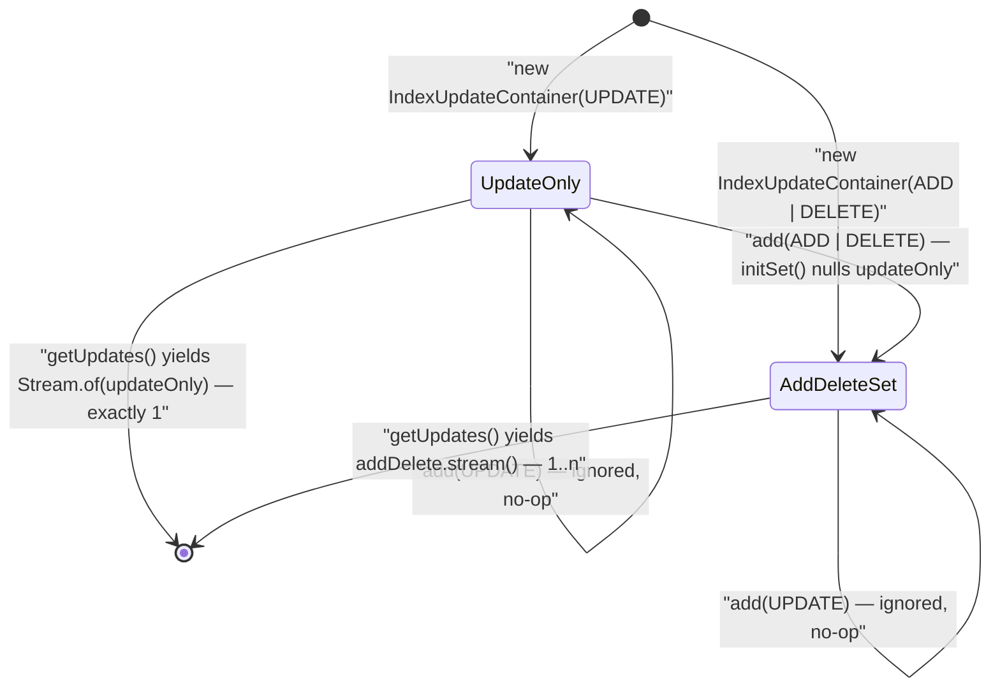
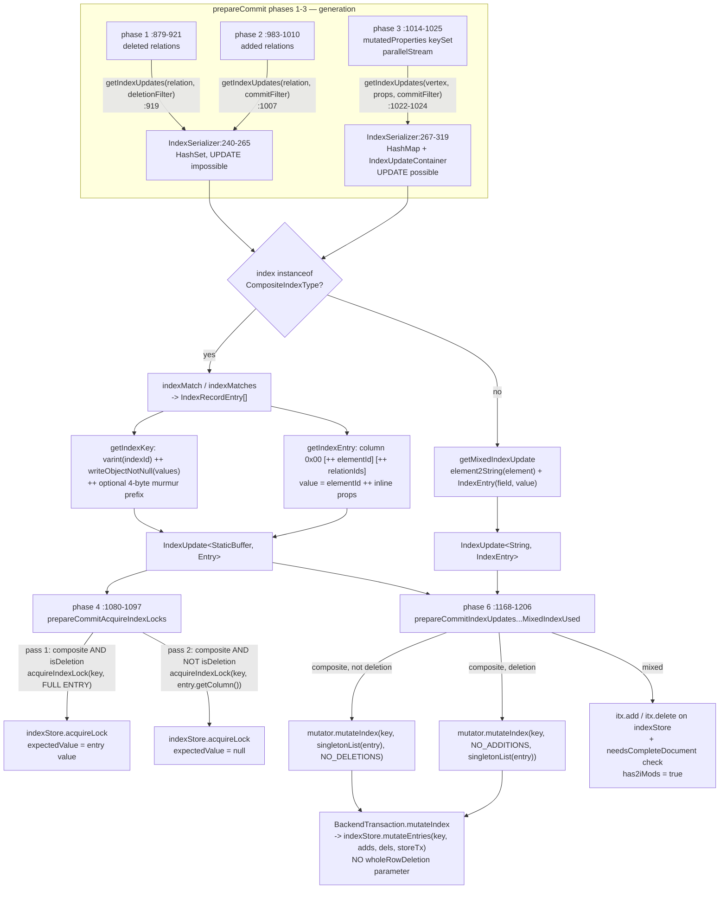

<!--
entry-meta
date: 2026-11-15
type: lesson
track: JanusGraph
lesson: 17
category: Database Internals
title: Composite indexes on write — the row key that cannot be scanned, and the column that is the uniqueness constraint
slug: janusgraph-index-serializer-graphindex-writes
-->

# Composite indexes on write — the row key that cannot be scanned, and the column that is the uniqueness constraint

**2026-11-15 · JanusGraph Track · Lesson 17 of 28**

## Where This Fits

- [Lesson 16](../2026-11-14-janusgraph-commit-prepare-commit-order/README.md) established the *frame* around index updates and deliberately left the box unopened: `prepareCommit` is seven phases over three accumulators, `indexUpdates` is written by phases 1–3 and read by phases 4 and 6, the three generation sites are `StandardJanusGraph:919` (per deleted relation), `:1007` (per added relation) and `:1022-1024` (per mutated vertex, on a `parallelStream`), and the locks are taken at `:1080-1099`. What it never said is what an `IndexUpdate` *is*.
- This lesson opens the box. `IndexSerializer.getIndexUpdates` has three real overloads behind four thin ones, and between them they produce a `StaticBuffer` key and an `Entry` for a composite index, or a `String` document id and an `IndexEntry` for a mixed one. The composite half is three byte-layout decisions — row key, column, value — and every one of them is a consequence of the storage contract from Part I, not of anything index-specific.
- **The finding:** the composite-index row key is deliberately *not* ordered and the column width *is* the uniqueness level. `getIndexKey` serializes field values with `writeObjectNotNull`, not the order-preserving writer lesson 12 dissected, and then optionally prefixes 4 bytes of murmur hash — so the graphindex store is an ordered KCV store that no one is allowed to scan in order. That is the mechanical reason the docs' "composite indexes are limited to equality lookups" is true, which they state without explaining.
- It sets up **lesson 18** (`ExpectedValueCheckingStore`, `ConsistentKeyLocker`), which inherits one concrete, falsifiable conjecture from this reading: the `UPDATE` mutation type reaches the *addition* lock branch with a `null` expected value against a cell that demonstrably already exists. Lesson 18 owns confirming or killing it.

## The Three Entry Points

`IndexSerializer` exposes seven `getIndexUpdates` methods. Four are one-liners that pick a filter; three do work.

| Signature | Lines | Returns | Called from |
|---|---|---|---|
| `getIndexUpdates(InternalRelation, TypeInspector)` | [224-226](https://github.com/JanusGraph/janusgraph/blob/a59ae8d8024207598eada34998d867617df51adf/janusgraph-core/src/main/java/org/janusgraph/graphdb/database/IndexSerializer.java#L224-L226) | delegates with `FULL_INDEX_APPLIES_TO_FILTER` | — |
| `getIndexUpdates(InternalVertex, Collection<InternalRelation>, TypeInspector)` | [228-230](https://github.com/JanusGraph/janusgraph/blob/a59ae8d8024207598eada34998d867617df51adf/janusgraph-core/src/main/java/org/janusgraph/graphdb/database/IndexSerializer.java#L228-L230) | delegates | — |
| `getIndexUpdatesNoConstraints(...)` ×2 | [232-238](https://github.com/JanusGraph/janusgraph/blob/a59ae8d8024207598eada34998d867617df51adf/janusgraph-core/src/main/java/org/janusgraph/graphdb/database/IndexSerializer.java#L232-L238) | delegate with `INDEX_APPLIES_TO_NO_CONSTRAINTS_FILTER` | reindex / OLAP paths |
| **`getIndexUpdates(InternalRelation, IndexAppliesToFunction, TypeInspector)`** | [240-265](https://github.com/JanusGraph/janusgraph/blob/a59ae8d8024207598eada34998d867617df51adf/janusgraph-core/src/main/java/org/janusgraph/graphdb/database/IndexSerializer.java#L240-L265) | `Collection<IndexUpdate>` (a `HashSet`) | `StandardJanusGraph:919`, `:1007` |
| **`getIndexUpdates(InternalVertex, Collection<InternalRelation>, IndexAppliesToFunction, TypeInspector)`** | [267-319](https://github.com/JanusGraph/janusgraph/blob/a59ae8d8024207598eada34998d867617df51adf/janusgraph-core/src/main/java/org/janusgraph/graphdb/database/IndexSerializer.java#L267-L319) | `Stream<IndexUpdate>` | `StandardJanusGraph:1022-1024` |
| **`reindexElement(JanusGraphElement, CompositeIndexType, TypeInspector)`** | [390-408](https://github.com/JanusGraph/janusgraph/blob/a59ae8d8024207598eada34998d867617df51adf/janusgraph-core/src/main/java/org/janusgraph/graphdb/database/IndexSerializer.java#L390-L408) | `Set<IndexUpdate<StaticBuffer,Entry>>`, all `ADD` | lesson 25's reindex job |

The two commit-path overloads are not variations on each other. They differ in four ways that all matter:

- **Which index list they walk.** The relation overload reads `((InternalRelationType) type).getKeyIndexes()` ([:247](https://github.com/JanusGraph/janusgraph/blob/a59ae8d8024207598eada34998d867617df51adf/janusgraph-core/src/main/java/org/janusgraph/graphdb/database/IndexSerializer.java#L247)). The vertex overload reads `getKeyIndexesReferences()` ([:280](https://github.com/JanusGraph/janusgraph/blob/a59ae8d8024207598eada34998d867617df51adf/janusgraph-core/src/main/java/org/janusgraph/graphdb/database/IndexSerializer.java#L280)) — an `IndexReferenceType`, which carries `isInlined()`. A key can be in an index as a *field key* (part of the row key) or as an *inline key* (carried in the value), and only the reference list distinguishes them.
- **Whether `UPDATE` can happen at all.** `getUpdateType(relation, isInlined)` is `isInlined ? UPDATE : (relation.isNew() ? ADD : DELETE)`. The relation overload passes `false` hard-coded ([:243](https://github.com/JanusGraph/janusgraph/blob/a59ae8d8024207598eada34998d867617df51adf/janusgraph-core/src/main/java/org/janusgraph/graphdb/database/IndexSerializer.java#L243)); the vertex overload passes `indexRef.isInlined()` ([:281](https://github.com/JanusGraph/janusgraph/blob/a59ae8d8024207598eada34998d867617df51adf/janusgraph-core/src/main/java/org/janusgraph/graphdb/database/IndexSerializer.java#L281)). **`IndexMutationType.UPDATE` is reachable from exactly one of the three sites**, and only for an inline key.
- **What they deduplicate with.** The relation overload collects into a plain `HashSet<IndexUpdate>` ([:242](https://github.com/JanusGraph/janusgraph/blob/a59ae8d8024207598eada34998d867617df51adf/janusgraph-core/src/main/java/org/janusgraph/graphdb/database/IndexSerializer.java#L242)), relying on `IndexUpdate.equals` over `(index, mutationType, key, entry)`. The vertex overload keys a `HashMap<Object, IndexUpdateContainer>` on `update.getKey()` alone ([:273](https://github.com/JanusGraph/janusgraph/blob/a59ae8d8024207598eada34998d867617df51adf/janusgraph-core/src/main/java/org/janusgraph/graphdb/database/IndexSerializer.java#L273), [:293-297](https://github.com/JanusGraph/janusgraph/blob/a59ae8d8024207598eada34998d867617df51adf/janusgraph-core/src/main/java/org/janusgraph/graphdb/database/IndexSerializer.java#L293-L297)) and collapses per key — see below.
- **One early exit the other does not have.** `if (updatedProperties.isEmpty()) return Stream.empty()` ([:272](https://github.com/JanusGraph/janusgraph/blob/a59ae8d8024207598eada34998d867617df51adf/janusgraph-core/src/main/java/org/janusgraph/graphdb/database/IndexSerializer.java#L272)), and `if (vertex.isRemoved() && indexRef.isInlined()) continue` ([:283](https://github.com/JanusGraph/janusgraph/blob/a59ae8d8024207598eada34998d867617df51adf/janusgraph-core/src/main/java/org/janusgraph/graphdb/database/IndexSerializer.java#L283)) — a vertex being deleted needs no per-inline-key work, because the whole index entry is going.

Both overloads assert the same precondition as lesson 16's two loops: `relation.isNew() || relation.isRemoved()`. These are Java `assert`s here ([:241](https://github.com/JanusGraph/janusgraph/blob/a59ae8d8024207598eada34998d867617df51adf/janusgraph-core/src/main/java/org/janusgraph/graphdb/database/IndexSerializer.java#L241), [:278](https://github.com/JanusGraph/janusgraph/blob/a59ae8d8024207598eada34998d867617df51adf/janusgraph-core/src/main/java/org/janusgraph/graphdb/database/IndexSerializer.java#L278)), not the live `Preconditions` lesson 16 found in `prepareCommit` — so in a production JVM without `-ea` they are not checked.

## What A "Record" Is

An `IndexUpdate` is built from an `IndexRecordEntry[]` — one slot per field key of the index, in index order. `IndexRecordEntry` ([source](https://github.com/JanusGraph/janusgraph/blob/a59ae8d8024207598eada34998d867617df51adf/janusgraph-core/src/main/java/org/janusgraph/graphdb/database/IndexRecordEntry.java)) is three fields: `relationId`, `value`, `key`. The `relationId` is the **property's** id, not the element's — the second constructor is `this(property.longId(), property.value(), property.propertyKey())`. That distinction is the whole reason a `LIST`-cardinality composite index can hold two entries for the same element with the same value.

Two functions produce records, and they are shaped by what an edge is versus what a vertex is:

- **`IndexRecordUtil.indexMatch(JanusGraphRelation, CompositeIndexType)`** — a relation has at most one value per key, so there is exactly one candidate record. It fills one slot per field key from `relation.valueOrNull(f.getFieldKey())` and **returns `null` the moment any field is unset**. No partial index entries: an element missing one indexed key is simply not in the index, which is what makes "the query must supply all keys" a storage fact rather than a planner rule.
- **`IndexRecordUtil.indexMatches(JanusGraphVertex, CompositeIndexType, boolean onlyLoaded, PropertyKey replaceKey, IndexRecordEntry replaceValue)`** — a vertex can have many values per key, so this is a **recursive Cartesian product** over the field keys. The recursion carries a `current[]` buffer and a position; at `pos >= fields.length` it calls `matches.add(current)`, and `IndexRecords.add` is overridden to `Arrays.copyOf` the buffer ([IndexRecords.java](https://github.com/JanusGraph/janusgraph/blob/a59ae8d8024207598eada34998d867617df51adf/janusgraph-core/src/main/java/org/janusgraph/graphdb/database/index/IndexRecords.java)) — without that copy every record in the list would alias the same mutating array.

The cost follows directly: a composite index over keys with *k₁, k₂, … kₙ* values on one vertex produces **∏ kᵢ** index entries for that vertex. For all-`SINGLE` keys that is 1. For a 2-key index over two `SET` keys with 5 values each it is 25 rows written per element, each with its own row key.

The `replaceKey` / `replaceValue` pair is the interesting part, and the call site is one line:

```java
// IndexSerializer:288
final IndexRecords updateRecords =
    indexMatches(vertex, cIndex, rel.isRemoved(), p.propertyKey(), new IndexRecordEntry(p));
```

`onlyLoaded` **is** `rel.isRemoved()`. So:

- **Removal** → `onlyLoaded = true` → the recursion takes the transaction-query branch, `qb.noPartitionRestriction().type(key)` with `queryOnlyLoaded()`, i.e. the *pre-transaction* property values, with the removed property substituted in its slot. The generated record therefore matches the bytes that are actually on disk, which is what the deletion has to hit.
- **Addition** → `onlyLoaded = false` → `vertex.properties(key.name())` for an ordinary vertex, i.e. the *post-change* values, with the new property substituted. The record matches the bytes that are about to exist.

The same branch has a second trigger: `!vertex.isNew() && IDManager.VertexIDType.PartitionedVertex.is(vertex.id())` also forces the transaction-query path, with the comment *"going through transaction so we can query deleted vertices"*. A partitioned vertex is read through the query builder even on an addition, because its properties live on the canonical representative (lesson 08's partition bits, lesson 15's `canonicalId` collapse).

**This is a read, during commit, from inside a `parallelStream`.** Lesson 16's claim that "phases 1–4 touch storage only to take locks" was about locks and holds for phases 1, 2 and 4; phase 3 is the exception, and it is not a lock. `prepareCommitVertexIndexUpdates` ([:1014-1025](https://github.com/JanusGraph/janusgraph/blob/a59ae8d8024207598eada34998d867617df51adf/janusgraph-core/src/main/java/org/janusgraph/graphdb/database/StandardJanusGraph.java#L1014-L1025)) knows it, and pre-warms exactly one of the two read sources:

```java
if (tx.getConfiguration().useMultiQuery() && backend.getStoreFeatures().hasMultiQuery()) {
    loadLabelsCheckedByIndexes(mutatedProperties, tx, config.maxKeysPerRead());
}
indexUpdates.addAll(mutatedProperties.keySet().parallelStream()
    .flatMap(v -> indexSerializer.getIndexUpdates(v, mutatedProperties.get(v), commitIndexAppliesToFilter, tx))
    .collect(Collectors.toList()));
```

`loadLabelsCheckedByIndexes` batches the **label** reads that `indexAppliesTo`'s constraint check needs, in multi-queries of `query.batch.max-keys-per-read` vertices each. It does not batch the **property** reads that `indexMatches` does for a removal or a partitioned vertex. Those stay one slice query per key per vertex, issued on the common ForkJoinPool, after the locks of phases 1–2 are already held.

## The Row Key: Ordered Store, Unorderable Key

`IndexRecordUtil.getIndexKey(CompositeIndexType, Object[], Serializer, boolean hashKeys, HashLength)` is short enough to read in one sitting and every line of it is a decision:

```
key := varint(index.longId())
    ++ for each field i, in index order:
         hasGenericDataType(field) ? writeClassAndObject(values[i])
                                   : writeObjectNotNull(values[i])
if (hashKeys) key := murmur32(key) ++ key      // 4-byte prefix
```

Three things to notice.

**1. The index id is the row-key prefix, so one physical store holds every composite index.** `VariableLong.writePositive(out, index.longId())` goes first, which is why `getIndexIdFromKey` ([IndexSerializer:593-595](https://github.com/JanusGraph/janusgraph/blob/a59ae8d8024207598eada34998d867617df51adf/janusgraph-core/src/main/java/org/janusgraph/graphdb/database/IndexSerializer.java#L593-L595)) can recover which index a row belongs to by reading one varint, and why `getIndexInfoFromKey` can then decode the values back by asking that index for its field keys. The `graphIndex` store is a multiplexed store keyed by `(indexId, values...)`, in the same way the `edgestore` is one store for every vertex.

**2. The values are serialized with `writeObjectNotNull`, not `writeObjectByteOrder`.** Lesson 12 established the distinction precisely: `StandardSerializer` has four write entry points, and `EdgeSerializer` picks the order-preserving one for anything whose byte comparison must match its value comparison. `getIndexKey` picks the *non*-order-preserving one. Consequence: for a composite index on an `Integer` key, the row key for value 2 and the row key for value 10 have no defined relative order, so a range scan over the graphindex store is meaningless even on a backend that offers ordered scans.

**3. The hash prefix is not a configuration option.** This is the detail worth carrying:

```java
// StandardJanusGraph:304-305
this.indexSerializer = new IndexSerializer(configuration.getConfiguration(), this.edgeSerializer, this.serializer,
        this.backend.getIndexInformation(), storeFeatures.isDistributed() && storeFeatures.isKeyOrdered());
```

`hashKeys` is derived from `StoreFeatures` (lesson 03's subject), and `hashLength` is a `private final` initialised to `HashLength.SHORT` with no setter ([IndexSerializer:133-134](https://github.com/JanusGraph/janusgraph/blob/a59ae8d8024207598eada34998d867617df51adf/janusgraph-core/src/main/java/org/janusgraph/graphdb/database/IndexSerializer.java#L133-L134)) — `SHORT` is 4 bytes, `LONG` is 8, and `HashingUtil.hashPrefixKey` writes `hashcode.asInt()` ahead of the original key bytes, which `getKey` later strips with `subrange(4, len-4)`. So on a **distributed, key-ordered** backend (HBase, Cassandra with an ordered partitioner) every composite-index row key carries 4 bytes of murmur hash, specifically so that a hot value range does not become a hot token range. On the in-memory store, BerkeleyJE (not distributed) and CQL with the default Murmur3 partitioner (not key-ordered) there is no prefix at all.

Read 2 and 3 together: **the backends that could scan the graphindex store in order are exactly the backends whose index keys are hashed, and the backends that are not hashed cannot scan in order anyway.** The equality-only limitation is not a planner simplification; there is no byte layout in which it could be lifted without changing the key encoding. The documentation asserts the limitation and does not say why; this is why.

A fourth, smaller thing: `getIndexKey`'s `DataOutput` is presized `8*DEFAULT_OBJECT_BYTELEN + 8` = 248 bytes, with `DEFAULT_OBJECT_BYTELEN = 30`. It is a guess that does not depend on the number of fields, so a wide index over long strings reallocates.

## The Column And The Value

`IndexRecordUtil.getIndexEntry` (private, called only from `getCompositeIndexUpdate`) writes one `StaticArrayEntry` and returns it with a `valuePosition` — the same single-integer column/value boundary trick lesson 10 found in `EdgeSerializer.writeRelation`. The layout:

```
column := 0x00                                  // FIRST_INDEX_COLUMN_BYTE
       ++ if cardinality != SINGLE:  elementId   // writeVertexId, or varint(relationId) for a relation
       ++ if cardinality == LIST:    varint(record[i].relationId) for each field i
--- valuePosition ---
value  := vertex:   writeVertexId(element.id()) ++ inlineProperties
          relation: varint(relationId) ++ writeVertexId(outVertexId) ++ varint(typeId)
                    ++ [writeVertexId(inVertexId) if present]
```

| Index cardinality | Column bytes | Entries per row | What collides |
|---|---|---|---|
| `SINGLE` | `0x00` — one byte, always | exactly **1** | any second element with the same field values |
| `SET` | `0x00` + element id | one per element | the same element twice with the same values |
| `LIST` | `0x00` + element id + one varint per field | one per (element, property-ids) tuple | nothing |

**The column width is the uniqueness level, and the KCV store does the enforcing.** A `SINGLE` composite index has a one-byte column, so the row for `("byName", "alice")` has exactly one addressable cell; a second vertex named alice writes the *same* `(key, column)` pair and overwrites. There is no index-side check doing this — it is lesson 02's one-value-per-(key, column) contract and lesson 10's "the column is the uniqueness constraint", now appearing a third time one layer up. `LIST` puts the property ids in the column precisely so that nothing can ever collide, which is why it needs no lock (next section).

The value is the element's identity, which is what a composite index lookup returns: `IndexSerializer.query` reads the value back with `bytebuffer2RelationId` or a vertex id and hands the caller element ids, never properties — unless the index has **inline keys**.

**Inline keys are a covering index, and they are an edgestore cell nested inside an index cell.** `getInlineProperties` maps each of `index.getInlineFieldKeys()` through `edgeSerializer.writeRelation((InternalRelation) prop, 0, typeInspector)` — the exact function lesson 10 dissected — and `writeInlineProperties` appends each one as `int length`, `int valuePosition`, then the relation bytes. `readInlineProperties` is the mirror iterator. Two consequences:

- The nested `valuePosition` must be stored explicitly, because the outer entry already spent its own single `valuePosition` on the column/value split. That is why the framing is 8 bytes per inline property rather than 4.
- `getInlineProperties` returns empty when `element.isRemoved()`, which pairs with the `vertex.isRemoved() && indexRef.isInlined() → continue` guard at `IndexSerializer:283`.

`getInlinePropertiesSize` is `n * Integer.BYTES * 2 + Σ length`, and `getIndexEntry` presizes its output `1 + 8 + 8*record.length + 4*8 + inlinePropertiesSize` — this one *does* scale with the record width.

## Cardinality Is Derived, Not Declared

Nothing in the public API sets a composite index's cardinality. `ManagementSystem.createCompositeIndex` computes it from two inputs ([:839-850](https://github.com/JanusGraph/janusgraph/blob/a59ae8d8024207598eada34998d867617df51adf/janusgraph-core/src/main/java/org/janusgraph/graphdb/database/management/ManagementSystem.java#L839-L850)):

```java
boolean allSingleKeys = true;
for (PropertyKey key : keys) {
    ...
    if (key.cardinality() != Cardinality.SINGLE) allSingleKeys = false;
    ...
}
Cardinality indexCardinality;
if (unique) indexCardinality = Cardinality.SINGLE;
else indexCardinality = (allSingleKeys ? Cardinality.SET : Cardinality.LIST);
```

So `unique()` → `SINGLE`; otherwise a composite index over all-`SINGLE` property keys is a `SET` index, and one that includes any `LIST`/`SET` property key is a `LIST` index. Two further facts from the same method:

- `Preconditions.checkArgument(!unique || elementCategory == ElementCategory.VERTEX, ...)` ([:838](https://github.com/JanusGraph/janusgraph/blob/a59ae8d8024207598eada34998d867617df51adf/janusgraph-core/src/main/java/org/janusgraph/graphdb/database/management/ManagementSystem.java#L838)) — there is no unique edge index, which follows from the column layout: a relation's column under `SET`/`LIST` is built from `longId()`, and the `SINGLE` layout has nowhere to put one.
- `canIndexBeEnabled = oneNewKey || (constraint != null && constraint.isNew())` and `STATUS = canIndexBeEnabled ? ENABLED : INSTALLED` ([:852-860](https://github.com/JanusGraph/janusgraph/blob/a59ae8d8024207598eada34998d867617df51adf/janusgraph-core/src/main/java/org/janusgraph/graphdb/database/management/ManagementSystem.java#L852-L860)) — an index on a brand-new key is `ENABLED` immediately and needs no reindex, which is the only reason the Hands-On below is three lines long instead of a `ManagementSystem.awaitGraphIndexStatus` dance. Lesson 25 owns the rest of that lifecycle.

Now put the derived cardinality next to the lock predicate, which is the other half of lesson 16's `acquireLock` pair:

```java
// StandardJanusGraph:768-771
public static boolean acquireLock(CompositeIndexType index, boolean acquireLocksConfig) {
    return acquireLocksConfig && index.getConsistencyModifier()==ConsistencyModifier.LOCK
            && index.getCardinality()!= Cardinality.LIST;
}
```

The three cardinalities line up exactly with the three column widths: `LIST` is excluded because its column already contains the property ids and cannot collide, so there is nothing for a lock to protect. `SET` is *not* excluded — a `SET` index does take storage locks under `ConsistencyModifier.LOCK`, even though it enforces no uniqueness across elements. What it protects there is the same-element-twice case its column makes addressable.

## The Three Mutation Types, And The Container

`IndexMutationType` is three constants and nothing else: `ADD`, `UPDATE`, `DELETE` ([source](https://github.com/JanusGraph/janusgraph/blob/a59ae8d8024207598eada34998d867617df51adf/janusgraph-core/src/main/java/org/janusgraph/graphdb/database/index/IndexMutationType.java)). `IndexUpdate` ([source](https://github.com/JanusGraph/janusgraph/blob/a59ae8d8024207598eada34998d867617df51adf/janusgraph-core/src/main/java/org/janusgraph/graphdb/database/index/IndexUpdate.java)) is a five-field immutable carrier `(index, mutationType, key, entry, element)` whose asserts encode the whole type scheme:

```java
assert !index.isCompositeIndex() || (key instanceof StaticBuffer && entry instanceof Entry);
assert !index.isMixedIndex()     || (key instanceof String      && entry instanceof IndexEntry);
```

`equals`/`hashCode` cover `(index, mutationType, key, entry)` and **exclude `element`** — so two updates differing only in which element produced them are the same update. `setTTL` is the one mutator, and it `Preconditions.checkArgument(ttl > 0 && mutationType != DELETE)` before casting the entry to `MetaAnnotatable`.

`IndexUpdateContainer` ([source](https://github.com/JanusGraph/janusgraph/blob/a59ae8d8024207598eada34998d867617df51adf/janusgraph-core/src/main/java/org/janusgraph/graphdb/database/index/IndexUpdateContainer.java)) is 40 lines and holds a two-field state machine per index key: `updateOnly` (one `IndexUpdate`) or `addDelete` (a `HashSet`). The transitions are not symmetric:

- Constructed with an `UPDATE` → `updateOnly` set, `addDelete` null.
- Constructed with an `ADD`/`DELETE` → `initSet`, `addDelete` holds it, `updateOnly` null.
- `add(UPDATE)` → **ignored entirely**. `add` only acts `if (!indexUpdate.isUpdate())`.
- `add(ADD or DELETE)` → `initSet`, which adds to the set **and sets `updateOnly = null`**.

So an `UPDATE` survives only if no `ADD` or `DELETE` ever arrives for the same index key, and once one does the `UPDATE` is silently dropped rather than merged. That is the correct collapse: if a field-key value changed, the row key changed, there is a real delete and a real add, and the in-place refresh of the old entry's inline bytes would be writing to a row that is going away.



Note what the container is keyed on at `IndexSerializer:293`: `update.getKey()`, which is a `StaticBuffer` for a composite index and a `String` document id for a mixed one. **Composite and mixed updates share the map.** They cannot collide (one key type is a buffer, the other a string), but the collapse rule applies to mixed-index updates too, and for a mixed index the "key" is the *element*, not a value tuple — so for one element, one changed inline-ish field, a mixed-index `UPDATE` is likewise dropped as soon as any field of that element produces an add or delete.

## Generation → Locks → Writes



## Locks: Two Full Passes, Deletions First

`prepareCommitAcquireIndexLocks` ([:1080-1097](https://github.com/JanusGraph/janusgraph/blob/a59ae8d8024207598eada34998d867617df51adf/janusgraph-core/src/main/java/org/janusgraph/graphdb/database/StandardJanusGraph.java#L1080-L1097)) is two `for` loops over the *same* `indexUpdates` list, not one loop with a branch, and the javadoc says why in three words: *"Acquire index locks (deletions first)"*. Mixed-index updates are skipped in both passes (`!update.isCompositeIndex() → continue`): a mixed index takes no storage lock, ever.

The asymmetry is lesson 16's edgestore asymmetry, verbatim:

| | argument | expected value | asserts |
|---|---|---|---|
| deletion, `:1087` | `acquireIndexLock(key, (Entry) entry)` | `entry.getValueAs(...)` | "this cell exists **with this content**" |
| addition, `:1094` | `acquireIndexLock(key, entry.getColumn())` | `null` | "this cell does **not** exist" |

For a `SINGLE` index the addition's column is the single byte `0x00`, so the addition lock reads literally: *nobody currently owns this value*. That one line is the entire uniqueness mechanism for a unique composite index — which is why the docs' remark that a `unique()` index on an eventually-consistent backend needs `ConsistencyModifier.LOCK` to be enforced is a statement about `acquireLock(CompositeIndexType, ...)` returning `false` without it, not about the index definition.

**Derived, not run: this is why the deletion pass must come first, and it exposes a conjecture for lesson 18.** `BackendTransaction.acquireIndexLock`'s javadoc states *"If this method is called multiple times with the same key-column pair in the same transaction, all but the first invocation are ignored."* Take a unique index on `name` and one transaction that moves `"alice"` from v1 to v2. Both the deletion and the addition produce the same row key (same value) and the same column (`0x00`, because `SINGLE`). Pass 1 locks `(key, 0x00)` with expected value = v1's entry. Pass 2 asks for `(key, 0x00)` with expected value `null` — and is **ignored**, because the pair is already locked. The surviving assertion is the correct one ("the cell holds v1"); the contradictory one ("the cell is empty") is dropped by the idempotence rule. Reverse the two passes and the handover transaction would assert the cell is empty when it is not, and fail. The ordering is load-bearing.

The same reasoning produces a case where nothing saves it. `IndexMutationType.UPDATE` is not a deletion, so it is handled by **pass 2** (`!update.isDeletion()`) — expected value `null`, against a cell that by construction already exists, since an `UPDATE` is only generated when an inline key changed and the field-key values (and therefore the row key and column) did not. If no `ADD`/`DELETE` for that key clears the container, no pass-1 lock is taken on that pair first, and the `null` expected value stands. The predicted outcome is a locking failure on commit for: a composite index with `ConsistencyModifier.LOCK`, cardinality ≠ `LIST`, at least one inline key, on a transaction that changes only an inline property of an existing element. I did **not** verify this by running it, and the expected-value machinery is lesson 18's subject — so it goes to lesson 18 as an obligation with a named test, not into this entry as a fact. The exact confirming test is in the Hands-On.

## The Writes

`prepareCommitIndexUpdatesAndCheckIfAnyMixedIndexUsed` ([:1163-1206](https://github.com/JanusGraph/janusgraph/blob/a59ae8d8024207598eada34998d867617df51adf/janusgraph-core/src/main/java/org/janusgraph/graphdb/database/StandardJanusGraph.java#L1163-L1206)) is one loop with a two-way branch and a return value that is used exactly once.

**Composite branch.** One `mutator.mutateIndex` call per update, with a `Collections.singletonList` on whichever side applies and the `NO_ADDITIONS`/`NO_DELETIONS` sentinel on the other. Three details:

- **An `UPDATE` takes the addition path**, because the branch tests `isDeletion()` only. For a KCV store that is right: same key, same column, new value is an overwrite.
- **The deletion passes the whole `Entry`, not the column.** `BackendTransaction.mutateIndex(key, additions, deletions)` takes `List<Entry>` on both sides and forwards to `indexStore.mutateEntries(key, additions, deletions, storeTx)`. Lesson 16's finding that `KCVEntryMutation` compares both sides by `Entry::getColumn` — value ignored — means the extra value bytes in a deletion entry are carried to `consolidate()` and then dropped. They exist for the *lock*, not for the mutation.
- **There is no whole-row deletion for the index store.** `mutateIndex` calls the four-argument `mutateEntries`; only `mutateEdges` has the five-argument overload with `wholeRowDeletion`. Lesson 16's `storage.drop-whole-row-on-vertex-removal` optimisation is edgestore-only, and it has to be: deleting a vertex touches one edgestore row and *n* graphindex rows, one per (index, value-tuple), none of which belongs to that vertex alone.

**Mixed branch.** Sets `has2iMods = true` unconditionally, then `itx.add(...)` or `itx.delete(indexStore, key, entry.field, entry.value, element.isRemoved())`, then the complete-document check:

```java
if (!isCdcOnlyMixedIndex(update.getIndex()) && itx.needsCompleteDocument(indexStore, update.getKey())) {
    itx.registerCompleteDocument(indexStore, update.getKey(),
        indexSerializer.getCompleteDocument(update.getElement(), (MixedIndexType) update.getIndex()));
}
```

The in-tree comment states the constraint that makes this correct and the one that makes it fragile: *"Read here, while the transaction can still read: the index commit runs after the storage commit."* `getCompleteDocument` ([IndexSerializer:332-357](https://github.com/JanusGraph/janusgraph/blob/a59ae8d8024207598eada34998d867617df51adf/janusgraph-core/src/main/java/org/janusgraph/graphdb/database/IndexSerializer.java#L332-L357)) walks every non-`DISABLED` field key of the index and reads every value of each through `documentProperties` ([:364-370](https://github.com/JanusGraph/janusgraph/blob/a59ae8d8024207598eada34998d867617df51adf/janusgraph-core/src/main/java/org/janusgraph/graphdb/database/IndexSerializer.java#L364-L370)) — one slice if `query.fast-property` prefetching is on, otherwise one slice per key. That is a second, unbatched read inside phase 6, for every element whose document the provider reports missing. The comment also records the subtlety that makes `isNew()`/`isRemoved()` the wrong question here: a property change replaces the relation, so the deletion arrives from a removed element and the addition from a new one, while the mutation they add up to is an update of an existing document — hence *"Whether the document is an existing one is the pending mutation's to say, not the element's"*.

`has2iMods` is returned into `ModificationSummary` and read in exactly one place: `hasSecondaryPersistence = logTxIdentifier != null || commitSummary.has2iModifications` ([:1295](https://github.com/JanusGraph/janusgraph/blob/a59ae8d8024207598eada34998d867617df51adf/janusgraph-core/src/main/java/org/janusgraph/graphdb/database/StandardJanusGraph.java#L1295)) — i.e. whether this transaction needs the WAL at all. Lesson 28 owns that. There is also an assert at `:1267` that a schema-only commit has `hasModifications && !has2iModifications`.

**The cdc-only filters.** `isCdcOnlyMixedIndex` ([:1158-1161](https://github.com/JanusGraph/janusgraph/blob/a59ae8d8024207598eada34998d867617df51adf/janusgraph-core/src/main/java/org/janusgraph/graphdb/database/StandardJanusGraph.java#L1158-L1161)) is `index.isMixedIndex() && cdcOnlyBackingIndexes.contains(backingIndexName)`, and the two filters built in the constructor ([:267-288](https://github.com/JanusGraph/janusgraph/blob/a59ae8d8024207598eada34998d867617df51adf/janusgraph-core/src/main/java/org/janusgraph/graphdb/database/StandardJanusGraph.java#L267-L288)) differ by one clause: the deletion filter keeps a cdc-only index when `index.getElement().isRelation()`. So relation-document deletions are still written synchronously — CDC events cannot identify them — while everything else for that backend is left to the external worker. When any backend is cdc-only the constructor emits a `log.warn` that spells out the trade-off, including that *"the WAL records these transactions as fully successful, so transaction recovery will not repair them either."* That is as far as this lesson goes; lesson 26 owns the `IndexProvider` SPI and lesson 28 the recovery path.

## TTL

Three different TTL computations reach index entries, and they disagree about one case.

| Path | Source | DELETE handling |
|---|---|---|
| relation overload, [:244](https://github.com/JanusGraph/janusgraph/blob/a59ae8d8024207598eada34998d867617df51adf/janusgraph-core/src/main/java/org/janusgraph/graphdb/database/IndexSerializer.java#L244) | `updateType == DELETE ? 0 : StandardJanusGraph.getTTL(relation)` | zeroed up front, then `if (ttl>0)` |
| vertex overload, composite, [:291-292](https://github.com/JanusGraph/janusgraph/blob/a59ae8d8024207598eada34998d867617df51adf/janusgraph-core/src/main/java/org/janusgraph/graphdb/database/IndexSerializer.java#L291-L292) | `getIndexTTL(vertex, getKeysOfRecords(record))` | `if (ttl > 0 && updateType != DELETE)` |
| vertex overload, mixed, [:306-308](https://github.com/JanusGraph/janusgraph/blob/a59ae8d8024207598eada34998d867617df51adf/janusgraph-core/src/main/java/org/janusgraph/graphdb/database/IndexSerializer.java#L306-L308) | `getIndexTTL(vertex, p.propertyKey())` | same guard |

`IndexRecordUtil.getIndexTTL(vertex, keys...)` starts from `StandardJanusGraph.getTTL(vertex)` and takes the **minimum** over every key's `getTTL()`, treating 0 as "unset" (`if (kttl > 0 && (kttl < ttl || ttl <= 0)) ttl = kttl`). Note which keys: for the composite path it is **every field key of the record**, so a composite index entry expires with the shortest-lived of the keys it indexes — not with the property that triggered the write. Lesson 16 found the relation-side rule (minimum of the type's TTL and every endpoint label's); this is its index-side sibling, and the guard on `DELETE` is belt-and-braces over `IndexUpdate.setTTL`'s own `Preconditions.checkArgument(ttl > 0 && mutationType != DELETE)`.

## Hands-On

Two exercises in your clone of `aryanttripathi/janusgraph`, at `a59ae8d8`. The first makes the three column widths visible as bytes; the second is the lesson-18 conjecture, written as a test that should fail if the conjecture is right.

### A. Dump the graphindex row and watch the column change width

New file `janusgraph-inmemory/src/test/java/org/janusgraph/graphdb/inmemory/CompositeIndexEntryLayoutTest.java`. The open/close idiom is lifted from `WholeRowDeletionOptimizationTest`, which is the in-tree harness that already does this sort of thing.

```java
package org.janusgraph.graphdb.inmemory;

import org.apache.tinkerpop.gremlin.structure.Vertex;
import org.janusgraph.core.Cardinality;
import org.janusgraph.core.JanusGraph;
import org.janusgraph.core.JanusGraphFactory;
import org.janusgraph.core.PropertyKey;
import org.janusgraph.core.schema.JanusGraphManagement;
import org.janusgraph.diskstorage.Entry;
import org.janusgraph.diskstorage.EntryList;
import org.janusgraph.diskstorage.StaticBuffer;
import org.janusgraph.diskstorage.keycolumnvalue.KeySliceQuery;
import org.janusgraph.diskstorage.keycolumnvalue.SliceQuery;
import org.janusgraph.diskstorage.util.BufferUtil;
import org.janusgraph.graphdb.database.StandardJanusGraph;
import org.janusgraph.graphdb.database.management.ManagementSystem;
import org.janusgraph.graphdb.transaction.StandardJanusGraphTx;
import org.janusgraph.graphdb.types.CompositeIndexType;
import org.junit.jupiter.api.Test;

import java.util.Collections;

public class CompositeIndexEntryLayoutTest {

    private static String hex(StaticBuffer b) {
        StringBuilder sb = new StringBuilder();
        for (byte x : b.as(StaticBuffer.ARRAY_FACTORY)) sb.append(String.format("%02x ", x));
        return sb.toString().trim();
    }

    private void dump(boolean unique, Cardinality keyCardinality) {
        JanusGraph graph = JanusGraphFactory.build().set("storage.backend", "inmemory").open();
        try {
            JanusGraphManagement mgmt = graph.openManagement();
            PropertyKey name = mgmt.makePropertyKey("name").dataType(String.class)
                .cardinality(keyCardinality).make();
            JanusGraphManagement.IndexBuilder b = mgmt.buildIndex("byName", Vertex.class).addKey(name);
            if (unique) b.unique();
            b.buildCompositeIndex();
            mgmt.commit();

            graph.addVertex("name", "alice");
            graph.addVertex("name", "alice");   // same value on purpose
            graph.tx().commit();

            StandardJanusGraphTx tx = (StandardJanusGraphTx) graph.newTransaction();
            CompositeIndexType idx =
                (CompositeIndexType) ManagementSystem.getGraphIndexDirect("byName", tx);
            StaticBuffer key = ((StandardJanusGraph) graph).getIndexSerializer()
                .getIndexKey(idx, Collections.singletonMap("name", "alice"));

            EntryList row = tx.getTxHandle().indexQuery(new KeySliceQuery(key,
                new SliceQuery(BufferUtil.zeroBuffer(1), BufferUtil.oneBuffer(64))));

            System.out.printf("unique=%s keyCardinality=%s indexCardinality=%s hashKeys=%s%n",
                unique, keyCardinality, idx.getCardinality(),
                ((StandardJanusGraph) graph).getIndexSerializer().isHashKeys());
            System.out.println("  row key : " + hex(key));
            System.out.println("  entries : " + row.size());
            for (Entry e : row) {
                System.out.println("    column=[" + hex(e.getColumn()) + "]  value=[" + hex(e.getValue()) + "]");
            }
            tx.rollback();
        } finally {
            graph.close();
        }
    }

    @Test
    public void showAllThreeCardinalities() {
        dump(true,  Cardinality.SINGLE);   // -> index cardinality SINGLE
        dump(false, Cardinality.SINGLE);   // -> index cardinality SET
        dump(false, Cardinality.LIST);     // -> index cardinality LIST
    }
}
```

Run it:

```
mvn -q -pl janusgraph-inmemory -am -Dtest=CompositeIndexEntryLayoutTest#showAllThreeCardinalities \
    -DfailIfNoTests=false test
```

**What to look for, in this order:**

1. **The row key's first byte(s).** `hashKeys` prints `false` for the in-memory store (not distributed), so byte 0 is the varint-encoded index id of `byName`, and the rest is `writeObjectNotNull("alice")`. Compare that byte to `idx.longId()` — it is a `VariableLong.writePositive`, so for a small id it is the id itself.
2. **The column, across the three runs.** `SINGLE` prints `column=[00]` — one byte. `SET` prints `00` followed by the vertex id. `LIST` prints `00`, the vertex id, and then the property's relation id. This is the table in *The Column And The Value* made of actual bytes.
3. **`entries` for the unique run.** Two vertices were given the same name. For `SINGLE` the row holds **one** entry, because the second write hit the same `(key, 0x00)` cell. Nothing threw: the in-memory store's `StoreFeatures` do not offer locking and the index has the default `ConsistencyModifier`, so `acquireLock(CompositeIndexType, …)` returned `false` and uniqueness degraded to last-writer-wins. That is the degradation the docs describe, reproduced in six lines.
4. **The value.** Under `SINGLE` the value is the surviving vertex's id written by `IDHandler.writeVertexId`; compare it with the ids the two `addVertex` calls returned to see *which* writer won.

**Extension worth the ten minutes:** add `mgmt.addInlinePropertyKey(mgmt.getGraphIndex("byName"), ageKey)` for a second key, commit, set `age` on one of the vertices in a fresh transaction, and dump again. The value grows by `int length`, `int valuePosition` and a full `EdgeSerializer.writeRelation` cell — an edgestore cell nested inside an index cell — and the update that produced it is `IndexMutationType.UPDATE`, the only mutation type the relation overload can never emit.

### B. The lesson-18 conjecture, as a failing test

Same module. Build a graph with an index that satisfies all four conditions — composite, `ConsistencyModifier.LOCK`, cardinality ≠ `LIST`, at least one inline key — and change *only* the inline property:

```java
JanusGraphManagement mgmt = graph.openManagement();
PropertyKey name = mgmt.makePropertyKey("name").dataType(String.class).cardinality(Cardinality.SINGLE).make();
PropertyKey age  = mgmt.makePropertyKey("age").dataType(Integer.class).cardinality(Cardinality.SINGLE).make();
JanusGraphIndex byName = mgmt.buildIndex("byName", Vertex.class).addKey(name).unique().buildCompositeIndex();
mgmt.addInlinePropertyKey(byName, age);
mgmt.setConsistency(byName, ConsistencyModifier.LOCK);
mgmt.commit();

Object id = graph.addVertex("name", "alice", "age", 30).id();
graph.tx().commit();

// change ONLY the inline key -> IndexMutationType.UPDATE, no ADD/DELETE for this index key
graph.traversal().V(id).next().property("age", 31);
graph.tx().commit();     // <-- the conjecture says this path reaches an addition lock
                         //     with expectedValue=null against an existing cell
```

**What to look for:** whether the second `commit()` completes. The in-memory backend will almost certainly complete it regardless, because without locking `StoreFeatures` the whole `acquireLock` branch is skipped — so run the same scenario against **BerkeleyJE** (`storage.backend=berkeleyje`, a temp `storage.directory`), which is the non-distributed backend lesson 05 already set up and the one the docs name as needing explicit locking for uniqueness. Then set a breakpoint on `StandardJanusGraph.prepareCommitAcquireIndexLocks` and step the **second** pass: the question to answer is whether `update.getType()` is `UPDATE` there, and what `ExpectedValueCheckingTransaction` does with a `null` expected value on a cell that exists. If it throws, the conjecture holds and there is a PR in it. If it does not, find the line that saves it — that line is the one lesson 18 actually needs to explain. Either answer is worth having before lesson 18 is written; do not commit the breakpoint or any temporary logging.

## Where This Breaks Down

- **Index writes are not batched per row.** `prepareCommitIndexUpdatesAndCheckIfAnyMixedIndexUsed` issues one `mutateIndex` per `IndexUpdate` with a `singletonList`. For the edgestore, phase 5 groups by vertex key and sends one `mutateEdges` per row (lesson 16); nothing does that for the index store. The grouping happens a layer down — `CacheTransaction.mutate` merges per `(store, key)` — but the allocation of one singleton list per update, and one call per update, is paid in the commit path. For a 2-key index over two 5-valued keys that is 25 calls for one vertex.
- **Phase 3 reads storage on the common ForkJoinPool with locks already held.** `indexMatches` goes through `VertexCentricQueryBuilder` for every removal and every partitioned vertex. `loadLabelsCheckedByIndexes` batches only the label check. A commit touching many vertices with index-relevant removals issues an unbounded number of single-key slice queries from parallel-stream threads, between the locks of phases 1–2 and the storage write of phase 7.
- **`getCompleteDocument` is a second unbatched read, in phase 6, per element the provider says it is missing.** Per field key unless `query.fast-property` is on. The comment is explicit that it must happen before the transaction stops being able to read, which means it cannot be deferred to the index commit where it would be cheaper.
- **The Cartesian product has no guard.** `indexMatches` recurses over all values of all field keys with no limit, no warning, and no configuration. A composite index over two multi-valued keys is quadratic in index entries per element, at commit time and at read time, and nothing in the schema API flags it.
- **Equality-only is not fixable in the planner.** Covered above: non-order-preserving value encoding plus an optional hash prefix on exactly the backends that could scan. Any range support over a composite index means a new key encoding and a reindex of the world.
- **`unique()` is advisory by default.** `acquireLock(CompositeIndexType, …)` needs all three of the config flag (false under `enableBatchLoading`), `ConsistencyModifier.LOCK`, and cardinality ≠ `LIST`. Miss any one and a unique index silently becomes last-writer-wins at the storage layer — exercise A reproduces it.
- **A cdc-only mixed index that loses its worker is invisible.** The constructor's `log.warn` is the only signal, it fires once at open, and the WAL records the transactions as successful — so neither monitoring nor recovery will notice. The warning text says so itself.
- **Three TTL computations, one of which is driven by keys the write did not touch.** A composite index entry's TTL is the minimum over every field key of the record plus the vertex's own, so adding a short-TTL key to an existing index silently shortens the lifetime of entries written for the other keys.

## Further Study

- [JanusGraph docs — index performance (composite and mixed indexes)](https://docs.janusgraph.org/schema/index-management/index-performance/) — the user-facing contract this lesson is the implementation of: `graphIndex` as a separate store, equality-only, full-key-match, `unique()` plus locking on eventually consistent backends, label constraints via `indexOnly`.
- [`IndexRecordUtil.java` at the pinned commit](https://github.com/JanusGraph/janusgraph/blob/a59ae8d8024207598eada34998d867617df51adf/janusgraph-core/src/main/java/org/janusgraph/graphdb/database/util/IndexRecordUtil.java) — read `getIndexKey`, `getIndexEntry`, `indexMatch`, `indexMatches` and the inline-property quartet (`getInlineProperties`, `getInlinePropertiesSize`, `writeInlineProperties`, `readInlineProperties`) as one unit; they are the entire byte layout.
- [`IndexSerializerRemoveElementTest.java`](https://github.com/JanusGraph/janusgraph/blob/a59ae8d8024207598eada34998d867617df51adf/janusgraph-core/src/test/java/org/janusgraph/graphdb/database/IndexSerializerRemoveElementTest.java) — the only test in `janusgraph-core` aimed at `IndexSerializer` directly, and a model for testing it with `new IndexSerializer(null, null, null, null, false)` plus a mocked `MixedIndexType`. Its header comment names the caller that matters for lesson 28: `StandardTransactionLogProcessor` recovery removing a stale document.
- [`ManagementSystem.createCompositeIndex`](https://github.com/JanusGraph/janusgraph/blob/a59ae8d8024207598eada34998d867617df51adf/janusgraph-core/src/main/java/org/janusgraph/graphdb/database/management/ManagementSystem.java#L831-L879) — the write side of lesson 13's schema vertices, and where `INDEX_CARDINALITY`, `INDEXSTORE_NAME` and the initial `SchemaStatus` are set. Lesson 25 starts here.

## Next Steps

1. **Lesson 18 inherits the `UPDATE` lock conjecture as its first obligation.** Conditions, predicted failure and the confirming scenario are in Hands-On B. Answer it from `ExpectedValueCheckingTransaction` and `ConsistentKeyLocker` at the pinned commit, and either log a PR candidate in [`tracks/janusgraph-registers.md`](../../../tracks/janusgraph-registers.md) or record the line that makes it a non-issue.
2. **Lesson 18 also owns the idempotence claim this lesson derived but did not run:** that pass 2's lock request for an already-locked `(key, column)` pair is dropped, which is what makes a unique-value handover in one transaction legal. `BackendTransaction`'s javadoc states it; confirm it in `ExpectedValueCheckingStore`/`ConsistentKeyLocker` rather than trusting the javadoc.
3. **Re-pin review is due after lesson 18**, at the Part III/IV boundary, and must re-run `list_commits` on `JanusGraph/janusgraph` `master`. It was deliberately not raised this run — lesson 17 is mid-Part, like 14, 15 and 16.
4. **Lesson 19 should check whether the index store cache is invalidated on these writes.** `KCVSCacheInvalidationService` is constructed with both `backend.getEdgeStoreCache()` and `backend.getIndexStoreCache()` (`StandardJanusGraph:298-299`), and `mutateIndex` goes through `indexStore.mutateEntries`, i.e. the cache wrapper — the same `KCVSCache` path lesson 07 mapped. Whether a composite-index row is evicted or merely written through is lesson 19's question.
5. **Lesson 25 inherits `SchemaStatus` on the index-write path with a boundary already drawn.** Lesson 16 found `DISABLED` checked at `:1125` for relation types; this lesson found the index-side checks: `indexAppliesToWithoutConstraints` rejects a `DISABLED` composite index, and `IndexSerializer:257`/`:304` skip a `DISABLED` *field* of a mixed index. `INSTALLED` and `REGISTERED` still receive writes in both cases, which is what lets a reindex job converge.
6. **Lesson 27 gets a third CQL question.** Lesson 16 left two (whether CQL honours `consolidate()`'s addition-after-deletion rule and `hasWholeRowDeletion`'s before-additions promise, via `graph.assign-timestamp`). Add: CQL is distributed but not key-ordered under the default partitioner, so `hashKeys` is `false` and composite-index row keys go to the ring unhashed — confirm that from `CQLStoreFeatures` and check what happens with `ByteOrderedPartitioner`.

## Sources

Read at pinned commit `a59ae8d8024207598eada34998d867617df51adf` (`JanusGraph/janusgraph` master, 2026-10-28) with `get_file_contents` this run. Line fragments appear only on the three files whose numbering was verified locally this run; the others are linked whole and cited by member name.

- [`janusgraph-core/.../graphdb/database/IndexSerializer.java`](https://github.com/JanusGraph/janusgraph/blob/a59ae8d8024207598eada34998d867617df51adf/janusgraph-core/src/main/java/org/janusgraph/graphdb/database/IndexSerializer.java) — 614 lines; the seven `getIndexUpdates`, `getCompleteDocument`, `reindexElement`, `removeElement`, `getIndexKey`.
- [`janusgraph-core/.../graphdb/database/util/IndexRecordUtil.java`](https://github.com/JanusGraph/janusgraph/blob/a59ae8d8024207598eada34998d867617df51adf/janusgraph-core/src/main/java/org/janusgraph/graphdb/database/util/IndexRecordUtil.java) — `getUpdateType`, `indexAppliesTo`, `indexMatch`, the four `indexMatches`, `getIndexEntry`, the three `getIndexKey`, `getCompositeIndexUpdate`, `getMixedIndexUpdate`, `getIndexTTL`, the inline-property quartet, `element2String`/`string2ElementId`.
- [`janusgraph-core/.../graphdb/database/StandardJanusGraph.java`](https://github.com/JanusGraph/janusgraph/blob/a59ae8d8024207598eada34998d867617df51adf/janusgraph-core/src/main/java/org/janusgraph/graphdb/database/StandardJanusGraph.java) — 1490 lines; [:267-288](https://github.com/JanusGraph/janusgraph/blob/a59ae8d8024207598eada34998d867617df51adf/janusgraph-core/src/main/java/org/janusgraph/graphdb/database/StandardJanusGraph.java#L267-L288), [:304-305](https://github.com/JanusGraph/janusgraph/blob/a59ae8d8024207598eada34998d867617df51adf/janusgraph-core/src/main/java/org/janusgraph/graphdb/database/StandardJanusGraph.java#L304-L305), [:518](https://github.com/JanusGraph/janusgraph/blob/a59ae8d8024207598eada34998d867617df51adf/janusgraph-core/src/main/java/org/janusgraph/graphdb/database/StandardJanusGraph.java#L518), [:533](https://github.com/JanusGraph/janusgraph/blob/a59ae8d8024207598eada34998d867617df51adf/janusgraph-core/src/main/java/org/janusgraph/graphdb/database/StandardJanusGraph.java#L533), [:768-771](https://github.com/JanusGraph/janusgraph/blob/a59ae8d8024207598eada34998d867617df51adf/janusgraph-core/src/main/java/org/janusgraph/graphdb/database/StandardJanusGraph.java#L768-L771), [:1014-1025](https://github.com/JanusGraph/janusgraph/blob/a59ae8d8024207598eada34998d867617df51adf/janusgraph-core/src/main/java/org/janusgraph/graphdb/database/StandardJanusGraph.java#L1014-L1025), [:1080-1097](https://github.com/JanusGraph/janusgraph/blob/a59ae8d8024207598eada34998d867617df51adf/janusgraph-core/src/main/java/org/janusgraph/graphdb/database/StandardJanusGraph.java#L1080-L1097), [:1158-1206](https://github.com/JanusGraph/janusgraph/blob/a59ae8d8024207598eada34998d867617df51adf/janusgraph-core/src/main/java/org/janusgraph/graphdb/database/StandardJanusGraph.java#L1158-L1206).
- [`janusgraph-core/.../graphdb/database/management/ManagementSystem.java`](https://github.com/JanusGraph/janusgraph/blob/a59ae8d8024207598eada34998d867617df51adf/janusgraph-core/src/main/java/org/janusgraph/graphdb/database/management/ManagementSystem.java) — 1815 lines; [`createCompositeIndex`:831-879](https://github.com/JanusGraph/janusgraph/blob/a59ae8d8024207598eada34998d867617df51adf/janusgraph-core/src/main/java/org/janusgraph/graphdb/database/management/ManagementSystem.java#L831-L879), [`getGraphIndexDirect`:431](https://github.com/JanusGraph/janusgraph/blob/a59ae8d8024207598eada34998d867617df51adf/janusgraph-core/src/main/java/org/janusgraph/graphdb/database/management/ManagementSystem.java#L431).
- [`janusgraph-core/.../graphdb/database/index/IndexUpdate.java`](https://github.com/JanusGraph/janusgraph/blob/a59ae8d8024207598eada34998d867617df51adf/janusgraph-core/src/main/java/org/janusgraph/graphdb/database/index/IndexUpdate.java), [`IndexUpdateContainer.java`](https://github.com/JanusGraph/janusgraph/blob/a59ae8d8024207598eada34998d867617df51adf/janusgraph-core/src/main/java/org/janusgraph/graphdb/database/index/IndexUpdateContainer.java), [`IndexMutationType.java`](https://github.com/JanusGraph/janusgraph/blob/a59ae8d8024207598eada34998d867617df51adf/janusgraph-core/src/main/java/org/janusgraph/graphdb/database/index/IndexMutationType.java), [`IndexRecords.java`](https://github.com/JanusGraph/janusgraph/blob/a59ae8d8024207598eada34998d867617df51adf/janusgraph-core/src/main/java/org/janusgraph/graphdb/database/index/IndexRecords.java).
- [`janusgraph-core/.../graphdb/database/IndexRecordEntry.java`](https://github.com/JanusGraph/janusgraph/blob/a59ae8d8024207598eada34998d867617df51adf/janusgraph-core/src/main/java/org/janusgraph/graphdb/database/IndexRecordEntry.java).
- [`janusgraph-core/.../graphdb/transaction/StandardJanusGraphTx.java`](https://github.com/JanusGraph/janusgraph/blob/a59ae8d8024207598eada34998d867617df51adf/janusgraph-core/src/main/java/org/janusgraph/graphdb/transaction/StandardJanusGraphTx.java) — 2278 lines; read for [`getTxHandle`:436](https://github.com/JanusGraph/janusgraph/blob/a59ae8d8024207598eada34998d867617df51adf/janusgraph-core/src/main/java/org/janusgraph/graphdb/transaction/StandardJanusGraphTx.java#L436) only.
- [`janusgraph-core/.../diskstorage/BackendTransaction.java`](https://github.com/JanusGraph/janusgraph/blob/a59ae8d8024207598eada34998d867617df51adf/janusgraph-core/src/main/java/org/janusgraph/diskstorage/BackendTransaction.java) — `mutateIndex`, `mutateEdges`, both `acquireIndexLock` overloads and their javadoc, `indexQuery(KeySliceQuery)`, `commitStorage`/`commitIndexes`.
- [`janusgraph-core/.../diskstorage/util/HashingUtil.java`](https://github.com/JanusGraph/janusgraph/blob/a59ae8d8024207598eada34998d867617df51adf/janusgraph-core/src/main/java/org/janusgraph/diskstorage/util/HashingUtil.java) — `HashLength.SHORT = 4`, `LONG = 8`, `hashPrefixKey`, `getKey`.
- [`janusgraph-core/.../diskstorage/StaticBuffer.java`](https://github.com/JanusGraph/janusgraph/blob/a59ae8d8024207598eada34998d867617df51adf/janusgraph-core/src/main/java/org/janusgraph/diskstorage/StaticBuffer.java) — `ARRAY_FACTORY`, used by the Hands-On hex dump.
- [`janusgraph-core/src/test/.../IndexSerializerRemoveElementTest.java`](https://github.com/JanusGraph/janusgraph/blob/a59ae8d8024207598eada34998d867617df51adf/janusgraph-core/src/test/java/org/janusgraph/graphdb/database/IndexSerializerRemoveElementTest.java).
- [`janusgraph-inmemory/src/test/.../WholeRowDeletionOptimizationTest.java`](https://github.com/JanusGraph/janusgraph/blob/a59ae8d8024207598eada34998d867617df51adf/janusgraph-inmemory/src/test/java/org/janusgraph/graphdb/inmemory/WholeRowDeletionOptimizationTest.java) and [`WholeRowDeletionCapturingStoreManager.java`](https://github.com/JanusGraph/janusgraph/blob/a59ae8d8024207598eada34998d867617df51adf/janusgraph-inmemory/src/test/java/org/janusgraph/diskstorage/inmemory/WholeRowDeletionCapturingStoreManager.java) — the harness idiom the Hands-On copies.
- [JanusGraph documentation — Index Performance](https://docs.janusgraph.org/schema/index-management/index-performance/).

## Takeaways

- **An `IndexUpdate` is a key, an entry, a mutation type and an element — and `equals` ignores the element.** Composite updates carry `(StaticBuffer, Entry)`; mixed updates carry `(String documentId, IndexEntry)`. The asserts in the constructor are the only place that type scheme is written down.
- **The composite row key is `varint(indexId) ++ non-order-preserving(values) ` with an optional 4-byte murmur prefix on distributed key-ordered backends.** Equality-only lookups are a property of that encoding, not of the query planner, and no planner change can lift them.
- **The column width is the uniqueness level.** `SINGLE` → one byte `0x00`; `SET` → `0x00` + element id; `LIST` → `0x00` + element id + one relation id per field. Uniqueness is enforced by the KCV store's one-value-per-`(key, column)` rule, and the cardinality itself is derived in `ManagementSystem` from `unique()` and the keys' own cardinalities, never declared.
- **`acquireLock(CompositeIndexType, …)` excludes exactly the cardinality whose column cannot collide**, and the deletion/addition lock asymmetry — full entry versus bare column, old value versus `null` — is the uniqueness assertion itself.
- **Deletion locks are taken in a separate, earlier pass for a reason**, and the reason is `acquireIndexLock`'s documented idempotence: it lets one transaction hand a unique value from one element to another without the addition's "must not exist" assertion contradicting the deletion's "must exist with this content". Derived here; lesson 18 confirms it.
- **`IndexMutationType.UPDATE` exists for inline (covering) keys only, is reachable from one of three generation sites, and is written as an addition.** `IndexUpdateContainer` keeps it only while nothing real happens to the same index key. It is also the one path that reaches an addition lock against a cell that already exists — the open question this lesson hands to lesson 18.
- **Index writes are the un-batched half of the commit.** One `mutateIndex` per update, a Cartesian product of entries per element for multi-valued keys, two unbatched read sites inside phases 3 and 6, and no whole-row-deletion shortcut at all.
