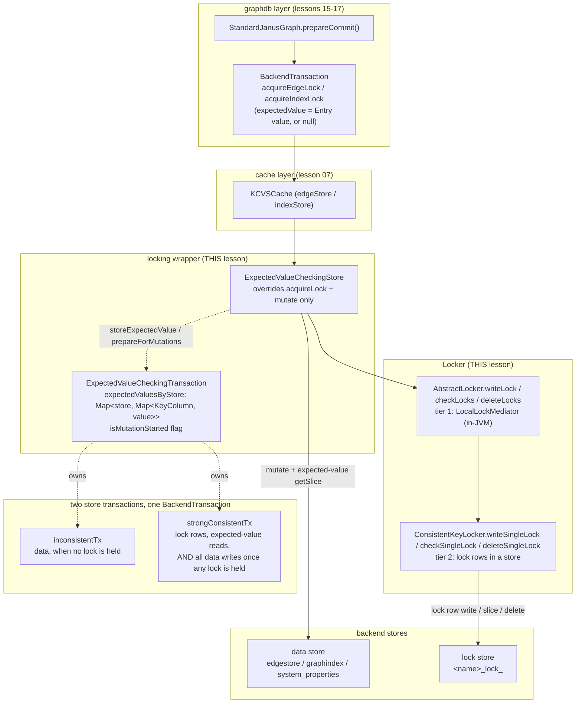
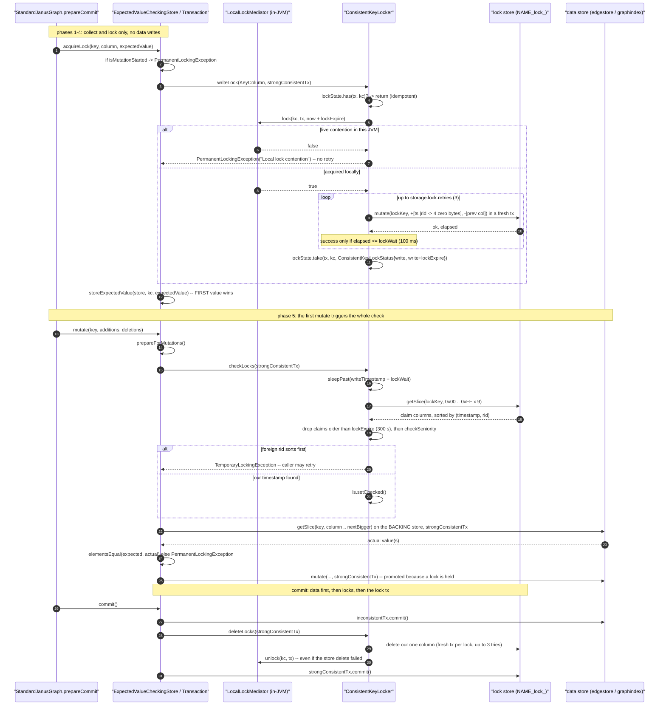

<!--
entry-meta
date: 2026-11-16
type: lesson
track: JanusGraph
lesson: 18
category: Database Internals
title: Locking — ExpectedValueCheckingStore and ConsistentKeyLocker
slug: janusgraph-locking-consistent-key-locker
-->

# Locking: `ExpectedValueCheckingStore` and `ConsistentKeyLocker`

**2026-11-16 · JanusGraph Track · Lesson 18 of 28**

> **Pin review (Part III/IV boundary, due this run).** `list_commits` on `JanusGraph/janusgraph`
> `master` returns `a59ae8d8` (2026-10-28, *"Restore 1.3.0-SNAPSHOT version CTR"*) as the tip, with
> `9a30ff14` (2026-10-28) and `5e3e7bc7` *JanusGraph release 1.2.0* (2026-10-24) behind it — the same
> three lesson 13 saw. **There is nothing to re-pin to; the pin stays at `a59ae8d8` and Part IV's byte
> offsets stay comparable with lessons 02–18.** Next review: the Part IV/V boundary, after lesson 22.

## Where This Fits

- **Lesson 17** finished the index write path: `IndexSerializer` generates `IndexUpdate`s,
  `prepareCommitAcquireIndexLocks` takes two passes over them (deletions first, then everything
  else), and uniqueness on a composite index is enforced by nothing but lesson 02's
  one-value-per-`(key, column)` contract. It left two debts: a **falsifiable conjecture** about
  `IndexMutationType.UPDATE` locking with expected value `null` against a cell that exists, and an
  **idempotence claim** derived only from `BackendTransaction`'s javadoc.
  ([lesson 17](../2026-11-15-janusgraph-index-serializer-graphindex-writes/README.md))
- **This lesson** opens `acquireLock` itself: the `ExpectedValueCheckingStore` wrapper, the
  two-transaction split that makes "strong consistency only when locking" possible, the on-disk lock
  row written by `ConsistentKeyLocker`, the write → sleep → read → seniority protocol, lock expiry and
  cleaning, and the exact knobs with their defaults. Both of lesson 17's debts are settled — one of
  them by **confirming the conjecture and correcting the backend lesson 17 proposed to reproduce it
  on**.
- **It sets up Part IV.** Lesson 19 opens the read path at `StandardVertex`/`CacheVertex` and the two
  cache tiers; the question it inherits is whether the lock-store writes and the graphindex mutations
  invalidate or write through `KCVSCache`. This lesson adds a second reason that question matters: the
  lock store is *another* store opened through the same wrapper stack, and it is not cached at all.

---

## 1. The shape of the thing: a wrapper, a manager, and a transaction that is really two

The locking layer is three collaborating classes plus a `Locker`. Nothing above it knows it exists;
`Backend` decides once, at construction, whether to splice it in.

| Class | Size | Role |
|---|---|---|
| `ExpectedValueCheckingStoreManager` | 5,134 B | `KCVSManagerProxy`; wraps each store it opens, pairs two backend transactions, **and advertises `locking(true)`** |
| `ExpectedValueCheckingStore` | 5,468 B | `KCVSProxy`; overrides exactly `acquireLock` and `mutate` |
| `ExpectedValueCheckingTransaction` | 11,347 B | holds the two transactions, remembers expected values, runs the pre-mutation check |
| `ConsistentKeyLocker` + `AbstractLocker` | 27,809 + 17,072 B | the two-tier lock protocol: in-JVM mediator, then lock rows in a store |

### 1.1 `Backend` splices it in by a single feature test

`Backend` is itself the `LockerProvider`
([`Backend.java:134`](https://github.com/JanusGraph/janusgraph/blob/a59ae8d8024207598eada34998d867617df51adf/janusgraph-core/src/main/java/org/janusgraph/diskstorage/Backend.java#L134)),
and the decision is four lines
([`:271-276`](https://github.com/JanusGraph/janusgraph/blob/a59ae8d8024207598eada34998d867617df51adf/janusgraph-core/src/main/java/org/janusgraph/diskstorage/Backend.java#L271-L276)):

```java
if (!storeFeatures.hasLocking()) {
    Preconditions.checkArgument(storeFeatures.isKeyConsistent(),"Store needs to support some form of locking");
    storeManagerLocking = new ExpectedValueCheckingStoreManager(storeManager,LOCK_STORE_SUFFIX,this,maxReadTime);
} else {
    storeManagerLocking = storeManager;
}
```

Three consequences, all load-bearing for the rest of the lesson:

- **`storeManagerLocking` is what opens every graph store** — `edgestore` and `graphindex`
  ([`:345-346`](https://github.com/JanusGraph/janusgraph/blob/a59ae8d8024207598eada34998d867617df51adf/janusgraph-core/src/main/java/org/janusgraph/diskstorage/Backend.java#L345-L346))
  and `system_properties`
  ([`:385`](https://github.com/JanusGraph/janusgraph/blob/a59ae8d8024207598eada34998d867617df51adf/janusgraph-core/src/main/java/org/janusgraph/diskstorage/Backend.java#L385)).
  So on a non-locking backend, *all three* are `ExpectedValueCheckingStore`s and all three get their
  own lock store.
- **The lock store's name is derived, not configured.** `LOCK_STORE_SUFFIX = "_lock_"`
  ([`:157`](https://github.com/JanusGraph/janusgraph/blob/a59ae8d8024207598eada34998d867617df51adf/janusgraph-core/src/main/java/org/janusgraph/diskstorage/Backend.java#L157)),
  and `ExpectedValueCheckingStoreManager.openDatabase` builds `store.getName() + lockStoreSuffix`,
  then asks the provider for a locker by that name. The stores are therefore `edgestore_lock_`,
  `graphindex_lock_`, `system_properties_lock_`.
- **`hasLocking()` becomes a lie, deliberately.** The wrapper's constructor is

  ```java
  this.storeFeatures = new StandardStoreFeatures.Builder(storeManager.getFeatures()).locking(true).build();
  ```

  so every `storeFeatures.hasLocking()` branch *above* `Backend` — the ones lesson 03 mapped — sees
  `true` on a store that has no native locking whatsoever. **That one flag flip is the answer to
  "how does uniqueness survive an eventually consistent store": the layer above is never told the
  store can't lock, because by the time it asks, it can.**

`getLocker` memoises per name in a `ConcurrentHashMap` with the usual `putIfAbsent`-then-reread idiom
([`:309-325`](https://github.com/JanusGraph/janusgraph/blob/a59ae8d8024207598eada34998d867617df51adf/janusgraph-core/src/main/java/org/janusgraph/diskstorage/Backend.java#L309-L325)),
and the registry of locker kinds is a two-entry unmodifiable map
([`:198-202`](https://github.com/JanusGraph/janusgraph/blob/a59ae8d8024207598eada34998d867617df51adf/janusgraph-core/src/main/java/org/janusgraph/diskstorage/Backend.java#L198-L202)):

| `storage.lock.backend` | Creator | Notes |
|---|---|---|
| `consistentkey` (default) | `CONSISTENT_KEY_LOCKER_CREATOR` ([`:185-196`](https://github.com/JanusGraph/janusgraph/blob/a59ae8d8024207598eada34998d867617df51adf/janusgraph-core/src/main/java/org/janusgraph/diskstorage/Backend.java#L185-L196)) | opens `lockerName` as a store, builds `ConsistentKeyLocker.Builder(...).fromConfig(configuration).build()` |
| `test` | `TEST_LOCKER_CREATOR` ([`:183`](https://github.com/JanusGraph/janusgraph/blob/a59ae8d8024207598eada34998d867617df51adf/janusgraph-core/src/main/java/org/janusgraph/diskstorage/Backend.java#L183)) | reflective `openLocker(String)` on `org.janusgraph.diskstorage.util.TestLockerManager` |

Anything else throws `JanusGraphConfigurationException` listing the two known names
([`:292-299`](https://github.com/JanusGraph/janusgraph/blob/a59ae8d8024207598eada34998d867617df51adf/janusgraph-core/src/main/java/org/janusgraph/diskstorage/Backend.java#L292-L299)).
There are exactly **two** lock backends in the tree, and one of them is for tests.

### 1.2 Which backends take which path

Read off the `StandardStoreFeatures.Builder` calls in each manager's constructor:

| Backend | `locking(…)` | `keyConsistent(…)` | Path taken |
|---|---|---|---|
| **in-memory** (`InMemoryStoreManager`) | *not called* → `false` | yes | **`ExpectedValueCheckingStoreManager` + `ConsistentKeyLocker`** |
| **BerkeleyJE** (`BerkeleyJEStoreManager`) | `locking(true)` | yes | native; wrapper never constructed |
| CQL / HBase | not read this run | — | expected to be the wrapper path (not verified here) |

**This is the most practically useful fact in the lesson, and it is not in the docs.** The in-memory
backend — the one already built in this track since lesson 01 — declares
`orderedScan/unorderedScan/keyOrdered/persists(false)/optimisticLocking(true)/optimizedWholeRowDeletion(true)/keyConsistent(...)`
and **never calls `.locking(...)`**. So `hasLocking()` is `false`, `isKeyConsistent()` is `true`, and
`Backend` wraps it. **Every in-memory JanusGraph exercises the whole `ConsistentKeyLocker` protocol,
lock rows and 100 ms sleeps included, in a store that does not even persist.** No Cassandra needed to
watch this layer work.

Conversely, BerkeleyJE's constructor sets `.locking(true)`, so on BerkeleyJE
`storeManagerLocking == storeManager` and `acquireLock` goes straight to the BerkeleyJE
key-value store — the two-tier native locking lesson 05 read. **Lesson 17's Hands-On B proposed
breaking on `prepareCommitAcquireIndexLocks` under BerkeleyJE to test its conjecture. That
reproduction could not have worked: on BerkeleyJE none of this file's code runs.** Corrected in
§6 below.

### 1.3 One backend transaction is two store transactions

`ExpectedValueCheckingStoreManager.beginTransaction` begins the underlying manager's transaction
**twice**:

```java
StoreTransaction inconsistentTx = manager.beginTransaction(configuration);
Configuration customOptions = new MergedConfiguration(storeFeatures.getKeyConsistentTxConfig(), configuration.getCustomOptions());
BaseTransactionConfig consistentTxCfg = new StandardBaseTransactionConfig.Builder(configuration).customOptions(customOptions).build();
StoreTransaction strongConsistentTx = manager.beginTransaction(consistentTxCfg);
return new ExpectedValueCheckingTransaction(inconsistentTx, strongConsistentTx, maxReadTime);
```

- `inconsistentTx` — "No guarantees about consistency strength" (field javadoc). Normal client data.
- `strongConsistentTx` — the same manager, with `getKeyConsistentTxConfig()` merged **under** the
  caller's own custom options (so a caller's explicit option wins). This is the quorum-or-better
  transaction, and it is used for **three** different things: writing lock rows, reading lock rows,
  and reading the expected values.
- `maxReadTime` is `storage.read-time`, default **10 s**
  ([`GraphDatabaseConfiguration:801-804`](https://github.com/JanusGraph/janusgraph/blob/a59ae8d8024207598eada34998d867617df51adf/janusgraph-core/src/main/java/org/janusgraph/graphdb/configuration/GraphDatabaseConfiguration.java#L801-L804)).

The switch between them is made **per mutation, by whether the transaction holds any lock at all**,
in both `ExpectedValueCheckingStore.mutate` and `ExpectedValueCheckingStoreManager.mutateMany`:

```java
boolean hasAtLeastOneLock = etx.prepareForMutations();
if (hasAtLeastOneLock) {
    // Force all mutations on this transaction to use strong consistency
    store.mutate(key, additions, deletions, getConsistentTx(txh));
} else {
    store.mutate(key, additions, deletions, unwrapTx(txh));
}
```

So the consistency level of the *data* writes is decided by the presence of locks, not by
configuration: **one locked property key promotes every write in that transaction to the
key-consistent transaction**, including writes to unrelated vertices in the same commit. That is the
price of `ConsistencyModifier.LOCK` that nothing in the docs states numerically, and it is
all-or-nothing per transaction.

And `prepareForMutations` returns `!expectedValuesByStore.isEmpty()` — the map is populated by
`storeExpectedValue`, which is reached only from the `locker != null` branch of `acquireLock`. A
*failed* lock attempt therefore never promotes the transaction, because the failure throws before
`storeExpectedValue`.



---

## 2. `acquireLock` is a *promise*, not a check

The whole mechanism turns on the fact that `acquireLock` does not read the data cell. It writes a
lock claim and files the expected value away for later:

```java
public void acquireLock(StaticBuffer key, StaticBuffer column, StaticBuffer expectedValue, StoreTransaction txh) throws BackendException {
    if (locker != null) {
        ExpectedValueCheckingTransaction tx = (ExpectedValueCheckingTransaction) txh;
        if (tx.isMutationStarted())
            throw new PermanentLockingException("Attempted to obtain a lock after mutations had been persisted");
        KeyColumn lockID = new KeyColumn(key, column);
        log.debug("Attempting to acquireLock on {} ev={}", lockID, expectedValue);
        locker.writeLock(lockID, tx.getConsistentTx());
        tx.storeExpectedValue(this, lockID, expectedValue);
    } else {
        store.acquireLock(key, column, expectedValue, unwrapTx(txh));
    }
}
```

Points that matter:

- **`locker == null` is a live branch.** `getLocker` never returns null for the `consistentkey`
  creator, but the constructor takes any `Locker`, and `LockKeyColumnValueStoreTest` constructs
  `new ExpectedValueCheckingStore(store[i], c)` directly. With a null locker the wrapper degrades to
  a pass-through that hands the raw `expectedValue` to the backing store's own `acquireLock`.
- **Locks are a strict prefix of the transaction.** `isMutationStarted` is set in
  `mutationStarted()`, called from `prepareForMutations()` on the first `mutate`/`mutateMany`, and is
  "true forever after" (field javadoc). Attempting a lock afterwards is a `PermanentLockingException`
  — not temporary, so lesson 07's `BackendOperation` backoff will not retry it. This is precisely why
  `prepareCommit`'s phases 1–4 must finish collecting *and locking* before phase 5 writes anything
  (lesson 16).
- **The expected value is remembered verbatim, including `null`.** `null` means *this cell must not
  exist*.

### 2.1 First writer wins: the idempotence rule, confirmed twice

Lesson 17 took the "all but the first invocation are ignored" claim from `BackendTransaction`'s
javadoc. It is implemented by **two independent mechanisms**, and both are needed:

1. **The lock itself** — `AbstractLocker.writeLock` opens with

   ```java
   if (lockState.has(tx, lockID)) {
       log.debug("Transaction {} already wrote lock on {}", tx, lockID);
       return;
   }
   ```

   `LockerState.has` is a `containsKey` on the per-transaction `Map<KeyColumn, S>`, held in a
   `MapMaker().concurrencyLevel(8).weakKeys()` map keyed on the `StoreTransaction` **by identity**.
   So no second lock row is written.
2. **The expected value** — `ExpectedValueCheckingTransaction.storeExpectedValue`:

   ```java
   if (m.containsKey(lockID)) {
       log.debug("Multiple expected values for {}: keeping initial value {} and discarding later value {}", lockID, m.get(lockID), value);
   } else {
       m.put(lockID, value);
   }
   ```

   The *first* expected value wins and later ones are dropped. The method's own javadoc explains why
   in unusually candid terms: *"In testing, it seems JanusGraph's graphdb requires that
   implementations discard the second expectedValue."*

**This is what makes lesson 16's "deletions first" ordering load-bearing.** A transaction that moves
a unique value from element A to element B emits a deletion lock on `(key, column)` with expected
value = the old entry's **value bytes**, and then an addition lock on the *same* `(key, column)` with
expected value **`null`**. Pass 1 runs first, so the remembered expected value is the old value — the
cell as it actually exists — and the check passes. Had the passes been ordered the other way, the
remembered expected value would be `null` against an existing cell and **every such hand-off would
fail**. The two-pass order in
[`StandardJanusGraph:1080-1097`](https://github.com/JanusGraph/janusgraph/blob/a59ae8d8024207598eada34998d867617df51adf/janusgraph-core/src/main/java/org/janusgraph/graphdb/database/StandardJanusGraph.java#L1080-L1097)
is not a cosmetic choice; it is the only ordering that works, and the mechanism that makes it work
lives in a `containsKey` check two layers down. The javadoc comment on the method is one word long
("*deletions first*"); this is what it is protecting.

Both halves are covered by a real test — `transactionMayReenterLock` in
`LockKeyColumnValueStoreTest` locks `(k, c1)` three times, then mutates and commits.

### 2.2 `prepareForMutations`: three steps, once per transaction

```java
boolean prepareForMutations() throws BackendException {
    if (!isMutationStarted()) {
        checkAllLocks();
        checkAllExpectedValues();
        mutationStarted();
    }
    return !expectedValuesByStore.isEmpty();
}
```

- `checkAllLocks()` iterates the stores, skips any with a null locker (*"Ignore locks on stores
  without a locker"*), and calls `locker.checkLocks(lt)` with the **consistent** transaction.
- `checkAllExpectedValues()` iterates stores → `KeyColumn`s → `checkSingleExpectedValue`.
- Order is fixed and significant: **no expected value is read until every lock has been confirmed
  held.**

Note that `checkAllLocks` iterates `expectedValuesByStore.keySet()` — the map whose keys are the
*stores locked on* — and `checkLocks(tx)` then checks every lock that transaction holds **in that
locker**. Because lockers are per lock-store name and the map is per store, each locker's
`checkLocks` is called once per store. `testLocksOnMultipleStores` in the suite pins this with
EasyMock: six stores, locks on four of them, and exactly `numStores / 3 * 2` = **4**
`writeLock` calls and **4** `checkLocks` calls.

### 2.3 The expected-value check is a one-column slice plus an exact-match filter

`checkSingleExpectedValueUnsafe` is the whole comparison:

```java
final StaticBuffer nextBuf = BufferUtil.nextBiggerBuffer(kc.getColumn());
KeySliceQuery ksq = new KeySliceQuery(kc.getKey(), kc.getColumn(), nextBuf);
Iterable<Entry> actualEntries = store.getBackingStore().getSlice(ksq, strongConsistentTx);
```

- It reads through `getBackingStore()` — **not** through the `KCVSCache` above it and not through the
  wrapper — with the **strong-consistent** transaction. Lesson 19's cache question does not touch this
  read; it bypasses the cache by construction.
- `nextBiggerBuffer` increments the column with carry and **throws `IllegalArgumentException` on
  overflow** (`BufferUtil.nextBiggerBuffer(buffer, false)`). An all-`0xFF` column would therefore blow
  up here rather than returning a half-open range — unreachable for real index columns (which start
  with `0x00`), but it is the reason the method exists in the non-overflow variant.
- The slice is then filtered for columns that `equals` the target exactly, because *"it's possible
  that the slice returned columns for which `kc.getColumn()` is a prefix"* — the backend's slice is
  half-open on bytes, not on logical columns.
- Finally:

  ```java
  expectedValues = (null == ev) ? Collections.emptyList() : Collections.singletonList(ev);
  if (!Iterables.elementsEqual(expectedValues, actualValues)) throw new PermanentLockingException(...);
  ```

  **`elementsEqual` on an empty expected list is the "must not exist" semantics**, and it is
  symmetric: expected-but-absent and absent-but-expected both throw the same
  `PermanentLockingException`. Keep that symmetry in mind for §6.
- The whole thing runs inside `BackendOperation.executeDirect(..., maxReadTime)` with
  `toString()` = `"ExpectedValueChecking"` — so it gets lesson 07's retry/backoff against the 10 s
  read budget, and that string is what shows up in the retry logs.

---

## 3. `AbstractLocker`: tier one is an in-JVM map, and losing it is fatal

`AbstractLocker<S extends LockStatus>` implements the three `Locker` methods and leaves
`writeSingleLock` / `checkSingleLock` / `deleteSingleLock` abstract. Its own contribution is the
`LocalLockMediator` tier and the metrics.

`writeLock`, in order: metric counter → `lockState.has` early return (§2.1) → `lockLocally` →
`writeSingleLock` → update the local expiry to the remote status's expiry → `lockState.take`. On
any failure, `unlockLocally` in a `finally`.

```java
} else {
    // Fail immediately with no retries on local contention
    throw new PermanentLockingException("Local lock contention");
}
```

**Two threads in the same JVM contending for the same `(key, column)` get a `PermanentLockingException`
with no retry. Two threads in different JVMs get a `TemporaryLockingException` from
`checkSeniority` and are retried.** The exception classes say exactly this in their javadocs —
`PermanentLockingException extends PermanentBackendException` ("*will not go away on retries unless a
machine modifies the underlying lock state*"), `TemporaryLockingException extends
TemporaryBackendException` ("*might disappear if the request is retried*") — and the asymmetry is
backwards from what you would want: in-process contention is the case the process could trivially
resolve by waiting, and it is the one treated as unrecoverable. The suite acknowledges the ambiguity
rather than pinning it: `testLocalLockContention` asserts only
`e instanceof PermanentLockingException || e instanceof TemporaryLockingException`.

(A pleasing detail: both exception classes carry the identical
`serialVersionUID = 482890657293484420L`. Harmless — different classes — but unmistakably
copy-pasted.)

### 3.1 `LocalLockMediator` is a `ConcurrentHashMap` with lazy expiry and no sweeper

`LocalLockMediator<T>.lock(kc, requester, expires)` is a four-way branch on
`locks.putIfAbsent(kc, audit)`:

| `inMap` | Branch | Result |
|---|---|---|
| `null` | uncontended | `true`, lock created |
| `inMap.equals(audit)` | same holder | `locks.replace` to extend expiry; `true` if the CAS wins |
| `inMap.expires < now` | stale claim | `locks.replace` to steal it; `true` if the CAS wins |
| otherwise | live contention | `false` → `PermanentLockingException` above |

`AuditRecord.equals`/`hashCode` **depend only on `holder`**, not on `expires` — which is what makes
both the extend-expiry branch and `unlock`'s `locks.remove(kc, new AuditRecord<>(requester, null, null))`
work at all. Re-entrance is explicitly *not* counted: the javadoc states *"One `#unlock()` call is
enough, no matter how many times a `requester` called `lock` beforehand."*

**There is no expiry sweep.** An entry leaves the map only via `unlock`, or by being overwritten in
the stale branch by *another* requester for the same `KeyColumn`. A transaction that dies without
rollback leaves its `KeyColumn` resident until someone else contends for it. The leak is bounded by
the number of distinct locked `(key, column)` pairs, and the mediators are process-global and shared
by name through `LocalLockMediators.INSTANCE` (`storage.lock.local-mediator-group`,
[`GraphDatabaseConfiguration:989-996`](https://github.com/JanusGraph/janusgraph/blob/a59ae8d8024207598eada34998d867617df51adf/janusgraph-core/src/main/java/org/janusgraph/graphdb/configuration/GraphDatabaseConfiguration.java#L989-L996)
— `LOCAL`, `String`, **no default**, generated at startup, *"Overriding the default is generally only
useful in testing"*). The test suite does exactly that: it sets the group to
`concreteClassName + i` to fake eight distinct "hosts" inside one JVM, and calls
`LocalLockMediators.INSTANCE.clear(...)` in `setUp`.

Also worth noting: the mediator records a **full stack trace** of the acquiring call
(`new Throwable("Lock acquisition by " + requester).getStackTrace()`) — but only when
`log.isTraceEnabled()`, so it costs nothing in production and is a gift when debugging contention.

### 3.2 The metrics for `check` and `delete` count the wrong thing

`AbstractLocker` defines six metric name parts: `M_LOCKS`, `M_WRITE`, `M_CHECK`, `M_DELETE`,
`M_CALLS`, `M_EXCEPTIONS`. `writeLock`'s failure path does the right thing:

```java
MetricManager.INSTANCE.getCounter(..., M_LOCKS, M_WRITE, M_EXCEPTIONS).inc();
```

`checkLocks`'s `finally` and `deleteLocks`'s `catch` both do this instead:

```java
if (!ok && null != tx.getConfiguration().getGroupName()) {
    MetricManager.INSTANCE.getCounter(..., M_LOCKS, M_CHECK, M_CALLS).inc();   // checkLocks
}
...
MetricManager.INSTANCE.getCounter(..., M_LOCKS, M_DELETE, M_CALLS).inc();      // deleteLocks
```

So `locks.check.exceptions` and `locks.delete.exceptions` are **never emitted at all** — `M_EXCEPTIONS`
has exactly one use site in the class — and `locks.check.calls` / `locks.delete.calls` are
**double-incremented on failure**, which makes the only two meters that exist unusable as either a
call count or an error count. Logged as **PR candidate 34**.

---

## 4. `ConsistentKeyLocker`: the on-disk protocol, byte for byte

The class javadoc
([`:92-121`](https://github.com/JanusGraph/janusgraph/blob/a59ae8d8024207598eada34998d867617df51adf/janusgraph-core/src/main/java/org/janusgraph/diskstorage/locking/consistentkey/ConsistentKeyLocker.java#L92-L121))
states the protocol as seven steps. The code matches it, with one documentation discrepancy noted
below.

### 4.1 The lock row

`ConsistentKeyLockerSerializer` is 61 lines and three methods. The layouts are exact:

```
lock key   = toLockKey(dataKey, dataColumn)
           = [ 4-byte big-endian int: dataKey.length() ] ++ dataKey ++ dataColumn
             (WriteByteBuffer(key.length() + column.length() + 4); b.putInt(key.length()))

lock column = toLockCol(ts, rid, provider)
           = [ 8-byte big-endian long: provider.getTime(ts) ] ++ rid
             (WriteByteBuffer(rid.length() + 8); b.putLong(...))

lock value  = ConsistentKeyLocker.zeroBuf = BufferUtil.getIntBuffer(0)
           = 4 bytes 0x00 0x00 0x00 0x00
```

Worked example, for a unique property on a default graph (lessons 08 and 10 for the operands): the
data key is the 8-byte edgestore row key, so the lock key opens with the literal bytes
`00 00 00 08`, followed by those 8 bytes, followed by the relation's column. A 3-byte column gives a
15-byte lock key. `rid` is the UTF-8 encoding of `graph.unique-instance-id`, which by default is
*"hostname, process id, and a static (process-wide) counter"* concatenated
([`GraphDatabaseConfiguration:150-155`](https://github.com/JanusGraph/janusgraph/blob/a59ae8d8024207598eada34998d867617df51adf/janusgraph-core/src/main/java/org/janusgraph/graphdb/configuration/GraphDatabaseConfiguration.java#L150-L155)) —
so a ~16-byte rid gives a 24-byte lock column.

**Two documentation defects in the protocol javadoc, both verified against the code:**

1. It says the column holds *"the approximate current timestamp in **nanoseconds**"*. The provider is
   whatever `graph.timestamps` resolves to, defaulted **`TimestampProviders.MICRO`** and `FIXED`
   ([`GraphDatabaseConfiguration:148`](https://github.com/JanusGraph/janusgraph/blob/a59ae8d8024207598eada34998d867617df51adf/janusgraph-core/src/main/java/org/janusgraph/graphdb/configuration/GraphDatabaseConfiguration.java#L148)).
   `AbstractLocker.Builder` does default `times` to `TimestampProviders.NANO`, but
   `ConsistentKeyLocker.Builder.fromConfig` overwrites it with `times(config.get(TIMESTAMP_PROVIDER))`
   ([`:240`](https://github.com/JanusGraph/janusgraph/blob/a59ae8d8024207598eada34998d867617df51adf/janusgraph-core/src/main/java/org/janusgraph/diskstorage/locking/consistentkey/ConsistentKeyLocker.java#L240)),
   and `Backend` always builds via `fromConfig`. **In the default configuration a lock column carries
   microseconds, not nanoseconds** — which also means two claims written inside the same microsecond
   are indistinguishable by timestamp.
2. It says the value is *"the single byte 0"*. `zeroBuf = BufferUtil.getIntBuffer(0)`
   ([`:152`](https://github.com/JanusGraph/janusgraph/blob/a59ae8d8024207598eada34998d867617df51adf/janusgraph-core/src/main/java/org/janusgraph/diskstorage/locking/consistentkey/ConsistentKeyLocker.java#L152)),
   and `BufferUtil.getIntBuffer(int)` allocates `intSize` and asserts the array length — **4 bytes**.
   The line even carries `// TODO this does not belong here`.

Logged together as **PR candidate 36** (documentation only; the wire format is self-consistent).

### 4.2 Why the slice bounds are 1 byte and 9 bytes

```java
public static final StaticBuffer LOCK_COL_START = BufferUtil.zeroBuffer(1);   // 0x00
public static final StaticBuffer LOCK_COL_END   = BufferUtil.oneBuffer(9);    // 0xFF x 9
```

The 27-line comment above them
([`:154-180`](https://github.com/JanusGraph/janusgraph/blob/a59ae8d8024207598eada34998d867617df51adf/janusgraph-core/src/main/java/org/janusgraph/diskstorage/locking/consistentkey/ConsistentKeyLocker.java#L154-L180))
is the best piece of reasoning in the file, and it is an argument about **UTF-8**, not about
timestamps:

- A lock column is ≥ 9 bytes (8 timestamp + ≥1 rid). A 1-byte start bound sorts before any of them
  purely by length.
- The end bound cannot rely on the timestamp, because `System.nanoTime()` *"may go negative"* by
  contract, so an all-ones timestamp is not safely unreachable.
- But the 9th byte is the **first byte of the rid**, and the rid is `String.getBytes` under UTF-8,
  where `0xFF` is **not a legal byte**. So `0xFF × 9` is guaranteed to sort after every real lock
  column — *"This is why `LOCK_END_COL` is exactly 9 bytes long."*

That is a correctness argument resting on an encoding invariant two abstraction layers away, and it
is the kind of thing that only survives because someone wrote it down. (Note the comment calls the
constant `LOCK_END_COL` while the field is `LOCK_COL_END`.)

### 4.3 Write: `writeSingleLock`

```java
for (int i = 0; i < lockRetryCount; i++) {
    WriteResult wr = tryWriteLockOnce(lockKey, oldLockCol, txh);
    if (wr.isSuccessful() && wr.getDuration().compareTo(lockWait) <= 0) {
        return new ConsistentKeyLockStatus(wr.getWriteTimestamp(), wr.getWriteTimestamp().plus(lockExpire));
    }
    oldLockCol = wr.getLockCol();
    handleMutationFailure(lockID, lockKey, wr, txh);
}
tryDeleteLockOnce(lockKey, oldLockCol, txh);
throw new TemporaryBackendException("Lock write retry count exceeded");
```

- **A slow success is a failure.** The write must complete *within* `lockWait`
  (`storage.lock.wait-time`, MASKABLE, default **100 ms**,
  [`GraphDatabaseConfiguration:947-952`](https://github.com/JanusGraph/janusgraph/blob/a59ae8d8024207598eada34998d867617df51adf/janusgraph-core/src/main/java/org/janusgraph/graphdb/configuration/GraphDatabaseConfiguration.java#L947-L952)).
  A write that succeeds in 150 ms is retried with a *new* timestamp and the previous column queued for
  deletion. The reason is the protocol's safety argument: a claim whose write took longer than the
  wait window cannot be distinguished from a claim that another process has not yet seen.
- Each attempt is its own backend transaction. `tryWriteLockOnce` calls
  `overrideTimestamp(txh, writeTimer.getStartTime())`, which does
  `manager.beginTransaction(new StandardBaseTransactionConfig.Builder(tx.getConfiguration()).commitTime(commitTime).build())`,
  mutates, **commits that transaction**, and rolls it back in a `finally` if anything escaped.
  Pinning the commit timestamp to the measured start time is what makes the stored column's
  timestamp and the status's `writeTimestamp` the same instant.
- The add and the delete of the previous attempt's column go in the **same** `mutate` call
  (`Collections.singletonList(newLockEntry)`, `Collections.singletonList(del)`) — so lesson 02's
  additions-after-deletions rule applies, and a retry never leaves two live claims from one process.
- `handleMutationFailure` splits on the throwable: `TemporaryBackendException` → warn and continue the
  loop; anything else → best-effort delete, log, **rethrow without consuming remaining retries**. A
  `null` throwable with a too-slow duration is just a warning.
- Exhausting the retries throws `TemporaryBackendException("Lock write retry count exceeded")` —
  deliberately *Temporary*, so the caller's `BackendOperation` may retry the whole operation.
  `storage.lock.retries` is MASKABLE, default **3**
  ([`:943-945`](https://github.com/JanusGraph/janusgraph/blob/a59ae8d8024207598eada34998d867617df51adf/janusgraph-core/src/main/java/org/janusgraph/graphdb/configuration/GraphDatabaseConfiguration.java#L943-L945)).

### 4.4 Check: `checkSingleLock`

```java
if (ls.isChecked()) return;
final Instant now = times.sleepPast(ls.getWriteTimestamp().plus(lockWait));
KeySliceQuery ksq = new KeySliceQuery(serializer.toLockKey(kc.getKey(), kc.getColumn()), LOCK_COL_START, LOCK_COL_END);
List<Entry> claimEntries = getSliceWithRetries(ksq, tx);
```

- `ConsistentKeyLockStatus.checked` is a mutable one-way flag, set at the end of a successful check.
  So within one transaction a lock is verified **at most once**, no matter how many `mutate` calls
  follow — though `prepareForMutations` already guarantees that via `isMutationStarted`.
- **The sleep is the cost.** `sleepPast(writeTimestamp + lockWait)` means the claim must be at least
  `lockWait` old before it may be read. The sleeps are per lock and `checkLocks` iterates a
  `HashMap`'s `entrySet()` in arbitrary order, so the *total* wall-clock wait is
  `max(writeTimestamp) + lockWait − now`, not the sum — roughly **one 100 ms stall per locking
  transaction**, independent of the number of locks. The `// We could be smarter about sleeping by
  iterating oldest -> latest...` TODO at
  [`:446-447`](https://github.com/JanusGraph/janusgraph/blob/a59ae8d8024207598eada34998d867617df51adf/janusgraph-core/src/main/java/org/janusgraph/diskstorage/locking/consistentkey/ConsistentKeyLocker.java#L446-L447)
  would not actually change that total, since any order ends at the same maximum.
- `getSliceWithRetries` loops `lockRetryCount` times, converting `PermanentBackendException` into
  `PermanentLockingException` immediately and retrying only `TemporaryBackendException`. Its own TODO
  notes that it and `writeSingleLock` handle throwables inconsistently — one catches `Throwable`, the
  other only the two `BackendException` subtypes.
- Expired claims are dropped by `tr.getTimestamp().isBefore(now.minus(lockExpire))`, each with a
  `log.warn`, and each one optionally enqueues the cleaner (§4.6). **If the expired claim is our own**
  — `rid.equals(tr.getRid()) && ls.getWriteTimestamp().equals(tr.getTimestamp())` — it throws
  `ExpiredLockException` naming the config path of `storage.lock.expiry-time`, with a self-aware
  comment: *"Really shouldn't refer to GDC.LOCK_EXPIRE here, but this will typically be accurate in a
  real use case."*

### 4.5 Seniority: the actual mutual-exclusion rule

```java
for (TimestampRid tr : claimTRs) {
    trCount++;
    if (!rid.equals(tr.getRid())) throw new TemporaryLockingException("Lock on " + target + " already held by " + tr.getRid() + " (we are " + rid + ")");
    if (tr.getTimestamp().equals(ls.getWriteTimestamp())) return;   // we hold it
    log.warn("Skipping outdated lock on {} with our rid ({}) but mismatched timestamp ...");
}
if (0 == trCount) throw new TemporaryLockingException("No lock columns found for " + target);
else throw new PermanentBackendException("Read " + trCount + " locks with our rid " + rid + " but mismatched timestamps; ...");
```

The entries arrive **sorted by column**, i.e. by `(timestamp, rid)` — the store's own ordering is the
only tie-break mechanism in the protocol. The rule is therefore exactly the javadoc's step 6: *we hold
the lock iff our column is the first unexpired column, or is preceded only by columns with our own
`rid`.* Note what that means in practice:

- **Earliest write wins**, decided by a clock that is *not* synchronised by anything in the code.
  The docs say the plainest version of this: the implementation *"requires that clocks are
  synchronized across all machines in the cluster."* With `MICRO` resolution and no fencing, clock
  skew across instances directly re-orders lock grants.
- A foreign `rid` in front of ours is `Temporary` → the caller retries.
- Our own older-but-mismatched columns are *skipped with a warning*, which is how the retry loop's
  abandoned columns are tolerated.
- `trCount == 0` is also `Temporary`; the two failure comments at
  [`:527-545`](https://github.com/JanusGraph/janusgraph/blob/a59ae8d8024207598eada34998d867617df51adf/janusgraph-core/src/main/java/org/janusgraph/diskstorage/locking/consistentkey/ConsistentKeyLocker.java#L527-L545)
  name the two causes: the store lost a write (*"With Cassandra, for instance, this problem could
  arise if the locker is configured to talk to Cassandra at a consistency level below QUORUM"*), or
  our lock expired before we read it.

### 4.6 Delete, release order, and the cleaner

`deleteSingleLock` deletes exactly one column — `toLockCol(ls.getWriteTimestamp(), rid, times)` —
looping up to `lockRetryCount` times, **each iteration in a fresh transaction** via
`overrideTimestamp(tx, times.getTime())` + `commit()`. A `TemporaryBackendException` retries; any
other `BackendException` logs and gives up (*"give up on this lock"*), leaving the row to expire.

`AbstractLocker.deleteLocks` is the only caller, and it removes the lock from the local mediator
**regardless** of whether the store delete succeeded — *"Regardless of whether we successfully deleted
the lock from storage, take it out of the local mediator"* — then `iterator.remove()`s it from
`LockerState`.

Release order at the top is deliberate, in `ExpectedValueCheckingTransaction`:

```java
public void commit() throws BackendException {
    inconsistentTx.commit();
    deleteAllLocks();
    strongConsistentTx.commit();
}
public void rollback() throws BackendException {
    deleteAllLocks();
    inconsistentTx.rollback();
    strongConsistentTx.rollback();
}
```

**Locks are released after the data commit and before the lock transaction commits; on rollback they
are released first.** Note that `deleteAllLocks` calls `s.deleteLocks(this)` for every store in
`expectedValuesByStore`, and `ExpectedValueCheckingStore.deleteLocks` dereferences `locker`
**without a null check** — while `checkAllLocks` explicitly skips null lockers. Unreachable today,
because only the `locker != null` branch populates the map, but the two methods disagree about
whether a null locker is possible and one of them is dead code either way (**PR candidate 37**).

Cleaning expired rows is **reactive and off by default**:

- `storage.lock.clean-expired` is MASKABLE, default **false**
  ([`GraphDatabaseConfiguration:975-977`](https://github.com/JanusGraph/janusgraph/blob/a59ae8d8024207598eada34998d867617df51adf/janusgraph-core/src/main/java/org/janusgraph/graphdb/configuration/GraphDatabaseConfiguration.java#L975-L977)),
  and only `fromConfig` → `standardCleaner()` wires one up.
- There is **no periodic sweep**. The only trigger is a `checkSingleLock` that happens to read an
  expired claim. An expired lock row on a `(key, column)` nobody locks again is never deleted.
- `StandardLockCleanerService` guards against stampedes with a Caffeine `expireAfterWrite` map keyed
  by `KeyColumn` and a **hard-coded 30 s** cooldown, on a `ThreadPoolExecutor(0, 1, 5s, LinkedBlockingQueue)`
  of daemon threads named `LockCleaner-%d`. One cleaner thread, unbounded queue.
- `StandardLockCleanerRunnable` re-slices `LOCK_COL_START..LOCK_COL_END` (with its own
  `// TODO reduce LOCK_COL_END based on cutoff`), deletes every column strictly before the cutoff, and
  swallows `BackendException` with a warning. Its log line says *"before or at cutoff"* while the
  predicate is `isBefore(cutoff)`.
- **It is handed the caller's `StoreTransaction` and runs on another thread**, so it can touch a
  transaction its owner has already committed. The class javadoc owns this: *"This implementation is
  'best-effort.' If the store or transaction closes in the middle of its operation ... it will fail
  without retrying and log the exception."* Accepted, not accidental — but it is one more reason the
  default is `false`.



---

## 5. The knobs, with their real defaults and types

All from `GraphDatabaseConfiguration`, namespace `storage.lock`
([`:937-996`](https://github.com/JanusGraph/janusgraph/blob/a59ae8d8024207598eada34998d867617df51adf/janusgraph-core/src/main/java/org/janusgraph/graphdb/configuration/GraphDatabaseConfiguration.java#L937-L996)),
plus the two that reach in from outside:

| Option | Type | Default | Read by | Effect |
|---|---|---|---|---|
| `storage.lock.retries` | MASKABLE | **3** | `writeSingleLock`, `getSliceWithRetries`, `deleteSingleLock` | attempts per lock write, per lock read, per lock delete |
| `storage.lock.wait-time` | MASKABLE | **100 ms** | `writeSingleLock` success test, `checkSingleLock` sleep | the "is this write fast enough" bound **and** the pre-read quiet period |
| `storage.lock.expiry-time` | **GLOBAL_OFFLINE** | **300 000 ms (5 min)** | `AbstractLocker.lockLocally`, `checkSingleLock` cutoff | claim lifetime, in both tiers |
| `storage.lock.clean-expired` | MASKABLE | **false** | `Builder.fromConfig` → `standardCleaner()` | whether expired rows are ever deleted |
| `storage.lock.backend` | **GLOBAL_OFFLINE** | `"consistentkey"` | `Backend` constructor | one of exactly two registered names |
| `storage.lock.local-mediator-group` | LOCAL | *(none; generated)* | `Builder.fromConfig` | which `LocalLockMediator` instance this locker shares |
| `graph.unique-instance-id` | LOCAL | *(none; hostname + pid + counter)* | `Builder.fromConfig` → `rid` | the bytes after the timestamp in every lock column |
| `graph.timestamps` | **FIXED** | `MICRO` | `Builder.fromConfig` → `times` | resolution of every lock timestamp |
| `storage.read-time` | MASKABLE | **10 s** | `ExpectedValueCheckingStoreManager` ctor | budget for each expected-value read |

Three things fall out of the *types*, not the values:

- `storage.lock.expiry-time` is **GLOBAL_OFFLINE**: it cannot be changed while any instance is open,
  which is right, because the two tiers and every instance must agree on when a claim dies.
  `storage.lock.wait-time` is only MASKABLE, and its own description pleads for discipline: *"Although
  this value is maskable, it is highly recommended to use the same value across JanusGraph instances
  in production environments."* A per-instance `wait-time` directly breaks the protocol's "write
  faster than the quiet period" argument.
- `storage.lock.backend` being GLOBAL_OFFLINE but living in the row that lesson 14 dissected means
  it is read from `system_properties` — a store that is itself opened through
  `storeManagerLocking`.
- Every default is tuned for a distributed store and none of them is relaxed for a local one. The
  in-memory backend pays the full 100 ms.

### 5.1 Cost, counted

For a transaction that locks **N** distinct `(key, column)` pairs on a non-locking backend:

| Operation | Count | Transactions |
|---|---|---|
| lock row write | N (≥ N on retry) | **N fresh backend transactions**, each committed |
| quiet-period sleep | 1 (≈ `lockWait`, 100 ms) | — |
| lock row slice read | N | the shared `strongConsistentTx` |
| expected-value read | N | the shared `strongConsistentTx`, on the backing store, cache bypassed |
| data writes | as usual | promoted to `strongConsistentTx` |
| lock row delete | N | **N more fresh backend transactions**, each committed |

So **2N + 1 extra backend transactions, 2N extra round trips, and a ~100 ms floor** on commit
latency. That is the number behind the docs' *"In the interest of efficiency, JanusGraph does not use
locking by default"* and *"it is suggested to use locking-based consistency constraints sparingly
with eventually consistent storage backends."* It is also why lesson 16's finding that an addition
whose endpoint `isNew()` takes **no** lock matters so much: bulk-inserting fresh vertices skips all of
it.

### 5.2 The one true compare-and-set: `KCVSConfiguration.set`

Lesson 14 promised this as the simplest entry point, and it is — `acquireLock` and `mutate` inside a
single retried callable:

```java
BackendOperation.execute(new BackendOperation.Transactional<Boolean>() {
    public Boolean call(StoreTransaction txh) throws BackendException {
        if (checkExpectedValue) store.acquireLock(rowKey,column,expectedValueBuffer,txh);
        store.mutate(rowKey, additions, deletions, txh);
        return true;
    }
    public String toString() { return "setConfiguration"; }
}, txProvider, times, maxOperationWaitTime);
```

- `set(key, value, expectedValue)` delegates to `set(key, value, expectedValue, true)`; the
  `WriteConfiguration` override `set(key, value)` passes `false` and so takes **no lock at all**.
- `expectedValueBuffer` is `null` when `expectedValue` is null **even with `checkExpectedValue`
  true** — so "create only if absent" is expressible, and it is the same `null` that means "must not
  exist" three layers down.
- `value == null` is the deletion path, so `remove(key)` → `set(key, null)` → `checkExpectedValue`
  false: **removing a config property is never a compare-and-set.**
- `maxOperationWaitTime` is a field initialised to **10 000 ms** and mutable via
  `setMaxOperationWaitTime`, not a config option.
- Because the lock and the mutate share `txh`, `ExpectedValueCheckingStore.mutate` →
  `prepareForMutations()` runs the full §2.2 sequence before the write. **One config property set
  therefore costs the entire §5.1 protocol with N = 1**: ~100 ms, four round trips, three
  transactions. And since it is inside `BackendOperation.execute`, a `TemporaryLockingException`
  (lost race) is retried with lesson 07's backoff while a `PermanentLockingException` (mismatch, or
  local contention) is not.

---

## 6. Lesson 17's `UPDATE` conjecture: confirmed by reading, on the wrong backend

Lesson 17 predicted that `IndexMutationType.UPDATE` reaches the addition-lock pass with expected
value `null` against a cell that by construction exists, and handed this lesson the job of either
logging a PR candidate or naming the line that makes it a non-issue. **No such line exists.** The
three steps, each verified at the pinned commit:

1. **`UPDATE` is not a deletion.** `IndexUpdate.isDeletion()` is `mutationType == IndexMutationType.DELETE`,
   and `isUpdate()` is a separate predicate. So pass 1 of `prepareCommitAcquireIndexLocks` skips an
   `UPDATE` (`if (!update.isCompositeIndex() || !update.isDeletion()) continue;`) and pass 2 takes it
   (`if (!update.isCompositeIndex() || update.isDeletion()) continue;`), calling
   [`:1094`](https://github.com/JanusGraph/janusgraph/blob/a59ae8d8024207598eada34998d867617df51adf/janusgraph-core/src/main/java/org/janusgraph/graphdb/database/StandardJanusGraph.java#L1094):

   ```java
   mutator.acquireIndexLock((StaticBuffer)update.getKey(), ((Entry)update.getEntry()).getColumn());
   ```
2. **That two-argument overload hard-codes `null`.** `BackendTransaction.acquireIndexLock(StaticBuffer, StaticBuffer)`
   is `indexStore.acquireLock(key, column, null, storeTx)`, and its javadoc spells out the meaning:
   *"or null if it is expected that the key-column pair does not exist."*
3. **`null` is checked as "must not exist".** `checkSingleExpectedValueUnsafe` sets
   `expectedValues = Collections.emptyList()` for a null `ev` and compares with
   `Iterables.elementsEqual`. An `UPDATE` is generated only when an **inline (covering) key** changed
   while the field-key values did not, so the row key and column are unchanged and the cell is
   present with its old value. `elementsEqual([], [oldValue])` is `false` →
   `PermanentLockingException("Expected value mismatch for ...")`.

**The conjecture holds.** Firing conditions, unchanged from lesson 17: composite index,
`ConsistencyModifier.LOCK`, cardinality != `LIST`, at least one inline key, a transaction changing
only an inline property of an existing element — **plus one this lesson adds: a backend without
native locking**, i.e. one that goes through `ExpectedValueCheckingStore`. Logged as
**PR candidate 38**.

Two honest qualifications:

- **This is derived from reading, not from a run.** Every link in the chain is a line quoted above,
  but the end-to-end failure has not been observed. §7's Hands-On C is written to produce it.
- **Lesson 17's proposed reproduction cannot work.** It named BerkeleyJE, and BerkeleyJE sets
  `.locking(true)`, so `Backend` never builds the wrapper and none of `ExpectedValueCheckingTransaction`
  runs. The reproduction must use a backend whose `StoreFeatures` omit `locking` — and the cheapest
  such backend is the **in-memory** one already in this build (§1.2).

One more observation that sharpens the case: the suite already tests the **mirror** of this.
`expectedValueMismatchCausesMutateFailure` asserts `PermanentLockingException` for
*expected-present, actually-absent*:

```java
store[0].acquireLock(k, c1, v1, tx[0][0]);
store[0].mutate(k, Collections.singletonList(StaticArrayEntry.of(c1, v1)), NO_DELETIONS, tx[0][0]);
```

There is no test for *expected-absent, actually-present*. The check is symmetric; the coverage is
not.

---

## Hands-On

Everything below runs against `janusgraph-inmemory`, which §1.2 established goes through the real
locking stack. No Cassandra, no BerkeleyJE.

### A. Run the locking suite and read what it actually exercises

```bash
mvn -pl janusgraph-inmemory -am -DskipTests install          # once, if not already built
mvn -pl janusgraph-inmemory -Dtest=InMemoryLockKeyColumnValueStoreTest test
```

Thirteen tests, inherited from `LockKeyColumnValueStoreTest`:
`singleLockAndUnlock`, `transactionMayReenterLock`, `expectedValueMismatchCausesMutateFailure`,
`testLocalLockContention`, `testRemoteLockContention`, `singleTransactionWithMultipleLocks`,
`twoLocalTransactionsWithIndependentLocks`, `twoTransactionsWithIndependentLocks`,
`expiredLocalLockIsIgnored`, `expiredRemoteLockIsIgnored`, `repeatLockingDoesNotExtendExpiration`,
`parallelNoncontendedLockStressTest`, `testLocksOnMultipleStores`.

**What to look for**, in the Surefire XML rather than the console — lesson 06's habit:

```bash
sed -n '1,40p' janusgraph-inmemory/target/surefire-reports/TEST-org.janusgraph.diskstorage.inmemory.InMemoryLockKeyColumnValueStoreTest.xml
```

1. **`testRemoteLockContention` should be a ~0 ms pass.** The in-memory subclass overrides it with an
   empty body and the comment `//Does not apply to non-persisting in-memory store`, and JUnit 5 still
   discovers it through the superclass's `@Test`. That is lesson 06's fourth opt-out idiom again — a
   silent pass, not a skip. Confirm it shows **no** `<skipped/>` element.
2. **`expiredLocalLockIsIgnored` and `expiredRemoteLockIsIgnored` should each take > 5 s.** `tryLocks`
   does `Thread.sleep(EXPIRE_MS + 100L)` with `EXPIRE_MS = 5000`, because the suite sets
   `LOCK_EXPIRE` to 5 s (production default is 300 s). `repeatLockingDoesNotExtendExpiration` also
   spends ~5 s, and its own comment admits it is *"intrinsically racy and unreliable."*
3. **`parallelNoncontendedLockStressTest` does 8 × 100 lock-and-commit cycles** and asserts only
   `succeeded + temporaryFailures == 100` per thread, with a 90 s budget. Any `temporaryFailures > 0`
   is logged as a warning, not a failure — so a run that mostly *fails* to lock still passes. Note
   the count and divide by 800 to get a per-op cost; it is the cheapest measurement of the protocol
   in the tree. (`LockStressor` catches `TemporaryLockingException` separately from `Throwable`, so
   a `PermanentLockingException` is merely `log.error`'d and silently loses an op — which is why the
   assertion is an equality on the sum.)
4. **The suite fakes eight hosts in one JVM** by setting `LOCK_LOCAL_MEDIATOR_GROUP` to
   `concreteClassName + i` and `UNIQUE_INSTANCE_ID` to `"inst" + i`, and by raising `LOCK_RETRY` to
   10. Read `open()` and convince yourself that `store[0]` and `store[1]` share a backing manager but
   not a mediator — that is the whole trick that lets `testRemoteLockContention` exist at all.

### B. Measure the 100 ms quiet period on a store with no disk

Add a temporary test to `janusgraph-inmemory` (do **not** commit it) that times two commits on the
same graph, one touching a `ConsistencyModifier.LOCK` property key and one not:

```java
JanusGraph g = JanusGraphFactory.open("inmemory");
JanusGraphManagement mgmt = g.openManagement();
PropertyKey email = mgmt.makePropertyKey("email").dataType(String.class).cardinality(Cardinality.SINGLE).make();
mgmt.buildIndex("byEmail", Vertex.class).addKey(email).unique().buildCompositeIndex();
mgmt.setConsistency(mgmt.getGraphIndex("byEmail"), ConsistencyModifier.LOCK);
mgmt.commit();

long t0 = System.nanoTime();
g.addVertex("email", "a@example.com");      // new vertex: lesson 16 says NO lock is taken
g.tx().commit();
long tNew = System.nanoTime() - t0;

Vertex v = g.traversal().V().has("email", "a@example.com").next();
long t1 = System.nanoTime();
v.property("email", "b@example.com");        // existing element: locks
g.tx().commit();
long tUpdate = System.nanoTime() - t1;
System.out.printf("new=%.1f ms  update=%.1f ms%n", tNew/1e6, tUpdate/1e6);
```

**What to look for:** the *update* commit should be ≳ 100 ms and the *new-vertex* commit should not,
because `prepareCommitAdditions` guards the edge lock with `!vertex.isNew()`
([`StandardJanusGraph:1002`](https://github.com/JanusGraph/janusgraph/blob/a59ae8d8024207598eada34998d867617df51adf/janusgraph-core/src/main/java/org/janusgraph/graphdb/database/StandardJanusGraph.java#L1002)).
If both are fast, no lock was taken — re-check that `setConsistency` was applied and that
`storage.batch-loading` is off (lesson 16: `enableBatchLoading()` forces `acquireLocks` false). Then
drop `storage.lock.wait-time` to 10 ms in the graph config and watch the update commit track it
linearly: that is `times.sleepPast` and nothing else.

Second measurement on the same graph: set a breakpoint on
`ConsistentKeyLocker.tryWriteLockOnce` and another on `deleteSingleLock`, and count how many times
each is hit for a single commit that touches two locked properties. Expect **2 and 2** — §5.1's
`2N` — each one beginning and committing its own `StoreTransaction` via `overrideTimestamp`.

### C. Reproduce the `UPDATE` expected-value failure (§6)

The scenario needs a composite index with an **inline/covering** key, under `LOCK`, non-`LIST`, and a
transaction that changes *only* the inline key:

```java
mgmt.buildIndex("byName", Vertex.class).addKey(name).addKey(nickname).buildCompositeIndex();
// name is a field key; make nickname the inline/covering key per lesson 17's generation sites
mgmt.setConsistency(mgmt.getGraphIndex("byName"), ConsistencyModifier.LOCK);
```

then, in a later transaction, change `nickname` and leave `name` alone.

**What to look for**, in this order:

1. Break on `StandardJanusGraph.prepareCommitAcquireIndexLocks` and confirm an `IndexUpdate` whose
   `getType()` is `IndexMutationType.UPDATE` survives into the **second** loop.
2. Step into `BackendTransaction.acquireIndexLock(StaticBuffer, StaticBuffer)` and confirm the third
   argument is literally `null`.
3. Break on `ExpectedValueCheckingTransaction.checkSingleExpectedValueUnsafe` and inspect
   `expectedValues` (should be empty) against `actualValues` (should hold the old value bytes).
4. The commit should fail with `PermanentLockingException: Expected value mismatch for ...`.

**This exercise is written to fail if §6 is right.** If it *passes*, the conjecture is wrong and the
reason will be visible at step 1 or 2 — most likely that no `UPDATE` is generated for the schema you
built, in which case re-read lesson 17's three generation sites and pick the one that emits
`UPDATE`. Record which, either way. Do not leave the temporary test or any added logging in the
working tree.

---

## Where This Breaks Down

- **The protocol is a clock-ordering protocol, and nothing enforces the clock.** Seniority is decided
  by an 8-byte microsecond timestamp written by whichever instance got there first, compared across
  instances. The docs state the requirement — *"It requires that clocks are synchronized across all
  machines in the cluster"* — and the code has no fencing token, no epoch, no leader. NTP skew larger
  than `lockWait` silently re-orders grants.
- **`lockWait` is doing two incompatible jobs.** It is both the maximum acceptable lock-write latency
  and the minimum quiet period before reading. Raising it to tolerate a slow backend also raises every
  locking transaction's commit latency one-for-one; lowering it to cut latency makes slow writes count
  as failures. There is no third knob.
- **Expiry is a timeout, not a lease.** A transaction holding a lock for longer than
  `storage.lock.expiry-time` (300 s) does not find out until its own `checkSingleLock` throws
  `ExpiredLockException` — and another instance may already have stolen and used the lock. The
  docs' advice that expiry *"should be larger than the maximum time a transaction can take"* is the
  only protection, and it is advice.
- **Below quorum, there is no mutual exclusion at all.** `checkSeniority`'s own comment names the
  failure: a lost write makes `trCount == 0` or a mismatch, and the docs say it plainly — *"when a
  Cassandra cluster drops below quorum, consistency is no longer ensured."*
- **Local contention fails hard.** `PermanentLockingException("Local lock contention")` with no
  retries is the *worst* handling of the *easiest* case. Two threads in one JVM writing the same
  unique value: one gets a non-retryable error. Two JVMs: both retry.
- **The expected-value check is a read-then-write with the lock as its only guard.** Nothing in the
  store prevents an unlocked writer from overwriting the cell between the check and the mutate —
  `BackendTransaction`'s own javadoc says so: *"somebody could potentially still overwrite the
  key-value entry without taking a lock."* Locking is cooperative, per schema element, and opt-in.
- **Locking is all-or-nothing per transaction.** One locked element promotes every write in the
  commit to the key-consistent transaction (§1.3). There is no way to pay the price only for the
  constrained element.
- **Expired lock rows accumulate by default.** `clean-expired=false`, no periodic sweep, and the
  reactive cleaner only fires on a `KeyColumn` someone locks again. On a long-lived cluster with
  crashed writers, the lock store grows monotonically and nothing reports it.
- **The cleaner reaches across a transaction boundary.** It is handed the caller's
  `StoreTransaction` and runs on a daemon thread that may outlive the commit — documented as
  best-effort, which is another way of saying the failure mode is a logged warning.
- **`optimisticLocking` is a different mechanism entirely.** In-memory sets
  `optimisticLocking(true)`, BerkeleyJE sets `optimisticLocking(false)`, and neither flag reaches any
  code in this lesson. Do not conflate the `StoreFeatures` flag with `ConsistencyModifier.LOCK`.
- **One in-tree lock backend.** `storage.lock.backend` accepts `consistentkey` and `test`. There is
  no alternative implementation to fall back to, and `AbstractLocker`'s abstract triple is the only
  extension point.

---

## Further Study

- [JanusGraph docs — Eventual Consistency](https://docs.janusgraph.org/advanced-topics/eventual-consistency/):
  the four-step commit protocol in prose, the `setConsistency` recipe, the clock-synchronisation
  requirement, and the "use locking sparingly" advice. Read it *after* this lesson; it asserts
  everything and explains none of it.
- [`ConsistentKeyLocker:57-130`](https://github.com/JanusGraph/janusgraph/blob/a59ae8d8024207598eada34998d867617df51adf/janusgraph-core/src/main/java/org/janusgraph/diskstorage/locking/consistentkey/ConsistentKeyLocker.java#L57-L130)
  — the protocol javadoc, worth reading as a specification and diffing against §4.
- [`ConsistentKeyLocker:154-180`](https://github.com/JanusGraph/janusgraph/blob/a59ae8d8024207598eada34998d867617df51adf/janusgraph-core/src/main/java/org/janusgraph/diskstorage/locking/consistentkey/ConsistentKeyLocker.java#L154-L180)
  — the UTF-8 argument for a 9-byte end bound.
- [`LockKeyColumnValueStoreTest`](https://github.com/JanusGraph/janusgraph/blob/a59ae8d8024207598eada34998d867617df51adf/janusgraph-backend-testutils/src/main/java/org/janusgraph/diskstorage/LockKeyColumnValueStoreTest.java)
  — the shared suite, including the eight-fake-hosts setup and the EasyMock
  `testLocksOnMultipleStores`.
- Not opened this run, and the obvious next reads for anyone going deeper:
  `janusgraph-test/src/test/java/org/janusgraph/diskstorage/locking/ConsistentKeyLockerTest.java`
  (found by `search_code`, not read), and the `locking` package files this lesson only saw in the
  directory listing — `Locker.java` (4,987 B), `LockStatus.java` (1,076 B),
  `LocalLockMediators.java` (2,875 B), `LockerProvider.java` (779 B), `ExpiredLockException.java`
  (1,049 B), `LockCleanerService.java` (912 B), `TimestampRid.java` (1,105 B).

---

## Next Steps

1. **Run Hands-On C and settle PR candidate 38 empirically.** The reading is complete; the run is
   not. If it reproduces, the candidate is a real correctness bug on CQL/HBase with covering
   composite indexes under `LOCK`, and the fix is small: pass 2 should use the three-argument
   `acquireIndexLock(key, entry)` for an `UPDATE`, exactly as pass 1 does for a deletion.
2. **Lesson 19 inherits the cache question, now sharper.** `KCVSCacheInvalidationService` is built
   with both `getEdgeStoreCache()` and `getIndexStoreCache()`
   ([`StandardJanusGraph:298-299`](https://github.com/JanusGraph/janusgraph/blob/a59ae8d8024207598eada34998d867617df51adf/janusgraph-core/src/main/java/org/janusgraph/graphdb/database/StandardJanusGraph.java#L298-L299),
   per lesson 17). This lesson adds: the expected-value read goes to `getBackingStore()` and bypasses
   the cache entirely, and the lock stores are opened by `getLocker`'s creator directly off
   `storeManager` — **not** `storeManagerLocking` and **not** through any `KCVSCache`. So lock rows
   are never cached and never invalidated. Whether a *graphindex* row is evicted or written through
   is still lesson 19's question.
3. **Carry PR candidates 33–38 into the registers** and decide which is worth a first PR. 33, 36 and
   37 are small and self-contained; 34 is a real but low-stakes metrics bug with a two-line fix; 35
   is dead code whose removal needs an argument; 38 needs Hands-On C first.
4. **Verify the `edgestore_lock_` key-length claim (candidate 35) properly.** `Backend:537-541`
   declares `EDGESTORE_NAME + LOCK_STORE_SUFFIX` as an 8-byte fixed-length key for the
   `OrderedKeyValueStoreManagerAdapter`, while `toLockKey` produces `4 + keyLen + colLen` bytes. It is
   unreachable today because every in-tree `OrderedKeyValueStoreManager` (BerkeleyJE) sets
   `locking(true)`, so the lock store is never opened through the adapter. Confirming that it *would*
   misbehave needs `OrderedKeyValueStoreAdapter`, which lesson 05 read but this lesson did not re-open.
5. **Lesson 27 (the CQL backend) owes two answers.** Whether `CQLStoreManager` omits `locking`, and
   what its `getKeyConsistentTxConfig()` actually sets — the consistency level that §1.3's promotion
   switches to is the whole safety argument, and this lesson only saw the mechanism, not the value.

---

## Sources

Everything below was read during this run. Source files are permalinks at the pinned commit
`a59ae8d8024207598eada34998d867617df51adf`. Files read inline carry whole-file links and are cited by
member name in the text; files large enough to be returned as a saved payload were numbered locally
and carry `#Lstart-Lend` fragments — those four are `ConsistentKeyLocker.java` (638 lines),
`Backend.java` (775), `StandardJanusGraph.java` (1,489) and `GraphDatabaseConfiguration.java` (2,191).

**The locking layer**

- [`diskstorage/locking/` (directory listing)](https://github.com/JanusGraph/janusgraph/tree/a59ae8d8024207598eada34998d867617df51adf/janusgraph-core/src/main/java/org/janusgraph/diskstorage/locking)
- [`diskstorage/locking/consistentkey/` (directory listing)](https://github.com/JanusGraph/janusgraph/tree/a59ae8d8024207598eada34998d867617df51adf/janusgraph-core/src/main/java/org/janusgraph/diskstorage/locking/consistentkey)
- [`ConsistentKeyLocker.java`](https://github.com/JanusGraph/janusgraph/blob/a59ae8d8024207598eada34998d867617df51adf/janusgraph-core/src/main/java/org/janusgraph/diskstorage/locking/consistentkey/ConsistentKeyLocker.java) — numbered locally
- [`AbstractLocker.java`](https://github.com/JanusGraph/janusgraph/blob/a59ae8d8024207598eada34998d867617df51adf/janusgraph-core/src/main/java/org/janusgraph/diskstorage/locking/AbstractLocker.java)
- [`LocalLockMediator.java`](https://github.com/JanusGraph/janusgraph/blob/a59ae8d8024207598eada34998d867617df51adf/janusgraph-core/src/main/java/org/janusgraph/diskstorage/locking/LocalLockMediator.java)
- [`LockerState.java`](https://github.com/JanusGraph/janusgraph/blob/a59ae8d8024207598eada34998d867617df51adf/janusgraph-core/src/main/java/org/janusgraph/diskstorage/locking/LockerState.java)
- [`PermanentLockingException.java`](https://github.com/JanusGraph/janusgraph/blob/a59ae8d8024207598eada34998d867617df51adf/janusgraph-core/src/main/java/org/janusgraph/diskstorage/locking/PermanentLockingException.java)
- [`TemporaryLockingException.java`](https://github.com/JanusGraph/janusgraph/blob/a59ae8d8024207598eada34998d867617df51adf/janusgraph-core/src/main/java/org/janusgraph/diskstorage/locking/TemporaryLockingException.java)
- [`ExpectedValueCheckingStore.java`](https://github.com/JanusGraph/janusgraph/blob/a59ae8d8024207598eada34998d867617df51adf/janusgraph-core/src/main/java/org/janusgraph/diskstorage/locking/consistentkey/ExpectedValueCheckingStore.java)
- [`ExpectedValueCheckingStoreManager.java`](https://github.com/JanusGraph/janusgraph/blob/a59ae8d8024207598eada34998d867617df51adf/janusgraph-core/src/main/java/org/janusgraph/diskstorage/locking/consistentkey/ExpectedValueCheckingStoreManager.java)
- [`ExpectedValueCheckingTransaction.java`](https://github.com/JanusGraph/janusgraph/blob/a59ae8d8024207598eada34998d867617df51adf/janusgraph-core/src/main/java/org/janusgraph/diskstorage/locking/consistentkey/ExpectedValueCheckingTransaction.java)
- [`ConsistentKeyLockerSerializer.java`](https://github.com/JanusGraph/janusgraph/blob/a59ae8d8024207598eada34998d867617df51adf/janusgraph-core/src/main/java/org/janusgraph/diskstorage/locking/consistentkey/ConsistentKeyLockerSerializer.java)
- [`ConsistentKeyLockStatus.java`](https://github.com/JanusGraph/janusgraph/blob/a59ae8d8024207598eada34998d867617df51adf/janusgraph-core/src/main/java/org/janusgraph/diskstorage/locking/consistentkey/ConsistentKeyLockStatus.java)
- [`StandardLockCleanerRunnable.java`](https://github.com/JanusGraph/janusgraph/blob/a59ae8d8024207598eada34998d867617df51adf/janusgraph-core/src/main/java/org/janusgraph/diskstorage/locking/consistentkey/StandardLockCleanerRunnable.java)
- [`StandardLockCleanerService.java`](https://github.com/JanusGraph/janusgraph/blob/a59ae8d8024207598eada34998d867617df51adf/janusgraph-core/src/main/java/org/janusgraph/diskstorage/locking/consistentkey/StandardLockCleanerService.java)

**Callers, wiring and configuration**

- [`Backend.java`](https://github.com/JanusGraph/janusgraph/blob/a59ae8d8024207598eada34998d867617df51adf/janusgraph-core/src/main/java/org/janusgraph/diskstorage/Backend.java) — numbered locally
- [`BackendTransaction.java`](https://github.com/JanusGraph/janusgraph/blob/a59ae8d8024207598eada34998d867617df51adf/janusgraph-core/src/main/java/org/janusgraph/diskstorage/BackendTransaction.java)
- [`StandardJanusGraph.java`](https://github.com/JanusGraph/janusgraph/blob/a59ae8d8024207598eada34998d867617df51adf/janusgraph-core/src/main/java/org/janusgraph/graphdb/database/StandardJanusGraph.java) — numbered locally
- [`GraphDatabaseConfiguration.java`](https://github.com/JanusGraph/janusgraph/blob/a59ae8d8024207598eada34998d867617df51adf/janusgraph-core/src/main/java/org/janusgraph/graphdb/configuration/GraphDatabaseConfiguration.java) — numbered locally
- [`KCVSConfiguration.java`](https://github.com/JanusGraph/janusgraph/blob/a59ae8d8024207598eada34998d867617df51adf/janusgraph-core/src/main/java/org/janusgraph/diskstorage/configuration/backend/KCVSConfiguration.java)
- [`IndexUpdate.java`](https://github.com/JanusGraph/janusgraph/blob/a59ae8d8024207598eada34998d867617df51adf/janusgraph-core/src/main/java/org/janusgraph/graphdb/database/index/IndexUpdate.java)
- [`BufferUtil.java`](https://github.com/JanusGraph/janusgraph/blob/a59ae8d8024207598eada34998d867617df51adf/janusgraph-core/src/main/java/org/janusgraph/diskstorage/util/BufferUtil.java)

**Backends and tests**

- [`InMemoryStoreManager.java`](https://github.com/JanusGraph/janusgraph/blob/a59ae8d8024207598eada34998d867617df51adf/janusgraph-inmemory/src/main/java/org/janusgraph/diskstorage/inmemory/InMemoryStoreManager.java)
- [`BerkeleyJEStoreManager.java`](https://github.com/JanusGraph/janusgraph/blob/a59ae8d8024207598eada34998d867617df51adf/janusgraph-berkeleyje/src/main/java/org/janusgraph/diskstorage/berkeleyje/BerkeleyJEStoreManager.java)
- [`BaseKeyColumnValueAdapter.java`](https://github.com/JanusGraph/janusgraph/blob/a59ae8d8024207598eada34998d867617df51adf/janusgraph-core/src/main/java/org/janusgraph/diskstorage/keycolumnvalue/keyvalue/BaseKeyColumnValueAdapter.java)
- [`LockKeyColumnValueStoreTest.java`](https://github.com/JanusGraph/janusgraph/blob/a59ae8d8024207598eada34998d867617df51adf/janusgraph-backend-testutils/src/main/java/org/janusgraph/diskstorage/LockKeyColumnValueStoreTest.java)
- [`InMemoryLockKeyColumnValueStoreTest.java`](https://github.com/JanusGraph/janusgraph/blob/a59ae8d8024207598eada34998d867617df51adf/janusgraph-inmemory/src/test/java/org/janusgraph/diskstorage/inmemory/InMemoryLockKeyColumnValueStoreTest.java)

**Repository queries and documentation**

- `list_commits` on `JanusGraph/janusgraph` `master` (pin review): tip
  [`a59ae8d8`](https://github.com/JanusGraph/janusgraph/commit/a59ae8d8024207598eada34998d867617df51adf),
  then [`9a30ff14`](https://github.com/JanusGraph/janusgraph/commit/9a30ff149a7a11a7ed564c695046287f36fb1681)
  and [`5e3e7bc7`](https://github.com/JanusGraph/janusgraph/commit/5e3e7bc76e3a1db983cd55475a9bc51e09bcaf23).
- `search_code` × 5: `filename:IndexUpdate.java`; `hasAcquiredLock` (**one** hit, its own definition);
  `path:janusgraph-core/src/test/java/org/janusgraph/diskstorage/locking` (**zero** hits — there are
  no locking tests in `janusgraph-core`); `filename:LockKeyColumnValueStoreTest.java` (3 hits);
  `ConsistentKeyLockerTest` (1 hit, in `janusgraph-test`).
- [JanusGraph docs — Eventual Consistency](https://docs.janusgraph.org/advanced-topics/eventual-consistency/)

---

## Takeaways

- **One boolean carries the whole design.** `ExpectedValueCheckingStoreManager` rebuilds the backing
  manager's `StoreFeatures` with `locking(true)`, so nothing above `Backend` ever learns the store
  cannot lock. "How does uniqueness survive an eventually consistent store" is answered by a wrapper
  that lies about its features and then earns it.
- **`acquireLock` doesn't check anything.** It writes a claim row and files the expected value for
  later. The read-and-compare happens once, on the first `mutate`, for every lock at once — and
  `isMutationStarted` makes locking a strict prefix of the transaction, which is exactly why
  `prepareCommit`'s phases are ordered as lesson 16 found them.
- **First-writer-wins idempotence is implemented twice**, in `LockerState.has` and in
  `storeExpectedValue`'s `containsKey`, and it is what makes lesson 16's "deletions first" ordering
  correct rather than arbitrary. Reverse the two passes and every hand-off of a unique value fails.
- **Lock identity is bytes, and the bounds are an argument about UTF-8.** `4-byte key length ‖ key ‖
  column` for the row, `8-byte timestamp ‖ rid` for the column, 4 zero bytes for the value, sliced
  `0x00 .. 0xFF×9` because `0xFF` is illegal in UTF-8 and the 9th byte is the first byte of the rid.
  The javadoc's "nanoseconds" and "single byte 0" are both wrong against the default configuration.
- **The cost is 2N + 1 transactions and a 100 ms floor**, N being the number of locked
  `(key, column)` pairs — and one lock promotes *every* write in the commit to the key-consistent
  transaction. The in-memory backend, which has no disk at all, pays all of it.
- **Severity is inverted.** In-JVM contention, the easiest case to resolve, throws a non-retryable
  `PermanentLockingException`. Cross-JVM contention throws `TemporaryLockingException` and is retried.
- **Lesson 17's conjecture is confirmed by reading and its reproduction was aimed at the wrong
  backend.** `IndexMutationType.UPDATE` reaches the addition pass with expected value `null` against
  a cell that exists, and BerkeleyJE — which lesson 17 named — never runs this code at all. The
  in-memory backend does.
- **Mutual exclusion here rests on synchronised clocks, quorum reads, and opt-in cooperation.** None
  of the three is enforced by the code; all three are documented as requirements. Locking in
  JanusGraph is a protocol you must configure correctly, not a guarantee you are given.
