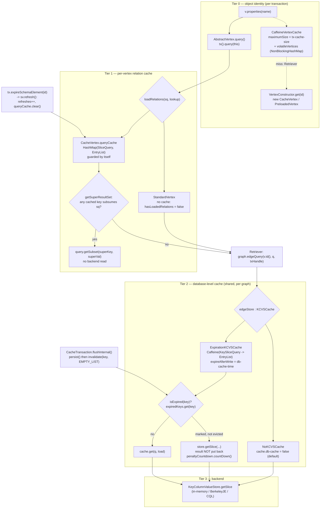
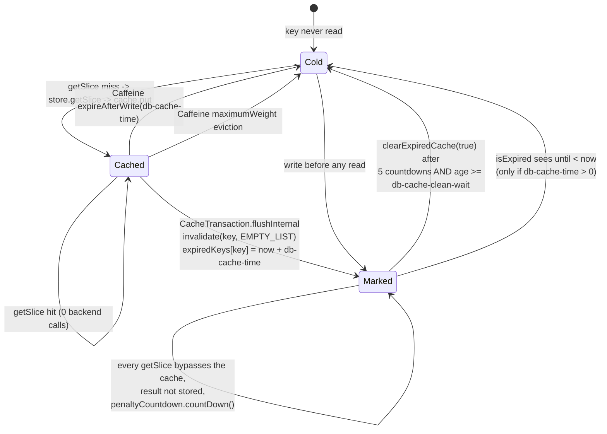

<!--
entry-meta
date: 2026-11-17
type: lesson
track: JanusGraph
lesson: 19
category: Database Internals
title: StandardVertex, CacheVertex, and the four cache tiers a read passes through
slug: janusgraph-vertex-caches-lazy-adjacency
-->

# `StandardVertex`/`CacheVertex`, lazy adjacency loading, and the two cache tiers

**2026-11-17 · JanusGraph Track · Lesson 19 of 28**

## Where This Fits

- **Lesson 18** closed Part III with the locking layer: `ExpectedValueCheckingStore`, the
  two-transaction split, `ConsistentKeyLocker`'s write → sleep → read → seniority protocol, and the
  fact that the in-memory backend runs all of it. It handed this lesson one question in two halves —
  *does a composite-index row get evicted or written through, and what happens to the lock stores?* —
  and told it not to re-derive the locking layer.
  ([lesson 18](../2026-11-16-janusgraph-locking-consistent-key-locker/README.md))
- **This lesson** opens Part IV, the read path, at its bottom: the vertex object itself. What
  `StandardVertex` is (an element with a lifecycle byte and an added-relations container, and *no*
  cache), what `CacheVertex` adds (a `SliceQuery → EntryList` map, a subsumption check, and a refresh
  counter), how `loadRelations` makes adjacency loading lazy, and then the two cache tiers around it:
  `CaffeineVertexCache` inside the transaction and `ExpirationKCVSCache` shared across the graph.
  Lesson 18's question is answered in **§6**: *marked, not evicted, and not written through* — and the
  marking has a probabilistic release that the test suite quietly documents with the number `5`.
- **It sets up lessons 20–22.** Everything here is reached through one call —
  `v.loadRelations(sliceQuery, lookup)` at `StandardJanusGraphTx:1570`. Lesson 20 asks where that
  `SliceQuery` comes from (`BasicVertexCentricQueryBuilder`, vertex-centric indexes); lesson 21 asks
  how a graph-centric query picks an index; lesson 22 asks how limits and sub-queries merge. This
  lesson fixes the *storage* side of all three: what is cached, keyed by what, invalidated when.

---

## 1. Three vertex classes, and the one method that matters

`janusgraph-core/src/main/java/org/janusgraph/graphdb/vertices/` holds exactly four files:

| File | Size | Role |
|---|---|---|
| `AbstractVertex.java` | 7,200 B | TinkerPop surface + `it()`/`tx()` indirection; no state but the tx |
| `StandardVertex.java` | 7,553 B | lifecycle byte, `AddedRelationsContainer`, **no relation cache** |
| `CacheVertex.java` | 5,482 B | adds `queryCache`, subsumption, `refresh()` |
| `PreloadedVertex.java` | 9,230 B | `extends CacheVertex`, for OLAP; relations come pre-stuffed |

The inheritance chain is `AbstractElement` → `AbstractVertex` → `StandardVertex` → `CacheVertex` →
`PreloadedVertex`. The whole read path narrows to one abstract method, declared on `InternalVertex`
and implemented three times:

```java
EntryList loadRelations(SliceQuery query, Retriever<SliceQuery, EntryList> lookup);
```

`StandardVertex`'s implementation is one line:

```java
@Override
public EntryList loadRelations(SliceQuery query, Retriever<SliceQuery, EntryList> lookup) {
    return (isNew()) ? EntryList.EMPTY_LIST : lookup.get(query);
}

@Override
public boolean hasLoadedRelations(SliceQuery query) {
    return false;
}
```

**Lesson 15 asked why these two look the way they do, and the answer is that `StandardVertex` is the
no-cache base.** `hasLoadedRelations` is a flat `false` because it is not a *question about the
backend* — it is the question *"do I already hold the answer to this `SliceQuery`?"*, and a
`StandardVertex` never holds any answer, so `false` is not a stub, it is the truth. The flat `false`
is what forces every caller to go through `loadRelations`, which for a loaded vertex is a straight
pass-through to the retriever. And `EntryList.EMPTY_LIST` for `isNew()` is also the truth: a vertex
created in this transaction has no edgestore row yet, so there is nothing a slice query over its row
key could return. Its relations live in `addedRelations` and are merged in separately — see §2.

### 1.1 `it()` is the reason a vertex outlives its transaction

`AbstractVertex` holds exactly one field, `private final StandardJanusGraphTx tx`, and exposes two
indirections that every mutating method goes through:

```java
public final InternalVertex it() {
    if (tx.isOpen()) return this;
    InternalVertex next = (InternalVertex) tx.getNextTx().getVertex(id());
    if (next == null) throw InvalidElementException.removedException(this);
    else return next;
}

public final StandardJanusGraphTx tx() { return tx.isOpen() ? tx : tx.getNextTx(); }

public final boolean isTxOpen() { return tx.isOpen(); }
```

So a `JanusGraphVertex` reference held across a commit silently re-resolves to the *same id in the
next transaction*, which means a fresh `CacheVertex` with an empty `queryCache`. Two consequences
worth holding on to:

- `isTxOpen()` exists for exactly one caller outside this class: `CaffeineVertexCache`'s removal
  listener (§4), which must not pin a vertex belonging to a dead transaction.
- `StandardVertex.remove()` resolves `it()` **once** into a local before flipping the lifecycle,
  with a comment saying why: calling `it()` again after the flip would re-resolve through
  `getNextTx().getVertex(id)` and throw *"was removed"* for a reference that originated in an
  already-closed transaction.

---

## 2. `StandardVertex`: a lifecycle byte and a lazily-allocated container

The state is four fields:

```java
private final Object lifecycleMutex = new Object();
private volatile byte lifecycle;
private VertexLabel cachedVertexLabel;
private volatile AddedRelationsContainer addedRelations = AddedRelationsContainer.EMPTY;
```

Points worth being precise about:

- **`lifecycle` is one byte**, mutated only through `updateLifeCycle(ElementLifeCycle.Event)` under
  `lifecycleMutex`, and read without a lock (it is `volatile`). `hasAddedRelations()` and
  `hasRemovedRelations()` are pure bit tests on it — the vertex does not consult the container.
- **`addedRelations` starts as the shared `EMPTY` singleton** and is promoted on first write, with
  the choice of implementation made by the transaction's threading mode:

  ```java
  if (addedRelations == AddedRelationsContainer.EMPTY) {
      if (tx().getConfiguration().isSingleThreaded()) {
          addedRelations = new SimpleAddedRelations(true);
      } else {
          synchronized (this) {
              if (addedRelations == AddedRelationsContainer.EMPTY)
                  addedRelations = new ConcurrentAddedRelations(true);
          }
      }
  }
  ```

  A read-only traversal therefore allocates **nothing** per vertex beyond the object header and these
  four fields — which is the whole point of the `EMPTY` singleton, given that the vertex cache may
  hold `tx-cache-size` (default 20,000) of them.
- **`cachedVertexLabel` is a one-slot memo**, and it is filled on two different paths: lazily in
  `vertexLabel()` (which otherwise runs a vertex-centric query via
  `BasicVertexCentricQueryUtil.withLabelVertices`), and *eagerly* in `addRelation` via
  `cacheLabelVertex(r)` when the relation being added is `BaseLabel.VertexLabelEdge`. So a vertex
  created with a label never issues a query to learn its own label.
- **`properties(String...)` forks on `isNew()`**: a new vertex answers straight out of
  `addedRelations.getViewOfProperties(keys)`, filtering invisible keys and null values; a loaded
  vertex falls through to `AbstractVertex.properties`, which is
  `query().direction(Direction.OUT).keys(keys).properties()` — i.e. the full query path, and hence
  `loadRelations`.

---

## 3. `CacheVertex`: a `HashMap`, a subsumption scan, and a refresh counter

`CacheVertex` adds two fields:

```java
protected final Map<SliceQuery, EntryList> queryCache;   // new HashMap<>(4)
private long refreshes;
```

The comment above them states the design decision outright: *"We don't try to be smart and match with
previous queries because that would waste more cycles on lookup than save actual memory. We use a
normal map with synchronization since the likelihood of contention is super low in a single
transaction."* Every access is inside `synchronized (queryCache)`, and `queryCache` is its own
monitor — not the vertex's, which `StandardVertex.remove()` and `addRelation`'s slow path use.

### 3.1 The lookup is two-stage: exact, then subsuming

```java
public EntryList loadRelations(SliceQuery query, Retriever<SliceQuery, EntryList> lookup,
                               long refreshesBefore) {
    if (isNew()) return EntryList.EMPTY_LIST;
    EntryList result;
    synchronized (queryCache) { result = queryCache.get(query); }
    return result != null ? result : load(query, lookup, refreshesBefore);
}

private EntryList load(SliceQuery query, Retriever<SliceQuery, EntryList> lookup,
                       long refreshesBefore) {
    Map.Entry<SliceQuery, EntryList> superset = getSuperResultSet(query);
    EntryList result = superset == null || superset.getValue() == null
        ? lookup.get(query) : query.getSubset(superset.getKey(), superset.getValue());
    addToQueryCache(query, result, refreshesBefore);
    return result;
}
```

`getSuperResultSet` is a **linear scan** over the map asking `entry.getKey().subsumes(query)`. This is
the one piece of "smartness" they did keep, and it is what makes `v.properties()` followed by
`v.property("name")` a single backend read: the broad query's cached `EntryList` subsumes the narrow
one, and `SliceQuery.getSubset` slices it in memory. The cost is `O(queryCache.size())` comparisons on
every miss, which is why the map is initialised at capacity 4 and why the authors did not want a
cleverer index.

Note the asymmetry: a *hit* is an exact `HashMap` lookup on the `SliceQuery`, so `SliceQuery`'s
`equals`/`hashCode` are load-bearing here (lesson 02's territory). A *subsumption* hit is a scan.
`hasLoadedRelations(query)` answers using both: `queryCache.get(query) != null || getSuperResultSet(query) != null`.

### 3.2 The refresh counter is a lost-update guard, not a timestamp

This is the subtle part of the class, and the source comments spell out why it exists:

```java
public void refresh() {
    synchronized (queryCache) { refreshes++; queryCache.clear(); }
}

public long refreshes() {
    synchronized (queryCache) { return refreshes; }
}

private void addToQueryCache(SliceQuery query, EntryList entries, long refreshesBefore) {
    synchronized (queryCache) {
        if (refreshes == refreshesBefore) queryCache.put(query, entries);
    }
}
```

The race it closes: thread A calls `loadRelations`, which reads `refreshes()` **before** the backend
read, then blocks in the retriever. Thread B calls `refresh()` because a schema element changed.
Thread A returns and would store a result that predates the change — undoing the refresh and leaving
the transaction acting on stale definition edges. The counter check makes the store a no-op instead,
so the next read goes to the backend again.

There are two entry points, and they differ in *when* the count is read:

| Entry point | Who calls it | `refreshesBefore` read |
|---|---|---|
| `loadRelations(q, lookup)` | `edgeProcessorImpl.execute`, `StandardJanusGraphTx:1570` | inside, via `refreshes()`, just before `load` |
| `loadRelations(q, lookup, refreshesBefore)` | multi-query paths, `StandardJanusGraphTx:1436` and `:1459` | by the **caller**, before the batched backend read |

The three-argument overload exists because a multi-query reads *many* vertices' relations in one
backend call and only then hands each vertex its slice — by which time the vertex's own
`loadRelations` would read a count that is already too late. So `executeMultiQuery` snapshots the
counts first:

```java
for (InternalVertex v : vertices) {
    if (!v.isNew() && v.hasId() && (v instanceof CacheVertex) && !v.hasLoadedRelations(sq)) {
        vertexIds.add(v.id());
        refreshesBefore.add(((CacheVertex) v).refreshes());
    }
}
...
((CacheVertex) v).loadRelations(sq, query -> vresults, refreshesBefore.get(pos));
```

`executeMultiSliceMultiQuery` does the same with a `Map<Object, Long>` keyed by vertex id
(`StandardJanusGraphTx:1457-1465`). Note that it snapshots for **every** `CacheVertex` in the
collection, not just the ones it is about to read — cheaper than deciding, and harmless.

### 3.3 Who calls `refresh()` in production

Not a cache-eviction timer. The only production caller is schema eviction, and the chain is worth
having in full:

1. `ManagementSystem.commit()` (or `ManagementLogger` on receiving an eviction message from another
   instance) iterates `graph.getOpenTransactions()` and calls `tx.expireSchemaElement(id)` on each,
   after `schemaCache.expireSchemaElement(id)`.
2. `StandardJanusGraphTx.expireSchemaElement` (`:2252-2276`) looks the id up **without touching
   storage** — `if (vertexCache.contains(id))` — and only then:

   ```java
   JanusGraphSchemaVertex sv = (JanusGraphSchemaVertex) v;
   sv.refresh();
   sv.resetCache();
   if (!sv.hasDefinition()) return;
   if (sv.getDefinition().containsKey(TypeDefinitionCategory.INTERNAL_INDEX)) {
       IndexType indexType = sv.asIndexType();
       if (indexType.isMixedIndex()) { ... indexTx.invalidate(sv.name()); }
   }
   ```

So `refresh()` clears the *schema vertex's* relation cache in every open transaction. A user-data
`CacheVertex` is never refreshed by JanusGraph itself; the only way to clear one is the cast the
documentation sanctions, `((CacheVertex) v).refresh()`, which the cache doc explicitly warns is
**not** a compare-and-set primitive.

And the unit test that pins the behaviour is
`janusgraph-core/src/test/java/org/janusgraph/graphdb/vertices/CacheVertexRefreshTest.java`, with two
methods: `aLoadWhichARefreshOverlapsIsNotKept` (two latches, a pausing `Retriever`, asserts
`loads == 2`) and `aResultLoadedBeforeTheCallIsKeptOnlyIfNoRefreshCameSince` (the three-argument
overload). Both construct a `CacheVertex` over a Mockito-mocked `StandardJanusGraphTx` with
`isNew()` overridden to `false`, so the transaction is never consulted — a useful pattern for testing
vertex internals without a graph.

---

## 4. Tier 0: `CaffeineVertexCache`, and why "pinned" is a lie told on eviction

`janusgraph-core/.../graphdb/transaction/vertexcache/` has three files: the `VertexCache` interface
(5 methods: `contains`, `get`, `add`, `getAllNew`, `close`), `CaffeineVertexCache`, and
`EmptyVertexCache`.

`CaffeineVertexCache` is **two** structures:

```java
private final ConcurrentMap<Object, InternalVertex> volatileVertices;  // jctools NonBlockingHashMap
private final Cache<Object, InternalVertex> cache;                      // Caffeine, maximumSize
```

Construction, from `StandardJanusGraphTx:350-363`:

```java
long effectiveVertexCacheSize = config.getVertexCacheSize();
if (!config.isReadOnly()) {
    effectiveVertexCacheSize = Math.max(MIN_VERTEX_CACHE_SIZE, effectiveVertexCacheSize);  // 100
}
...
vertexCache = new CaffeineVertexCache(effectiveVertexCacheSize, config.getDirtyVertexSize());
indexCache  = new CaffeineSubqueryCache(config.getIndexCacheWeight());
```

- `MIN_VERTEX_CACHE_SIZE` is `100L` (`StandardJanusGraphTx:206`), and **the floor is skipped for
  read-only transactions** — which matters, because `StandardTransactionBuilder.readOnlyOLAP()` sets
  `vertexCacheSize = 0` *and* `dirtyVertexSize = 0`. An OLAP transaction therefore gets a Caffeine
  cache with `maximumSize(0)`: every `add` is evicted immediately with cause `SIZE`. That is
  deliberate — OLAP uses `PreloadedVertex` and holds its own references — but it means the
  "transaction-level cache" is literally absent on that path.
- `indexCacheWeight` is not a separate option. `StandardTransactionBuilder.vertexCacheSize(int size)`
  sets `this.indexCacheWeight = size / 2`, which is where the cache doc's *"total weight will not
  exceed half of the transaction cache size"* and its 9,998-element ceiling
  (`tx-cache-size / 2 - 2` with the default 20,000) come from.
- `.executor(Runnable::run)` makes Caffeine's maintenance run on the calling thread, with a comment
  pointing at the Caffeine discussion that recommends it.
- `recordStats()` is enabled only `if (log.isDebugEnabled())` **at construction time**, and `close()`
  logs `cache.stats()` under the same guard. Turning debug logging on later yields a zero stats
  snapshot.

**The pinning mechanism is reactive, not preventive.** The doc says modified vertices "cannot be
evicted". What the code does is let Caffeine evict them and catch them on the way out:

```java
.removalListener((RemovalListener<Object, InternalVertex>) (key, v, removalCause) -> {
    if (removalCause == RemovalCause.EXPLICIT) { assert volatileVertices.isEmpty(); return; }
    assert (removalCause == RemovalCause.SIZE || removalCause == RemovalCause.REPLACED) : "Cause: " + removalCause;
    if (((AbstractVertex) v).isTxOpen() && (v.isModified() || v.isRemoved())) {
        volatileVertices.putIfAbsent(key, v);
    }
})
```

So the identity guarantee is: *a vertex that is modified or removed, in a still-open transaction, is
never dropped* — it moves from the size-bounded `cache` to the unbounded `volatileVertices`. The
`assert` on the cause is a real statement about configuration: no `expireAfter*` and no weak/soft
values are configured, so `EXPIRED` and `COLLECTED` are impossible, and `EXPLICIT` happens only in
`close()`, which clears `volatileVertices` first so the assertion holds.

`add` is the eager half of the same rule:

```java
cache.put(id, vertex);
if (vertex.isNew() || vertex.hasAddedRelations()) volatileVertices.put(id, vertex);
```

Note the predicate: **`isNew() || hasAddedRelations()` at add time**, which is *narrower* than the
removal listener's `isModified() || isRemoved()`. A vertex that is added clean and only later has a
property *removed* is not in `volatileVertices` until it is evicted. Correctness is preserved by the
listener; what differs is residency.

`get` is the read path, and the ordering is the interesting bit:

```java
InternalVertex vertex = cache.getIfPresent(id);
if (vertex == null) {
    InternalVertex newVertex = volatileVertices.get(id);
    if (newVertex == null) newVertex = retriever.get(id);
    final InternalVertex v = newVertex;
    vertex = cache.get(id, (k) -> v);     // re-admits it to the bounded cache
}
return vertex;
```

Dirty vertices are consulted **after** the main cache and re-admitted to it on hit, so a dirty vertex
evicted by size will bounce back and forth; it is never *lost*, and `cache.get(id, k -> v)` guarantees
one object per id per transaction even under concurrent `get`.

`getAllNew()` iterates `volatileVertices.values()` and filters `isNew()` — which is why eager pinning
of new vertices matters: this is how `prepareCommit` (lesson 16) finds vertices to assign ids to.

`EmptyVertexCache` is a logging no-op singleton installed by `releaseTransaction()`
(`StandardJanusGraphTx:2200-2210`) alongside `EmptySubqueryCache`, `EmptyAddedRelations` and
`EmptyIndexCache`. Its `get` returns **null**, which is why `getVertices` carries this guard and
comment:

```java
//Filter out potentially removed vertices. A concurrent transaction release (e.g. graph.close() on
//another thread) can swap the vertexCache to an EmptyVertexCache whose get() returns null after this
//method has already passed verifyOpen(), so guard against null entries the same way getVertex() does.
result.removeIf(v -> v == null || v.isRemoved());
```

### 4.1 `VertexConstructor` is the `Retriever`, and it is where the class is chosen

`vertexCache.get(id, retriever)` takes one of three `VertexConstructor` instances built once per
transaction (`StandardJanusGraphTx:346-348`):

| Field | `verifyExistence` | Used by |
|---|---|---|
| `externalVertexRetriever` | `config.hasVerifyExternalVertexExistence()` (default **true**) | `getVertex(id)`, i.e. `g.V(id)` |
| `internalVertexRetriever` | `config.hasVerifyInternalVertexExistence()` (default **false**) | `getInternalVertex(id)`, i.e. traversal-internal resolution |
| `existingVertexRetriever` | `false` | `getExistingVertex(id)`, schema and partitioned lookups |

`VertexConstructor.get` (`:624-664`) does three things in order: an existence probe, a canonical-id
lifecycle fetch, and the class decision.

```java
byte lifecycle = ElementLifeCycle.Loaded;
Object canonicalVertexId = idInspector.isPartitionedVertex(vertexId)
    ? idManager.getCanonicalVertexId(((Number) vertexId).longValue()) : vertexId;
if (verifyExistence) {
    if (graph.edgeQuery(canonicalVertexId, graph.vertexExistenceQuery, txHandle).isEmpty())
        lifecycle = ElementLifeCycle.Removed;
}
if (!vertexId.equals(canonicalVertexId)) {
    lifecycle = getExistingVertex(canonicalVertexId).getLifeCycle();
}
```

- **`verifyExistence` costs one slice query per vertex id**, `graph.vertexExistenceQuery` — the same
  query lesson 16 saw written as the unconditional `VertexExists` property. `g.V(id)` pays it;
  traversal-internal resolution does not. `getVertices(Object...)` batches it:
  `graph.edgeMultiQuery(vertexIds, graph.vertexExistenceQuery, txHandle)` for all ids not already
  cached (`:570-577`).
- The class choice, at `:659-661`:

  ```java
  } else if (idInspector.isUserVertexId(vertexId)) {
      if (createStubVertex) vertex = new PreloadedVertex(StandardJanusGraphTx.this, vertexId, lifecycle);
      else vertex = new CacheVertex(StandardJanusGraphTx.this, vertexId, lifecycle);
  }
  ```

  `createStubVertex` is `config.hasPreloadedData()`. **So in every ordinary transaction, every
  user vertex is a `CacheVertex`** — `StandardVertex` is instantiated directly only as the base of
  something else. Schema ids branch earlier to `PropertyKeyVertex`, `EdgeLabelVertex`,
  `VertexLabelVertex`, `JanusGraphSchemaVertex`, or `SystemTypeManager.getSystemType` for system
  relation types (lesson 13's territory).

### 4.2 Partitioned vertices: one logical vertex, N objects, N query caches

Lesson 08 left the partitioned-vertex read cost here. What this lesson can verify from the
transaction side:

- `getVertex(id)` canonicalises first — `if (idInspector.isPartitionedVertex(vertexId)) vertexId =
  idManager.getCanonicalVertexId(...)` (`:534`) — so `g.V(partitionedId)` always lands on the
  canonical object.
- Each representative is reached by its own id and is therefore **its own `CacheVertex` with its own
  `queryCache`**: `getOtherPartitionVertex` (`:459-462`) and `getAllRepresentatives` (`:464-480`)
  both loop `getExistingVertex(ids[i])`, one `vertexCache.get` per representative.
- `getAllRepresentatives` takes its id list from `idManager.getPartitionedVertexRepresentatives`,
  **unless** the transaction has restricted partitions, in which case it builds only
  `config.getRestrictedPartitions().length` ids. That is the knob that bounds the fan-out.
- Non-canonical representatives do not get an independent lifecycle: `VertexConstructor.get` replaces
  it with `getExistingVertex(canonicalVertexId).getLifeCycle()`, which is itself a `vertexCache.get`
  — so constructing a representative can trigger a second cache lookup and (with
  `verifyExistence`) a second existence query.

**Not verified here:** how many slice queries a traversal over a partitioned vertex actually issues.
That is decided in `BasicVertexCentricQueryBuilder`/`MultiVertexCentricQueryBuilder`, which is lesson
20. What is established is that *there is no shared relation cache across representatives* — the
caching is strictly per vertex object, and the per-object key is the id, not the canonical id.

### 4.3 `relTypeCache`: lesson 15's other question

`StandardJanusGraphTx:239` declares `private final Map<Long, InternalRelationType> relTypeCache`,
with the javadoc *"Keeps track of relation types vertex. Used only in `JanusGraphLazyRelation`."* It
is allocated **only** when the transaction was built with `lazyLoadRelations()`:

```java
if (this.config.isLazyLoadRelations()) { relTypeCache = new ConcurrentHashMap<>(30); }
else { relTypeCache = null; }
```

and the single consumer is:

```java
public InternalRelationType getOrLoadRelationTypeById(long typeId) {
    if (relTypeCache == null) return loadRelationTypeById(typeId);
    return this.relTypeCache.computeIfAbsent(typeId, this::loadRelationTypeById);
}

private InternalRelationType loadRelationTypeById(long typeId) {
    return TypeUtil.getBaseType((InternalRelationType) this.getExistingRelationType(typeId));
}
```

So it caches the result of `getExistingRelationType(typeId)` **after** `TypeUtil.getBaseType`
unwrapping — i.e. the base relation type, not the schema vertex. The `null` sentinel instead of an
empty map is a deliberate zero-cost path for the non-lazy default: `getExistingRelationType` already
goes through the vertex cache and the schema cache, so the extra map only pays off when
`JanusGraphLazyRelation` resolves the same type id many times. It is **not** invalidated by
`expireSchemaElement`, which touches `vertexCache` and the schema caches only — a point for lesson 25.

---

## 5. The lazy load, end to end

The call that ties tiers 0 and 1 to tier 2 is in `edgeProcessorImpl.execute`
(`StandardJanusGraphTx:1562-1573`):

```java
@Override
public Iterator<JanusGraphRelation> execute(VertexCentricQuery query, SliceQuery sq,
                                            Object exeInfo, QueryProfiler profiler) {
    assert exeInfo == null;
    if (query.getVertex().isNew()) return Collections.emptyIterator();
    final InternalVertex v = query.getVertex();
    final EntryList iterable = v.loadRelations(sq,
        query1 -> QueryProfiler.profile(profiler, query1, q -> graph.edgeQuery(v.id(), q, txHandle)));
    return RelationConstructor.readRelation(v, iterable, StandardJanusGraphTx.this).iterator();
}
```

Four observations:

1. **The `Retriever` is a lambda closing over the vertex id and the backend transaction.** The vertex
   never holds a reference to the store; it is handed a function. That is why `CacheVertexRefreshTest`
   can test `CacheVertex` with a mocked transaction and a hand-written `Retriever`.
2. **A new vertex short-circuits twice** — here (`isNew()` → empty iterator) and again inside
   `loadRelations`. Belt and braces, and the inner one is what protects the multi-query paths.
3. **Deserialization happens after the cache**, in `RelationConstructor.readRelation`. The
   `queryCache` stores `EntryList`s — raw columns, lesson 10/11's byte layout — not `JanusGraphEdge`
   objects. So a cache hit still re-runs `parseRelation` per entry. The cache saves the *read*, not
   the decode.
4. `getNew`/`isDeleted` (`:1474-1560`) are the other half of the executor and read `addedRelations`
   and `deletedRelations` directly — this is where a new vertex's relations and a transaction's own
   uncommitted changes are merged over the cached backend result.



---

## 6. Tier 2: the database-level cache, and lesson 18's question answered

### 6.1 Which wrapper gets installed

`Backend`'s constructor decides once (`Backend:257`):

```java
cacheEnabled = !configuration.get(STORAGE_BATCH) && configuration.get(DB_CACHE);
```

and then, at `Backend:344-376`:

```java
KeyColumnValueStore edgeStoreRaw  = storeManagerLocking.openDatabase(EDGESTORE_NAME);
KeyColumnValueStore indexStoreRaw = storeManagerLocking.openDatabase(INDEXSTORE_NAME);

//Configure caches
if (cacheEnabled) {
    long expirationTime = configuration.get(DB_CACHE_TIME);
    if (expirationTime == 0) expirationTime = ETERNAL_CACHE_EXPIRATION;   // 200 years
    ... cacheSizeBytes from DB_CACHE_SIZE (percentage of free heap if < 1.0, else bytes, min 1000) ...
    long cleanWaitTime = configuration.get(DB_CACHE_CLEAN_WAIT);
    long edgeStoreCacheSize  = Math.round(cacheSizeBytes * EDGESTORE_CACHE_PERCENT);   // 0.8
    long indexStoreCacheSize = Math.round(cacheSizeBytes * INDEXSTORE_CACHE_PERCENT);  // 0.2
    edgeStore  = new ExpirationKCVSCache(edgeStoreRaw,  getMetricsCacheName(EDGESTORE_NAME),  expirationTime, cleanWaitTime, edgeStoreCacheSize);
    indexStore = new ExpirationKCVSCache(indexStoreRaw, getMetricsCacheName(INDEXSTORE_NAME), expirationTime, cleanWaitTime, indexStoreCacheSize);
} else {
    edgeStore  = new NoKCVSCache(edgeStoreRaw);
    indexStore = new NoKCVSCache(indexStoreRaw);
}
```

The knobs, with the values from the pinned source rather than from the docs page:

| Option | Field | Type | Default | Notes |
|---|---|---|---|---|
| `cache.db-cache` | `DB_CACHE` | Boolean, MASKABLE | **`false`** | `GraphDatabaseConfiguration:615-620`; also forced off by `storage.batch-loading` |
| `cache.db-cache-size` | `DB_CACHE_SIZE` | Double, MASKABLE | `0.3` | `<1.0` ⇒ fraction of *currently free* heap, `>1.0` ⇒ bytes, must exceed 1000 |
| `cache.db-cache-time` | `DB_CACHE_TIME` | Long, MASKABLE | `10000` ms | `0` ⇒ `ETERNAL_CACHE_EXPIRATION` = `1000L*3600*24*365*200` |
| `cache.db-cache-clean-wait` | `DB_CACHE_CLEAN_WAIT` | Integer, MASKABLE | `50` ms | the invalidation grace period |
| `cache.tx-cache-size` | `TX_CACHE_SIZE` | Integer, MASKABLE | `20000` | tier-0 `maximumSize`; `/2` becomes `indexCacheWeight` |
| `cache.tx-dirty-size` | `TX_DIRTY_SIZE` | Integer, MASKABLE | *unset* | falls back to `32` (`TX_DIRTY_SIZE_DEFAULT_WITHOUT_BATCH`) or `4096` with batch loading |

Two splits worth noting. `EDGESTORE_CACHE_PERCENT = 0.8` / `INDEXSTORE_CACHE_PERCENT = 0.2`
(`Backend:162-163`) are `public static final` constants with a `Preconditions` check that they sum to
1.0 — not configurable. And `DB_CACHE_SIZE` as a fraction is computed against
`runtime.maxMemory() - (runtime.totalMemory() - runtime.freeMemory())` — free heap *at graph open
time*, so the same config yields a different cache on a warm JVM than on a cold one.

Everything else is `NoKCVSCache`: `txLogStore` (`Backend:381`, and note it is opened off
`storeManager`, not `storeManagerLocking`), and — per lesson 18 — every lock store, opened by
`CONSISTENT_KEY_LOCKER_CREATOR` directly off `storeManager`. So **lock rows are never cached and
never invalidated**, and the expected-value re-read deliberately goes through `getBackingStore()`.
Both halves of lesson 18's question about the lock stores are therefore already settled; the open
half was the graphindex, and the answer follows.

### 6.2 `ExpirationKCVSCache` is a Caffeine cache plus a side table of "expired" keys

```java
private static final int INVALIDATE_KEY_FRACTION_PENALTY = 1000;
private static final int PENALTY_THRESHOLD = 5;

private volatile CountDownLatch penaltyCountdown;
private final Cache<KeySliceQuery, EntryList> cache;
private final ConcurrentHashMap<StaticBuffer, Long> expiredKeys;
```

- The cache is keyed by **`KeySliceQuery`** — (row key, slice bounds, limit) — not by row key. So one
  row can hold many cache entries, one per distinct query shape. `invalidate`, however, works on the
  **row key**, which is the whole reason `expiredKeys` exists: there is no index from key to the
  `KeySliceQuery`s that mention it.
- The weigher is `CAFFEINE_CACHE_ENTRY_SIZE + KEY_QUERY_SIZE + entries.getByteSize()`, with
  `KEY_QUERY_SIZE = OBJECT_HEADER + 4 + 1 + 3 * (OBJECT_REFERENCE + STATICARRAYBUFFER_RAW_SIZE + 10)`
  — an *estimate*, which is exactly the known limitation the cache doc links to
  (JanusGraph issue 2369): the accounting is of serialized sizes, not of the deserialized objects
  Caffeine actually holds.
- `expireAfterWrite(cacheTimeMS)` is the only time-based eviction. There is no `expireAfterAccess`, so
  a hot entry still dies at `db-cache-time` after being written. That is the design: the expiry is a
  *staleness bound* against other JanusGraph instances, not an LRU knob.

The read path:

```java
public EntryList getSlice(KeySliceQuery query, StoreTransaction txh) throws BackendException {
    incActionBy(1, CacheMetricsAction.RETRIEVAL, txh);
    if (isExpired(query)) {
        incActionBy(1, CacheMetricsAction.MISS, txh);
        return store.getSlice(query, unwrapTx(txh));      // <- NOT put back in the cache
    }
    return cache.get(query, key -> {
        incActionBy(1, CacheMetricsAction.MISS, txh);
        try { return store.getSlice(query, unwrapTx(txh)); }
        catch (BackendException e) { ... throw new JanusGraphException(e); }
    });
}
```

and the marking:

```java
public void invalidate(StaticBuffer key, List<CachableStaticBuffer> entries) {
    Preconditions.checkArgument(!hasValidateKeysOnly() || entries.isEmpty());
    expiredKeys.put(key, getExpirationTime());            // now + cacheTimeMS
    if (Math.random() < 1.0/INVALIDATE_KEY_FRACTION_PENALTY) penaltyCountdown.countDown();
}

private boolean isExpired(KeySliceQuery query) {
    Long until = expiredKeys.get(query.getKey());
    if (until == null) return false;
    if (isBeyondExpirationTime(until)) { expiredKeys.remove(query.getKey(), until); return false; }
    penaltyCountdown.countDown();                          // every expired read counts down
    return true;
}
```

### 6.3 So: marked, not evicted — and this is the answer to lesson 18's question

**A commit does not evict the row's cache entries and does not write through them. It writes one
entry into `expiredKeys` keyed by the row key, and from then until a cleanup pass, every read of that
row bypasses the cache entirely and is not re-cached.** The call site is
`CacheTransaction.flushInternal()`, and the ordering is explicit: *persist first, invalidate after*.

```java
if (numSubMutations > 0) persist(subMutations);

for (Map.Entry<KCVSCache, Map<StaticBuffer, KCVEntryMutation>> storeMutations : mutations.entrySet()) {
    final KCVSCache cache = storeMutations.getKey();
    for (Map.Entry<StaticBuffer, KCVEntryMutation> mutationsForKey : storeMutations.getValue().entrySet()) {
        if (cache.hasValidateKeysOnly()) {
            cache.invalidate(mutationsForKey.getKey(), Collections.EMPTY_LIST);
        } else {
            ... build List<CachableStaticBuffer> entries ...
            cache.invalidate(mutationsForKey.getKey(), entries);
        }
    }
}
```

The eviction half is the `CleanupThread`, and this is where `PENALTY_THRESHOLD` earns its keep:

```java
public void run() {
    while (true) {
        if (stop) return;
        try { penaltyCountdown.await(); }
        catch (InterruptedException e) { if (stop) return; else throw new RuntimeException(...); }
        clearExpiredCache(true);
    }
}

private synchronized void clearExpiredCache(boolean withNewPenaltyCountdown) {
    final Map<StaticBuffer,Long> expiredKeysCopy = new HashMap<>(expiredKeys.size());
    for (Map.Entry<StaticBuffer,Long> expKey : expiredKeys.entrySet()) {
        if (isBeyondExpirationTime(expKey.getValue()))
            expiredKeys.remove(expKey.getKey(), expKey.getValue());
        else if (getAge(expKey.getValue()) >= invalidationGracePeriodMS)
            expiredKeysCopy.put(expKey.getKey(), expKey.getValue());
    }
    for (KeySliceQuery ksq : cache.asMap().keySet()) {
        if (expiredKeysCopy.containsKey(ksq.getKey())) cache.invalidate(ksq);
    }
    if (withNewPenaltyCountdown) penaltyCountdown = new CountDownLatch(PENALTY_THRESHOLD);
    for (Map.Entry<StaticBuffer,Long> expKey : expiredKeysCopy.entrySet())
        expiredKeys.remove(expKey.getKey(), expKey.getValue());
}
```

`getAge(until)` is `now - (until - cacheTimeMS)` — time since the `invalidate` call, which is why the
grace period is measured correctly even though `expiredKeys` stores a deadline rather than a start.

**The full life of one invalidated key, with the real numbers at defaults
(`db-cache-time=10000`, `db-cache-clean-wait=50`):**

1. `invalidate(key)` ⇒ `expiredKeys[key] = now + 10000`. One chance in 1000 of counting the latch down.
2. Every subsequent `getSlice` on that row: `isExpired` → true → `store.getSlice`, result **not**
   cached, latch counted down by one.
3. After **5** countdowns the cleanup thread wakes. It copies out only keys whose age ≥ 50 ms,
   `cache.invalidate`s matching `KeySliceQuery`s, resets the latch to 5, and drops those keys from
   `expiredKeys`. Only now does the row become cacheable again.
4. Independently, if 10 s elapse first, `isExpired` sees `until < now`, removes the entry itself and
   returns false — so the mark self-heals even if cleanup never runs.

This is not a reconstruction. `ExpirationCacheTest.testGracePeriod` asserts exactly this sequence,
and its local constant is the giveaway:

```java
final int minCleanupTriggerCalls = 5;           // == PENALTY_THRESHOLD
...
verifyResults(key, keys, query, 5);
assertEquals(2, store.getSliceCalls());          // post-invalidate read goes to the store
verifyResults(key, keys, query, 5);
assertEquals(4, store.getSliceCalls());          // and so does the next one
times.sleepPast(utime.plus(graceWait));
for (int t = 0; t < minCleanupTriggerCalls; t++) {
    assertEquals(5, cache.getSlice(new KeySliceQuery(key,query), tx).size());
    times.sleepFor(Duration.ofMillis(5));
}
store.resetCounter();
verifyResults(key, keys, query, 5);
assertEquals(0, store.getSliceCalls());          // cacheable again
```

Two store calls per `verifyResults` because it does a single-key `getSlice` and a three-key
`getSlice`. The `for` loop is doing nothing but counting the latch down five times.



### 6.4 `hasValidateKeysOnly()` is always true, so half of `flushInternal` is dead code

`KCVSCache.hasValidateKeysOnly()` returns `true`, and a repo-wide `search_code` for the identifier at
the pinned commit returns exactly **three** hits: the definition in `KCVSCache`, the branch in
`CacheTransaction.flushInternal`, and the tautological `Preconditions.checkArgument` inside
`ExpirationKCVSCache.invalidate`. **No subclass overrides it.** `NoKCVSCache` overrides `clearCache`,
`invalidate` and `forceClearExpiredCache` only, all as no-ops.

Consequences, all mechanical:

- The `else` branch of `flushInternal` — which builds a `List<CachableStaticBuffer>` from the
  mutation's additions and deletions, with `assert e instanceof CachableStaticBuffer` on each — can
  never execute in the shipped tree.
- `ExpirationKCVSCache.invalidate`'s `entries` parameter is always `Collections.EMPTY_LIST`, and its
  precondition `!hasValidateKeysOnly() || entries.isEmpty()` is always satisfied by the first clause.
- Column-level invalidation is therefore **not implemented anywhere**, only scaffolded. That is why
  the invalidation granularity is the whole row: it is not a design choice made at the call site, it
  is the only implemented path.

Logged as **PR candidate 39** in the registers.

### 6.5 The multi-key and multi-slice read paths

`getSlice(List<StaticBuffer> keys, SliceQuery, txh)` and
`getMultiSlices(MultiKeysQueryGroups<...>, txh)` share one helper, `fillResultAndReturnMisses`, whose
contract is encoded in its return type `Pair<List<StaticBuffer>, Map<StaticBuffer, KeySliceQuery>>`:

- for each key it builds `new KeySliceQuery(key, query)`;
- **expired** ⇒ key goes in `remainingKeys` and the map gets `key → null`;
- **not expired, cache miss** ⇒ key goes in `remainingKeys` and the map gets `key → ksqs`;
- **hit** ⇒ result filled in, key not in `remainingKeys`.

The `null` is the signal that survives the backend round trip: after `store.getSlice`, the caller does
`KeySliceQuery ksqs = keySliceQueries.get(key); if (ksqs != null) cache.put(ksqs, subresult);`. So the
"expired ⇒ do not repopulate" rule is enforced identically on all three read paths, by a sentinel
rather than by a second expiry check.

`getMultiSlices` additionally *rewrites the query grouping in place*: per group it drops queries that
were fully served from cache, and for partially-served queries it collects
`Pair.of(query, remainingCurrentGroupKeys)` and hands them to
`MultiSliceQueriesGroupingUtil.moveQueriesToNewLeafNode(...)`, then filters empty groups with
`filterEmptyGroups` and calls `multiKeysQueryGroups.setQueryGroups(allQueryGroups)`. The cache is
therefore not a transparent wrapper on this path — it mutates the query plan the backend receives.
The grouping tree itself is lesson 20/22 material.

### 6.6 Mutations never go through `KCVSCache.mutate`

```java
@Override
public void mutate(StaticBuffer key, List<Entry> additions, List<StaticBuffer> deletions, StoreTransaction txh) {
    throw new UnsupportedOperationException("Only supports mutateEntries()");
}

public void mutateEntries(StaticBuffer key, List<Entry> additions, List<Entry> deletions,
                          boolean wholeRowDeletion, StoreTransaction txh) {
    assert txh instanceof CacheTransaction;
    ((CacheTransaction) txh).mutate(this, key, additions, deletions, wholeRowDeletion);
}
```

A write through a `KCVSCache` is *buffered in the `CacheTransaction`*, not passed down — which is why
invalidation can be batched at flush time and why `KCVSCache` keeps deletions as `Entry` (with
values) rather than as bare columns: `CacheTransaction.convert` is what strips them to columns via
`KCVEntryMutation.ENTRY2COLUMN_FCT` just before `mutateMany`. `unwrapTx` is `final` and asserts the
transaction is a `CacheTransaction`, so the cache layer and the buffering layer are hard-wired to each
other. `getSliceNoCache`, `getSliceNoCache(keys, …)` and `getMultiSlicesNoCache` are the escape
hatches that unwrap the transaction and go straight to `store` — three methods, and lesson 18 found
that `ExpectedValueCheckingTransaction` reaches past even these via `getBackingStore()`.

---

## 7. What a transaction sees when it commits and immediately re-reads

Lesson 16 left this question here, and it now has a precise answer — but it splits three ways, because
the vertex object in hand determines which tier answers.

**Case A — `db-cache` off (the default).** `edgeStore` is a `NoKCVSCache`, whose `invalidate` is a
no-op. Tier 2 does not exist. The only cache is tier 1, per vertex object, and `commit()` →
`releaseTransaction()` swaps in `EmptyVertexCache`, so a read after commit through a *retained
reference* resolves `it()`/`tx()` to `getNextTx()`, gets a **fresh** `CacheVertex` for the same id,
and reads the backend. Correct data, no cache benefit, and the number of slice queries equals the
number of distinct `SliceQuery` shapes the traversal issues.

**Case B — `db-cache` on, re-read in a new transaction.** `flushInternal` marked every mutated row key
in `expiredKeys`. The new transaction's fresh `CacheVertex` misses tier 1, reaches
`ExpirationKCVSCache.getSlice`, `isExpired` returns true, and the read goes to the backend **and is
not cached**. Every subsequent read of that row does the same until a cleanup pass or
`db-cache-time`. So a commit does not just lose the cached value for the rows it touched — it
temporarily disables caching for them, and the disabling is released by a probabilistic counter
rather than by a clock.

**Case C — `db-cache` on, same JanusGraph instance, row not touched by this transaction.** Served from
Caffeine, bounded by `expireAfterWrite(db-cache-time)`. This is the case the docs describe as the
read-heavy win.

**And the staleness bound in Case C is one-sided.** `cache.db-cache-time` bounds how long *this*
instance can lag behind *another* instance's writes, because invalidation is local to the JVM that
committed — `CacheTransaction` calls `invalidate` on its own `KCVSCache` objects. Cross-instance
invalidation exists only for *schema* changes, via `ManagementLogger` (§3.3), not for data. That
asymmetry is the one-line justification for the doc's advice to disable the db-cache in a distributed
setup where changes must be immediately visible.

---

## Hands-On

All three run in a local clone of `aryanttripathi/janusgraph` at or near the pinned commit. Nothing
here needs Cassandra.

### A. Watch the invalidation penalty counter with your own eyes

`ExpirationCacheTest` is the only test that exercises the full mark/bypass/cleanup cycle.

```bash
mvn -q -pl janusgraph-test -am -DskipTests install
mvn -pl janusgraph-test -Dtest='ExpirationCacheTest#testGracePeriod' test
```

Then read the Surefire XML rather than the console:

```bash
sed -n '1,40p' janusgraph-test/target/surefire-reports/org.janusgraph.diskstorage.cache.ExpirationCacheTest.txt
```

**What to look for.** The test is annotated `@RepeatedIfExceptionsTest(repeats = 3)` and is known
flaky (JanusGraph issue 3352). The flakiness is the lesson: the only thing that releases an
invalidated key is `penaltyCountdown` reaching zero, and the test gets there by making exactly
`minCleanupTriggerCalls = 5` reads with 5 ms sleeps. Change that constant to `4` in a scratch copy and
the final `assertEquals(0, store.getSliceCalls())` must fail — that is the cheapest possible proof
that `PENALTY_THRESHOLD` is load-bearing and that the release is not time-based.

### B. Prove the subsumption cache with a counter, not a stopwatch

`CacheVertexRefreshTest` shows the pattern: a `CacheVertex` over a mocked transaction and a
hand-written `Retriever`. Write a scratch test in
`janusgraph-core/src/test/java/org/janusgraph/graphdb/vertices/` that counts retriever invocations:

```java
CacheVertex v = new CacheVertex(mock(StandardJanusGraphTx.class), 1L, ElementLifeCycle.Loaded) {
    @Override public boolean isNew() { return false; }
};
AtomicInteger loads = new AtomicInteger();
Retriever<SliceQuery, EntryList> counting = q -> { loads.incrementAndGet(); return EntryList.EMPTY_LIST; };

SliceQuery broad  = new SliceQuery(BufferUtil.zeroBuffer(1), BufferUtil.oneBuffer(4));
SliceQuery narrow = new SliceQuery(BufferUtil.zeroBuffer(1), BufferUtil.oneBuffer(1));

v.loadRelations(broad,  counting);
v.loadRelations(narrow, counting);
// assert loads.get() == 1 if broad.subsumes(narrow); otherwise 2
assertTrue(v.hasLoadedRelations(narrow));
```

**What to look for.** Whether `loads` is 1 or 2 tells you whether `SliceQuery.subsumes` actually holds
for the bounds you chose — and that is the real exercise, because `subsumes` is the predicate the
whole tier-1 saving rests on. If you get 2, print `broad.subsumes(narrow)` and narrow the bounds until
it is true; you will have derived the containment rule from lesson 02's `SliceQuery` by experiment.
Then call `v.refresh()` and repeat: both queries must go to the retriever again.

### C. Count backend reads across a commit, with and without the db-cache

In `janusgraph-inmemory`, open two graphs and compare. The in-memory backend is the right choice for
this per lesson 18's carried fact — it goes through the real wrapper stack.

```java
JanusGraph g1 = JanusGraphFactory.build()
    .set("storage.backend", "inmemory")
    .set("cache.db-cache", false).open();
JanusGraph g2 = JanusGraphFactory.build()
    .set("storage.backend", "inmemory")
    .set("cache.db-cache", true)
    .set("cache.db-cache-time", 10000)
    .set("cache.db-cache-clean-wait", 50)
    .set("basic-metrics", true)
    .set("metrics.prefix", "jg").open();
```

With `basic-metrics` on, `KCVSCache.incActionBy` writes counters named
`<groupName>.<metricsName>.<action>` where `metricsName` is `getMetricsCacheName("edgestore")` and the
actions come from `CacheMetricsAction` (`RETRIEVAL`, `MISS`). Dump them from
`MetricManager.INSTANCE.getRegistry()` after each phase:

1. add a vertex with three properties, commit;
2. in a new transaction read one property **twice**, commit — record RETRIEVAL/MISS;
3. in a third transaction read the same property twice — record again.

**What to look for.** On `g2`, phase 2 should show MISS ≈ RETRIEVAL (the row is marked expired by
phase 1's commit, so nothing is cached), while phase 3 should show a MISS only on the first read of
the pair. If phase 3 still misses every time, you have fewer than 5 expired reads behind you — add a
loop of reads and watch the behaviour flip. That flip *is* `PENALTY_THRESHOLD`, observed on a real
graph. Within a single transaction, the second read of the same property never reaches the metrics at
all, because tier 1 answers it — which is how you separate the two tiers with one counter.

---

## Where This Breaks Down

- **`db-cache-time = 0` makes the invalidation mark eternal, not just the cache entries.** The docs
  recommend `0` for a single-instance deployment, and `Backend:352` turns it into
  `ETERNAL_CACHE_EXPIRATION` (200 years). But the same `cacheTimeMS` is used by `getExpirationTime()`,
  so `expiredKeys[key] = now + 200 years` and `isExpired`'s self-healing branch
  (`isBeyondExpirationTime`) can never fire. A written row is then uncacheable until the
  `CleanupThread` runs — which on a write-mostly workload needs ~5,000 `invalidate` calls at 1-in-1000
  each. The "best cache performance" setting has the worst invalidation-release behaviour.
- **Cleanup is a full key-set scan.** `clearExpiredCache` iterates `cache.asMap().keySet()` — up to
  `0.8 × 0.3 × heap` worth of `KeySliceQuery` objects for the edgestore — to invalidate entries for at
  most `expiredKeysCopy.size()` keys, inside a `synchronized` method that `clearCache()` also calls.
  There is no key → `KeySliceQuery` index. Logged as **PR candidate 40**.
- **Invalidation is after persistence, so a failed `persist` leaves a stale cache.**
  `flushInternal` calls `persist(subMutations)` and only then loops over `invalidate`. If
  `BackendOperation.execute` gives up and throws, the invalidation loop and `clear()` are skipped —
  while `mutateMany` may have applied some chunks (the method deliberately persists in
  `persistChunkSize` chunks). The db-cache then serves pre-mutation rows for up to `db-cache-time`.
  Derived from reading, not from a run. Logged as **PR candidate 41**, marked *do not file until
  observed*.
- **The tier-1 refresh guard has a documented hole on the index path.** The public two-argument
  `CacheVertex.addToQueryCache(query, entries)` does **not** check the refresh counter, and its one
  caller is `StandardJanusGraphTx`'s `vertexIDConversionFct` (`:2091-2103`), which stuffs
  `VertexWithInlineProps.getInlineProperties()` into the vertex's query cache after a graph-centric
  index read. A `refresh()` concurrent with that path can be undone — exactly the race the
  three-argument overload exists to prevent. Logged as **PR candidate 42**.
- **Cache size accounting is an estimate, by the authors' own admission.** The weigher sums
  `entries.getByteSize()` (serialized bytes) while Caffeine holds deserialized `EntryList`s, and
  `DB_CACHE_SIZE` as a fraction is resolved against free heap *at open time*. JanusGraph issue 2369 is
  linked from the docs page as a known limitation. Treat `cache.db-cache-size` as a hint.
- **`tx-cache-size` does not bound a write-heavy transaction.** `volatileVertices` is unbounded by
  construction, and the removal listener keeps feeding it. The cache doc says so; the mechanism is the
  `putIfAbsent` in the listener. A transaction that modifies a million vertices holds a million vertex
  objects regardless of `cache.tx-cache-size`.
- **`refresh()` is not a consistency primitive, and the docs say so explicitly.** It clears tier 1
  only; the next read may be answered by tier 2 or by an eventually-consistent backend that has not
  yet caught up.
- **Deserialization is not cached at any tier.** All three tiers store `EntryList`s. A hot traversal
  over a cached vertex still pays `parseRelation` per entry on every iteration — lesson 11's cost,
  untouched by any of this.

---

## Further Study

- [JanusGraph Cache (docs/operations/cache.md at the pinned commit)](https://github.com/JanusGraph/janusgraph/blob/a59ae8d8024207598eada34998d867617df51adf/docs/operations/cache.md)
  — the four-layer model in the authors' own words, including the `((CacheVertex) v).refresh()` recipe
  and the CAS warning.
- [JanusGraph issue 2369 — database-level cache uses more memory than configured](https://github.com/JanusGraph/janusgraph/issues/2369)
  — the weigher's estimation problem, linked from the docs page itself.
- [JanusGraph issue 3352 — flaky `ExpirationCacheTest#testGracePeriod`](https://github.com/JanusGraph/janusgraph/issues/3352)
  and [issue 2934 — flaky `testExpiration`](https://github.com/JanusGraph/janusgraph/issues/2934)
  — both flakes are timing races around the penalty countdown.
- [Caffeine discussion 757 — executor choice](https://github.com/ben-manes/caffeine/discussions/757)
  — cited in `CaffeineVertexCache` as the reason for `.executor(Runnable::run)`.

## Next Steps

1. **Lesson 20** (`BasicVertexCentricQueryBuilder`) owns the question this lesson deliberately did not
   answer: how many `SliceQuery` shapes a traversal generates per vertex, and therefore how many tier-1
   entries and tier-2 `KeySliceQuery` keys one `v.out("knows")` costs. It also owns the
   partitioned-vertex read fan-out that §4.2 bounded but did not count, and
   `MultiSliceQueriesGroupingUtil`'s grouping tree, which §6.5 showed the cache *mutates*.
2. **Run Hands-On C and record the numbers**, then settle PR candidate 42 by writing the concurrent
   `refresh()`/`addToQueryCache` test; if it cannot be made to fail, strike the candidate with the
   reason rather than dropping it.
3. **PR candidate 41 must be observed before filing.** The reproduction is a `KeyColumnValueStore`
   that throws on the second `mutateMany` chunk with `persistChunkSize` lowered, then a read of the
   first chunk's rows through the cache.
4. **Lesson 22** inherits `cache.asMap()` scanning from the "Where This Breaks Down" list if it ends up
   touching `forceClearExpiredCache`, and still owns `InMemoryKeyColumnValueStore.RowIterator` and
   `SimpleScanJob`. **Lesson 22 is also the Part IV/V boundary and therefore owes the re-pin review.**
5. **Lesson 25** inherits one new fact: `expireSchemaElement` clears `vertexCache`-resident schema
   vertices and the mixed-index transaction, but **not** `relTypeCache` (§4.3). Whether that is a bug
   depends on whether a lazy-relation transaction can outlive a schema change, which is lesson 25's
   `ManagementLogger` territory.
6. **Still unowned**, carried forward: `MultiPageEntryBuffer`, `BufferPageUtils` and
   `BufferPage.merge`; lesson 09's bulk id-allocation two-pass path and
   `VertexIDAssignerTest#testDisableIdsFlush`. This lesson did not need any of them and should not
   pretend to have taken them.

## Sources

**Method note.** Three files were read in full and numbered locally, so `#Lstart-Lend` fragments below
are used for those three only: `StandardJanusGraphTx.java` (2,277 lines), `Backend.java` (775 lines)
and `GraphDatabaseConfiguration.java` (2,191 lines). The line counts for `Backend` and
`GraphDatabaseConfiguration` match what lesson 18 measured independently, which is a cheap
cross-check that the pin has not moved. Everything else is cited by member name against a whole-file
permalink, because a file returned inline carries no line numbers and guessed ones are worse than
none. No mechanism below was simulated; all claims are computed from the read sources, and the two
derived claims (PR candidates 41 and 42) are labelled as such where they appear.

Source files read at `a59ae8d8024207598eada34998d867617df51adf`:

- [`graphdb/vertices/AbstractVertex.java`](https://github.com/JanusGraph/janusgraph/blob/a59ae8d8024207598eada34998d867617df51adf/janusgraph-core/src/main/java/org/janusgraph/graphdb/vertices/AbstractVertex.java)
- [`graphdb/vertices/StandardVertex.java`](https://github.com/JanusGraph/janusgraph/blob/a59ae8d8024207598eada34998d867617df51adf/janusgraph-core/src/main/java/org/janusgraph/graphdb/vertices/StandardVertex.java)
- [`graphdb/vertices/CacheVertex.java`](https://github.com/JanusGraph/janusgraph/blob/a59ae8d8024207598eada34998d867617df51adf/janusgraph-core/src/main/java/org/janusgraph/graphdb/vertices/CacheVertex.java)
- [`graphdb/transaction/vertexcache/VertexCache.java`](https://github.com/JanusGraph/janusgraph/blob/a59ae8d8024207598eada34998d867617df51adf/janusgraph-core/src/main/java/org/janusgraph/graphdb/transaction/vertexcache/VertexCache.java)
- [`graphdb/transaction/vertexcache/CaffeineVertexCache.java`](https://github.com/JanusGraph/janusgraph/blob/a59ae8d8024207598eada34998d867617df51adf/janusgraph-core/src/main/java/org/janusgraph/graphdb/transaction/vertexcache/CaffeineVertexCache.java)
- [`graphdb/transaction/vertexcache/EmptyVertexCache.java`](https://github.com/JanusGraph/janusgraph/blob/a59ae8d8024207598eada34998d867617df51adf/janusgraph-core/src/main/java/org/janusgraph/graphdb/transaction/vertexcache/EmptyVertexCache.java)
- [`graphdb/transaction/StandardJanusGraphTx.java`](https://github.com/JanusGraph/janusgraph/blob/a59ae8d8024207598eada34998d867617df51adf/janusgraph-core/src/main/java/org/janusgraph/graphdb/transaction/StandardJanusGraphTx.java) — whole, 2,277 lines, numbered; cited at [`#L206`](https://github.com/JanusGraph/janusgraph/blob/a59ae8d8024207598eada34998d867617df51adf/janusgraph-core/src/main/java/org/janusgraph/graphdb/transaction/StandardJanusGraphTx.java#L206), [`#L230-L268`](https://github.com/JanusGraph/janusgraph/blob/a59ae8d8024207598eada34998d867617df51adf/janusgraph-core/src/main/java/org/janusgraph/graphdb/transaction/StandardJanusGraphTx.java#L230-L268), [`#L345-L365`](https://github.com/JanusGraph/janusgraph/blob/a59ae8d8024207598eada34998d867617df51adf/janusgraph-core/src/main/java/org/janusgraph/graphdb/transaction/StandardJanusGraphTx.java#L345-L365), [`#L486-L496`](https://github.com/JanusGraph/janusgraph/blob/a59ae8d8024207598eada34998d867617df51adf/janusgraph-core/src/main/java/org/janusgraph/graphdb/transaction/StandardJanusGraphTx.java#L486-L496), [`#L526-L607`](https://github.com/JanusGraph/janusgraph/blob/a59ae8d8024207598eada34998d867617df51adf/janusgraph-core/src/main/java/org/janusgraph/graphdb/transaction/StandardJanusGraphTx.java#L526-L607), [`#L609-L665`](https://github.com/JanusGraph/janusgraph/blob/a59ae8d8024207598eada34998d867617df51adf/janusgraph-core/src/main/java/org/janusgraph/graphdb/transaction/StandardJanusGraphTx.java#L609-L665), [`#L1428-L1467`](https://github.com/JanusGraph/janusgraph/blob/a59ae8d8024207598eada34998d867617df51adf/janusgraph-core/src/main/java/org/janusgraph/graphdb/transaction/StandardJanusGraphTx.java#L1428-L1467), [`#L1562-L1573`](https://github.com/JanusGraph/janusgraph/blob/a59ae8d8024207598eada34998d867617df51adf/janusgraph-core/src/main/java/org/janusgraph/graphdb/transaction/StandardJanusGraphTx.java#L1562-L1573), [`#L2091-L2103`](https://github.com/JanusGraph/janusgraph/blob/a59ae8d8024207598eada34998d867617df51adf/janusgraph-core/src/main/java/org/janusgraph/graphdb/transaction/StandardJanusGraphTx.java#L2091-L2103), [`#L2200-L2210`](https://github.com/JanusGraph/janusgraph/blob/a59ae8d8024207598eada34998d867617df51adf/janusgraph-core/src/main/java/org/janusgraph/graphdb/transaction/StandardJanusGraphTx.java#L2200-L2210), [`#L2252-L2276`](https://github.com/JanusGraph/janusgraph/blob/a59ae8d8024207598eada34998d867617df51adf/janusgraph-core/src/main/java/org/janusgraph/graphdb/transaction/StandardJanusGraphTx.java#L2252-L2276)
- [`graphdb/transaction/StandardTransactionBuilder.java`](https://github.com/JanusGraph/janusgraph/blob/a59ae8d8024207598eada34998d867617df51adf/janusgraph-core/src/main/java/org/janusgraph/graphdb/transaction/StandardTransactionBuilder.java)
- [`diskstorage/keycolumnvalue/cache/KCVSCache.java`](https://github.com/JanusGraph/janusgraph/blob/a59ae8d8024207598eada34998d867617df51adf/janusgraph-core/src/main/java/org/janusgraph/diskstorage/keycolumnvalue/cache/KCVSCache.java)
- [`diskstorage/keycolumnvalue/cache/ExpirationKCVSCache.java`](https://github.com/JanusGraph/janusgraph/blob/a59ae8d8024207598eada34998d867617df51adf/janusgraph-core/src/main/java/org/janusgraph/diskstorage/keycolumnvalue/cache/ExpirationKCVSCache.java)
- [`diskstorage/keycolumnvalue/cache/NoKCVSCache.java`](https://github.com/JanusGraph/janusgraph/blob/a59ae8d8024207598eada34998d867617df51adf/janusgraph-core/src/main/java/org/janusgraph/diskstorage/keycolumnvalue/cache/NoKCVSCache.java)
- [`diskstorage/keycolumnvalue/cache/CacheTransaction.java`](https://github.com/JanusGraph/janusgraph/blob/a59ae8d8024207598eada34998d867617df51adf/janusgraph-core/src/main/java/org/janusgraph/diskstorage/keycolumnvalue/cache/CacheTransaction.java)
- [`diskstorage/Backend.java`](https://github.com/JanusGraph/janusgraph/blob/a59ae8d8024207598eada34998d867617df51adf/janusgraph-core/src/main/java/org/janusgraph/diskstorage/Backend.java) — whole, 775 lines, numbered; cited at [`#L162-L165`](https://github.com/JanusGraph/janusgraph/blob/a59ae8d8024207598eada34998d867617df51adf/janusgraph-core/src/main/java/org/janusgraph/diskstorage/Backend.java#L162-L165), [`#L257`](https://github.com/JanusGraph/janusgraph/blob/a59ae8d8024207598eada34998d867617df51adf/janusgraph-core/src/main/java/org/janusgraph/diskstorage/Backend.java#L257), [`#L344-L381`](https://github.com/JanusGraph/janusgraph/blob/a59ae8d8024207598eada34998d867617df51adf/janusgraph-core/src/main/java/org/janusgraph/diskstorage/Backend.java#L344-L381), [`#L768-L774`](https://github.com/JanusGraph/janusgraph/blob/a59ae8d8024207598eada34998d867617df51adf/janusgraph-core/src/main/java/org/janusgraph/diskstorage/Backend.java#L768-L774)
- [`graphdb/configuration/GraphDatabaseConfiguration.java`](https://github.com/JanusGraph/janusgraph/blob/a59ae8d8024207598eada34998d867617df51adf/janusgraph-core/src/main/java/org/janusgraph/graphdb/configuration/GraphDatabaseConfiguration.java) — whole, 2,191 lines, numbered; cited at [`#L610-L698`](https://github.com/JanusGraph/janusgraph/blob/a59ae8d8024207598eada34998d867617df51adf/janusgraph-core/src/main/java/org/janusgraph/graphdb/configuration/GraphDatabaseConfiguration.java#L610-L698), [`#L2055-L2066`](https://github.com/JanusGraph/janusgraph/blob/a59ae8d8024207598eada34998d867617df51adf/janusgraph-core/src/main/java/org/janusgraph/graphdb/configuration/GraphDatabaseConfiguration.java#L2055-L2066)
- [`graphdb/vertices/CacheVertexRefreshTest.java`](https://github.com/JanusGraph/janusgraph/blob/a59ae8d8024207598eada34998d867617df51adf/janusgraph-core/src/test/java/org/janusgraph/graphdb/vertices/CacheVertexRefreshTest.java)
- [`diskstorage/cache/ExpirationCacheTest.java`](https://github.com/JanusGraph/janusgraph/blob/a59ae8d8024207598eada34998d867617df51adf/janusgraph-test/src/test/java/org/janusgraph/diskstorage/cache/ExpirationCacheTest.java)
- [`docs/operations/cache.md`](https://github.com/JanusGraph/janusgraph/blob/a59ae8d8024207598eada34998d867617df51adf/docs/operations/cache.md)

Directory listings read this run: [`graphdb/vertices/`](https://github.com/JanusGraph/janusgraph/tree/a59ae8d8024207598eada34998d867617df51adf/janusgraph-core/src/main/java/org/janusgraph/graphdb/vertices),
[`graphdb/transaction/vertexcache/`](https://github.com/JanusGraph/janusgraph/tree/a59ae8d8024207598eada34998d867617df51adf/janusgraph-core/src/main/java/org/janusgraph/graphdb/transaction/vertexcache),
[`diskstorage/keycolumnvalue/cache/`](https://github.com/JanusGraph/janusgraph/tree/a59ae8d8024207598eada34998d867617df51adf/janusgraph-core/src/main/java/org/janusgraph/diskstorage/keycolumnvalue/cache),
[`janusgraph-inmemory` tests](https://github.com/JanusGraph/janusgraph/tree/a59ae8d8024207598eada34998d867617df51adf/janusgraph-inmemory/src/test/java/org/janusgraph/graphdb/inmemory).

Five `search_code` queries against `JanusGraph/janusgraph` this run: `CacheVertex refresh` (5 hits,
which is how `docs/operations/cache.md` and `CacheVertexRefreshTest` were found),
`getIndexCacheWeight` (4 hits), `expireSchemaElement` (11 hits, which gave the
`ManagementSystem`/`ManagementLogger` → `tx.expireSchemaElement` chain), `hasValidateKeysOnly`
(**3 hits — the whole basis of §6.4**), and one for `ExpirationCacheTest`.

Previous entries cited by relative path: [lesson 18](../2026-11-16-janusgraph-locking-consistent-key-locker/README.md).

## Takeaways

- **`StandardVertex` has no cache; `CacheVertex` is the cache, and in practice every user vertex is a
  `CacheVertex`.** `hasLoadedRelations() == false` and `loadRelations → lookup.get(query)` are not
  stubs — they are the honest base case, and `VertexConstructor` picks `CacheVertex` unless the
  transaction has `hasPreloadedData()`.
- **Tier 1 is keyed by `SliceQuery` and saves the read, not the decode.** An exact hit is a `HashMap`
  lookup; a subsumption hit is a linear scan plus `getSubset`. Either way the cached value is an
  `EntryList`, so `parseRelation` runs again on every iteration.
- **"Pinned in the cache" is implemented on the way out.** `CaffeineVertexCache` lets Caffeine evict
  by size and rescues modified or removed vertices into an unbounded `volatileVertices` from the
  removal listener — so `cache.tx-cache-size` bounds clean vertices only.
- **Invalidation marks a row key; it does not evict and it does not write through.** Until a cleanup
  pass, every read of an invalidated row bypasses the db-cache and is not re-cached — and the cleanup
  is released by a `CountDownLatch(5)` fed by expired reads and a 1-in-1000 chance per `invalidate`,
  not by a clock. `ExpirationCacheTest`'s `minCleanupTriggerCalls = 5` is that constant, in a test.
- **Column-level invalidation is scaffolding, not code.** `hasValidateKeysOnly()` is `true` with no
  override anywhere, so the whole-row mark is the only implemented path and half of
  `CacheTransaction.flushInternal` is unreachable.
- **The db-cache's recommended "eternal" setting (`db-cache-time=0`) also makes invalidation
  marks eternal**, leaving release entirely to a probabilistic cleanup. The settings that maximise hit
  rate minimise recovery speed after a write.
