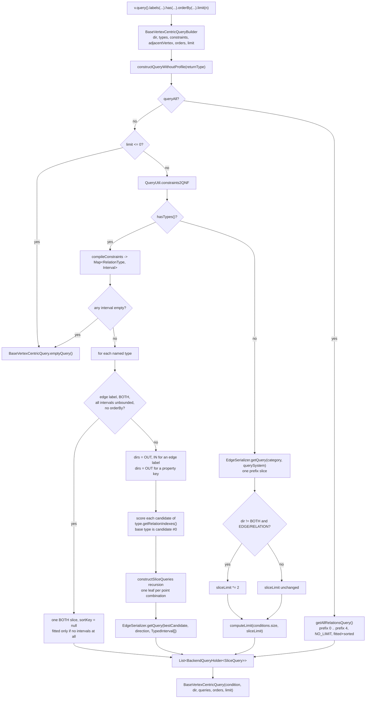
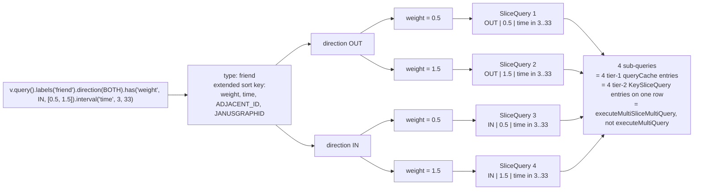

<!--
entry-meta
date: 2026-11-18
type: lesson
track: JanusGraph
lesson: 20
category: Database Internals
title: BasicVertexCentricQueryBuilder — v.edges(...) to SliceQuery, and how an index is chosen
slug: janusgraph-vertex-centric-query-builder
-->

# `BasicVertexCentricQueryBuilder` — `v.edges(...)` → `SliceQuery`, and how an index is chosen

**2026-11-18 · JanusGraph Track · Lesson 20 of 28**

## Where This Fits

- **Lesson 19** established the three cache tiers under a vertex read and, crucially, that tier 1 (`CacheVertex.queryCache`) is keyed by `SliceQuery` and tier 2 (`ExpirationKCVSCache`) by `KeySliceQuery` — so *one edgestore row holds one cache entry per distinct query shape*. It fixed what a shape **costs** and explicitly did **not** count how many shapes a traversal makes. See [`2026-11-17-janusgraph-vertex-caches-lazy-adjacency`](../2026-11-17-janusgraph-vertex-caches-lazy-adjacency/README.md).
- **This lesson** is where the shapes are made. `BasicVertexCentricQueryBuilder.constructQueryWithoutProfile` turns a `v.query().labels(...).has(...).orderBy(...).limit(...)` chain into a `List<BackendQueryHolder<SliceQuery>>`, picking a relation index per (type, direction) by a numeric score and then handing sort-key intervals to `EdgeSerializer.getQuery` to be serialized into column bounds. It answers the count question: **the number of sub-queries is a product, not a constant.**
- It also discharges two debts lesson 19 handed over: the **partitioned-vertex read fan-out** (`allRequiredRepresentatives` × sub-queries, with `hasAllCanonicalTypes()` as the collapse condition) and the entry point into **`MultiSliceQueriesGroupingUtil`**, which is reached only when `bq.getQueries().size() > 1` — that is, only when today's product is greater than one.
- **Lesson 21** takes the same question to the graph-centric side: `GraphCentricQueryBuilder` choosing between composite, mixed and full scan. The scoring function there is a different animal; this one is worth knowing first because it is small enough to read whole.

> **Method note.** Every mechanism below was read from the source at the pinned commit `a59ae8d8`. The two derived claims — the scoring crossover in §4 and the `.all()` prefix range in §8 — are labelled where they appear and each is paired with an exercise in **Hands-On** that runs real code rather than asserting. Line numbers come from files numbered locally this run; see **Sources** for which.

---

## 1. Two builders, one compiler

There is exactly one query compiler and two execution shells over it.

| Class | Role |
|---|---|
| [`BaseVertexCentricQueryBuilder`](https://github.com/JanusGraph/janusgraph/blob/a59ae8d8024207598eada34998d867617df51adf/janusgraph-core/src/main/java/org/janusgraph/graphdb/query/vertex/BaseVertexCentricQueryBuilder.java) | The fluent surface. Holds `dir` (default `BOTH`), `types` (default empty), `constraints`, `adjacentVertex`, `orders`, `limit` (default `Query.NO_LIMIT`). No logic beyond normalising arguments. |
| [`BasicVertexCentricQueryBuilder`](https://github.com/JanusGraph/janusgraph/blob/a59ae8d8024207598eada34998d867617df51adf/janusgraph-core/src/main/java/org/janusgraph/graphdb/query/vertex/BasicVertexCentricQueryBuilder.java) | The compiler (`constructQueryWithoutProfile`) **and** the result constructors. 973 lines, and the only place a vertex-centric `SliceQuery` is born. |
| [`VertexCentricQueryBuilder`](https://github.com/JanusGraph/janusgraph/blob/a59ae8d8024207598eada34998d867617df51adf/janusgraph-core/src/main/java/org/janusgraph/graphdb/query/vertex/VertexCentricQueryBuilder.java) | One base vertex. `v.query()`. |
| [`MultiVertexCentricQueryBuilder`](https://github.com/JanusGraph/janusgraph/blob/a59ae8d8024207598eada34998d867617df51adf/janusgraph-core/src/main/java/org/janusgraph/graphdb/query/vertex/MultiVertexCentricQueryBuilder.java) | A `Set<InternalVertex>`. `tx.multiQuery(...)`. Same compiler, different pre-load. |

A few details in the fluent layer that change what the compiler sees:

- **`has(key)` is `has(key, Cmp.NOT_EQUAL, null)`** and **`hasNot(key)` is `has(key, Cmp.EQUAL, null)`** — both are rewritten at the surface, so the compiler never sees a distinct "exists" predicate. This matters in §3.
- **`interval(key, start, end)` adds two constraints**, `GREATER_THAN_EQUAL start` and `LESS_THAN end`, which are intersected later.
- **`has(ADJACENT_ID, …)` is diverted into `adjacent(vertex)`** at `addConstraint`, and `has(ID, …)` is rewritten to a constraint on `ImplicitKey.JANUSGRAPHID` carrying `RelationIdentifier.getRelationId()` values.
- **`orderBy` allows exactly one key**: `Preconditions.checkArgument(orders.isEmpty(), "Only a single sort order is supported on vertex queries")`. The `OrderList` machinery is general; the vertex-centric surface is not.
- **`singleType()` memoises one resolved `RelationType`** keyed on the name it was resolved for, because the compiler asks for the type several times per query.

`VertexCentricQueryBuilder.execute(returnType, resultConstructor)` is the whole execution shell and it is short enough to characterise exactly:

1. `bq = super.constructQuery(returnType)` — compile (timed under a nested `OPTIMIZATION` profiler).
2. If `bq.isEmpty()` (which is `getLimit() <= 0`), return the constructor's empty result.
3. Optional property prefetch: `returnType == PROPERTY && hasSingleType() && !hasQueryOnlyLoaded() && tx.getConfiguration().hasPropertyPrefetching()`, and then only if `!propertiesLoaded(vertex)`. The guard is `holder.hasLoadedRelations(ALL_PROPERTIES_SLICE)` against a **static, never-mutated** `SliceQuery` built once from `IDHandler.getBounds(PROPERTY, false)` — the in-tree comment says why: "so that the fast path allocates no query per access".
4. Partitioned vertex → `allRequiredRepresentatives`, annotate, and pre-load (§7).
5. Non-partitioned **and** `bq.getQueries().size() > 1` **and** not prefetching → `tx.executeMultiSliceMultiQuery(singletonList(vertex), bq.getQueries(), profiler)`. This is the only door into lesson 19's grouping-tree rewrite for a single-vertex query, and the product computed in §3 is the key that opens it.
6. `resultConstructor.getResult(vertex, bq)`.

---

## 2. The untyped path: one slice, and why the limit is doubled

When `types.length == 0` ([`:581-601`](https://github.com/JanusGraph/janusgraph/blob/a59ae8d8024207598eada34998d867617df51adf/janusgraph-core/src/main/java/org/janusgraph/graphdb/query/vertex/BasicVertexCentricQueryBuilder.java#L581-L601)) there is nothing to choose: the query is a single slice over a *whole relation-category prefix*.

```java
final BackendQueryHolder<SliceQuery> query = new BackendQueryHolder<>(
        serializer.getQuery(returnType, querySystem),
        (adjacentVertex == null && dir == Direction.BOTH || returnType == RelationCategory.PROPERTY && dir == Direction.OUT)
            && !conditions.hasChildren(),
        orders.isEmpty());
```

`EdgeSerializer.getQuery(RelationCategory, boolean)` is three lines: `getBounds(resultType, querySystemTypes)` and `new SliceQuery(bound[0], bound[1])`. The bounds are **single-byte prefixes**, from `IDHandler.getPrefixed(prefix)` with `PREFIX_BIT_LEN = 3`, and `DirectionID.getPrefix(invisible, systemType)` is `((systemType ? 0 : invisible ? 2 : 1) << 1) + getRelationType()`:

| prefix | meaning |
|---|---|
| 0 | system property |
| 1 | system edge |
| 2 | normal visible property |
| 3 | normal visible edge |
| 4 | invisible non-system property |
| 5 | invisible non-system edge |

So `v.query().edges()` slices `[prefix 3, prefix 4)` and `v.query().properties()` slices `[prefix 2, prefix 3)`.

**Why the fitted expression has that shape.** `writeRelationType` packs the column prefix as `[invisible&system (2 bits) | relation-type bit | type count (varint) | direction bit]`, and the direction bit is the **low bit of the varint payload** (`strippedId = (strippedCount << 1) + dirID.getDirectionInt()`, with `EDGE_OUT → 0`, `EDGE_IN → 1`). Direction is therefore *inside* each relation type, not above it: all OUT cells of type T, then all IN cells of type T, then type T+1. **A prefix slice cannot select a direction.** That is the entire content of the first disjunct: an untyped query is fitted only when `dir == BOTH` (nothing to filter) or when it is a `PROPERTY` query with `dir == OUT` (properties only ever have `PROPERTY_DIR`, so `OUT` is free).

The test asserts exactly this pair, three lines apart:

```java
evaluateQuery(v.query(),                RELATION, numV * 4, 1, new boolean[]{true,  true});
evaluateQuery(v.query().direction(OUT), RELATION, numV * 4, 1, new boolean[]{false, true});
```

— [`JanusGraphTest:5290-5293`](https://github.com/JanusGraph/janusgraph/blob/a59ae8d8024207598eada34998d867617df51adf/janusgraph-backend-testutils/src/main/java/org/janusgraph/graphdb/JanusGraphTest.java#L5290-L5293). Same result count, same single sub-query; only `fitted` flips.

And that is also why the limit is doubled right there:

```java
if (sliceLimit != Query.NO_LIMIT && sliceLimit < Integer.MAX_VALUE/3) {
    if (dir != Direction.BOTH
        && (returnType == RelationCategory.EDGE || returnType == RelationCategory.RELATION)) {
        sliceLimit *= 2;
    }
}
```

"approximately half will be filtered" is not a heuristic about data — in a graph where every edge is written in both directions on both endpoints, it is arithmetic about the column layout.

Two small things in this branch worth noticing:

- **`conditions.add(returnType)` and the `VisibilityFilterCondition` are added *after* `computeLimit` is called** ([`:595-601`](https://github.com/JanusGraph/janusgraph/blob/a59ae8d8024207598eada34998d867617df51adf/janusgraph-core/src/main/java/org/janusgraph/graphdb/query/vertex/BasicVertexCentricQueryBuilder.java#L595-L601)), so `conditions.size()` passed to `computeLimit` is the count of *user* constraints only. The two structural conditions never inflate the limit.
- The `VisibilityFilterCondition` exists for a reason the comment states: "Need this to filter out newly created invisible relations in the transaction". The byte prefix already separates them on disk; the in-memory condition catches the ones not yet written.

### The `.all()` special case

`queryAll` short-circuits everything ([`:537-544`](https://github.com/JanusGraph/janusgraph/blob/a59ae8d8024207598eada34998d867617df51adf/janusgraph-core/src/main/java/org/janusgraph/graphdb/query/vertex/BasicVertexCentricQueryBuilder.java#L537-L544)):

```java
SliceQuery fullQuery = new SliceQuery(
    IDHandler.getBounds(RelationCategory.RELATION, true)[0],
    IDHandler.getBounds(RelationCategory.RELATION, false)[1]);
```

Note the asymmetry: `true` for the lower bound, `false` for the upper. **Derived from the prefix table above:** that is `[prefix 0, prefix 4)` — system relations *and* normal visible relations, but **not** prefixes 4–5, the invisible-but-not-system relation types. `.all()` is reached from exactly one place in the tree, `MultiVertexCentricQueryBuilder.drop()`, which calls `noPartitionRestriction().all().relations()`. Whether any shipped relation type is invisible-without-being-system is a `TypeDefinitionCategory.INVISIBLE` question this lesson did not settle; **lesson 25** owns it, and if the answer is yes, `drop()` leaves those cells behind.

Also: `getAllRelationsQuery()` allocates a fresh `SliceQuery` on every call, while the file three directories over keeps `ALL_PROPERTIES_SLICE` as a `static final` with a comment explaining why. **PR candidate 43** — make it a constant; the in-tree precedent is in the same package.

---

## 3. The typed path: the sub-query count is a product

With `types.length > 0` the compiler takes the long branch ([`:602-729`](https://github.com/JanusGraph/janusgraph/blob/a59ae8d8024207598eada34998d867617df51adf/janusgraph-core/src/main/java/org/janusgraph/graphdb/query/vertex/BasicVertexCentricQueryBuilder.java#L602-L729)). The shape is three nested loops and a recursion:

```
for each named type                                   (types.length)
  └─ for each direction in dirs                       (1, or 2 when typeDir == BOTH)
       └─ pick the best relation index by score
            └─ constructSliceQueries(...) recursion    (∏ |points| over the leading point intervals)
                 └─ one SliceQuery appended
```

### 3.1 Constraints become intervals first

`compileConstraints` ([`:816-847`](https://github.com/JanusGraph/janusgraph/blob/a59ae8d8024207598eada34998d867617df51adf/janusgraph-core/src/main/java/org/janusgraph/graphdb/query/vertex/BasicVertexCentricQueryBuilder.java#L816-L847)) folds the condition tree into a `Map<RelationType, Interval>` and returns whether *everything* fitted into it:

- `PredicateCondition` → `intersectConstraints`, which maps `Cmp.EQUAL` → `PointInterval`, the four comparisons → `range(...)`, and anything else (a `Text.CONTAINS`, a connective predicate) → `null`, which sets `isFitted = false`.
- An `Or` of equalities on one key → `QueryUtil.extractOrCondition` → a multi-point `PointInterval`. This is how `Contain.IN` arrives.
- **`has(key)` — i.e. `NOT_EQUAL null` — becomes `new RangeInterval<>()`, a range with no ends**, not a `null`: `if (value != null || type instanceof ImplicitKey) return null;` then `return pint != null ? pint : new RangeInterval<>();`. So "has a value of this key" **is** a constraint in the map, and it is counted by `intervalConstraints.size()`. That single decision drives three test assertions in §6.
- `adjacentVertex` with a real id becomes `constraintMap.put(ImplicitKey.ADJACENT_ID, new PointInterval(id))`; without an id it sets `isFitted = false`.
- `intersect` refuses to combine intervals whose values are of **different classes** (`valueType(interval) != valueType(other)` → `null` → unfitted), because "the conditions compare numbers of different types, which the intervals don't".

If any resulting interval `isEmpty()`, the whole query short-circuits to `BaseVertexCentricQuery.emptyQuery()` before a single byte is serialized.

### 3.2 Direction fan-out

```java
Direction[] dirs = {typeDir};
if (typeDir == Direction.BOTH) {
    if (type.isEdgeLabel()) dirs = new Direction[]{Direction.OUT, Direction.IN};
    else                    dirs = new Direction[]{Direction.OUT};   // property key
}
```

An edge label queried `BOTH` is **two** slices — unless the `isUnbounded` escape hatch above it applies ([`:645-654`](https://github.com/JanusGraph/janusgraph/blob/a59ae8d8024207598eada34998d867617df51adf/janusgraph-core/src/main/java/org/janusgraph/graphdb/query/vertex/BasicVertexCentricQueryBuilder.java#L645-L654)):

```java
if (type.isEdgeLabel() && typeDir == Direction.BOTH
    && intervalConstraints.values().stream().allMatch(BasicVertexCentricQueryBuilder::isUnbounded)
    && orders.isEmpty()) {
    SliceQuery q = serializer.getQuery(type, typeDir, null);   // sortKey == null
    ...
}
```

`isUnbounded` is `interval instanceof RangeInterval && getStart() == null && getEnd() == null` — precisely the shape `has(key)` produces. So a `BOTH` query whose only constraints are bare `has(key)`s, with no ordering, collapses to **one** slice spanning `OUT`-start to `IN`-end, and the `has` is checked in memory. The in-tree `TODO` admits the condition is "a little too restrictive".

Evidence, both directions of the fork:

```java
// one slice, BOTH, fitted = false (the has(weight) is checked in memory)
evaluateQuery(v.query().labels("sorted").direction(BOTH).has("weight"), EDGE, 4, 1, new boolean[]{false, true});
```
— [`JanusGraphTest:2247-2248`](https://github.com/JanusGraph/janusgraph/blob/a59ae8d8024207598eada34998d867617df51adf/janusgraph-backend-testutils/src/main/java/org/janusgraph/graphdb/JanusGraphTest.java#L2247-L2248)

```java
// two slices, BOTH, because the constraints are not all unbounded
evaluateQuery(v.query().labels("connect").has("time", Cmp.EQUAL, 5).interval("weight", 0.0, 5.0).direction(BOTH),
        EDGE, 1, 2, new boolean[0]);
```
— [`JanusGraphTest:5267-5268`](https://github.com/JanusGraph/janusgraph/blob/a59ae8d8024207598eada34998d867617df51adf/janusgraph-backend-testutils/src/main/java/org/janusgraph/graphdb/JanusGraphTest.java#L5267-L5268)

The `fitted` of the collapsed form is `isIntervalFittedConditions && intervalConstraints.isEmpty()` — and since `has(weight)` *put something in the map*, `isEmpty()` is false and the query is unfitted. That is why the first assertion reads `{false, true}` and not `{true, true}`.

### 3.3 Point fan-out: `constructSliceQueries`

[`:733-774`](https://github.com/JanusGraph/janusgraph/blob/a59ae8d8024207598eada34998d867617df51adf/janusgraph-core/src/main/java/org/janusgraph/graphdb/query/vertex/BasicVertexCentricQueryBuilder.java#L733-L774) walks the extended sort key left to right:

```java
if (position < extendedSortKey.length) {
    PropertyKey keyType = extendedSortKey[position];
    Interval interval = intervalConstraints.get(keyType);
    if (interval != null) { sortKeyConstraints[position] = new TypedInterval(keyType, interval); position++; }
    if (interval != null && interval.isPoints()) {
        for (Object point : interval.getPoints()) {
            TypedInterval[] clonedSKC = Arrays.copyOf(sortKeyConstraints, sortKeyConstraints.length);
            clonedSKC[position-1] = new TypedInterval(keyType, new PointInterval(point));
            constructSliceQueries(extendedSortKey, clonedSKC, position, ...);
        }
        return;
    }
}
// ... otherwise emit one SliceQuery here
```

One `SliceQuery` per leaf of that recursion tree. A *k*-point interval on a sort-key position multiplies the leaves by *k*, and the recursion keeps descending only through point intervals — a single range interval terminates the descent (it is written into `sortKeyConstraints` and then falls through to emission).

**So, the count lesson 19 asked for:**

> sub-queries per vertex = Σ over named types of ( dirs(type) × ∏ over the leading run of point-interval sort-key positions of |points| )

with `dirs(type) ∈ {1, 2}` and the `isUnbounded`-BOTH collapse forcing 1.

Three assertions that pin it, all in `testVertexCentricQuery` on the label `friend` with `sortKey(weight, time)`:

| Query | sub-queries | fitted |
|---|---|---|
| `.labels("friend").direction(OUT).interval("time",3,33).has("weight",0.5)` | **1** | true |
| `.labels("friend").direction(OUT).has("weight", IN, [0.5,1.5]).…` | **2** | true |
| `.labels("friend").direction(OUT).has("weight", IN, [0.5,1.5,2.5]).interval("time",3,33)` | **3** | true |

— [`JanusGraphTest:4829-4834`](https://github.com/JanusGraph/janusgraph/blob/a59ae8d8024207598eada34998d867617df51adf/janusgraph-backend-testutils/src/main/java/org/janusgraph/graphdb/JanusGraphTest.java#L4829-L4834).

**Why this matters beyond the count.** Each of those is a distinct `SliceQuery`, so by lesson 19's keying it is a distinct tier-1 `queryCache` entry *and* a distinct tier-2 `KeySliceQuery` entry on the same row. A three-point `IN` list against one vertex costs three cache entries on one row, and `CacheVertex.getSuperResultSet`'s linear `subsumes` scan has three entries to walk past on the next miss. It is also what pushes `execute` over the `bq.getQueries().size() > 1` threshold and into `executeMultiSliceMultiQuery`, i.e. into the grouping tree that lesson 19 found `ExpirationKCVSCache.getMultiSlices` **mutates in place**.

---

## 4. Choosing the relation index: the score

The inner loop ([`:665-713`](https://github.com/JanusGraph/janusgraph/blob/a59ae8d8024207598eada34998d867617df51adf/janusgraph-core/src/main/java/org/janusgraph/graphdb/query/vertex/BasicVertexCentricQueryBuilder.java#L665-L713)) is the whole vertex-centric planner. There is no cardinality estimate, no statistics, no cost in bytes — one `double`.

**Candidate set.** `type.getRelationIndexes()`, implemented in [`RelationTypeVertex`](https://github.com/JanusGraph/janusgraph/blob/a59ae8d8024207598eada34998d867617df51adf/janusgraph-core/src/main/java/org/janusgraph/graphdb/types/vertices/RelationTypeVertex.java) as

```java
return Iterables.concat(
    Collections.singletonList(this),
    Iterables.transform(getRelated(TypeDefinitionCategory.RELATIONTYPE_INDEX, Direction.OUT), …));
```

**The base relation type is always candidate #0**, followed by its relation indexes in schema-edge order. A vertex-centric index is itself an `InternalRelationType` with its own id, so "choosing the index" means slicing a *different relation-type prefix in the same row* — not a different store.

**Filters**, applied before scoring:

```java
if (!candidate.isUnidirected(Direction.BOTH) && !candidate.isUnidirected(direction)) continue;
if (!candidate.equals(type) && candidate.getStatus() != SchemaStatus.ENABLED) continue;
```

An index built `Direction.OUT` is simply invisible to the `IN` pass. And the status check **exempts the base type**: a `REGISTERED` or `INSTALLED` index is skipped, but the base type is used whatever its status. (Compare lesson 17's write side, where `INSTALLED` and `REGISTERED` composite indexes still *receive* writes — which is what makes a reindex converge. Reads skip them; writes do not.)

**The score:**

```java
boolean supportsOrder = orders.isEmpty() || orders.getCommonOrder() == candidate.getSortOrder();
int currentOrder = 0;
double score = 0.0;
PropertyKey[] extendedSortKey = getExtendedSortKey(candidate, direction, tx);

for (PropertyKey keyType : extendedSortKey) {
    if (currentOrder < orders.size() && orders.getKey(currentOrder).equals(keyType)) currentOrder++;
    Interval interval = intervalConstraints.get(keyType);
    if (interval == null || !interval.isPoints()) {
        if (interval != null) score += 1;
        break;
    } else {
        score += 5.0 / interval.getPoints().size();
    }
}
if (supportsOrder && currentOrder == orders.size()) score += 3;
if (score > bestScore) { … }
```

Read as arithmetic:

| contribution | value |
|---|---|
| a 1-point equality on a sort-key position in the leading prefix | **+5.0** |
| a *k*-point `IN` on such a position | **+5.0 / k** |
| a range (or any non-point interval) on the next position — then **stop** | **+1**, loop breaks |
| no constraint at all on the next position | **0**, loop breaks |
| the candidate's declared sort order and key prefix satisfy the query's `orderBy` | **+3** |

**Three consequences that are not obvious from reading the docs.**

**(a) With no `orderBy`, every candidate gets the +3.** `orders.isEmpty()` makes `supportsOrder` true and `currentOrder == orders.size()` trivially `0 == 0`. So the ordering bonus is a constant offset in the common case, not a tiebreaker. The base type with no sort key scores exactly **3.0**: its extended sort key starts with `ADJACENT_ID` (or `JANUSGRAPHID`), which has no constraint unless `adjacent()` was used, so the loop breaks at position 0 with `score == 0`.

**(b) `score > bestScore` is strict, and the base type is first — so every tie goes to the plain label slice.** An index whose *leading* sort key carries no constraint scores 3.0 and loses to the base type's 3.0. This is defensible (both are full slices; the base type's cells are the ones that exist regardless) but it is worth knowing that a vertex-centric index is silently unused whenever the constraint lands on its second key rather than its first — which is exactly what the docs page warns about in prose ("an equality constraint on `rating` is needed to make the `time` key effective") without saying it is a `>` versus `>=`.

**(c) Derived: a 5-point `IN` and an unbounded range score identically, and a 6-point `IN` scores *worse* than a range.** `5.0/5 = 1.0`, and a non-point interval contributes exactly `1`. So for the same leading key:

| constraint on the leading sort key | score contribution |
|---|---|
| `EQUAL x` | 5.000 |
| `IN` 2 values | 2.500 |
| `IN` 4 values | 1.250 |
| `IN` 5 values | **1.000** |
| any range, `has(key)` included | **1.000** |
| `IN` 6 values | 0.833 |
| `IN` 10 values | 0.500 |

An `IN` of six values produces six tight, fitted slices; a range produces one wide one. The function ranks the six-slice plan **below** the one-wide-slice plan whenever two candidates offer that choice, because `5.0/k` was written as a selectivity proxy and is being compared against a flat `1` that carries no selectivity information at all. This is a scoring artefact, not a correctness bug — a wrong choice still returns the right answer, just over more bytes — but it is the kind of thing a maintainer would want a benchmark for. **PR candidate 44.** The derivation is from the two lines above; the exercise in **Hands-On B** makes a real planner choose, so the claim is testable rather than argued.

**One more real defect while in this file.** [`BackendQueryHolder.hashCode()`](https://github.com/JanusGraph/janusgraph/blob/a59ae8d8024207598eada34998d867617df51adf/janusgraph-core/src/main/java/org/janusgraph/graphdb/query/BackendQueryHolder.java) is

```java
return Objects.hash(backendQuery, isFitted, isFitted);
```

while `equals` compares `isFitted`, `isSorted` and `backendQuery`. `isFitted` is hashed twice and `isSorted` never. Equal objects still hash equal, so nothing breaks — but two holders differing only in `isSorted` collide by construction. A one-character typo. **PR candidate 45.**

Finally, the planner is allowed to fail loudly:

```java
Preconditions.checkArgument(bestCandidate != null,
    "Current graph schema does not support the specified query constraints for type: %s", type.name());
```

`bestCandidate` can only be null if **every** candidate was filtered out — which, since the base type is always a candidate, means the base type itself failed `isUnidirected`. That happens for a `unidirected()` edge label queried in the wrong direction… except that case is already `continue`d earlier at [`:640`](https://github.com/JanusGraph/janusgraph/blob/a59ae8d8024207598eada34998d867617df51adf/janusgraph-core/src/main/java/org/janusgraph/graphdb/query/vertex/BasicVertexCentricQueryBuilder.java#L640). I could not construct a schema that reaches this `checkArgument` at the pinned commit and am not going to claim it is dead; **noting it as unresolved** rather than filling the gap.

---

## 5. `getExtendedSortKey` — where `ADJACENT_ID` and `JANUSGRAPHID` come from

The sort key a query plans against is **not** the one the user declared ([`:787-801`](https://github.com/JanusGraph/janusgraph/blob/a59ae8d8024207598eada34998d867617df51adf/janusgraph-core/src/main/java/org/janusgraph/graphdb/query/vertex/BasicVertexCentricQueryBuilder.java#L787-L801)):

```java
int additional = 0;
if (!type.multiplicity().isUnique(dir)) {
    if (!type.multiplicity().isConstrained()) additional++;
    if (type.isEdgeLabel())                   additional++;
}
PropertyKey[] entireKey = new PropertyKey[type.getSortKey().length + additional];
for (i = 0; i < type.getSortKey().length; i++) entireKey[i] = tx.getExistingPropertyKey(type.getSortKey()[i]);
if (type.isEdgeLabel() && !type.multiplicity().isUnique(dir)) entireKey[i++] = ImplicitKey.ADJACENT_ID;
if (!type.multiplicity().isConstrained())                     entireKey[i]   = ImplicitKey.JANUSGRAPHID;
```

This mirrors lesson 10's column layout exactly — the declared sort keys, then the adjacent vertex id, then the relation id, which is the tail that makes a cell unique. Worked examples:

| label | multiplicity | extended sort key for `OUT` |
|---|---|---|
| `friend` with `sortKey(weight, time)` | `MULTI` | `[weight, time, ADJACENT_ID, JANUSGRAPHID]` |
| `connect` with `sortKey(time)` | `MULTI` | `[time, ADJACENT_ID, JANUSGRAPHID]` |
| plain label, no sort key | `MULTI` | `[ADJACENT_ID, JANUSGRAPHID]` |
| `child`, `ONE2MANY`, direction `IN` | unique in `IN` | `[]` — nothing appended |
| a `SINGLE`-cardinality property key | constrained | declared keys only |

The practical consequence: **`adjacent(u)` is a planner input, not a post-filter.** Because `ADJACENT_ID` sits in the extended sort key with a `PointInterval`, an adjacency constraint on a label with no declared sort key lands on position 0 and scores 5.0, and the emitted slice narrows to that one neighbour's byte range. The test confirms the fitting:

```java
evaluateQuery(v.query().labels("connect").direction(OUT).adjacent(u),                        EDGE, 1, 1, {true,  true});
evaluateQuery(v.query().labels("connect").direction(OUT).has("weight", Cmp.EQUAL, 0.0).adjacent(u), EDGE, 1, 1, {true,  true});
evaluateQuery(v.query().labels("connect").direction(OUT).interval("weight", 0.0, 1.0).adjacent(u),  EDGE, 1, 1, {false, true});
```
— [`JanusGraphTest:5281-5286`](https://github.com/JanusGraph/janusgraph/blob/a59ae8d8024207598eada34998d867617df51adf/janusgraph-backend-testutils/src/main/java/org/janusgraph/graphdb/JanusGraphTest.java#L5281-L5286). The third is unfitted because a *range* on `weight` stops the descent before `ADJACENT_ID` is reached, so `position` never equals `intervalConstraints.size()`.

The one exception: `ImplicitKey.JANUSGRAPHID` and `ADJACENT_ID` are asserted to be **points only** in the serializer (`assert interval == null || interval.isPoints()` at `EdgeSerializer:473`), and `intersectConstraints` makes `has(implicitKey)` return `null` for exactly that reason — "that of an implicit key, which a slice takes as points only, is checked in memory as before", with [`JanusGraphTest:2251-2252`](https://github.com/JanusGraph/janusgraph/blob/a59ae8d8024207598eada34998d867617df51adf/janusgraph-backend-testutils/src/main/java/org/janusgraph/graphdb/JanusGraphTest.java#L2251-L2252) asserting `{false, true}`.

---

## 6. From `TypedInterval[]` to bytes

[`EdgeSerializer.getQuery(InternalRelationType, Direction, TypedInterval[])`](https://github.com/JanusGraph/janusgraph/blob/a59ae8d8024207598eada34998d867617df51adf/janusgraph-core/src/main/java/org/janusgraph/graphdb/database/EdgeSerializer.java#L436-L552) is the serialization counterpart of lesson 10's `writeRelation`. It maintains **two** `DataOutput`s, `colStart` and `colEnd`, writing the same relation-type prefix into both and then diverging only where the interval does.

```
colStart ──► [relType prefix | sortKey₀ | sortKey₁ | …]  ──► sliceStart
colEnd   ──► [relType prefix | sortKey₀ | sortKey₁ | …]  ──► sliceEnd
```

The cases:

- **`dir == BOTH`** (only reachable from the `isUnbounded` collapse, since `sortKey` is `null` there): start = `getRelationType(id, EDGE_OUT_DIR, invisible)`, end = `nextBiggerBuffer(getRelationType(id, EDGE_IN_DIR, invisible))`. One prefix-pair, both directions, no sort-key bytes.
- **Point interval**: the same value is written into both buffers, through one of three writers depending on the key — `VariableLong.writePositiveBackward` for `JANUSGRAPHID`, `IDHandler.writeVertexId(..., false)` for `ADJACENT_ID`, `writeInline(..., InlineType.KEY)` for a real property key. (The *backward* encoding is lesson 11's order-preserving varint; this is the read-side use of it.) The loop then continues to the next position.
- **Range interval**: start bound into `colStart`, end bound into `colEnd`, then the slice is finalised and the loop **breaks** — a range is necessarily the last constrained position.
- **No interval / empty interval**: `break` immediately.

Two details that are easy to miss and both show up in assertions:

**(1) `ASC` vs `DESC` is a byte flip, not a comparator.**

```java
case ASC:  sliceStart = colStart.getStaticBuffer();
           sliceEnd   = colEnd.getStaticBuffer();
           if (!interval.startInclusive()) sliceStart = BufferUtil.nextBiggerBuffer(sliceStart);
           if (interval.endInclusive())    sliceEnd   = BufferUtil.nextBiggerBuffer(sliceEnd);
           break;
case DESC: sliceEnd   = colStart.getStaticBufferFlipBytes(keyStartPos, colStart.getPosition());
           sliceStart = colEnd.getStaticBufferFlipBytes(keyStartPos, colEnd.getPosition());
           if (interval.startInclusive()) sliceEnd   = BufferUtil.nextBiggerBuffer(sliceEnd);
           if (!interval.endInclusive())  sliceStart = BufferUtil.nextBiggerBuffer(sliceStart);
           break;
```

A `DESC` index stores the sort-key bytes **ones-complemented** from `keyStartPos` onward, so the two buffers swap roles and the inclusivity adjustments invert with them. The storage layer below knows nothing about ordering; it still returns one ascending byte range. This is why `isSorted` can be `true` for a descending `orderBy` on a `DESC` index and `false` on an `ASC` one, with identical `fitted`:

```java
evaluateQuery(v.query().labels("connect").direction(OUT).has("time", Cmp.EQUAL, 22).orderBy("weight", desc),
        EDGE, 1, 1, new boolean[]{true, true},  weight, Order.DESC);
evaluateQuery(v.query().labels("connect").direction(OUT).has("time", Cmp.EQUAL, 22).orderBy("weight", asc),
        EDGE, 1, 1, new boolean[]{true, false}, weight, Order.ASC);
```
— [`JanusGraphTest:5277-5280`](https://github.com/JanusGraph/janusgraph/blob/a59ae8d8024207598eada34998d867617df51adf/janusgraph-backend-testutils/src/main/java/org/janusgraph/graphdb/JanusGraphTest.java#L5277-L5280). Same index (`connect3`, `time+weight` `DESC`), same bytes, same single sub-query — only whether `QueryProcessor` must sort afterwards.

**(2) The open-ended range and the missing-value sentinel.**

```java
} else if (leavesOutMissingValues(propertyKey)) {
    //The range ends before the relations without a value of the key, whose missing value is
    //written as -1 after the values (see writesMissingValuesLast), as no range holds them
    colEnd.putByte((byte) -1);
    endInclusive = false;
}
```

A relation that simply does not carry the sort key is serialized with `-1` — the largest byte — in that position, so it sorts **after** every real value. A range with no upper bound would therefore sweep it up. `getQuery` writes the explicit `-1` terminator so the slice ends just before them, and the builder checks the same predicate before claiming fitness ([`:763-770`](https://github.com/JanusGraph/janusgraph/blob/a59ae8d8024207598eada34998d867617df51adf/janusgraph-core/src/main/java/org/janusgraph/graphdb/query/vertex/BasicVertexCentricQueryBuilder.java#L763-L770)):

```java
if (isFitted && position > 0) {
    EdgeSerializer.TypedInterval lastInterval = sortKeyConstraints[position-1];
    if (!lastInterval.interval.isPoints() && lastInterval.interval.getEnd() == null
        && !serializer.leavesOutMissingValues(lastInterval.key)) isFitted = false;
}
```

`leavesOutMissingValues(key)` delegates straight to `serializer.writesMissingValuesLast(key.dataType())`, so **fitness here is a property of the data type**, not of the query. The test for this ([`testVertexCentricOrderLeavesOutTheRelationsWithoutTheKey`](https://github.com/JanusGraph/janusgraph/blob/a59ae8d8024207598eada34998d867617df51adf/janusgraph-backend-testutils/src/main/java/org/janusgraph/graphdb/JanusGraphTest.java#L2120-L2262)) builds the data set `{3, null, 1, 2, null, 5}` and asserts four results for `has("weight")` against six edges, fitted, on an indexed label — and `{false, false}` for the same query on the un-indexed label `plain`.

The floating-point corner is handled one level up, in `range(Cmp, Object)` ([`:883-896`](https://github.com/JanusGraph/janusgraph/blob/a59ae8d8024207598eada34998d867617df51adf/janusgraph-core/src/main/java/org/janusgraph/graphdb/query/vertex/BasicVertexCentricQueryBuilder.java#L883-L896)), because byte order and `AttributeUtils.compare` disagree about zeros and NaN: byte order puts `-0.0` before `+0.0` and `NaN` after `+∞`, while the comparison treats the two zeros as equal and `NaN` as comparable with nothing. So a decimal range from a start gets an explicit `setEnd(NaN, false)`, a bound at either zero is rewritten to `-0.0` or `+0.0` depending on strictness, and a `NaN` bound becomes the single point `NaN`. Three assertions cover it at [`JanusGraphTest:2256-2260`](https://github.com/JanusGraph/janusgraph/blob/a59ae8d8024207598eada34998d867617df51adf/janusgraph-backend-testutils/src/main/java/org/janusgraph/graphdb/JanusGraphTest.java#L2256-L2260).

Finally, the returned query carries two things beyond its bounds:

```java
return new SliceQuery(sliceStart, sliceEnd, type.name())
    .setDirectColumnByStartOnlyAllowed(isDirectColumnByStartOnlyAllowed(type));
```

The third constructor argument is the type **name**, carried for profiling. `isDirectColumnByStartOnlyAllowed` is `true` only for a `PropertyKeyVertex` whose multiplicity has `Cardinality.SINGLE` — one value per key means the start bound identifies the column outright, so the backend may fetch by start rather than scan a range.

---

## 7. `fitted`, `sorted`, `simple` — and what each actually buys

`BackendQueryHolder` carries two booleans; `BaseVertexCentricQuery.isSimple()` is their conjunction with a count:

```java
public boolean isSimple() {
    return queries.size() == 1 && queries.get(0).isFitted() && queries.get(0).isSorted();
}
```

And `useSimpleQueryProcessor` adds a liveness condition:

```java
if (!query.isSimple()) return false;
if (queryOnlyLoaded)   return true;
for (InternalVertex vertex : vertices) if (!vertex.isLoaded()) return false;
return true;
```

| flag | set where | what it buys |
|---|---|---|
| `isFitted` | `isIntervalFittedConditions && position == intervalConstraints.size()` (+ the open-range correction) | no in-memory `condition.evaluate(relation)` per result |
| `isSorted` | `bestCandidateSupportsOrder`, i.e. the candidate's declared order and key prefix match the `orderBy` | no in-memory sort |
| `isSimple` | one sub-query **and** both of the above | [`SimpleVertexQueryProcessor`](https://github.com/JanusGraph/janusgraph/blob/a59ae8d8024207598eada34998d867617df51adf/janusgraph-core/src/main/java/org/janusgraph/graphdb/query/vertex/SimpleVertexQueryProcessor.java) instead of the generic `QueryProcessor` |

What the simple processor saves is concrete, not rhetorical. Its `vertexIds()` reads adjacent ids **straight out of the `Entry` bytes**:

```java
return edgeSerializer.readRelation(entry, true, tx).getOtherVertexId();
```

with `true` meaning parse-the-header-only — no `JanusGraphRelation` object is constructed at all. It tracks `sorted` as it goes by comparing each id to the last and hands the result to `VertexIdList(tx, list, sorted)`. The generic path, by contrast, materialises relations through `RelationConstructor.readRelation` and then calls `edge.otherVertex(v)` on each.

Its one subtlety is the limit dance:

```java
if (sliceQuery.hasLimit() && sliceQuery.getLimit() != query.getLimit()) iterator = new LimitAdjustingIterator();
else                                                                    iterator = getBasicIterator();
```

The inequality is the trigger: the slice limit was inflated by `computeLimit` (§8), so it differs from the user's, and the `LimitAdjustingIterator` re-issues with `sliceQuery.updateLimit(newLimit)` until the user's count is satisfied. When the two happen to be equal, the whole wrapper is skipped.

`queryOnlyLoaded()` is enforced by assertion at the end of `constructQuery(vertex, baseQuery)`:

```java
Preconditions.checkArgument(!queryOnlyLoaded || query.isSimple(), "Query-only-loaded only works on simple queries");
```

— which is what makes lesson 17's `IndexSerializer` delta computation safe: it asks only for queries it knows compile to a single fitted slice.

There is also a second cache-aware read path, `CachedRelationConstructor` → `loadRelationsFromCache` ([`:376-409`](https://github.com/JanusGraph/janusgraph/blob/a59ae8d8024207598eada34998d867617df51adf/janusgraph-core/src/main/java/org/janusgraph/graphdb/query/vertex/BasicVertexCentricQueryBuilder.java#L376-L409)), used by **`MultiVertexCentricQueryBuilder` only**. Its guard is:

```java
boolean hasNotCachedQueries = baseQuery.getQueries().stream()
    .anyMatch(q -> cacheVertex.getFromCache(q.getBackendQuery()) == null || !q.isFitted() || !q.isSorted());
if (hasNotCachedQueries) return executeRelations(vertex, baseQuery);
```

Note `getFromCache` — an **exact** `queryCache` hit, not lesson 19's `subsumes` scan. Every sub-query must already be in the vertex's query cache *and* fitted *and* sorted; one miss and the whole thing falls back. That is why the multi-query path pre-loads first and reads second, and why the pre-load must use the same `SliceQuery` objects the compiler produced.

---

## 8. Limits: the arithmetic

`computeLimit` ([`:960-969`](https://github.com/JanusGraph/janusgraph/blob/a59ae8d8024207598eada34998d867617df51adf/janusgraph-core/src/main/java/org/janusgraph/graphdb/query/vertex/BasicVertexCentricQueryBuilder.java#L960-L969)) plus [`QueryUtil.adjustLimitForTxModifications`](https://github.com/JanusGraph/janusgraph/blob/a59ae8d8024207598eada34998d867617df51adf/janusgraph-core/src/main/java/org/janusgraph/graphdb/query/QueryUtil.java#L57-L71):

```java
private int computeLimit(int remainingConditions, int baseLimit) {
    if (baseLimit == Query.NO_LIMIT) return baseLimit;
    baseLimit = Math.max(baseLimit,
            Math.min(HARD_MAX_LIMIT, QueryUtil.adjustLimitForTxModifications(tx, remainingConditions, baseLimit)));
    return baseLimit;
}

public static int adjustLimitForTxModifications(StandardJanusGraphTx tx, int uncoveredAndConditions, int limit) {
    if (uncoveredAndConditions > 0) {
        final int maxMultiplier     = Integer.MAX_VALUE / limit;
        final int estimatedMultiplier = (int) Math.pow(2, uncoveredAndConditions);
        limit = estimatedMultiplier < maxMultiplier ? limit * estimatedMultiplier : Integer.MAX_VALUE;
    }
    if (tx.hasModifications()) limit += Math.min(Integer.MAX_VALUE - limit, 5);
    return limit;
}
```

`HARD_MAX_LIMIT = 300000`, a private constant in the builder. The `Math.max` guarantees the slice limit is never *below* the user's, and the `Math.min` caps only the inflated value — so a user limit above 300 000 passes through untouched.

`remainingConditions` differs by branch:

- untyped: `conditions.size()`, the count of user constraints, with `sliceLimit` already doubled for a single-direction edge query;
- typed: `intervalConstraints.size() - position`, the constraints the sort-key prefix did **not** absorb.

Worked, on a clean transaction (`hasModifications() == false`):

| query | `sliceLimit` in | remaining | slice limit emitted |
|---|---|---|---|
| `v.query().direction(OUT).limit(10).edges()` | 10 → ×2 = 20 | 0 | **20** |
| same, on a tx with modifications | 20 | 0 | **25** |
| `v.query().direction(OUT).has("x", …).limit(10).edges()` (unfitted) | 20 | 1 | max(20, 20·2) = **40** |
| `.labels("friend").direction(OUT).has("weight",0.5).limit(3)` (fully fitted) | 3 | 0 | **3** |
| `.labels("connect").direction(OUT).has("time",15).has("weight",3.5).limit(10)` | 10 | 1 | **20** |

The last row is the one to remember: `connect` has `sortKey(time)` only, so `weight` is never absorbed, `position` stops at 1 while `intervalConstraints.size()` is 2 — the query is unfitted *and* over-reads by 2×. The test asserts the fit directly:

```java
evaluateQuery(v.query().labels("connect").direction(OUT).has("time", 15).has("weight", 3.5),
        EDGE, 1, 1, new boolean[]{false, true});
```
— [`JanusGraphTest:4819`](https://github.com/JanusGraph/janusgraph/blob/a59ae8d8024207598eada34998d867617df51adf/janusgraph-backend-testutils/src/main/java/org/janusgraph/graphdb/JanusGraphTest.java#L4819).

The comment above `sliceLimit` deserves quoting because it is a design statement, not a note:

> `//Don't be smart with query limit adjustments - it just messes up the caching layer and penalizes when appropriate limits are set by the user!`

Every distinct limit produces a distinct `SliceQuery`, hence a distinct tier-1 and tier-2 cache key. Adaptive limit growth would shred the cache. Lesson 19's keying is the reason this comment exists.

---

## 9. Partitioned vertices — closing lesson 08's debt

Lesson 19 established the storage side: each representative of a partitioned vertex is its own `CacheVertex` with its own `queryCache`, and `config.getRestrictedPartitions()` bounds the id list. The query side is here, and it is two methods ([`:205-212`](https://github.com/JanusGraph/janusgraph/blob/a59ae8d8024207598eada34998d867617df51adf/janusgraph-core/src/main/java/org/janusgraph/graphdb/query/vertex/BasicVertexCentricQueryBuilder.java#L205-L212) and [`:325-334`](https://github.com/JanusGraph/janusgraph/blob/a59ae8d8024207598eada34998d867617df51adf/janusgraph-core/src/main/java/org/janusgraph/graphdb/query/vertex/BasicVertexCentricQueryBuilder.java#L325-L334)):

```java
protected boolean hasAllCanonicalTypes() {
    if (types.length == 0) return false;
    for (String typeName : types) {
        InternalRelationType type = QueryUtil.getType(tx, typeName);
        if (type != null && !type.isPropertyKey() && !type.multiplicity().isUnique(dir)) return false;
    }
    return true;
}

protected List<InternalVertex> allRequiredRepresentatives(InternalVertex partitionedVertex) {
    if (hasAllCanonicalTypes()) return ImmutableList.of(tx.getCanonicalVertex(partitionedVertex));
    return Arrays.asList(tx.getAllRepresentatives(partitionedVertex, restrict2Partitions));
}
```

**The fan-out is `|representatives| × sub-queries`**, and it collapses to `1 × sub-queries` exactly when every named type is either a property key or unique in the queried direction — because such relations can only live on the canonical representative. An untyped query (`types.length == 0`) returns `false` immediately and therefore always fans out to every representative.

With more than one representative, the results are merged rather than concatenated:

- `executeRelations` merges with `ResultMergeSortIterator.mergeSort(merge, iterable, byOrders, false)`, where `byOrders` is `RelationComparator.compareOnOrders(r1, r2, relationOrders)` — the *query's* orders, which is why each representative must return in that order for the merge to be correct;
- `executeVertices` merges by `VertexArrayList.VERTEX_ID_COMPARATOR`, but **only after** checking `if (!orders.isEmpty()) return edges2VertexIds((Iterable) executeRelations(...), vertex)` — an ordered vertex query degrades to the relation path and then projects;
- `executeVertexIds` does **not** merge-sort at all; it concatenates with `merge.addAll(vertexList)` and breaks early once `merge.size() >= baseQuery.getLimit()`. Ordering across representatives is not preserved on that path, which is consistent with `VertexList` carrying its own `isSorted()` flag.

And the pre-load decision in `VertexCentricQueryBuilder.execute` is where today's count meets lesson 19's grouping tree:

```java
if (vertices.size() > 1) {
    if (bq.getQueries().size() == 1) {
        tx.executeMultiQuery(vertices, query.getBackendQuery(), query.getProfiler());
    } else {
        tx.executeMultiSliceMultiQuery(vertices, bq.getQueries(), profiler);
    }
}
```

The in-tree comment says it plainly: "if it's just a single query - there is no need to group any queries together." So **the grouping tree that `ExpirationKCVSCache.getMultiSlices` mutates in place is reached only when the product in §3 exceeds one.** A traversal with a single equality constraint never touches it; a three-value `IN` list always does.

---

## The whole compile path



## How the sub-query count multiplies out



---

## Hands-On

All three run against `janusgraph-inmemory`, which is the fastest backend that still exercises the real compiler. None of the three test methods below is in `InMemoryGraphTest`'s `@Disabled` list, so they actually run (lesson 06's warning about silent skips applies to 31 *other* methods there).

### A — Watch the sub-query count move

```bash
mvn -q -pl janusgraph-inmemory -am -DskipTests install
mvn -pl janusgraph-inmemory -Dtest=InMemoryGraphTest#testRelationTypeIndexes test
```

Then open `janusgraph-backend-testutils/src/main/java/org/janusgraph/graphdb/JanusGraphBaseTest.java` and read `evaluateQuery(JanusGraphVertexQuery, …)` at lines 601–659. The assertion that matters is the last one:

```java
assertEquals(numSubQueries, subQueryCounter);
```

where `subQueryCounter` counts the profiler's children, skipping the `OPTIMIZATION` child and anything annotated `MULTI_SLICES_ANNOTATION`. **That counter is the product from §3, measured.**

Now break it on purpose. In your fork, change [`JanusGraphTest:5268`](https://github.com/JanusGraph/janusgraph/blob/a59ae8d8024207598eada34998d867617df51adf/janusgraph-backend-testutils/src/main/java/org/janusgraph/graphdb/JanusGraphTest.java#L5267-L5268) from `2` to `1`:

```java
evaluateQuery(v.query().labels("connect").has("time", Cmp.EQUAL, 5).interval("weight", 0.0, 5.0).direction(BOTH),
        EDGE, 1, 2, new boolean[0]);        // <- change the 2 to a 1
```

**What to look for:** `expected: <1> but was: <2>`. You have just proved that a `BOTH` query on an edge label with a non-unbounded constraint is two slices, not one. Revert, then do the same to [`:4831`](https://github.com/JanusGraph/janusgraph/blob/a59ae8d8024207598eada34998d867617df51adf/janusgraph-backend-testutils/src/main/java/org/janusgraph/graphdb/JanusGraphTest.java#L4831) (`3` → `2`) in `testVertexCentricQuery` and watch the point fan-out fail the same way. Revert both; these are upstream test files and the edits must not be committed.

### B — Make the planner choose, and read its score

This is the exercise for §4's derived claim. Add a throwaway test to your fork under `janusgraph-inmemory/src/test/java/org/janusgraph/graphdb/inmemory/`:

```java
@Test
public void scoringCrossover() {
    PropertyKey rating = mgmt.makePropertyKey("rating").dataType(Integer.class).make();
    EdgeLabel battled = mgmt.makeEdgeLabel("battled").make();
    mgmt.buildEdgeIndex(battled, "byRating", Direction.OUT, Order.ASC, rating);
    finishSchema();

    JanusGraphVertex v = tx.addVertex();
    for (int i = 0; i < 100; i++) v.addEdge("battled", tx.addVertex()).property("rating", i % 10);
    newTx();
    v = getV(tx, v.id());

    // 1 point  -> index scores 5+3 = 8, base scores 3  -> index wins, 1 slice
    evaluateQuery(v.query().labels("battled").direction(Direction.OUT).has("rating", 3),
            RelationCategory.EDGE, 10, 1, new boolean[]{true, true});
    // 5 points -> index scores 5/5+3 = 4; a range would score 1+3 = 4 as well
    evaluateQuery(v.query().labels("battled").direction(Direction.OUT)
                    .has("rating", Contain.IN, ImmutableList.of(0,1,2,3,4)),
            RelationCategory.EDGE, 50, 5, new boolean[]{true, true});
}
```

Run it:

```bash
mvn -pl janusgraph-inmemory -Dtest=InMemoryGraphTest#scoringCrossover test
```

**What to look for:** the second call asserts **5** sub-queries — the `IN` list of five values became five slices, each fitted. Then set a breakpoint on `BasicVertexCentricQueryBuilder` line 704 (`if (score > bestScore)`) and inspect `score` on each pass of the candidate loop. You should see `8.0` then `3.0` for the first query and `4.0` then `3.0` for the second; the gap between the index and the base type shrinks from 5.0 to 1.0 as the `IN` list grows, and at eleven or more values `5.0/k < 1.0` puts a hypothetical range-serving index ahead. Record the numbers you actually observe — the point of the exercise is that the score is a number you can watch, not a claim to take on trust.

### C — See the bytes a sort key produces

Set a breakpoint on `EdgeSerializer.getQuery(InternalRelationType, Direction, TypedInterval[])` at line 551 (the `return new SliceQuery(...)`) and run `InMemoryGraphTest#testVertexCentricQuery`. On each stop, evaluate:

```
sliceStart.length()  sliceEnd.length()
type.getSortOrder()
sortKey == null ? "collapsed BOTH" : sortKey.length
```

**What to look for, in order:**

1. For an `ASC` label, `sliceStart` and `sliceEnd` share a byte prefix and diverge at the first constrained sort-key position.
2. For `connectDesc` (`sortOrder(Order.DESC)`), step into the `case DESC:` arm and confirm `sliceStart` comes from `colEnd` and `sliceEnd` from `colStart`, both via `getStaticBufferFlipBytes(keyStartPos, …)` — the bounds are swapped *and* ones-complemented from `keyStartPos` onward, while `keyStartPos` itself is the position right after the relation-type prefix, which is **not** flipped.
3. For an open-ended range on a key whose type `writesMissingValuesLast`, confirm the extra `(byte) -1` at the tail of `colEnd` and that `endInclusive` was forced to `false`.

Temporary logging added for any of this must not be committed.

---

## Where This Breaks Down

- **There are no statistics.** The score is a function of the *schema and the query text* alone — never of how many edges a vertex actually has, or how selective `rating = 3` is on this particular vertex. Two indexes on the same leading key are indistinguishable to it. For a supernode where one index would read 10 cells and another 10 000, the planner cannot tell.
- **Only a prefix of the extended sort key is usable, and one gap ends it.** `has("time", 15).has("weight", 3.5)` on a label with `sortKey(time)` is unfitted because `weight` is not in the key at all; `interval("time", …)` on a label with `sortKey(weight, time)` is unfitted because `weight` has no constraint. Both cases silently fall back to in-memory filtering, and the only signal is the `fitted` annotation in a profile.
- **A range ends the descent.** At most one range constraint can be pushed down, and it must land on the position immediately after the last equality. `interval("time",10,20).interval("weight",0.0,5.0)` on `connect` is `{false, true}` — one slice on `time`, `weight` filtered ([`JanusGraphTest:5269-5270`](https://github.com/JanusGraph/janusgraph/blob/a59ae8d8024207598eada34998d867617df51adf/janusgraph-backend-testutils/src/main/java/org/janusgraph/graphdb/JanusGraphTest.java#L5269-L5270)).
- **`Contain.IN` is linear in slices.** An `IN` of 1 000 values compiles to 1 000 `SliceQuery` objects, 1 000 cache keys per vertex, and a grouping tree with 1 000 leaves. There is no cap and no fallback to a single wide range. The scoring function in fact makes the planner *less* likely to pick the index as the list grows, which is the opposite of what the slice cost suggests.
- **`orderBy` is single-key only, by `Preconditions`.** A two-key ordering on a vertex query throws at build time, even when a relation index exists on both keys in order.
- **An index must be `ENABLED` to be read, but `INSTALLED`/`REGISTERED` indexes still receive writes.** During a reindex the index is being filled but is invisible to the planner — correct, but it means the performance cliff appears and disappears at a schema-status transition with no query-side signal.
- **The `BOTH` collapse is admittedly too narrow.** The in-tree `TODO` at `:648-650` says so: cases with interval constraints or orders that *cannot* be covered by any sort key should also collapse, and do not.
- **The direction split is not free on the cache.** A `BOTH` query that fans out to two slices creates two tier-2 `KeySliceQuery` entries for one logical traversal, and lesson 19 established that `invalidate` marks the **row key** — so a write to that row invalidates both, and the row becomes *uncacheable* until five penalty countdowns pass.

---

## Further Study

- [Index performance — JanusGraph docs](https://docs.janusgraph.org/schema/index-management/index-performance/) — the user-facing account of `buildEdgeIndex`, prefix semantics and ordered traversals. Read it after this lesson and notice which of the warnings are statements about the score function above.
- [`QueryProcessor`](https://github.com/JanusGraph/janusgraph/blob/a59ae8d8024207598eada34998d867617df51adf/janusgraph-core/src/main/java/org/janusgraph/graphdb/query/QueryProcessor.java) and [`LimitAdjustingIterator`](https://github.com/JanusGraph/janusgraph/blob/a59ae8d8024207598eada34998d867617df51adf/janusgraph-core/src/main/java/org/janusgraph/graphdb/query/LimitAdjustingIterator.java) — the generic path this lesson kept deferring to. Lesson 22.
- [`GraphCentricQueryBuilder`](https://github.com/JanusGraph/janusgraph/blob/a59ae8d8024207598eada34998d867617df51adf/janusgraph-core/src/main/java/org/janusgraph/graphdb/query/graph/GraphCentricQueryBuilder.java) — tomorrow's file, and the other scoring function.
- [`QueryUtil`](https://github.com/JanusGraph/janusgraph/blob/a59ae8d8024207598eada34998d867617df51adf/janusgraph-core/src/main/java/org/janusgraph/graphdb/query/QueryUtil.java) — `constraints2QNF`, `simplifyAnd`, `extractOrCondition`, `processIntersectingRetrievals`. The condition-normalisation half of both builders.

---

## Next Steps

1. **Lesson 21 (`GraphCentricQueryBuilder`)** inherits three things. (a) The **shape of a second scoring function** to compare against this one — specifically whether the graph-centric side uses statistics where this one does not. (b) `QueryUtil.processIntersectingRetrievals(List<IndexCall<R>>, int limit)`, read today only by name; it is the graph-centric equivalent of today's sub-query merge. (c) The question of whether `JanusGraphStep` can fold a `has()` into a vertex-centric query *after* this compiler has run, or whether the strategy layer must re-enter `constructQuery` — lesson 23/24 territory but it is decided by what `GraphCentricQueryBuilder` exposes.
2. **Lesson 22 (`QueryProcessor`)** owes the other half of §7: what the generic processor actually does with an unfitted or unsorted holder, how `ResultMergeSortIterator` and `ResultSetIterator` compose the per-sub-query iterators, and whether the in-memory filter runs before or after the limit is applied. It also owes the **re-pin review** — `a59ae8d8` has not been re-checked since lesson 18 and lesson 22 is the Part IV/V boundary.
3. **Lesson 25 (`ManagementSystem`)** inherits two. (a) Whether any shipped relation type has `isInvisibleType() == true` without being a system type, which decides whether §2's prefix-range observation about `.all()` (and therefore `MultiVertexCentricQueryBuilder.drop()`) is a real gap or a non-issue. (b) `mgmt.buildEdgeIndex` / `buildPropertyIndex` and the `RELATIONTYPE_INDEX` schema edge that `getRelationIndexes()` walks — today's candidate list is a schema-vertex traversal and lesson 25 owns the write side of it.
4. **Open and unresolved:** the `Preconditions.checkArgument(bestCandidate != null, …)` at `:711` could not be reached by any schema I could construct, because the unidirected-mismatch case is `continue`d earlier at `:640`. Not claiming it is dead code; it needs a reachability argument, and that is a good small upstream question.
5. **PR candidates logged this run: 43** (`getAllRelationsQuery` allocates per call where the sibling `ALL_PROPERTIES_SLICE` is a constant), **44** (`5.0/k` versus a flat `1` makes a 6-value `IN` score below a range), **45** (`BackendQueryHolder.hashCode` hashes `isFitted` twice and never `isSorted`). Next free candidate number: **46**.

---

## Sources

All source links are permalinks at the pinned commit `a59ae8d8024207598eada34998d867617df51adf`, read this run with `mcp__github__get_file_contents`. Following lesson 19's practice: `#Lstart-Lend` fragments are used **only** for the files numbered locally this run — `BasicVertexCentricQueryBuilder` (973 lines), `EdgeSerializer` (591), `QueryUtil` (521), `JanusGraphBaseTest` (764), `JanusGraphTest` (12,258). Everything else is cited by member name against a whole-file permalink.

**Query compiler and execution shells**

- [`BasicVertexCentricQueryBuilder.java`](https://github.com/JanusGraph/janusgraph/blob/a59ae8d8024207598eada34998d867617df51adf/janusgraph-core/src/main/java/org/janusgraph/graphdb/query/vertex/BasicVertexCentricQueryBuilder.java) — whole, 973 lines, numbered locally. Cited at [`:205-212`](https://github.com/JanusGraph/janusgraph/blob/a59ae8d8024207598eada34998d867617df51adf/janusgraph-core/src/main/java/org/janusgraph/graphdb/query/vertex/BasicVertexCentricQueryBuilder.java#L205-L212), [`:325-334`](https://github.com/JanusGraph/janusgraph/blob/a59ae8d8024207598eada34998d867617df51adf/janusgraph-core/src/main/java/org/janusgraph/graphdb/query/vertex/BasicVertexCentricQueryBuilder.java#L325-L334), [`:336-342`](https://github.com/JanusGraph/janusgraph/blob/a59ae8d8024207598eada34998d867617df51adf/janusgraph-core/src/main/java/org/janusgraph/graphdb/query/vertex/BasicVertexCentricQueryBuilder.java#L336-L342), [`:344-367`](https://github.com/JanusGraph/janusgraph/blob/a59ae8d8024207598eada34998d867617df51adf/janusgraph-core/src/main/java/org/janusgraph/graphdb/query/vertex/BasicVertexCentricQueryBuilder.java#L344-L367), [`:376-409`](https://github.com/JanusGraph/janusgraph/blob/a59ae8d8024207598eada34998d867617df51adf/janusgraph-core/src/main/java/org/janusgraph/graphdb/query/vertex/BasicVertexCentricQueryBuilder.java#L376-L409), [`:498-517`](https://github.com/JanusGraph/janusgraph/blob/a59ae8d8024207598eada34998d867617df51adf/janusgraph-core/src/main/java/org/janusgraph/graphdb/query/vertex/BasicVertexCentricQueryBuilder.java#L498-L517), [`:537-544`](https://github.com/JanusGraph/janusgraph/blob/a59ae8d8024207598eada34998d867617df51adf/janusgraph-core/src/main/java/org/janusgraph/graphdb/query/vertex/BasicVertexCentricQueryBuilder.java#L537-L544), [`:546-731`](https://github.com/JanusGraph/janusgraph/blob/a59ae8d8024207598eada34998d867617df51adf/janusgraph-core/src/main/java/org/janusgraph/graphdb/query/vertex/BasicVertexCentricQueryBuilder.java#L546-L731), [`:733-774`](https://github.com/JanusGraph/janusgraph/blob/a59ae8d8024207598eada34998d867617df51adf/janusgraph-core/src/main/java/org/janusgraph/graphdb/query/vertex/BasicVertexCentricQueryBuilder.java#L733-L774), [`:787-801`](https://github.com/JanusGraph/janusgraph/blob/a59ae8d8024207598eada34998d867617df51adf/janusgraph-core/src/main/java/org/janusgraph/graphdb/query/vertex/BasicVertexCentricQueryBuilder.java#L787-L801), [`:816-847`](https://github.com/JanusGraph/janusgraph/blob/a59ae8d8024207598eada34998d867617df51adf/janusgraph-core/src/main/java/org/janusgraph/graphdb/query/vertex/BasicVertexCentricQueryBuilder.java#L816-L847), [`:849-929`](https://github.com/JanusGraph/janusgraph/blob/a59ae8d8024207598eada34998d867617df51adf/janusgraph-core/src/main/java/org/janusgraph/graphdb/query/vertex/BasicVertexCentricQueryBuilder.java#L849-L929), [`:960-969`](https://github.com/JanusGraph/janusgraph/blob/a59ae8d8024207598eada34998d867617df51adf/janusgraph-core/src/main/java/org/janusgraph/graphdb/query/vertex/BasicVertexCentricQueryBuilder.java#L960-L969).
- [`BaseVertexCentricQueryBuilder.java`](https://github.com/JanusGraph/janusgraph/blob/a59ae8d8024207598eada34998d867617df51adf/janusgraph-core/src/main/java/org/janusgraph/graphdb/query/vertex/BaseVertexCentricQueryBuilder.java) — whole. `addConstraint`, `toRelationIds`, `has`/`hasNot`/`interval`, `orderBy`, `singleType`, `isImplicitKeyQuery`.
- [`VertexCentricQueryBuilder.java`](https://github.com/JanusGraph/janusgraph/blob/a59ae8d8024207598eada34998d867617df51adf/janusgraph-core/src/main/java/org/janusgraph/graphdb/query/vertex/VertexCentricQueryBuilder.java) — whole. `ALL_PROPERTIES_SLICE`, `execute`, `propertiesLoaded`, `edges`/`properties`/`relations`/`vertices`/`vertexIds`.
- [`MultiVertexCentricQueryBuilder.java`](https://github.com/JanusGraph/janusgraph/blob/a59ae8d8024207598eada34998d867617df51adf/janusgraph-core/src/main/java/org/janusgraph/graphdb/query/vertex/MultiVertexCentricQueryBuilder.java) — whole. `execute`, `getResolvedAdjVertices`, `preFetch`, `drop`.
- [`SimpleVertexQueryProcessor.java`](https://github.com/JanusGraph/janusgraph/blob/a59ae8d8024207598eada34998d867617df51adf/janusgraph-core/src/main/java/org/janusgraph/graphdb/query/vertex/SimpleVertexQueryProcessor.java) — whole. `iterator`, `vertexIds`, `getBasicIterator`, `LimitAdjustingIterator`.
- [`BaseVertexCentricQuery.java`](https://github.com/JanusGraph/janusgraph/blob/a59ae8d8024207598eada34998d867617df51adf/janusgraph-core/src/main/java/org/janusgraph/graphdb/query/vertex/BaseVertexCentricQuery.java) — whole. `isSimple`, `isEmpty`, `numSubQueries`, `observeWith`.
- [`VertexCentricQuery.java`](https://github.com/JanusGraph/janusgraph/blob/a59ae8d8024207598eada34998d867617df51adf/janusgraph-core/src/main/java/org/janusgraph/graphdb/query/vertex/VertexCentricQuery.java) — whole. `isSorted`, `getSortOrder`, `hasDuplicateResults`.
- [`BasicVertexCentricQueryUtil.java`](https://github.com/JanusGraph/janusgraph/blob/a59ae8d8024207598eada34998d867617df51adf/janusgraph-core/src/main/java/org/janusgraph/graphdb/query/vertex/BasicVertexCentricQueryUtil.java) — whole. `withLabelVertices`.
- [`BackendQueryHolder.java`](https://github.com/JanusGraph/janusgraph/blob/a59ae8d8024207598eada34998d867617df51adf/janusgraph-core/src/main/java/org/janusgraph/graphdb/query/BackendQueryHolder.java) — whole. `isFitted`, `isSorted`, `withBackendQuery`, `observeWith`, `hashCode`/`equals`.
- [`QueryUtil.java`](https://github.com/JanusGraph/janusgraph/blob/a59ae8d8024207598eada34998d867617df51adf/janusgraph-core/src/main/java/org/janusgraph/graphdb/query/QueryUtil.java) — whole, 521 lines, numbered locally. Cited at [`:57-71`](https://github.com/JanusGraph/janusgraph/blob/a59ae8d8024207598eada34998d867617df51adf/janusgraph-core/src/main/java/org/janusgraph/graphdb/query/QueryUtil.java#L57-L71) and [`:89-95`](https://github.com/JanusGraph/janusgraph/blob/a59ae8d8024207598eada34998d867617df51adf/janusgraph-core/src/main/java/org/janusgraph/graphdb/query/QueryUtil.java#L89-L95).

**Serialization and schema**

- [`EdgeSerializer.java`](https://github.com/JanusGraph/janusgraph/blob/a59ae8d8024207598eada34998d867617df51adf/janusgraph-core/src/main/java/org/janusgraph/graphdb/database/EdgeSerializer.java) — whole, 591 lines, numbered locally. Cited at [`:430-434`](https://github.com/JanusGraph/janusgraph/blob/a59ae8d8024207598eada34998d867617df51adf/janusgraph-core/src/main/java/org/janusgraph/graphdb/database/EdgeSerializer.java#L430-L434), [`:436-552`](https://github.com/JanusGraph/janusgraph/blob/a59ae8d8024207598eada34998d867617df51adf/janusgraph-core/src/main/java/org/janusgraph/graphdb/database/EdgeSerializer.java#L436-L552), [`:554-577`](https://github.com/JanusGraph/janusgraph/blob/a59ae8d8024207598eada34998d867617df51adf/janusgraph-core/src/main/java/org/janusgraph/graphdb/database/EdgeSerializer.java#L554-L577), [`:579-588`](https://github.com/JanusGraph/janusgraph/blob/a59ae8d8024207598eada34998d867617df51adf/janusgraph-core/src/main/java/org/janusgraph/graphdb/database/EdgeSerializer.java#L579-L588).
- [`IDHandler.java`](https://github.com/JanusGraph/janusgraph/blob/a59ae8d8024207598eada34998d867617df51adf/janusgraph-core/src/main/java/org/janusgraph/graphdb/database/idhandling/IDHandler.java) — whole. `DirectionID.getPrefix`, `writeRelationType`, `getPrefixed`, `getBounds`, `writeVertexId`.
- [`InternalRelationType.java`](https://github.com/JanusGraph/janusgraph/blob/a59ae8d8024207598eada34998d867617df51adf/janusgraph-core/src/main/java/org/janusgraph/graphdb/internal/InternalRelationType.java) — whole.
- [`RelationTypeVertex.java`](https://github.com/JanusGraph/janusgraph/blob/a59ae8d8024207598eada34998d867617df51adf/janusgraph-core/src/main/java/org/janusgraph/graphdb/types/vertices/RelationTypeVertex.java) — whole. `getSortKey`, `getSortOrder`, `multiplicity`, `getBaseType`, `getRelationIndexes`, `resetCache`.

**Tests**

- [`JanusGraphBaseTest.java`](https://github.com/JanusGraph/janusgraph/blob/a59ae8d8024207598eada34998d867617df51adf/janusgraph-backend-testutils/src/main/java/org/janusgraph/graphdb/JanusGraphBaseTest.java) — 764 lines, numbered locally; `evaluateQuery` for vertex queries at [`:589-659`](https://github.com/JanusGraph/janusgraph/blob/a59ae8d8024207598eada34998d867617df51adf/janusgraph-backend-testutils/src/main/java/org/janusgraph/graphdb/JanusGraphBaseTest.java#L589-L659).
- [`JanusGraphTest.java`](https://github.com/JanusGraph/janusgraph/blob/a59ae8d8024207598eada34998d867617df51adf/janusgraph-backend-testutils/src/main/java/org/janusgraph/graphdb/JanusGraphTest.java) — 12,258 lines, numbered locally. Cited at [`:2120-2262`](https://github.com/JanusGraph/janusgraph/blob/a59ae8d8024207598eada34998d867617df51adf/janusgraph-backend-testutils/src/main/java/org/janusgraph/graphdb/JanusGraphTest.java#L2120-L2262), [`:4722-4761`](https://github.com/JanusGraph/janusgraph/blob/a59ae8d8024207598eada34998d867617df51adf/janusgraph-backend-testutils/src/main/java/org/janusgraph/graphdb/JanusGraphTest.java#L4722-L4761), [`:4818-4834`](https://github.com/JanusGraph/janusgraph/blob/a59ae8d8024207598eada34998d867617df51adf/janusgraph-backend-testutils/src/main/java/org/janusgraph/graphdb/JanusGraphTest.java#L4818-L4834), [`:5086-5106`](https://github.com/JanusGraph/janusgraph/blob/a59ae8d8024207598eada34998d867617df51adf/janusgraph-backend-testutils/src/main/java/org/janusgraph/graphdb/JanusGraphTest.java#L5086-L5106), [`:5265-5293`](https://github.com/JanusGraph/janusgraph/blob/a59ae8d8024207598eada34998d867617df51adf/janusgraph-backend-testutils/src/main/java/org/janusgraph/graphdb/JanusGraphTest.java#L5265-L5293).
- [`InMemoryGraphTest.java`](https://github.com/JanusGraph/janusgraph/blob/a59ae8d8024207598eada34998d867617df51adf/janusgraph-inmemory/src/test/java/org/janusgraph/graphdb/inmemory/InMemoryGraphTest.java) — whole; the `@Disabled` list, confirming today's three methods are not on it.
- [`BerkeleyGraphTest.java`](https://github.com/JanusGraph/janusgraph/blob/a59ae8d8024207598eada34998d867617df51adf/janusgraph-berkeleyje/src/test/java/org/janusgraph/graphdb/berkeleyje/BerkeleyGraphTest.java) — seen via `search_code`; `testVertexCentricQuerySmall()` overrides the 10 000-vertex default with 1 450.

**Directory listings and searches, this run**

- `janusgraph-core/src/main/java/org/janusgraph/graphdb/query/vertex` and `.../graphdb/query` (12 and 14 files + 5 subdirectories respectively).
- `janusgraph-inmemory/src/test/java/org/janusgraph/graphdb/inmemory` (17 files).
- `search_code`: `testVertexCentricQuery` (1 hit, `BerkeleyGraphTest`), `evaluateQuery JanusGraphBaseTest` (4 hits), `buildEdgeIndex JanusGraphTest` (1 hit), `VertexCentricQueryTest` (**0 hits** — there is no dedicated unit test for this compiler; its coverage is entirely inside `JanusGraphTest`).

**Documentation**

- [Index performance — JanusGraph docs](https://docs.janusgraph.org/schema/index-management/index-performance/), fetched this run.

---

## Takeaways

- **The number of `SliceQuery` objects a vertex-centric traversal makes is a product**: `Σ over types ( dirs × ∏ |points| )`. A three-value `Contain.IN` on a `BOTH` edge label is six slices, six tier-1 cache entries and six tier-2 `KeySliceQuery` entries on one edgestore row. This is the count lesson 19 asked for.
- **Crossing one is the switch that changes machinery.** `bq.getQueries().size() == 1` picks `executeMultiQuery`; anything more picks `executeMultiSliceMultiQuery`, which is the only path into the grouping tree that the db-cache rewrites in place.
- **The vertex-centric planner is one `double` and no statistics.** +5.0 per equality on a leading sort-key position, +5.0/k for a k-point `IN`, a flat +1 for a range and then stop, +3 if the ordering is satisfied — which, with no `orderBy`, every candidate gets. `score > bestScore` is strict and `getRelationIndexes()` yields the base type first, so **every tie goes to the plain label slice**.
- **Derived, and worth a benchmark: `5.0/k` crosses the flat `+1` at k = 5.** A six-value `IN` list is scored *below* an open range on the same key, even though it compiles to six tight fitted slices rather than one wide one. PR candidate 44.
- **Direction lives inside the relation type, not above it** — it is the low bit of the varint after the 3-bit prefix. That one layout fact explains why an untyped `direction(OUT)` query is unfitted, why its slice limit is doubled, and why a typed `BOTH` query must be split into two slices unless every constraint is an unbounded `has(key)`.
- **`has(key)` is not "no constraint".** It compiles to an endless `RangeInterval` that *occupies a slot in* `intervalConstraints`, which is why `labels("sorted").direction(BOTH).has("weight")` is one slice and **unfitted**, and why an indexed label with the same query is fitted — the index's slice ends before the `-1` sentinel that marks a missing value.
- **`adjacent(u)` is planner input.** `ADJACENT_ID` is appended to the extended sort key for any non-unique edge label, so adjacency narrows bytes rather than filtering objects — unless a range constraint stops the descent before it.
- **`fitted + sorted + exactly one sub-query = `SimpleVertexQueryProcessor`**, which reads adjacent vertex ids out of the raw `Entry` bytes without constructing a single relation object. Everything in this file is, in the end, an attempt to reach that one branch.
