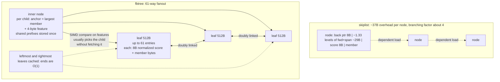

<!--
entry-meta
date: 2026-11-18
type: daily-diff
category: Daily Diff
title: Daily Diff — 2026-11-18
slug: janusgraph-vertex-centric-query-builder
-->

# Daily Diff — 2026-11-18

**2026-11-18 · Daily Diff Digest**

**Which edition.** At the time of this run (~03:35 UTC / 09:05 IST on 2026-11-18) the front page of [tdd.cat](https://tdd.cat/) served the **2026-11-17 edition, 57 stories**, under a single `HN` section. `https://tdd.cat/2026-11-18/` returned a client error — no 2026-11-18 edition has published yet. The 2026-11-16 edition was covered by lesson 19, so 2026-11-17 is the newest uncovered one and is what this digest covers. The front-page-ahead-of-archive pattern noted on 2026-11-16 and 2026-11-17 held again.

---

## The edition, point-wise

**Storage and database internals** — the thin slice that matters most to this log:

- **[Replacing skiplists with B+ trees cuts Valkey memory overhead](https://valkey.io/blog/from-skiplist-to-b+tree/)** — Valkey 9.2 replaces the sorted-set skiplist with `fbtree`. Today's deep dive, below.
- **[How content addressable systems accelerate massive git repositories](https://developers.googleblog.com/accelerating-development-for-massive-git-repositories/)** — content-addressing as the lever for very large Git trees.
- **[Why RushDB replaced Neo4j with a custom storage engine](https://rushdb.com/blog/time-to-move-on-from-neo4j)** — a graph product moving off a general-purpose graph engine onto its own storage. Directly adjacent to the JanusGraph track's premise that a graph database is a translation layer over a sorted store.
- **[Verifying SQLite schema migrations using the Lean theorem prover](https://github.com/vihren-dev/belay)** — formal verification applied to migrations.
- **[Database ontologies must enforce domain rules rather than decoration](https://typegraph.dev/blog/an-ontology-that-holds/)** — schema as constraint, not documentation.
- **[MinLZ SIMD blocks achieve Zstandard compression with LZ4 decompression speeds](https://github.com/minio/minlz/releases/tag/v1.3.0)** — block-format compression release.

**Systems and performance:**

- **[Counting thirty-six million lines of code in sixty-seven milliseconds](https://petros-papatheodorou.dev/writing/mezura/counting-the-linux-kernel/)** — I/O and parsing throughput on the kernel tree.
- **[How kernel TLS saved Netflix from encryption bottlenecks](https://deepsystemstuff.com/why-https-almost-broke-netflix-and-how-kernl-tls-saved-id-crazy-linux-customizations/)** — kTLS and sendfile at CDN scale.
- **[Apple M-series processors enforce sequential and parallel memory composition](https://arxiv.org/abs/2611.21406)** — an empirical memory-model paper.
- **[Enabling huge pages via glibc speeds up llama.cpp inference](https://tensward.com/blog/huge-pages-llama-cpp)** — TLB pressure on large weight files.
- **[Netmap caching keeps Tailscale working on unreliable connections](https://tailscale.com/blog/netmap-caching)** — caching the coordination map so the data plane survives control-plane loss.
- **[Running a real Linux kernel compiled directly to WebAssembly](https://github.com/pithings/unkernel)**.
- **[Comparing classic and parallel DWARF linkers in dsymutil](https://jonasdevlieghere.com/post/dsymutil-classic-and-parallel-linkers/)**.
- **[Gilguard detects extension modules that re-enable the Python GIL](https://mkennedy.codes/posts/catch-the-import-name-the-culprit-keep-threads-free-introducing-gilguard/)** — free-threaded Python tooling.
- **[Why SSH agent forwarding enables dangerous infrastructure compromise](https://kimhq.net/blog/secure-ssh-agent-forwarding/)**.
- **[Building a global anycast DNS cluster with PowerDNS](https://varunpriolkar.com/2026/11/building-a-global-anycast-dns-cluster-with-powerdns/)**.
- **[Deterministic intervention timing eliminates false fixes in race reproduction](https://arxiv.org/abs/2611.21214)** — relevant to anyone who has chased a `@RepeatedIfExceptionsTest` in the JanusGraph tree.
- **[Gossip Glomers bridges distributed systems theory and practical code](https://fly.io/blog/gossip-glomers/)**.
- **[Running unmodified embedded firmware in deterministic network simulations](https://github.com/mikroverk/cooja-ng)**.
- **[Parent tasks lending slots to children avoids recursive deadlocks](https://cocoindex.io/blogs/bounded-concurrency-task-tree/)** — a concurrency pattern, not an AI piece.
- **[Building a basic but complete web browser in Python](https://browser.engineering/)**.

**Agents and tooling** — the bulk of the edition, roughly 30 of the 57 items. Representative:

- **[Durable execution helps long-horizon agents survive real-world failures](https://martinfowler.com/articles/durable-execution-agents.html)**.
- **[Executing untrusted automation steps inside fresh gVisor sandboxes](https://notebook.tines.com/writing/anatomy-of-a-3b-step/)**.
- **[Lower token prices can double the cost per task](https://github.com/apimodels/llm-agent-field-notes/blob/main/cost-per-task.md)**.
- **[Single agent loops often outperform complex subagent architectures](https://claude.com/resources/articles/building-agents-when-to-fold-subagents-into-your-main-agent-loop)**.
- **[Loom gives coding agents memory that tracks evolving code](https://clickhouse.com/blog/introducing-loom-agent-memory-that-keeps-up-with-your-code)**.
- **[Machine auditing reveals uncorrected errors cascading across astrophysics literature](https://science.caseyhandmer.com/physics/)** and its companion **[playbook](https://science.caseyhandmer.com/playbook/)**.

**Not covered here:** the remainder of the agent/LLM items, which carry no mechanism worth a digest line.

---

## Deep dive — Valkey 9.2 replaces the sorted-set skiplist with a B+ tree

Source followed: **[valkey.io/blog/from-skiplist-to-b+tree](https://valkey.io/blog/from-skiplist-to-b+tree/)**.

### What changed

A Valkey sorted set above the listpack threshold has always been **two** structures: a hashtable for `member → score` in O(1), and an ordered index for rank and range work in O(log n). Valkey 9.2 replaces the ordered index — the skiplist — with `fbtree` ("Feature B+ Tree"). The hashtable is untouched.

### Why the skiplist was costing money

Two separate problems, and the post is careful to keep them apart:

- **Allocation overhead, measured per node.** About **37 bytes before the member string**: an 8-byte backward pointer, roughly 29 bytes of forward pointers and span values (about 1.33 levels on average, since each level is promoted with probability 1/4), and an 8-byte score. Every element is its own heap allocation.
- **Dependent loads.** Each hop in a skiplist traversal cannot be issued until the previous pointer has arrived. The post cites a 2025 study of *other* concurrent in-memory indexes — explicitly not Valkey — finding skiplists take roughly **2.4–4.8× more cache misses** than a comparable B-tree. It is cited as motivation, not as a Valkey measurement, which is the right level of claim.

### The node layout

The mechanism that matters is the fanout and what sits in an inner node.

- **61-way fanout.** Each node holds up to 61 entries or child pointers, sized to land on jemalloc's allocation classes on 64-bit builds. Against the skiplist's effective branching factor of about 4, that is the whole story on depth: same O(log n), far fewer levels, far fewer dependent loads.
- **Leaves are 512 bytes** holding up to 61 value pointers, with each entry packing the **normalized 8-byte score immediately followed by the member bytes** — comparison data contiguous, one indirection removed.
- **Inner nodes describe each child by an anchor** (the largest member in that child) plus a **4-byte "feature"**. Shared prefixes are stored once. A SIMD comparison over the features usually identifies the right child **without fetching it**; when it does not, the features narrow the range for a binary search. This is the part that is genuinely not just "a B+ tree" — it is a compressed-key inner node designed so the hot comparison stays in one cache line.
- **Leaves are doubly linked**, and the **leftmost and rightmost leaves are cached**, making both ends O(1).

### What it buys, by operation

Range scans no longer climb the tree: `ZRANGE` walks the leaf links, and because a leaf holds up to 61 entries contiguously it can process them as a batch and prefetch the next leaf, where a skiplist must receive one item before it knows where the next lives. `ZPOPMIN` stays at parity thanks to the cached end leaves. Range deletions are handled without rebuilding surrounding structure. The post benchmarks `ZRANK` but does **not** explain how `fbtree` computes rank internally — a real gap if you were planning to depend on it.

**Memory, ordered index only, 5 million 20-byte members:**

| insertion order | per-member overhead | reduction | total saved |
|---|---|---|---|
| sequential | 50.3B → 28.5B | 43% | ~109 MB |
| random | 50.3B → 32.0B | 36% | ~92 MB |

Random insertion leaves more partially filled nodes, which is the entire explanation for the smaller gain.

**Throughput**, on a Graviton3 `c7g.metal` (64 cores), nine I/O threads, pipeline depth 10, 3-million-member set, five runs, confidence intervals ≤2% except `ZRANDMEMBER` — and, importantly, **from a PR branch, not re-run on the merged commit**:

| command | workload | change |
|---|---|---|
| `ZADD` | score update, all hits | **+105%** |
| `ZREM` | 50/50 add/remove | **+76%** |
| `ZCOUNT` | score-range count | +27% |
| `ZRANK` | point rank lookup | +19% |
| `ZRANGE` | 100-element rank scan | +6% |
| `ZRANDMEMBER` | 100 random samples | +2% |
| `ZSCORE` | point score lookup | +2% |
| `ZRANGEBYSCORE` | 100-element score scan | +1% |
| `ZPOPMIN` | pop min + append | ~0% |

The shape of that table is the interesting part. The big wins are **repositioning** operations — `ZADD` on an existing member and `ZREM` — because those are the ones that pay the full traversal plus a structural edit. `ZSCORE` and `ZRANDMEMBER` barely move because they go through the hashtable and never touch the ordered index at all. The range commands gain little because, once the index stops being the bottleneck, producing the reply elements becomes the dominant cost. A reader who only looked at the "+105%" headline would draw the wrong conclusion about their own workload.

### What it changes for operators

- **No functional change.** Command semantics are identical.
- **One visible change:** `OBJECT ENCODING` returns `btree` instead of `skiplist` for large sorted sets. Any tooling, test suite or dashboard that string-matches `skiplist` breaks. Small sets on listpacks are unaffected.
- **Gains shrink as members get larger** (the fixed per-node overhead is a smaller fraction) and as insertion gets more random.
- **9.2 is in release-candidate testing**, and the authors explicitly ask for real workloads to be tested against it.

### Why it is worth reading alongside today's lesson

Today's JanusGraph lesson is about turning a query into a **byte range over sorted columns**, and about an optimiser that picks between candidate orderings with a scalar score and no statistics. The Valkey post is the same problem one layer down: given that your access pattern is "find a position in a sorted collection, then walk forward", the data structure's *branching factor and node locality* dominate, and the asymptotic complexity — O(log n) both before and after — tells you nothing about which one to ship. JanusGraph's `SliceQuery` leans on exactly this property of the backend: it hands down a start and an end and expects the sorted structure underneath to make the walk cheap. A backend that swaps a pointer-chasing index for a 61-way fanout one changes nothing about JanusGraph's correctness and a great deal about its throughput — and JanusGraph's own planner, as today's lesson showed, has no way to know that happened.

---

## Sources

- [tdd.cat](https://tdd.cat/) — front page, 2026-11-17 edition, 57 stories, fetched this run.
- `https://tdd.cat/2026-11-18/` — returned a client error this run; no 2026-11-18 edition exists yet.
- [Valkey 9.2: from skiplist to B+ tree](https://valkey.io/blog/from-skiplist-to-b+tree/) — deep-dive source, fetched this run.
- All other links in the point-wise section are the source URLs as they appeared in the 2026-11-17 edition fetched this run; they were not individually fetched.
