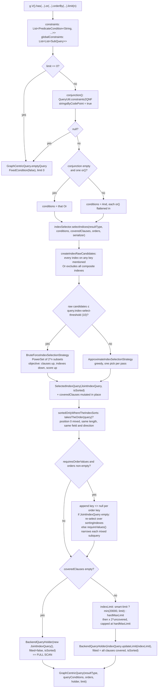
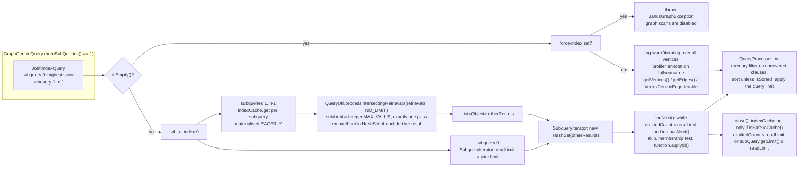

<!--
entry-meta
date: 2026-11-19
type: lesson
track: JanusGraph
lesson: 21
category: Database Internals
title: GraphCentricQueryBuilder — index selection between composite, mixed, and full scan
slug: janusgraph-graph-centric-query-builder
-->

# `GraphCentricQueryBuilder` — index selection between composite, mixed, and full scan

**2026-11-19 · JanusGraph Track · Lesson 21 of 28**

## Where This Fits

- **Lesson 20** compiled the vertex-centric side: `BasicVertexCentricQueryBuilder` turning `v.query().labels(…).has(…)` into a *product* of `SliceQuery` shapes, choosing a relation index per `(type, direction)` with a scoring function that consults **nothing but schema and query text** — `+5.0` per leading point, `5.0/k` for a `k`-point `IN`, a flat `+1` for a range and then `break`, `+3` for a satisfied `orderBy`. It explicitly handed this lesson the job of saying whether the graph-centric planner is the same kind of function. See [`2026-11-18-janusgraph-vertex-centric-query-builder`](../2026-11-18-janusgraph-vertex-centric-query-builder/README.md).
- **This lesson** answers that, and the answer is **yes, with one twist**: the graph-centric planner is also statistics-free, but where the vertex-centric one picks *one* index by a scalar, this one solves a **weighted set-cover** over the query's clauses and may pick *several* indexes — and it is allowed to pick **none**, which is the full graph scan. The decision does not live in `GraphCentricQueryBuilder` at all; it lives behind an `IndexSelectionStrategy` SPI with three shipped implementations, one of which is `2^n` by construction.
- It also discharges the other two debts lesson 20 left: **`QueryUtil.processIntersectingRetrievals`** (read by name only last run — it turns out not to be a "merge" at all, but the *intersect* half of a stream-one/intersect-the-rest executor), and **whether the strategy layer can fold a `has()` into an already-compiled query** (it cannot; `JanusGraphStep` re-enters compilation on a fresh builder).
- **Lesson 22** takes `QueryProcessor` — the consumer of the `BackendQueryHolder<JointIndexQuery>` this lesson produces — and owes the Part IV/V **re-pin review**. This lesson is mid-Part and deliberately did not re-run `list_commits`; see §11 for the two free cross-checks it got instead.

---

## 1. One compile method, and the three things it produces

`GraphCentricQueryBuilder` is 612 lines at the pinned commit and implements `JanusGraphQuery<GraphCentricQueryBuilder>`. It is the `g.V().has(…)` / `graph.query().has(…)` compiler — the graph-centric twin of lesson 20's vertex-centric one.

The whole of compilation is [`constructQueryWithoutProfile(ElementCategory)`](https://github.com/JanusGraph/janusgraph/blob/a59ae8d8024207598eada34998d867617df51adf/janusgraph-core/src/main/java/org/janusgraph/graphdb/query/graph/GraphCentricQueryBuilder.java#L332-L436), 105 lines, and it returns exactly one object:

```java
return new GraphCentricQuery(resultType, queryConditions, orders, query, limit);
```

where `query` is a `BackendQueryHolder<JointIndexQuery>`. Three facts follow immediately, and they shape everything below:

| Fact | Where | Consequence |
|---|---|---|
| `GraphCentricQuery.numSubQueries()` returns a hard-coded `1` | `GraphCentricQuery` | Unlike a vertex-centric query, a graph query has **exactly one** sub-query holder — the fan-out lives *inside* `JointIndexQuery`, not beside it |
| The holder's `isFitted` is `coveredClauses.size() == queryConditions.numChildren() \|\| coveredClauses.contains(queryConditions)` | [`:430`](https://github.com/JanusGraph/janusgraph/blob/a59ae8d8024207598eada34998d867617df51adf/janusgraph-core/src/main/java/org/janusgraph/graphdb/query/graph/GraphCentricQueryBuilder.java#L429-L431) | "Fitted" here means *every clause was claimed by some index*, a **counting** test — not lesson 20's prefix-position test |
| An empty cover yields `new BackendQueryHolder<>(new JointIndexQuery(), false, selectedIndex.isSorted())` | [`:432-434`](https://github.com/JanusGraph/janusgraph/blob/a59ae8d8024207598eada34998d867617df51adf/janusgraph-core/src/main/java/org/janusgraph/graphdb/query/graph/GraphCentricQueryBuilder.java#L432-L434) | The **full scan is an empty `JointIndexQuery`**, not a flag. The executor branches on `indexQuery.isEmpty()` |

Two early exits before any of that:

- `if (limit == 0) return GraphCentricQuery.emptyQuery(resultType);` ([`:334`](https://github.com/JanusGraph/janusgraph/blob/a59ae8d8024207598eada34998d867617df51adf/janusgraph-core/src/main/java/org/janusgraph/graphdb/query/graph/GraphCentricQueryBuilder.java#L334)). `emptyQuery` builds a `FixedCondition<>(false)` with limit `0`, and `GraphCentricQuery.isEmpty()` is `getLimit() <= 0`.
- `if (conjunction == null) return GraphCentricQuery.emptyQuery(resultType);` ([`:342-344`](https://github.com/JanusGraph/janusgraph/blob/a59ae8d8024207598eada34998d867617df51adf/janusgraph-core/src/main/java/org/janusgraph/graphdb/query/graph/GraphCentricQueryBuilder.java#L342-L344)) — the unsatisfiable case, reached when `QueryUtil.constraints2QNF` returns `null`.

### The fluent layer, and what it rewrites before the compiler sees it

Same pattern as lesson 20, different list. From [`:177-249`](https://github.com/JanusGraph/janusgraph/blob/a59ae8d8024207598eada34998d867617df51adf/janusgraph-core/src/main/java/org/janusgraph/graphdb/query/graph/GraphCentricQueryBuilder.java#L177-L249):

| Call | Becomes |
|---|---|
| `has(key)` | `has(key, Cmp.NOT_EQUAL, null)` |
| `hasNot(key)` | `has(key, Cmp.EQUAL, null)` |
| `has(key, value)` | `has(key, Cmp.EQUAL, value)` |
| `hasNot(key, value)` | `has(key, Cmp.NOT_EQUAL, value)` |
| `interval(k, s, e)` | `GREATER_THAN_EQUAL s` **and** `LESS_THAN e` — two constraints |
| `has(key, without(v…))` i.e. `Contain.NOT_IN` | **also calls `has(key)` first**, with the in-tree comment *"when querying `has(key, without(value))`, the query must also satisfy `has(key)`"* |
| `or(subQueries)` | a `List<SubQuery>` snapshot appended to `globalConstraints` — each `SubQuery` copies the sub-builder's `constraints` and its own `globalConstraints` at the moment of the call |

Three differences from the vertex-centric builder worth naming, because they are easy to assume away:

1. **`orderBy` accepts several keys.** Lesson 20 found `Preconditions.checkArgument(orders.isEmpty(), "Only a single sort order is supported on vertex queries")`. Here the only guard is `Preconditions.checkArgument(!orders.containsKey(key), "orders [%s] already contains key [%s]", orders, key)` ([`:238`](https://github.com/JanusGraph/janusgraph/blob/a59ae8d8024207598eada34998d867617df51adf/janusgraph-core/src/main/java/org/janusgraph/graphdb/query/graph/GraphCentricQueryBuilder.java#L238)) — a graph query can order by `(a asc, b desc)`. It does require `Comparable.class.isAssignableFrom(key.dataType())`, and the cardinality check is **commented out** in-tree at [`:236-237`](https://github.com/JanusGraph/janusgraph/blob/a59ae8d8024207598eada34998d867617df51adf/janusgraph-core/src/main/java/org/janusgraph/graphdb/query/graph/GraphCentricQueryBuilder.java#L236-L237) (`"Ordering is undefined on multi-valued key"`), alongside a commented-out `import org.janusgraph.core.Cardinality` at the top of the file.
2. **Constraints are keyed by `String`, not `RelationType`.** The field is `List<PredicateCondition<String, JanusGraphElement>> constraints`, and resolution to a `RelationType` happens inside `QueryUtil.constraints2QNF`. A key that does not exist is therefore a *compile-time* outcome, not a parse error — see §2.
3. **There is no `ADJACENT_ID` diversion and no implicit-key special case for ids.** `has(ID, …)` is just another constraint on an `ImplicitKey`; the id fast path for graph queries lives in `JanusGraphStep`, not here.

### Execution entry points

```java
public Iterable<JanusGraphVertex> vertices()   { return iterables(constructQuery(ElementCategory.VERTEX),   JanusGraphVertex.class); }
public Iterable<JanusGraphEdge>   edges()      { return iterables(constructQuery(ElementCategory.EDGE),     JanusGraphEdge.class); }
public Iterable<JanusGraphVertexProperty> properties() { return iterables(constructQuery(ElementCategory.PROPERTY), JanusGraphVertexProperty.class); }
```

and `iterables` is a one-liner that wraps `new QueryProcessor(query, tx.elementProcessor).iterator()` in a `CloseableIteratorUtils.filter` on `aClass::isInstance` ([`:271-274`](https://github.com/JanusGraph/janusgraph/blob/a59ae8d8024207598eada34998d867617df51adf/janusgraph-core/src/main/java/org/janusgraph/graphdb/query/graph/GraphCentricQueryBuilder.java#L271-L274)). `constructQuery` differs from `constructQueryWithoutProfile` only by an `OPTIMIZATION` nested profiler with a start/stop timer around it — identical to lesson 20's split, and the reason `JanusGraphBaseTest.evaluateQuery` skips `OPTIMIZATION` children when counting sub-queries.

---

## 2. Conditions first: `constraints2QNF`, and the one flag that differs from lesson 20

Before any index is considered, the constraint list becomes a condition tree. The call is at [`:505`](https://github.com/JanusGraph/janusgraph/blob/a59ae8d8024207598eada34998d867617df51adf/janusgraph-core/src/main/java/org/janusgraph/graphdb/query/graph/GraphCentricQueryBuilder.java#L505), inside the builder's own `conjunction(…)`:

```java
final And<JanusGraphElement> conjunction = QueryUtil.constraints2QNF(tx, own);
```

which is the two-argument overload at [`QueryUtil:229-231`](https://github.com/JanusGraph/janusgraph/blob/a59ae8d8024207598eada34998d867617df51adf/janusgraph-core/src/main/java/org/janusgraph/graphdb/query/QueryUtil.java#L229-L231), delegating to the three-argument form with **`stringsByCodePoint = true`**. That boolean is the whole semantic difference between the two query families' condition trees, and the in-tree javadoc at [`QueryUtil:233-240`](https://github.com/JanusGraph/janusgraph/blob/a59ae8d8024207598eada34998d867617df51adf/janusgraph-core/src/main/java/org/janusgraph/graphdb/query/QueryUtil.java#L233-L240) says why:

> …into a condition which compares two strings in the ranges of `Cmp` by their **code points** if `stringsByCodePoint`, as a graph-centric query does, in the order of the mixed indexes and of the query's own order, or by **UTF-16 code unit** otherwise, as a vertex-centric query does, in the order in which the storage backend holds the sort keys of a vertex's relations

So: a graph query's `Cmp.GREATER_THAN` on a `String` compares by code point, because that is what Elasticsearch/Solr/Lucene do and what `OrderList` does; a vertex-centric query's compares by UTF-16 code unit, because that is what the edgestore's column bytes do. `QueryTest#testGraphQueryConditionsCompareStringsByCodePoint` and `#testInMemoryOrderComparesStringsByCodePoint` are the two tests that pin the pair, against a 12-element `BY_CODE_POINT` array ([`QueryTest:81-82`](https://github.com/JanusGraph/janusgraph/blob/a59ae8d8024207598eada34998d867617df51adf/janusgraph-test/src/test/java/org/janusgraph/graphdb/query/QueryTest.java#L81-L82)) whose point is that `U+E000..U+FFFF` sort *before* the astral characters that `String.compareTo` puts first.

### What `constraints2QNF` does to each constraint

Walking [`QueryUtil:240-307`](https://github.com/JanusGraph/janusgraph/blob/a59ae8d8024207598eada34998d867617df51adf/janusgraph-core/src/main/java/org/janusgraph/graphdb/query/QueryUtil.java#L240-L307):

| Input | Output |
|---|---|
| `atomKey == null` | `return null` — **the whole query is unsatisfiable** |
| key name resolves to no `RelationType`, predicate is `Cmp.EQUAL` and value `null` (i.e. `hasNot(missingKey)`) | `continue` — *trivially satisfied*, dropped |
| key name resolves to no `RelationType`, anything else | `return null` — unsatisfiable |
| `Contain.NOT_IN` with an empty collection | `continue` — trivially satisfied |
| `Contain.IN` with an empty collection | `return null` |
| `Contain.IN` with exactly one value | a single `Cmp.EQUAL` — **not** a one-branch `Or` |
| `Contain.IN` with `n > 1` values | a nested `Or<E>` of `n` `Cmp.EQUAL`s appended to the `And` |
| `Contain.NOT_IN` with `n` values | `n` separate `Cmp.NOT_EQUAL`s appended **flat** to the `And` |
| an `AndJanusPredicate` | recursed into the same `And`; `null` propagates |
| an `OrJanusPredicate` | an `Or<E>` — with an in-tree `// FIXME:` admitting this *"might generate a non QNF-compliant form, e.g. nested = PredicateCondition OR (PredicateCondition AND PredicateCondition)"* |

A property key's value is also type-checked here: `Preconditions.checkArgument(key.dataType()==Object.class || predicate.isValidValueType(key.dataType()), "Data type of key is not compatible with condition")`. For an edge label it is `Preconditions.checkArgument(((EdgeLabel) type).isUnidirected())` plus a `JanusGraphVertex` value-type check.

**This is where the `Contain.IN` representation diverges from lesson 20.** Lesson 20 found a multi-value `IN` arriving at the vertex-centric planner as a multi-point `PointInterval` via `QueryUtil.extractOrCondition`, and scored as `5.0/k`. Here the same `Or` of equalities survives into the condition tree and is read back by `getEqualityConditionValues` (§3) — the *same* `extractOrCondition` helper, [`QueryUtil:443-461`](https://github.com/JanusGraph/janusgraph/blob/a59ae8d8024207598eada34998d867617df51adf/janusgraph-core/src/main/java/org/janusgraph/graphdb/query/QueryUtil.java#L443-L461), which returns `null` unless *every* child is a `PredicateCondition` with `Cmp.EQUAL`, a non-null value, and the **same** `RelationType`. But the graph-centric side does not divide by `k`: a `k`-value `IN` becomes `k` separate index *keys* in one `MultiKeySliceQuery` and is scored as **one** covered clause. §4 shows the arithmetic.

### `or()`, and the flattening rules

The builder's own three helpers above `constraints2QNF` are the local addition, and they exist to keep an `or()` in a form a composite index can still answer:

- [`conjunction(own, ors, disjunctions)`](https://github.com/JanusGraph/janusgraph/blob/a59ae8d8024207598eada34998d867617df51adf/janusgraph-core/src/main/java/org/janusgraph/graphdb/query/graph/GraphCentricQueryBuilder.java#L503-L524) — QNFs the query's own constraints, then for each `or()` call builds its disjunction; **an `or()` that reduced to a single branch is spliced into the conjunction**, anything wider goes into `disjunctions` for the caller. `addOnce` suppresses duplicate atoms.
- [`disjunction(subQueries)`](https://github.com/JanusGraph/janusgraph/blob/a59ae8d8024207598eada34998d867617df51adf/janusgraph-core/src/main/java/org/janusgraph/graphdb/query/graph/GraphCentricQueryBuilder.java#L532-L551) — recursive; a sub-query no element can hold is `continue`d (it *adds nothing to the others*), a sub-query **every** element holds (no conditions) short-circuits the whole `or()` to a single always-true branch, and an `or()` left empty returns `null`, which makes the enclosing conjunction `null` and the query empty.
- [`flattened(or)`](https://github.com/JanusGraph/janusgraph/blob/a59ae8d8024207598eada34998d867617df51adf/janusgraph-core/src/main/java/org/janusgraph/graphdb/query/graph/GraphCentricQueryBuilder.java#L561-L573) — rewrites `And` branches of one child as that child, and splices a nested `Or` (the shape a `within()` produces) into the outer one. A branch of **several** conditions stays a conjunction, and the in-tree comment is explicit that JanusGraph then checks it in memory *"unless a mixed index which takes conditions that aren't in normal form covers the whole condition, as Elasticsearch and Lucene take them."*

Then the top-level choice at [`:349-356`](https://github.com/JanusGraph/janusgraph/blob/a59ae8d8024207598eada34998d867617df51adf/janusgraph-core/src/main/java/org/janusgraph/graphdb/query/graph/GraphCentricQueryBuilder.java#L349-L356):

```java
if (conjunction.isEmpty() && disjunctions.size() == 1) {
    conditions = disjunctions.get(0);          // a bare or(): the condition IS an Or
} else {
    conditions = conjunction;                  // otherwise an And, with each or() flattened in
    for (final Or<JanusGraphElement> or : disjunctions) conditions.add(flattened(or));
}
```

`conditions` is a `MultiCondition<JanusGraphElement>` — and whether it is an `And` or an `Or` is load-bearing in §3, because the candidate filter tests `conditions instanceof Or`.

Finally, two lines that are easy to miss and matter to lesson 22:

```java
orders.makeImmutable();
if (orders.isEmpty()) orders = OrderList.NO_ORDER;
```

`GraphCentricQuery`'s constructor asserts `orders.isImmutable()`, and `getSortOrder()` returns `new ComparableComparator()` when the list is empty — so an unordered graph query still hands `QueryProcessor` a comparator, just a meaningless one.

---

## 3. Candidates: which indexes are even allowed to compete

Selection is an SPI. `StandardJanusGraph` holds one instance for the lifetime of the graph —

```java
this.indexSelector = getConfiguration().getIndexSelectionStrategy();   // StandardJanusGraph:310
```

— built once in `GraphDatabaseConfiguration` from `REGISTERED_INDEX_SELECTION_STRATEGIES`, a three-entry `HashMap` of shorthand → class name ([`GraphDatabaseConfiguration:1611-1615`](https://github.com/JanusGraph/janusgraph/blob/a59ae8d8024207598eada34998d867617df51adf/janusgraph-core/src/main/java/org/janusgraph/graphdb/configuration/GraphDatabaseConfiguration.java#L1611-L1615)), resolved through `Backend.getImplementationClass` so a **full class name also works**. The builder receives it as a constructor argument.

The interface is two overloads of one method plus a two-field value class ([`IndexSelectionStrategy`](https://github.com/JanusGraph/janusgraph/blob/a59ae8d8024207598eada34998d867617df51adf/janusgraph-core/src/main/java/org/janusgraph/graphdb/query/index/IndexSelectionStrategy.java)):

```java
SelectedIndexQuery selectIndices(Set<IndexType> indexCandidates, MultiCondition<JanusGraphElement> conditions,
                                 Set<Condition> coveredClauses, OrderList orders, IndexSerializer serializer);
SelectedIndexQuery selectIndices(ElementCategory resultType,   MultiCondition<JanusGraphElement> conditions,
                                 Set<Condition> coveredClauses, OrderList orders, IndexSerializer serializer);
class SelectedIndexQuery { JointIndexQuery getQuery(); boolean isSorted(); }
```

Note the signature: **`coveredClauses` is an out-parameter.** The strategy mutates the caller's `Set<Condition>`, and that set is what the fitted test in §1 counts. Nothing returns it.

### 3.1 Raw candidates

`AbstractIndexSelectionStrategy.selectIndices(resultType, …)` is the two-step entry: `createIndexRawCandidates` then the `Set<IndexType>` overload. The raw set comes from `IndexSelectionUtil.getMatchingIndexes(conditions, filter)`, which `ConditionUtil.traversal`s the whole condition tree and, for each `PredicateCondition`, collects `((InternalRelationType) key).getKeyIndexes()` — *every* index that mentions a key the query mentions, anywhere in the tree, at any nesting depth. `getKeyIndexesForCondition` asserts `type != null && type.isPropertyKey()`, so a condition on an edge label contributes no candidates at all.

The filter is where the first two eliminations happen:

```java
indexType -> indexType.getElement() == resultType
    && !(conditions instanceof Or
         && (indexType.isCompositeIndex()
             || !serializer.features((MixedIndexType) indexType).supportNotQueryNormalForm()))
```

Read it as a table:

| `conditions` | Composite index | Mixed index |
|---|---|---|
| `And` (the usual case) | eligible | eligible |
| `Or` (a bare `or()` with several branches) | **excluded, always** | eligible **only if** its backend reports `supportNotQueryNormalForm()` |

So a top-level disjunction is answerable by Elasticsearch or Lucene and by nothing else — and the fallback for everything else is the full scan, because the composite path cannot represent a disjunction of keys in a row key. Note the expression relies on `||` short-circuit for its own type safety: `(MixedIndexType) indexType` is only evaluated when `isCompositeIndex()` is already false. Correct as written, fragile to reorder.

### 3.2 From an `IndexType` to an `IndexCandidate`

[`createIndexCandidate(index, conditions, serializer)`](https://github.com/JanusGraph/janusgraph/blob/a59ae8d8024207598eada34998d867617df51adf/janusgraph-core/src/main/java/org/janusgraph/graphdb/query/index/AbstractIndexSelectionStrategy.java) returns `null` — *not a candidate* — in any of these cases:

1. **Schema-constrained index, no usable label equality.** If `index.hasSchemaTypeConstraint()` (an index built with `indexOnly(label)`), the method demands an equality condition on `ImplicitKey.LABEL`: `getEqualityConditionValues(conditions, ImplicitKey.LABEL)`. `null` → not a candidate. More than one label value → not a candidate, with the in-tree comment *"The query optimizer currently does not support multiple label constraints"*. A label that is not `type.name()` → not a candidate. On success the label clause itself is added to `subCover`, which means **an `indexOnly` index gets a free covered clause from `hasLabel()`**.
2. **Composite index, condition not in query normal form.** `indexCover(CompositeIndexType, …)` starts `if (!QueryUtil.isQueryNormalForm(condition)) return null;`.
3. **Composite index not `ENABLED`.** `if (index.getStatus() != SchemaStatus.ENABLED) return null;` — no exemption of any kind. Compare lesson 20's relation-index filter, which exempted the *base* type from the status check. Here there is nothing to exempt: a composite index in `INSTALLED` or `REGISTERED` is simply invisible to reads while lesson 17's write path keeps feeding it. That is the same convergence mechanism, enforced at a different place.
4. **Composite index with a gap in its field list.** `constructIndexCover` recurses position by position over `index.getFieldKeys()`; if any position has no equality condition it returns without adding anything, `indexCovers` stays empty, and the method returns `null`. **A composite index is all-or-nothing: every field must have an equality.**
5. **Mixed index covering nothing.** `indexCover(MixedIndexType, …)` builds an `And` of the sub-clauses that `coversAll` accepts and returns `null` if that `And` is empty.
6. **Empty `subCover` for any reason** — the final guard is `if (subCondition == null || subCover.isEmpty()) return null;`.

The composite recursion is also where an `IN` multiplies out:

```java
for (final Object value : equalCon.getValue()) {
    final Object[] newValues = Arrays.copyOf(indexValues, fields.length);
    newValues[position] = value;
    constructIndexCover(newValues, position+1, fields, condition, indexCovers, coveredClauses);
}
```

`indexCovers` is a `List<Object[]>` — **one tuple per combination of `IN` values across all fields.** A 2-field composite with a 3-value `IN` on field 0 and a 2-value `IN` on field 1 produces **six** tuples, which §9 turns into six `KeySliceQuery`s inside one `MultiKeySliceQuery`. That is the graph-centric analogue of lesson 20's point fan-out, and it is a *product* for exactly the same reason — but it is one sub-query, not six, and therefore one covered clause per key, not `5.0/k`.

### 3.3 `coversAll` — the mixed-index predicate test

```java
if (condition.getType() != Condition.Type.LITERAL)
    return IterablesUtil.stream(condition.getChildren()).allMatch(child -> coversAll(index, child, indexInfo));
if (!(condition instanceof PredicateCondition)) return false;
if (atom.getValue() == null && atom.getPredicate() != Cmp.NOT_EQUAL) return false;
Preconditions.checkArgument(atom.getKey().isPropertyKey());
```

then the field must exist on the index **and be `ENABLED` in its own right**:

```java
final ParameterIndexField match = Arrays.stream(fields)
    .filter(field -> field.getStatus() == SchemaStatus.ENABLED)
    .filter(field -> field.getFieldKey().equals(key))
    .findAny().orElse(null);
if (match == null) return false;
boolean existsQuery = atom.getValue() == null && atom.getPredicate() == Cmp.NOT_EQUAL
                      && indexInfo.supportsExistsQuery(index, match);
return existsQuery || indexInfo.supports(index, match, atom.getPredicate());
```

Three things fall out:

- **Per-field status.** A mixed index is not enabled or disabled as a whole for query purposes; each `ParameterIndexField` carries its own `SchemaStatus`, which is how adding a key to a live mixed index works without invalidating it.
- **`has(key)` is an "exists" query, and only some backends have one.** `has(key)` arrived as `Cmp.NOT_EQUAL` against `null` (§1); that is the `existsQuery` branch, gated on `IndexSerializer.supportsExistsQuery`. A backend without it cannot answer *"this key is present"* from the index — which is exactly why §6's `requireValues` has to check the same predicate again before narrowing.
- **Predicate support is a backend question.** `indexInfo.supports(index, field, predicate)` is `IndexSerializer.supports(MixedIndexType, ParameterIndexField, JanusGraphPredicate)`, delegating to the `IndexInformation` of the backing index. `Text.CONTAINS` on a `STRING`-mapped field, `Geo.WITHIN` on a non-geo field, a `Cmp.GREATER_THAN` on a `TEXT` field — all answered here, not in the planner.

The `Or` branch of the mixed `indexCover` is stricter than the `And` branch, and deliberately so: for a disjunction it demands that **every** sub-clause of **every** branch is covered (`return null` otherwise) and then adds the *entire* condition to `covered`. Partial coverage of a disjunction is meaningless — you cannot drop one branch of an `Or` and filter later without losing results — and that whole-condition add is why §1's fitted test has the second disjunct `coveredClauses.contains(queryConditions)`.

---

## 4. The second scoring function — the answer to lesson 20's question

Lesson 20 asked whether the graph-centric planner consults statistics where the vertex-centric one consults none. **It does not.** There are exactly four constants, all `private static final double` on [`AbstractIndexSelectionStrategy`](https://github.com/JanusGraph/janusgraph/blob/a59ae8d8024207598eada34998d867617df51adf/janusgraph-core/src/main/java/org/janusgraph/graphdb/query/index/AbstractIndexSelectionStrategy.java), plus two more on the approximate strategy:

```java
private static final double EQUAL_CONDITION_SCORE    = 4;      // AbstractIndexSelectionStrategy
private static final double OTHER_CONDITION_SCORE    = 1;
private static final double CARDINALITY_SINGE_SCORE  = 1000;
private static final double CARDINALITY_OTHER_SCORE  = 1000;

private static final double ORDER_MATCH              = 1;      // ApproximateIndexSelectionStrategy
private static final double ALREADY_MATCHED_ADJUSTOR = -1.1;
```

and two three-line functions over them:

```java
protected double getConditionBasicScore(final Condition c) {
    if (c instanceof PredicateCondition && ((PredicateCondition) c).getPredicate() == Cmp.EQUAL) return EQUAL_CONDITION_SCORE;
    else return OTHER_CONDITION_SCORE;
}

protected double getIndexTypeScore(final IndexType index) {
    double score = 0.0;
    if (index.isCompositeIndex()) {
        if (((CompositeIndexType) index).getCardinality() == Cardinality.SINGLE) score = CARDINALITY_SINGE_SCORE;
        else                                                                     score = CARDINALITY_OTHER_SCORE;
    }
    return score;
}
```

No row counts, no histograms, no cardinality estimates, no sampling, no backend call. The only inputs are: *is this clause an equality*, and *is this index a composite index*. The `ThresholdBasedIndexSelectionStrategy` carries an in-tree `TODO` naming exactly what is missing — *"use in-memory histograms to estimate selectivity of PredicateConditions and filter out low-selectivity ones if they would result in an individual index call (better to filter afterwards in memory)"*.

So the two planners are the same kind of function — a scalar over schema and query text — and differ in **shape**: lesson 20's picks one winner by `score > bestScore`; this one optimises a *set*.

### Four things that fall straight out of those six constants

**(a) `getIndexTypeScore`'s branch cannot change any decision.** `CARDINALITY_SINGE_SCORE` and `CARDINALITY_OTHER_SCORE` are **both `1000`**. The `if`/`else` on `Cardinality.SINGLE` computes the same number either way, so a unique composite index and a non-unique one are weighed identically. *Derived from the two constant declarations.* **PR candidate 46** — either the distinction was meant to exist and the second constant is a typo, or the branch is dead and should collapse to one line. Either way a maintainer has to say which, and the name `CARDINALITY_SINGE_SCORE` (missing `L`) suggests the pair has not been looked at in a while.

**(b) Composite indexes outweigh everything by three orders of magnitude.** A covered equality is worth `4` on a mixed index and `1004` on a composite one. There is no query shape in which a mixed index out-scores a composite one that covers the same clauses. That is a deliberate, documented preference — the docs say composite indexes are *"fast but limited"* and mixed ones *"generally slower… for exact-match queries"* — but it is expressed as a magic `1000` per clause, so it also means the `4` vs `1` equality weighting **only ever breaks ties among indexes of the same kind.**

**(c) An `IN` list scores the same as a range, and `k` is invisible.** `getConditionBasicScore` tests `c instanceof PredicateCondition`. A multi-value `IN` is an `Or` of `PredicateCondition`s (§2), **not** a `PredicateCondition`, so it falls to the `else` branch and scores `OTHER_CONDITION_SCORE = 1` — the same as `gt`, `lt`, `textContains` or `has(key)`. Concretely, on a composite index over one key:

| Query on one indexed key | Covered clauses | Brute-force score |
|---|---|---|
| `has("name","alice")` | 1 (`PredicateCondition`) | `1 × (4 + 1000)` = **1004** |
| `has("name", within("a","b","c"))` | 1 (one `Or`) | `1 × (1 + 1000)` = **1001** |
| `has("name", within(… 1000 values …))` | 1 (one `Or`) | `1 × (1 + 1000)` = **1001** |

The `k = 3` and `k = 1000` rows are the same number, while §3.2's `constructIndexCover` has produced **1000 `Object[]` tuples** for the second, which §9 turns into 1000 `KeySliceQuery`s inside a single `MultiKeySliceQuery`. **This is the exact mirror image of lesson 20's finding.** There, `5.0/k` *over*-penalised a wide `IN` — a six-value `IN` scored below an open range (PR candidate 44). Here `k` is not in the function at all, so a thousand-value `IN` is scored as cheap as a single equality. The two planners get the same question wrong in opposite directions. *Derived from `getConditionBasicScore` plus the `Or` representation in `constraints2QNF`.* **PR candidate 47.**

**(d) The "already matched" penalty is inert for composite indexes.** In the approximate strategy, a clause already in `coveredClauses` has its basic score multiplied by `ALREADY_MATCHED_ADJUSTOR = -1.1`, but the index-type score is added *outside* that multiplication:

```java
double subScore = getConditionBasicScore(c);
if (coveredClauses.contains(c)) subScore = subScore * ALREADY_MATCHED_ADJUSTOR;
score += subScore + getIndexTypeScore(indexCandidate.getIndex());
```

For an equality already covered by an earlier pick, on a composite index, that is `(4 × −1.1) + 1000 = **+995.6**`. The penalty intended to discourage redundant coverage leaves the contribution **strongly positive**; only on a mixed index (`−4.4 + 0`) does it actually penalise. *Derived from the three lines above and the constants.* **PR candidate 48.**

### Worked examples, computed from the two functions

Schema: `name` (String), `age` (Integer), `status` (String), all `Cardinality.SINGLE`; composite `byName(name)`, composite `byNameAge(name, age)`, composite `byStatus(status)`, mixed `search(name, age, status)`. All `ENABLED`. Scores are brute-force scores (`Σ over subCover of basic + typeScore`).

| Query | `byName` | `byNameAge` | `search` | Winner, and why |
|---|---|---|---|---|
| `has(name,"alice").has(age,30)` | cover 1, **1004** | cover 2, **2008** | cover 2, **8** | `byNameAge` — ties `search` on clauses and index count, wins on score |
| `has(name,"alice").has(age,gt(30))` | cover 1, 1004 | **not a candidate** (no equality at field 1 → `indexCovers` empty) | cover 2, **5** | `search` — **5 beats 1004**, because clause count is compared first |
| `has(name,"alice").has(status,"active")`, with `search` dropped | cover 1, 1004 (`byStatus` likewise 1004) | not a candidate | — | **both composites, jointly** — `{byName, byStatus}` covers 2 clauses, 2008 total, and so beats either alone on the first comparison |
| `has(name, within("a","b","c"))` | cover 1, **1001** | — | cover 1, 1 | `byName`; three `KeySliceQuery`s in one sub-query |
| `has(status, textContains("x"))` | — | — | cover 1, 1 | `search`; a composite index cannot represent the predicate |
| `has(age, gt(30))`, no mixed index | — | — | — | **no candidate at all → full scan** |

The second row is the one to remember: **clause coverage dominates the 1000-point composite bias**, because `IndexCandidateGroup.compareTo` compares covered-clause count *before* it ever looks at the score. A mixed index scoring 5 beats a composite index scoring 1004 if it covers one more clause. That is the right call for I/O (fewer in-memory filters, a tighter limit — §7) and it is why the `1000` is not as blunt as it looks.

---

## 5. Three strategies over one scoring function

### 5.1 `BruteForceIndexSelectionStrategy` — weighted set cover, enumerated

```java
for (final IndexType index : rawCandidates) {
    IndexCandidate ic = createIndexCandidate(index, conditions, serializer);
    if (ic == null) continue;
    ic.setScore(calculateIndexCandidateScore(ic));
    indexCandidates.add(ic);                       // HashSet<IndexCandidate>
}
IndexCandidateGroup bestGroup = null;
for (Set<IndexCandidate> subset : new PowerSet<>(indexCandidates)) {
    if (subset.isEmpty()) continue;
    final IndexCandidateGroup group = new IndexCandidateGroup(subset);
    if (group.compareTo(bestGroup) > 0) bestGroup = group;
}
```

`createIndexCandidate` is called exactly **once per raw candidate**; the enumeration is over the `2^n` subsets of the surviving candidates. The in-tree javadoc is honest about it:

> Determine the best jointIndexQuery by enumerating all possibilities with exponential time complexity. Similar to Weighted Set Cover problem, to find the best choice is NP-Complete, so we should be careful that the problem size MUST be small…

`IndexCandidateGroup.compareTo` is the objective function, and it is **lexicographic, not a weighted sum**:

| Priority | Comparison | Direction |
|---|---|---|
| 1 | `coveredClauses.size()` | more is better |
| 2 | `indexCandidates.size()` | **fewer** is better |
| 3 | `getTotalScore()` (sum of member scores) | higher is better |

`getTotalScore()` memoises with a `Double.NEGATIVE_INFINITY` sentinel; `coveredClauses` is built in the constructor as the union of the members' sub-covers, so a group's clause count is **not** the sum of its members' — overlapping covers collapse, which is how "fewer indexes" becomes meaningful.

**The tie-break is not deterministic.** `group.compareTo(bestGroup) > 0` is strict, so the *first* group seen wins a tie; the iteration order comes from `new PowerSet<>(indexCandidates)` over a `HashSet<IndexCandidate>`; and [`IndexCandidate`](https://github.com/JanusGraph/janusgraph/blob/a59ae8d8024207598eada34998d867617df51adf/janusgraph-core/src/main/java/org/janusgraph/graphdb/query/index/IndexCandidate.java) declares **no `equals` and no `hashCode`**, so those are identity-based and the bucket order depends on identity hash codes. Two composite indexes that cover the same single clause with the same score — the common case for two single-key indexes on the same key, or the third worked example in §4 — can therefore be chosen differently between JVM runs. The same non-determinism then decides which subquery lands at position 0, and §8 shows position 0 is the one that gets **streamed** while the rest are fully materialised and intersected. *Derived from `compareTo`'s strict `>`, `PowerSet` over a `HashSet`, and `IndexCandidate`'s missing `equals`/`hashCode`.*

Once a group wins:

```java
coveredClauses.addAll(bestGroup.getCoveredClauses());
List<IndexCandidate> bestIndexes = new ArrayList<>(bestGroup.getIndexCandidates());
bestIndexes.sort((a, b) -> Double.compare(b.getScore(), a.getScore()));   // descending
isSorted = orders.isEmpty() || bestIndexes.get(0).getIndex().isMixedIndex()
           && IndexSelectionUtil.indexCoversOrder((MixedIndexType) bestIndexes.get(0).getIndex(), orders, serializer);
for (IndexCandidate c : bestIndexes) addToJointQuery(c, jointQuery, serializer, orders);
```

So **the highest-scoring index is the one streamed**, and `isSorted` is decided by that index alone. `List.sort` is stable, so equal scores keep the `HashSet` order above.

### 5.2 `ApproximateIndexSelectionStrategy` — greedy, and quadratic in candidate work

```java
while (true) {
    IndexCandidate bestCandidate = null;
    for (final IndexType index : rawCandidates) {
        final IndexCandidate indexCandidate = createIndexCandidate(index, conditions, serializer);   // every iteration
        if (indexCandidate == null) continue;
        boolean supportsSort = orders.isEmpty()
            || coveredClauses.isEmpty() && index.isMixedIndex()
               && IndexSelectionUtil.indexCoversOrder((MixedIndexType) index, orders, serializer);
        indexCandidate.setScore(calculateIndexCandidateScore(indexCandidate, coveredClauses, supportsSort));
        if (!coveredClauses.containsAll(indexCandidate.getSubCover())
            && (bestCandidate == null || indexCandidate.getScore() > bestCandidate.getScore())) {
            bestCandidate = indexCandidate; candidateSupportsSort = supportsSort;
        }
    }
    if (bestCandidate != null) {
        if (coveredClauses.isEmpty()) isSorted = candidateSupportsSort;
        coveredClauses.addAll(bestCandidate.getSubCover());
        addToJointQuery(bestCandidate, jointQuery, serializer, orders);
    } else break;
}
```

Differences that matter:

- **`createIndexCandidate` is re-run for every candidate on every pass.** With `n` raw candidates and `p` picks the loop makes `n × (p + 1)` calls, each re-walking the whole condition tree through `indexCover` / `coversAll` / `constructIndexCover` and allocating a fresh `HashSet` sub-cover and, for a composite index with `IN` lists, a fresh `List<Object[]>` of all tuples. Nothing is memoised. For a wide `IN` that is the full tuple product rebuilt once per pass. **PR candidate 49** — hoist the candidate construction above the `while`, as the brute-force strategy already does, and recompute only the score.
- **Order can only be satisfied by the first pick.** `supportsSort` has `coveredClauses.isEmpty() &&` in it, so after the first pick no candidate can claim the order bonus; and `isSorted` is latched on the first pick only. That matches §8's execution model, where only subquery 0 streams in index order.
- **With no `orderBy`, `ORDER_MATCH` is a constant offset.** `orders.isEmpty()` makes `supportsSort` true for *every* candidate, so every score gains `+1` and nothing is ranked differently. Structurally identical to lesson 20's `+3` `orderBy` bonus being a constant when no order is requested — the same bug class in two planners, harmless in both.
- **Greedy can be strictly worse than brute force, and the lexicographic objective is why.** Greedy maximises score per step; `compareTo` maximises *clauses* first. Take §4's second worked example, `has(name,"alice").has(age,gt(30))`. Pass 1: `byName` scores `1004 + 1 = 1005`, `search` scores `5 + 1 = 6`, so **`byName` is picked** and covers `{name=alice}`. Pass 2: `byName`'s sub-cover is now fully covered so it is skipped; `search` still adds `age>30`, and its score is `(4 × −1.1) + 1 + 1 = −2.4` — negative, but it is the only candidate, so it is picked. The result is a **two-subquery joint query**, where brute force chose `{search}` alone and covered the same two clauses in one backend call. Greedy pays an extra round trip plus an intersection (§8) for the same answer.

### 5.3 `ThresholdBasedIndexSelectionStrategy` — the default

```java
public static final ConfigOption<Integer> INDEX_SELECT_BRUTE_FORCE_THRESHOLD =
    new ConfigOption<>(QUERY_NS, "index-select-threshold", "…", ConfigOption.Type.MASKABLE, 10);
…
IndexSelectionStrategy preferredStrategy = indexCandidates.size() <= threshold
    ? usedIfLessOrEqualThreshold     // BruteForceIndexSelectionStrategy
    : usedIfGreaterThanThreshold;    // ApproximateIndexSelectionStrategy
```

| Option | Default | Note |
|---|---|---|
| `query.index-select-strategy` | `threshold-based` | shorthands `brute-force`, `approximate`, `threshold-based`, or a full class name |
| `query.index-select-threshold` | `10` | *"Only effective when `threshold-based` index select strategy is chosen"* |

Two subtleties:

1. **The threshold counts *raw* candidates, before `createIndexCandidate` filtering.** `indexCandidates.size()` here is the `Set<IndexType>` that `createIndexRawCandidates` produced. Ten raw candidates of which only three survive still take the brute-force path — which is the conservative direction, but it also means the guard does not bound the thing it is guarding as tightly as it reads.
2. **`2^10 = 1024` subsets is the worst case the default allows**, each allocating an `IndexCandidateGroup` and a union `HashSet`. That is per compiled query, inside the `OPTIMIZATION` profiler span, on the request path.

Both subclasses receive `Configuration config` through `AbstractIndexSelectionStrategy(Configuration)` — whose body is **empty**. Only the threshold strategy actually reads it.

---

## 6. Order: three gates before `isSorted` survives

`isSorted` on the returned holder decides whether `QueryProcessor` sorts in memory or trusts the index. Three layers can take it away, in this order.

**Gate 1 — the strategy's own `indexCoversOrder`.** Both strategies call [`IndexSelectionUtil.indexCoversOrder(MixedIndexType, OrderList, IndexSerializer)`](https://github.com/JanusGraph/janusgraph/blob/a59ae8d8024207598eada34998d867617df51adf/janusgraph-core/src/main/java/org/janusgraph/graphdb/query/index/IndexSelectionUtil.java), which requires, for every order key: the index holds the key; `serializer.supportsOrdering(index, index.getField(key))`; and, if the key is `Cardinality.LIST` or `SET`, `serializer.features(index).supportsOrderingListProperty()`. The in-tree javadoc names the real cases — *"none of JanusGraph's backends can sort by a string key of TEXT mapping"*, and for multi-valued keys *"Elasticsearch, OpenSearch and Solr can and Lucene can't."* The **deprecated** two-argument overload checks only `index.indexesKey(…)`, and its deprecation note says why: it does not ask the backend.

**Gate 2 — `IndexSerializer.getQuery` may hand back no order at all.** [`IndexSerializer:464-485`](https://github.com/JanusGraph/janusgraph/blob/a59ae8d8024207598eada34998d867617df51adf/janusgraph-core/src/main/java/org/janusgraph/graphdb/database/IndexSerializer.java#L464-L485) builds the `IndexQuery`'s `OrderEntry` list only under the *same* predicate:

```java
ImmutableList<IndexQuery.OrderEntry> newOrders = IndexQuery.NO_ORDER;
if (!orders.isEmpty() && IndexSelectionUtil.indexCoversOrder(index, orders, this)) { … }
return new IndexQuery(index.getStoreName(), newCondition, newOrders);
```

So a strategy that said *"sorted"* for an index whose serialized query carries `NO_ORDER` would be lying — which is what gate 3 exists to catch.

**Gate 3 — `sortedOnlyWhereTheIndexSorts`, in the builder.** [`:302-330`](https://github.com/JanusGraph/janusgraph/blob/a59ae8d8024207598eada34998d867617df51adf/janusgraph-core/src/main/java/org/janusgraph/graphdb/query/graph/GraphCentricQueryBuilder.java#L302-L330) re-derives the fact from the *serialized* query rather than trusting the strategy:

```java
if (!selected.isSorted() || orders.isEmpty() || takesTheOrder(query)) return selected;
return new IndexSelectionStrategy.SelectedIndexQuery(query, false);
```

and `takesTheOrder` is exact, not permissive:

```java
if (query.isEmpty() || !query.getQuery(0).getIndex().isMixedIndex()) return false;
final List<IndexQuery.OrderEntry> order = query.getQuery(0).getMixedQuery().getOrder();
if (order.size() != orders.size()) return false;                 // not a prefix — an equality
for (int i = 0; i < orders.size(); i++) {
    if (!index.indexesKey(key) || order.get(i).getOrder() != orders.getOrder(i)
        || !IndexRecordUtil.key2Field(index, key).equals(order.get(i).getKey())) return false;
}
```

Three properties are being asserted: **position 0** of the joint query (nothing else streams), **same length** (an index order that is a *prefix* of the query order is not enough, and neither is one that sorts by extra keys), and **same field name and same direction at every position**. The method's own comment states the contract: *"by each of its keys in its direction, and by no other key."* The in-tree rationale names two ways a strategy can legitimately claim an order the serializer did not grant — a custom strategy using the deprecated `indexCoversOrder`, or one giving the index only part of the order — and in both cases *"JanusGraph sorts such results."*

### `requireOrderValues()` — the TinkerPop `order().by()` semantics, as a fourth path

`orderBy` in JanusGraph places elements *without* a value of the order key **last**; TinkerPop's `order().by(key)` **drops** them. `JanusGraphStep` calls `requireOrderValues()` before compiling, and the flag changes compilation in three stages, at [`:368-417`](https://github.com/JanusGraph/janusgraph/blob/a59ae8d8024207598eada34998d867617df51adf/janusgraph-core/src/main/java/org/janusgraph/graphdb/query/graph/GraphCentricQueryBuilder.java#L368-L417):

1. **A `key <> null` condition is appended per order key** into a fresh `And` (`withValues`), skipping any the query already has, and `queryConditions` becomes that `And` — so the in-memory filter enforces it even when no index does. The in-tree comment explains why an *existing* condition on the key does not substitute: *"an index may find that one in documents without the key: Solr drops the clause of a condition whose value the key's analyzer turns into no terms."*
2. **Only if `indexQuery.isEmpty()`** — i.e. the full-scan case — does it try again with a restricted candidate set: `sortingIndexes(resultType, withValues)`, which is `getMatchingIndexes` filtered to mixed indexes of the right element type that pass `indexCoversOrder` **and** `holdsNoOrderKeyWithCustomParameters`. The second re-selection is accepted only if it produced **exactly one** subquery, covered **every** clause of `withValues`, and that index is in the candidate set. The comment is explicit that this is a deliberate refusal to do better: *"Every element is still read where no such index answers the query whole: checking a condition in memory would read the index in growing batches and look each element up, and a joint query of several indexes reads all but the first whole."*
3. **Otherwise `requireValues(indexQuery, key)`** narrows the *existing* subqueries in place: for each mixed subquery whose `index.getField(key)` exists, is `ENABLED`, and passes `serializer.supportsExistsQuery`, it conjoins `PredicateCondition(key2Field(field), Cmp.NOT_EQUAL, null)` onto the subquery's condition; composite subqueries are copied through unchanged. It returns the original object identity when nothing was narrowed (`return anyNarrowed ? narrowed : indexQuery;`), and the caller uses that identity comparison to decide whether to mark the clause covered:

```java
final JointIndexQuery narrowed = requireValues(indexQuery, hasValue.getKey());
if (narrowed != indexQuery) { indexQuery = narrowed; coveredClauses.add(hasValue); }
```

`holdsNoOrderKeyWithCustomParameters` rejects any order key whose `ParameterIndexField` carries a parameter whose key starts with `ParameterType.CUSTOM_PARAMETER_PREFIX` — because a custom mapping parameter can change how the backend indexes the field, and Elasticsearch folds those into its mapping.

---

## 7. The limit, and why `smart-limit` is off by default

[`:419-434`](https://github.com/JanusGraph/janusgraph/blob/a59ae8d8024207598eada34998d867617df51adf/janusgraph-core/src/main/java/org/janusgraph/graphdb/query/graph/GraphCentricQueryBuilder.java#L419-L434):

```java
if (!coveredClauses.isEmpty()) {
    int indexLimit;
    if (useSmartLimit) indexLimit = limit == Query.NO_LIMIT ? DEFAULT_NO_LIMIT : Math.min(MAX_BASE_LIMIT, limit);
    else               indexLimit = limit == Query.NO_LIMIT ? hardMaxLimit : limit;
    indexLimit = Math.min(hardMaxLimit,
        QueryUtil.adjustLimitForTxModifications(tx, queryConditions.numChildren() - coveredClauses.size(), indexLimit));
    query = new BackendQueryHolder<>(indexQuery.updateLimit(indexLimit), …);
}
```

The constants are file-private: `DEFAULT_NO_LIMIT = 1000`, `MAX_BASE_LIMIT = 20000` ([`:282-283`](https://github.com/JanusGraph/janusgraph/blob/a59ae8d8024207598eada34998d867617df51adf/janusgraph-core/src/main/java/org/janusgraph/graphdb/query/graph/GraphCentricQueryBuilder.java#L282-L283)). The two switches come from the config at construction, each with a per-transaction override:

```java
useSmartLimit = customOptions.has(ADJUST_LIMIT) ? customOptions.get(ADJUST_LIMIT) : graphConfigs.adjustQueryLimit();
hardMaxLimit  = customOptions.has(HARD_MAX_LIMIT) ? customOptions.get(HARD_MAX_LIMIT) : graphConfigs.getHardMaxLimit();
```

| Option | Default | Effect here |
|---|---|---|
| `query.smart-limit` ([`GraphDatabaseConfiguration:337-340`](https://github.com/JanusGraph/janusgraph/blob/a59ae8d8024207598eada34998d867617df51adf/janusgraph-core/src/main/java/org/janusgraph/graphdb/configuration/GraphDatabaseConfiguration.java#L337-L340)) | **`false`** | when off, an unlimited query asks the backend for `hardMaxLimit` outright instead of `1000` |
| `query.hard-max-limit` ([`:342-347`](https://github.com/JanusGraph/janusgraph/blob/a59ae8d8024207598eada34998d867617df51adf/janusgraph-core/src/main/java/org/janusgraph/graphdb/configuration/GraphDatabaseConfiguration.java#L342-L347)) | **`Integer.MAX_VALUE`** | *"effectively disables this behavior"*, per its own description |
| `query.force-index` ([`:318-322`](https://github.com/JanusGraph/janusgraph/blob/a59ae8d8024207598eada34998d867617df51adf/janusgraph-core/src/main/java/org/janusgraph/graphdb/configuration/GraphDatabaseConfiguration.java#L318-L322)) | `false` | throws instead of scanning — §8 |

**So the shipped default is: no incremental loading, one request for `Integer.MAX_VALUE` rows.** That is the opposite of what the `DEFAULT_NO_LIMIT = 1000` constant suggests when read in isolation, and it is worth knowing before reading `LimitAdjustingIterator` next lesson: with `smart-limit` off there is usually nothing to adjust.

`QueryUtil.adjustLimitForTxModifications` is the same function lesson 20 used, [`QueryUtil:57-71`](https://github.com/JanusGraph/janusgraph/blob/a59ae8d8024207598eada34998d867617df51adf/janusgraph-core/src/main/java/org/janusgraph/graphdb/query/QueryUtil.java#L57-L71), but the `uncoveredAndConditions` argument is computed differently: `queryConditions.numChildren() - coveredClauses.size()` — **the number of clauses left to filter in memory**, not lesson 20's `intervalConstraints.size() - position`.

`QueryTest#testQueryLimitAdjustment` measures it end to end against the in-memory backend, reading the `QUERY_ANNOTATION` off the last nested profiler group. With `prop1_idx(prop1)` and `props_idx(prop1, prop2)` composite indexes and `limit(5)` ([`QueryTest:107-145`](https://github.com/JanusGraph/janusgraph/blob/a59ae8d8024207598eada34998d867617df51adf/janusgraph-test/src/test/java/org/janusgraph/graphdb/query/QueryTest.java#L107-L145)):

| Query | Covered / total clauses | Annotation |
|---|---|---|
| `has(prop1,…)` | 1 / 1 | `multiKSQ[1]@5{KeySliceQuery(0x0A89A070726F70317661EC)[0x00,0xFF)}` |
| `has(prop1,…).has(prop2,…)` | 2 / 2 (one `props_idx`) | `multiKSQ[1]@5{KeySliceQuery(0x0C89A070726F70317661ECA070726F70327661EC)[0x00,0xFF)}` |
| `has(prop1,…).has(prop3,…)` | 1 / 2 | `multiKSQ[1]@10{…0x0A89A0…}` |
| `has(prop1,…).has(prop3,…).has(prop4,…)` | 1 / 3 | `multiKSQ[1]@20{…0x0A89A0…}` |

`5 → 5 → 10 → 20`: `limit × 2^uncovered`, exactly. Three things are visible in those four strings at once — the limit arithmetic, the fact that a 2-key composite index key is one longer byte string rather than two keys (`0x0C…` with both values inlined versus `0x0A…` with one), and that `multiKSQ[1]` means a single `KeySliceQuery` inside the `MultiKeySliceQuery`. A `within()` of three values on `prop1` would print `multiKSQ[3]`.

---

## 8. Execution: stream the first index, intersect the rest

The compiled query is consumed by `QueryProcessor` (lesson 22) through `tx.elementProcessor`, which is a `QueryExecutor<GraphCentricQuery, JanusGraphElement, JointIndexQuery>` defined as an anonymous class inside `StandardJanusGraphTx` — wrapped in a `MetricsQueryExecutor` when metrics are on ([`StandardJanusGraphTx:373-376`](https://github.com/JanusGraph/janusgraph/blob/a59ae8d8024207598eada34998d867617df51adf/janusgraph-core/src/main/java/org/janusgraph/graphdb/transaction/StandardJanusGraphTx.java#L373-L376)). Its `execute` is [`:1894-1942`](https://github.com/JanusGraph/janusgraph/blob/a59ae8d8024207598eada34998d867617df51adf/janusgraph-core/src/main/java/org/janusgraph/graphdb/transaction/StandardJanusGraphTx.java#L1894-L1942) and has exactly two branches.

### Branch 1 — `!indexQuery.isEmpty()`

```java
final List<QueryUtil.IndexCall<Object>> retrievals = new ArrayList<>();
// Leave first index for streaming, and prepare the rest for intersecting and lookup
for (int i = 1; i < indexQuery.size(); i++) { … retrievals.add(limit -> indexCache.get(adjustedQuery, …)); }
iterator = new SubqueryIterator(indexQuery.getQuery(0), indexSerializer, txHandle, StandardJanusGraphTx.this,
        indexCache, indexQuery.getLimit(), getConversionFunction(query.getResultType()),
        retrievals.isEmpty() ? null : QueryUtil.processIntersectingRetrievals(retrievals, Query.NO_LIMIT));
```

The asymmetry is the whole design:

| Subquery | How it is read | Bounded by |
|---|---|---|
| index 0 | **lazily streamed** through `SubqueryIterator` | `indexQuery.getLimit()` as `readLimit` |
| indexes 1…n−1 | **fully materialised** to a `List`, before the first element is produced | nothing — `Query.NO_LIMIT` |

`processIntersectingRetrievals` is called **eagerly**, as an argument. So a two-index graph query does all of index 1's work up front, then streams index 0 and tests each id for membership. `SubqueryIterator`'s constructor turns that `List<Object>` into a `HashSet` with an in-tree comment explaining why: *"Scanning the list for each element would make the intersection cost O(n·m)"* — and the `#4931` issue body notes that `contains` on the raw `ArrayList` is what the code used to do.

### `processIntersectingRetrievals`, and the loop that cannot run

[`QueryUtil:463-504`](https://github.com/JanusGraph/janusgraph/blob/a59ae8d8024207598eada34998d867617df51adf/janusgraph-core/src/main/java/org/janusgraph/graphdb/query/QueryUtil.java#L463-L504), in full shape:

```java
final int multiplier = Math.min(16, (int) Math.pow(2, retrievals.size() - 1));
int subLimit = Integer.MAX_VALUE;
if (Integer.MAX_VALUE / multiplier >= limit) subLimit = limit * multiplier;
do {
    exhaustedResults = true; results = null;
    for (final IndexCall<R> call : retrievals) {
        Collection<R> subResult = call.call(subLimit);
        if (subResult.size() >= subLimit) exhaustedResults = false;
        if (results == null) results = new ArrayList<>(subResult);
        else { … results.removeIf(o -> !subResultSet.contains(o)); }
    }
    subLimit = (int) Math.min(Integer.MAX_VALUE - 1, Math.max(Math.pow(subLimit, 1.5), (subLimit + 1) * 2));
} while (results != null && results.size() < limit && !exhaustedResults);
```

It is written as an **adaptive** intersector: ask each index for `limit × min(16, 2^(n−1))` ids, intersect, and if the intersection came up short *and* some index was truncated, grow `subLimit` super-linearly and retry. But on its only call path it is handed `limit = Query.NO_LIMIT = Integer.MAX_VALUE`, and then:

- `multiplier == 1` only when `retrievals.size() == 1`; then `Integer.MAX_VALUE / 1 >= Integer.MAX_VALUE` holds and `subLimit = Integer.MAX_VALUE × 1 = Integer.MAX_VALUE`.
- For `retrievals.size() >= 2`, `multiplier >= 2`, so `Integer.MAX_VALUE / multiplier < Integer.MAX_VALUE` and the `if` does not fire — `subLimit` stays at its initial `Integer.MAX_VALUE`.

Either way `subLimit == Integer.MAX_VALUE`, so `subResult.size() >= subLimit` requires a sub-result with 2 147 483 647 elements, `exhaustedResults` stays `true`, and the `while` condition is false after one pass. **The retry loop, the `16` cap, the `2^(n−1)` multiplier and the `subLimit^1.5` growth are all unreachable from the only caller at this commit.** The in-tree `//TODO: smarter limit estimation` sits directly above the multiplier. *Derived from `Query.NO_LIMIT = Integer.MAX_VALUE` (`Query:24`), the two integer-division guards, and a `search_code` for the method name returning exactly one production caller.* **PR candidate 51** — this is a reachability claim, so it wants a maintainer's confirmation before anything is deleted; the honest ask is whether the adaptive path is intended to come back.

Lesson 20 was told this function was *"the graph-centric analogue of the sub-query merge."* It is not a merge. The vertex-centric side merge-sorts per-sub-query iterators to produce a union; this side **intersects**, because the graph-centric sub-queries are conjuncts of one `And`, not alternatives.

### `SubqueryIterator` — the one piece of this path with its own unit test

Worth knowing three of its properties, because lesson 22's `LimitAdjustingIterator` work depends on them:

- It implements `BackendLimitAware`: `hasBackendReachedLimit()` is `subQuery.hasLimit() && position >= subQuery.getLimit()`, `getBackendResultsRead()` is `position`, and `skipBackendResults(long)` is allowed **only before the first element** (`Preconditions.checkState(!started, …)`).
- `findNext()` is `while (emittedCount < readLimit && ids.hasNext())`, and the membership test is `otherResultSet == null || otherResultSet.contains(id)`. An id that converts to `null` element is logged as `"Subquery returned invalid element id: {}"` and skipped — that is where ids of elements the transaction removed disappear.
- **Caching is conditional on completeness**, `isSafeToCache()` = `emittedCount < readLimit || subQuery.getLimit() <= readLimit`, and `close()` will even *probe* one element ahead to tell "caller stopped at the limit" apart from "caller gave up". The javadoc names the reason explicitly: `JointIndexQuery.updateLimit(int)` propagates the limit into a subquery **only when `queries.size() == 1`**, so a multi-subquery joint query leaves subquery 0 at `NO_LIMIT` and its cache key does not vary with the outer limit. That is [issue #4931](https://github.com/JanusGraph/janusgraph/issues/4931), *"Joint-index subquery cache stores limit-truncated results as complete, causing silently missing results"*, `kind/bug/confirmed` + `area/index`, closed by [PR #4941](https://github.com/JanusGraph/janusgraph/pull/4941) in milestone 1.2.0 — and `QueryTest#testIndexQueryCache` is the regression suite, with `assertBackendHit` / `assertNoBackendHit` asserting, among nine cases, that *"cache is not used when second query has higher limit"* and that *"incomplete results are not put in cache if iterator is not exhausted"* ([`QueryTest:848-938`](https://github.com/JanusGraph/janusgraph/blob/a59ae8d8024207598eada34998d867617df51adf/janusgraph-test/src/test/java/org/janusgraph/graphdb/query/QueryTest.java#L848-L938)).

### Branch 2 — the full scan

```java
if (config.hasForceIndexUsage()) throw new JanusGraphException(
    "Could not find a suitable index to answer graph query and graph scans are disabled: " + query);
log.warn("Query requires iterating over all vertices [{}]. For better performance, use indexes", query.getCondition());
QueryProfiler sub = profiler.addNested("scan");
sub.setAnnotation(QueryProfiler.QUERY_ANNOTATION, indexQuery);
sub.setAnnotation(QueryProfiler.FULLSCAN_ANNOTATION, true);
sub.setAnnotation(QueryProfiler.CONDITION_ANNOTATION, query.getResultType());
```

then `getVertices()`, `getEdges()`, or `new VertexCentricEdgeIterable(getInternalVertices(), RelationCategory.PROPERTY)` by result type, wrapped in a `ProfiledIterator<>`. Three things to take from it:

1. **The full scan is reached by an empty `JointIndexQuery`**, i.e. by `coveredClauses.isEmpty()` back in §1 — not by any explicit decision. "No index covers a single clause" and "full scan" are the same state.
2. **The scan is `fullscan=true` in the profile**, which makes it detectable with `.profile()` rather than only in the log. The log line is the one users actually see, and it is the exact string the `gremlin-users` thread *"Query requires iterating over all vertices"* is about.
3. **`force-index` throws, it does not degrade.** The docs recommend enabling it in production precisely so this branch becomes an error.

### The new/deleted overlay, in one paragraph

Three more `QueryExecutor` methods make an index read consistent with the current transaction, all in the same anonymous class, and they are worth naming because they are *where index staleness is corrected*:

- `getNew(query)` returns in-transaction candidates. For vertices it `collectPredicates` the condition tree (tracking negation parity), then unions `addNewVertices` — the new vertices under the **conjunct with the fewest added equality properties**, chosen by `countNewVertexEqualityProperties` over `addedPropertyIndex.count(...)` — with `addLoadedVertices`, the pre-existing vertices whose indexed keys this transaction *changed*, including order keys when `isSortedByAnIndex(query)`. Everything is then re-checked with `query.matches(vertex)`.
- `isDeleted(query, result)` is `(v.hasAddedRelations() || v.hasRemovedRelations()) && !query.matches(result)` for a vertex, and `result.isNew() && !query.matches(result)` for a relation — *"Loaded relations are immutable so we don't need to check those."*
- `withoutResultsAfter(query, indexQuery, value)` narrows subquery 0 with a range on the first order key so a paged ordered read does not re-fetch what it already has, via `JointIndexQuery.narrowFirst`. It bails out unless the key is `Cardinality.SINGLE`, the field passes `isRangedAsOrdered` (an `ENABLED` field with no custom parameters; floats and doubles only ascending and not `NaN`; `Instant` only on whole milliseconds; strings only on a `STRING`/`TEXTSTRING` field with no unpaired surrogate), and `indexSerializer.supports(index, field, Cmp.LESS_THAN_EQUAL/GREATER_THAN_EQUAL)`.

That last method is the clearest statement of this layer's relationship with the backend: **every optimisation is conditional on a predicate the backend is asked about first**, and the fallback is always "do it in memory."

---

## 9. What reaches the backend

### Composite → `MultiKeySliceQuery`

[`IndexSerializer:454-462`](https://github.com/JanusGraph/janusgraph/blob/a59ae8d8024207598eada34998d867617df51adf/janusgraph-core/src/main/java/org/janusgraph/graphdb/database/IndexSerializer.java#L454-L462):

```java
public MultiKeySliceQuery getQuery(final CompositeIndexType index, List<Object[]> values) {
    final List<KeySliceQuery> ksqs = new ArrayList<>(values.size());
    for (final Object[] value : values)
        ksqs.add(new KeySliceQuery(IndexRecordUtil.getIndexKey(index, value, serializer, hashKeys, hashLength),
            BufferUtil.zeroBuffer(1), BufferUtil.oneBuffer(1)));
    //Each key of a unique index holds at most one entry: its one column doesn't name the element
    return new MultiKeySliceQuery(ksqs, index.getCardinality() == Cardinality.SINGLE);
}
```

One `KeySliceQuery` per value tuple, each with the **widest possible column range** `[0x00, 0xFF)` — which is `BufferUtil.zeroBuffer(1)` to `oneBuffer(1)`, and exactly what the test annotations in §7 print. This is the read side of lesson 17's write: the index key carries the *values*, the column carries the element id, so the slice reads the whole row. And here is where `Cardinality.SINGLE` **does** matter — as the `unique` flag on `MultiKeySliceQuery`, not in the planner's score.

Reading it back ([`IndexSerializer:414-446`](https://github.com/JanusGraph/janusgraph/blob/a59ae8d8024207598eada34998d867617df51adf/janusgraph-core/src/main/java/org/janusgraph/graphdb/database/IndexSerializer.java#L414-L446)): `sq.execute(tx, tx.getConfiguration().useMultiQuery(), maxKeysPerRead())` — so whether the row reads are batched is the transaction's `query.batch` setting, not an index-specific one — then for each entry, `readBuffer.movePositionTo(entry.getValuePosition())` and `IDHandler.readVertexId(readBuffer, true)` for a vertex, `bytebuffer2RelationId` otherwise. A vertex result is a `VertexWithInlineProps` carrying any **inline** properties the index covers, which is how a covering composite index avoids a second edgestore read.

### Mixed → `IndexQuery`

`getQuery(MixedIndexType, Condition, OrderList)` rewrites every literal's key through `IndexRecordUtil.key2Field(index, key)` — *property key → backend field name* — with `ConditionUtil.literalTransformation`, attaches the `OrderEntry` list if and only if gate 1 of §6 passes, and returns `new IndexQuery(index.getStoreName(), newCondition, newOrders)` with **no limit**, which is the `NO_LIMIT` that §8's `#4931` note turns on.

---

## 10. The two planners, side by side

The explicit answer to the question lesson 20 posed:

| | Vertex-centric (lesson 20) | Graph-centric (this lesson) |
|---|---|---|
| Entry | `BasicVertexCentricQueryBuilder.constructQueryWithoutProfile` | `GraphCentricQueryBuilder.constructQueryWithoutProfile` |
| Statistics consulted | **none** | **none** |
| Decision made in | the builder itself | an `IndexSelectionStrategy` SPI, swappable by config |
| Shape of the decision | pick **one** relation index per `(type, direction)`, by `score > bestScore` | pick a **set** of indexes, by lexicographic `(clauses↑, indexes↓, score↑)` |
| Number of candidates examined | the type's `getRelationIndexes()` | every index on any key the condition mentions, at any nesting depth |
| Enumeration cost | linear | **`2^n`** under the default, for `n ≤ 10` raw candidates |
| Equality weight | `+5.0` per leading point | `+4` per clause |
| `k`-value `IN` | `5.0/k` — **over**-penalised; worse than a range at `k ≥ 6` | `+1`, **`k`-independent** — a 1000-value `IN` scores like a 2-value one |
| Range | flat `+1`, then `break` (stops the descent) | `+1`, no positional effect |
| Index-kind bias | none | **`+1000` per clause** for a composite index |
| `orderBy` bonus | `+3`, a constant when no order is asked | `+1` (approximate only), a constant when no order is asked |
| Ties | resolve to the base relation type, **deterministically** | resolve by `HashSet` iteration order, **non-deterministically** |
| "Fitted" means | the chosen index's sort-key prefix was consumed with no gap | every clause was claimed by some index (a count) |
| Number of sub-queries | a **product** (`Σ dirs × ∏ points`) | always **1** `BackendQueryHolder`; the fan-out is inside `JointIndexQuery` |
| Multiple backend reads combine by | **merge-sort / union** (`ResultMergeSortIterator`) | **intersection** (`processIntersectingRetrievals`) — they are conjuncts |
| Fallback when nothing fits | a wide prefix slice of **one vertex's** row | a **full graph scan** of every vertex, edge or property |
| Can it refuse? | no | yes — `query.force-index` throws |

The last two rows are the real difference, and they explain why this planner is the one with an SPI, a `2^n` mode and a config switch: a bad vertex-centric plan over-reads one row, while a bad graph-centric plan reads the graph.

### And lesson 20's third debt: can a `has()` be folded into a compiled query?

**No.** `JanusGraphStep` holds a `GraphCentricQueryBuilder`, accumulates its `has()` containers into it, and then compiles:

```java
centricQueryBuilder.requireOrderValues();
final GraphCentricQuery graphCentricQuery = centricQueryBuilder.constructQueryWithoutProfile(
    Vertex.class.isAssignableFrom(this.returnClass) ? ElementCategory.VERTEX : ElementCategory.EDGE);
optProfiler.stopTimer();
```

The builder is mutable and the query is immutable; compilation is a one-way function from one to the other, and nothing on `GraphCentricQuery` adds a condition. So the strategy layer's only way to add a constraint is to add it to a builder **before** `constructQuery*`, which is exactly why `JanusGraphLocalQueryOptimizerStrategy` works by folding `HasStep`s *into* the `JanusGraphStep` at strategy time rather than by rewriting a plan. The one post-compilation rewrite that exists is `JointIndexQuery.narrowFirst`, used by `withoutResultsAfter` (§8) — and it narrows the *backend* query, not the condition tree. Lessons 23–24 inherit the rest.

---

## The whole compile path



## How a joint query is executed



---

## Hands-On

Prerequisite is the lesson-02 setup plus the in-memory backend: `mvn clean install -pl janusgraph-inmemory -am -DskipTests` once. `QueryTest` lives in `janusgraph-test/src/test/java/org/janusgraph/graphdb/query/QueryTest.java` and runs entirely on `InMemoryStoreManager` — no external index backend, so every exercise below is offline. **Nothing added here should be committed; the temporary log line in C especially.**

### A — Watch the limit multiply, and read the composite index key out of the profile

```bash
mvn -pl janusgraph-test -am -Dtest='QueryTest#testQueryLimitAdjustment' test
```

Then make it tell you more. Copy the test body into a scratch test in the same class and add a fourth index plus two queries:

```java
mgmt.buildIndex("prop3_idx", Vertex.class).addKey(prop3Key).buildCompositeIndex();
…
System.out.println(getQueryAnnotation(graph.traversal().V()
    .has("prop1","prop1val").has("prop3","prop3val").limit(5).profile().next()));
System.out.println(getQueryAnnotation(graph.traversal().V()
    .has("prop1", org.apache.tinkerpop.gremlin.process.traversal.P.within("a","b","prop1val"))
    .limit(5).profile().next()));
```

**What to look for.** The first now prints **two** `AND_QUERY` groups rather than one `multiKSQ[1]@10{…}`, because `{prop1_idx, prop3_idx}` covers 2 clauses and beats either index alone — §4's third worked example, live, and the `@10` collapses back to `@5` because nothing is left to filter. The second prints `multiKSQ[3]`: three `KeySliceQuery`s, one per `IN` value, in **one** sub-query, each with the `[0x00,0xFF)` column range. Compare the hex keys: the two-key `props_idx` key is a single longer buffer (`0x0C89A0…A070726F70327661EC`) with both values inlined, not two keys.

### B — Make the planner choose, and read its score off a breakpoint

Breakpoints, in `janusgraph-core`:

| Class | Place | Inspect |
|---|---|---|
| `BruteForceIndexSelectionStrategy` | the line `ic.setScore(calculateIndexCandidateScore(ic))` | `ic.getIndex().getName()`, `ic.getSubCover().size()`, the returned score |
| `IndexCandidateGroup` | first line of `compareTo` | `coveredClauses.size()` of both sides, then `getTotalScore()` |
| `AbstractIndexSelectionStrategy` | `getIndexTypeScore`, both branches | that the two branches return the same `1000.0` |

Run the §4 schema — `byName(name)`, `byNameAge(name, age)`, mixed is unavailable offline so substitute `byAge(age)` — and query `has("name","alice").has("age",30)`.

**What to look for.** `byNameAge` scores `2008.0` and `byName` `1004.0`; the winning group has `coveredClauses.size() == 2` and `indexCandidates.size() == 1`; and `compareTo` returns on its **first** comparison for most pairs, never reaching the score. Then query `has("name","alice").has("age",P.gt(30))` and watch `createIndexCandidate` return `null` for `byNameAge` — step into `constructIndexCover` and see `indexCovers` left empty at position 1. That is the all-or-nothing rule, and it is the single most common reason a production query "ignores" an index.

### C — Prove the adaptive intersection loop never loops

Set `query.index-select-strategy` to `brute-force` (irrelevant here, but it removes a variable), build two single-key composite indexes on different keys, and run a query covered by both so `JointIndexQuery.size() == 2`.

Breakpoint `QueryUtil.processIntersectingRetrievals` on the line `final int multiplier = …`. Add **one temporary** line right after the `subLimit` assignment:

```java
log.debug("PIR limit={} multiplier={} subLimit={}", limit, multiplier, subLimit);   // TEMPORARY, do not commit
```

(`QueryUtil` has no logger at this commit, so for a throwaway use `System.err.println` instead of adding one.)

**What to look for.** `limit == 2147483647`, `multiplier == 2`, `subLimit == 2147483647` — the `if` did not fire. Step over the `for`, confirm `exhaustedResults` is still `true`, and watch the `while` exit on the first pass. Then set a conditional breakpoint on the `subLimit = (int) Math.min(…)` line with condition `false` changed to a hit-count of 2: it never hits. Finally, in the same session, step into `SubqueryIterator`'s constructor and confirm `otherResultSet` is a `HashSet` built from the full, unlimited list — the whole second index is in memory before the first element of the result exists.

---

## Where This Breaks Down

- **The planner cannot know which index is selective.** Two composite indexes on `country` and on `passport_number` score identically (`1004` each) for `has(country,"IN").has(passport_number,"…")`, and the joint query reads **both** — streaming whichever won a `HashSet` race and materialising the other in full. The right plan reads `passport_number` alone and filters. There is no statistic in the system that could tell them apart, and the `TODO` in `ThresholdBasedIndexSelectionStrategy` is the acknowledgement.
- **Every index after the first is read unbounded.** `Query.NO_LIMIT` into `processIntersectingRetrievals` is a correctness fix (`#4931` is the other half of the same story), but it means a joint query over a low-selectivity second index materialises that index's entire matching set into a `List` and then a `HashSet` before producing one row. A `limit(10)` does not help: the limit reaches subquery 0 only.
- **`2^n` on the request path.** The default allows 1024 `IndexCandidateGroup` allocations per compiled query, inside the `OPTIMIZATION` span, and the threshold is checked against *raw* candidates. A schema with many indexes over a few hot keys is the shape that hits it.
- **A composite index is all-or-nothing, and a range poisons it.** Any field without an equality drops the whole index out of candidacy. This is the most common "why is my index not used" in practice — and the docs say it plainly for the two-key case.
- **A top-level `or()` locks out every composite index.** `conditions instanceof Or` excludes all of them in the raw filter, so a disjunction is answerable only by a mixed index whose backend `supportNotQueryNormalForm()`. Without one, it is a full scan.
- **"Sorted" is a three-gate conjunction, and a `TEXT` mapping silently fails it.** An index that holds the order key still cannot sort by it if `supportsOrdering` is false, and the result is an in-memory sort of up to `hardMaxLimit` rows — invisible unless you read the profile.
- **Ties are not reproducible.** Same schema, same query, same data, different JVM run: a different index can be streamed. That is a problem for benchmarking before it is a problem for correctness.
- **The default limit is `Integer.MAX_VALUE`.** `query.smart-limit` is `false` and `query.hard-max-limit` is `Integer.MAX_VALUE`, so an unlimited graph query asks its backend for everything in one request. `DEFAULT_NO_LIMIT = 1000` only applies when smart-limit is switched on.

---

## Further Study

- [JanusGraph docs — Index Performance](https://docs.janusgraph.org/schema/index-management/index-performance/): the user-facing statement of §3's rules — composite needs *every* key as an equality, mixed needs only one field, and `force-index` is recommended in production to prohibit graph scans.
- [JanusGraph docs — Search Predicates](https://docs.janusgraph.org/basics/search-predicates): the predicate vocabulary that `IndexSerializer.supports` answers for, which is what decides `coversAll`.
- [Issue #4931 — joint-index subquery cache stores limit-truncated results as complete](https://github.com/JanusGraph/janusgraph/issues/4931) and [PR #4941](https://github.com/JanusGraph/janusgraph/pull/4941): the three-part failure (`updateLimit` not propagating past one subquery, the limit being part of the cache key, and caching on a short-circuited stream), and the fix whose contract `SubqueryIterator.isSafeToCache` now documents.
- [JanusGraph docs — Index Backends](https://docs.janusgraph.org/index-backend/): which backend supplies `supportNotQueryNormalForm`, `supportsOrderingListProperty` and `supportsExistsQuery` — the three feature flags that decide §3 and §6.
- [gremlin-users — *"Query requires iterating over all vertices"*](https://groups.google.com/g/gremlin-users/c/ZyXugAy_JSg): the user-side view of §8's branch 2, i.e. of `coveredClauses.isEmpty()`.
- [janusgraph-core javadoc index](https://www.javadoc.io/static/org.janusgraph/janusgraph-core/1.0.0-rc1/index-all.html) for the published shape of these classes at 1.0.0-rc1, useful for seeing what has moved since.

---

## Next Steps

1. **Lesson 22 (`QueryProcessor`)** now has a concrete consumer to describe: a `GraphCentricQuery` with `numSubQueries() == 1`, a holder whose `isFitted` is a *count* test and whose `isSorted` survived three gates, and a `SubqueryIterator` that implements `BackendLimitAware` with `hasBackendReachedLimit()`, `getBackendResultsRead()` and a `skipBackendResults` that may only be called before the first element. It owes: whether the in-memory filter runs before or after the limit; how `ResultMergeSortIterator` and `ResultSetIterator` compose; and `LimitAdjustingIterator` proper — noting that with `smart-limit` off by default there is often nothing to adjust. It also owes the **Part IV/V re-pin review**.
2. **Measure, don't argue, PR candidate 47.** Build a composite index on one key, insert 100k vertices, and compare `has(k, within(…1000 values…))` against `has(k, P.gte(lo)).has(k, P.lt(hi))` covering the same rows. The planner scores them `1001` and `1001`; the backend work differs by three orders of magnitude. The result decides whether 47 is a doc fix or a scoring fix.
3. **Settle PR candidate 51's reachability** before proposing anything: `search_code` found exactly one production caller of `processIntersectingRetrievals` and it passes `NO_LIMIT`. Confirm there is no reflective or test caller that supplies a real limit, then open it as a question, not a patch.
4. **Lesson 25 (`ManagementSystem`)** gains a third inheritance: this lesson showed that reads skip a composite index unless `index.getStatus() == SchemaStatus.ENABLED`, with **no base-type exemption**, and that a mixed index is filtered per `ParameterIndexField` status instead. Lesson 25 owns the state machine that moves those statuses, and should state which of the two is checked during a reindex.
5. **Lesson 26 (`ElasticSearchIndex`)** inherits the three feature flags: `supportNotQueryNormalForm`, `supportsOrderingListProperty`, `supportsExistsQuery`. Every one of them changes a planner decision in §3 or §6, and this lesson could only name them.
6. **Open and unresolved.** `IndexCandidateGroup.getTotalScore()` memoises with a `Double.NEGATIVE_INFINITY` sentinel, so a group whose members' scores genuinely sum to `−∞` recomputes on every call. Reachable only through a custom strategy that sets `−∞` scores, and `IndexCandidate`'s own default score is `Double.NEGATIVE_INFINITY` — so a candidate whose `setScore` was never called makes its group's total `−∞` *and* unmemoisable. Harmless, but it is the kind of thing worth one sentence in an issue about the tie-break (candidate 50).
7. **PR candidates logged this run: 46** (`CARDINALITY_SINGE_SCORE == CARDINALITY_OTHER_SCORE == 1000`, so the branch is inert — and the constant name is misspelled), **47** (`getConditionBasicScore` is `k`-blind for an `IN`, the mirror image of candidate 44), **48** (`ALREADY_MATCHED_ADJUSTOR` is swamped by `+1000` for composite indexes), **49** (`ApproximateIndexSelectionStrategy` rebuilds every `IndexCandidate` on every pass), **50** (brute-force tie-break is `HashSet`-order dependent because `IndexCandidate` has no `equals`/`hashCode`), **51** (the adaptive retry loop in `processIntersectingRetrievals` is unreachable from its only caller). Next free candidate number: **52**.

---

## Sources

Every JanusGraph link is a permalink at the pinned commit `a59ae8d8024207598eada34998d867617df51adf`, read this run with `mcp__github__get_file_contents`. Following lesson 19's and 20's practice, `#Lstart-Lend` fragments are used **only** for the files whose lines were numbered locally this run — `GraphCentricQueryBuilder` (612 lines), `QueryUtil` (520), `StandardJanusGraphTx` (2277), `IndexSerializer` (613), `GraphDatabaseConfiguration` (2191) and `QueryTest` (1105). Everything else is cited by member name against a whole-file permalink.

**The compiler**

- [`GraphCentricQueryBuilder.java`](https://github.com/JanusGraph/janusgraph/blob/a59ae8d8024207598eada34998d867617df51adf/janusgraph-core/src/main/java/org/janusgraph/graphdb/query/graph/GraphCentricQueryBuilder.java) — whole, 612 lines, numbered locally. Cited at [`:177-249`](https://github.com/JanusGraph/janusgraph/blob/a59ae8d8024207598eada34998d867617df51adf/janusgraph-core/src/main/java/org/janusgraph/graphdb/query/graph/GraphCentricQueryBuilder.java#L177-L249), [`:236-238`](https://github.com/JanusGraph/janusgraph/blob/a59ae8d8024207598eada34998d867617df51adf/janusgraph-core/src/main/java/org/janusgraph/graphdb/query/graph/GraphCentricQueryBuilder.java#L236-L238), [`:271-274`](https://github.com/JanusGraph/janusgraph/blob/a59ae8d8024207598eada34998d867617df51adf/janusgraph-core/src/main/java/org/janusgraph/graphdb/query/graph/GraphCentricQueryBuilder.java#L271-L274), [`:282-283`](https://github.com/JanusGraph/janusgraph/blob/a59ae8d8024207598eada34998d867617df51adf/janusgraph-core/src/main/java/org/janusgraph/graphdb/query/graph/GraphCentricQueryBuilder.java#L282-L283), [`:302-330`](https://github.com/JanusGraph/janusgraph/blob/a59ae8d8024207598eada34998d867617df51adf/janusgraph-core/src/main/java/org/janusgraph/graphdb/query/graph/GraphCentricQueryBuilder.java#L302-L330), [`:332-436`](https://github.com/JanusGraph/janusgraph/blob/a59ae8d8024207598eada34998d867617df51adf/janusgraph-core/src/main/java/org/janusgraph/graphdb/query/graph/GraphCentricQueryBuilder.java#L332-L436), [`:448-465`](https://github.com/JanusGraph/janusgraph/blob/a59ae8d8024207598eada34998d867617df51adf/janusgraph-core/src/main/java/org/janusgraph/graphdb/query/graph/GraphCentricQueryBuilder.java#L448-L465), [`:471-495`](https://github.com/JanusGraph/janusgraph/blob/a59ae8d8024207598eada34998d867617df51adf/janusgraph-core/src/main/java/org/janusgraph/graphdb/query/graph/GraphCentricQueryBuilder.java#L471-L495), [`:503-524`](https://github.com/JanusGraph/janusgraph/blob/a59ae8d8024207598eada34998d867617df51adf/janusgraph-core/src/main/java/org/janusgraph/graphdb/query/graph/GraphCentricQueryBuilder.java#L503-L524), [`:532-551`](https://github.com/JanusGraph/janusgraph/blob/a59ae8d8024207598eada34998d867617df51adf/janusgraph-core/src/main/java/org/janusgraph/graphdb/query/graph/GraphCentricQueryBuilder.java#L532-L551), [`:561-597`](https://github.com/JanusGraph/janusgraph/blob/a59ae8d8024207598eada34998d867617df51adf/janusgraph-core/src/main/java/org/janusgraph/graphdb/query/graph/GraphCentricQueryBuilder.java#L561-L597), [`:603-611`](https://github.com/JanusGraph/janusgraph/blob/a59ae8d8024207598eada34998d867617df51adf/janusgraph-core/src/main/java/org/janusgraph/graphdb/query/graph/GraphCentricQueryBuilder.java#L603-L611).
- [`GraphCentricQuery.java`](https://github.com/JanusGraph/janusgraph/blob/a59ae8d8024207598eada34998d867617df51adf/janusgraph-core/src/main/java/org/janusgraph/graphdb/query/graph/GraphCentricQuery.java) — whole. `emptyQuery`, `numSubQueries`, `getSubQuery`, `isSorted`, `getSortOrder`, `matches`, `observeWith`.
- [`JointIndexQuery.java`](https://github.com/JanusGraph/janusgraph/blob/a59ae8d8024207598eada34998d867617df51adf/janusgraph-core/src/main/java/org/janusgraph/graphdb/query/graph/JointIndexQuery.java) — whole. `add(MixedIndexType, IndexQuery)`, `add(CompositeIndexType, MultiKeySliceQuery)`, `narrowFirst`, `conjunction`, `updateLimit`, and the `Subquery` nested class with `observeWith`, `replacedBy`, `getMixedQuery`, `getCompositeQuery`.
- [`QueryUtil.java`](https://github.com/JanusGraph/janusgraph/blob/a59ae8d8024207598eada34998d867617df51adf/janusgraph-core/src/main/java/org/janusgraph/graphdb/query/QueryUtil.java) — whole, 520 lines, numbered locally. Cited at [`:57-71`](https://github.com/JanusGraph/janusgraph/blob/a59ae8d8024207598eada34998d867617df51adf/janusgraph-core/src/main/java/org/janusgraph/graphdb/query/QueryUtil.java#L57-L71) (`adjustLimitForTxModifications`), [`:229-307`](https://github.com/JanusGraph/janusgraph/blob/a59ae8d8024207598eada34998d867617df51adf/janusgraph-core/src/main/java/org/janusgraph/graphdb/query/QueryUtil.java#L229-L307) (`constraints2QNF` and its `stringsByCodePoint` javadoc), [`:443-461`](https://github.com/JanusGraph/janusgraph/blob/a59ae8d8024207598eada34998d867617df51adf/janusgraph-core/src/main/java/org/janusgraph/graphdb/query/QueryUtil.java#L443-L461) (`extractOrCondition`), [`:463-504`](https://github.com/JanusGraph/janusgraph/blob/a59ae8d8024207598eada34998d867617df51adf/janusgraph-core/src/main/java/org/janusgraph/graphdb/query/QueryUtil.java#L463-L504) (`processIntersectingRetrievals`).
- [`Query.java`](https://github.com/JanusGraph/janusgraph/blob/a59ae8d8024207598eada34998d867617df51adf/janusgraph-core/src/main/java/org/janusgraph/graphdb/query/Query.java) — whole; `NO_LIMIT = Integer.MAX_VALUE`, which is what makes §8's reachability argument work.
- [`BackendQueryHolder.java`](https://github.com/JanusGraph/janusgraph/blob/a59ae8d8024207598eada34998d867617df51adf/janusgraph-core/src/main/java/org/janusgraph/graphdb/query/BackendQueryHolder.java) — the `(backendQuery, isFitted, isSorted)` triple this lesson produces.

**Index selection**

- [`IndexSelectionStrategy.java`](https://github.com/JanusGraph/janusgraph/blob/a59ae8d8024207598eada34998d867617df51adf/janusgraph-core/src/main/java/org/janusgraph/graphdb/query/index/IndexSelectionStrategy.java) — whole; the two overloads and `SelectedIndexQuery`.
- [`AbstractIndexSelectionStrategy.java`](https://github.com/JanusGraph/janusgraph/blob/a59ae8d8024207598eada34998d867617df51adf/janusgraph-core/src/main/java/org/janusgraph/graphdb/query/index/AbstractIndexSelectionStrategy.java) — whole. `selectIndices`, `createIndexRawCandidates`, `createIndexCandidate`, `addToJointQuery`, `getConditionBasicScore`, `getIndexTypeScore`, `indexCover` (both overloads), `constructIndexCover`, `coversAll`, `getEqualityConditionValues`, and the four score constants.
- [`BruteForceIndexSelectionStrategy.java`](https://github.com/JanusGraph/janusgraph/blob/a59ae8d8024207598eada34998d867617df51adf/janusgraph-core/src/main/java/org/janusgraph/graphdb/query/index/BruteForceIndexSelectionStrategy.java) — whole. `selectIndices`, `calculateIndexCandidateScore`, the `PowerSet` enumeration and the NP-complete javadoc.
- [`ApproximateIndexSelectionStrategy.java`](https://github.com/JanusGraph/janusgraph/blob/a59ae8d8024207598eada34998d867617df51adf/janusgraph-core/src/main/java/org/janusgraph/graphdb/query/index/ApproximateIndexSelectionStrategy.java) — whole. `selectIndices`, `calculateIndexCandidateScore`, `ORDER_MATCH`, `ALREADY_MATCHED_ADJUSTOR`.
- [`ThresholdBasedIndexSelectionStrategy.java`](https://github.com/JanusGraph/janusgraph/blob/a59ae8d8024207598eada34998d867617df51adf/janusgraph-core/src/main/java/org/janusgraph/graphdb/query/index/ThresholdBasedIndexSelectionStrategy.java) — whole. `INDEX_SELECT_BRUTE_FORCE_THRESHOLD` and the selectivity-histogram `TODO`.
- [`IndexCandidate.java`](https://github.com/JanusGraph/janusgraph/blob/a59ae8d8024207598eada34998d867617df51adf/janusgraph-core/src/main/java/org/janusgraph/graphdb/query/index/IndexCandidate.java) — whole; no `equals`, no `hashCode`, default score `Double.NEGATIVE_INFINITY`.
- [`IndexCandidateGroup.java`](https://github.com/JanusGraph/janusgraph/blob/a59ae8d8024207598eada34998d867617df51adf/janusgraph-core/src/main/java/org/janusgraph/graphdb/query/index/IndexCandidateGroup.java) — whole; the lexicographic `compareTo` and the memoised `getTotalScore`.
- [`IndexSelectionUtil.java`](https://github.com/JanusGraph/janusgraph/blob/a59ae8d8024207598eada34998d867617df51adf/janusgraph-core/src/main/java/org/janusgraph/graphdb/query/index/IndexSelectionUtil.java) — whole. Both `indexCoversOrder` overloads (one deprecated), `getMatchingIndexes`, `existsMatchingIndex`, `getKeyIndexesForCondition`, `isIndexSatisfiedByGivenKeys`.

**Serialization and execution**

- [`IndexSerializer.java`](https://github.com/JanusGraph/janusgraph/blob/a59ae8d8024207598eada34998d867617df51adf/janusgraph-core/src/main/java/org/janusgraph/graphdb/database/IndexSerializer.java) — whole, 613 lines, numbered locally. Cited at [`:414-446`](https://github.com/JanusGraph/janusgraph/blob/a59ae8d8024207598eada34998d867617df51adf/janusgraph-core/src/main/java/org/janusgraph/graphdb/database/IndexSerializer.java#L414-L446) (`query(Subquery, …)`), [`:454-462`](https://github.com/JanusGraph/janusgraph/blob/a59ae8d8024207598eada34998d867617df51adf/janusgraph-core/src/main/java/org/janusgraph/graphdb/database/IndexSerializer.java#L454-L462) (`getQuery(CompositeIndexType, …)`), [`:464-485`](https://github.com/JanusGraph/janusgraph/blob/a59ae8d8024207598eada34998d867617df51adf/janusgraph-core/src/main/java/org/janusgraph/graphdb/database/IndexSerializer.java#L464-L485) (`getQuery(MixedIndexType, …)`); also `supports`, `supportsOrdering`, `supportsExistsQuery`, `features` by name.
- [`StandardJanusGraphTx.java`](https://github.com/JanusGraph/janusgraph/blob/a59ae8d8024207598eada34998d867617df51adf/janusgraph-core/src/main/java/org/janusgraph/graphdb/transaction/StandardJanusGraphTx.java) — whole, 2277 lines, numbered locally. Cited at [`:373-376`](https://github.com/JanusGraph/janusgraph/blob/a59ae8d8024207598eada34998d867617df51adf/janusgraph-core/src/main/java/org/janusgraph/graphdb/transaction/StandardJanusGraphTx.java#L373-L376) (the `MetricsQueryExecutor` wrap), [`:1589-1592`](https://github.com/JanusGraph/janusgraph/blob/a59ae8d8024207598eada34998d867617df51adf/janusgraph-core/src/main/java/org/janusgraph/graphdb/transaction/StandardJanusGraphTx.java#L1589-L1592) (`MATCHED_BY_ONE_VALUE`), [`:1596-1631`](https://github.com/JanusGraph/janusgraph/blob/a59ae8d8024207598eada34998d867617df51adf/janusgraph-core/src/main/java/org/janusgraph/graphdb/transaction/StandardJanusGraphTx.java#L1596-L1631) (`getNew`), [`:1640-1698`](https://github.com/JanusGraph/janusgraph/blob/a59ae8d8024207598eada34998d867617df51adf/janusgraph-core/src/main/java/org/janusgraph/graphdb/transaction/StandardJanusGraphTx.java#L1640-L1698) (`addNewVertices`, `countNewVertexEqualityProperties`), [`:1713-1755`](https://github.com/JanusGraph/janusgraph/blob/a59ae8d8024207598eada34998d867617df51adf/janusgraph-core/src/main/java/org/janusgraph/graphdb/transaction/StandardJanusGraphTx.java#L1713-L1755) (`addLoadedVertices`), [`:1807-1836`](https://github.com/JanusGraph/janusgraph/blob/a59ae8d8024207598eada34998d867617df51adf/janusgraph-core/src/main/java/org/janusgraph/graphdb/transaction/StandardJanusGraphTx.java#L1807-L1836) (`isIndexed`, `collectPredicates`), [`:1838-1857`](https://github.com/JanusGraph/janusgraph/blob/a59ae8d8024207598eada34998d867617df51adf/janusgraph-core/src/main/java/org/janusgraph/graphdb/transaction/StandardJanusGraphTx.java#L1838-L1857) (`hasDeletions`, `isDeleted`), [`:1868-1891`](https://github.com/JanusGraph/janusgraph/blob/a59ae8d8024207598eada34998d867617df51adf/janusgraph-core/src/main/java/org/janusgraph/graphdb/transaction/StandardJanusGraphTx.java#L1868-L1891) (`withoutResultsAfter`), [`:1894-1942`](https://github.com/JanusGraph/janusgraph/blob/a59ae8d8024207598eada34998d867617df51adf/janusgraph-core/src/main/java/org/janusgraph/graphdb/transaction/StandardJanusGraphTx.java#L1894-L1942) (`execute`), [`:1956-1990`](https://github.com/JanusGraph/janusgraph/blob/a59ae8d8024207598eada34998d867617df51adf/janusgraph-core/src/main/java/org/janusgraph/graphdb/transaction/StandardJanusGraphTx.java#L1956-L1990) (`isRangedAsOrdered`, `isComparedWhole`).
- [`SubqueryIterator.java`](https://github.com/JanusGraph/janusgraph/blob/a59ae8d8024207598eada34998d867617df51adf/janusgraph-core/src/main/java/org/janusgraph/graphdb/util/SubqueryIterator.java) — whole. `findNext`, `collect`, `computeNext`, `close`, `probe`, `isSafeToCache`, `hasBackendReachedLimit`, `getBackendResultsRead`, `skipBackendResults`, and the `#4931` javadoc.
- [`StandardJanusGraph.java`](https://github.com/JanusGraph/janusgraph/blob/a59ae8d8024207598eada34998d867617df51adf/janusgraph-core/src/main/java/org/janusgraph/graphdb/database/StandardJanusGraph.java) — whole, 1489 lines. `indexSelector` field, its assignment from `getConfiguration().getIndexSelectionStrategy()`, and `getIndexSelector()`.
- [`GraphDatabaseConfiguration.java`](https://github.com/JanusGraph/janusgraph/blob/a59ae8d8024207598eada34998d867617df51adf/janusgraph-core/src/main/java/org/janusgraph/graphdb/configuration/GraphDatabaseConfiguration.java) — whole, 2191 lines, numbered locally. Cited at [`:318-322`](https://github.com/JanusGraph/janusgraph/blob/a59ae8d8024207598eada34998d867617df51adf/janusgraph-core/src/main/java/org/janusgraph/graphdb/configuration/GraphDatabaseConfiguration.java#L318-L322) (`FORCE_INDEX_USAGE`), [`:337-347`](https://github.com/JanusGraph/janusgraph/blob/a59ae8d8024207598eada34998d867617df51adf/janusgraph-core/src/main/java/org/janusgraph/graphdb/configuration/GraphDatabaseConfiguration.java#L337-L347) (`ADJUST_LIMIT`, `HARD_MAX_LIMIT`), [`:349-356`](https://github.com/JanusGraph/janusgraph/blob/a59ae8d8024207598eada34998d867617df51adf/janusgraph-core/src/main/java/org/janusgraph/graphdb/configuration/GraphDatabaseConfiguration.java#L349-L356) (`INDEX_SELECT_STRATEGY`, default `threshold-based`), [`:1611-1615`](https://github.com/JanusGraph/janusgraph/blob/a59ae8d8024207598eada34998d867617df51adf/janusgraph-core/src/main/java/org/janusgraph/graphdb/configuration/GraphDatabaseConfiguration.java#L1611-L1615) (`REGISTERED_INDEX_SELECTION_STRATEGIES`), [`:2079-2084`](https://github.com/JanusGraph/janusgraph/blob/a59ae8d8024207598eada34998d867617df51adf/janusgraph-core/src/main/java/org/janusgraph/graphdb/configuration/GraphDatabaseConfiguration.java#L2079-L2084) (where the three are read).

**Tests and strategy layer**

- [`QueryTest.java`](https://github.com/JanusGraph/janusgraph/blob/a59ae8d8024207598eada34998d867617df51adf/janusgraph-test/src/test/java/org/janusgraph/graphdb/query/QueryTest.java) — whole, 1105 lines, numbered locally; 22 `@Test` methods, all on `InMemoryStoreManager`. Cited at [`:77-105`](https://github.com/JanusGraph/janusgraph/blob/a59ae8d8024207598eada34998d867617df51adf/janusgraph-test/src/test/java/org/janusgraph/graphdb/query/QueryTest.java#L77-L105) (setup and `getQueryAnnotation`), [`:81-82`](https://github.com/JanusGraph/janusgraph/blob/a59ae8d8024207598eada34998d867617df51adf/janusgraph-test/src/test/java/org/janusgraph/graphdb/query/QueryTest.java#L81-L82) (`BY_CODE_POINT`), [`:107-145`](https://github.com/JanusGraph/janusgraph/blob/a59ae8d8024207598eada34998d867617df51adf/janusgraph-test/src/test/java/org/janusgraph/graphdb/query/QueryTest.java#L107-L145) (`testQueryLimitAdjustment`), [`:357-378`](https://github.com/JanusGraph/janusgraph/blob/a59ae8d8024207598eada34998d867617df51adf/janusgraph-test/src/test/java/org/janusgraph/graphdb/query/QueryTest.java#L357-L378) (`testMultipleKeysQuery`), [`:848-938`](https://github.com/JanusGraph/janusgraph/blob/a59ae8d8024207598eada34998d867617df51adf/janusgraph-test/src/test/java/org/janusgraph/graphdb/query/QueryTest.java#L848-L938) (`testIndexQueryCache`), [`:940-986`](https://github.com/JanusGraph/janusgraph/blob/a59ae8d8024207598eada34998d867617df51adf/janusgraph-test/src/test/java/org/janusgraph/graphdb/query/QueryTest.java#L940-L986) (`testMultipleIndexQueryWithLimits`).
- [`SubqueryIteratorTest.java`](https://github.com/JanusGraph/janusgraph/blob/a59ae8d8024207598eada34998d867617df51adf/janusgraph-core/src/test/java/org/janusgraph/graphdb/util/SubqueryIteratorTest.java) — seen this run through `search_code`; it is the dedicated unit test the vertex-centric compiler does not have, and its header comment states the stream-one/intersect-the-rest contract.
- [`JanusGraphStep.java`](https://github.com/JanusGraph/janusgraph/blob/a59ae8d8024207598eada34998d867617df51adf/janusgraph-core/src/main/java/org/janusgraph/graphdb/tinkerpop/optimize/step/JanusGraphStep.java) — seen this run through `search_code`: `centricQueryBuilder.requireOrderValues()` followed by `constructQueryWithoutProfile(…)`, and `executeGraphCentricQuery(GraphCentricQueryBuilder, List<Iterator<E>>, GraphCentricQuery)`. This is the evidence for §10's answer to lesson 20's third debt.
- [Issue #4931](https://github.com/JanusGraph/janusgraph/issues/4931) and [PR #4941](https://github.com/JanusGraph/janusgraph/pull/4941) — read this run with `mcp__github__issue_read`; `kind/bug/confirmed`, `area/index`, milestone 1.2.0, closed 2026-09-22.

**Documentation**

- [Index Performance](https://docs.janusgraph.org/schema/index-management/index-performance/) — fetched this run.
- [Search Predicates](https://docs.janusgraph.org/basics/search-predicates), [Index Backends](https://docs.janusgraph.org/index-backend/), [janusgraph-core 1.0.0-rc1 javadoc index](https://www.javadoc.io/static/org.janusgraph/janusgraph-core/1.0.0-rc1/index-all.html), [gremlin-users thread on full-scan warnings](https://groups.google.com/g/gremlin-users/c/ZyXugAy_JSg) — URLs returned by a WebSearch this run.

---

## Takeaways

- **The graph-centric planner is statistics-free, like the vertex-centric one — four constants and two three-line functions.** What differs is the *shape*: a weighted set cover over the query's clauses, solved exactly by `2^n` enumeration under the default threshold of 10, not a single argmax.
- **The objective is lexicographic: more clauses covered, then fewer indexes, then higher score.** That ordering is why a mixed index scoring `5` beats a composite index scoring `1004` when it covers one more clause, and it matters more than the `+1000` composite bias.
- **A composite index is all-or-nothing.** Every field needs an equality condition, or `constructIndexCover` produces nothing and the index is not a candidate. A range on the second key of a two-key index drops it entirely.
- **The full scan is not a decision, it is an empty `JointIndexQuery`.** `coveredClauses.isEmpty()` is the whole condition, and `query.force-index` is the switch that turns it into an exception.
- **Only the first subquery streams.** Every other index in a joint query is materialised in full, unbounded, before the first result exists — a deliberate correctness choice (`NO_LIMIT`, issue #4931) with a real cost.
- **Both planners mishandle `IN` lists, in opposite directions.** Lesson 20's divides by `k`; this one ignores `k`. Neither has a reason to prefer one plan grounded in data volume.
- **"Sorted" is a three-gate conjunction** — the strategy's `indexCoversOrder`, the serializer's identical check when building `OrderEntry`s, and the builder's `takesTheOrder` re-derivation from the serialized query — and the builder deliberately distrusts the strategy, because a custom one is allowed to be wrong.
- **The shipped limit defaults are the opposite of the constants in the file.** `smart-limit` is `false` and `hard-max-limit` is `Integer.MAX_VALUE`, so `DEFAULT_NO_LIMIT = 1000` and `MAX_BASE_LIMIT = 20000` are opt-in, and an unlimited graph query asks for everything at once.
