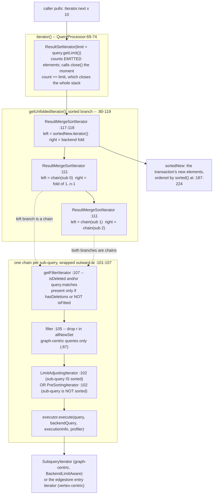
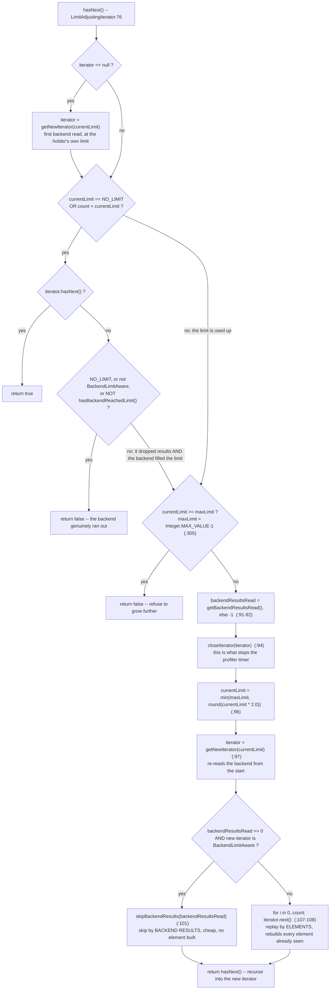

<!--
entry-meta
date: 2026-11-20
type: lesson
track: JanusGraph
lesson: 22
category: Database Internals
title: QueryProcessor — the iterator stack, the doubling limit, and why the profile cannot see any of it
slug: janusgraph-query-processor-iterator-stack
-->

# QueryProcessor — the iterator stack, the doubling limit, and why the profile cannot see any of it

**2026-11-20 · JanusGraph Track · Lesson 22 of 28**

## Where This Fits

- **Lesson 21** finished the graph-centric *compiler*: `GraphCentricQueryBuilder.constructQueryWithoutProfile` emits a `GraphCentricQuery` holding exactly one `BackendQueryHolder<JointIndexQuery>`, with `isFitted` a *count* of covered clauses, `isSorted` surviving three independent gates, and `numSubQueries()` a hard-coded `1`. ([lesson 21](../2026-11-19-janusgraph-graph-centric-query-builder/README.md)) **Lesson 20** did the same for the vertex-centric compiler, which emits a *list* of `BackendQueryHolder<SliceQuery>` — a product over types, directions and sort-key points. ([lesson 20](../2026-11-18-janusgraph-vertex-centric-query-builder/README.md))
- **This lesson** is the consumer of both. `QueryProcessor` is the one class that turns a compiled `ElementQuery` plus a `QueryExecutor` into an `Iterator<R>`: it folds the sub-queries into a merge tree, splices the transaction's own uncommitted elements into that tree, decides where the in-memory `matches` filter sits relative to the limit, and grows the backend limit when the filter eats results. It is 320 lines and it is the last piece of Part IV.
- **It sets up Part V.** `JanusGraphStep` and `JanusGraphVertexStep` (lessons 23–24) sit *above* this stack, and the `.profile()` output a user reads is assembled by `TP3ProfileWrapper`, which this lesson opens. The headline finding below — that `QueryProcessor` creates no profiler span of its own — is exactly why a Gremlin profile shows backend time and nothing about the merge, the sort or the filter.
- **Part IV/V boundary, so the re-pin review was due and was performed.** See [§10](#10-the-re-pin-review-performed-this-run).

**The answer to the headline question, up front.** The three debts lesson 21 handed over resolve into one sentence: **`QueryProcessor` is a generic right fold over sub-queries that in the shipped tree almost never folds anything.** Of its two branches, one is reachable only by vertex-centric queries and one only by graph-centric ones; the de-duplication machinery in both is dead because the only two `ElementQuery` implementations return a constant `false` from `hasDuplicateResults()`; and the multi-sub-query `concat` arm of the unsorted branch is unreachable outright, because the only query family that can take that branch has `numSubQueries()` hard-coded to `1`. What *is* load-bearing is the three-layer limit discipline — a backend limit that doubles, an in-memory filter between the backend and the count, and a final count that closes the stack — and that is what this lesson is actually about.

---

## 1. The stack, and who owns which number

`QueryProcessor` is `Iterable<R>`, not `Iterator<R>`, and all the work happens in `iterator()` ([`:69-74`](https://github.com/JanusGraph/janusgraph/blob/a59ae8d8024207598eada34998d867617df51adf/janusgraph-core/src/main/java/org/janusgraph/graphdb/query/QueryProcessor.java#L69-L74)):

```java
public CloseableIterator<R> iterator() {
    if (query.isEmpty())
        return CloseableIteratorUtils.emptyIterator();

    return new ResultSetIterator(getUnfoldedIterator(),(query.hasLimit()) ? query.getLimit() : Query.NO_LIMIT);
}
```

Two facts worth pinning immediately.

- **`getUnfoldedIterator()` runs eagerly, inside `iterator()`.** Building the stack is not lazy: `executor.hasDeletions(query)` and `executor.getNew(query)` are both called before any caller has asked for an element, and in the sorted branch `getNew` is *drained to a list* ([`:86`](https://github.com/JanusGraph/janusgraph/blob/a59ae8d8024207598eada34998d867617df51adf/janusgraph-core/src/main/java/org/janusgraph/graphdb/query/QueryProcessor.java#L86)) and then sorted. So `g.V().has(...).order().by(...)` pays the whole new-element sort at `iterator()` time, before the first `next()`.
- **The empty check is `query.isEmpty()`, which for both implementations is `getLimit() <= 0`** — `GraphCentricQuery.isEmpty()` and `BaseVertexCentricQuery.isEmpty()` are literally the same expression. This is the door lesson 21 found: an unsatisfiable condition is compiled to `emptyQuery(...)` with limit `0`, and *that* is what short-circuits here, not any inspection of the condition.

Three distinct limits live in this stack and confusing them is the main way to misread the code:

| Limit | Where it is set | What it counts | Who enforces it |
|---|---|---|---|
| `query.getLimit()` | the compiler, from the user's `limit(n)` | **elements emitted to the caller** | `ResultSetIterator` ([`ResultSetIterator.nextInternal`](https://github.com/JanusGraph/janusgraph/blob/a59ae8d8024207598eada34998d867617df51adf/janusgraph-core/src/main/java/org/janusgraph/graphdb/query/ResultSetIterator.java)) |
| `backendQueryHolder.getBackendQuery().getLimit()` | the compiler (graph-centric: `min(hardMaxLimit, adjustLimitForTxModifications(...))`; vertex-centric: the per-slice limit, doubled where a direction is unfitted) | **raw results the backend returns** | `LimitAdjustingIterator`, and it is the one that **grows** |
| `MAX_SORT_ITERATION = 1000000` | a private constant, [`:56`](https://github.com/JanusGraph/janusgraph/blob/a59ae8d8024207598eada34998d867617df51adf/janusgraph-core/src/main/java/org/janusgraph/graphdb/query/QueryProcessor.java#L56) | **raw results a pre-sort may fetch** | `PreSortingIterator`, which throws rather than truncating |

`ResultSetIterator` is deliberately one element ahead of itself: the constructor calls `nextInternal()` so `next` is populated before anyone asks, `hasNext()` is `next != null`, and `nextInternal()` calls `close()` the moment the limit is reached or the inner iterator dries up. Because `close()` propagates down through every wrapper (`CloseableIteratorUtils.filter` closes its delegate, `MultiIterator.close` drains and closes the rest, `LimitAdjustingIterator.close` closes the current backend iterator, `SubqueryIterator.close` stops the profiler timer and may cache), **`limit(10)` on a graph query is what releases an Elasticsearch scroll context** — the limit is a resource-management event, not only an arithmetic one. The one-ahead read also means `remove()` can be implemented on the *previous* element (`current.remove()`), which is the only `remove()` in the whole stack that is not an `UnsupportedOperationException`.



---

## 2. Which branch each query family actually takes

This is the fact the rest of the lesson hangs on, and it is settled by four one-line method bodies rather than by anything in `QueryProcessor` itself. `search_code` for `implements ElementQuery` at the pinned commit returns **exactly two** classes.

| | `VertexCentricQuery` | `GraphCentricQuery` |
|---|---|---|
| `isSorted()` | **`return true;`** — unconditionally ([`VertexCentricQuery`](https://github.com/JanusGraph/janusgraph/blob/a59ae8d8024207598eada34998d867617df51adf/janusgraph-core/src/main/java/org/janusgraph/graphdb/query/vertex/VertexCentricQuery.java)) | `!orders.isEmpty()` ([`GraphCentricQuery`](https://github.com/JanusGraph/janusgraph/blob/a59ae8d8024207598eada34998d867617df51adf/janusgraph-core/src/main/java/org/janusgraph/graphdb/query/graph/GraphCentricQuery.java)) |
| `getSortOrder()` | `new RelationComparator(vertex, getOrders())` — **not** an `OrderList` | the `OrderList`, or a bare `ComparableComparator` when empty |
| `numSubQueries()` | `queries.size()` — the product lesson 20 measured | **`return 1;`** — literal |
| `hasDuplicateResults()` | `return false;` with the comment *"We wanna count self-loops twice"* | `return false;` |
| branch taken in `getUnfoldedIterator` | **always the sorted branch** (`:80-119`) | sorted branch iff there is an `orderBy`, else the unsorted branch (`:120-160`) |

Four consequences fall straight out, and three of them are PR candidates.

1. **A vertex-centric query is "sorted" even with no `order().by()`.** The edgestore returns a row's cells in column order and `RelationComparator` is the comparator that order means; declaring `isSorted() == true` is how the processor is told it may merge rather than materialise. There is no vertex-centric code path through the unsorted branch at all.
2. **The unsorted branch's multi-sub-query arm is unreachable.** `iterators.size() > 1` at [`:139`](https://github.com/JanusGraph/janusgraph/blob/a59ae8d8024207598eada34998d867617df51adf/janusgraph-core/src/main/java/org/janusgraph/graphdb/query/QueryProcessor.java#L139) requires `numSubQueries() > 1` on a query that is *not* sorted — and the only unsorted family hard-codes `1`. So `CloseableIteratorUtils.concat(iterators)` and the `seenResults` de-duplication block under it ([`:139-150`](https://github.com/JanusGraph/janusgraph/blob/a59ae8d8024207598eada34998d867617df51adf/janusgraph-core/src/main/java/org/janusgraph/graphdb/query/QueryProcessor.java#L139-L150)) never execute; every unsorted query falls through to `else iterator = iterators.get(0);` at [`:151`](https://github.com/JanusGraph/janusgraph/blob/a59ae8d8024207598eada34998d867617df51adf/janusgraph-core/src/main/java/org/janusgraph/graphdb/query/QueryProcessor.java#L151). **PR candidate 55.**
3. **`ResultMergeSortIterator`'s duplicate filter is dead too.** Both implementations return a constant `false`, so the `filterDuplicates` field is always `false` and the `do { … } while (next != null && filterDuplicates && comp.compare(current, next) == 0)` loop in [`ResultMergeSortIterator.next`](https://github.com/JanusGraph/janusgraph/blob/a59ae8d8024207598eada34998d867617df51adf/janusgraph-core/src/main/java/org/janusgraph/graphdb/query/ResultMergeSortIterator.java) always runs exactly one iteration. The class javadoc in `QueryProcessor` ([`:48`](https://github.com/JanusGraph/janusgraph/blob/a59ae8d8024207598eada34998d867617df51adf/janusgraph-core/src/main/java/org/janusgraph/graphdb/query/QueryProcessor.java#L48)) still documents the behaviour as live. **PR candidate 56.**
4. **`lastFirstOrderValueWithinLimit` is graph-centric-only, and not by an `instanceof`.** Its fourth guard is `!(query.getSortOrder() instanceof OrderList)` ([`:171-174`](https://github.com/JanusGraph/janusgraph/blob/a59ae8d8024207598eada34998d867617df51adf/janusgraph-core/src/main/java/org/janusgraph/graphdb/query/QueryProcessor.java#L171-L174)), and a vertex-centric query's sort order is a `RelationComparator`. So it returns `null` for every vertex-centric query, which is consistent with `QueryExecutor.withoutResultsAfter` being a `default` method that returns its argument unchanged ([`QueryExecutor`](https://github.com/JanusGraph/janusgraph/blob/a59ae8d8024207598eada34998d867617df51adf/janusgraph-core/src/main/java/org/janusgraph/graphdb/query/QueryExecutor.java)).

And one that is a design observation rather than a defect: the generic processor contains a hard `instanceof GraphCentricQuery` at [`:87`](https://github.com/JanusGraph/janusgraph/blob/a59ae8d8024207598eada34998d867617df51adf/janusgraph-core/src/main/java/org/janusgraph/graphdb/query/QueryProcessor.java#L87), the only one in the file, with the reason stated in the comment above it: a graph query's backend can return an element the transaction also reports as *new*, a vertex-centric query's backend cannot (it reads the pre-transaction relations). That distinction is a property of the query family and would be better expressed on `ElementQuery` than by a cast in the engine. **PR candidate 59.**

---

## 3. The sorted branch, line by line

The loop runs **backwards** — `for (int i = query.numSubQueries() - 1; i >= 0; i--)` at [`:93`](https://github.com/JanusGraph/janusgraph/blob/a59ae8d8024207598eada34998d867617df51adf/janusgraph-core/src/main/java/org/janusgraph/graphdb/query/QueryProcessor.java#L93) — because the fold at [`:109-111`](https://github.com/JanusGraph/janusgraph/blob/a59ae8d8024207598eada34998d867617df51adf/janusgraph-core/src/main/java/org/janusgraph/graphdb/query/QueryProcessor.java#L109-L111) puts the *new* iterator on the left of each `ResultMergeSortIterator` and the accumulated one on the right. Going backwards makes sub-query 0 the outermost left operand, so for *n* sub-queries you get a right-leaning chain of *n−1* merge nodes with sub-query 0 at the top, and the pairwise comparator is applied *n−1* times per emitted element in the worst case. There is no *k*-way heap here: `ResultMergeSortIterator` is strictly binary and holds one lookahead element per side (`nextFirst`, `nextSecond`).

Its tie-break matters for stability: `int c = comp.compare(nextFirst, nextSecond); if (c <= 0) { result = nextFirst; … }` — **`<=`, so on a tie the left side wins**, and the left side is always the lower-numbered sub-query. Combined with the backwards loop, that means equal-ordering results come out in sub-query order, deterministically.

The per-sub-query chain is built innermost-first and wrapped outward, which is the opposite of the reading order on the page:

```java
CloseableIterator<R> subqueryIterator = subquery.isSorted()
    ? new LimitAdjustingIterator(subquery) : new PreSortingIterator(subquery);     // :101-102
if (!allNewSet.isEmpty()) {
    subqueryIterator = CloseableIteratorUtils.filter(subqueryIterator, r -> !allNewSet.contains(r));  // :105
}
subqueryIterator = getFilterIterator(subqueryIterator, hasDeletions, !subquery.isFitted());           // :107
```

So, from the backend upward: **raw results → backend limit → drop elements the transaction already reports as new → drop deleted and non-matching → merge → count against the query limit.**

**That answers lesson 21's debt (a) exactly: the in-memory filter runs *before* the query limit and *after* the backend limit.** `getFilterIterator` ([`:239-245`](https://github.com/JanusGraph/janusgraph/blob/a59ae8d8024207598eada34998d867617df51adf/janusgraph-core/src/main/java/org/janusgraph/graphdb/query/QueryProcessor.java#L239-L245)) is a single `filter` with a two-clause predicate, and — this is the part worth noticing — **it is absent entirely when there is nothing to do**:

```java
if (filterDeletions || filterMatches) {
    return CloseableIteratorUtils.filter(iterator, r -> (!filterDeletions || !executor.isDeleted(query, r)) && (!filterMatches || query.matches(r)));
} else {
    return iterator;
}
```

A fitted sub-query in a transaction with no deletions gets **no wrapper at all**, not a wrapper with a constant-true predicate. For a `limit(10)` vertex-centric read of a typed, fitted slice in a clean transaction, the whole stack collapses to `ResultSetIterator → LimitAdjustingIterator → entry iterator`: three objects, one of which only counts.

Two more details in this branch that are easy to miss:

- **`allNewSet` is a `HashSet<R>` built from the new-element list** ([`:87-88`](https://github.com/JanusGraph/janusgraph/blob/a59ae8d8024207598eada34998d867617df51adf/janusgraph-core/src/main/java/org/janusgraph/graphdb/query/QueryProcessor.java#L87-L88)) and is consulted once per backend result. Membership therefore rides on `JanusGraphElement.equals`/`hashCode`, i.e. on element identity by id — the same assumption the unsorted branch makes at [`:131`](https://github.com/JanusGraph/janusgraph/blob/a59ae8d8024207598eada34998d867617df51adf/janusgraph-core/src/main/java/org/janusgraph/graphdb/query/QueryProcessor.java#L131).
- **`Preconditions.checkArgument(iterator != null)`** at [`:114`](https://github.com/JanusGraph/janusgraph/blob/a59ae8d8024207598eada34998d867617df51adf/janusgraph-core/src/main/java/org/janusgraph/graphdb/query/QueryProcessor.java#L114) fires if `numSubQueries() == 0`. For `GraphCentricQuery` that is impossible (literal `1`). For a vertex-centric query, `queries` can be empty — but the compiler returns `BaseVertexCentricQuery.emptyQuery()` with limit `0` in that case, which `query.isEmpty()` catches at `:70` before the branch is reached. The assertion is the backstop for a compiler that forgets to do that.

---

## 4. `sorted()` — a bounded heap, and why stability is part of the contract

[`:187-224`](https://github.com/JanusGraph/janusgraph/blob/a59ae8d8024207598eada34998d867617df51adf/janusgraph-core/src/main/java/org/janusgraph/graphdb/query/QueryProcessor.java#L187-L224) is the most carefully written method in the file, and it is not the obvious `allNew.sort(comparator)`.

- **Fast path:** if the sort order is not an `OrderList`, or there are fewer than two new elements, it is a plain `List.sort`. Every vertex-centric query lands here, because `RelationComparator` is not an `OrderList`.
- **Graph-centric path:** each element is boxed into a `Ranked<R>` holding `element`, `Object[] values = orders.values(element)` and its `position` in the transaction's order. The comparator is `orders.compareValues(r1.values, r2.values)` with `Integer.compare(r1.position, r2.position)` as the tie-break.

Two separate optimisations are stacked here, and the in-tree comment states both intentions:

1. **Read the order values once per element, not twice per comparison.** A comparison-based sort of *m* elements performs Θ(*m* log *m*) comparisons; reading an order key off a vertex may be a property lookup. Pre-extracting into `Object[] values` makes it *m* reads.
2. **Keep only as many as the limit can use.** `kept = min(limit, size)` when there is a limit and no duplicate filtering; if `kept < size`, a `PriorityQueue<Ranked<R>>` of capacity `kept + 1` ordered by `byValues.reversed()` is filled and polled so that the *head is the worst of the best*, giving Θ(*m* log *k*) instead of Θ(*m* log *m*) and Θ(*k*) retained memory. `first = new ArrayList<>(heap)` then **`first.sort(byValues)`** — necessary, because a `PriorityQueue`'s iteration order is heap order, not sorted order.

The explicit `position` tie-break is not cosmetic. The comment says it plainly: *"elements of equal values keep the order in which the transaction gave them, as a stable sort of all of them does, so that the first of them under a limit are the first under a larger limit as well."* A `PriorityQueue` is not a stable sort container, so without `position` the top-*k* selection would be free to return a different *k* elements than a full stable sort would — and `limit(10)` followed by `limit(20)` in the same transaction could disagree on the first ten. That is a correctness property of pagination, recovered with one `int` per element.

Note the asymmetry worth carrying forward: the heap bounds the **new** elements only. Nothing here bounds the backend side; that is `LimitAdjustingIterator`'s job, and for an unsortable index it is `PreSortingIterator`'s million-element budget.

---

## 5. `withoutResultsAfter` — the only place the transaction narrows the backend

This is the youngest machinery in the file and the only *downward* flow of information in the whole stack: everywhere else the transaction's state filters what the backend already returned; here it changes what the backend is asked for.

The guard is four conditions, all of which must hold ([`:170-176`](https://github.com/JanusGraph/janusgraph/blob/a59ae8d8024207598eada34998d867617df51adf/janusgraph-core/src/main/java/org/janusgraph/graphdb/query/QueryProcessor.java#L170-L176)):

```java
if (!query.hasLimit() || query.hasDuplicateResults() || sortedNew.size() < query.getLimit()
        || !(query.getSortOrder() instanceof OrderList)) {
    return null;
}
return ((OrderList) query.getSortOrder()).value(sortedNew.get(query.getLimit() - 1), 0);
```

In words: **there is a limit, the transaction's own new elements already fill it, and the order is an `OrderList`.** Then the value of the *first* order key on the *last new element inside the limit* is an upper bound: nothing ordering after it can land within the limit, so the backend may be told not to return it. The returned value can still be `null` if that element has no value for the key — the guard comment notes a missing value sorts last, and `QueryProcessorTest#asksNothingWhereTheLastNewElementWithinTheLimitHasNoValue` pins that case.

Then, per sub-query ([`:95-100`](https://github.com/JanusGraph/janusgraph/blob/a59ae8d8024207598eada34998d867617df51adf/janusgraph-core/src/main/java/org/janusgraph/graphdb/query/QueryProcessor.java#L95-L100)):

```java
if (lastValue != null && subquery.isSorted()) {
    final B narrowed = executor.withoutResultsAfter(query, subquery.getBackendQuery(), lastValue);
    if (narrowed != subquery.getBackendQuery()) {
        subquery = subquery.withBackendQuery(narrowed);
    }
}
```

**The success signal is reference inequality, `!=`, not a boolean** — the same idiom lesson 21 found in `requireValues`/`requireOrderValues`, where `return anyNarrowed ? narrowed : indexQuery;` is tested with `!=`. The `default` implementation in `QueryExecutor` returns its argument, so a backend that cannot narrow needs no flag and no exception: identity *is* the negative answer. This is why `BackendQueryHolder.withBackendQuery` exists at all, and why it carefully copies the profiler across — `holder.profiler = profiler;` — so the narrowed query's executions are recorded under the span the original holder was given rather than under `NO_OP`.

Lesson 21 established the receiving end: `withoutResultsAfter` reaches `JointIndexQuery.narrowFirst`, which adds a range on the first order key to sub-query 0 and bails out unless the key is `Cardinality.SINGLE`, the field passes `isRangedAsOrdered` and the backend supports the range predicate.

---

## 6. `LimitAdjustingIterator` — the doubling loop, and the skip that makes it correct

Lesson 21's debt (b). The abstract class is [`LimitAdjustingIterator`](https://github.com/JanusGraph/janusgraph/blob/a59ae8d8024207598eada34998d867617df51adf/janusgraph-core/src/main/java/org/janusgraph/graphdb/query/LimitAdjustingIterator.java) (131 lines, byte-verified against GitHub's blob SHA `96a7e3ae`); the concrete subclass is `QueryProcessor`'s private inner class of the same name ([`:298-318`](https://github.com/JanusGraph/janusgraph/blob/a59ae8d8024207598eada34998d867617df51adf/janusgraph-core/src/main/java/org/janusgraph/graphdb/query/QueryProcessor.java#L298-L318)), whose whole body is:

```java
private LimitAdjustingIterator(BackendQueryHolder<B> backendQueryHolder) {
    super(Integer.MAX_VALUE-1,backendQueryHolder.getBackendQuery().getLimit());
    …
}

@Override
public Iterator<R> getNewIterator(int newLimit) {
    if (newLimit>backendQuery.getLimit())
        backendQuery = backendQuery.updateLimit(newLimit);
    return executor.execute(query, backendQuery, executionInfo, profiler);
}
```

- `maxLimit = Integer.MAX_VALUE - 1` and `currentLimit = ` the holder's own backend limit. Note what this means for an unbounded query: `Query.NO_LIMIT == Integer.MAX_VALUE`, so an unbounded backend query starts with `currentLimit == NO_LIMIT` **and** `currentLimit > maxLimit`, which makes the `currentLimit >= maxLimit` guard at `:87` of the abstract class a hard stop. An unbounded read never grows, and never needs to.
- The `Preconditions.checkArgument(currentLimit>0 && maxLimit>0, …)` in the abstract constructor means **a backend query with limit `0` throws `IllegalArgumentException` here rather than returning nothing.** `query.isEmpty()` at `:70` is what keeps that unreachable; the limit-0 `emptyQuery` never gets this far.
- `backendQuery` is mutable state on the iterator and `updateLimit` is only called when the new limit is *larger*, so a re-read never shrinks.

The growth decision ([`LimitAdjustingIterator:76-113`](https://github.com/JanusGraph/janusgraph/blob/a59ae8d8024207598eada34998d867617df51adf/janusgraph-core/src/main/java/org/janusgraph/graphdb/query/LimitAdjustingIterator.java#L76-L113)):



**Who actually drives the growth.** `count` is incremented in `next()`, so it counts results this iterator handed *upward* — to the filters above it, not to the user. The user's limit is enforced two layers up. So the sequence that triggers a re-read is: the backend returned `currentLimit` raw results, the in-memory filter above consumed all of them and emitted fewer than the user asked for, `ResultSetIterator` asks again, `count == currentLimit`, and the limit doubles. **Growth is the price of an unfitted query, and nothing else.** A fitted sub-query whose backend limit is at least the query limit never re-reads.

**Why `skipBackendResults` had to be invented.** The naive resumption is the `else` arm: re-read at the new limit and throw away `count` elements with `iterator.next()`. That is wrong when the inner iterator drops results — and the graph-centric one does, because `SubqueryIterator.findNext` skips ids whose `function.apply(id)` returns `null` and ids absent from `otherResultSet`. If a relation was removed between the two reads, the *element* at position `count` is no longer the same backend result, every result before it gets converted into an element a second time, and the replay silently shifts the window. `BackendLimitAware` fixes it by changing the unit of resumption from elements to **backend results**: `getBackendResultsRead()` returns `position`, which `SubqueryIterator` advances only when an element is actually handed out (and deliberately *not* during the lookahead probe in `close()`), and `skipBackendResults(long)` is guarded by `Preconditions.checkState(!started, "Ids can only be skipped before the iterator looks for its first element")` so it can only be set on a fresh iterator.

The second half of that interface answers a question the naive version cannot even ask. `hasBackendReachedLimit()` is `subQuery.hasLimit() && position >= subQuery.getLimit()`: an iterator that drops results can end *before* its own limit while the backend still holds more, so "my wrapped iterator is exhausted" no longer implies "the backend ran out". That is why `:78-86` of the abstract class has two exits rather than one — the plain `return false` is only taken when the iterator is *not* `BackendLimitAware` or the backend did not fill its limit.

**`search_code` for `BackendLimitAware` at the pinned commit returns exactly one class, `SubqueryIterator`** — the index did not return the interface's own file or `LimitAdjustingIterator`, both of which contain the string, so treat that as suggestive rather than exhaustive. Taken with the fact that `SubqueryIterator` is constructed only on the graph-centric path, the practical split is: **graph-centric re-reads skip; vertex-centric re-reads replay.**

Finally, the comment on `:93-94` — *"Close old iterator. This is needed otherwise it would not be timed properly by profiler."* — is not housekeeping. `SubqueryIterator` starts its profiler timer in its constructor and stops it in `close()`; an abandoned-but-unclosed iterator would leave `runningTimer == true`, and `SimpleQueryProfiler.startTimer` begins with `Preconditions.checkArgument(!runningTimer, "A timer is already running")`. Skipping that `close()` would not merely lose a measurement, it would throw on the next read of the same span.

---

## 7. `PreSortingIterator` — the million-element wall

The other arm of `:101-102`, taken when the query wants an order the sub-query's backend does not provide. For a vertex-centric query that means a sort order the slice's column order does not satisfy; for a graph-centric query it means an `orderBy` that survived none of lesson 21's three `isSorted` gates — in practice a composite index or a full scan under `order().by(key)`.

Its constructor ([`:257-275`](https://github.com/JanusGraph/janusgraph/blob/a59ae8d8024207598eada34998d867617df51adf/janusgraph-core/src/main/java/org/janusgraph/graphdb/query/QueryProcessor.java#L257-L275)) does all of its work eagerly:

```java
final Iterator<R> results = executor.execute(query,
    backendQueryHolder.getBackendQuery().updateLimit(MAX_SORT_ITERATION),
    backendQueryHolder.getExecutionInfo(),backendQueryHolder.getProfiler());
int fetched = 0;
while (results.hasNext()) {
    final R result = results.next();
    fetched++;
    if (!result.isRemoved()) {
        all.add(result);
    }
}
if (fetched >= MAX_SORT_ITERATION)
    throw new QueryException("Could not execute query since pre-sorting requires fetching more than " +
            MAX_SORT_ITERATION + " elements. Consider rewriting the query to exploit sort orders");
all.sort(query.getSortOrder());
```

Five things about this that matter in production:

1. **It overrides the compiler's limit upward.** `updateLimit(MAX_SORT_ITERATION)` replaces whatever the holder carried with `1_000_000`. Lesson 21 established that `query.hard-max-limit` defaults to `Integer.MAX_VALUE` but can be set to bound index reads — **this path ignores it**, in both directions. A user who set `hard-max-limit = 5000` to protect the cluster still gets a million-row read the moment an ordered query picks an index that cannot sort.
2. **It discards removed elements before sorting, not during.** The comment explains why: the order values of a removed vertex cannot be read, so `isRemoved()` must be checked before `OrderList.values` ever touches it. Elements that are *deleted in other senses* — changed so they no longer match — are left to `getFilterIterator` above, as they are for an unsorted query, deliberately, so that a mutation made by the caller *while reading* is still observed. `QueryProcessorTest#leavesOutTheRemovedElementsBeforeSortingWhatTheBackendReturns` pins exactly this, with a mock whose `valueOrNull` throws.
3. **The `QueryException` fires after the work, not before it.** The million results are fetched, converted and counted first; the exception is thrown only once the loop ends. There is no incremental bail-out, so the failure costs a full million-row read.
4. **A complete result of exactly 1,000,000 elements is rejected.** The read was performed under limit `MAX_SORT_ITERATION`, so `fetched` can never exceed it; `fetched >= MAX_SORT_ITERATION` therefore means "the backend filled the limit", which is *not* the same as "there were more". An ordered query over an index holding exactly 1,000,000 matching elements, which the backend returned in full and which would sort fine, throws `QueryException` with a message claiming more than a million exist. The honest predicate needs one more result than the budget: read at `MAX_SORT_ITERATION + 1` and fail on `fetched > MAX_SORT_ITERATION`. **PR candidate 53.**
5. **The budget is per sub-query, not per query.** A multi-slice vertex-centric query with three unsorted sub-queries can fetch up to three million results before the first element is emitted — and `PreSortingIterator` is constructed inside the loop at `:102`, so each one gets its own million.

This is the mechanism behind a message visible in the upstream history. The commit that fixed [#5124](https://github.com/JanusGraph/janusgraph/commit/0f578b3f6588e40d54dbd5f6ae9d9d9d690fc971) describes `g.V().order().by("name").limit(10)` as reading *"every vertex and sort[ing] them in memory, which fails with a QueryException from a million vertices on"* — that `QueryException` is this one, thrown from `:270-272`, and the fix was made on the *compiler* side (choose a mixed index that sorts) precisely because there is nothing to be done about it here.

---

## 8. Profiling: the stack is invisible, by construction

Lesson 21 left the profiler as a set of span names. Here is the whole mechanism, and the surprise is what is *missing*.

**The interface.** [`QueryProfiler`](https://github.com/JanusGraph/janusgraph/blob/a59ae8d8024207598eada34998d867617df51adf/janusgraph-core/src/main/java/org/janusgraph/graphdb/query/profile/QueryProfiler.java) is five instance methods — `addNested(String, boolean)`, `setAnnotation(String, Object)`, `startTimer()`, `stopTimer()`, `setResultSize(long)` — plus a `NO_OP` singleton whose `addNested` returns `this` and whose other methods are empty, and four `static profile(...)` helpers that wrap a `Function` call in `startTimer`/`stopTimer`/`setResultSize`. Group names: `OR-query`, `AND-query`, `backend-query`, `optimization`, `constructGraphCentricQuery`, `GraphCentricQuery`, `MixedIndexCountQuery`. Annotation keys: `condition`, `orders`, `limit`, `multi`, `multiPreFetch`, `vertices`, `partitioned`, `isFitted`, `isOrdered`, `query`, `fullscan`, `index`, `queries`, `queriesAmount`, `multiSlices`, `limitsPerQuery`.

**Two implementations, two different tree shapes from the same instrumentation.**

| | [`SimpleQueryProfiler`](https://github.com/JanusGraph/janusgraph/blob/a59ae8d8024207598eada34998d867617df51adf/janusgraph-core/src/main/java/org/janusgraph/graphdb/query/profile/SimpleQueryProfiler.java) | [`TP3ProfileWrapper`](https://github.com/JanusGraph/janusgraph/blob/a59ae8d8024207598eada34998d867617df51adf/janusgraph-core/src/main/java/org/janusgraph/graphdb/tinkerpop/profile/TP3ProfileWrapper.java) |
|---|---|---|
| backing store | `List<SimpleQueryProfiler> nestedProfilers`, `Map<String,Object> annotations` | TinkerPop `MutableMetrics` |
| `addNested(name, hasSiblings)` | **ignores `hasSiblings`** — always allocates a child | `if (!hasSiblings && (name.equals(AND_QUERY) \|\| name.equals(OR_QUERY))) return this;` — **flattens a single-child AND/OR into its parent** |
| child id | none; the group name only | `metrics.getId() + "." + groupName + "_" + subMetricCounter++` |
| annotation values | stored as-is; `convert` is a no-op with the type-narrowing lines commented out in-tree | anything not `String` or `Number` is `toString()`-ed |
| timing | `System.nanoTime()` deltas accumulated into `measuredTimeNs`; `startTimer` throws if a timer is already running | `metrics.start()` / `metrics.stop()` |
| result size | `resultSize = size`, with `checkArgument(size >= 0)` | `metrics.incrementCount(TraversalMetrics.ELEMENT_COUNT_ID, size)` — **accumulates**, does not assign |

So a `.profile()` in Gremlin collapses the `OR-query` wrapper when a query has one sub-query, and `SimpleQueryProfiler` does not. The flattening is what makes a real profile readable — and `BaseVertexCentricQuery.observeWith` is the one place that computes the flag: `boolean consistsOfMultipleQueries = queries.size() > 1; queries.forEach(bqh -> bqh.observeWith(profiler, consistsOfMultipleQueries));`. Since `GraphCentricQuery.observeWith` calls `indexQuery.observeWith(profiler)` — the one-argument default, i.e. `hasSiblings == false` — a graph query's `OR-query` span is **always** flattened away in a TinkerPop profile and **always** present in a `SimpleQueryProfiler` tree. **PR candidate 60** is the asymmetry itself: `SimpleQueryProfiler` accepting and discarding a parameter that changes the shape of the output is a trap for anyone writing a test against it.

**Where the spans actually come from.** `BackendQueryHolder.observeWith` is the only annotator of a sub-query:

```java
profiler = parentProfiler.addNested(QueryProfiler.OR_QUERY, hasSiblings);
profiler.setAnnotation(QueryProfiler.FITTED_ANNOTATION,isFitted);
profiler.setAnnotation(QueryProfiler.ORDERED_ANNOTATION,isSorted);
profiler.setAnnotation(QueryProfiler.QUERY_ANNOTATION,backendQuery);
if (backendQuery instanceof ProfileObservable) ((ProfileObservable)backendQuery).observeWith(profiler);
```

That is the whole origin of `isFitted=true`/`isOrdered=false` in a profile: a holder field, written once at compile time. Note the ordering constraint it implies — `observeWith` must run **before** `QueryProcessor` builds its stack, because the stack reads `backendQueryHolder.getProfiler()` at construction and a holder that was never observed still carries `QueryProfiler.NO_OP`, silently producing an unprofiled read.

**And now the finding.** Grep `QueryProcessor.java` for `profiler` and you find exactly three uses, all of them *pass-through*: the inner `LimitAdjustingIterator` field, its use in `getNewIterator`, and `backendQueryHolder.getProfiler()` in `PreSortingIterator`. **`QueryProcessor` never calls `addNested`, `startTimer`, `stopTimer` or `setResultSize`.** Consequences, all of which show up as user-visible gaps in `.profile()`:

- The merge tree, the `sorted()` heap, the `allNewSet` filter, the `matches` filter and the final count are **untimed and uncounted**. Time spent on an unfitted filter or an in-memory sort is simply absent from the profile; it is not attributed to the backend span either, because the backend span's timer is stopped on `close()`.
- `setResultSize` is called by `SubqueryIterator.close()` with `readCount` — **ids read from the index**, including those skipped and those that converted to nothing. So a profile's result count on a `backend-query` span is a *backend* count, and the discrepancy between it and the elements the user received is the only trace an in-memory filter leaves.
- A `LimitAdjustingIterator` that doubles produces **several `backend-query` spans under one holder's span**, because `getNewIterator` is called again and `SubqueryIterator` starts a fresh `startProfile` each time. Repeated sibling `backend-query` entries with growing `limit` annotations are the signature of an unfitted query, and the only way to see the doubling from outside.

One cosmetic bug falls out of the same reading, and it is in the string a profile shows. `GraphCentricQuery.toString()` is:

```java
b.append("[").append(condition.toString()).append("]");
if (!orders.isEmpty()) b.append(getLimit());
if (hasLimit()) b.append("(").append(getLimit()).append(")");
b.append(":").append(resultType.toString());
```

The second line clearly means to append the **orders** and appends the **limit** instead, so an ordered, limited graph query renders as `[condition]10(10):vertex` — the limit twice, the order never. Because `TP3ProfileWrapper.setAnnotation` `toString()`s any non-`String`/`Number` value, this is exactly what lands in the `query` annotation of a real `.profile()`. **PR candidate 52.**

**Metrics, separately.** [`MetricsQueryExecutor`](https://github.com/JanusGraph/janusgraph/blob/a59ae8d8024207598eada34998d867617df51adf/janusgraph-core/src/main/java/org/janusgraph/graphdb/query/MetricsQueryExecutor.java) is a decorator around `QueryExecutor` that is unrelated to the profiler: it increments `<prefix>.query.<name>.<op>.calls`, times `<op>.time` and counts `<op>.exceptions` on `MetricManager.INSTANCE` for `getNew`, `hasDeletions`, `isDeleted` and `execute`. Note that **`withoutResultsAfter` is the one method it does not wrap** — it delegates straight through with no counter — which is defensible (it is pure query rewriting) but means the narrowing path is invisible to Metrics as well as to the profiler. Also note `isDeleted` is per-element, so on an unfitted query with deletions the Codahale timer is started and stopped once per backend result.

---

## 9. The composite picture, per query family

| Query | branch | sub-queries | per-sub-query head | growth | in-memory filter | pre-sort risk |
|---|---|---|---|---|---|---|
| `v.outE("friend").limit(10)`, typed + fitted | sorted | 1 | `LimitAdjustingIterator` | none (fitted) | none — no wrapper at all | no |
| `v.outE().direction(OUT)` untyped | sorted | 1 | `LimitAdjustingIterator` | yes, by doubling + **replay** | `query.matches` per result | no |
| `v.query().labels("friend").has("weight", within(0.5,1.5,2.5)).interval("time",3,33)` | sorted | **3** (lesson 20) | 3 × `LimitAdjustingIterator` | per sub-query | per sub-query | no |
| `g.V().has("name","alice")`, one composite index, fitted | **unsorted** | 1 (literal) | `LimitAdjustingIterator` over `SubqueryIterator` | yes, by doubling + **skip** | none | no |
| `g.V().has("name","alice").has("age",gt(30))`, mixed index covering one clause | unsorted | 1 | same | yes | `query.matches` on the uncovered clause | no |
| `g.V().has("status","x").order().by("name")`, composite index, no sorting index | **sorted** | 1 | **`PreSortingIterator`** | n/a | after the sort | **yes, 1,000,000** |
| `g.V().order().by("name").limit(10)` with no index at all | sorted | 1 (empty `JointIndexQuery` → full scan) | **`PreSortingIterator`** | n/a | after the sort | **yes** — the #5124 case |

---

## 10. The re-pin review, performed this run

Lesson 22 is the Part IV/V boundary and owed the review that lessons 19, 20 and 21 correctly deferred. `list_commits` on `JanusGraph/janusgraph` `master` was re-run this run and returns, newest first:

| sha | date | subject |
|---|---|---|
| [`a59ae8d8`](https://github.com/JanusGraph/janusgraph/commit/a59ae8d8024207598eada34998d867617df51adf) | 2026-10-28 | *Restore 1.3.0-SNAPSHOT version CTR* |
| [`9a30ff14`](https://github.com/JanusGraph/janusgraph/commit/9a30ff149a7a11a7ed564c695046287f36fb1681) | 2026-10-28 | *Restore 1.2.1-SNAPSHOT version and update Sonatype link CTR* |
| [`5e3e7bc7`](https://github.com/JanusGraph/janusgraph/commit/5e3e7bc76e3a1db983cd55475a9bc51e09bcaf23) | 2026-10-24 | *JanusGraph release 1.2.0* |
| [`0f578b3f`](https://github.com/JanusGraph/janusgraph/commit/0f578b3f6588e40d54dbd5f6ae9d9d9d690fc971) | 2026-10-22 | *Read a mixed index of the order keys which answers a query whole* — fixes #5124 |
| [`b7c14c53`](https://github.com/JanusGraph/janusgraph/commit/b7c14c53c400b8975c318f1b2545b886761f9cca) | 2026-10-23 | *Read Solr results larger than a page in growing pages* — fixes #5126 |

**The pin stays: `a59ae8d8` is still the tip of `master`, for the fourth review in a row.** There is nothing to re-pin to, so Part V's line numbers stay comparable with lessons 02–22.

Two of those commits are directly relevant to this lesson and are worth reading as primary sources rather than as pin evidence. `0f578b3f` is the #5124 fix discussed in §7 — it is the change that *avoids* `PreSortingIterator` by re-selecting a sorting mixed index when the first index selection covered nothing, and its commit message is the clearest English statement in the tree of why a joint query reads all but its first sub-query whole. `b7c14c53` is the Solr paging fix, and its mechanism — a first page of `max-result-set-size`, then each page twice the previous up to `max-page-size`, *"so a read which stops early asks for no more than twice the hits it takes"* — is `LimitAdjustingIterator`'s doubling re-implemented one layer down, inside an index provider. Reading the two together is the cheapest way to see that growing-batch reads appear at three levels of this system independently.

**Free cross-check, in lieu of a fourth line-count comparison.** This run byte-verified two files rather than comparing totals: `QueryProcessor.java` reconstructed locally hashes to git blob `b28e68871c9a8a0f655373deaa4185cdf4da9a44` at 16,048 bytes and `LimitAdjustingIterator.java` to `96a7e3ae38ff3c0138879c5688f8a62053b66220` at 5,961 bytes, both exactly the blob SHAs `get_file_contents` reported for those paths at the pinned commit. Every `QueryProcessor:NN` and `LimitAdjustingIterator:NN` citation in this entry comes from a file whose content is proven byte-identical to the pinned blob — a strictly stronger check than the line-count comparisons lessons 19–21 used, and the method to prefer from here on.

---

## Hands-On

All three exercises run against the fork at `aryanttripathi/janusgraph`, checked out at `a59ae8d8`. Nothing here needs a real backend — `QueryProcessorTest` uses Mockito and `QueryTest` runs on `InMemoryStoreManager`.

### A. Read the processor's own unit test, then close its coverage gap

```bash
cd ~/src/janusgraph
git fetch upstream && git checkout a59ae8d8024207598eada34998d867617df51adf
mvn -pl janusgraph-core -Dtest=QueryProcessorTest -DfailIfNoTests=false test
```

**What to look for.** Seven `@Test` methods pass. The interesting part is not that they pass but what the fixture pins — open `janusgraph-core/src/test/java/org/janusgraph/graphdb/query/QueryProcessorTest.java` and read the private `query(boolean ordered, int limit, boolean backendSorts)` helper. It is a Mockito `ElementQuery` with **`when(query.numSubQueries()).thenReturn(1)`** and a single `when(query.getSubQuery(0))`. So all seven tests exercise a one-sub-query stack: the backwards fold, `ResultMergeSortIterator`, the pairwise `<=` tie-break and the `concat` arm have **no unit coverage here at all**. Also read `Executor`, the fake `QueryExecutor`: it counts `newTaken`, records every `FakeBackendQuery` it was asked to `execute`, and implements `withoutResultsAfter` by returning a *new* `FakeBackendQuery(true, …)` — which is how `asksTheBackendOfAnOrderedQueryForTheResultsUpToItsLastNewValueWithinTheLimit` asserts narrowing happened, via `executed.stream().allMatch(q -> q.narrowed)`. That reference-inequality protocol from §5 is directly visible in the test's design.

Then write the missing test. It needs no new infrastructure — four lines on the existing fixture:

```java
// in query(...): make it a two-sub-query, sorted query
when(query.numSubQueries()).thenReturn(2);
when(query.getSubQuery(0)).thenReturn(new BackendQueryHolder<>(new FakeBackendQuery(false, limit), true, true));
when(query.getSubQuery(1)).thenReturn(new BackendQueryHolder<>(new FakeBackendQuery(false, limit), true, true));
```

and an `Executor` that returns a *different* list per `execute` call so the merge is observable. Assert two things the current suite cannot: that the output is the merge of the two lists in `OrderList` order, and that on an exact tie the element from **sub-query 0** comes first. That second assertion is the one that pins `c <= 0` in `ResultMergeSortIterator.nextInternal` and would catch a refactor to `c < 0`. **Run it against an unmodified checkout first to confirm it passes, then invert the `<=` locally and confirm it fails** — a test that cannot fail is not coverage. Revert the inversion; do not commit it.

### B. Watch the backend limit double

The doubling is invisible from outside except through repeated `backend-query` spans, so make it print. Put a temporary line at the top of `LimitAdjustingIterator.getNewIterator` in `QueryProcessor`:

```java
@Override
public Iterator<R> getNewIterator(int newLimit) {
    System.err.println("[LAI] newLimit=" + newLimit + " holderLimit=" + backendQuery.getLimit()
        + " backendQuery=" + backendQuery);
    if (newLimit>backendQuery.getLimit())
        backendQuery = backendQuery.updateLimit(newLimit);
    return executor.execute(query, backendQuery, executionInfo, profiler);
}
```

Then run a query that is **unfitted on purpose** — one indexed clause and one that no index covers, which lesson 21 showed leaves `coveredClauses.size() < queryConditions.numChildren()`:

```bash
mvn -pl janusgraph-test -am -Dtest=QueryTest#testMultipleIndexQueryWithLimits -DfailIfNoTests=false test
```

**What to look for.** More than one `[LAI]` line for a single sub-query, with `newLimit` following `L, 2L, 4L, …`. Each line is one extra round trip to the index. Compare against `QueryTest#testQueryLimitAdjustment`, which lesson 21 measured printing `@5`, `@10`, `@20` for `limit(5)` with 0, 1 and 2 uncovered clauses — that multiplier is applied **at compile time** by `QueryUtil.adjustLimitForTxModifications`, and it exists precisely to make the *first* read large enough that the doubling here is not needed. Seeing both numbers in one run is the point: `2^uncovered` is the static guess, the doubling is the dynamic correction, and they are two different mechanisms addressing the same problem. Delete the `System.err.println` before committing anything; a stray print in `getNewIterator` fires once per backend read.

### C. See `PreSortingIterator` chosen, and reproduce the `toString` bug

Two parts, both in `janusgraph-test`, both one-method runs.

For the chooser, add a temporary print at `QueryProcessor:101`:

```java
CloseableIterator<R> subqueryIterator = subquery.isSorted()
    ? new LimitAdjustingIterator(subquery) : new PreSortingIterator(subquery);
System.err.println("[QP] sorted=" + query.isSorted() + " subSorted=" + subquery.isSorted()
    + " fitted=" + subquery.isFitted() + " head="
    + (subquery.isSorted() ? "LimitAdjusting" : "PreSorting") + " q=" + query);
```

and run the three string-ordering tests lesson 21 identified, which order on a key without necessarily having a sorting index:

```bash
mvn -pl janusgraph-test -am -Dtest=QueryTest#testGraphQueryConditionsCompareStringsByCodePoint+testInMemoryOrderComparesStringsByCodePoint -DfailIfNoTests=false test
```

**What to look for.** `head=PreSorting` on any query where `sorted=true` and `subSorted=false`. That single line is the whole decision of §7, and the `q=` field is the second half of the exercise: on an ordered, limited graph query it prints the limit twice — `[…]10(10):vertex` — with no order in it, which is PR candidate 52 reproduced without writing a test. Confirm it against the source: `GraphCentricQuery.toString`'s second line is `if (!orders.isEmpty()) b.append(getLimit());`.

For the million-element wall, do not try to build a million vertices. Instead temporarily lower the constant and watch the exception appear and the boundary misfire:

```java
private static final int MAX_SORT_ITERATION = 3;   // was 1000000
```

Then run any ordered in-memory query returning exactly three matching elements. **What to look for:** a `QueryException` whose message says *"requires fetching more than 3 elements"* on a result of exactly 3 — complete, returned in full by the backend under limit 3, and sortable. That is PR candidate 53, demonstrated in one test run rather than argued. Now change the read to `updateLimit(MAX_SORT_ITERATION + 1)` and the check to `fetched > MAX_SORT_ITERATION`, re-run, and confirm the three-element query succeeds while a four-element one still throws. Restore the constant to `1000000` before committing; the fix itself (the `+ 1` and the `>`) is the candidate-53 patch and is worth keeping on a branch.

---

## Where This Breaks Down

- **The in-memory filter sits below the count, so an unfitted query's cost is unbounded in the limit.** `limit(10)` bounds what you receive, not what is read. With a selective-looking index whose uncovered clause rejects almost everything, the stack reads `L`, `2L`, `4L` … up to `Integer.MAX_VALUE - 1` results, one round trip each, and stops only when ten survive or the index runs out. There is no cost ceiling and no error — just latency that grows with the *inverse* of the uncovered clause's selectivity. The `2^uncovered` compile-time multiplier is a single, uninformed guess at that selectivity.
- **Resumption after growth re-reads from the start.** `getNewIterator` issues a fresh backend query; there is no cursor. So a sub-query that doubles four times has read the first `L` results five times. `skipBackendResults` makes the *skipping* cheap (no element construction) but the backend still returns and transfers the rows. For a remote index this is the dominant cost of an unfitted query.
- **`PreSortingIterator` ignores `query.hard-max-limit` and has a per-sub-query budget.** §7, items 1 and 5. An operator cannot bound an ordered-but-unsortable query, and the failure is a hard `QueryException` after a million-row read rather than a degraded result.
- **The merge tree is binary and rebuilt per vertex.** `n−1` nested `ResultMergeSortIterator`s mean up to `n−1` comparator invocations per emitted element, and for a vertex-centric query the comparator is `RelationComparator`, which is not free. Lesson 20 measured a three-slice compile from one ordinary traversal; a six-value `within(...)` on a sort key would make six. A *k*-way heap would be `log n` comparisons per element instead of `n`, but nothing in the tree does that.
- **Nothing in the stack is profiled.** §8. Time spent merging, sorting new elements, filtering on `matches`, or hashing `allNewSet` is absent from `.profile()` and absent from Metrics. The only externally visible symptom of an expensive in-memory stage is the gap between a `backend-query` span's result count and the number of elements the traversal returned. This is the single biggest obstacle to diagnosing a slow JanusGraph query from the outside, and it is a *missing* three lines rather than a wrong one.
- **Half the class is dead in the shipped tree.** The unsorted multi-sub-query arm, the duplicate-filter arm of `ResultMergeSortIterator`, and the `seenResults` block are all unreachable given the two `ElementQuery` implementations (§2). That is not a performance problem but it is a maintenance one: the generality is documented in the javadoc, costs comprehension on every read, and would silently become reachable — untested — the day someone gives `GraphCentricQuery` a real `numSubQueries()` or makes `hasDuplicateResults()` non-constant. The `or()` handling that *would* need it is instead implemented one layer up, by running each branch as its own query.
- **The eager prologue costs on every call.** `executor.hasDeletions(query)` and `executor.getNew(query)` run inside `iterator()`, and in the sorted branch the new elements are fully drained and sorted before the first element is produced. In a long transaction that has touched many elements of the queried type, `limit(1)` still pays the whole `getNew` + `sorted` cost. The heap in `sorted()` bounds the *sorting*, not the `getNew` scan that feeds it.
- **One thing that is explicitly *not* broken, and the comment says why.** Elements the transaction deleted in the "no longer matches" sense are filtered lazily, as they are reached, rather than up front — in both branches — *"so that a change which the caller makes while it reads the results is seen"*. That is a deliberate consistency choice, not an oversight, and it is why `isDeleted` is called per element and shows up in Metrics as a high-count timer.

---

## Further Study

- [`0f578b3f` — *Read a mixed index of the order keys which answers a query whole*](https://github.com/JanusGraph/janusgraph/commit/0f578b3f6588e40d54dbd5f6ae9d9d9d690fc971) — the #5124 fix. Read the commit message in full: it is the clearest in-tree statement of why a joint query reads all but its first sub-query whole, and the `PreSortingIterator` failure it avoids is the one in §7.
- [`b7c14c53` — *Read Solr results larger than a page in growing pages*](https://github.com/JanusGraph/janusgraph/commit/b7c14c53c400b8975c318f1b2545b886761f9cca) — the same doubling idea at the index-provider layer, with real measurements (31,846 hits in 5.9 s at page size 50 versus 0.52 s at 1,000). Useful for calibrating how expensive the re-read in §6 actually is against a remote index.
- [JanusGraph docs — batch processing](https://docs.janusgraph.org/operations/batch-processing) — where `query.batch` lives, which `IndexSerializer.query` passes as `useMultiQuery`; the setting that decides whether a composite-index read is one request or many.
- [JanusGraph 0.2.3 docs, chapter 10 — *Indexing for Better Performance*](https://old-docs.janusgraph.org/0.2.3/indexes.html) and [0.3.0, chapter 11](https://old-docs.janusgraph.org/0.3.0/indexes.html) — the oldest published statements of the index-usage rules; the prose about a constraint needing to land on an index's first key is the user-facing shadow of the mechanics in lessons 20–21.
- [*Warning: Query requires iterating over all vertices* — gremlin-users thread](https://groups.google.com/g/gremlin-users/c/ZyXugAy_JSg) and [*Trying to improve query performance with vertex-centric indexes* — janusgraph-users thread](https://groups.google.com/g/janusgraph-users/c/CajMpymn7C8) — the full-scan warning and the unfitted-query symptom as users actually report them. Worth reading alongside §8: in almost every thread the missing information is exactly what the profiler does not record.
- [JanusGraph discussion #4055 — *Janusgraph taking too much time or gives Timeout Error*](https://github.com/JanusGraph/janusgraph/discussions/4055) — a timeout report. Read it with §6 in mind and ask whether the repeated growth of an unfitted sub-query could produce that shape.
- [DataStax Enterprise Graph — *Anatomy of a graph traversal*](https://docs.datastax.com/en/dse/6.9/graph/using/query-anatomy.html) and [TigerGraph — *Query profiling*](https://docs.tigergraph.com/gsql-ref/4.2/querying/query-optimizer/query-profiling) — two other graph engines' published profiling models, for contrast with §8. Both expose per-operator timings that JanusGraph's profile does not.

---

## Next Steps

1. **File PR candidate 53 (`PreSortingIterator`'s boundary) first.** It is a two-token fix with a mechanical test (Hands-On C), no API change, and a clear correctness argument. Candidate 52 (`GraphCentricQuery.toString`) is equally small but needs a decision about what the ordered form *should* print, so it is better opened as a question with the patch attached.
2. **Measure the unfitted re-read, do not estimate it.** Build an in-memory graph where a composite index covers one clause and a second clause rejects 99% of hits, run `limit(10)`, and count `[LAI]` lines plus total backend results read. That number against the ten elements returned is the strongest possible argument for instrumenting the stack, and it is the data a `QueryProcessor`-level profiler-span PR would need.
3. **Propose three profiler calls, not a redesign.** `addNested("merge"/"presort"/"filter")` around the three in-memory stages, with `setResultSize` on each, would close the §8 gap without changing any behaviour. Check first whether the maintainers consider the flattening in `TP3ProfileWrapper` a contract — adding spans changes the shape of every published `.profile()` output, which is the kind of change that needs asking before coding.
4. **Carry the dead-code question into lesson 23/24 rather than filing it blind.** Candidates 55 and 56 are only true because of what the two `ElementQuery` implementations return *today*. The strategy layer is where `or()` is handled, so lesson 23 should establish whether the TinkerPop side ever intended to produce a multi-sub-query unsorted `ElementQuery` — if a strategy once did, the generality is historical and the right PR is a comment, not a deletion.
5. **Lesson 23 starts from `JanusGraphStep.executeGraphCentricQuery` and `JanusGraphLocalQueryOptimizerStrategy`,** with lesson 21's settled answer in hand (the strategy layer cannot fold a `has()` into a compiled query; the only post-compilation rewrite is `JointIndexQuery.narrowFirst`) and this lesson's addition: the step is also where `TP3ProfileWrapper` is attached and where `observeWith` must be called before `QueryProcessor` reads the holders' profilers. Establish the ordering of `requireOrderValues()`, `constructQueryWithoutProfile`, `observeWith` and `iterator()` precisely — a holder observed too late silently profiles nothing.
6. **Still open, deliberately.** (a) Whether any production code path passes a real limit to `QueryUtil.processIntersectingRetrievals` (candidate 51 is a reachability claim, not yet a confirmed defect). (b) Whether `BackendQueryHolder.hashCode`'s duplicated `isFitted` (candidate 54) can actually degrade anything — the holders are used as map keys nowhere this run found, so it may be a pure tidy-up. (c) Lesson 20's `BasicVertexCentricQueryBuilder:711` `checkArgument(bestCandidate != null, …)` reachability question, unchanged.

---

## Sources

Every link below was fetched or read during this run. Source files were read with `mcp__github__get_file_contents` at the pinned commit `a59ae8d8024207598eada34998d867617df51adf`; the two files cited by line number were additionally reconstructed locally and verified byte-for-byte against the git blob SHA that `get_file_contents` reported.

**Read in full at the pinned commit (line numbers trustworthy — blob SHA verified):**

- [`janusgraph-core/.../graphdb/query/QueryProcessor.java`](https://github.com/JanusGraph/janusgraph/blob/a59ae8d8024207598eada34998d867617df51adf/janusgraph-core/src/main/java/org/janusgraph/graphdb/query/QueryProcessor.java) — 320 lines, 16,048 bytes, blob `b28e68871c9a8a0f655373deaa4185cdf4da9a44`. Cited at [`:56`](https://github.com/JanusGraph/janusgraph/blob/a59ae8d8024207598eada34998d867617df51adf/janusgraph-core/src/main/java/org/janusgraph/graphdb/query/QueryProcessor.java#L56), [`:69-74`](https://github.com/JanusGraph/janusgraph/blob/a59ae8d8024207598eada34998d867617df51adf/janusgraph-core/src/main/java/org/janusgraph/graphdb/query/QueryProcessor.java#L69-L74), [`:76-162`](https://github.com/JanusGraph/janusgraph/blob/a59ae8d8024207598eada34998d867617df51adf/janusgraph-core/src/main/java/org/janusgraph/graphdb/query/QueryProcessor.java#L76-L162), [`:80-119`](https://github.com/JanusGraph/janusgraph/blob/a59ae8d8024207598eada34998d867617df51adf/janusgraph-core/src/main/java/org/janusgraph/graphdb/query/QueryProcessor.java#L80-L119), [`:87-88`](https://github.com/JanusGraph/janusgraph/blob/a59ae8d8024207598eada34998d867617df51adf/janusgraph-core/src/main/java/org/janusgraph/graphdb/query/QueryProcessor.java#L87-L88), [`:93`](https://github.com/JanusGraph/janusgraph/blob/a59ae8d8024207598eada34998d867617df51adf/janusgraph-core/src/main/java/org/janusgraph/graphdb/query/QueryProcessor.java#L93), [`:95-100`](https://github.com/JanusGraph/janusgraph/blob/a59ae8d8024207598eada34998d867617df51adf/janusgraph-core/src/main/java/org/janusgraph/graphdb/query/QueryProcessor.java#L95-L100), [`:101-107`](https://github.com/JanusGraph/janusgraph/blob/a59ae8d8024207598eada34998d867617df51adf/janusgraph-core/src/main/java/org/janusgraph/graphdb/query/QueryProcessor.java#L101-L107), [`:109-111`](https://github.com/JanusGraph/janusgraph/blob/a59ae8d8024207598eada34998d867617df51adf/janusgraph-core/src/main/java/org/janusgraph/graphdb/query/QueryProcessor.java#L109-L111), [`:114`](https://github.com/JanusGraph/janusgraph/blob/a59ae8d8024207598eada34998d867617df51adf/janusgraph-core/src/main/java/org/janusgraph/graphdb/query/QueryProcessor.java#L114), [`:120-160`](https://github.com/JanusGraph/janusgraph/blob/a59ae8d8024207598eada34998d867617df51adf/janusgraph-core/src/main/java/org/janusgraph/graphdb/query/QueryProcessor.java#L120-L160), [`:139-151`](https://github.com/JanusGraph/janusgraph/blob/a59ae8d8024207598eada34998d867617df51adf/janusgraph-core/src/main/java/org/janusgraph/graphdb/query/QueryProcessor.java#L139-L151), [`:170-176`](https://github.com/JanusGraph/janusgraph/blob/a59ae8d8024207598eada34998d867617df51adf/janusgraph-core/src/main/java/org/janusgraph/graphdb/query/QueryProcessor.java#L170-L176), [`:187-224`](https://github.com/JanusGraph/janusgraph/blob/a59ae8d8024207598eada34998d867617df51adf/janusgraph-core/src/main/java/org/janusgraph/graphdb/query/QueryProcessor.java#L187-L224), [`:227-237`](https://github.com/JanusGraph/janusgraph/blob/a59ae8d8024207598eada34998d867617df51adf/janusgraph-core/src/main/java/org/janusgraph/graphdb/query/QueryProcessor.java#L227-L237), [`:239-245`](https://github.com/JanusGraph/janusgraph/blob/a59ae8d8024207598eada34998d867617df51adf/janusgraph-core/src/main/java/org/janusgraph/graphdb/query/QueryProcessor.java#L239-L245), [`:247-296`](https://github.com/JanusGraph/janusgraph/blob/a59ae8d8024207598eada34998d867617df51adf/janusgraph-core/src/main/java/org/janusgraph/graphdb/query/QueryProcessor.java#L247-L296), [`:257-275`](https://github.com/JanusGraph/janusgraph/blob/a59ae8d8024207598eada34998d867617df51adf/janusgraph-core/src/main/java/org/janusgraph/graphdb/query/QueryProcessor.java#L257-L275), [`:298-318`](https://github.com/JanusGraph/janusgraph/blob/a59ae8d8024207598eada34998d867617df51adf/janusgraph-core/src/main/java/org/janusgraph/graphdb/query/QueryProcessor.java#L298-L318).
- [`janusgraph-core/.../graphdb/query/LimitAdjustingIterator.java`](https://github.com/JanusGraph/janusgraph/blob/a59ae8d8024207598eada34998d867617df51adf/janusgraph-core/src/main/java/org/janusgraph/graphdb/query/LimitAdjustingIterator.java) — 131 lines, 5,961 bytes, blob `96a7e3ae38ff3c0138879c5688f8a62053b66220`. Cited at [`:59-65`](https://github.com/JanusGraph/janusgraph/blob/a59ae8d8024207598eada34998d867617df51adf/janusgraph-core/src/main/java/org/janusgraph/graphdb/query/LimitAdjustingIterator.java#L59-L65), [`:76-113`](https://github.com/JanusGraph/janusgraph/blob/a59ae8d8024207598eada34998d867617df51adf/janusgraph-core/src/main/java/org/janusgraph/graphdb/query/LimitAdjustingIterator.java#L76-L113), [`:78-86`](https://github.com/JanusGraph/janusgraph/blob/a59ae8d8024207598eada34998d867617df51adf/janusgraph-core/src/main/java/org/janusgraph/graphdb/query/LimitAdjustingIterator.java#L78-L86), [`:87`](https://github.com/JanusGraph/janusgraph/blob/a59ae8d8024207598eada34998d867617df51adf/janusgraph-core/src/main/java/org/janusgraph/graphdb/query/LimitAdjustingIterator.java#L87), [`:91-96`](https://github.com/JanusGraph/janusgraph/blob/a59ae8d8024207598eada34998d867617df51adf/janusgraph-core/src/main/java/org/janusgraph/graphdb/query/LimitAdjustingIterator.java#L91-L96), [`:99-108`](https://github.com/JanusGraph/janusgraph/blob/a59ae8d8024207598eada34998d867617df51adf/janusgraph-core/src/main/java/org/janusgraph/graphdb/query/LimitAdjustingIterator.java#L99-L108).

**Read in full at the pinned commit (cited by member name, per the track's convention for files read inline):**

- [`graphdb/query/ResultSetIterator.java`](https://github.com/JanusGraph/janusgraph/blob/a59ae8d8024207598eada34998d867617df51adf/janusgraph-core/src/main/java/org/janusgraph/graphdb/query/ResultSetIterator.java)
- [`graphdb/query/ResultMergeSortIterator.java`](https://github.com/JanusGraph/janusgraph/blob/a59ae8d8024207598eada34998d867617df51adf/janusgraph-core/src/main/java/org/janusgraph/graphdb/query/ResultMergeSortIterator.java)
- [`graphdb/query/BackendQueryHolder.java`](https://github.com/JanusGraph/janusgraph/blob/a59ae8d8024207598eada34998d867617df51adf/janusgraph-core/src/main/java/org/janusgraph/graphdb/query/BackendQueryHolder.java)
- [`graphdb/query/QueryExecutor.java`](https://github.com/JanusGraph/janusgraph/blob/a59ae8d8024207598eada34998d867617df51adf/janusgraph-core/src/main/java/org/janusgraph/graphdb/query/QueryExecutor.java)
- [`graphdb/query/MetricsQueryExecutor.java`](https://github.com/JanusGraph/janusgraph/blob/a59ae8d8024207598eada34998d867617df51adf/janusgraph-core/src/main/java/org/janusgraph/graphdb/query/MetricsQueryExecutor.java)
- [`graphdb/query/ElementQuery.java`](https://github.com/JanusGraph/janusgraph/blob/a59ae8d8024207598eada34998d867617df51adf/janusgraph-core/src/main/java/org/janusgraph/graphdb/query/ElementQuery.java)
- [`graphdb/query/BackendLimitAware.java`](https://github.com/JanusGraph/janusgraph/blob/a59ae8d8024207598eada34998d867617df51adf/janusgraph-core/src/main/java/org/janusgraph/graphdb/query/BackendLimitAware.java)
- [`graphdb/query/profile/QueryProfiler.java`](https://github.com/JanusGraph/janusgraph/blob/a59ae8d8024207598eada34998d867617df51adf/janusgraph-core/src/main/java/org/janusgraph/graphdb/query/profile/QueryProfiler.java)
- [`graphdb/query/profile/SimpleQueryProfiler.java`](https://github.com/JanusGraph/janusgraph/blob/a59ae8d8024207598eada34998d867617df51adf/janusgraph-core/src/main/java/org/janusgraph/graphdb/query/profile/SimpleQueryProfiler.java)
- [`graphdb/tinkerpop/profile/TP3ProfileWrapper.java`](https://github.com/JanusGraph/janusgraph/blob/a59ae8d8024207598eada34998d867617df51adf/janusgraph-core/src/main/java/org/janusgraph/graphdb/tinkerpop/profile/TP3ProfileWrapper.java)
- [`graphdb/query/graph/GraphCentricQuery.java`](https://github.com/JanusGraph/janusgraph/blob/a59ae8d8024207598eada34998d867617df51adf/janusgraph-core/src/main/java/org/janusgraph/graphdb/query/graph/GraphCentricQuery.java)
- [`graphdb/query/vertex/BaseVertexCentricQuery.java`](https://github.com/JanusGraph/janusgraph/blob/a59ae8d8024207598eada34998d867617df51adf/janusgraph-core/src/main/java/org/janusgraph/graphdb/query/vertex/BaseVertexCentricQuery.java)
- [`graphdb/query/vertex/VertexCentricQuery.java`](https://github.com/JanusGraph/janusgraph/blob/a59ae8d8024207598eada34998d867617df51adf/janusgraph-core/src/main/java/org/janusgraph/graphdb/query/vertex/VertexCentricQuery.java)
- [`graphdb/util/CloseableIteratorUtils.java`](https://github.com/JanusGraph/janusgraph/blob/a59ae8d8024207598eada34998d867617df51adf/janusgraph-core/src/main/java/org/janusgraph/graphdb/util/CloseableIteratorUtils.java)
- [`graphdb/util/MultiIterator.java`](https://github.com/JanusGraph/janusgraph/blob/a59ae8d8024207598eada34998d867617df51adf/janusgraph-core/src/main/java/org/janusgraph/graphdb/util/MultiIterator.java)
- [`graphdb/util/SubqueryIterator.java`](https://github.com/JanusGraph/janusgraph/blob/a59ae8d8024207598eada34998d867617df51adf/janusgraph-core/src/main/java/org/janusgraph/graphdb/util/SubqueryIterator.java) — re-read from lesson 21, for `BackendLimitAware` and the profiler stop in `close()`
- [`janusgraph-core/src/test/.../graphdb/query/QueryProcessorTest.java`](https://github.com/JanusGraph/janusgraph/blob/a59ae8d8024207598eada34998d867617df51adf/janusgraph-core/src/test/java/org/janusgraph/graphdb/query/QueryProcessorTest.java) — 7 `@Test` methods, `FakeBackendQuery`, the fake `Executor`

**Directory listings and searches, this run:** `janusgraph-core/.../graphdb/query/` (14 files; `QueryProcessor.java` 16,048 bytes, `QueryUtil.java` 25,671, `LimitAdjustingIterator.java` 5,961) and `graphdb/query/profile/` (4 files). `search_code` for `new QueryProcessor` (3 hits: `GraphCentricQueryBuilder.iterables`, `BasicVertexCentricQueryBuilder.executeIndividualRelations`, `QueryProcessorTest.run`), `hasSiblings addNested` (6 files), `implements ElementQuery` / `hasDuplicateResults()` (2 files), `useSimpleQueryProcessor` (1 file), `BackendLimitAware` (1 file). `list_commits` on `master`.

**Commits read this run:** [`a59ae8d8`](https://github.com/JanusGraph/janusgraph/commit/a59ae8d8024207598eada34998d867617df51adf), [`9a30ff14`](https://github.com/JanusGraph/janusgraph/commit/9a30ff149a7a11a7ed564c695046287f36fb1681), [`5e3e7bc7`](https://github.com/JanusGraph/janusgraph/commit/5e3e7bc76e3a1db983cd55475a9bc51e09bcaf23), [`0f578b3f`](https://github.com/JanusGraph/janusgraph/commit/0f578b3f6588e40d54dbd5f6ae9d9d9d690fc971), [`b7c14c53`](https://github.com/JanusGraph/janusgraph/commit/b7c14c53c400b8975c318f1b2545b886761f9cca).

**Web, this run:** [JanusGraph batch-processing docs](https://docs.janusgraph.org/operations/batch-processing), [old-docs 0.2.3 indexes](https://old-docs.janusgraph.org/0.2.3/indexes.html), [old-docs 0.3.0 indexes](https://old-docs.janusgraph.org/0.3.0/indexes.html), [discussion #4055](https://github.com/JanusGraph/janusgraph/discussions/4055), [gremlin-users: full-scan warning](https://groups.google.com/g/gremlin-users/c/ZyXugAy_JSg), [janusgraph-users: vertex-centric index performance](https://groups.google.com/g/janusgraph-users/c/CajMpymn7C8), [DSE graph: anatomy of a traversal](https://docs.datastax.com/en/dse/6.9/graph/using/query-anatomy.html), [TigerGraph: query profiling](https://docs.tigergraph.com/gsql-ref/4.2/querying/query-optimizer/query-profiling).

---

## Takeaways

- **`QueryProcessor` is three limits in a stack, and only the middle one moves.** The query limit counts elements emitted and closes the whole stack when it is reached; the backend limit counts raw results and *doubles* when the filters above it eat more than expected; the million-element pre-sort budget throws rather than truncating. Getting these three straight is the whole file.
- **The in-memory filter sits between the backend limit and the element count.** That one ordering fact explains the doubling loop, explains why `limit(10)` on an unfitted query has no cost ceiling, and answers the question lesson 21 posed.
- **`BackendLimitAware` exists because resuming a filtered read by element count is wrong.** Switching the unit of resumption from elements to backend results is the only way a re-read can land in the same place after a concurrent removal — and it is the difference between the graph-centric path (skip) and the vertex-centric one (replay every element already seen).
- **A vertex-centric query is always "sorted"; a graph-centric query always has exactly one sub-query.** Those two one-line method bodies decide which branch runs, make the unsorted multi-sub-query arm and both de-duplication paths unreachable, and are the reason the class reads as far more general than it behaves.
- **`sorted()` is a bounded top-*k* heap with an explicit stability tie-break,** so `limit(10)` and `limit(20)` in the same transaction agree on the first ten. That is a pagination correctness property bought with one `int` per element.
- **Nothing in the stack is profiled.** `QueryProcessor` passes profilers through and never creates a span, so merge, sort and filter time is invisible in `.profile()` and in Metrics. The only externally visible trace of in-memory work is the gap between a `backend-query` span's result count and the elements returned, and repeated sibling `backend-query` spans with doubling `limit` annotations.
- **Part IV closes with the pin unmoved for the fourth review in a row,** and this run replaced line-count cross-checks with git blob-SHA verification of the two files it cites by line number — a strictly stronger check that costs one local hash.
