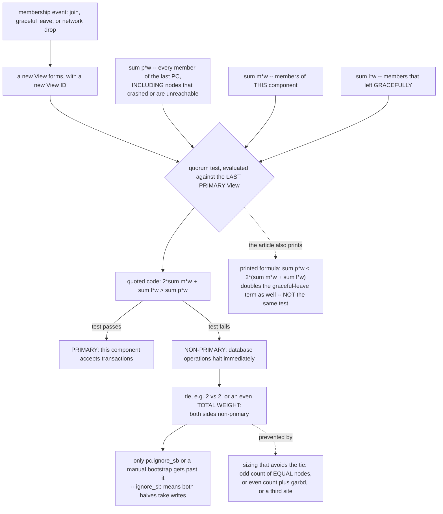

<!--
entry-meta
date: 2026-11-20
type: daily-diff
category: Daily Diff
title: Daily Diff — 2026-11-20
slug: janusgraph-query-processor-iterator-stack
-->

# Daily Diff — 2026-11-20

**2026-11-20 · Daily Diff Digest**

## There is no 2026-11-20 edition, and the 2026-11-19 edition never existed

Stated plainly, because the rest of this document rests on it. Checked at ~03:40 UTC on 2026-11-20:

- **https://tdd.cat/** front page serves **Wednesday, 2026-11-18**, header *"61 Stories"*.
- **https://tdd.cat/archive/** header reads *"143 Editions"*, its *Latest* link points at `https://tdd.cat/2026-11-18/`, and its calendar shows dated editions from 2026-06-20 through **2026-11-18**. November 19 through 30 have no linked day cells.
- **https://tdd.cat/2026-11-19/** — `client_error`, nothing retrieved. **https://tdd.cat/2026-11-20/** — the same. The archive agrees with both: no edition exists for either date.

So the two indexes **agree**, as they did yesterday: today's edition has not published, and no edition was published for 2026-11-19 either. This is the **second consecutive run** with no new edition, after a three-run streak in which the front page ran *ahead* of the archive. Nothing has been invented to fill the gap.

**The 2026-11-18 edition was already digested** — by lesson 21 on 2026-11-19, which went deep on its item 1, `CREATE TEMP TABLE` catalog churn and the instance-wide shared-invalidation ring. Rather than repeat it or skip the digest, this one takes an **uncovered item from that same 61-story edition**, which is the track's documented last-resort fallback. One item spent from 2026-11-18; 59 remain.

## The item taken today

**#15 — "Reevaluating the risks of assigning custom galera node weights"**, Percona blog, Marco Tusa, published 2026-11-13 → https://www.percona.com/blog/just-because-you-can-doesnt-mean-you-should-re-evaluating-galera-node-weights/

Chosen over the other uncovered database items in the edition (#5 Lakegres vector search on open table formats, #46 ProxySQL/MariaDB HTAP routing, #54 Postgres read-replica lag under load) because it is about a **quorum formula with an arithmetic error visible in the article itself**, which makes it a better object of study than a product announcement.

## Notable items in the 2026-11-18 edition, point-wise

Grouped from the first 23 stories, which were read verbatim from the front page. The remaining 38 titles were available only as an extracted summary and are deliberately not characterised here.

- **Databases and storage.** Postgres temp-table catalog bloat (postgres.ai — spent by lesson 21); re-evaluating Galera node weights (Percona — today's deep dive); native vector search indexing open lakehouse tables directly (Onehouse); content-addressable storage for very large Git repositories, which appeared **twice** in the same edition under two different titles pointing at the same Google developers blog post (items 11 and 19 — one with an `/en/` path segment, one without).
- **Security, and the sharpest operational item of the day.** Two independent write-ups of the same nginx HTTP/2 vulnerability class claiming unauthenticated RCE — Wiz (item 2) and Xint (item 16). An edition carrying two separate analyses of one nginx RCE is the thing to action first regardless of what else is in it.
- **Hardware and systems.** GPU load-store-unit contention as a side channel (arXiv 2611.23022); bare-metal pipelined Kafka streaming straight from FPGA detectors (arXiv 2611.22674); optimising a macOS VPN client past 5 Gbit/s (Firezone).
- **Agents and models**, which dominated by volume: two Gemini 4 Neon pages (one AI Studio, one Cloud docs), a multi-agent coordination benchmark arguing that poor coordination cancels the benefit of scaling agent teams, energy-based models with explicit progress signals for recurrent reasoning, LLMs reading and writing executables byte by byte, redundant token reprocessing from shared Ollama slots, and an "agent org speedran a company" write-up.
- **Languages and tooling.** Bypassing Rust's orphan rule; proof-first harnesses for local coding models; FastFrames two-step video generation.

## Deep dive: Galera's weighted quorum, and a formula that does not match its own code

### What the mechanism is

Galera replaces "majority of nodes" with "majority of **weight**". Each node carries `pc.weight`, set through `wsrep_provider_options="pc.weight=N"`, range **0–255**. The article does not state the default in the setting's own description but does say a rebuilt node "comes back with the default w=1", so the default is 1.

Two concepts carry the whole thing:

- A **View** is the agreed membership at an instant, with a unique View ID. A new View forms whenever a node joins, leaves gracefully, or drops off the network.
- The **Primary Component (PC)** is the View that holds the majority. **Only the PC accepts transactions.** A component that is not primary "immediately halt[s] database operations" — it does not serve stale reads, it stops.

The quorum test is evaluated against the **last primary View**, not against the configured cluster. The article prints it as:

> Σ p·w < 2·(Σ m·w + Σ l·w)

where `p` = members of the last PRIMARY view, `m` = members of the component being evaluated, `l` = members that left gracefully, `w` = `pc.weight`.

Three rules follow from *which set each node lands in*, and they are the part operators get wrong:

- A node that **crashed or is unreachable** still counts in `Σ p·w`. It raises the threshold the survivors must clear. Failure does not shrink the denominator.
- A node that **left gracefully** is credited to the survivors via `Σ l·w`. A clean shutdown and a crash are arithmetically different events.
- A node that was **not in the last PC** contributes nothing — so a node that has just joined or is still rejoining cannot help you reach quorum.

### The discrepancy worth noticing

The article also quotes the C function from `percona/galera` at commit `a6b54d887d58bae43ae3f46f5696195329405b7e`:

```
gcomm::pc::Proto::have_quorum(const View& view, const View& pc_view)
```

and describes its arithmetic as: take the weighted sum of `view` members **intersected with** PC members, **double it**, add the weighted sum of `view.left()` intersected with PC members, and compare against the weighted sum of all PC members with a strict `>`. Without weights it falls back to node counts in the same shape.

Side by side:

| | left-hand side | relation | right-hand side |
|---|---|---|---|
| **article's prose formula** | `Σ p·w` | `<` | `2·(Σ m·w + Σ l·w)` |
| **the quoted code** | `2·Σ m·w + Σ l·w` | `>` | `Σ p·w` |

Flipping the prose formula to put `Σ p·w` on the right gives `2·Σ m·w + 2·Σ l·w > Σ p·w`. **The code doubles only the surviving-members term; the printed formula doubles the graceful-leave term as well.** The article does not comment on the difference. It matters exactly where `l` is non-empty — the clean-shutdown case the article itself uses as a worked scenario — and it is the kind of divergence that makes a maintenance plan look safe on paper and tie in production. **Read the code, not the blog formula**; that is the one actionable takeaway for anyone sizing a cluster from this post.

### Why it changes how you size a cluster

The article's scenarios, in the order they build:

- **5 nodes, all `w=1`.** Every two-way split is 3|2 or 4|1, so one side always wins. This is the configuration to want.
- **6 nodes with one at `w=2`** (total 7) behaves like an odd cluster. A `garbd` arbitrator as a seventh voter does the same job without a seventh data copy.
- **3 nodes weighted 2,1,1** (total 4) is an **odd node count with an even total weight** — and can therefore tie. Node count is not the quantity that matters; total weight in the PC is.
- **The PC shrinks, and the arithmetic moves with it.** Five nodes lose one and stay primary, but the new PC has 4. A subsequent 2|2 split ties. Roll that forward and you end at 2 nodes, where losing either one ties.
- **A graceful leave re-rounds the cluster.** Shut one of five down cleanly and the counted weight is 4; a 2|2 split of the remainder ties.
- **A three-way split needs no tie to kill everything.** 2|2|1 of five nodes: no two groups are equal, yet no group is larger than the other two combined, so **every** group goes non-primary.
- **Survivability does not improve with the sixth node.** 5 and 6 nodes both tolerate two failures. Five do not tolerate three.
- **Two data centres, 3+2.** The 3-node site survives a link cut; if that site dies, the 2-node site stops. Surviving the loss of *either* site requires a third location — even one running nothing but `garbd`.
- **Weights create a single point of fate.** With `2,1,1,1`, losing the heavy node plus any one other is fatal. With a `w=3` node, losing that node *alone* causes a tie. A weight does not make a node more reliable; it makes its loss more expensive.

The one log excerpt in the article (dated 2026-11-10) shows a primary View with three members and one partitioned member, each node id suffixed `,2` — `memb { 49d8df08-bad6,2  5ce1a9aa-8e06,2  8458c8f0-9b8f,2 }`, `partitioned { 85a6e937-b8c4,2}`. **The article does not say what the trailing `,2` is** — weight, segment, or something else — and I am not going to guess; that is the field you would want to confirm against the source before relying on a log line to audit weights.

### The recommendation, and the thing not to do

Ranked, from the article: (1) an odd number of **equal** nodes; (2) an even number of nodes plus `garbd`; (3) an even number of nodes with weights — only when you can add neither a node nor an arbitrator and you want one specific side to always win. Weights are "a deliberate tiebreaker, not a fix for even node counts", and they cost real operational surface: nodes stop being interchangeable, maintenance order starts to matter, and the setting silently drifts back to `w=1` when a node is rebuilt.

And `pc.ignore_sb`: the article calls `wsrep_provider_options="pc.ignore_sb = yes"` dangerous and says to remove it wherever it is set. It is one of only two ways past a last-two-nodes tie — the other being a manual bootstrap — and what it actually buys you is both halves of a split brain accepting writes.



### What it has to do with yesterday's and today's lesson

Three connections, all of them about the same shape of mistake.

1. **A quorum rule is a planner with no statistics.** Lesson 21 found that JanusGraph's index selector is a scalar function of schema and query text with no cardinality input; `have_quorum` is a scalar function of membership and weights with no input about which nodes are actually healthy or close. Both make a decision that *looks* adaptive and is in fact a fixed arithmetic over configuration.
2. **A node that crashed still counts in `Σ p·w`, exactly as JanusGraph's `QueryProcessor` keeps reading a sub-query it has already been told is exhausted.** Today's lesson found that `LimitAdjustingIterator` cannot infer "the backend ran out" from "my iterator ended" and needed a whole interface, `BackendLimitAware`, to tell the two apart. Galera has the mirror problem: it cannot infer "this node is gone for good" from "this node is not in my component", so it keeps it in the denominator. **Absence is not evidence of either exhaustion or death**, and both systems pay for it in an extra concept.
3. **Prose and code diverge, in both.** The Galera formula in the blog is not the test in the source. `QueryProcessor`'s class javadoc documents a duplicate-filtering merge that no shipped query can trigger, and `GraphCentricQuery.toString` prints its limit where it means its order. Documentation drift is not a cosmetic category; it is what makes people reason confidently about behaviour that does not exist.

## Sources

- https://tdd.cat/ — front page, newest edition 2026-11-18, 61 stories (fetched this run)
- https://tdd.cat/archive/ — 143 editions, newest listed 2026-11-18, calendar June–November 2026 (fetched this run)
- `https://tdd.cat/2026-11-19/` and `https://tdd.cat/2026-11-20/` — both `client_error`, nothing retrieved (probed this run; not linked, since neither exists)
- [Percona — *Just Because You Can, Doesn't Mean You Should: Re-evaluating Galera Node Weights*](https://www.percona.com/blog/just-because-you-can-doesnt-mean-you-should-re-evaluating-galera-node-weights/) — Marco Tusa, 2026-11-13 (fetched this run; the `have_quorum` source at `percona/galera` commit `a6b54d887d58bae43ae3f46f5696195329405b7e` is quoted **by the article**, not read directly this run)
- [postgres.ai — *Frequent temporary table creation degrades performance via catalog bloat*](https://postgres.ai/blog/20261118-hidden-costs-of-create-temp-table) — item 1 of the same edition, spent by lesson 21 (link seen on the front page this run)
- [Wiz — *HTTP/2 flaws expose NGINX servers to remote code execution*](https://www.wiz.io/blog/nginx-http2-rce-vulnerabilities) and [Xint — *nginx2root remote code execution*](https://xint.io/blog/nginx2root-remote-code-execution) — the two nginx write-ups (links seen on the front page this run; not fetched)
- [Onehouse — *Lakegres: vector search on open table formats*](https://www.onehouse.ai/blog/lakegres-vector-search-on-open-table-formats) (link seen on the front page this run; not fetched)
