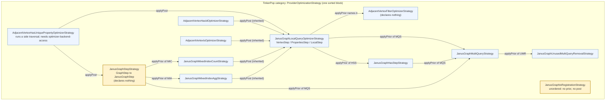

<!--
entry-meta
date: 2026-11-21
type: lesson
track: JanusGraph
lesson: 23
category: Database Internals
title: The strategy layer — twelve rewrites, one dependency graph, and a compile that happens before the profiler exists
slug: janusgraph-optimizer-strategy-layer
-->

# The strategy layer — twelve rewrites, one dependency graph, and a compile that happens before the profiler exists

**2026-11-21 · JanusGraph Track · Lesson 23 of 28**

## Where This Fits

- **Lesson 22** ([`QueryProcessor` — the iterator stack, the doubling limit, and why the profile cannot see any of it](../2026-11-20-janusgraph-query-processor-iterator-stack/README.md)) finished Part IV by opening the *consumer* of both compilers: a generic right fold whose in-memory filter sits between the backend limit and the element count, which creates no profiler span of its own, and whose multi-sub-query branches are unreachable in the shipped tree. It handed forward three debts, all of which land here.
- **This lesson** opens Part V at the layer *above* both compilers: the twelve `TraversalStrategy` instances JanusGraph registers into TinkerPop, what each one rewrites, and — the part that actually matters — the **declared dependency graph** that fixes the order they run in. It also answers lesson 22's three debts, because all three turn out to be questions about *when* a strategy runs relative to when TinkerPop installs a profiler.
- **It sets up lesson 24** (`JanusGraphStep` / `JanusGraphVertexStep`: folding `has`/`limit`/`order` into storage queries, and multi-query batching). This lesson establishes *which* strategy creates each JanusGraph step and *what it has already folded in* by the time the step runs; lesson 24 owns the steps' own execution, the batch-size question raised in §3.4, and the `multi` / `multiPreFetch` / `vertices` / `partitioned` annotations lesson 22 found declared but never set.

Everything from lessons 02–22 is assumed. In particular: `GraphCentricQuery.numSubQueries()` is a literal `1`, `VertexCentricQuery.isSorted()` an unconditional `true`, a `BackendQueryHolder` not reached by `observeWith` still carries `QueryProfiler.NO_OP`, and `QueryProcessor` reads `getProfiler()` at **construction**.

**Reading provenance for this entry.** Four files were transcribed to local disk and their **git blob SHAs verified** against what `get_file_contents` reported at the pinned commit, so they are cited **by line number**: `JanusGraphLocalQueryOptimizerStrategy.java` (13,515 bytes → `01de0bed05e79f80f70b370b0bc6207b6cb96019`, 245 lines), `HasStepFolder.java` (27,466 → `0232fc9b9af19d6d781a6caaaea08ad8ed0f3580`, 532 lines), `StandardJanusGraph.java` (80,408 → `f650acb2f5c9080fd67fbd4a6683e54a30f78347`, 1,489 lines) and `JanusGraphStepStrategyTest.java` (46,982 → `abd23a81d0f1f70db17f6dcb19948e6bca25bb10`, 546 lines). `JanusGraphStepStrategy.java`, `JanusGraphStep.java`, `JanusGraphMixedIndexCountStrategy.java`, `AbstractJanusGraphMixedIndexAggStrategy.java` and `OptimizerStrategyTest.java` were read **inline**, which returns no line numbers, so they are cited **by member name only** — lesson 20's rule. The remaining ten strategy files were read at the pinned commit by a **delegated reader** inside this run, which returned the `applyPrior()`/`applyPost()` initialisers and the `apply()` bodies verbatim; their paths and blob SHAs come from a directory listing fetched directly, but their text did not pass through a local transcription, so they are cited by member name and flagged as such wherever a claim rests only on them.

---

## 1. The registry: twelve strategies, one category, one static initialiser

Everything in this lesson is installed by a single `static` block, [`StandardJanusGraph.java:165-185`](https://github.com/JanusGraph/janusgraph/blob/a59ae8d8024207598eada34998d867617df51adf/janusgraph-core/src/main/java/org/janusgraph/graphdb/database/StandardJanusGraph.java#L165-L185):

```java
static {
    TraversalStrategies graphStrategies =
        TraversalStrategies.GlobalCache.getStrategies(Graph.class)
            .clone()
            .addStrategies(AdjacentVertexFilterOptimizerStrategy.instance(),
                           AdjacentVertexHasIdOptimizerStrategy.instance(),
                           AdjacentVertexIsOptimizerStrategy.instance(),
                           AdjacentVertexHasUniquePropertyOptimizerStrategy.instance(),
                           JanusGraphLocalQueryOptimizerStrategy.instance(),
                           JanusGraphHasStepStrategy.instance(),
                           JanusGraphMultiQueryStrategy.instance(),
                           JanusGraphUnusedMultiQueryRemovalStrategy.instance(),
                           JanusGraphMixedIndexAggStrategy.instance(),
                           JanusGraphMixedIndexCountStrategy.instance(),
                           JanusGraphStepStrategy.instance(),
                           JanusGraphIoRegistrationStrategy.instance());

    //Register with cache
    TraversalStrategies.GlobalCache.registerStrategies(StandardJanusGraph.class, graphStrategies);
    TraversalStrategies.GlobalCache.registerStrategies(StandardJanusGraphTx.class, graphStrategies);
}
```

Facts worth holding on to:

| Fact | Why it matters |
|---|---|
| **All twelve are `TraversalStrategy.ProviderOptimizationStrategy`.** None is a `DecorationStrategy`, `OptimizationStrategy` or `VerificationStrategy`. | TinkerPop sorts strategies by **category first**, then topologically **within** a category. So the whole JanusGraph layer runs as one block after TinkerPop's own optimizations, and every ordering question below is a question about edges *inside* that block. |
| **`JanusGraphIoRegistrationStrategy` is in that list.** Its `apply()` only does `if (traversal.getStartStep() instanceof IoStep) ioStep.configure(IO.registry, JanusGraphIoRegistry.instance())` — a registration, not an optimization — and it declares neither `applyPrior` nor `applyPost`. | A decoration concern filed under the optimization category. Harmless today (nothing else touches `IoStep`), but it means `io()` wiring is ordered arbitrarily against eleven query rewrites. |
| The block registers the **same `TraversalStrategies` object** for `StandardJanusGraph.class` and `StandardJanusGraphTx.class` (`:183-184`). | `graph.traversal()` and `tx.traversal()` get an identical strategy set; the only runtime difference is whether `JanusGraphTraversalUtil.getJanusGraphTx(traversal)` finds a transaction, which changes where config is read from (§3.1). |
| `ReadOnlyStrategy.instance()` is added **separately and per-traversal**, in `StandardJanusGraph`'s script-eval path at `:377`, not in this block. | Read-only enforcement is not part of the registered set. |
| OLAP does **not** get this set. `FulgoraUtil` builds its own: `TraversalStrategies.GlobalCache.getStrategies(Graph.class).clone().addStrategies(JanusGraphLocalQueryOptimizerStrategy.instance())` — one strategy, not twelve. | Under `GraphComputer` there is no `JanusGraphStep`, no multi-query batching and no index-aggregation push-down. Five of the twelve also early-return on `TraversalHelper.onGraphComputer(traversal)` anyway. |

## 2. The dependency graph is the real design document

TinkerPop gives a strategy two ways to constrain its position: `applyPrior()` returns the strategies that must run **before** it, `applyPost()` the ones that must run **after** it. Every edge below is a literal static-field initialiser in the named class.

| Strategy | `applyPrior()` | `applyPost()` |
|---|---|---|
| `AdjacentVertexFilterOptimizerStrategy` | — | — |
| `AdjacentVertexOptimizerStrategy` *(abstract base)* | — | `singleton(JanusGraphLocalQueryOptimizerStrategy)` |
| `AdjacentVertexHasIdOptimizerStrategy` | — | *inherited* |
| `AdjacentVertexIsOptimizerStrategy` | — | *inherited* |
| `AdjacentVertexHasUniquePropertyOptimizerStrategy` | — | `new HashSet<>(Arrays.asList(JanusGraphStepStrategy, JanusGraphLocalQueryOptimizerStrategy))` |
| `JanusGraphStepStrategy` | — | — |
| `AbstractJanusGraphMixedIndexAggStrategy` *(abstract base)* | — | `singleton(JanusGraphLocalQueryOptimizerStrategy)` |
| `JanusGraphMixedIndexCountStrategy` | `singleton(JanusGraphStepStrategy)` | *inherited* |
| `JanusGraphMixedIndexAggStrategy` | `singleton(JanusGraphStepStrategy)` | *inherited* |
| `JanusGraphLocalQueryOptimizerStrategy` | `singleton(AdjacentVertexFilterOptimizerStrategy)` (`:57`, `:238-239`) | — |
| `JanusGraphHasStepStrategy` | `singleton(JanusGraphLocalQueryOptimizerStrategy)` | — |
| `JanusGraphMultiQueryStrategy` | `new HashSet<>(Arrays.asList(JanusGraphLocalQueryOptimizerStrategy, JanusGraphHasStepStrategy, JanusGraphStepStrategy))` | — |
| `JanusGraphUnusedMultiQueryRemovalStrategy` | `new HashSet<>(Arrays.asList(JanusGraphMultiQueryStrategy))` | — |
| `JanusGraphIoRegistrationStrategy` | — | — |

Four structural observations fall straight out of that table.

**2.1 — Half the edges are declared from the other end.** `AdjacentVertexFilterOptimizerStrategy` declares nothing at all, yet it is reliably first, because `JanusGraphLocalQueryOptimizerStrategy` names *it* in `PRIORS` (`:57`). Reading only the Adjacent\* files makes it look unordered; the edge exists, pointing the other way. The same inversion holds for `JanusGraphStepStrategy`, which declares nothing and is nonetheless constrained by four other classes naming it.

**2.2 — `JanusGraphStepStrategy` is pinned before `JanusGraphLocalQueryOptimizerStrategy` only *transitively*, through the two mixed-index aggregation strategies.** There is no direct edge between them. The only paths are:

- `JanusGraphStepStrategy` → `JanusGraphMixedIndexCountStrategy` → `JanusGraphLocalQueryOptimizerStrategy`
- `JanusGraphStepStrategy` → `JanusGraphMixedIndexAggStrategy` → `JanusGraphLocalQueryOptimizerStrategy`

Delete or disable both aggregation strategies — `withoutStrategies(JanusGraphMixedIndexCountStrategy.class, JanusGraphMixedIndexAggStrategy.class)` is a one-liner any user can write — and the relative order of the two main rewriters becomes **undeclared**, decided by TinkerPop's topological sort over the remaining edges and insertion order. That is a fragility, not a demonstrated bug: the two strategies target disjoint step types (`GraphStep` vs `VertexStep`/`PropertiesStep`/`PropertyMapStep`/`ElementMapStep`/`LabelStep`/`DropStep`/`LocalStep`), and `HasStepFolder`'s walk loops break on any step that is not `HasContainerHolder`, `IdentityStep` or `NoOpBarrierStep`, so a `JanusGraphVertexStep` terminates the walk exactly as a `VertexStep` would. I did not find a traversal where the order is observable. Logged as a candidate on the strength of the missing declaration alone.

**2.3 — The one real asymmetry among the Adjacent\* family.** `AdjacentVertexHasUniquePropertyOptimizerStrategy` overrides `applyPost` to add `JanusGraphStepStrategy`; its three siblings only declare `JanusGraphLocalQueryOptimizerStrategy`. The override is load-bearing, because this is the only one of the four that **executes a side traversal during strategy application** — `makeFilterByAdjacentIdStep` builds a `DefaultGraphTraversal` of `GraphStep` + the original `HasStep` + `IdStep` and calls `filterTraversal.next()` to resolve the unique key to a concrete vertex id, substituting `new DiscardStep<>(traversal)` when there is no match. It must therefore run while that `GraphStep` is still a plain `GraphStep`. It is also the only one gated on configuration: it early-returns unless `janusGraph.getConfiguration().optimizerBackendAccess()` is true, which is the switch for "a strategy may touch the backend".

**2.4 — Exact-class vs assignable-class matters here.** `AdjacentVertexHasIdOptimizerStrategy` and `AdjacentVertexHasUniquePropertyOptimizerStrategy` both use `TraversalHelper.getStepsOfClass(HasStep.class, …)` — exact class — while `JanusGraphHasStepStrategy` *replaces* `HasStep`s with `JanusGraphHasStep`s. Neither Adjacent\* strategy declares an edge against `JanusGraphHasStepStrategy`. They are nevertheless safe, transitively: `Adjacent*` → `JanusGraphLocalQueryOptimizerStrategy` (their `applyPost`) → `JanusGraphHasStepStrategy` (its `applyPrior`). The guarantee exists; it just passes through a third class.



*Arrow direction is "applies before". The two highlighted nodes are the ones with no outgoing declaration of their own: `JanusGraphIoRegistrationStrategy` has no edge in either direction, and `JanusGraphStepStrategy` is positioned entirely by other classes naming it.*

---

## 3. `JanusGraphLocalQueryOptimizerStrategy`, in order

245 lines, blob-verified. It is five passes over the traversal, run in a fixed sequence at `:92-96`.

### 3.1 The guards and the config read (`:63-90`)

```java
if (!traversal.getGraph().isPresent()) return;                      // :64-65
final StandardJanusGraph janusGraph = JanusGraphTraversalUtil.getJanusGraph(traversal);
if (janusGraph == null) return;                                     // :68-70
final Optional<StandardJanusGraphTx> tx = JanusGraphTraversalUtil.getJanusGraphTx(traversal);
```

- There is **no `onGraphComputer` guard** here, unlike `JanusGraphStepStrategy`, `JanusGraphMultiQueryStrategy` and the aggregation strategies. That is deliberate: this is the *only* strategy `FulgoraUtil` installs for OLAP.
- `tx.isPresent()` (`:78-84`) reads `getVertexCacheSize()`, `getPropertiesStrategyMode()`, `getLabelStepStrategyMode()` and `getDropStepStrategyMode()` from `TransactionConfiguration`; the `else` arm (`:85-90`) reads `getTxVertexCacheSize()`, `propertiesStrategyMode()`, `labelStepStrategyMode()` and `dropStepStrategyMode()` from `GraphDatabaseConfiguration`. **Same four settings, two different accessor names, four different method names per side** — eight accessors for four values. A per-transaction override of any of these therefore only takes effect on a traversal started from the transaction (`tx.traversal()`), never one started from the graph.

### 3.2 Pass 1 — `applyJanusGraphVertexSteps` (`:99-117`)

`TraversalHelper.getStepsOfAssignableClass(VertexStep.class, traversal)`, and for each one:

1. `new JanusGraphVertexStep(originalStep)` and `TraversalHelper.replaceStep(...)` — unconditional, every `VertexStep` becomes a `JanusGraphVertexStep`.
2. **Only if** `JanusGraphTraversalUtil.isEdgeReturnStep(vertexStep)`: `HasStepFolder.foldInHasContainer(vertexStep, …)` (`:105`). An `out()` that returns *vertices* folds in no `has()` at all — the conditions apply to the adjacent vertex, not to the edge, so there is nothing a vertex-centric slice could filter on.
3. The in-source comment at `:106` is the whole design in one line: `//We cannot fold in orders or ranges since they are not local`.
4. `:109` is an `assert` — `isEdgeReturnStep || isVertexReturnStep` — so it is disabled in any normal JVM.
5. `:110-114`: the **one** thing a top-level vertex step does fold is a *high* limit, and only from an immediately following `RangeGlobalStep`:
   ```java
   final Step nextStep = JanusGraphTraversalUtil.getNextNonIdentityStep(vertexStep);
   if (nextStep instanceof RangeGlobalStep) {
       final int limit = QueryUtil.convertLimit(((RangeGlobalStep) nextStep).getHighRange());
       vertexStep.setLimit(0, QueryUtil.mergeHighLimits(limit, vertexStep.getHighLimit()));
   }
   ```
   Note what is *not* there: the `RangeGlobalStep` is **not removed**, and the low limit is hard-coded `0`. Both are correct and for the same reason — `g.V().out().limit(10)` is a limit on the *global* stream, not per vertex, so the step may use `10` as a backend hint but TinkerPop must still enforce the real cut. Compare `foldInRange` (§4.4), which does remove the step for a `JanusGraphStep`.

### 3.3 Pass 2 — `applyJanusGraphPropertiesSteps` (`:118-161`)

A single predicate match over three unrelated TinkerPop classes: `step instanceof PropertiesStep || step instanceof PropertyMapStep || step instanceof ElementMapStep` (`:119`), with an idempotence guard `if (originalStep instanceof MultiQueriable) return;` (`:120-122`).

| Original | Replacement | Folds `has()`? |
|---|---|---|
| `PropertiesStep` | `JanusGraphPropertiesStep` | yes, if `getReturnType().forProperties()` (`:134-137`) |
| `PropertyMapStep` | `JanusGraphPropertyMapStep` | no |
| `ElementMapStep` | `JanusGraphElementMapStep` | no |

All three take the same two booleans, derived from one enum:

```java
boolean prefetchAllPropertiesRequired = MultiQueryPropertiesStrategyMode.ALL_PROPERTIES.equals(propertiesStrategyMode);
boolean prefetchAllowed = !MultiQueryPropertiesStrategyMode.NONE.equals(propertiesStrategyMode);
```

so a four-valued mode collapses to two bits at the step boundary, and `:158` sets `propertiesPrefetchingStep.setBatchSize(txVertexCacheSize)` — **the property prefetch batch is the transaction vertex cache size**, not a setting of its own.

### 3.4 Pass 5 — `inspectLocalTraversals` (`:163-197`), and why `local()` is the privileged case

This is the pass that does strictly more than pass 1, and the difference is the point of the whole strategy. For a `LocalStep` whose local child *starts* with a `VertexStep` (`:168-179`):

```java
final JanusGraphVertexStep vertexStep = new JanusGraphVertexStep((VertexStep) localStart);
vertexStep.setBatchSize(txVertexCacheSize);                                            // :170
TraversalHelper.replaceStep(localStart, vertexStep, localTraversal);
if (JanusGraphTraversalUtil.isEdgeReturnStep(vertexStep)) {
    HasStepFolder.foldInHasContainer(vertexStep, localTraversal, traversal);            // :174
    HasStepFolder.foldInOrder(vertexStep, vertexStep.getNextStep(), localTraversal, traversal, false);  // :175
}
HasStepFolder.foldInRange(vertexStep, JanusGraphTraversalUtil.getNextNonIdentityStep(vertexStep), localTraversal);  // :177
unfoldLocalTraversal(traversal, localStep, localTraversal, vertexStep);
```

Three differences from pass 1, all consequences of `local()` meaning *per incoming element*:

- **`foldInOrder` is called** (`:175`, `:191`) with `isVertexOrder = false`. `g.V().out().order().by("w")` cannot push the order down; `g.V().local(__.outE().order().by("w"))` can, because the ordering is within one vertex's adjacency and a vertex-centric index can supply it.
- **`foldInRange` is called** (`:177`, `:193`) — and for a non-`JanusGraphStep` folder it *does* remove the range step when `range.getLowRange() == 0`, so `local(outE().limit(5))` becomes a genuine per-vertex slice limit with no TinkerPop step left behind.
- **`setBatchSize(txVertexCacheSize)` is called** (`:170`, `:185`). Pass 1 **never calls `setBatchSize`** on the top-level `JanusGraphVertexStep` it creates. Whether the top-level step therefore keeps `JanusGraphVertexStep`'s own default batch size, or has one set later by `JanusGraphMultiQueryStrategy` (which runs after this strategy, and which attaches clients to every `MultiQueriable`), is **not settled by this lesson** — `JanusGraphVertexStep` and `JanusGraphMultiQueryStep` are lesson 24's files and were not read here. Flagged as an explicit open question rather than guessed.

`unfoldLocalTraversal` (`:225-235`) is four lines and one of the more satisfying rewrites in the tree: if the local child has collapsed to a **single** step, the entire `LocalStep` wrapper is replaced by that step in the *outer* traversal (`vertexStep.setTraversal(traversal); TraversalHelper.replaceStep(localStep, vertexStep, traversal)`). So `local(__.outE().has("w", 1).order().by("w").limit(5))` — four steps — ends as one `JanusGraphVertexStep` with condition, order and limit folded in, directly in the outer traversal, with no `local()` barrier at all. Both of its preconditions are `assert`s (`:228`, `:231`), so neither is checked in production.

### 3.5 Passes 3 and 4 — `applyJanusGraphLabelSteps` and `applyJanusGraphDropSteps` (`:199-223`)

Structurally identical twelve-line methods: early-return on the mode being `NONE`, `getStepsOfAssignableClass`, skip if already converted, `replaceStep`. Neither folds anything. `label()` and `drop()` become `JanusGraphLabelStep` / `JanusGraphDropStep` purely so the multi-query layer has a `MultiQueriable` to batch, which is why they are no-ops when their mode is `NONE` — the only reason they exist is batching.

---

## 4. The shared machinery: `HasStepFolder`

532 lines, blob-verified, an **interface with 8 abstract methods and 14 `static` ones**. Both `JanusGraphStep` and the vertex-centric steps implement it; the statics are the folding algorithms. `foldInIds` (`:145-178`) is used only by `JanusGraphStepStrategy`; `foldInHasContainer` (`:181-214`), `foldInOrder` (`:380-434`) and `foldInRange` (`:484-502`) are used by both.

### 4.1 `JanusGraphStepStrategy`: the id interlock

Read inline, so cited by member name. Its `apply` is a single `getStepsOfClass(GraphStep.class, …)` loop with two arms, and the ordering inside the first arm is the interesting part:

```
if (ArrayUtils.isEmpty(originalGraphStep.getIds())) {
    new JanusGraphStep<>(originalGraphStep); replaceStep(...)
    HasStepFolder.foldInIds(janusGraphStep, traversal);              // hasId(...) / has(T.id, within(...))
    HasStepFolder.foldInHasContainer(janusGraphStep, traversal, traversal);
    if (ArrayUtils.isEmpty(janusGraphStep.getIds())) {               // ← check AGAIN
        HasStepFolder.foldInOrder(..., janusGraphStep.returnsVertex());
        HasStepFolder.foldInRange(...);
    }
}
```

with the in-source reason stated plainly: *"Now that has(T.id, ids) and hasId(ids) steps are folded, we check again if there are any ids folded. If yes, then we shouldn't fold in order and range steps so that they can be handled by TinkerPop."* A `g.V().hasId(a, b, c).order().by("name").limit(2)` therefore keeps its `order()` and `limit()` as TinkerPop steps, because the step is now an id lookup and there is no index query to push them into.

The `else` arm — a `GraphStep` that already had ids — does **not** create a `JanusGraphStep` at all. It unwraps any `Element` arguments to their `id()` and installs an iterator supplier over `graph.vertices(elementIds)` / `graph.edges(elementIds)`. The in-source comment: *"Make sure that any provided 'start' elements are instantiated in the current transaction"* — `g.V(someVertexFromAnotherTx)` is a correctness fix, not an optimization.

### 4.2 `foldInHasContainer` and the `or()` fold (`:181-214`)

The loop walks forward from the step and has four arms. The first is the only place in the folding machinery that is **specific to one implementor**:

```java
if (currentStep instanceof OrStep && janusgraphStep instanceof JanusGraphStep) {   // :185
```

so `or()` is folded for graph-centric steps and never for vertex-centric ones. Inside:

- Every branch must pass `validFoldInOrBranch` (`:247-268`) — *all or nothing*: one bad branch and `return` abandons the whole fold, including the branches that were fine. A branch is valid if every step in it is a `HasContainerHolder` with JanusGraph-foldable predicates, an *exists* step, an `OrderGlobalStep` whose `keysWithValues` is non-null, a `RangeGlobalStep`, an `IdentityStep` or a `NoOpBarrierStep` — **and at least one of them is a condition** (`hasCondition` must end true).
- `anyPasses |= branchPassesElements(child)` (`:270-281`): a branch is "passing" unless it contains a `RangeGlobalStep` with `getLowRange() > 0 || getHighRange() == 0`. That is TinkerPop semantics taken seriously — a branch is evaluated **per element**, so `range(1, 5)` inside `or()` skips the single element it sees and the branch can never fire.
- `localFoldInHasContainer` (`:225-245`) then turns each branch into a flat `List<HasContainer>`, where the conversions are the clever bit:
  - a `has(key)` *exists* step becomes `new HasContainer(key, P.neq(null))`;
  - an `order().by(key)` becomes `new HasContainer(key, P.neq(null))` **for every key in `keysWithValues`** — because TinkerPop drops an element whose `by()` modulator yields nothing, so an order inside an `or()` branch *is* a condition.
- If no branch passes, `addLocalHasContainersOfNoBranch` records the `or()` as a parent id with an **empty** branch set (`:195-197`), and the `OrStep` is removed either way.

The test file pins all of this. `JanusGraphStepStrategyTest.java:342-380` (blob-verified) is the best documentation in the repo for `or()` folding:

```java
// a limit() lets every element through, and an order() each one which has a value of its key
arguments(g.V().or(has("length", lt(160)), has("age", gt(32)).limit(5)),
    g_V(__.or(g_V("length", lt(160)), g_V("age", gt(32)))), Collections.emptyList()),
arguments(g.V().or(has("name", "marko"), has("lang", "java").order().by("name", Order.desc)),
    g_V(__.or(g_V("name", eq("marko")), g_V("lang", eq("java"), "name", neq(null))))),
// an or() which lets no element through folds in as one of no branches
arguments(g.V().or(has("name", "marko").range(1, 2), has("age", gt(32)).limit(0)),
    g_V(__.or()), Collections.emptyList()),
```

The second and third arms of the loop are smaller but load-bearing: `isExistsStep` (`:351-363`) recognises TinkerPop's encoding of `has(key)` as `TraversalFilterStep(PropertiesStep)` with exactly one key, and `foldInHasFilter` (`:367-378`) rewrites it **in place** into a real `HasStep` with `P.neq(null)` and returns it so the loop re-examines it. `validFoldInHasContainer` (`:327-343`) is a three-valued `Boolean` accumulator — `null` means "nothing decided yet" — and its `defaultValue` parameter decides what an unfoldable trailing step means: `true` from `foldInHasContainer` (`:200`) and from `foldableHasContainerNoLimit`'s `HasContainerHolder` arm (`:519`), `false` from that method's `OrStep` arm (`:513`).

### 4.3 `foldInOrder` (`:380-434`): the loop that runs backwards

Two things make this more than a scan.

First, it collects **all** consecutive `OrderGlobalStep`s (tolerating interleaved `HasStep`/`IdentityStep`/`NoOpBarrierStep`), then iterates them **in reverse** (`for (int i = orderSteps.size() - 1; i >= 0; i--)`), with the reason in-source: *"TinkerPop sorts by each order() in turn, keeping the order of ties, and each leaves out the elements for which one of its by() modulators has no value: so the elements come in the order of the last one, and where that ties, of those before it."* A later `order()` dominates, so its keys go in first, and a key already present is skipped (`:418-420`) because re-sorting by it changes nothing.

Second, the eligibility gate at `:423-425`:

```java
//A query of the edges or properties of a vertex takes a single order key
if (orders.isEmpty() || orders.size() > 1 && !(janusgraphStep instanceof JanusGraphStep)) {
    return;
}
```

**A vertex-centric query folds in at most one order key; a graph-centric one folds in any number.** That is not a planner choice, it is the shape of a vertex-centric index — the sort keys are a fixed prefix of the column, so one key is what a slice can deliver.

`validJanusGraphOrder` (`:102-143`) is where an order is rejected, and the rejections are specific: a `ValueTraversal` whose `getBypassTraversal() != null` (i.e. one `ProductiveByStrategy` has rewritten to yield `null` for a missing key) is **not** foldable, because TinkerPop would then keep those elements and sort them itself; `Order.shuffle` is never foldable; and the key must resolve to a `PropertyKey` whose `dataType()` is `Comparable`, with `Cardinality.SINGLE` required for a vertex order unless `graph.getIndexSerializer().allMixedIndexBackendSupportsOrderingListProperty()` — one of the three mixed-index feature flags lesson 26 inherits.

### 4.4 `foldInRange` (`:484-502`): the asymmetry between a graph step and a vertex step

```java
int low = 0;
if (janusgraphStep instanceof JanusGraphStep) {
    low = QueryUtil.convertLimit(range.getLowRange());
    low = QueryUtil.mergeLowLimits(low, janusgraphStep.getLowLimit());
}
int high = QueryUtil.mergeHighLimits(QueryUtil.convertLimit(range.getHighRange()), janusgraphStep.getHighLimit());
janusgraphStep.setLimit(low, high);
if (janusgraphStep instanceof JanusGraphStep || range.getLowRange() == 0) {
    traversal.removeStep(nextStep);
}
```

- **Only a `JanusGraphStep` folds an offset.** A vertex-centric step always gets `low = 0`, and a vertex-centric slice has no `OFFSET` to push down.
- **The `RangeGlobalStep` is removed when the folder is a `JanusGraphStep`, or when the offset is zero.** For a vertex-centric step with a non-zero offset, the limit is folded as a *high* bound and the range step is **kept**, so the backend returns `[0, high)` and TinkerPop discards the first `low`. That is the right answer and it is easy to misread as a leak.

---

## 5. Lesson 22's three debts, answered

### 5.1 Where `observeWith` is called relative to `constructQueryWithoutProfile` and `new QueryProcessor(...)`

Answered from `JanusGraphStep` (read inline; cited by member name). The whole chain lives inside the lambda installed by `setIteratorSupplier` in the constructor, so it runs **lazily, at first `hasNext()`**, in this order:

1. `buildGlobalGraphCentricQuery()` → `buildGlobalGraphCentricQuery(tx, queryProfiler)`, which assembles a `JanusGraphQuery` with `query.or(localQueries)` per folded `or()`, applies `orderBy` for each `OrderEntry` and `query.limit(highLimit)`, then calls the private `buildGraphCentricQuery(query, queryProfiler)`.
2. That method is the only place the compile is timed: `queryProfiler.addNested(QueryProfiler.CONSTRUCT_GRAPH_CENTRIC_QUERY)` → `optProfiler.startTimer()` → `disableSmartLimit()` **if** `traversal.getEndStep() instanceof CountGlobalStep` → `requireOrderValues()` → `constructQueryWithoutProfile(VERTEX|EDGE)` → `optProfiler.stopTimer()`.
3. **Then** `globalQuery.observeWith(queryProfiler.addNested(QueryProfiler.GRAPH_CENTRIC_QUERY))`.
4. **Then** `executeGraphCentricQuery` reads `query.getProfiler()` and wraps `builder.iterables(query, graphClass).iterator()` in a `ProfiledIterator`, and `iterables` is what constructs the `QueryProcessor`.

So on the normal path the ordering is **safe**: `observeWith` reaches the `BackendQueryHolder`s at step 3, strictly before `QueryProcessor` reads `getProfiler()` at step 4. The holder-observed-too-late failure lesson 22 worried about does not happen here. `requireOrderValues()` is called *before* `constructQueryWithoutProfile`, as lesson 21 requires, with the reason in-source: *"TinkerPop's order().by(key) leaves out the elements which have no value of the key"*.

**But there is a hole, and it is in the strategy layer — which is why it is this lesson's to find.** `buildGlobalGraphCentricQuery()` (the public no-arg form) **memoizes**: `if (globalQuery != null) return globalQuery;`. And `JanusGraphMixedIndexAggStep`'s constructor calls exactly that method — `final GraphCentricQuery query = janusGraphStep.buildGlobalGraphCentricQuery();` — from inside `AbstractJanusGraphMixedIndexAggStrategy.buildMixedIndexAggStep`, i.e. **during strategy application**. At that moment TinkerPop has not yet called `setMetrics(MutableMetrics)`, so `JanusGraphStep.queryProfiler` is still its initialiser value, `QueryProfiler.NO_OP`. Consequences, for any traversal that ends in `count()`, `min()`, `max()`, `sum()` or `mean()` — the only shapes whose `getAggregation` returns non-null:

- The `GraphCentricQuery` is compiled **at strategy time**, and **index selection happens then**, not at first iteration.
- The `constructGraphCentricQuery` span is created against `NO_OP` and discarded. When the aggregation push-down then **fails** (`directQueryAggStep.getMixedIndexAggQuery() == null`, the common case with no mixed index), the original `JanusGraphStep` stays in the traversal carrying the memoized query, and `.profile()` on that traversal shows **no `constructGraphCentricQuery` span at all** — while the `GraphCentricQuery` and `backend-query` spans are still present, because step 3 re-observes the memoized query with the live `TP3ProfileWrapper`.
- `buildGlobalGraphCentricQuery()` also mutates the step as a side effect: when `hasLocalContainers.isEmpty()` it inserts `hasLocalContainers.put(null, {[]})`. After the probe, `getHasContainers()`, `hashCode()` and `toString()` all see a step whose local-container map is non-empty. I traced all three and found no behaviour change — `toString()` takes the `size()==1 && singleLocalContainers.size()==1` branch and merges an empty list; `hashCode()` adds a constant for the empty `or()` — but a mutating "probe" on a shared step is worth filing.

### 5.2 Does the TinkerPop side ever produce a multi-sub-query *unsorted* `ElementQuery`?

**No — and the reason is that `JanusGraphStep` does the multi-query merge itself rather than handing a multi-sub-query `ElementQuery` to `QueryProcessor`.** The switch is one line:

```java
if (!globalQuery.getSubQuery(0).getBackendQuery().isEmpty() || hasLocalContainers.size() != 1) {
    globalQuery.observeWith(...); queries.add(globalQuery);
} else {
    //No index answers the or() as a whole, so each of its branches is a query of its own, which an index may answer
    for (List<HasContainer> c : hasLocalContainers.values().iterator().next()) { ... queries.add(centricQuery); }
}
```

Two paths, and **neither produces a query with more than one sub-query**:

- **One query with a disjunctive condition** (`query.or(localQueries)` built one `GraphCentricQuery`, whose `numSubQueries()` is still the literal `1`).
- **N separate `GraphCentricQuery` objects**, one per `or()` branch, each with `numSubQueries() == 1`, executed into N independent `ProfiledIterator`s and merged **in the step** by `MultiDistinctUnorderedIterator<>(lowLimit, highLimit, responses)` or `MultiDistinctOrderedIterator<>(lowLimit, highLimit, responses, comparator)`.

Note the shape of the fallback condition: `hasLocalContainers.size()` counts **`or()` steps**, not branches. With two folded `or()`s the per-branch fallback is unreachable, and the global disjunctive query is used whatever the index situation.

So lesson 22's candidates **55 and 56 stand**: `QueryProcessor`'s unsorted multi-iterator `concat` arm and `ResultMergeSortIterator`'s `filterDuplicates` really are unreachable, and this is the positive evidence for *why* — the de-duplicating multi-query merge JanusGraph needs exists, in `MultiDistinctUnorderedIterator` / `MultiDistinctOrderedIterator`, one layer **above** `QueryProcessor`, where it can also apply the step's `lowLimit`. That makes the right contribution a **comment**, not a deletion: the code in `QueryProcessor` is the generic fallback for an `ElementQuery` implementation that does not exist yet, and the duplicate story is handled elsewhere. The in-source comment on the ordered branch is the clearest statement of the invariant that makes the merge sound: *"Every query which may return elements is ordered by the step's orders, so they come in the order of the OrderList which those queries share"* — and it is backed by an `assert`, `queries.stream().allMatch(q -> q.getOrder().isEmpty() || q.getOrder().equals(order))`, which is **disabled in production**.

### 5.3 Is `TP3ProfileWrapper`'s AND/OR flattening a stable contract?

**Not a tested one.** `search_code` for `AND_QUERY OR_QUERY TP3ProfileWrapper assert metrics` returned **0 results**, and for `"backend-query" profile test assertion` also **0 results**, across the whole repository. That is suggestive rather than conclusive — the code-search index does not reliably return every file containing a string, as lesson 22 already noted for `BackendLimitAware` — but combined with lesson 22's reading of both profiler implementations it means the flattening is an **undocumented, untested behavioural difference** between `TP3ProfileWrapper` and `SimpleQueryProfiler`.

The practical conclusion for lesson 22's three-span proposal: adding spans inside `QueryProcessor` would change `.profile()` output shape, nothing in the repository asserts that shape, and the flattening rule means a span added as an only child of an `AND-query`/`OR-query` group would be **silently reparented** in a TinkerPop profile while appearing nested in a `SimpleQueryProfiler` tree. Any such PR must therefore state the intended shape in both profilers and should land a test first. Candidate 60 is the right vehicle and should be filed **before** any new-span patch.

```mermaid
flowchart LR
  subgraph strat["Strategy application (no profiler installed yet)"]
    S1["AbstractJanusGraphMixedIndexAggStrategy.apply"]
    S2["new JanusGraphMixedIndexAggStep(...)"]
    S3["janusGraphStep.buildGlobalGraphCentricQuery()<br/>memoizes globalQuery, profiler = NO_OP"]
    S4{"getMixedIndexAggQuery() != null ?"}
    S5["replaceStep: JanusGraphStep is gone"]
    S6["agg step discarded;<br/>JanusGraphStep keeps the memoized query"]
  end
  subgraph prof["TinkerPop profiling"]
    P1["setMetrics(MutableMetrics)<br/>queryProfiler = new TP3ProfileWrapper"]
  end
  subgraph exec["First hasNext(): the iterator supplier"]
    E1["buildGlobalGraphCentricQuery()<br/>returns memoized -> no construct span"]
    E2["addNested(constructGraphCentricQuery) + startTimer<br/>SKIPPED on the memoized path"]
    E3["globalQuery.observeWith(addNested(GraphCentricQuery))<br/>holders get the LIVE profiler"]
    E4["executeGraphCentricQuery: ProfiledIterator over builder.iterables(...)"]
    E5["new QueryProcessor(...) reads getProfiler() at construction"]
  end

  S1 --> S2 --> S3 --> S4
  S4 -->|yes| S5
  S4 -->|no| S6
  S6 --> P1 --> E1
  E1 -.->|"only on a fresh step"| E2
  E1 --> E3 --> E4 --> E5

  classDef hole fill:#fff3cd,stroke:#b8860b,stroke-width:2px
  class S3,S6,E1,E2 hole
```



---

## Hands-On

The strategy tests run entirely on the in-memory backend — `OptimizerStrategyTest.open()` is `graph = StorageSetup.getInMemoryGraph()` — so nothing external is needed. Work in your clone of `aryanttripathi/janusgraph` at `a59ae8d8`.

### A — Read the `or()` fold off the test table, then make it fail

```bash
mvn -pl janusgraph-test -Dtest=JanusGraphStepStrategyTest#doTest test
```

`JanusGraphStepStrategyTest.doTest` builds a `DefaultTraversalStrategies`, adds `JanusGraphStepStrategy.instance()` plus whatever the parameter row supplies, calls `applyStrategies()` and asserts `assertEquals(optimized, original)`. Open `JanusGraphStepStrategyTest.java:342-380` and read the `or()` rows against §4.2.

**What to look for:** the row at `:347-348` folds `or(has("length", lt(160)), has("age", gt(32)).limit(5))` into **two** branches, and the row at `:342-343` folds the same `or()` with `range(1, 5)` into **one**. Now break the rule: change `branchPassesElements` (`HasStepFolder:270-281`) to drop the `range.getLowRange() > 0` test and re-run. The `:342` row must fail with a two-branch `or()` where the expectation has one. If it passes, your edit did not reach the compiled class — check that you edited `janusgraph-core` and that Maven rebuilt it (`mvn -pl janusgraph-core install -DskipTests` first).

### B — Print the order the strategies actually run in

Add a scratch test in `janusgraph-test` (do **not** commit it):

```java
@Test
public void printStrategyOrder() {
    org.janusgraph.core.JanusGraph g0 = org.janusgraph.StorageSetup.getInMemoryGraph();
    g0.traversal().V().asAdmin().getStrategies().toList()
        .forEach(s -> System.out.println(s.getClass().getSimpleName()
            + "  prior=" + s.applyPrior() + "  post=" + s.applyPost()));
    g0.close();
}
```

**What to look for:** (1) the twelve JanusGraph names appear as one contiguous block, after TinkerPop's own strategies — that is the category sort from §1; (2) `JanusGraphStepStrategy` appears **before** `JanusGraphLocalQueryOptimizerStrategy` while printing `prior=[]  post=[]`, which is §2.2 made visible; (3) now re-run with `.withoutStrategies(JanusGraphMixedIndexCountStrategy.class, JanusGraphMixedIndexAggStrategy.class)` inserted before `.V()` and see whether the relative order of those two still holds. Record what you get — that is the evidence the candidate in §2.2 needs.

### C — Reproduce the memoized-compile profiler hole (§5.1)

Against the sample graph from `OptimizerStrategyTest.makeSampleGraph()` (it builds composite indexes `byId`, `byWeight`, `byIdWeight`, `byUniqueId` and 100 + 10 vertices, no mixed index):

```java
System.out.println(g.V().has("weight", 2).toList().size());
System.out.println(g.V().has("weight", 2).profile().next());        // (1) plain read
System.out.println(g.V().has("weight", 2).count().profile().next()); // (2) ends in count()
```

**What to look for:** a `constructGraphCentricQuery` entry in the metrics tree of (1) and **its absence** from (2), because `JanusGraphMixedIndexCountStrategy` already probed the step and memoized its `globalQuery` under `NO_OP`. Both should still show `GraphCentricQuery` and `backend-query`. If (2) *does* show the span, check whether the traversal was reused — a traversal is single-shot, and re-profiling a spent one tells you nothing. To confirm the mechanism rather than the symptom, set a breakpoint on `JanusGraphStep.buildGlobalGraphCentricQuery()` (the no-arg form) and observe that for (2) it is hit twice: once with `queryProfiler == QueryProfiler.NO_OP` from `JanusGraphMixedIndexAggStep`'s constructor, once from the iterator supplier returning the memoized object.

### D — Watch `local()` collapse to a single step

```java
System.out.println(g.V(sv[0]).local(__.outE("knows").has("weight", 1)
        .order().by("weight", Order.desc).limit(5)).explain());
```

**What to look for:** in the final traversal there is **no `LocalStep`** — `unfoldLocalTraversal` (`:225-235`) replaced it with one `JanusGraphVertexStep` carrying the condition, the order and the limit. Compare with the same traversal written without `local()`: the `order()` and `limit()` survive as TinkerPop steps, because §3.2's `//We cannot fold in orders or ranges since they are not local` applies. Then run `mvn -pl janusgraph-test -Dtest=JanusGraphLocalQueryOptimizerStrategyTest#testDefaultConfiguration test` to see the maintained version of the same assertion.

---

## Where This Breaks Down

- **The whole layer is a pattern matcher over step classes, and patterns are brittle in a specific direction.** `getStepsOfClass` is exact-class; `getStepsOfAssignableClass` is not. §2.4's pair of Adjacent\* strategies would silently stop firing if they ran after `JanusGraphHasStepStrategy`, and nothing would fail — the traversal would just be slower. There is no verification strategy anywhere in the set that asserts "this fold happened"; a missed fold is a performance bug with no signal, exactly like lesson 21's silent full scan and lesson 22's silently doubling backend limit. **This is the third layer in a row where the failure mode is latency with no error.**
- **`validFoldInOrBranch` is all-or-nothing per `or()`.** One branch containing a step the folder does not recognise abandons the fold for every branch, so an `or()` of four indexed `has()`es and one `where()` degrades to a full TinkerPop `or()` over a full scan. The partial fold is not attempted.
- **A vertex-centric query folds at most one order key** (`:423-425`). `local(outE().order().by("w").by("t"))` pushes down nothing, because `orders.size() > 1` and the folder is not a `JanusGraphStep`.
- **A per-transaction strategy-mode override only applies to traversals started from the transaction** (§3.1). `graph.traversal()` reads `GraphDatabaseConfiguration` even inside an open transaction that set a different mode.
- **Three correctness preconditions in this strategy are `assert`s** (`:109`, `:228`, `:231`), so in production the step-type invariant and both `unfoldLocalTraversal` preconditions are unchecked; the same is true of the `OrderList` agreement assert in `JanusGraphStep`'s ordered merge (§5.2).
- **The compile for an aggregating traversal happens during strategy application** (§5.1), which means index selection for `g.V().has(...).count()` is done at traversal-compile time with no profiler, and the result is cached on the step. Anything that depends on the compile being lazy — including a profile of it — is wrong for that shape.
- **`JanusGraphIoRegistrationStrategy` has no ordering declaration at all** and is in the wrong TinkerPop category (§1). Nothing depends on it today.

## Further Study

- [`JanusGraphLocalQueryOptimizerStrategy.java` at the pinned commit](https://github.com/JanusGraph/janusgraph/blob/a59ae8d8024207598eada34998d867617df51adf/janusgraph-core/src/main/java/org/janusgraph/graphdb/tinkerpop/optimize/strategy/JanusGraphLocalQueryOptimizerStrategy.java) — 245 lines, worth reading end to end once; the five-pass structure at `:92-96` is the index.
- [`HasStepFolder.java`](https://github.com/JanusGraph/janusgraph/blob/a59ae8d8024207598eada34998d867617df51adf/janusgraph-core/src/main/java/org/janusgraph/graphdb/tinkerpop/optimize/step/HasStepFolder.java) — the four comment blocks at `:217-223`, `:247`, `:269` and `:282-288` are the clearest prose in the repo on TinkerPop's per-element semantics.
- [`JanusGraphStepStrategyTest.java`](https://github.com/JanusGraph/janusgraph/blob/a59ae8d8024207598eada34998d867617df51adf/janusgraph-test/src/test/java/org/janusgraph/graphdb/tinkerpop/optimize/JanusGraphStepStrategyTest.java) — 546 lines of before/after traversal pairs; read it as the specification the folding code is written against.
- [`JanusGraphMultiQueryStrategy.java`](https://github.com/JanusGraph/janusgraph/blob/a59ae8d8024207598eada34998d867617df51adf/janusgraph-core/src/main/java/org/janusgraph/graphdb/tinkerpop/optimize/strategy/JanusGraphMultiQueryStrategy.java) and [`JanusGraphUnusedMultiQueryRemovalStrategy.java`](https://github.com/JanusGraph/janusgraph/blob/a59ae8d8024207598eada34998d867617df51adf/janusgraph-core/src/main/java/org/janusgraph/graphdb/tinkerpop/optimize/strategy/JanusGraphUnusedMultiQueryRemovalStrategy.java) — the insert-then-remove pair, deliberately: *"This is OK to insert `JanusGraphMultiQueryStep` before the step which won't be using it because `JanusGraphUnusedMultiQueryRemovalStrategy` will remove any unnecessary `JanusGraphMultiQueryStep`."* Lesson 24's material.

## Next Steps

1. **File the §2.2 candidate** — `JanusGraphStepStrategy` and `JanusGraphLocalQueryOptimizerStrategy` have no direct ordering declaration; run Hands-On B first and attach the observed order with and without the two aggregation strategies, since a candidate that says "undeclared" is much stronger with evidence that the order does or does not change.
2. **File the §5.1 candidate** — `JanusGraphMixedIndexAggStep`'s constructor compiles and memoizes the step's `GraphCentricQuery` under `QueryProfiler.NO_OP` during strategy application, and the probe mutates `hasLocalContainers` even when the push-down is declined. Reproduce with Hands-On C before filing; propose passing the profiler at `observeWith` time, or re-compiling when `setMetrics` arrives, and say explicitly that index selection also moves earlier.
3. **File candidate 60 (from lesson 22) before any new-span proposal**, per §5.3: ask whether the `AND-query`/`OR-query` flattening is a stable contract, and note that nothing in the repository tests profile-tree shape.
4. **Settle the batch-size asymmetry in §3.4** — lesson 24 owns `JanusGraphVertexStep` and `JanusGraphMultiQueryStep` and must say whether a top-level `out()` ends up with `txVertexCacheSize` as its batch size by some other route, or keeps a different default than `local(out())`. Do **not** file anything on this until it is read.
5. **Carry §5.2 to lesson 28**: the de-duplicating multi-query merge lives in `MultiDistinctUnorderedIterator` / `MultiDistinctOrderedIterator`, and the ordered variant's soundness rests on an `assert`. When the edgestore and a mixed index disagree, that is the merge that sees both.
6. Still open from earlier lessons, untouched here: `BasicVertexCentricQueryBuilder:711`'s `bestCandidate != null` reachability (lesson 20), whether any production path passes a real limit to `QueryUtil.processIntersectingRetrievals` (candidate 51), and `BackendQueryHolder.hashCode`'s duplicated `isFitted` (candidate 54).

## Sources

Read at `JanusGraph/janusgraph@a59ae8d8024207598eada34998d867617df51adf` this run. The first four were transcribed to disk and **blob-SHA verified**, so they are cited by line number above; the rest were read inline (no line numbers) or by a delegated reader inside this run, and are cited by member name only.

- [`janusgraph-core/.../graphdb/tinkerpop/optimize/strategy/JanusGraphLocalQueryOptimizerStrategy.java`](https://github.com/JanusGraph/janusgraph/blob/a59ae8d8024207598eada34998d867617df51adf/janusgraph-core/src/main/java/org/janusgraph/graphdb/tinkerpop/optimize/strategy/JanusGraphLocalQueryOptimizerStrategy.java) — 13,515 bytes, blob `01de0bed`
- [`janusgraph-core/.../graphdb/tinkerpop/optimize/step/HasStepFolder.java`](https://github.com/JanusGraph/janusgraph/blob/a59ae8d8024207598eada34998d867617df51adf/janusgraph-core/src/main/java/org/janusgraph/graphdb/tinkerpop/optimize/step/HasStepFolder.java) — 27,466 bytes, blob `0232fc9b`
- [`janusgraph-core/.../graphdb/database/StandardJanusGraph.java#L165-L185`](https://github.com/JanusGraph/janusgraph/blob/a59ae8d8024207598eada34998d867617df51adf/janusgraph-core/src/main/java/org/janusgraph/graphdb/database/StandardJanusGraph.java#L165-L185) — 80,408 bytes, blob `f650acb2`
- [`janusgraph-test/.../optimize/JanusGraphStepStrategyTest.java`](https://github.com/JanusGraph/janusgraph/blob/a59ae8d8024207598eada34998d867617df51adf/janusgraph-test/src/test/java/org/janusgraph/graphdb/tinkerpop/optimize/JanusGraphStepStrategyTest.java) — 46,982 bytes, blob `abd23a81`
- [`.../strategy/JanusGraphStepStrategy.java`](https://github.com/JanusGraph/janusgraph/blob/a59ae8d8024207598eada34998d867617df51adf/janusgraph-core/src/main/java/org/janusgraph/graphdb/tinkerpop/optimize/strategy/JanusGraphStepStrategy.java)
- [`.../step/JanusGraphStep.java`](https://github.com/JanusGraph/janusgraph/blob/a59ae8d8024207598eada34998d867617df51adf/janusgraph-core/src/main/java/org/janusgraph/graphdb/tinkerpop/optimize/step/JanusGraphStep.java)
- [`.../strategy/JanusGraphMixedIndexCountStrategy.java`](https://github.com/JanusGraph/janusgraph/blob/a59ae8d8024207598eada34998d867617df51adf/janusgraph-core/src/main/java/org/janusgraph/graphdb/tinkerpop/optimize/strategy/JanusGraphMixedIndexCountStrategy.java)
- [`.../strategy/AbstractJanusGraphMixedIndexAggStrategy.java`](https://github.com/JanusGraph/janusgraph/blob/a59ae8d8024207598eada34998d867617df51adf/janusgraph-core/src/main/java/org/janusgraph/graphdb/tinkerpop/optimize/strategy/AbstractJanusGraphMixedIndexAggStrategy.java)
- [`.../strategy/JanusGraphMixedIndexAggStrategy.java`](https://github.com/JanusGraph/janusgraph/blob/a59ae8d8024207598eada34998d867617df51adf/janusgraph-core/src/main/java/org/janusgraph/graphdb/tinkerpop/optimize/strategy/JanusGraphMixedIndexAggStrategy.java)
- [`.../strategy/JanusGraphHasStepStrategy.java`](https://github.com/JanusGraph/janusgraph/blob/a59ae8d8024207598eada34998d867617df51adf/janusgraph-core/src/main/java/org/janusgraph/graphdb/tinkerpop/optimize/strategy/JanusGraphHasStepStrategy.java)
- [`.../strategy/JanusGraphMultiQueryStrategy.java`](https://github.com/JanusGraph/janusgraph/blob/a59ae8d8024207598eada34998d867617df51adf/janusgraph-core/src/main/java/org/janusgraph/graphdb/tinkerpop/optimize/strategy/JanusGraphMultiQueryStrategy.java)
- [`.../strategy/JanusGraphUnusedMultiQueryRemovalStrategy.java`](https://github.com/JanusGraph/janusgraph/blob/a59ae8d8024207598eada34998d867617df51adf/janusgraph-core/src/main/java/org/janusgraph/graphdb/tinkerpop/optimize/strategy/JanusGraphUnusedMultiQueryRemovalStrategy.java)
- [`.../strategy/JanusGraphIoRegistrationStrategy.java`](https://github.com/JanusGraph/janusgraph/blob/a59ae8d8024207598eada34998d867617df51adf/janusgraph-core/src/main/java/org/janusgraph/graphdb/tinkerpop/optimize/strategy/JanusGraphIoRegistrationStrategy.java)
- [`.../strategy/AdjacentVertexFilterOptimizerStrategy.java`](https://github.com/JanusGraph/janusgraph/blob/a59ae8d8024207598eada34998d867617df51adf/janusgraph-core/src/main/java/org/janusgraph/graphdb/tinkerpop/optimize/strategy/AdjacentVertexFilterOptimizerStrategy.java)
- [`.../strategy/AdjacentVertexOptimizerStrategy.java`](https://github.com/JanusGraph/janusgraph/blob/a59ae8d8024207598eada34998d867617df51adf/janusgraph-core/src/main/java/org/janusgraph/graphdb/tinkerpop/optimize/strategy/AdjacentVertexOptimizerStrategy.java)
- [`.../strategy/AdjacentVertexHasIdOptimizerStrategy.java`](https://github.com/JanusGraph/janusgraph/blob/a59ae8d8024207598eada34998d867617df51adf/janusgraph-core/src/main/java/org/janusgraph/graphdb/tinkerpop/optimize/strategy/AdjacentVertexHasIdOptimizerStrategy.java)
- [`.../strategy/AdjacentVertexIsOptimizerStrategy.java`](https://github.com/JanusGraph/janusgraph/blob/a59ae8d8024207598eada34998d867617df51adf/janusgraph-core/src/main/java/org/janusgraph/graphdb/tinkerpop/optimize/strategy/AdjacentVertexIsOptimizerStrategy.java)
- [`.../strategy/AdjacentVertexHasUniquePropertyOptimizerStrategy.java`](https://github.com/JanusGraph/janusgraph/blob/a59ae8d8024207598eada34998d867617df51adf/janusgraph-core/src/main/java/org/janusgraph/graphdb/tinkerpop/optimize/strategy/AdjacentVertexHasUniquePropertyOptimizerStrategy.java)
- [`janusgraph-core/.../graphdb/olap/computer/FulgoraUtil.java`](https://github.com/JanusGraph/janusgraph/blob/a59ae8d8024207598eada34998d867617df51adf/janusgraph-core/src/main/java/org/janusgraph/graphdb/olap/computer/FulgoraUtil.java) — seen as a `search_code` match for the OLAP strategy set
- [`janusgraph-test/.../optimize/OptimizerStrategyTest.java`](https://github.com/JanusGraph/janusgraph/blob/a59ae8d8024207598eada34998d867617df51adf/janusgraph-test/src/test/java/org/janusgraph/graphdb/tinkerpop/optimize/OptimizerStrategyTest.java)
- [`janusgraph-test/.../optimize/JanusGraphLocalQueryOptimizerStrategyTest.java`](https://github.com/JanusGraph/janusgraph/blob/a59ae8d8024207598eada34998d867617df51adf/janusgraph-test/src/test/java/org/janusgraph/graphdb/tinkerpop/optimize/JanusGraphLocalQueryOptimizerStrategyTest.java) — seen as a `search_code` match; only `testDefaultConfiguration` is verified verbatim

## Takeaways

- **The strategy layer's real content is its dependency graph, and half of it is declared from the far end.** Two of the twelve strategies declare no ordering of their own; `JanusGraphStepStrategy`'s position is fixed entirely by four other classes naming it, and its order relative to `JanusGraphLocalQueryOptimizerStrategy` holds only *transitively*, through the two mixed-index aggregation strategies that a user can disable with one `withoutStrategies` call.
- **`local()` is not sugar — it is the only construct that lets an order or a range reach the storage layer.** `g.V().out().order().by(k).limit(n)` folds nothing but a high limit hint; `g.V().local(__.outE().order().by(k).limit(n))` folds condition, order and limit into one vertex-centric slice and then deletes the `LocalStep` entirely. The comment `//We cannot fold in orders or ranges since they are not local` is the whole rule.
- **`or()` is compiled twice over, and never into a multi-sub-query query.** Each branch becomes a flat `List<HasContainer>` — with `order().by(k)` inside a branch turning into `has(k, neq(null))`, because TinkerPop drops elements a `by()` cannot value — and then either one disjunctive `GraphCentricQuery` or N single-sub-query ones merged by `MultiDistinct*Iterator` **in the step**. That is why lesson 22's unreachable `concat` arm is unreachable, and why the fix is a comment rather than a deletion.
- **A traversal that ends in an aggregation is compiled during strategy application, against `QueryProfiler.NO_OP`, and the result is memoized on the step.** Index selection moves earlier and the `constructGraphCentricQuery` span disappears from `.profile()`, even when the aggregation push-down is declined. The probe also mutates the step it declined to replace.
- **The profiler-attachment order on the normal path is safe**, and worth stating once so it is not re-derived: `addNested(constructGraphCentricQuery)` → `requireOrderValues()` → `constructQueryWithoutProfile` → `observeWith(addNested(GraphCentricQuery))` → `ProfiledIterator` → `iterables` → `new QueryProcessor`. The holders are observed before anything reads `getProfiler()`.
- **Three layers, one failure mode.** Lesson 21: a query with no usable index silently becomes a full scan. Lesson 22: an unfitted query silently doubles its backend limit and re-reads from the start. Lesson 23: a fold that stops matching silently does not happen. None of the three raises an error, none is visible in `.profile()`, and the only non-`assert` guard against any of them is the `query.force-index` switch.
