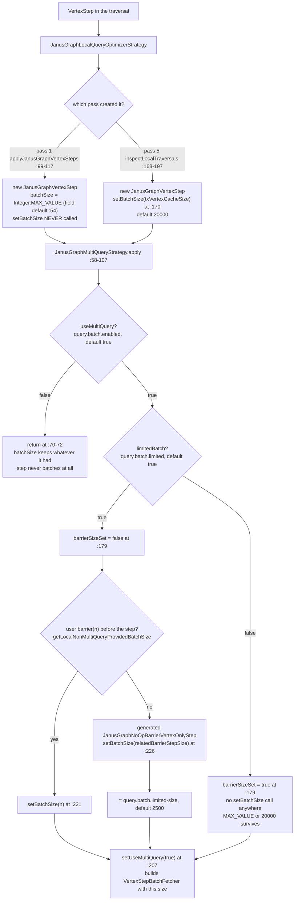
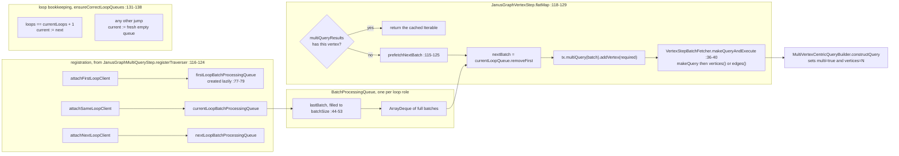

<!--
entry-meta
date: 2026-11-22
type: lesson
track: JanusGraph
lesson: 24
category: Database Internals
title: JanusGraphStep and JanusGraphVertexStep — the fold is executed in one place, the batch is three queues, and the batch size is set twice
slug: janusgraph-step-multiquery-batching
-->

# JanusGraphStep and JanusGraphVertexStep — the fold is executed in one place, the batch is three queues, and the batch size is set twice

**2026-11-22 · JanusGraph Track · Lesson 24 of 28**

## Where This Fits

- **Lesson 23** ([The strategy layer — twelve rewrites, one dependency graph, and a compile that happens before the profiler exists](../2026-11-21-janusgraph-optimizer-strategy-layer/README.md)) opened Part V at the layer that *creates* these two steps: twelve `ProviderOptimizationStrategy` instances in one `static` block, a dependency graph in which `JanusGraphStepStrategy` and `JanusGraphLocalQueryOptimizerStrategy` are ordered only transitively, and the fold rules — pass 1 folds a `has()` only for an edge-returning step and no order or range at all, pass 5 folds everything and sets a batch size. It handed four explicit debts forward.
- **This lesson** opens the two steps themselves and discharges all four: (a) the **batch-size asymmetry**, (b) the **four multi-query annotations** nothing had been seen to set, (c) **`JanusGraphMultiQueryStrategy`'s own shape**, and (d) the other half of lesson 20's `executeMultiQuery` switch. The headline is (a), and the answer is not the one lesson 23 guessed at: `JanusGraphMultiQueryStrategy` does not *fill in* a batch size pass 1 forgot — on the default configuration it **overwrites pass 5's `txVertexCacheSize` as well**, so the asymmetry only becomes observable when you turn `query.batch.limited` off.
- **It sets up lesson 25** (`ManagementSystem` and the index lifecycle), which opens Part VI. Part V is complete after this entry: the strategies (23) and the steps they produce (24).
- **It is the Part V/VI boundary, so the re-pin review was due and was performed.** Result below, in §0.

Everything from lessons 02–23 is assumed. In particular: `GraphCentricQuery.numSubQueries()` is a literal `1`; `buildGlobalGraphCentricQuery()` memoizes and is called during strategy application by `JanusGraphMixedIndexAggStep`'s constructor; a vertex-centric query folds at most one order key and a graph-centric one any number; `foldInRange` folds a *low* limit only for a `JanusGraphStep`.

### Reading provenance for this entry

Thirteen source files were fetched at the pinned commit, written to local disk, and their **git blob SHAs computed locally and checked against what `get_file_contents` reported** before anything was cited. Every line number below comes from a file whose blob SHA matched exactly:

| File | bytes | lines | blob SHA |
|---|---|---|---|
| `JanusGraphStep.java` | 17,030 | 374 | `315640d2` |
| `JanusGraphVertexStep.java` | 8,152 | 197 | `d328dff0` |
| `MultiQueriable.java` | 3,310 | 65 | `8496dfe1` |
| `JanusGraphMultiQueryStep.java` | 7,262 | 182 | `1f5e9a63` |
| `JanusGraphMultiQueryStrategy.java` | 13,779 | 260 | `60fa1caf` |
| `JanusGraphUnusedMultiQueryRemovalStrategy.java` | 4,348 | 94 | `225ead59` |
| `JanusGraphNoOpBarrierVertexOnlyStep.java` | 2,746 | 64 | `2810c6f3` |
| `JanusGraphTraversalUtil.java` | 22,204 | 431 | `8290888d` |
| `JanusGraphRepeatStep.java` | 7,289 | 148 | `3a6f1b34` |
| `MultiQueryPositions.java` | 1,003 | 28 | `5b47c194` |
| `MultiQueriableStepBatchFetcher.java` | 7,250 | 146 | `e4a25136` |
| `VertexStepBatchFetcher.java` | 1,700 | 41 | `d226dcef` |
| `BatchProcessingQueue.java` | 2,693 | 94 | `141dcb7e` |
| `GraphDatabaseConfiguration.java` | 137,928 | 2,191 | `4d5a9167` |

This is a **stronger** citation grade than lesson 23's delegated reads: the transcription was delegated, but a matching blob SHA makes the local copy byte-identical to the blob at the pinned commit regardless of who typed it, so a line number read off it is the line number in the repository. Where this entry cites a file it did **not** transcribe — `MultiVertexCentricQueryBuilder`, `QueryProfiler`, `JanusGraphMultiQueryStrategyTest` — it says so inline and cites by member name, not line number.

---

## 0. The Part V/VI re-pin review — performed, pin stays

`list_commits` on `JanusGraph/janusgraph` `master` this run returns, newest first:

| SHA | date | subject |
|---|---|---|
| `a59ae8d8` | 2026-10-28 | Restore 1.3.0-SNAPSHOT version CTR |
| `9a30ff14` | 2026-10-28 | Restore 1.2.1-SNAPSHOT version and update Sonatype link CTR |
| `5e3e7bc7` | 2026-10-24 | JanusGraph release 1.2.0 |
| `0f578b3f` | 2026-10-22 | Read a mixed index of the order keys which answers a query whole (fixes #5124) |
| `b7c14c53` | 2026-10-23 | Read Solr results larger than a page in growing pages (fixes #5126) |

`a59ae8d8` is still the tip. **The pin stays, for the fifth consecutive review.** There is nothing to re-pin to; the newest three commits are release plumbing and the two below them are already behind the pin. Next review: the Part VI boundary, i.e. after lesson 28 or at the capstone.

---

## 1. The two steps are not the same kind of thing

It is tempting to read "`JanusGraphStep` and `JanusGraphVertexStep`" as a matched pair. They are not.

| | `JanusGraphStep` | `JanusGraphVertexStep` |
|---|---|---|
| Replaces | TinkerPop `GraphStep` (`g.V()`, `g.E()`) | TinkerPop `VertexStep` (`out()`, `inE()`, …) |
| Created by | `JanusGraphStepStrategy` | `JanusGraphLocalQueryOptimizerStrategy` passes 1 and 5 |
| Interfaces | `HasStepFolder`, `Profiling`, `HasContainerHolder` (`JanusGraphStep:61`) | `HasStepFolder`, `Profiling`, **`MultiQueriable`** (`JanusGraphVertexStep:49`) |
| What the fold becomes | a `GraphCentricQuery` **compiled inside the step** | arguments **forwarded** to a `BaseVertexQuery` builder |
| Batches | no — it is not a `MultiQueriable` | yes — that is the whole of §4–§6 |
| Low limit (offset) | supported, applied in the step (`:285-289`, `:110`) | **rejected**: `Preconditions.checkArgument(low == 0, …)` (`:174`) |

So "multi-query batching" is entirely a `JanusGraphVertexStep` story. `JanusGraphStep` runs once per traversal and reads the graph-centric index; it has no notion of a batch because there is nothing to batch — there is one start.

The second asymmetry is where the compiler lives. `JanusGraphStep` builds a `GraphCentricQuery` itself, in `buildGraphCentricQuery(query, profiler)` (`:183-196`). `JanusGraphVertexStep` builds nothing: `makeQuery` (`:100-115`) pushes labels, direction, conditions, orders and limit into a `BaseVertexQuery` and hands it back, and the vertex-centric compiler lesson 20 read runs later, inside the builder.

---

## 2. `JanusGraphStep` at execution time

### 2.1 The iterator supplier has four arms, not two

The whole of the step's behaviour is a lambda installed in the constructor, `setIteratorSupplier(...)` at `:77-122`. Reading it top to bottom:

```java
// JanusGraphStep.java:78-85   (ids arms)
if (this.ids == null)        return Collections.emptyIterator();
else if (this.ids.length > 0) return iteratorList((Iterator<E>) (Vertex.class.isAssignableFrom(getReturnClass())
                                   ? graph.vertices(ids) : graph.edges(ids)));
```

- **`ids == null`** (`:78-79`) — the "no element can pass" sentinel. `GraphStep` uses a `null` id array to mean *this step returns nothing*; the step short-circuits before touching the transaction.
- **`ids.length > 0`** (`:80-83`) — `g.V(1,2,3)`. No index is consulted at all: the graph is asked for those elements and `iteratorList` (`:322-334`) filters them in memory with `holdsConditions` (`:336-357`), which applies `hasContainers` and then requires **at least one branch of every folded `or()` to hold** (`:344-355`). Note the consequence: with explicit ids, every `has()` the strategy folded in is re-checked in Java, never pushed to a backend. That is also why `JanusGraphStepStrategy` checks `ArrayUtils.isEmpty(getIds())` twice (lesson 23) and skips order/range folding when ids are present — there is nothing for the folded order to act on.
- **`ids.length == 0`, index-answerable `or()` or no `or()`** (`:88-90`) — one disjunctive `GraphCentricQuery`.
- **`ids.length == 0`, exactly one `or()` whose combined query no index answers** (`:91-99`) — N separate `GraphCentricQuery` objects, one per branch.

The branch condition is worth quoting exactly, because it is the one line in the class a reader will misremember:

```java
// JanusGraphStep.java:88
if (!globalQuery.getSubQuery(0).getBackendQuery().isEmpty() || hasLocalContainers.size() != 1) {
```

`hasLocalContainers` is a `Map<String, Set<List<HasContainer>>>` keyed by the **`or()` step's id** (`:64`, written at `:254` and `:265`). So `size()` counts **`or()` steps, not branches**. With two folded `or()`s the per-branch split never happens — the disjunctive query is used even when no index answers it. Lesson 23 recorded this; it is confirmed here against the code.

### 2.2 Both arms converge on the same merge, and the low limit is applied there

```java
// JanusGraphStep.java:109-121
if (orders.isEmpty()) {
    return new MultiDistinctUnorderedIterator<>(lowLimit, highLimit, responses);
} else {
    final OrderList order = queries.stream().map(GraphCentricQuery::getOrder)
        .filter(o -> !o.isEmpty()).findFirst().orElse(OrderList.NO_ORDER);
    assert queries.stream().allMatch(q -> q.getOrder().isEmpty() || q.getOrder().equals(order));
    return new MultiDistinctOrderedIterator<>(lowLimit, highLimit, responses,
        (e1, e2) -> order.compare((JanusGraphElement) e1, (JanusGraphElement) e2));
}
```

Three facts fall out of this, and they settle a question lesson 22 left open:

1. **The merge runs even when `queries.size() == 1`.** Both arms append to `responses` and both fall through to `:109`. So the de-duplicating, offset-applying merge is not a special case for split `or()`s — it is *the* execution path of every `JanusGraphStep` that is not an id lookup.
2. **`lowLimit` (the offset from `range(low, high)`) exists only here.** It is set by `setLimit` (`:285-289`), is never passed to a `GraphCentricQuery` — `:161` and `:179` pass only `highLimit` — and is consumed by the merge iterator. That is why `foldInRange` folds a low limit *only* for a `JanusGraphStep`: it is the only step with a place to put one.
3. **`highLimit` is applied twice**, once as `query.limit(highLimit)` (`:161`, `:179`) and once as the merge iterator's bound. With N split branch queries, each branch carries the *full* limit, so the step can read up to `N × highLimit` elements to emit `highLimit`. That is correct and it is not free.

The `assert` on `:118` is the cross-query ordering invariant: every non-empty query's `OrderList` must equal the one picked at `:116-117`. Assertions are off in production. Carry that to lesson 28, where a stale mixed index is exactly the condition under which two branch queries could come back ordered differently.

### 2.3 The empty-`or()` path mutates, and is the only path that returns a typed empty query

If an `or()` has no branch that can let an element through, `addLocalHasContainersOfNoBranch` (`:270-278`) records the step id with an **empty** set. Two things then happen:

- `buildGlobalGraphCentricQuery` reaches `localQueries.isEmpty()` at `:153` and returns `GraphCentricQuery.emptyQuery(VERTEX|EDGE)` (`:155-156`).
- At execution the split arm's loop body (`:94-98`) runs zero times, `queries` is empty, and `:101-104` returns `Collections.emptyIterator()` with a comment saying exactly that.

And the mutation lesson 23 flagged is confirmed verbatim at `:134-138`:

```java
if (hasLocalContainers.isEmpty()) {
    Set<List<HasContainer>> containers = new LinkedHashSet<>();
    containers.add(new ArrayList<>());
    hasLocalContainers.put(null, containers);
}
```

A `buildGlobalGraphCentricQuery()` call on a step with no `or()` leaves a `null` key behind holding one empty branch. It is idempotent (the map is only re-populated when empty), `toString()` (`:205-241`) handles the one-key/one-branch case by printing the plain container list (`:214-218`), and `hashCode()` (`:359-370`) sums `31 * or.hashCode() + 1` per `or()`, so one `or()` of one empty branch is a stable constant. No behaviour change found — but this is the mutation a declined `JanusGraphMixedIndexAggStep` probe leaves on a step it did not replace, so it is worth knowing it is deliberate rather than accidental.

---

## 3. `JanusGraphVertexStep` — a fold that is forwarded, and two orders that become three conditions

`makeQuery` is fifteen lines and three of them are load-bearing:

```java
// JanusGraphVertexStep.java:100-115
public <Q extends BaseVertexQuery> Q makeQuery(Q query) {
    query.labels(getEdgeLabels());
    query.direction(getDirection());
    for (final HasContainer condition : hasContainers) {
        query.has(condition.getKey(), JanusGraphPredicateUtils.convert(condition.getBiPredicate()), condition.getValue());
    }
    for (final OrderEntry order : orders) {
        //TinkerPop's order().by(key) leaves out the elements which have no value of the key. The query takes this
        //has(key) as a range without ends, which another condition on the key narrows
        query.has(order.key);
        query.orderBy(order.key, order.order);
    }
    if (limit != BaseQuery.NO_LIMIT) query.limit(limit);
    ((BasicVertexCentricQueryBuilder) query).profiler(queryProfiler);
    return query;
}
```

- **`:109` is the vertex-centric twin of `JanusGraphStep`'s `requireOrderValues()`** (`:192`). A folded `order().by(k)` silently adds `has(k)`, i.e. a `P.neq(null)` existence condition, because TinkerPop's `order().by()` drops elements it cannot value. The comment says what the compiler then does with it: an unbounded range on `k` that another condition on `k` narrows. So `out().has("w", gt(5)).order().by("w")` produces *one* interval, not an intersection of two — and `out().order().by("w")` produces a slice bounded by the key's presence, not a full adjacency read.
- **`:113` is where the profiler enters.** The cast to `BasicVertexCentricQueryBuilder` is unconditional: every `BaseVertexQuery` this step is given is one. `queryProfiler` is `NO_OP` (`:53`) until TinkerPop calls `setMetrics` (`:193-196`), and `makeQuery` runs at traversal execution, so unlike the aggregation path lesson 23 found, this one always gets the live wrapper.
- **`:112` passes only a high limit**, consistent with `setLimit` rejecting a non-zero offset at `:174`.

`flatMap` (`:117-129`) is the fork:

```java
if (useMultiQuery) {
    result = vertexStepBatchFetcher.fetchData(getTraversal(), traverser.get(), JanusGraphTraverserUtil.getLoops(traverser));
} else {
    final JanusGraphVertexQuery query = makeQuery(JanusGraphTraversalUtil.getJanusGraphVertex(traverser).query());
    result = (Vertex.class.isAssignableFrom(getReturnClass())) ? query.vertices() : query.edges();
}
```

The non-batched arm is one vertex-centric query per traverser — the shape lesson 20 read. The batched arm never builds a single-vertex query at all; it asks a fetcher for a *pre-computed* result and the fetcher decides whether a backend round trip is needed.

---

## 4. The batching machinery, bottom up

### 4.1 `MultiQueriable` is a five-method interface and three of the methods are the same method

```java
// MultiQueriable.java:23-63
public interface MultiQueriable<S,E> extends Step<S,E> {
    void setUseMultiQuery(boolean useMultiQuery);
    void setBatchSize(int batchSize);
    void registerFirstNewLoopFutureVertexForPrefetching(Vertex futureVertex, int futureVertexTraverserLoop);
    void registerSameLoopFutureVertexForPrefetching(Vertex futureVertex, int futureVertexTraverserLoop);
    void registerNextLoopFutureVertexForPrefetching(Vertex futureVertex, int futureVertexTraverserLoop);
}
```

Three registration methods, differing only in *which loop iteration* the vertex will arrive on. That distinction exists for `repeat()` and for nothing else: outside a repeat, every registration is a same-loop registration.

### 4.2 `JanusGraphMultiQueryStep` is a tee, not a buffer

`JanusGraphMultiQueryStep` (`:40`) sits *before* the step that will need the vertices. It keeps three client lists (`:48-50`) and does exactly one thing in `processNextStart` (`:106-114`): pass the traverser through and tell its clients about it.

```java
// JanusGraphMultiQueryStep.java:116-124
private void registerTraverser(Admin<Element> traverser){
    if (traverser.get() instanceof Vertex) {
        Vertex vertex = (Vertex) traverser.get();
        int loops = JanusGraphTraverserUtil.getLoops(traverser);
        firstLoopClientSteps.forEach(client -> client.registerFirstNewLoopFutureVertexForPrefetching(vertex, loops));
        sameLoopClientSteps.forEach(client -> client.registerSameLoopFutureVertexForPrefetching(vertex, loops));
        nextLoopClientSteps.forEach(client -> client.registerNextLoopFutureVertexForPrefetching(vertex, loops));
    }
}
```

The one piece of real control flow is `initialize()` (`:89-104`), and it is the **unlimited-batch** path:

```java
if (!limitBatchSize && (!sameLoopClientSteps.isEmpty() || !nextLoopClientSteps.isEmpty() || !firstLoopClientSteps.isEmpty())) {
    if (!starts.hasNext()) throw FastNoSuchElementException.instance();
    final List<Traverser.Admin<Element>> elements = new ArrayList<>();
    starts.forEachRemaining(e -> { elements.add(e); registerTraverser(e); });
    starts.add(elements.iterator());
}
```

With `limitBatchSize == false` the step **drains its entire upstream into a list**, registers every vertex, and pushes the list back as its own starts. That is the "eagerly cache all starts instead of batching" comment at `:93`. With `limitBatchSize == true` this block is skipped entirely and the batching is done downstream, by the barrier and the queue.

So the two modes are structurally different, not just differently sized: one materialises all starts in the step, the other lets a `NoOpBarrierStep` meter them.

### 4.3 Three queues, and the loop arithmetic that swaps them

`MultiQueriableStepBatchFetcher` (`:32`) holds `firstLoopBatchProcessingQueue`, `currentLoopBatchProcessingQueue` and `nextLoopBatchProcessingQueue` (`:39-41`), plus the memoised `multiQueryResults` map (`:36`).

The read path is `fetchData` (`:99-109`):

```java
public R fetchData(final Traversal.Admin<?, ?> traversal, Vertex forGeneralVertex, int traverserLoops){
    JanusGraphVertex forVertex = JanusGraphTraversalUtil.getJanusGraphVertex(forGeneralVertex);
    if (hasNoFetchedData(forVertex)) {
        refreshIfLoopsAreReset(traverserLoops, forVertex);
        ensureCorrectLoopQueues(traverserLoops);
        multiQueryResults = prefetchNextBatch(traversal, forVertex);
    } else {
        ensureCorrectLoopQueues(traverserLoops);
    }
    return multiQueryResults.get(forVertex);
}
```

`multiQueryResults` is replaced wholesale, not merged (`:104`). So a batch's results live exactly until the first vertex arrives that is not in them, and the previous batch's cached adjacency is dropped at that moment. There is no LRU here; the vertex cache lesson 19 read is what keeps the dropped data useful.

`prefetchNextBatch` (`:115-125`) is where the backend round trip is:

```java
Collection<JanusGraphVertex> batch = nextBatch();
final JanusGraphMultiVertexQuery multiQuery = JanusGraphTraversalUtil.getTx(traversal).multiQuery(batch);
multiQuery.addVertex(requiredFetchVertex);
```

`addVertex(requiredFetchVertex)` at `:118` is the safety net: whatever the queue produced, the vertex actually being asked for is in the query. That makes the batch an *optimisation hint* rather than a correctness-relevant set — if registration missed a vertex entirely, the step still works, with a one-vertex multi-query per miss.

`ensureCorrectLoopQueues` (`:131-138`) is the whole repeat-loop state machine:

```java
if(loops != currentLoops){
    currentLoopBatchProcessingQueue = loops == currentLoops + 1 ? nextLoopBatchProcessingQueue : generateNewBatchProcessingQueue();
    nextLoopBatchProcessingQueue = generateNewBatchProcessingQueue();
    currentLoops = loops;
}
```

Advance by exactly one loop and the next-loop queue becomes the current one — the registrations made during iteration *n* are the batch for iteration *n+1*. Jump by anything else and both queues are thrown away, so batching silently degrades to one-vertex multi-queries until registration refills. `refreshIfLoopsAreReset` (`:83-91`) handles the other direction, `loops` going back to `0` for a fresh outer start, by promoting `firstLoopBatchProcessingQueue`.

### 4.4 `BatchProcessingQueue` — a deque of fixed-size lists with a de-duplicating set

```java
// BatchProcessingQueue.java:44-53
public void addToBatchToEnd(T element) {
    if(!allBatchedElements.add(element)){ return; }
    if(lastBatch.size() >= batchSize){ batches.add(lastBatch); lastBatch = new ArrayList<>(); }
    lastBatch.add(element);
}
```

- `allBatchedElements` (`:31`) de-duplicates across *all* pending batches, so a vertex reached twice is queried once.
- `removeFirst` (`:55-65`) takes a full batch if there is one, otherwise flushes the partial `lastBatch` — so the final, short batch is served without waiting.
- The constructor clamps: `this.batchSize = Math.max(batchSize, 1)` (`:41`). **`setBatchSize` (`:87-89`) does not.** See §7.

---

## 5. The headline: the batch size is set twice, and the second write usually wins

This is lesson 23's debt (a), and the answer has three parts.

### 5.1 The default is not zero, it is `Integer.MAX_VALUE`

```java
// JanusGraphVertexStep.java:51-54
private boolean useMultiQuery = false;
private VertexStepBatchFetcher vertexStepBatchFetcher;
private QueryProfiler queryProfiler = QueryProfiler.NO_OP;
private int batchSize = Integer.MAX_VALUE;
```

Lesson 23 established that `applyJanusGraphVertexSteps` (pass 1, `JanusGraphLocalQueryOptimizerStrategy:99-117`) never calls `setBatchSize`, while `inspectLocalTraversals` (pass 5, `:170`) calls `setBatchSize(txVertexCacheSize)`. So immediately after `JanusGraphLocalQueryOptimizerStrategy` runs, a top-level `out()` carries `Integer.MAX_VALUE` and a `local(out())` carries `cache.tx-cache-size`, default **20000** (`GraphDatabaseConfiguration:668-670`).

Note the ordering constraint this creates inside the step: `setUseMultiQuery` constructs the fetcher with whatever `batchSize` is *at that moment* —

```java
// JanusGraphVertexStep.java:71-77
public void setUseMultiQuery(boolean useMultiQuery) {
    this.useMultiQuery = useMultiQuery;
    if(useMultiQuery && vertexStepBatchFetcher == null){
        vertexStepBatchFetcher = new VertexStepBatchFetcher(JanusGraphVertexStep.this::makeQuery, getReturnClass(), batchSize);
    }
}
```

— and `setBatchSize` (`:131-137`) forwards to an already-built fetcher if there is one. Either order works. `JanusGraphMultiQueryStrategy` happens to size first and enable second (`:181-201` then `:203-208`).

### 5.2 `JanusGraphMultiQueryStrategy` writes it again, and the gate is one boolean

```java
// JanusGraphMultiQueryStrategy.java:179
boolean barrierSizeSet = !limitedBatch;
```

That single line is the whole asymmetry.

- **`query.batch.limited = true` (the default — `GraphDatabaseConfiguration:379-384`).** `barrierSizeSet` starts `false`, so `applyPreviousMultiQueryAndReturnIfBarrierSizeSet` (`:212-233`) is allowed to write a size. It prefers a **user-written `barrier(n)`** (`getLocalNonMultiQueryProvidedBatchSize`, `:219-222`) and falls back to the **generated barrier's** size (`:224-227`), which is `query.batch.limited-size`, default **2500** (`GraphDatabaseConfiguration:386-391`). If neither applies, `:199-201` sets `limitedBatchSize` directly. **In every case the value pass 5 wrote is overwritten.**
- **`query.batch.limited = false`.** `barrierSizeSet` starts `true`, both the `if(!barrierSizeSet)` guard at `:218` and the one at `:199` are dead, and **no `setBatchSize` call happens anywhere in this strategy**. Whatever `JanusGraphLocalQueryOptimizerStrategy` left stands — `Integer.MAX_VALUE` for a top-level `out()`, `20000` for `local(out())`.

So the honest statement of the asymmetry is:

> On a default graph, `g.V().out()` and `g.V().local(out())` batch identically, at 2500, because the strategy overwrites both. Set `query.batch.limited=false` and they diverge: the top-level step issues **one multi-query containing every start vertex**, the local one caps at `cache.tx-cache-size`.

And note what `limited=false` does *upstream* as well: `JanusGraphMultiQueryStep.initialize()` (`:93-103`) drains all starts into memory. The two halves agree — unlimited means unlimited at both ends.

One more consequence worth stating because it is counter-intuitive: `cache.tx-cache-size`, a **cache** option, is the batch size of a `local()` vertex step, but only on a configuration where the batch is unlimited everywhere else. On the shipped default it has no effect on batching at all.



### 5.3 The user's `barrier(n)` wins, and the test that proves the barrier exists

`getLocalNonMultiQueryProvidedBatchSize` (`JanusGraphTraversalUtil:350-365`) is specifically written to distinguish a barrier the user wrote from one the strategy generated:

```java
Step<?,?> previousStep = noOpBarrierStep.getPreviousStep();
if(previousStep instanceof JanusGraphMultiQueryStep && ((JanusGraphMultiQueryStep) previousStep).getGeneratedBarrierStep() == noOpBarrierStep){
    return Optional.empty();
}
return Optional.of(noOpBarrierStep.getMaxBarrierSize());
```

The identity comparison on `:361` — not `instanceof`, not a flag — is how a generated barrier is told from a user one. `JanusGraphMultiQueryStrategyTest` (read inline this run; cited by member name) pins both halves: `testNoOpBarrierStepInsertedIfNotPresentAndLimitBatchSize` asserts exactly one `JanusGraphNoOpBarrierVertexOnlyStep` in `g.V(sv[0]).outE().inV()` with `LIMITED_BATCH` true, and `testNoOpBarrierStepNotInsertedLimitBatchSizeDisabled` asserts **zero** barriers of either class with `LIMITED_BATCH` false. Neither test asserts on the resulting numeric batch size — see §7, candidate 67.

---

## 6. Insert-then-remove, and the barrier that is not quite a barrier

### 6.1 The insertion is deliberately over-eager

`insertMultiQuerySteps` (`:118-128`) inserts a `JanusGraphMultiQueryStep` before **every** `MultiQueriable` *and* every `TraversalParent`, plus at the end of every `RepeatStep`'s repeat traversal. The javadoc at `:113-114` says why: *"This is OK to insert `JanusGraphMultiQueryStep` before the step which won't be using it because `JanusGraphUnusedMultiQueryRemovalStrategy` will remove any unnecessary `JanusGraphMultiQueryStep`."*

`JanusGraphUnusedMultiQueryRemovalStrategy` then deletes any step whose three client lists are all empty (`:73-84`) **and its generated barrier with it** (`:63-70`), using the same stored reference:

```java
NoOpBarrierStep generatedBarrierStep = multiQueryStep.getGeneratedBarrierStep();
traversal.removeStep(multiQueryStep);
if(generatedBarrierStep != null){ traversal.removeStep(generatedBarrierStep); }
```

So a user-written `barrier(n)` survives the cleanup and a generated one does not. That is the second use of the generated-barrier identity, and it is the reason the design needs the field at all.

### 6.2 `JanusGraphNoOpBarrierVertexOnlyStep` degrades to size 1 on anything that is not a vertex

```java
// JanusGraphNoOpBarrierVertexOnlyStep.java:44-57
public void processAllStarts() {
    if(!this.barrier.isEmpty()){ return; }
    while ((this.maxBarrierSize == Integer.MAX_VALUE || this.barrier.size() < this.maxBarrierSize) && this.starts.hasNext()) {
        final Traverser.Admin<S> traverser = this.starts.next();
        traverser.setStepId(this.getNextStep().getId());
        this.barrier.add(traverser);
        if(!(traverser.get() instanceof Vertex)){ break; }
    }
}
```

The `break` at `:53-55` is the whole subclass. A barrier exists here to accumulate *vertices* to batch; a non-vertex traverser in the stream is of no use to a multi-query, so the barrier stops filling and lets it through. The cost of getting this wrong would be latency, not correctness: a plain `NoOpBarrierStep` would hold a non-vertex traverser until 2500 more arrived.

The early return at `:46-48` is also not in TinkerPop's version: the barrier refuses to top itself up while it still holds traversers, which keeps batch boundaries stable rather than sliding.

### 6.3 `repeat()` is rewritten, by exact class

```java
// JanusGraphMultiQueryStrategy.java:101-103
TraversalHelper.getStepsOfAssignableClassRecursively(RepeatStep.class, traversal).stream()
    .filter(repeatStep -> repeatStep.getClass() == RepeatStep.class)
    .forEach(repeatStep -> JanusGraphRepeatStep.replace(repeatStep, repeatStep.getTraversal()));
```

`getStepsOfAssignableClassRecursively` finds subclasses too, then `getClass() == RepeatStep.class` filters them back out — the comment at `:97-100` explains that this is to avoid re-replacing a `JanusGraphRepeatStep` and that nested repeats are handled here rather than relying on strategy-application order on the child traversal. `JanusGraphRepeatStep.replace` is a static factory at `JanusGraphRepeatStep:55`. The reason the replacement is needed at all is stated at `:97-98`: the inserted barriers would otherwise switch TinkerPop's `RepeatStep` into its barrier mode, which feeds *all* start traversers into the repeat traversal at once — i.e. the barrier inserted to bound the batch would destroy the batching.



### 6.4 The position rules

`getLocalMultiQueryPositionForStep` (`:331-345`) decides *where* the tee goes: walk backwards over `SideEffectStep` and `ProfileStep` (`:334-337`), and if the step before that is a `NoOpBarrierStep`, put the tee **before the barrier** (`:338-340`) so the registrations happen as the barrier fills. If the walk lands on the traversal start, there is no position (`:341-343`).

`getAllMultiQueryPositionsForMultiQueriable` (`:254-312`) is the repeat-aware version and produces the three lists in `MultiQueryPositions` (`:24-26`). Its first line is the common case:

```java
if(!isStartStep(multiQueriable)){
    getLocalMultiQueryPositionForStep(multiQueriable).ifPresent(step -> multiQueryPositions.currentLoopMultiQueryStepLocations.add(step));
    return multiQueryPositions;
}
```

A step that is not the start of its own traversal gets exactly one same-loop position and nothing else. The loop below it exists only for steps that *are* a traversal start, i.e. the first step inside a `repeat`, `emit` or `until` child traversal, and it walks outward through repeat parents, gated by `multiNestedRepeatEligible` / `multiNestedRepeatNextIterationEligible`, which come from `query.batch.repeat-step-mode` (default `ALL_REPEAT_PARENTS`, `GraphDatabaseConfiguration:403-415`).

---

## 7. The four annotations, and three candidates

### 7.1 Debt (b), settled: all four annotations come from one class

Lesson 22 found `MULTIQUERY_ANNOTATION = "multi"`, `MULTIPREFETCH_ANNOTATION = "multiPreFetch"`, `NUMVERTICES_ANNOTATION = "vertices"` and `PARTITIONED_VERTEX_ANNOTATION = "partitioned"` declared in `QueryProfiler` and set nowhere it had read. Repository code search this run (fragments only — neither file was transcribed, so these are member-name citations) finds **all four set in `MultiVertexCentricQueryBuilder`**, and nowhere else in main sources:

| Annotation | Where set | What it means in a `.profile()` |
|---|---|---|
| `multi=true` | `constructQuery`, next to the `NUMVERTICES` line | this span is a multi-vertex query |
| `vertices=N` | `constructQuery`, `vertices.size()` | the batch size **actually used**, not the configured one |
| `partitioned=true` | the partitioned-vertex branch | the batch contained a partitioned vertex and was expanded over its representatives |
| `multiPreFetch=true` | `preFetch()` | a property pre-fetch, not an adjacency batch |

So `vertices` is the observable the batch-size analysis in §5 needs, and it is the only one of the four that carries a number. The test helper `queryProfilerAnnotationIsPresent` (static import in `JanusGraphMultiQueryStrategyTest` from `org.janusgraph.testutil.JanusGraphAssert`) matches on the string `"<annotation>=true"` in `TraversalMetrics.toString()`, which is why it works for the three boolean annotations and not for `vertices`.

### 7.2 Candidate 65 — `isLegalMultiQueryPosition` walks `currentStep` and tests `step`

```java
// JanusGraphTraversalUtil.java:390-403
public static boolean isLegalMultiQueryPosition(Step<?, ?> step) {
    if (step.getTraversal().getTraverserRequirements().contains(TraverserRequirement.PATH)) return false;
    boolean labeledPath = false;
    Step currentStep = step.getTraversal().getStartStep();
    while (!currentStep.equals(step, true)) {
        if (step instanceof PathProcessor) {
            final Set<String> keepLabels = ((PathProcessor) step).getKeepLabels();
            labeledPath &= keepLabels == null || !keepLabels.isEmpty();
        }
        labeledPath |= !step.getLabels().isEmpty();
        currentStep = currentStep.getNextStep();
    }
    return !labeledPath;
}
```

The loop advances `currentStep` and the body reads **`step`**, the method parameter, three times. The body is therefore loop-invariant and the walk computes nothing. Evaluating it:

- If `step` *is* the start step, the body never runs, `labeledPath` stays `false`, and the method returns `true` — **even if `step` itself carries a label**.
- Otherwise `labeledPath |= !step.getLabels().isEmpty()` fires on the first iteration and the result is `step.getLabels().isEmpty()`, independent of every other step in the traversal.

The javadoc at `:382-388` states the intent: *"This method closely matches the behavior implemented in `LazyBarrierStrategy` which ensures that no `NoOpBarrierStep`s are inserted if path labels are required."* TinkerPop's `LazyBarrierStrategy` iterates the traversal's steps and accumulates `labeledPath` over **every step up to the position**. JanusGraph's version renamed the iteration variable to `currentStep` and left the body on `step`. The `&=` line is a faithful translation of TinkerPop's keep-labels reset; only the variable is wrong.

Effect: JanusGraph inserts a `JanusGraphMultiQueryStep` and a generated barrier at positions `LazyBarrierStrategy` would decline, whenever a label appears *earlier* in the traversal than the position and the traversal's requirements include `LABELED_PATH` rather than `PATH` — the first guard at `:391` only catches full `PATH`. `testNoMultiQueryStepsInsertedIfPathQuery` covers the `PATH` case and nothing covers the labelled case, which is consistent with the bug surviving.

**This is derived from reading, not from a run.** Hands-On B is the experiment that would settle it, and it has not been run. File it with that caveat.

### 7.3 Candidate 66 — `BatchProcessingQueue.setBatchSize` drops the constructor's clamp

```java
// BatchProcessingQueue.java:40-42
public BatchProcessingQueue(int batchSize) { this.batchSize = Math.max(batchSize, 1); }
// BatchProcessingQueue.java:87-89
public void setBatchSize(int batchSize) { this.batchSize = batchSize; }
```

With a non-positive `batchSize`, `addToBatchToEnd`'s `lastBatch.size() >= batchSize` (`:48`) is true on every call, so the first add pushes an **empty** list onto `batches` and `removeFirst` then returns an empty batch — a multi-query carrying only `requiredFetchVertex`, i.e. batching silently off, with the per-batch allocation still paid.

Is it reachable? `query.batch.limited-size` has **no verifier**: `GraphDatabaseConfiguration:386-391` ends `ConfigOption.Type.MASKABLE, 2500)` with no third argument, where `MAX_KEYS_PER_READ` two declarations above it ends `ConfigOption.Type.MASKABLE, 1000, ConfigOption.positiveInt())` (`:401`). `cache.tx-cache-size` (`:668-670`) likewise has none. So `query.batch.limited-size=0` is accepted by configuration and reaches `setBatchSize` through `JanusGraphMultiQueryStrategy:200`. **I did not run this**, so the claim is "the clamp is absent and the path is open", not "it misbehaves in production". The honest fix is either the `Math.max` in the setter or `ConfigOption.positiveInt()` on both options — and the latter is the better PR because it rejects the nonsense at load time.

### 7.4 Candidate 67 — `JanusGraphVertexStep`'s copy constructor does not copy `batchSize`

```java
// JanusGraphVertexStep.java:60-68
if (originalStep instanceof JanusGraphVertexStep) {
    JanusGraphVertexStep originalJanusGraphVertexStep = (JanusGraphVertexStep) originalStep;
    setUseMultiQuery(originalJanusGraphVertexStep.useMultiQuery);
    this.hasContainers = originalJanusGraphVertexStep.hasContainers;
    this.limit = originalJanusGraphVertexStep.limit;
} else { … }
```

`useMultiQuery`, `hasContainers` and `limit` are carried over; `batchSize` is not, so the copy starts at `Integer.MAX_VALUE` — and because `setUseMultiQuery` is called *first* (`:62`), the new fetcher is built with `Integer.MAX_VALUE` rather than the original's size.

**I could not find a path where this changes behaviour.** The one reachable caller I traced is `inspectLocalTraversals`, which constructs a `JanusGraphVertexStep` from the local traversal's start step (already converted by pass 1 on that child traversal) and then immediately calls `setBatchSize(txVertexCacheSize)` at `JanusGraphLocalQueryOptimizerStrategy:170`, repairing it. So this is filed as latent, and the right PR is a copy of the field plus a test, not a bug report.

Also noted, not filed: `MultiQueriableStepBatchFetcher.setBatchSize` (`:93-97`) updates the current- and next-loop queues but not `firstLoopBatchProcessingQueue`. That queue is created lazily at `:77-79` from the field, and strategy application finishes before any traverser runs, so it is always null at that point. Harmless as written, fragile if anything ever resizes mid-run. And `BatchProcessingQueue.removeLast()` (`:67-77`) has no caller among the files read this run — but `HasStepBatchFetcher` and `DropStepBatchFetcher` were **not** read, so that is not a dead-code claim.

---

## Hands-On

All four run against the in-memory backend from a clone of your fork at the pinned commit. `JanusGraphMultiQueryStrategyTest` is concrete (it extends the abstract `OptimizerStrategyTest`, which supplies the graph via `StorageSetup.getInMemoryGraph()` and `clopen(...)` with `STORAGE_BACKEND=inmemory`), so it runs directly.

### A — see the real batch size in a profile, and watch it change with one option

The `vertices` annotation on a `backend-query` span is the batch size *actually used*. In the Gremlin console against an in-memory graph:

```groovy
// 1. default configuration
graph = JanusGraphFactory.open('inmemory')
g = graph.traversal()
hub = g.addV('hub').next()
(1..6000).each { g.addV('leaf').addE('knows').from(__.V(hub)).iterate() }
graph.tx().commit()

g.V().hasLabel('leaf').out().profile().next()
```

**What to look for:** a `backend-query` span annotated `multi=true` and `vertices=2500`, repeated as the traversal walks through the batches — 2500, 2500, 1000 for 6000 starts. That 2500 is `query.batch.limited-size`, and it got there through `JanusGraphMultiQueryStrategy:226`, not through anything `JanusGraphLocalQueryOptimizerStrategy` did.

Now reopen with `query.batch.limited=false`:

```groovy
graph = JanusGraphFactory.build().set('storage.backend','inmemory').set('query.batch.limited', false).open()
```

**What to look for:** one span with `vertices=6000` for `g.V().hasLabel('leaf').out()` — `Integer.MAX_VALUE`, i.e. no cap — and, for `g.V().hasLabel('leaf').local(out())`, `vertices` capped at `cache.tx-cache-size`. Raise the leaf count above 20000 and the local form should split while the top-level one does not. **This is the experiment that confirms or refutes §5.2; it has not been run.** If the local form does *not* cap, the likely cause is `unfoldLocalTraversal` (`JanusGraphLocalQueryOptimizerStrategy:225-235`) having deleted the `LocalStep` and left the step indistinguishable from a top-level one — check `g.V().hasLabel('leaf').local(out()).explain()` for a surviving `LocalStep` before concluding anything.

### B — prove or refute candidate 65 in twelve lines

```groovy
// labelled earlier in the traversal, LABELED_PATH but not PATH
t1 = g.V().hasLabel('leaf').as('a').out().select('a')
println t1.explain()

// the same traversal with the label on the position step itself
t2 = g.V().hasLabel('leaf').out().as('b').out()
println t2.explain()
```

**What to look for:** in `t1`, a `JanusGraphMultiQueryStep` (and a `JanusGraphNoOpBarrierVertexOnlyStep`) inserted before `out()` despite the earlier `as('a')`. If `LazyBarrierStrategy` declined to insert its own `NoOpBarrierStep` in the same traversal — compare against `g.V().hasLabel('leaf').as('a').out().select('a')` on a TinkerGraph — the divergence is real and candidate 65 is confirmed. In `t2`, the label sits on the step the position is computed *from*, which is the one case the broken loop still catches, so expect **no** insertion there. A result where `t1` is skipped and `t2` is inserted would refute the reading; say so rather than filing.

### C — run the two barrier tests and break one deliberately

```bash
mvn test -pl janusgraph-test -am \
  -Dtest=JanusGraphMultiQueryStrategyTest#testNoOpBarrierStepInsertedIfNotPresentAndLimitBatchSize \
  -DfailIfNoTests=false -Dsurefire.failIfNoSpecifiedTests=false
```

Then make the strategy stop generating barriers — comment out `JanusGraphMultiQueryStrategy:138-141`, the `new JanusGraphNoOpBarrierVertexOnlyStep(...)` / `insertBeforeStep` pair — and re-run both `testNoOpBarrierStepInsertedIfNotPresentAndLimitBatchSize` and `testNoOpBarrierStepNotInsertedLimitBatchSizeDisabled`.

**What to look for:** the first test fails on the barrier count and the second still passes, which tells you the `LIMITED_BATCH=false` test asserts an *absence* and would not catch a regression that removes batching. That is the gap candidate 67's test should fill: nothing in the repository asserts a numeric batch size. Revert the edit; temporary instrumentation must not be committed.

### D — watch the three queues swap across a `repeat()`

Add a temporary log line at the top of `MultiQueriableStepBatchFetcher.ensureCorrectLoopQueues` (`:131`) printing `loops`, `currentLoops` and whether the next-loop queue is being promoted, then run:

```groovy
g.V(hub).repeat(__.out()).times(3).profile().next()
```

**What to look for:** promotions at `loops == currentLoops + 1` and nothing else — each iteration's batch is the set registered during the previous one. Then run the same traversal with `query.batch.repeat-step-mode=closest_repeat_parent` and confirm `firstLoopMultiQueryStepLocations` stays empty (`JanusGraphMultiQueryStrategy:80-94` sets both nested-repeat flags false in that mode), so a nested repeat's inner step batches only from its immediate parent. Remove the log line before committing.

---

## Where This Breaks Down

- **A batch is a prediction, and a wrong prediction costs a round trip per element.** `prefetchNextBatch` adds the required vertex to whatever the queue produced (`:118`). If registration under-populates — a jump of more than one loop (`ensureCorrectLoopQueues:131-138`), an illegal position (`hasIllegalPositions:175-177`), a non-vertex traverser flowing through `registerTraverser`'s `instanceof` guard (`:117`) — the fetcher degrades to one multi-query per vertex, which is *worse* than the unbatched path because it pays the multi-query construction and the map allocation for a batch of one.
- **`multiQueryResults` is replaced, not merged** (`MultiQueriableStepBatchFetcher:104`). A traversal that interleaves vertices from two batches re-queries on every alternation. Nothing detects this.
- **Unlimited batching materialises everything twice.** With `query.batch.limited=false`, `JanusGraphMultiQueryStep.initialize()` (`:93-103`) holds every start traverser in an `ArrayList`, and the resulting multi-query holds every start vertex and its full adjacency result map. On a graph where `g.V().out()` is a reasonable thing to type, that is the whole vertex set in heap twice.
- **The split-`or()` path multiplies the limit.** N branch queries each carry `highLimit` (`JanusGraphStep:179`), and the merge discards the excess. A `limit(10)` over a three-branch `or()` can read 30 elements, and each branch pays lesson 22's doubling-limit re-read discipline independently.
- **The cross-query order invariant is an `assert`** (`JanusGraphStep:118`), i.e. absent in production. If two branch queries come back with different `OrderList`s, `MultiDistinctOrderedIterator` merges with the first one's comparator and emits a silently mis-ordered result.
- **`vertices=N` in a profile is the batch size, not the configured one.** Reading `query.batch.limited-size` out of a config file tells you nothing about what a given step used; four writers can set that field (§5) and the last one wins.
- **Everything in §4–§6 is off on OLAP.** `JanusGraphMultiQueryStrategy.apply` returns at `:59-61` when `TraversalHelper.onGraphComputer(traversal)`, and lesson 23 established that `FulgoraUtil.FULGORA_STRATEGIES` installs only `JanusGraphLocalQueryOptimizerStrategy` anyway. So on a `GraphComputer` traversal, `JanusGraphVertexStep` exists, `useMultiQuery` is never set, and every vertex is a separate query.

---

## Further Study

- [`JanusGraphStep.java` at the pinned commit](https://github.com/JanusGraph/janusgraph/blob/a59ae8d8024207598eada34998d867617df51adf/janusgraph-core/src/main/java/org/janusgraph/graphdb/tinkerpop/optimize/step/JanusGraphStep.java) — read `toString()` (`:205-241`) next to `hashCode()` (`:359-370`) and work out why the `or()` of no branches needs the `+ 1`.
- [`HasStepBatchFetcher.java`](https://github.com/JanusGraph/janusgraph/blob/a59ae8d8024207598eada34998d867617df51adf/janusgraph-core/src/main/java/org/janusgraph/graphdb/tinkerpop/optimize/step/fetcher/HasStepBatchFetcher.java) — the only fetcher with a `batchConsumerBeforeQuery`, and the one that drives `JanusGraphHasStep`'s property/label pre-fetch. Not read this run.
- [`MultiQueryStrategyRepeatStepMode.java`](https://github.com/JanusGraph/janusgraph/blob/a59ae8d8024207598eada34998d867617df51adf/janusgraph-core/src/main/java/org/janusgraph/graphdb/tinkerpop/optimize/strategy/MultiQueryStrategyRepeatStepMode.java) — the three modes whose semantics `getAllMultiQueryPositionsForMultiQueriable` implements.
- [TinkerPop's `LazyBarrierStrategy`, as JanusGraph's javadoc points at it](https://github.com/JanusGraph/janusgraph/blob/a59ae8d8024207598eada34998d867617df51adf/janusgraph-core/src/main/java/org/janusgraph/graphdb/tinkerpop/optimize/JanusGraphTraversalUtil.java#L382-L403) — the comparison that candidate 65 rests on.

## Next Steps

1. **Run Hands-On A** and record the three `vertices` values (default, `limited=false` top-level, `limited=false` local). That number is the only direct evidence for §5.2 and nobody has produced it.
2. **Run Hands-On B** and either confirm or refute candidate 65 before filing it. A confirmed version should go up as an issue with the `explain()` output of both traversals and a one-line diff.
3. **Bundle candidates 66 and 67** — both are small, both want a test, and both are in the same subsystem. Candidate 66's better form is `ConfigOption.positiveInt()` on `LIMITED_BATCH_SIZE` and `TX_CACHE_SIZE`.
4. **Lesson 25 owes** the index status question carried from lesson 21 and the `AdjacentVertexHasUniquePropertyOptimizerStrategy` / `optimizerBackendAccess()` question from lesson 23.
5. **Lesson 28 inherits** the `assert`-only cross-query ordering invariant from `JanusGraphStep:118`, on top of the `MultiDistinctOrderedIterator` invariant lesson 23 handed it.
6. **Still open from earlier lessons and not touched here:** `BasicVertexCentricQueryBuilder:711`'s `bestCandidate != null` reachability (lesson 20), whether any production path passes a real limit to `QueryUtil.processIntersectingRetrievals` (candidate 51), and the §2.2 strategy-ordering experiment from lesson 23, which also remains unrun.

## Sources

Read with `get_file_contents` at `a59ae8d8024207598eada34998d867617df51adf` this run, transcribed to local disk, and **blob-SHA verified locally** — cited by line number above:

- [`JanusGraphStep.java`](https://github.com/JanusGraph/janusgraph/blob/a59ae8d8024207598eada34998d867617df51adf/janusgraph-core/src/main/java/org/janusgraph/graphdb/tinkerpop/optimize/step/JanusGraphStep.java#L61-L370)
- [`JanusGraphVertexStep.java`](https://github.com/JanusGraph/janusgraph/blob/a59ae8d8024207598eada34998d867617df51adf/janusgraph-core/src/main/java/org/janusgraph/graphdb/tinkerpop/optimize/step/JanusGraphVertexStep.java#L49-L196)
- [`MultiQueriable.java`](https://github.com/JanusGraph/janusgraph/blob/a59ae8d8024207598eada34998d867617df51adf/janusgraph-core/src/main/java/org/janusgraph/graphdb/tinkerpop/optimize/step/MultiQueriable.java#L23-L63)
- [`JanusGraphMultiQueryStep.java`](https://github.com/JanusGraph/janusgraph/blob/a59ae8d8024207598eada34998d867617df51adf/janusgraph-core/src/main/java/org/janusgraph/graphdb/tinkerpop/optimize/step/JanusGraphMultiQueryStep.java#L40-L181)
- [`JanusGraphMultiQueryStrategy.java`](https://github.com/JanusGraph/janusgraph/blob/a59ae8d8024207598eada34998d867617df51adf/janusgraph-core/src/main/java/org/janusgraph/graphdb/tinkerpop/optimize/strategy/JanusGraphMultiQueryStrategy.java#L45-L255)
- [`JanusGraphUnusedMultiQueryRemovalStrategy.java`](https://github.com/JanusGraph/janusgraph/blob/a59ae8d8024207598eada34998d867617df51adf/janusgraph-core/src/main/java/org/janusgraph/graphdb/tinkerpop/optimize/strategy/JanusGraphUnusedMultiQueryRemovalStrategy.java#L41-L89)
- [`JanusGraphNoOpBarrierVertexOnlyStep.java`](https://github.com/JanusGraph/janusgraph/blob/a59ae8d8024207598eada34998d867617df51adf/janusgraph-core/src/main/java/org/janusgraph/graphdb/tinkerpop/optimize/step/JanusGraphNoOpBarrierVertexOnlyStep.java#L30-L62)
- [`JanusGraphTraversalUtil.java`](https://github.com/JanusGraph/janusgraph/blob/a59ae8d8024207598eada34998d867617df51adf/janusgraph-core/src/main/java/org/janusgraph/graphdb/tinkerpop/optimize/JanusGraphTraversalUtil.java#L254-L430)
- [`JanusGraphRepeatStep.java`](https://github.com/JanusGraph/janusgraph/blob/a59ae8d8024207598eada34998d867617df51adf/janusgraph-core/src/main/java/org/janusgraph/graphdb/tinkerpop/optimize/step/JanusGraphRepeatStep.java#L42-L55)
- [`MultiQueryPositions.java`](https://github.com/JanusGraph/janusgraph/blob/a59ae8d8024207598eada34998d867617df51adf/janusgraph-core/src/main/java/org/janusgraph/graphdb/tinkerpop/optimize/MultiQueryPositions.java#L22-L27)
- [`MultiQueriableStepBatchFetcher.java`](https://github.com/JanusGraph/janusgraph/blob/a59ae8d8024207598eada34998d867617df51adf/janusgraph-core/src/main/java/org/janusgraph/graphdb/tinkerpop/optimize/step/fetcher/MultiQueriableStepBatchFetcher.java#L32-L145)
- [`VertexStepBatchFetcher.java`](https://github.com/JanusGraph/janusgraph/blob/a59ae8d8024207598eada34998d867617df51adf/janusgraph-core/src/main/java/org/janusgraph/graphdb/tinkerpop/optimize/step/fetcher/VertexStepBatchFetcher.java#L24-L40)
- [`BatchProcessingQueue.java`](https://github.com/JanusGraph/janusgraph/blob/a59ae8d8024207598eada34998d867617df51adf/janusgraph-core/src/main/java/org/janusgraph/graphdb/tinkerpop/optimize/step/fetcher/BatchProcessingQueue.java#L29-L93)
- [`GraphDatabaseConfiguration.java`](https://github.com/JanusGraph/janusgraph/blob/a59ae8d8024207598eada34998d867617df51adf/janusgraph-core/src/main/java/org/janusgraph/graphdb/configuration/GraphDatabaseConfiguration.java#L365-L415) (also `:668-670`, `:1702-1704`, `:1778-1796`, `:2058`, `:2069-2073`)

Read inline this run and cited by member name only (not transcribed, so no line numbers):

- [`JanusGraphMultiQueryStrategyTest.java`](https://github.com/JanusGraph/janusgraph/blob/a59ae8d8024207598eada34998d867617df51adf/janusgraph-test/src/test/java/org/janusgraph/graphdb/tinkerpop/optimize/JanusGraphMultiQueryStrategyTest.java) and [`OptimizerStrategyTest.java`](https://github.com/JanusGraph/janusgraph/blob/a59ae8d8024207598eada34998d867617df51adf/janusgraph-test/src/test/java/org/janusgraph/graphdb/tinkerpop/optimize/OptimizerStrategyTest.java)

Seen this run only as repository code-search fragments — the permalinks are built from the path and ref the search result itself returned, and the files were **not** read whole, so every claim about them above is a member-name claim:

- [`MultiVertexCentricQueryBuilder.java`](https://github.com/JanusGraph/janusgraph/blob/a59ae8d8024207598eada34998d867617df51adf/janusgraph-core/src/main/java/org/janusgraph/graphdb/query/vertex/MultiVertexCentricQueryBuilder.java)
- [`QueryProfiler.java`](https://github.com/JanusGraph/janusgraph/blob/a59ae8d8024207598eada34998d867617df51adf/janusgraph-core/src/main/java/org/janusgraph/graphdb/query/profile/QueryProfiler.java)
- [`JanusGraphAssert.java`](https://github.com/JanusGraph/janusgraph/blob/a59ae8d8024207598eada34998d867617df51adf/janusgraph-backend-testutils/src/main/java/org/janusgraph/testutil/JanusGraphAssert.java)

Directory listings fetched this run (the source of every blob SHA in the provenance table): [`optimize/step/`](https://github.com/JanusGraph/janusgraph/tree/a59ae8d8024207598eada34998d867617df51adf/janusgraph-core/src/main/java/org/janusgraph/graphdb/tinkerpop/optimize/step), [`optimize/strategy/`](https://github.com/JanusGraph/janusgraph/tree/a59ae8d8024207598eada34998d867617df51adf/janusgraph-core/src/main/java/org/janusgraph/graphdb/tinkerpop/optimize/strategy), [`optimize/step/fetcher/`](https://github.com/JanusGraph/janusgraph/tree/a59ae8d8024207598eada34998d867617df51adf/janusgraph-core/src/main/java/org/janusgraph/graphdb/tinkerpop/optimize/step/fetcher).

## Takeaways

- **`JanusGraphStep` and `JanusGraphVertexStep` are not a pair.** One compiles a graph-centric query inside itself and is the only step that can apply an offset; the other forwards arguments to a builder and is the only one that batches.
- **The batch size is written by two strategies and the second one usually wins.** `boolean barrierSizeSet = !limitedBatch` (`JanusGraphMultiQueryStrategy:179`) is the entire gate: on the default `query.batch.limited=true`, pass 5's `setBatchSize(txVertexCacheSize)` is overwritten by 2500 before any traverser runs.
- **`Integer.MAX_VALUE` is the default batch size of a `JanusGraphVertexStep`, not zero or one.** Turn `query.batch.limited` off and a top-level `out()` issues a single multi-query over every start vertex, while `JanusGraphMultiQueryStep` holds every start traverser in a list at the same time.
- **A batch is a hint, never a correctness constraint** — `prefetchNextBatch` always adds the vertex actually being asked for, so a mis-predicted batch costs round trips, not wrong answers.
- **The `vertices` annotation is the only observable that carries the real batch size**, and all four multi-query annotations are set in exactly one class, `MultiVertexCentricQueryBuilder`.
- **The insert-then-remove design is deliberate and documented**, and it is why `JanusGraphMultiQueryStep` holds a reference to the barrier it generated: that identity is what distinguishes a generated barrier from a user's `barrier(n)`, both when choosing a batch size and when cleaning up.
- **`isLegalMultiQueryPosition` walks one variable and tests another.** The loop is a no-op and the method's answer depends only on the position step's own labels, where the javadoc says it should depend on every label before it.
