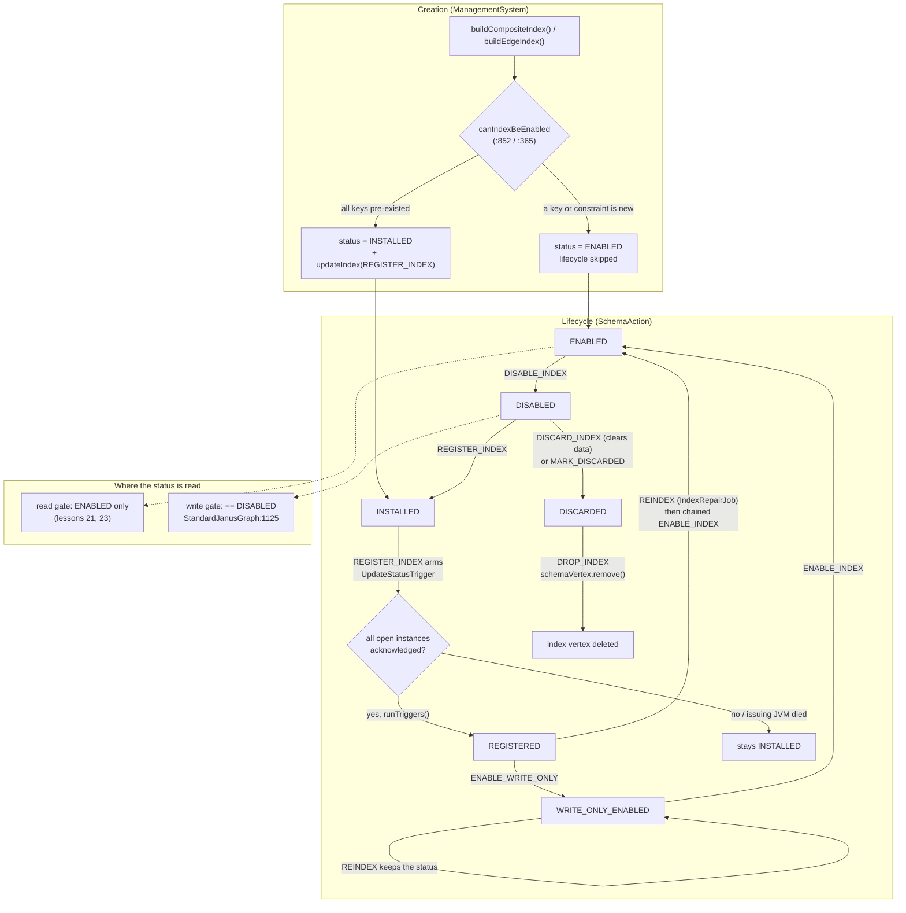
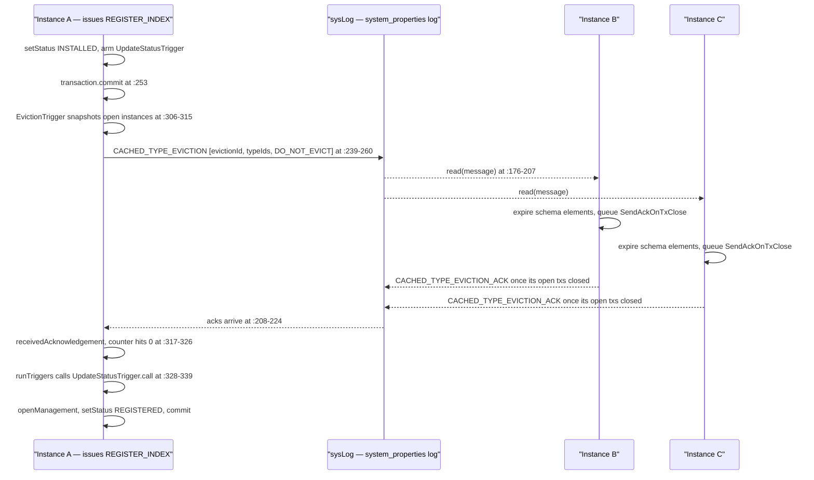

<!--
entry-meta
date: 2026-11-23
type: lesson
track: JanusGraph
lesson: 25
category: Database Internals
title: ManagementSystem and the index lifecycle — the state machine runs only when it must, and the transition that advances it runs on one JVM
slug: janusgraph-management-index-lifecycle
-->

# `ManagementSystem` and the index lifecycle — the state machine runs only when it must, and the transition that advances it runs on one JVM

**2026-11-23 · JanusGraph Track · Lesson 25 of 28**

## Where This Fits

- **Lesson 24** ([`2026-11-22`](../2026-11-22-janusgraph-step-multiquery-batching/README.md)) closed Part V on `JanusGraphStep` and `JanusGraphVertexStep`. Everything from lesson 19 to lesson 24 assumed an index was *there* and *usable*; lesson 21's planner asks `index.getStatus() == SchemaStatus.ENABLED` and lesson 23's `coversAll` filters a mixed index per `ParameterIndexField` status. Neither lesson said who writes those statuses.
- **This lesson opens Part VI** and owns that question: the six values of `SchemaStatus`, the nine `SchemaAction`s that move between them, the two physically different places a status is stored, the cross-instance acknowledgement protocol that performs the one transition JanusGraph will not let a single JVM make alone, and the scan job that backfills.
- **It sets up lessons 26–28.** Lesson 26 (`ElasticSearchIndex`) inherits the fact that a mixed index's *index-level* status is a constant and the real statuses are per-field. Lesson 27 (CQL) inherits the reindex scan's shape. Lesson 28 (stale-index repair) inherits `REMOVE_STALE_ENTRIES` and the window this lesson identifies in which a delete can be lost.

**Read at the pinned commit `a59ae8d8` (2026-10-28).** Two files were transcribed locally and their git blob SHAs verified against what the API reported, so they are cited by line number: `ManagementSystem.java` (1,815 lines, 86,864 bytes → `a722a7d9cd18b5dd85d16acf01bd537ae12765fd`) and `ManagementLogger.java` (505 lines, 24,707 bytes → `1980d1fbe950206bfb16e7e770b1782dcdf9bb9d`). Seven further files were read inline and are cited by member name only: `SchemaStatus`, `SchemaAction`, `JanusGraphIndexWrapper`, `GraphIndexStatusWatcher`, `AbstractIndexStatusWatcher`, `IndexUpdateJob`, `IndexRepairJob`.

---

## 1. The headline: most indexes never enter the state machine at all

Before any of the lifecycle matters, one expression decides whether the index you just created is subject to it. It appears twice, once per index kind, and nowhere else.

**Composite index** — [`ManagementSystem.java:852`](https://github.com/JanusGraph/janusgraph/blob/a59ae8d8024207598eada34998d867617df51adf/janusgraph-core/src/main/java/org/janusgraph/graphdb/database/management/ManagementSystem.java#L852):

```java
boolean canIndexBeEnabled = oneNewKey || (constraint != null && constraint.isNew());
...
def.setValue(TypeDefinitionCategory.STATUS, canIndexBeEnabled ? SchemaStatus.ENABLED : SchemaStatus.INSTALLED);   // :860
...
if (!canIndexBeEnabled) updateIndex(index, SchemaAction.REGISTER_INDEX);                                          // :877
```

`oneNewKey` is set in the key loop at `:841-846`: it is true if **any one** of the indexed property keys has `key.isNew()` — created in *this same management transaction*.

**Vertex-centric (relation type) index** — [`:365-367`](https://github.com/JanusGraph/janusgraph/blob/a59ae8d8024207598eada34998d867617df51adf/janusgraph-core/src/main/java/org/janusgraph/graphdb/database/management/ManagementSystem.java#L365-L367) and `:389-391`:

```java
boolean canIndexBeEnabled = type.isNew() || Arrays.stream(sortKeys).anyMatch(JanusGraphElement::isNew);
maker.status(canIndexBeEnabled ? SchemaStatus.ENABLED : SchemaStatus.INSTALLED);
...
if (!canIndexBeEnabled) { updateIndex(index, SchemaAction.REGISTER_INDEX); }
```

So:

| You do this | Status at `mgmt.commit()` | Lifecycle? |
|---|---|---|
| `makePropertyKey("name")…make()` **and** `buildIndex(…).addKey(name).buildCompositeIndex()` in **one** management transaction | `ENABLED` | **Skipped entirely.** No `REGISTER_INDEX`, no handshake, no reindex. |
| `buildIndex(…).addKey(existingName).buildCompositeIndex()` against a key that already existed | `INSTALLED` | Full: INSTALLED → REGISTERED → (reindex) → ENABLED |
| Composite on `(existingName, brandNewAge)` | `ENABLED` | Skipped — **one** new key is enough |
| `buildIndex(…).indexOnly(brandNewLabel)` with existing keys | `ENABLED` | Skipped — a new constraint is enough |

**Why this is sound rather than a shortcut.** A composite index is all-or-nothing over its field keys (lesson 21): an element that lacks any one field is not indexed by it at all. If one field key was created in this transaction, no element that committed before this transaction can carry a value for it, so **no pre-existing element qualifies for the index** and there is nothing to backfill. Same for a brand-new `indexOnly(...)` constraint: no pre-existing element has that label. The lifecycle exists to coordinate a backfill, so when the backfill is provably empty the lifecycle is provably unnecessary.

**And why it is worth knowing anyway.** The widely-repeated advice to "create the key and the index in the same management transaction" is not a style preference — it is the difference between an index that is queryable the moment the transaction commits and one that requires a cross-cluster handshake plus a full scan of the graph. The expression is also asymmetric in a way the docs do not state: the composite test is `oneNewKey` (**any** key), the relation-type test is `type.isNew() || any sortKey isNew`. A composite index over nine old keys and one new one is born `ENABLED`.

A **mixed** index is different again and is covered in §2: [`createMixedIndex:758`](https://github.com/JanusGraph/janusgraph/blob/a59ae8d8024207598eada34998d867617df51adf/janusgraph-core/src/main/java/org/janusgraph/graphdb/database/management/ManagementSystem.java#L758) sets the index vertex to `SchemaStatus.ENABLED` **unconditionally**, because for a mixed index the vertex status is not where the answer lives.

---

## 2. Two index kinds, two physically different places a status is stored

This is the structural fact the rest of the lesson hangs on, and it is invisible from the public API because `JanusGraphIndexWrapper.getIndexStatus(PropertyKey)` papers over it:

```java
@Override
public SchemaStatus getIndexStatus(PropertyKey key) {
    Preconditions.checkArgument(containsPropertyKey(key), "Provided key is not part of this index: %s", key);
    if (index.isCompositeIndex()) return ((CompositeIndexType) index).getStatus();
    else return ((MixedIndexType) index).getField(key).getStatus();
}
```

For a **composite** index the `key` argument is *ignored*: all N keys report the one index-level status. For a **mixed** index each key reports its own.

### 2.1 Composite and relation-type: one status, stored as a vertex property

`setStatusVertex` ([`:1328-1341`](https://github.com/JanusGraph/janusgraph/blob/a59ae8d8024207598eada34998d867617df51adf/janusgraph-core/src/main/java/org/janusgraph/graphdb/database/management/ManagementSystem.java#L1328-L1341)):

```java
private void setStatusVertex(JanusGraphSchemaVertex vertex, SchemaStatus status) {
    Preconditions.checkArgument(vertex instanceof RelationTypeVertex || vertex.asIndexType().isCompositeIndex());
    //Delete current status
    for (JanusGraphVertexProperty p : vertex.query().types(BaseKey.SchemaDefinitionProperty).properties()) {
        if (p.<TypeDefinitionDescription>valueOrNull(BaseKey.SchemaDefinitionDesc).getCategory() == TypeDefinitionCategory.STATUS) {
            if (p.value().equals(status)) return;
            else p.remove();
        }
    }
    //Add new status
    JanusGraphVertexProperty p = transaction.addProperty(vertex, BaseKey.SchemaDefinitionProperty, status);
    p.property(BaseKey.SchemaDefinitionDesc.name(), TypeDefinitionDescription.of(TypeDefinitionCategory.STATUS));
}
```

This is exactly the system-type storage from lesson 13: a `BaseKey.SchemaDefinitionProperty` on the index's schema vertex, tagged by a `SchemaDefinitionDesc` whose category is `TypeDefinitionCategory.STATUS`. A status change is **one property delete plus one property add** on one row of the edgestore, and the `p.value().equals(status) → return` short-circuit makes an idempotent re-set free.

### 2.2 Mixed: one status *per field*, stored as the last `Parameter` of the schema edge

`setStatusEdges` ([`:1343-1361`](https://github.com/JanusGraph/janusgraph/blob/a59ae8d8024207598eada34998d867617df51adf/janusgraph-core/src/main/java/org/janusgraph/graphdb/database/management/ManagementSystem.java#L1343-L1361)):

```java
private void setStatusEdges(JanusGraphSchemaVertex vertex, SchemaStatus status, Set<PropertyKeyVertex> keys) {
    Preconditions.checkArgument(vertex.asIndexType().isMixedIndex());
    for (JanusGraphEdge edge : vertex.getEdges(TypeDefinitionCategory.INDEX_FIELD, Direction.OUT)) {
        if (!keys.contains(edge.vertex(Direction.IN))) continue; //Only address edges with matching keys
        TypeDefinitionDescription desc = edge.valueOrNull(BaseKey.SchemaDefinitionDesc);
        assert desc.getCategory() == TypeDefinitionCategory.INDEX_FIELD;
        Parameter[] parameters = (Parameter[]) desc.getModifier();
        assert parameters[parameters.length - 1].key().equals(ParameterType.STATUS.getName());
        if (parameters[parameters.length - 1].value().equals(status)) continue;

        Parameter[] paraCopy = Arrays.copyOf(parameters, parameters.length);
        paraCopy[parameters.length - 1] = ParameterType.STATUS.getParameter(status);
        edge.remove();
        addSchemaEdge(vertex, edge.vertex(Direction.IN), TypeDefinitionCategory.INDEX_FIELD, paraCopy);
    }
    for (PropertyKeyVertex prop : keys) prop.resetCache();
}
```

Three things follow:

1. **The status of a mixed-index field is a positional array slot**, not a named field. The contract "`STATUS` is last" is maintained in exactly one place, `addIndexKey:785-791`:

   ```java
   boolean addMappingParameter = !ParameterType.MAPPED_NAME.hasParameter(parameters);
   Parameter[] extendedParas = new Parameter[parameters.length + 1 + (addMappingParameter ? 1 : 0)];
   System.arraycopy(parameters, 0, extendedParas, 0, parameters.length);
   int arrPosition = parameters.length;
   if (addMappingParameter) extendedParas[arrPosition++] = ParameterType.MAPPED_NAME.getParameter(
           graph.getIndexSerializer().getDefaultFieldName(key, parameters, indexType.getBackingIndexName()));
   extendedParas[arrPosition] = ParameterType.STATUS.getParameter(key.isNew() ? SchemaStatus.ENABLED : SchemaStatus.INSTALLED);
   ```

   Note the tail: `key.isNew() ? ENABLED : INSTALLED` is `canIndexBeEnabled` at per-key granularity, and `:807` then issues `if (!key.isNew()) updateIndex(index, SchemaAction.REGISTER_INDEX);`. **A mixed index is not one lifecycle but N independent ones**, one per `addIndexKey` call.

2. **Changing a mixed field's status rewrites the schema edge.** `edge.remove()` followed by `addSchemaEdge(...)` — a deletion and an insertion in the edgestore, not an in-place update, because the parameter array lives in the edge's `SchemaDefinitionDesc` modifier (lesson 11's `RelationCache` territory). Any `ParameterIndexField` value — including `MAPPED_NAME`, the Elasticsearch field name — rides along in that copy.

3. **The positional contract is an `assert`.** Assertions are off in production. If a future caller ever appends a parameter after `STATUS`, `setStatusEdges` silently overwrites *that* parameter with a status and the index keeps its old status forever, with no error anywhere. Nothing in the main sources does this today; it is a latent hazard and is logged as candidate **69**.

`setStatus` ([`:1321-1326`](https://github.com/JanusGraph/janusgraph/blob/a59ae8d8024207598eada34998d867617df51adf/janusgraph-core/src/main/java/org/janusgraph/graphdb/database/management/ManagementSystem.java#L1321-L1326)) is the two-line dispatcher that chooses between them, keyed on whether a key subset was supplied:

```java
private void setStatus(JanusGraphSchemaVertex vertex, SchemaStatus status, Set<PropertyKeyVertex> keys) {
    if (keys.isEmpty()) setStatusVertex(vertex, status);
    else setStatusEdges(vertex, status, keys);
    vertex.resetCache();
    updateSchemaVertex(vertex);
}
```

---

## 3. The six statuses and what each one gates

`SchemaStatus` is an enum of six, with a load-bearing comment on top of it:

> the status is persisted by its **ordinal** … so new constants must only ever be appended at the end and existing constants must never be reordered or removed.

That is why `WRITE_ONLY_ENABLED` — semantically between `REGISTERED` and `ENABLED` — sits last, after `DISCARDED`.

| # | Status | Receives writes? | Answers queries? | Reindexable? |
|---|---|---|---|---|
| 0 | `INSTALLED` | yes, on instances that know about it | no | no |
| 1 | `REGISTERED` | yes, on **all** instances | no | **yes** |
| 2 | `ENABLED` | yes | **yes** | yes |
| 3 | `DISABLED` | **no** | no | yes (see §5.2) |
| 4 | `DISCARDED` | no | no | no |
| 5 | `WRITE_ONLY_ENABLED` | yes | no | yes, and the status survives it |

Two gates, in two different layers, are what give this table teeth:

- **The write gate** is a single `== DISABLED` test in `StandardJanusGraph:1125`, inside `prepareCommitAddRelationMutations` (established by lesson 16). `INSTALLED` and `REGISTERED` index types **do** receive writes — which is precisely what makes a reindex safe, because new mutations land in the index while the scan backfills the old ones.
- **The read gate** is `index.getStatus() == SchemaStatus.ENABLED` for a composite index, with no base-type exemption, and a per-`ParameterIndexField` filter inside `coversAll` for a mixed one (established by lesson 21 and lesson 23). **That answers the question lesson 23 handed over**: a reindex of a composite index relies on the *vertex* status; a reindex of a mixed index relies on the *field* statuses. See §5.1.

The only behaviour on the enum is one method:

```java
public boolean isStable() { return this != SchemaStatus.INSTALLED; }
```

`INSTALLED` is the one status the system considers transient — and §4 is why.

---

## 4. `SchemaAction`: nine actions, an applicability matrix, and a branch that cannot execute

`SchemaAction` is an enum whose constructor takes the set of statuses the action may be applied to:

| Action | Applicable from | Does |
|---|---|---|
| `REGISTER_INDEX` | `INSTALLED`, `DISABLED` | sets `INSTALLED`, arms the handshake trigger for `REGISTERED` |
| `REINDEX` | `REGISTERED`, `ENABLED`, `DISABLED`, `WRITE_ONLY_ENABLED` | runs `IndexRepairJob`; on success chains `ENABLE_INDEX` unless write-only |
| `REMOVE_STALE_ENTRIES` | `REGISTERED`, `ENABLED`, `DISABLED`, `WRITE_ONLY_ENABLED` | runs a removal job; **does not change status** |
| `ENABLE_WRITE_ONLY` | `REGISTERED`, `ENABLED`, `WRITE_ONLY_ENABLED` | sets `WRITE_ONLY_ENABLED` |
| `ENABLE_INDEX` | `REGISTERED`, `DISABLED`, `ENABLED`, `WRITE_ONLY_ENABLED` | sets `ENABLED` |
| `DISABLE_INDEX` | all five of `ENABLED`, `DISABLED`, `REGISTERED`, `WRITE_ONLY_ENABLED`, `INSTALLED` | sets `DISABLED` |
| `DISCARD_INDEX` | `DISABLED`, `REGISTERED`, `DISCARDED`, `WRITE_ONLY_ENABLED` | clears the data, then `DISCARDED` |
| `MARK_DISCARDED` | `DISABLED`, `REGISTERED`, `DISCARDED`, `WRITE_ONLY_ENABLED` | sets `DISCARDED` with no data work |
| `DROP_INDEX` | `DISCARDED` **only** | `schemaVertex.remove()` |

Read the column, not the row: `DISABLE_INDEX` is the only action applicable from `INSTALLED`, which is how its javadoc's "an index can also be disabled directly after its creation … so that it never receives updates" is implemented. And `DROP_INDEX`'s single-element set is why removing an index is a three-step ritual rather than one call.

### 4.1 The branch that cannot execute

```java
public boolean isApplicableStatus(SchemaStatus status) {
    if (!applicableStatuses.contains(status))
        throw new IllegalArgumentException(String.format("Update action [%s] cannot be invoked for index with status [%s]", this, status));
    return true;
}
```

The method is not a predicate. It returns `true` or it throws. Its two call sites in `updateIndex` are written as if it were a predicate — [`:987-996`](https://github.com/JanusGraph/janusgraph/blob/a59ae8d8024207598eada34998d867617df51adf/janusgraph-core/src/main/java/org/janusgraph/graphdb/database/management/ManagementSystem.java#L987-L996):

```java
if (index instanceof RelationTypeIndex) {
    dependentTypes = Collections.singleton((JanusGraphSchemaVertex) ((InternalRelationType) schemaVertex).getBaseType());
    if (!updateAction.isApplicableStatus(schemaVertex.getStatus()))
        return null;
} else if (index instanceof JanusGraphIndex) {
    IndexType indexType = schemaVertex.asIndexType();
    dependentTypes = new HashSet<>();
    if (indexType.isCompositeIndex()) {
        if (!updateAction.isApplicableStatus(schemaVertex.getStatus()))
            return null;
```

`!true` is `false`, so **`return null` is unreachable in both branches**. The behaviour is correct (you get an `IllegalArgumentException`), but the source says `updateIndex` returns `null` for an inapplicable action, and a caller that believed it would hand a null `ScanJobFuture` straight into `get()`. Logged as candidate **68**.

### 4.2 The mixed-index branch, and the message it had to grow

A mixed index has no index-level status to test, so the equivalent check is built from the fields ([`:1000-1019`](https://github.com/JanusGraph/janusgraph/blob/a59ae8d8024207598eada34998d867617df51adf/janusgraph-core/src/main/java/org/janusgraph/graphdb/database/management/ManagementSystem.java#L1000-L1019)):

```java
keySubset = new HashSet<>();
MixedIndexType mixedIndexType = (MixedIndexType) indexType;
Set<SchemaStatus> applicableStatus = updateAction.getApplicableStatus();
for (ParameterIndexField field : mixedIndexType.getFieldKeys()) {
    if (applicableStatus.contains(field.getStatus()))
        keySubset.add((PropertyKeyVertex) field.getFieldKey());
}
//A mixed index keeps a status per field instead of one status on the index, so this is the
//equivalent of the isApplicableStatus check the composite branch makes above. ...
Preconditions.checkArgument(!keySubset.isEmpty(),
    "Update action [%s] cannot be invoked for index [%s] because none of its fields has one of the" +
    " applicable statuses %s. The current status of each field is %s", updateAction, index.name(),
    orderedStatuses(applicableStatus), fieldStatuses(mixedIndexType));
```

`keySubset` is then **the whole mechanism by which an action applies to a subset of a mixed index**: it is handed to `setStatus`, which routes to `setStatusEdges`, which skips every edge whose key is not in it. An action on a mixed index moves only the fields that were already in an applicable status. `orderedStatuses` (`:1310-1312`) sorts by enum ordinal so the message does not inherit a `HashSet` iteration order, and `fieldStatuses` (`:1315-1319`) prints `key=STATUS` per field.

---

## 5. `updateIndex`: nine cases, two of which start a scan

[`ManagementSystem.java:980-1140`](https://github.com/JanusGraph/janusgraph/blob/a59ae8d8024207598eada34998d867617df51adf/janusgraph-core/src/main/java/org/janusgraph/graphdb/database/management/ManagementSystem.java#L980-L1140) is one `switch`. Five arms are pure status writes that return `new EmptyScanJobFuture()`; four do real work.



### 5.1 `REINDEX` — the scan job, and what it validates

```java
case REINDEX:
    builder = graph.getBackend().buildEdgeScanJob();
    configureMixedIndexReindexBatching(index, builder);
    if (isWriteOnlyEnabled(index, schemaVertex)) {
        builder.setFinishJob(indexId.getIndexJobFinisher());
    } else {
        builder.setFinishJob(indexId.getIndexJobFinisher(graph, SchemaAction.ENABLE_INDEX));
    }
    builder.setJobId(indexId);
    builder.setNumProcessingThreads(numOfThreads);
    builder.setJob(VertexJobConverter.convert(graph, new IndexRepairJob(indexId.indexName, indexId.relationTypeName), vertexOnly));
```

Four things worth naming:

- **It is an `buildEdgeScanJob`, i.e. a full scan of the edgestore** — every vertex row, not just the ones that might match. `numOfThreads` defaults to `Runtime.getRuntime().availableProcessors()` (`:967`, `:977`).
- **The enable is a chained callback, not part of the job.** `IndexIdentifier.getIndexJobFinisher(graph, action)` (`:1436-1458`) returns a `Consumer<ScanMetrics>` that, **only if `metrics.get(ScanMetrics.Metric.FAILURE) == 0`**, opens a *new* management transaction, re-resolves the index by name through `retrieve(management)`, and calls `updateIndex(index, ENABLE_INDEX)`. Any `Throwable` in there is caught and logged at error — the reindex is reported successful and the index silently stays `REGISTERED`.
- **`isWriteOnlyEnabled` (`:1154-1166`) is where `WRITE_ONLY_ENABLED` earns its existence.** For composite and relation-type it is `schemaVertex.getStatus() == WRITE_ONLY_ENABLED`; for mixed it is **any** field in that status. Hitting it passes the no-argument finisher, so the status is preserved rather than promoted to `ENABLED`.
- **`IndexRepairJob.validateIndexStatus()` re-checks the status inside the job**, from the worker, not from the caller — and this is where the composite/mixed split becomes operational:

  ```java
  Set<SchemaStatus> acceptableStatuses = SchemaAction.REINDEX.getApplicableStatus();
  if (index instanceof RelationTypeIndex || (index instanceof JanusGraphIndex && ((JanusGraphIndex) index).isCompositeIndex())) {
      SchemaStatus actualStatus = schemaVertex.getStatus();
      isValidIndex = acceptableStatuses.contains(actualStatus);
      ...
  } else {
      ...
      for (PropertyKey key : graphIndex.getFieldKeys()) {
          SchemaStatus status = graphIndex.getIndexStatus(key);
          if (status != SchemaStatus.DISABLED && !acceptableStatuses.contains(status)) { isValidIndex = false; ... }
          if (acceptableStatuses.contains(status)) acceptableFields++;
      }
      if (isValidIndex && acceptableFields == 0) { isValidIndex = false; invalidIndexHint = "The index does not contain any valid keys"; }
  }
  ```

  A mixed index with some fields `DISABLED` and at least one in an acceptable status **reindexes anyway**, with the disabled fields contributing nothing — the `status != SchemaStatus.DISABLED &&` guard is explicit about it. A composite index has no such partial mode. Note also that the javadoc above the method says *"Check that our target index is in either the ENABLED or REGISTERED state"* while the set it actually uses is `REINDEX`'s four statuses; the comment predates `DISABLED` and `WRITE_ONLY_ENABLED` being added to that set.

- **The mixed-index flush is instrumented and batched.** `configureMixedIndexReindexBatching` (`:1142-1147`) sets the scan's `workBlockSize` to `MIXED_INDEX_REINDEX_BATCH_SIZE` when `MIXED_INDEX_REINDEX_BATCH_ENABLED`. Inside the job, `restoreDocuments` records four custom metrics: `mixed-index-flushes`, `mixed-index-flushed-docs`, `mixed-index-flush-time-ms` (rounded, not truncated — "truncation would systematically undercount across many fast flushes"), and the older `doc-updates`. Dividing the third by the first gives the average flush latency, which is the one number that tells you whether a slow reindex is index-backend-bound.

### 5.2 `REMOVE_STALE_ENTRIES` — the complement, and the only action that changes nothing

```java
case REMOVE_STALE_ENTRIES:
    if (index instanceof RelationTypeIndex) throw new UnsupportedOperationException(...);
    if (((JanusGraphIndex) index).isMixedIndex()) {
        future = MixedIndexStaleEntryRemover.submit(graph, indexId.indexName,
            graph.getConfiguration().getConfiguration().get(GraphDatabaseConfiguration.MIXED_INDEX_REINDEX_BATCH_SIZE));
    } else {
        builder = graph.getBackend().buildGraphIndexScanJob();
        builder.setJob(new StaleIndexEntryRemoveJob(graph, indexId.indexName, indexId.relationTypeName));
        ...
    }
```

Its javadoc states the division of labour exactly: *"a reindex restores missing entries for existing elements but never removes entries, while this action removes entries of deleted elements but never adds entries."* Two asymmetries follow. It scans the **graphindex** store (`buildGraphIndexScanJob`) where `REINDEX` scans the **edgestore**, because it is looking for index entries with no element rather than elements with no index entry. And it is unsupported for vertex-centric indexes, whose entries live in the edgestore row of the vertex itself and cannot be orphaned the same way. Note that the mixed-index path reuses `MIXED_INDEX_REINDEX_BATCH_SIZE` — the in-source comment says deletions are flushed through the same bulk `restore()` calls as reindex restores, so the one option governs both.

### 5.3 Removal is three steps and a type switch

`DISCARD_INDEX` is the only arm with a per-kind body: for a **mixed** index it calls `IndexSerializer.clearStore(mixedIndex, transaction.getTxHandle())` and sets `DISCARDED` **synchronously, in this transaction**, wrapping a `BackendException` into *"Index removal is not supported for this Backend. Index must be removed in the indexing system directly."* For a **composite** index it starts a `buildGraphIndexScanJob` with `IndexRemoveJob`, chaining `MARK_DISCARDED` on success; for a relation-type index, a `buildEdgeScanJob` with the same job. So on Elasticsearch a discard is a blocking backend call; on a composite index it is a full scan of the graphindex store.

`DROP_INDEX` is then two lines (`:1130-1135`) — `updatedTypes.add(schemaVertex); schemaVertex.remove();` — and is applicable only from `DISCARDED`, which is why `DISABLE_INDEX → DISCARD_INDEX → DROP_INDEX` is the documented removal sequence rather than an arbitrary ceremony.

---

## 6. The one transition a single JVM will not make: INSTALLED → REGISTERED

`REGISTER_INDEX` does **not** set `REGISTERED`. It sets `INSTALLED` and arms a callback:

```java
case REGISTER_INDEX:
    setStatus(schemaVertex, SchemaStatus.INSTALLED, keySubset);
    updatedTypes.add(schemaVertex);
    updatedTypes.addAll(dependentTypes);
    setUpdateTrigger(new UpdateStatusTrigger(graph, schemaVertex, SchemaStatus.REGISTERED, keySubset));
    future = new EmptyScanJobFuture();
    break;
```

`setUpdateTrigger` (`:1303-1305`) appends to `updatedTypeTriggers`, a plain `ArrayList` field on this `ManagementSystem` instance. The list is handed to the log on commit (`:256-257`):

```java
if (!updatedTypes.isEmpty() || evictGraphFromCache) {
    managementLogger.sendCacheEviction(updatedTypes, evictGraphFromCache, updatedTypeTriggers, getOpenInstancesInternal());
    for (JanusGraphSchemaVertex schemaVertex : updatedTypes) {
        schemaCache.expireSchemaElement(schemaVertex.longId());
        for (JanusGraphTransaction tx : graph.getOpenTransactions()) tx.expireSchemaElement(schemaVertex.longId());
    }
}
```

The order matters: `transaction.commit()` happens at `:253`, *before* the eviction message is sent, so no instance can be told to expire a schema element whose new definition is not yet durable.

### 6.1 The protocol



Mechanically:

- **`sendCacheEviction` (`ManagementLogger:239-260`)** allocates an eviction id from `nextEvictionId()` (`:235-237`), registers an `EvictionTrigger` in a `ConcurrentHashMap`, and writes a message of `[MgmtLogType.CACHED_TYPE_EVICTION][evictionId][n][typeId × n][EVICT|DO_NOT_EVICT]` to the system log. Ids run from 1 and wrap to 1 at `Long.MAX_VALUE`, never to **0** — `UNACKNOWLEDGED_EVICTION_ID = 0` (`:71`) is the sentinel for the fire-and-forget variant `sendUnacknowledgedCacheEviction` (`:275-286`), used for auto-created constraints and `addConnection`/`addProperties`, which must not arm a trigger.
- **The `EvictionTrigger` constructor (`:306-315`) opens its own management transaction** purely to snapshot `getOpenInstancesInternal()` — the set of namespaces under `REGISTRATION_NS` in the one `system_properties` configuration row (`ManagementSystem:209-213`). That snapshot is the acknowledgement roster.
- **Each receiving instance queues a `SendAckOnTxClose` (`:382-441`)** rather than acking immediately. It captures the set of transactions open *at the moment the message arrived*, re-checks them each run, and only acks once every one has closed, re-scheduling itself every `SLEEP_INTERVAL = 100 ms` for up to `graph.management-tx-close-wait-time`. That is the actual guarantee behind `REGISTERED`: **not "every instance has seen the schema change" but "every instance has seen it and every transaction that predated it has finished"** — so no in-flight transaction can still be writing under the old schema when the reindex starts.
- **`runTriggers` (`:328-339`)** fires when the roster empties, from `receivedAcknowledgement` or from `updateState()` (`:288-296`), the `MessageReader` callback that also sweeps `removeDroppedInstances()`.
- **`UpdateStatusTrigger.call()` opens a fresh `ManagementSystem`** and re-checks before writing (`:1236-1259`): if `propertyKeys` is empty it requires `schemaVertex.getStatus() == INSTALLED`, otherwise it keeps only the fields still `INSTALLED`. A `DISABLE_INDEX` issued while registration was in flight therefore wins, and the trigger rolls back and returns `true` rather than clobbering it. Its `equals`/`hashCode` (`:1289-1299`) are on `schemaVertexId` alone, so two registrations of the same index collapse to one trigger.

### 6.2 The failure mode this design has

The trigger lives in **`evictionTriggerMap` on the issuing JVM only**. Nothing about the pending INSTALLED → REGISTERED transition is persisted. If instance A commits `REGISTER_INDEX` and then dies before the last acknowledgement arrives, the index is `INSTALLED` in the edgestore and **no instance in the cluster is holding a callback to advance it**. `awaitGraphIndexStatus` on any instance will poll until its timeout. The recovery is undocumented but available: `REGISTER_INDEX` is applicable from `INSTALLED`, so re-issuing it from any live instance re-arms the trigger.

The escape hatch for the other half of the problem — a roster entry that will never ack because the instance is gone — is `removeDroppedInstances()` (`:341-357`), which drops instances no longer in `REGISTRATION_NS`, plus:

```java
if (autoCloseStaleInstances && !instancesToBeAcknowledged.isEmpty()
        && (System.currentTimeMillis() - createdAtMillis) > ackTimeout.toMillis()) {
    log.warn("ACK timeout ({}s) exceeded for eviction [{}]. Force-closing unresponsive instances: {}", ...);
    forceCloseStaleInstances(new HashSet<>(instancesToBeAcknowledged));
    instancesToBeAcknowledged.clear();
}
```

`graph.management-auto-close-stale-instances` is the switch. With it off — and a crashed instance still listed in `REGISTRATION_NS` because it never deregistered — the index never reaches `REGISTERED`, and the manual fix is `mgmt.forceCloseInstance(id)` (`ManagementSystem:226-234`).

---

## 7. Watching: `awaitGraphIndexStatus` polls per key, and its defaults are small

`ManagementSystem.awaitGraphIndexStatus(g, name)` (`:704-706`) and `awaitRelationIndexStatus` (`:720-724`) are one-line factories; the javadoc is blunt that *"This method just instantiates an object"* and you must call `.call()`.

`AbstractIndexStatusWatcher`'s constructor sets the defaults:

| Field | Default | Builder |
|---|---|---|
| `statuses` | `[REGISTERED]` | `.status(SchemaStatus...)` |
| `timeout` | `Duration.ofSeconds(60L)` | `.timeout(n, unit)`; **negative means wait forever** |
| `poll` | `Duration.ofMillis(500L)` | `.pollInterval(n, unit)` |

`GraphIndexStatusWatcher.call()` opens a management transaction per poll, iterates `idx.getFieldKeys()`, and partitions them into `converged` / `notConverged` by `idx.getIndexStatus(pk)`. Two consequences of §2:

- For a **composite** index this reads the same vertex status once per key and fills the maps with N identical readings. Harmless, but the "All 3 key(s) on index X have status(es) [REGISTERED]" log line is one fact reported three times.
- For a **mixed** index it is exactly right, and it is the only convenient way to see that one `addIndexKey` has registered while another has not.

The management transaction is rolled back in a `finally` with the comment *"Let an exception here propagate up the stack"* — a failure to read schema is not swallowed into a retry loop.

The same per-key reading drives `ManagementSystem.filter` (`:628-639`), used by `getGraphIndices(SchemaStatus withoutStatusFilter)`: an index is included if **any** field's status differs from the filter. `printIndexes` (`:655-679`) prints one row per key with its own status, which is why `mgmt.printIndexes()` shows a column that looks redundant on composite indexes and is essential on mixed ones.

---

## Hands-On

Everything below runs on `janusgraph-inmemory` from the build you already have, except where noted. Start the console with the in-memory graph:

```groovy
graph = JanusGraphFactory.open('inmemory')
mgmt = graph.openManagement()
```

### A. Make `canIndexBeEnabled` visible — the one experiment that matters

```groovy
// --- Case 1: key and index in the SAME management transaction
mgmt = graph.openManagement()
k1 = mgmt.makePropertyKey('freshKey').dataType(String.class).make()
i1 = mgmt.buildIndex('byFreshKey', Vertex.class).addKey(k1).buildCompositeIndex()
mgmt.commit()

mgmt = graph.openManagement()
idx = mgmt.getGraphIndex('byFreshKey')
println idx.getIndexStatus(mgmt.getPropertyKey('freshKey'))
mgmt.rollback()
```

**What to look for:** `ENABLED`, immediately, with no handshake and no reindex. That is `:852` taking the `oneNewKey` branch and `:877` never calling `updateIndex`.

```groovy
// --- Case 2: the key already existed
mgmt = graph.openManagement()
mgmt.makePropertyKey('oldKey').dataType(String.class).make()
mgmt.commit()

graph.addVertex('oldKey', 'a'); graph.tx().commit()      // give it data to backfill

mgmt = graph.openManagement()
k2 = mgmt.getPropertyKey('oldKey')
mgmt.buildIndex('byOldKey', Vertex.class).addKey(k2).buildCompositeIndex()
mgmt.commit()

mgmt = graph.openManagement()
println mgmt.getGraphIndex('byOldKey').getIndexStatus(mgmt.getPropertyKey('oldKey'))
mgmt.rollback()
```

**What to look for:** `INSTALLED` at first and `REGISTERED` within a second or so on a single-instance graph — the handshake completing against a roster of one. Poll it in a loop to catch `INSTALLED`; the window is short because the only instance to acknowledge is this one.

```groovy
// --- Case 3: the asymmetry. One old key, one brand-new key.
mgmt = graph.openManagement()
kNew = mgmt.makePropertyKey('brandNew').dataType(String.class).make()
kOld = mgmt.getPropertyKey('oldKey')
mgmt.buildIndex('byBoth', Vertex.class).addKey(kOld).addKey(kNew).buildCompositeIndex()
mgmt.commit()

mgmt = graph.openManagement()
println mgmt.getGraphIndex('byBoth').getIndexStatus(mgmt.getPropertyKey('oldKey'))
mgmt.rollback()
```

**What to look for:** `ENABLED`, even though `oldKey` has pre-existing data. Confirm that the index is nonetheless complete by checking that no pre-existing vertex can match it: a composite index on `(oldKey, brandNew)` only covers elements carrying **both**, and nothing committed before this transaction can carry `brandNew`.

### B. Watch the state machine move, with the statuses printed each step

```groovy
mgmt = graph.openManagement()
mgmt.updateIndex(mgmt.getGraphIndex('byOldKey'), SchemaAction.DISABLE_INDEX)
mgmt.commit()
ManagementSystem.awaitGraphIndexStatus(graph, 'byOldKey').status(SchemaStatus.DISABLED).call()

mgmt = graph.openManagement()
mgmt.updateIndex(mgmt.getGraphIndex('byOldKey'), SchemaAction.REGISTER_INDEX)
mgmt.commit()
ManagementSystem.awaitGraphIndexStatus(graph, 'byOldKey').status(SchemaStatus.REGISTERED).call()

mgmt = graph.openManagement()
mgmt.updateIndex(mgmt.getGraphIndex('byOldKey'), SchemaAction.REINDEX).get()
mgmt.commit()

mgmt = graph.openManagement(); println mgmt.printIndexes(); mgmt.rollback()
```

**What to look for:** three things.

1. `DISABLE_INDEX` from `ENABLED` goes straight to `DISABLED` with no intermediate — it is a pure `setStatus` arm.
2. `REGISTER_INDEX` from `DISABLED` goes back to **`INSTALLED`** first, not to `REGISTERED`. The `await` call is what hides this; put a `getIndexStatus` immediately after the commit and you will catch it.
3. After `REINDEX` the status is `ENABLED` without you asking — that is the chained `getIndexJobFinisher(graph, ENABLE_INDEX)` opening a second management transaction behind your back.

### C. Prove the status write is a vertex property on one kind and a schema edge on the other

Enable `DEBUG` on `org.janusgraph.graphdb.database.management` and run B again. **What to look for:** `UpdateStatusTrigger`'s `INFO` line *"Set status {} on schema element {} with property keys {}"* — the trailing set is **empty** for a composite index (so `setStatus` routed to `setStatusVertex`) and **non-empty** for a mixed one (routed to `setStatusEdges`). That single log line is the cheapest observable of the §2 split.

### D. Force the ack path to be non-trivial

The handshake is invisible on one instance. Open a second JanusGraph instance against the same backend (BerkeleyJE in a shared directory, or any real backend), start a long-running transaction on it and leave it open, then issue `REGISTER_INDEX` from the first:

```groovy
// on instance B
txB = graphB.newTransaction(); txB.traversal().V().next()   // leave it open

// on instance A
mgmt = graphA.openManagement()
mgmt.updateIndex(mgmt.getGraphIndex('byOldKey'), SchemaAction.REGISTER_INDEX)
mgmt.commit()
ManagementSystem.awaitGraphIndexStatus(graphA, 'byOldKey').status(SchemaStatus.REGISTERED).timeout(10, ChronoUnit.SECONDS).call()
```

**What to look for:** the watcher times out and the report's `succeeded` is `false` while `txB` is open; close `txB` and the status flips within `SLEEP_INTERVAL` plus one poll. Then check `mgmt.getOpenInstances()` on A — the instance ids you see there are the acknowledgement roster from `EvictionTrigger`'s constructor. Kill instance B's JVM **without** closing the graph, and the registration hangs until `graph.management-auto-close-stale-instances` fires at the ack timeout, or forever if it is off.

> Temporary logging and any debug statements added for these experiments must not be committed.

---

## Where This Breaks Down

- **The pending transition is JVM-local and unpersisted.** §6.2. An index can sit at `INSTALLED` indefinitely with nothing in the cluster trying to advance it, and nothing in the schema records that a registration was ever attempted. The symptom is an `awaitGraphIndexStatus` timeout with no error anywhere, which reads like a slow cluster rather than a lost callback.
- **The reindex-to-enable step is a best-effort callback.** `getIndexJobFinisher` catches `Throwable` and logs at error. A reindex can scan the entire edgestore successfully and leave the index at `REGISTERED` because the follow-up management transaction failed. There is no retry and no record on the index.
- **`REINDEX` never removes.** Its own javadoc says so. An index that was `DISABLED` while deletions happened has entries for elements that no longer exist, and a reindex will not clear them — `REMOVE_STALE_ENTRIES` is a *second*, separate full scan, of a different store. Two complete passes over your data to return from a disable.
- **Reindexing a `DISABLED` index is permitted and is almost always wrong.** `REINDEX`'s applicable set contains `DISABLED`, and `IndexRepairJob.validateIndexStatus` accepts it. But a `DISABLED` index receives no writes (`StandardJanusGraph:1125`), so the moment the scan starts, concurrent mutations are being dropped and the index is stale again before the job finishes. The correct sequence is `REGISTER_INDEX` first, then `REINDEX`, and nothing in the code enforces that ordering.
- **The mixed-index status is a positional array slot behind an `assert`.** §2.2. Correct today, unchecked in production, and the array it indexes into also carries the Elasticsearch field name.
- **`DISCARD_INDEX` on a mixed index blocks the management transaction on a backend call.** `IndexSerializer.clearStore` runs inline and a `BackendException` becomes an `UnsupportedOperationException` telling you to go delete the index in Elasticsearch yourself.
- **The watcher's 60-second default is short for a real cluster.** `AbstractIndexStatusWatcher` defaults to 60 s with 500 ms polling, and the ack path waits for every *pre-existing* transaction on every instance to close. One long-running analytical transaction sets the floor.
- **Not verified this run:** what `AdjacentVertexHasUniquePropertyOptimizerStrategy` does with an index whose status is not `ENABLED` (lesson 23's debt (d)). `IndexSelectionUtil` was not located at the pinned commit by the one `search_code` query this run spent on it, and rather than guess at a status filter that may or may not exist, the question is carried to lesson 26 with a note on where to look: `IndexSelectionUtil.existsMatchingIndex` and whatever `JanusGraphIndex`-level predicate it applies.

---

## Further Study

- [JanusGraph docs — index lifecycle and reindexing (`docs/` in the repository tree)](https://github.com/JanusGraph/janusgraph/tree/a59ae8d8024207598eada34998d867617df51adf/docs)
- [`SchemaAction.java` at the pinned commit](https://github.com/JanusGraph/janusgraph/blob/a59ae8d8024207598eada34998d867617df51adf/janusgraph-core/src/main/java/org/janusgraph/core/schema/SchemaAction.java) — the applicability sets are the cheapest documentation of the state machine in the whole repository.
- [`IndexRepairJob.java`](https://github.com/JanusGraph/janusgraph/blob/a59ae8d8024207598eada34998d867617df51adf/janusgraph-core/src/main/java/org/janusgraph/graphdb/olap/job/IndexRepairJob.java) — the four `mixed-index-*` scan metrics are the instrumentation to reach for before tuning a slow reindex.
- [`ManagementLogger.java`](https://github.com/JanusGraph/janusgraph/blob/a59ae8d8024207598eada34998d867617df51adf/janusgraph-core/src/main/java/org/janusgraph/graphdb/database/management/ManagementLogger.java) — read `SendAckOnTxClose` in full; it is the clearest statement in the codebase of what JanusGraph means by "all instances agree".

---

## Next Steps

1. **Run Hands-On A.** It is three console blocks and it settles the single most consequential operational fact in this lesson. Record whether case 3 really comes up `ENABLED`.
2. **Run Hands-On D against two instances.** The handshake is the part of this lesson derived entirely from reading; nothing here has been observed with a real roster of more than one.
3. **Lesson 24's three Hands-On experiments are still unrun**, and candidate 65 must not be filed upstream until Hands-On B of that lesson has been. That debt is now two lessons old.
4. **Lesson 26** should settle debt (d) above while it is in index-selection code, and carries forward its own four `ElasticSearchIndex` feature flags plus the Solr page-doubling comparison.
5. **Lesson 28** inherits the deletion window named under *Where This Breaks Down*: a delete that lands while an index is `DISABLED` is invisible to `REINDEX` and needs `REMOVE_STALE_ENTRIES`, which is exactly the edgestore/mixed-index disagreement lesson 28 is about.
6. **Candidates 68, 69 and 70** are logged in [`tracks/janusgraph-registers-2.md`](../../../tracks/janusgraph-registers-2.md). None is confirmed by a run; 70 is the only one with user-visible consequences.

---

## Sources

All read this run at pinned commit `a59ae8d8024207598eada34998d867617df51adf`.

**Blob-SHA verified locally, cited by line number:**

- [`ManagementSystem.java`](https://github.com/JanusGraph/janusgraph/blob/a59ae8d8024207598eada34998d867617df51adf/janusgraph-core/src/main/java/org/janusgraph/graphdb/database/management/ManagementSystem.java) — 1,815 lines, 86,864 bytes → `a722a7d9cd18b5dd85d16acf01bd537ae12765fd`
- [`ManagementLogger.java`](https://github.com/JanusGraph/janusgraph/blob/a59ae8d8024207598eada34998d867617df51adf/janusgraph-core/src/main/java/org/janusgraph/graphdb/database/management/ManagementLogger.java) — 505 lines, 24,707 bytes → `1980d1fbe950206bfb16e7e770b1782dcdf9bb9d`

**Read inline, cited by member name:**

- [`SchemaStatus.java`](https://github.com/JanusGraph/janusgraph/blob/a59ae8d8024207598eada34998d867617df51adf/janusgraph-core/src/main/java/org/janusgraph/core/schema/SchemaStatus.java) (`7b40611d`)
- [`SchemaAction.java`](https://github.com/JanusGraph/janusgraph/blob/a59ae8d8024207598eada34998d867617df51adf/janusgraph-core/src/main/java/org/janusgraph/core/schema/SchemaAction.java) (`b2bf7951`)
- [`JanusGraphIndexWrapper.java`](https://github.com/JanusGraph/janusgraph/blob/a59ae8d8024207598eada34998d867617df51adf/janusgraph-core/src/main/java/org/janusgraph/graphdb/database/management/JanusGraphIndexWrapper.java) (`94d0458d`)
- [`GraphIndexStatusWatcher.java`](https://github.com/JanusGraph/janusgraph/blob/a59ae8d8024207598eada34998d867617df51adf/janusgraph-core/src/main/java/org/janusgraph/graphdb/database/management/GraphIndexStatusWatcher.java) (`3ebe2f6a`)
- [`AbstractIndexStatusWatcher.java`](https://github.com/JanusGraph/janusgraph/blob/a59ae8d8024207598eada34998d867617df51adf/janusgraph-core/src/main/java/org/janusgraph/graphdb/database/management/AbstractIndexStatusWatcher.java) (`e0ab9913`)
- [`IndexUpdateJob.java`](https://github.com/JanusGraph/janusgraph/blob/a59ae8d8024207598eada34998d867617df51adf/janusgraph-core/src/main/java/org/janusgraph/graphdb/olap/job/IndexUpdateJob.java) (`f1b9b521`)
- [`IndexRepairJob.java`](https://github.com/JanusGraph/janusgraph/blob/a59ae8d8024207598eada34998d867617df51adf/janusgraph-core/src/main/java/org/janusgraph/graphdb/olap/job/IndexRepairJob.java) (`434abee9`)

**Directory listings:** [`graphdb/database/management/`](https://github.com/JanusGraph/janusgraph/tree/a59ae8d8024207598eada34998d867617df51adf/janusgraph-core/src/main/java/org/janusgraph/graphdb/database/management) and [`core/schema/`](https://github.com/JanusGraph/janusgraph/tree/a59ae8d8024207598eada34998d867617df51adf/janusgraph-core/src/main/java/org/janusgraph/core/schema).

**Cited from earlier lessons rather than re-derived:** the write gate at `StandardJanusGraph:1125` (lesson 16), the composite read gate `index.getStatus() == ENABLED` (lesson 21), the per-`ParameterIndexField` filter in `coversAll` (lesson 23), and `ManagementSystem`'s `configVerifier`/`GLOBAL_OFFLINE` behaviour (lesson 14).

---

## Takeaways

- **The lifecycle is conditional, and the condition is one expression.** `canIndexBeEnabled` — any indexed key or the `indexOnly` constraint created in the same management transaction — makes the index `ENABLED` at birth and skips INSTALLED → REGISTERED → reindex entirely. It is sound because a composite index is all-or-nothing over its fields, so a brand-new field means no pre-existing element can qualify.
- **"The index's status" is two different storage shapes.** Composite and vertex-centric: one `SchemaStatus` as a `BaseKey.SchemaDefinitionProperty` on the schema vertex. Mixed: one status **per field**, as the last `Parameter` of each `INDEX_FIELD` schema edge, changed by deleting and re-adding the edge. `getIndexStatus(key)` hides the difference by ignoring its argument on composite indexes.
- **`REGISTERED` means more than "everyone has seen it".** It means every instance has seen it *and* every transaction that was already open on every instance has closed. That is what `SendAckOnTxClose` buys, and it is why registration can block on one long-running read.
- **The transition that produces `REGISTERED` is a callback in the issuing JVM's heap.** Nothing persists it. Lose that process mid-handshake and the index is stranded at `INSTALLED` until someone re-issues `REGISTER_INDEX`.
- **A reindex only adds; a stale-entry removal only removes.** They scan different stores — edgestore versus graphindex — and returning an index from `DISABLED` to trustworthy requires both.
- **`updateIndex` has two unreachable `return null` branches** because `isApplicableStatus` throws rather than returning `false`. Harmless today, misleading to read, and the kind of thing a first contribution is made of.
