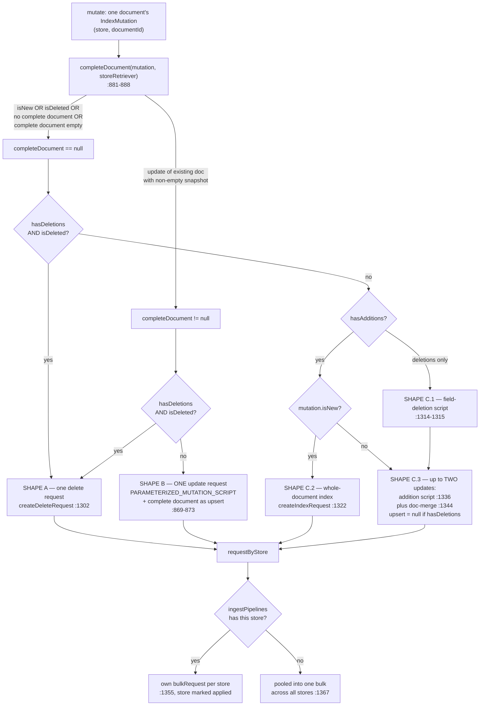
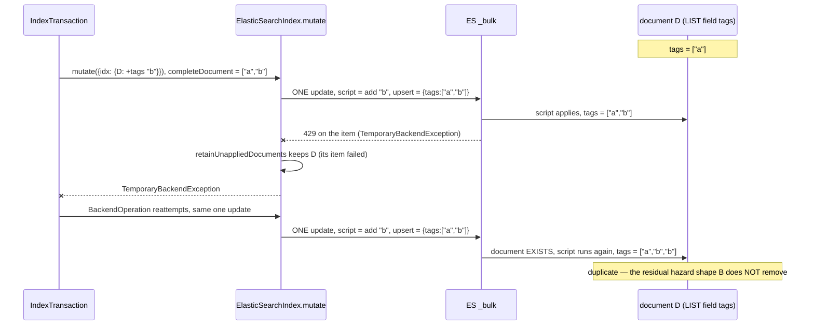

<!--
entry-meta
date: 2026-11-24
type: lesson
track: JanusGraph
lesson: 26
category: Database Internals
title: Mixed indexes — the IndexProvider SPI, and the one write that had to become idempotent
slug: janusgraph-index-provider-elasticsearch
-->

# Mixed indexes — the `IndexProvider` SPI, and the one write that had to become idempotent

**2026-11-24 · JanusGraph Track · Lesson 26 of 28**

## Where This Fits

- **Lesson 25** ([`2026-11-23`](../2026-11-23-janusgraph-management-index-lifecycle/README.md)) established that a mixed index has no index-level lifecycle worth reading: `createMixedIndex` writes `SchemaStatus.ENABLED` on the index vertex unconditionally, and the statuses that matter are *per field*, held as the last `Parameter` of each `INDEX_FIELD` schema edge. It also left lesson 26 five obligations and one unsettled debt.
- **This lesson** opens the thing those per-field statuses govern. `IndexProvider` is the only SPI in JanusGraph that is not a key-column-value store, and `ElasticSearchIndex` is its reference implementation at 2,028 lines. The finding is not the Elasticsearch mapping translation — that part is mechanical — but the **write** path: a mixed-index mutation is *not* naturally idempotent, retries are mandatory, and the fix required changing the core SPI so that `IndexMutation` carries the element's whole indexed state.
- **It sets up lesson 27** (`CQLKeyColumnValueStore`) by giving the contrast: the storage SPI is idempotent by construction — a cell write is last-writer-wins on a fixed column — while the index SPI is not, because a `LIST`-cardinality field is an *array in a JSON document* and "add one occurrence" applied twice is wrong.
- **And lesson 28** (transaction log, CDC, stale-index repair) inherits the precise statement of what can diverge, which this lesson can now give in terms of actual code paths rather than in the abstract.

**Citation discipline for this entry.** Line numbers appear only for `ElasticSearchIndex.java`, which was read through the over-limit path, written to local disk, and verified by **git blob SHA**: 119,295 bytes → `d80949e33e396905415595def00272ffd0517ce5`, byte-identical to what the directory listing reported. Every other file came back inline, without line numbers, and is cited **by member name only**. Nothing here is cited by a line number that was not read.

---

## 1. The SPI, exactly

`IndexProvider` ([permalink](https://github.com/JanusGraph/janusgraph/blob/a59ae8d8024207598eada34998d867617df51adf/janusgraph-core/src/main/java/org/janusgraph/diskstorage/indexing/IndexProvider.java), 8,443 bytes = `b7b342bb`) is an interface of **twelve** abstract methods plus one constant and one static helper, and it `extends IndexInformation`.

| Group | Members |
|---|---|
| Schema | `register(store, key, KeyInformation, tx)` |
| Write | `mutate(Map<String, Map<String, IndexMutation>>, IndexRetriever, tx)`, `restore(Map<String, Map<String, List<IndexEntry>>>, IndexRetriever, tx)` |
| Read | `query(IndexQuery, …)` → `Stream<String>`, `query(RawQuery, …)` → `Stream<RawQuery.Result<String>>`, `totals(RawQuery, …)` → `Long`, `queryAggregation(IndexQuery, …, Aggregation)` → `Number` |
| Lifecycle | `beginTransaction(BaseTransactionConfig)`, `close()`, `clearStorage()`, `clearStore(String)`, `exists()` |
| Inherited from `IndexInformation` | `supports(KeyInformation, JanusGraphPredicate)`, `supports(KeyInformation)`, `supportsOrdering(KeyInformation)` *(default `true`)*, `mapKey2Field(key, KeyInformation)`, `getFeatures()` |

Three structural facts that are easy to miss:

- **The two-level map is `store → documentId → mutation`.** "Store" is the mixed index name; "document id" is the element id. One `IndexProvider` serves an arbitrary number of stores — the javadoc says so in its first line: *"An index can contain an arbitrary number of index stores which are updated and queried separately."*
- **`REPLACEMENT_CHAR` is `'•'`** (a bullet), and `IndexProvider.checkKeyValidity` is a `static` method on the interface that rejects any property-key name *containing* it. This is the SPI reserving one Unicode codepoint globally so that implementations have something to substitute for characters a backend cannot take. `ElasticSearchIndex.mapKey2Field` (`:1959-1962`) uses it for exactly one substitution: `key.replace(' ', REPLACEMENT_CHAR)`.
- **`mutate`'s javadoc contains a mutability contract**, which is unusual for this codebase: *"A provider may remove from this map the documents it knows to have applied before it throws a `TemporaryBackendException`, so that the reattempt which `IndexTransaction` makes resends only the rest; a caller must not rely on the map being unchanged after a failure."* That sentence is the whole of §4 below, declared in the interface.

`restore` is the other half of the write surface and the javadoc states the difference precisely: *"Unlike `mutate(…)` this method does not do a delta-update, but entirely replaces the documents with the provided data or deletes them if the document content is empty."* An empty `List<IndexEntry>` means **delete**, not "no change". That is the reindex path; `mutate` is the commit path.

### 1.1 `IndexInformation.supportsOrdering` is a `default`, and that matters

```java
default boolean supportsOrdering(KeyInformation information) {
    return true;
}
```

The javadoc is explicit about the division of labour: *"Whether the index can sort by a key of several values is told by `IndexFeatures#supportsOrderingListProperty()` instead"*, and *"True by default, so that the index is given an order by any key which it holds."* So **per-key sortability** is a method on the provider and **collection sortability** is a flag on the features object — two different mechanisms for two different questions, and the default is the permissive answer.

`ElasticSearchIndex` overrides it (`:1946-1956`):

```java
public boolean supportsOrdering(KeyInformation information) {
    final Class<?> dataType = information.getDataType();
    if (AttributeUtils.isString(dataType)) {
        final Mapping mapping = getStringMapping(information);
        return (mapping == Mapping.STRING || mapping == Mapping.TEXTSTRING)
            && !ParameterType.STRING_ANALYZER.hasParameter(information.getParameters());
    }
    return Number.class.isAssignableFrom(dataType) || dataType == Date.class || dataType == Instant.class
        || dataType == Boolean.class || dataType == UUID.class;
}
```

Read the condition carefully. A `STRING`-mapped key is sortable **unless it carries a `STRING_ANALYZER` parameter** — because `pushMapping` then maps it to Elasticsearch `text` rather than `keyword`, and Elasticsearch does not sort by an analysed field. The in-source comment above the method (`:1944-1945`) says exactly that. So **adding a custom analyser to a `STRING` key silently removes the index's ability to sort by it**, and the consequence lands in query *compilation*, not execution.

---

## 2. `IndexFeatures`: eleven flags, one builder, and four classes that encode no difference

`IndexFeatures` ([permalink](https://github.com/JanusGraph/janusgraph/blob/a59ae8d8024207598eada34998d867617df51adf/janusgraph-core/src/main/java/org/janusgraph/diskstorage/indexing/IndexFeatures.java), 6,580 bytes = `6651e246`) is an immutable value object with a `Builder`, and its full content is:

| Field | Accessor | Builder default |
|---|---|---|
| `supportsDocumentTTL` | `supportsDocumentTTL()` | `false` |
| `defaultStringMapping` | `getDefaultStringMapping()` | `Mapping.TEXT` |
| `supportedStringMappings` | `supportsStringMapping(Mapping)` | empty set |
| `wildcardField` | `getWildcardField()` | `"*"` |
| `supportedCardinalities` | `supportsCardinality(Cardinality)` | empty set |
| `supportsNanoseconds` | `supportsNanoseconds()` | `false` |
| `supportsCustomAnalyzer` | `supportsCustomAnalyzer()` | `false` |
| `supportsGeoContains` | `supportsGeoContains()` | `false` |
| `supportsGeoExists` | `supportsGeoExists()` | `false` |
| `supportsNotQueryNormalForm` | `supportNotQueryNormalForm()` | `false` |
| `supportsOrderingListProperty` | `supportsOrderingListProperty()` | `false` |

The constructor enforces two invariants with `Preconditions.checkArgument`: `defaultMap != null && defaultMap != Mapping.DEFAULT`, and `supportedMap` non-empty **and containing `defaultMap`**. Note the accessor-name inconsistency that a reader will trip over: the field is `supportsNotQueryNormalForm`, the builder method is `supportNotQueryNormalForm()`, and the accessor is `supportNotQueryNormalForm()` — no `s`.

### 2.1 Correcting the inherited item

Lesson 24 handed lesson 26 "the four feature flags — `supportNotQueryNormalForm()`, `supportsOrderingListProperty()`, `supportsExistsQuery()` and `supportsOrdering(KeyInformation)`".

**There is no `supportsExistsQuery()` at the pinned commit.** `IndexFeatures` was read in full; the nearest member is `supportsGeoExists()`, which is a *geo* flag, and the only `exists` query construction in the Elasticsearch module is `AbstractESCompat.exists(key)` → `{"exists": {"field": key}}`. Either the name in the handover was wrong or it refers to a commit this track has not pinned. This is recorded rather than papered over: a lesson that cannot find a member does not invent one.

The other three are real, and one of them reaches further than the handover said. `IndexSelectionUtil.indexCoversOrder(MixedIndexType, OrderList, IndexSerializer)` — the non-deprecated overload — tests all three conditions per order key:

```java
if (!index.indexesKey(key) || !serializer.supportsOrdering(index, index.getField(key))) {
    return false;
}
final Cardinality cardinality = key.cardinality();
if ((cardinality == Cardinality.LIST || cardinality == Cardinality.SET)
        && !serializer.features(index).supportsOrderingListProperty()) {
    return false;
}
```

Its javadoc names the backends: *"as Elasticsearch, OpenSearch and Solr can and Lucene can't."* And `AbstractIndexSelectionStrategy.createIndexRawCandidates` applies `supportNotQueryNormalForm()` as a *candidacy* filter — the predicate is `indexType.getElement() == resultType && !(conditions instanceof Or && (indexType.isCompositeIndex() || !serializer.features((MixedIndexType) indexType).supportNotQueryNormalForm()))`, which is the mechanism behind lesson 21's finding that a composite index is excluded outright under a top-level `Or`. The flag therefore removes a *mixed* index from candidacy on the same grounds.

`allMixedIndexBackendSupportsOrderingListProperty()` on `IndexSerializer` closes the loop lesson 23 opened. Its body begins:

```java
public boolean allMixedIndexBackendSupportsOrderingListProperty() {
    if (mixedIndexes.isEmpty()) {
        return false;
    }
```

**A graph with no mixed index at all answers `false`**, so `HasStepFolder.validJanusGraphOrder` refuses to fold a vertex order on a `LIST`-cardinality key on a pure-composite graph — not because anything cannot sort it, but because the "all backends support it" quantifier over an empty set is implemented as `false` rather than as vacuous truth. Defensible, since there is no mixed index to sort with; worth knowing, because it means the fold decision depends on whether *some unrelated* mixed index exists.

### 2.2 The four `*Compat` classes are identical

`ElasticSearchIndex.getFeatures()` (`:1964-1967`) is one line: `return compat.getIndexFeatures();`. `AbstractESCompat.coreFeatures()` builds:

```java
new IndexFeatures.Builder()
    .setDefaultStringMapping(Mapping.TEXT)
    .supportedStringMappings(Mapping.TEXT, Mapping.TEXTSTRING, Mapping.STRING)
    .setWildcardField("_all")
    .supportsCardinality(Cardinality.SINGLE)
    .supportsCardinality(Cardinality.LIST)
    .supportsCardinality(Cardinality.SET)
    .supportsNanoseconds()
    .supportsCustomAnalyzer()
    .supportsGeoExists()
    .supportNotQueryNormalForm()
    .supportsOrderingListProperty()
```

and all four subclasses were read in full. Their bodies are **character-identical apart from the class name**:

| Class | Blob | Bytes | Features expression |
|---|---|---|---|
| `ES6Compat` | `d686ce02` | 1,132 | `coreFeatures().setWildcardField(CUSTOM_ALL_FIELD).supportsGeoContains().build()` |
| `ES7Compat` | `fb0efe32` | 1,065 | *identical* |
| `ES8Compat` | `bbd2b413` | 1,065 | *identical* |
| `ES9Compat` | `73af9fc2` | 1,065 | *identical* |

Two conclusions follow, and both are facts about the shipped tree rather than opinions:

1. **`setWildcardField("_all")` in `coreFeatures()` is dead.** Every subclass overwrites it with `CUSTOM_ALL_FIELD` before `build()`. No code path can observe `"_all"` as the wildcard field of an Elasticsearch index. (Candidate **71**.)
2. **`IndexFeatures` carries no version-dependent information for Elasticsearch.** Everything genuinely version-dependent — the `PREFIX_TREE` removal in ES 8, the `unmapped_type` rules, point-in-time availability — is handled elsewhere: `supportsGeoShapePrefixTree` is a *field on `ElasticSearchIndex`*, not a feature flag, and `register` (`:1018-1023`) throws an `IllegalArgumentException` naming ES 8 directly. The four compat classes exist for the *request-body builders* in `AbstractESCompat`, not for the features.

Also worth stating because it closes a dangling SPI member: **`supportsDocumentTTL` is `false` for every Elasticsearch version**, since no compat class calls the builder method. `IndexMutation.determineTTL()` still enforces a uniform TTL across all index fields with a `Preconditions.checkArgument` and `assert ttl >= 0` — a validation whose result no Elasticsearch path can act on.

---

## 3. `register()` — the one synchronous call inside the management transaction

Lesson 25 established that `ManagementSystem.addIndexKey` calls `IndexSerializer.register(...)` synchronously at `:802`, inside the management transaction. This is the far end of that call.

`ElasticSearchIndex.register` (`:1010-1047`) does, in order:

1. **Validate the mapping against the data type** (`:1015-1017`): `map == Mapping.DEFAULT || isString(dataType) || (isGeo(dataType) && (map == BKD || map == PREFIX_TREE))`. Anything else is a `checkArgument` failure.
2. **Reject `PREFIX_TREE` on ES 8+** (`:1018-1023`) by logging at error *and* throwing `IllegalArgumentException` — note: not a `BackendException`, so it does not travel the backend-exception conversion path.
3. Then branch on `index.[X].elasticsearch.create.ext.use-external-mappings`:
   - **External mappings** (`:1025-1038`): `client.getMapping(indexStoreName, store)`; if the mapping is absent, or is non-dynamic and lacks the property, throw `PermanentBackendException`. If it is dynamic *and* `allow-mapping-update` is set, push the mapping anyway.
   - **JanusGraph-managed** (`:1039-1046`): `checkForOrCreateIndex(indexStoreName)` then `pushMapping(store, key, information)`.

So `register` can **create an Elasticsearch index** and **push a field mapping** as a side effect of a schema transaction that has not committed yet.

### 3.1 What can leave the schema and the index backend disagreeing

This is one of lesson 25's two new obligations, and the answer is that the two failure directions are asymmetric.

| Failure | Schema side | Elasticsearch side | Recovery |
|---|---|---|---|
| `register` throws (bad mapping, ES unreachable, external mapping missing the field) | Management transaction fails; nothing written | ES index may already have been **created** by `checkForOrCreateIndex` before the failing `pushMapping` | None in code. A stray empty index, harmless but undeleted |
| `register` succeeds, management transaction then rolls back or fails to commit | Nothing written: no `INDEX_FIELD` edge, no field status | ES holds the field mapping | None in code. ES carries a mapping for a field JanusGraph's schema has never heard of |
| `DISCARD_INDEX` on a mixed index: `IndexSerializer.clearStore(...)` called synchronously from `ManagementSystem:1100-1112` | Status moves toward `DISCARDED` | `ElasticSearchIndex.clearStore` runs (`:1995-2007`) | Ordering is the inverse of the first case |

An Elasticsearch mapping is **additive and effectively permanent** — a field mapping cannot be removed from a live index without a reindex — so the second row is the one that accumulates. The code wraps `BackendException` into a user-facing message at the `ManagementSystem` end and nothing compensates at either end. The honest summary: **`register` is an un-rolled-back side effect of a transaction, and the design relies on it being idempotent and additive rather than on it being transactional.** That is a reasonable engineering choice — pushing a mapping twice is harmless — but it means "my index exists in Elasticsearch but `mgmt.printIndexes()` doesn't show it" is a reachable state with no documented repair.

---

## 4. `mutate()` — the finding

This is the centre of the lesson. `ElasticSearchIndex.mutate` (`:1275-1381`) is 107 lines and emits **one of three request shapes per document**. The three shapes are not equivalent, and which one is chosen decides whether a retry is safe.

### 4.1 The preconditions

Before anything is built, each document's mutation is checked (`:1292-1295`):

```java
assert mutation.isConsolidated();
Preconditions.checkArgument(!(mutation.isNew() && mutation.isDeleted()));
Preconditions.checkArgument(!mutation.isNew() || !mutation.hasDeletions());
Preconditions.checkArgument(!mutation.isDeleted() || !mutation.hasAdditions());
```

So: a new document has no deletions; a deleted document has no additions; and the consolidation invariant is an `assert` — **off in production**, the same pattern lesson 25 found guarding "STATUS is last".

### 4.2 The three shapes

```java
final Map<String, Object> completeDocument = completeDocument(mutation, information.get(storeName));
if (mutation.hasDeletions() && mutation.isDeleted()) {          // :1300  — shape A
    requestByStore.add(ElasticSearchMutation.createDeleteRequest(...));
} else if (completeDocument != null) {                           // :1304  — shape B
    addUpdatesCarryingTheCompleteDocument(...);
} else {                                                         // :1307  — shape C
    // up to three separate requests
}
```

**Shape A — whole-document delete.** Note the guard: `hasDeletions() && isDeleted()`. A mutation flagged `isDeleted()` with *no* deletion entries falls through to C.

**Shape B — one update carrying the complete document as its upsert.** `addUpdatesCarryingTheCompleteDocument` (`:855-876`) builds exactly one request:

```java
final List<Map<String, Object>> deletions = mutation.hasDeletions()
    ? getParameters(storeRetriever, mutation.getDeletions(), true) : Collections.emptyList();
final List<Map<String, Object>> collectionAdditions = mutation.hasAdditions()
    ? getParameters(storeRetriever, mutation.getAdditions(), false, Cardinality.SINGLE) : Collections.emptyList();
final Map<String, Object> singleValuedAdditions = mutation.hasAdditions()
    ? getAdditionDoc(information, storeName, mutation) : Collections.emptyMap();
if (deletions.isEmpty() && collectionAdditions.isEmpty() && singleValuedAdditions.isEmpty()) {
    return;                                                      // :866-868
}
```

— three parameter lists into **one** stored script, then one `createUpdateRequestWithCompleteDocument` (`:872-873`) whose last argument is `collectionAdditions.isEmpty() && singleValuedAdditions.isEmpty()`.

**Shape C — up to three requests for one `_id`** (`:1307-1350`): a field-deletion script request if there are deletions; then, if there are additions, either a whole-document index request (`isNew()`) or *two* update requests — the parameterised addition script for non-`SINGLE` fields, and a plain `{"doc": …}` merge for `SINGLE` fields. Both carry the same `upsert`, and `upsert` is **deliberately `null`** when the mutation also has deletions (`:1326-1330`).

### 4.3 Why shape B exists — read the in-source comment

The comment above `addUpdatesCarryingTheCompleteDocument` (`:846-854`) is the clearest statement of the problem anywhere in the codebase, and it is worth quoting in full because it is the lesson:

> With the element's complete document in hand, the document is updated by exactly one update, which carries the complete document as its upsert, so a document which turns out to be missing is recreated whole in the same round trip — and nothing is applied on top of it: Elasticsearch writes the upsert of an update whose document is missing and skips that update's script. So every change of the document travels in one script, which either applies to the existing document or is skipped as a whole; sent separately, a later part would apply to a snapshot which already holds its outcome, and removing or adding one occurrence of a LIST value is not idempotent. Being one item, the update is also applied or rejected as a whole: a bulk request split into chunks cannot separate the changes of a document, and a reattempt of a failed document never replays a part of them which had applied.

Three distinct mechanisms are being exploited at once:

1. **Elasticsearch's upsert semantics**: on a missing document, the `upsert` body is written and the `script` is *not* run. That is what makes "recreate whole" and "apply the delta" the same request.
2. **Bulk atomicity granularity**: Elasticsearch's bulk API is per-item, with no cross-item transaction. One item per document is therefore the *maximum* atomicity available, and shape B takes it.
3. **Retry safety**: a failed item is retried; a retried item that had partly applied would double-apply the non-idempotent parts.

### 4.4 Why `LIST` is the whole problem — the scripts, verbatim

`PARAMETERIZED_MUTATION_SCRIPT` (`:543-562`) is the shape-B script. Its collection-addition loop is:

```painless
for (field in params.additions) {
    if (ctx._source[field.name] == null) {
        ctx._source[field.name] = [];
    }
    if (field.cardinality != 'SET' || ctx._source[field.name].indexOf(field.value) == -1) {
        ctx._source[field.name].add(field.value);
    }
}
```

and its deletion loop:

```painless
for (field in params.deletions) {
    if (field.cardinality == 'SINGLE') {
        ctx._source.remove(field.name);
    } else if (ctx._source.containsKey(field.name)) {
        def fieldIndex = ctx._source[field.name].indexOf(field.value);
        if (fieldIndex >= 0 && fieldIndex < ctx._source[field.name].size()) {
            ctx._source[field.name].remove(fieldIndex);
        }
    }
}
```

followed by `ctx._source.putAll(params.doc);`.

Now the idempotence audit, per cardinality:

| Operation | Cardinality | Second application | Idempotent? |
|---|---|---|---|
| Delete field | `SINGLE` | `remove` of an absent key | **yes** |
| Assign field | `SINGLE` (via `params.doc` / `putAll`) | same value written again | **yes** |
| Add value | `SET` | `indexOf(...) == -1` fails, add skipped | **yes** |
| Add value | `LIST` | **appends a second copy** | **NO** |
| Remove value | `LIST` or `SET` | removes *another* occurrence, or none | **NO for `LIST`** |

So **exactly two operations are non-idempotent, and both are `LIST`** — and the `SET` guard is what makes `SET` safe. The lesson's one-line version: *the mixed-index write path is idempotent for every cardinality except `LIST`, and the entire complete-document machinery — a new field on `IndexMutation`, a third Painless script, a new `ElasticSearchMutation` factory and a retry-narrowing helper — exists to make `LIST` safe.*

Note also that `ctx._source.putAll(params.doc)` runs **last**, after the deletions and the collection additions. So within one document, a `SINGLE` assignment always wins over a `SINGLE` deletion of the same field in the same mutation, regardless of the order the transaction produced them.

### 4.5 The complete document comes from core, not from a read

`completeDocument` (`:881-888`) returns `null` in three cases: `mutation.isNew()`, `mutation.isDeleted()`, or `!mutation.hasCompleteDocument()` — **and also** when the supplied list is empty (`entries.isEmpty() ? null : …`). `IndexMutation`'s field comment says where it comes from:

> The complete indexed content of the element this mutation belongs to, when the caller which knows the element supplied it … Only an update of an existing document carries one. It is supplied once, from the element's state at commit, so it may be empty: an element with nothing indexed leaves nothing to recreate a missing document from, and a provider then goes on as without one. Reading the element again would read the same state.

That last sentence is the design justification: **no extra read.** The complete document is free, because the committing transaction already holds the element. The SPI change was necessary precisely because the *provider* cannot get this cheaply and the *core* can.

`IndexMutation.merge` resolves conflicts by recency — *"Both can only hold a snapshot of the same element; the one merged in was supplied later and stands"* — a one-line rule that is correct only because all snapshots are of the same element at the same commit.

### 4.6 `reAdditions`: the replace-with-the-same-value case

`IndexMutation.consolidate()` has a second job beyond de-duplication. Before delegating to `super.consolidate(...)` it collects, for **collection fields only**, the values that appear in both the deletions and the additions:

```java
if (hasDeletions() && hasAdditions()) {
    final Set<Object> deleted = new HashSet<>();
    for (final IndexEntry deletion : getDeletions()) {
        if (isCollection(deletion.field)) {
            deleted.add(entryConversionFunction.apply(deletion));
        }
    }
    for (final IndexEntry addition : getAdditions()) {
        if (deleted.contains(entryConversionFunction.apply(addition))) {
            addReAddition(addition.field, addition.value);
        }
    }
}
```

The field comment names the scenario: *"as when a vertex property is replaced by one of the same value: `consolidate()` drops those deletions, so the document still holds the values added."* The `entryConversionFunction` is the key: for a collection field it is the **`(field, value)` pair**, for a `SINGLE` field just the **field name** — so consolidation de-duplicates `SINGLE` fields by name (last wins) and collection fields by name *and* value. `isReAddition` is the public query, and `isCollection` resolves through the `storeRetriever` with a `keyInformation != null` null-guard, so an unknown field is treated as `SINGLE`.

### 4.7 The request-shape decision, as a diagram



Two things this makes visible that the code does not. First, **shape B is entered only on the `completeDocument != null` path, and shape C is the fallback** — so the non-idempotent split-request path is still live whenever the core did not supply a snapshot: for a brand-new document (where it is harmless, because the whole document is written), and for an *existing* document whose indexed content is empty or whose caller did not call `setCompleteDocument`. Second, **a store with a configured ingest pipeline gets its own bulk request** and is marked in `appliedStores` immediately (`:1352-1356`), while every other store is pooled into one bulk (`:1364-1368`). That split is what makes the failure bookkeeping in §5 necessary.

---

## 5. Failure narrowing: a provider that edits its caller's argument

`mutate`'s catch block (`:1369-1380`):

```java
} catch (final Exception e) {
    final BackendException converted = convert(e);
    if (converted instanceof TemporaryBackendException) {
        retainUnappliedDocuments(mutations, appliedStores, storesInBulk, e);
        log.warn("Transient failure while executing bulk Elasticsearch mutation", e);
    } else {
        log.error("Failed to execute bulk Elasticsearch mutation", e);
    }
    throw converted;
}
```

The comment at `:1371-1372` states the log-level rule precisely: *"Reserve the error level for a mutation which is about to be dropped: a temporary failure is reattempted by `BackendOperation`, and is only lost if the write time budget runs out, which commit reports itself."*

`retainUnappliedDocuments` (`:770-800`) then **mutates the caller's map in place**, in four steps, each of which can fail independently without losing correctness:

1. `mutations.keySet().removeAll(appliedStores)` — drop the stores whose own bulk request returned. If this throws `UnsupportedOperationException` (an immutable map), it **returns immediately** and the whole mutation is resent (`:773-777`).
2. `findBulkFailure(failure)` walks `TransientFailures.causalChain` for an `ElasticSearchBulkFailureException`; `null` → return.
3. `documentsToResend(bulkFailure)` unions `getFailedDocumentsByStore()` with `getUnsentDocumentsByStore()` — *"those whose items failed, and those of the chunks which were never sent because an earlier chunk failed"* (`:815-816`).
4. `namesPendingDocuments(...)` is a **guard against over-narrowing** (`:826-835`): every document the response names must still be present in `mutations`, or nothing is narrowed. The comment at `:783-784`: *"Only narrow the bulk when the response names documents this mutation holds; anything else would leave the reattempt with nothing to resend and the failure silently forgotten."*

Then, per store in `storesInBulk`, `documents.keySet().retainAll(documentsToResend...)`, removing the store entirely if it empties.

`narrowQuietly` (`:805-813`) wraps each step in a `try`/`catch (UnsupportedOperationException)` that logs at **debug** and returns `false`. The comment (`:802-804`) explains the invariant: *"Each step takes out only content which is known to have applied and stands on its own, so a document map the caller does not allow to change simply has that store resent whole, while the other stores are still narrowed. Nothing which must be resent is ever lost, whichever steps go through."*

This is a **fail-safe-toward-duplication** design, which is only sound because shape B made duplication harmless. The dependency runs in exactly that direction: the narrowing exists to reduce duplicate work, and the complete-document upsert exists to make the duplicates that slip through correct.



That last step is the honest limit of shape B, and it is worth being exact about. The comment at `:846-854` claims two things: that a document missing from the index is recreated whole rather than built from touched fields, and that a reattempt *"never replays a part of them which had applied"* — **part** being the operative word. Shape B guarantees all-or-nothing *within* a document. It does not make the script itself idempotent against a document that already holds the outcome. A bulk item that applied and was then reported as failed — or whose response was lost — still double-applies a `LIST` add on reattempt. **Whether `ElasticSearchBulkFailureException` can ever report an item as failed after it applied was not established this run**, and the lesson declines to claim either way; it is Hands-On C and candidate **73**'s companion question.

---

## 6. `restore()` versus `mutate()`

`restore` (`:1424-1462`) is 39 lines against `mutate`'s 107, and the difference is the whole point:

| | `mutate` | `restore` |
|---|---|---|
| Semantics | delta | **replace** |
| Request shapes | 3 (up to 3 requests per doc) | 2 (`createIndexRequest` or `createDeleteRequest`) |
| Scripts used | all three Painless scripts | **none** |
| Empty content means | nothing to do | **delete the document** (`:1436-1441`) |
| Failure handling | `retainUnappliedDocuments` narrowing | plain `throw convert(e)` (`:1459-1461`) |
| Idempotent? | only via the complete-document path | **yes, unconditionally** — an index request is a whole-document overwrite |

`restore` needs no narrowing precisely because it is idempotent: resending the whole batch rewrites the same documents. This is the same relationship the storage SPI has by default, and it is why `IndexRepairJob` can scan and restore without any of §5's machinery.

Both methods share the pooling rule: a store with an ingest pipeline gets its own `bulkRequest` (`:1451-1452` / `:1352-1355`), everything else is pooled (`:1457-1458` / `:1364-1368`).

---

## 7. The read side, briefly, and the Solr comparison settled

`query(IndexQuery, …)` (`:1709-1728`) is short because the work is in `getFilter` (`:1507-1708`, ~200 lines of condition translation) and `ElasticSearchSearcher`. Three details that matter:

- **`sr.setDisableSourceRetrieval(true)`** (`:1718`, and `:1816` for the raw-query path) — JanusGraph only ever wants document ids back, so `_source` is switched off. `AbstractESCompat.createRequestBody` turns that into `"_source": false`.
- **`addOrderToQuery`** (`:1794-1804`) sorts by the **dual mapping name** when `hasDualStringMapping(information)` — a `TEXTSTRING` key is indexed twice, under `key` (analysed `text`) and `key__STRING` (`keyword`), and the sort uses the second (`STRING_MAPPING_SUFFIX` is `"__STRING"`, `:120`). It also passes `convertToEsDataType(datatype, mapping)` as the `unmapped_type`, and the comment above the method (`:1730-1735`) explains why that cannot be null: *"Elasticsearch rejects a sort whose `unmapped_type` is null, and from version 8 on, where the index has no mapping of the field, one whose `unmapped_type` is `"string"`, which versions 6 and 7 read as keyword with a deprecation warning."*
- **Counts are bounded, not unbounded.** `countBound(offset, query)` (`:1864-1870`) passes `offset + limit` as a terminate-after bound, or `0` (meaning no bound) when the query has no limit **or** when the sum overflows an `int` — with the stated reason that *"a bound no count reaches would only keep Elasticsearch from answering a count from its statistics."* `countsNothing(query)` (`:1854-1856`) short-circuits a `limit <= 0` count to `0` with no request at all.

**Inherited item (b), settled.** Lesson 24 asked whether `ElasticSearchIndex` has an equivalent of `b7c14c53`'s `index.[X].solr.max-page-size` (default 10,000) and `SolrIndex`'s page-doubling read. The answer is **no equivalent doubling, and three page-size options instead of one**:

| Option | Default | Verifier | Role |
|---|---|---|---|
| `index.[X].elasticsearch.limited-result-max-page-size` | **250** | `positiveInt()` | largest page for a query whose offset+limit exceeds 10,000 hits; the result is read *"in as few pages as this allows, all of one size"* (`:234-250`) |
| `index.[X].elasticsearch.adaptive-point-in-time-max-page-size` | **500** | `positiveInt()` | largest page size at which `adaptive_point_in_time` uses a PIT rather than a scroll (`:224-232`) |
| `index.[X].elasticsearch.adaptive-point-in-time-max-shards` | **1** | `positiveInt()` | most shards an index may have for PIT paging (`:215-222`) |

So Elasticsearch paging is **sized once up front** rather than grown. The doubling that *does* happen for an ES-backed query is `LimitAdjustingIterator`'s, one layer up in `QueryProcessor` (lesson 22) — cursor-less, re-reading from the first hit each time. Two unrelated mechanisms with the same shape at different layers, which is exactly the confusion the handover was guarding against. Note also that all three ES options carry `positiveInt()` verifiers, where lesson 24's candidate **66** found `query.batch.limited-size` and `cache.tx-cache-size` carry none — the ES module is the better-validated half of the tree.

Two more options read this run and worth having on record because they change failure behaviour rather than performance:

- **`allow-partial-results`, default `false`** (`:252-266`). JanusGraph sends `allow_partial_search_results=false` and *"fails every answer which lacks the results of some shards"*. The doc text also records that later scroll pages *"take no such parameter"*, and that JanusGraph does not reattempt a timed-out search although the ES client will retry a 502/503/504 against its next host.
- **`scroll-keep-alive`, default 60 s, `GLOBAL_OFFLINE`** (`:185-188`) — and the interaction stated at `:240-245`: each page renews the keep-alive, so a consumer slower than 60 s *per page* loses the context. The documented remedy is that `limited-result-max-page-size` is `MASKABLE` and can be lowered locally while `scroll-keep-alive` cannot.

---

## 8. Debt (d), settled: `IndexSelectionUtil` applies no status filter at all

Lesson 25 could not locate `IndexSelectionUtil` and declined to guess. It is at [`janusgraph-core/src/main/java/org/janusgraph/graphdb/query/index/IndexSelectionUtil.java`](https://github.com/JanusGraph/janusgraph/blob/a59ae8d8024207598eada34998d867617df51adf/janusgraph-core/src/main/java/org/janusgraph/graphdb/query/index/IndexSelectionUtil.java) (blob `3ec0ec2a`), read in full this run. It has six public static methods and **not one reference to `SchemaStatus`**.

The two discovery methods are a `ConditionUtil.traversal` over the condition tree, collecting `((InternalRelationType) key).getKeyIndexes()` for every `PredicateCondition`, filtered by a caller-supplied `Predicate<IndexType>`:

```java
public static boolean existsMatchingIndex(MultiCondition<JanusGraphElement> conditions, Predicate<IndexType> filter) {
    if (conditions == null || filter == null) {
        return false;
    }
    MutableBoolean exists = new MutableBoolean();
    ConditionUtil.traversal(conditions, condition -> {
        if (exists.isFalse()) {
            for (IndexType indexCandidate : getKeyIndexesForCondition(condition)) {
                if (filter.test(indexCandidate)) {
                    exists.setTrue();
                    return true;
                }
            }
        }
        return true;
    });
    return exists.booleanValue();
}
```

And `AdjacentVertexHasUniquePropertyOptimizerStrategy`'s filter, as `search_code` returned it, is:

```java
// check all matching unique indexes
return IndexSelectionUtil.existsMatchingIndex(conditions,
    indexType -> indexType.isCompositeIndex()
    …
```

**So the answer to debt (d) is: nothing.** The strategy asks "does a unique composite index cover these conditions?" and gets an answer computed from the *schema shape* alone — `getKeyIndexes()` returns the index types attached to the property key, with no status predicate anywhere in the call chain. An index sitting at `INSTALLED`, `REGISTERED` or `DISABLED` is counted.

Why this matters, stated carefully. Lesson 25 established the read gate is `SchemaStatus == ENABLED` for a composite index (`StandardJanusGraph`, lesson 21) — so a non-`ENABLED` unique index is **not** readable. This strategy runs *at strategy-application time* and, per lesson 23, is the one strategy permitted to touch the backend (gated on `optimizerBackendAccess()`), running a side traversal to resolve the adjacent vertex. If it rewrites a traversal on the strength of an index whose status makes it unreadable, the side traversal either finds nothing or falls back — and which of those happens decides whether this is a performance footgun or a wrong-answer bug.

**The run that settles it was not performed.** That is filed as candidate **72** and as Hands-On B, explicitly *not* as a confirmed defect, and the honest statement is: *the status filter is absent; the consequence of its absence is unverified.* Lesson 27 owns it if lesson 26's Hands-On goes unrun, like the seven before it.

Also settled in passing: `indexCoversOrder(MixedIndexType, OrderList)` — the two-argument overload — is **`@Deprecated`** with the pointer *"use `indexCoversOrder(MixedIndexType, OrderList, IndexSerializer)`, which also checks that the index backend can sort by each key"*, and the repository ships two test-only strategies, `DeprecatedOrderCoverageIndexSelectionStrategy` and `CandidateIgnoringIndexSelectionStrategy`, in `janusgraph-backend-testutils/src/main/java` — the same "conformance helpers ship from `src/main/java`" pattern lesson 06 found for the backend test suites. `IndexSelectionUtilTest` asserts both overloads against a hand-built provider, including the case where a provider *"tells nothing"* and the deprecated method therefore returns `true` where the new one returns `false`.

---

## Hands-On

Everything below runs against `janusgraph-inmemory` plus a local Elasticsearch, except B which needs no ES at all. **Do not commit temporary logging.**

### A — See the three request shapes (the cheapest one; do this one)

Elasticsearch has an audit-free way to see exactly what JanusGraph sends: raise the provider's own trace logging, which `mutate` already emits at `:1301`, `:1313`, `:1319`, `:1338`, `:1346` and `:874`.

```bash
docker run -d --name es -p 9200:9200 \
  -e discovery.type=single-node -e xpack.security.enabled=false \
  docker.elastic.co/elasticsearch/elasticsearch:8.15.3
```

`conf/es.properties`:

```properties
storage.backend=inmemory
index.search.backend=elasticsearch
index.search.hostname=127.0.0.1
index.search.port=9200
```

Add to `conf/log4j2.xml` (or pass `-Dlog4j2.configurationFile=…`):

```xml
<Logger name="org.janusgraph.diskstorage.es.ElasticSearchIndex" level="TRACE"/>
```

Then in `bin/gremlin.sh`:

```groovy
graph = JanusGraphFactory.open('conf/es.properties')
mgmt = graph.openManagement()
tags = mgmt.makePropertyKey('tags').dataType(String.class).cardinality(org.janusgraph.core.Cardinality.LIST).make()
name = mgmt.makePropertyKey('name').dataType(String.class).make()
mgmt.buildIndex('byTagsAndName', Vertex.class).addKey(tags).addKey(name).buildMixedIndex('search')
mgmt.commit()

// 1. SHAPE C.2 — brand new document, whole-document index request
g = graph.traversal()
v = g.addV().property('name','a').property('tags','x').next()
graph.tx().commit()

// 2. SHAPE B — update of an existing document: ONE "Mutation script" trace line
g.V(v).property(org.apache.tinkerpop.gremlin.structure.VertexProperty.Cardinality.list,'tags','y').iterate()
graph.tx().commit()

// 3. SHAPE A — whole-document delete
g.V(v).drop().iterate()
graph.tx().commit()
```

**What to look for.** In step 2, exactly **one** `Mutation script … with deletions [] , collection additions [{name=tags, value=y, cardinality=LIST}] and single valued additions {}` line — *not* an "Adding script" line plus an "Adding update" line. If you see the latter pair, the complete document was not supplied and you are on shape C; that is the interesting case, because it means the core did not call `setCompleteDocument` for this mutation, and finding out why is worth more than the exercise. Cross-check the document body with:

```bash
curl -s 'localhost:9200/janusgraph_byTagsAndName/_search?pretty' | jq '.hits.hits[]._source'
```

`tags` must be `["x","y"]` with no duplicate.

### B — Does a non-`ENABLED` unique index still rewrite the traversal? (settles candidate 72)

No Elasticsearch needed; this is pure composite-index territory on `inmemory`.

```groovy
graph = JanusGraphFactory.open('inmemory')
mgmt = graph.openManagement()
uid = mgmt.makePropertyKey('uid').dataType(String.class).make()
mgmt.buildIndex('byUid', Vertex.class).addKey(uid).unique().buildCompositeIndex()
mgmt.commit()
// index is ENABLED at birth — canIndexBeEnabled, lesson 25

g = graph.traversal()
a = g.addV().property('uid','A').next(); b = g.addV().property('uid','B').next()
g.V(a).addE('knows').to(b).iterate(); graph.tx().commit()

// baseline: the rewrite fires
println g.V(a).out('knows').has('uid','B').profile().next()

// now disable the index and re-profile
m = graph.openManagement()
m.updateIndex(m.getGraphIndex('byUid'), org.janusgraph.core.schema.SchemaAction.DISABLE_INDEX).get()
m.commit()
org.janusgraph.graphdb.database.management.ManagementSystem
  .awaitGraphIndexStatus(graph,'byUid')
  .status(org.janusgraph.core.schema.SchemaStatus.DISABLED).call()

println g.V(a).out('knows').has('uid','B').profile().next()
println g.V(a).out('knows').has('uid','B').toList()
```

**What to look for.** Whether the profile tree still shows the `AdjacentVertexHasUniquePropertyOptimizerStrategy` rewrite (the `out('knows').has(...)` collapsing away) after the index is `DISABLED`, and — the question that decides whether this is a bug — whether the final `toList()` returns `[v[b]]` or `[]`. An empty list with a non-empty baseline is a wrong answer caused by a missing status check, and candidate 72 becomes reportable. If the result is unchanged, the absent filter costs only the side traversal, and 72 stays a cleanup.

### C — Can a bulk item be reported failed after it applied?

This is the residual hazard in §5's diagram, and it is answerable from the code rather than a cluster. Read `ElasticSearchBulkFailureException` (6,202 bytes, blob `e52ae410`) and `TransientFailures` (6,347 bytes, blob `6aba13b8`) — neither was read this run — and answer: does `getFailedDocumentsByStore()` ever include a document whose bulk item returned a 2xx? If a transport failure after a successful write produces *no* item statuses, `retainUnappliedDocuments` returns early at step 2 and the whole bulk is resent, which is the duplicating case the diagram shows.

**What to look for.** The classification boundary in `convert(Exception, Set<Integer>, boolean)` (`:897-916`) and `findTemporaryCause` (`:932-958`), against `index.[X].elasticsearch.retry-error-codes` and `retry-on-transport-failures`. A transport failure classified `Temporary` with no per-item detail is exactly the double-apply path.

### D — Confirm the dead wildcard field (candidate 71)

```bash
grep -rn 'setWildcardField' janusgraph-es/src/main/java janusgraph-core/src/main/java
grep -rn 'getWildcardField' janusgraph-core/src/main janusgraph-es/src/main
```

**What to look for.** Five `setWildcardField` call sites — one in `coreFeatures()` with `"_all"` and four in the compat subclasses with `CUSTOM_ALL_FIELD` — and then every `getWildcardField()` consumer. If no consumer can reach a provider whose features were built without a subclass, `"_all"` is unreachable and the patch is a one-line deletion.

---

## Where This Breaks Down

- **Shape B is not full idempotence, only per-document atomicity.** It guarantees that a document's changes are never *partly* applied. It does not make the script safe against a document that already holds the outcome. A `LIST` add replayed against an existing document appends a duplicate, and whether the failure reporting can produce that replay is the open question in Hands-On C.
- **Shape C is still live and has the property shape B was built to remove.** Any existing document whose mutation arrives without a complete document goes down a path that can emit three bulk items for one `_id`. The in-source comment at `:846-854` argues that splitting a document's changes is wrong for `LIST` values; the fallback path does it anyway. (Candidate **73**.)
- **`register` is a non-transactional side effect of a transaction.** It can create an index and push a mapping, then have the management transaction fail. Elasticsearch mappings are additive and practically irremovable, so the drift accumulates in one direction and no code removes it.
- **The whole per-field status machinery lesson 25 found has no consumer in `IndexSelectionUtil`.** The statuses govern the read gate in `StandardJanusGraph` and `IndexSerializer`, but the strategy layer's index-existence check is schema-shaped only.
- **`assert mutation.isConsolidated()` is off in production.** If an unconsolidated mutation reaches `mutate`, the `reAdditions` bookkeeping and the de-duplication in `getNewDocument` are both operating on an input the code believes it cannot receive.
- **`getNewDocument` de-duplicates in a `LinkedListMultimap` and takes `Iterators.getLast` for `SINGLE`** (`:1179-1192`), so "last entry wins" for a `SINGLE` field is decided by the *order of the additions list*, not by anything semantic. For `SET`/`LIST` it `.toArray()`s the lot and rejects `byte[]` values with a `checkArgument` *inside a stream `filter`* (`:1197-1201`) — a side-effecting predicate, which works only because the stream is sequential and fully consumed.
- **Four compat classes carry no feature differences.** A reader looking for "what changed in ES 8" will not find it in `IndexFeatures`; it is in a boolean field on `ElasticSearchIndex`, in `register`'s `IllegalArgumentException`, and in the `unmapped_type` comment.
- **Nothing here was run.** Lesson 24's three experiments, lesson 25's four and now lesson 26's four stand unexecuted. Hands-On A is a ten-minute Docker-plus-Gremlin exercise that would turn §4's central claim from "read" into "observed", and Hands-On B is the only thing between candidate 72 and a real bug report.

---

## Further Study

- [`IndexProvider.java` at the pinned commit](https://github.com/JanusGraph/janusgraph/blob/a59ae8d8024207598eada34998d867617df51adf/janusgraph-core/src/main/java/org/janusgraph/diskstorage/indexing/IndexProvider.java) — the twelve-method SPI, and the `mutate` javadoc's mutability contract.
- [`IndexSelectionUtil.java`](https://github.com/JanusGraph/janusgraph/blob/a59ae8d8024207598eada34998d867617df51adf/janusgraph-core/src/main/java/org/janusgraph/graphdb/query/index/IndexSelectionUtil.java) — the deprecated and current `indexCoversOrder` side by side; the clearest statement of which backend can sort what.
- [`AbstractESCompat.java`](https://github.com/JanusGraph/janusgraph/blob/a59ae8d8024207598eada34998d867617df51adf/janusgraph-es/src/main/java/org/janusgraph/diskstorage/es/compat/AbstractESCompat.java) — every Elasticsearch query JanusGraph can construct, as a flat list of one-line builders. The whole query surface is about 25 methods.
- [`ElasticSearchIndex.getFilter`](https://github.com/JanusGraph/janusgraph/blob/a59ae8d8024207598eada34998d867617df51adf/janusgraph-es/src/main/java/org/janusgraph/diskstorage/es/ElasticSearchIndex.java#L1507-L1708) — not read in depth this run; ~200 lines of `Condition` → ES DSL, and the place to go for how `Text.CONTAINS_PHRASE` and the decimal-infinity comment at `:1464-1468` are implemented.
- [`IndexSelectionUtilTest.java`](https://github.com/JanusGraph/janusgraph/blob/a59ae8d8024207598eada34998d867617df51adf/janusgraph-core/src/test/java/org/janusgraph/graphdb/query/index/IndexSelectionUtilTest.java) — seen only as a `search_code` fragment; it builds a fake provider that "tells nothing" to pin the deprecated/current divergence.

---

## Next Steps

1. **Run Hands-On A.** It is the cheapest unrun experiment in the track and it settles §4 — whether a `LIST` property update on a mixed index really travels as one request on a default graph.
2. **Run Hands-On B** and resolve candidate 72 to either a wrong-answer bug or a cleanup. This is the only candidate in 71–73 with possible user-visible consequences, and it is one `gremlin.sh` session.
3. **Read `ElasticSearchBulkFailureException` and `TransientFailures`** (Hands-On C) and close the residual-duplication question in §5. Until then, §5's diagram is the limit of what this track can claim.
4. **Lesson 27 (CQL) carries forward:** `setDirectColumnByStartOnlyAllowed` (lesson 20); whether `CQLStoreManager` and `HBaseStoreManager` call `.locking(...)` (lesson 18); whether CQL's `BatchStatement` ordering is explicit or implicit in client-side timestamps (lesson 16); `PreSortingIterator`'s `MAX_SORT_ITERATION = 1_000_000` per sub-query against a real backend (lesson 22); and `BasicVertexCentricQueryBuilder:711`'s `bestCandidate != null` reachability (lesson 20, reassigned to 27 by lesson 25).
5. **Lesson 28 inherits, newly from this lesson:** the exact divergence catalogue in §3.1 and §5 — the three ways schema and index backend can disagree, and the one way a retry can duplicate a `LIST` value — which is the concrete form of "what happens when the edgestore and a mixed index disagree".
6. **Remaining from lesson 25, not touched this run:** the four `mixed-index-*` scan metrics in `IndexRepairJob` (`mixed-index-flushes`, `mixed-index-flushed-docs`, `mixed-index-flush-time-ms`, `doc-updates`) and `MIXED_INDEX_REINDEX_BATCH_SIZE` / `MIXED_INDEX_REINDEX_BATCH_ENABLED`. They belong to lesson 28's stale-entry subject more naturally than to this one, and are reassigned there.

---

## Sources

Read with `mcp__github__get_file_contents` at `JanusGraph/janusgraph` commit `a59ae8d8024207598eada34998d867617df51adf` during this run. `ElasticSearchIndex.java` was blob-SHA verified locally (119,295 bytes → `d80949e3`, matching the directory listing) and is the only file cited by line number.

- [`janusgraph-es/src/main/java/org/janusgraph/diskstorage/es/ElasticSearchIndex.java`](https://github.com/JanusGraph/janusgraph/blob/a59ae8d8024207598eada34998d867617df51adf/janusgraph-es/src/main/java/org/janusgraph/diskstorage/es/ElasticSearchIndex.java) — 2,028 lines, blob `d80949e3`. Cited at `:120`, `:185-188`, `:215-222`, `:224-232`, `:234-250`, `:252-266`, `:526-536`, `:543-562`, `:564-566`, `:568-576`, `:770-800`, `:802-813`, `:815-824`, `:826-835`, `:837-844`, `:846-854`, `:855-876`, `:866-868`, `:869-873`, `:874-875`, `:881-888`, `:897-916`, `:932-958`, `:1010-1047`, `:1015-1017`, `:1018-1023`, `:1025-1038`, `:1039-1046`, `:1162-1167`, `:1169-1171`, `:1173-1217`, `:1179-1192`, `:1197-1201`, `:1219-1238`, `:1275-1381`, `:1292-1295`, `:1300-1306`, `:1307-1350`, `:1314-1315`, `:1319`, `:1322`, `:1326-1330`, `:1336`, `:1344`, `:1346`, `:1352-1356`, `:1364-1368`, `:1369-1380`, `:1371-1372`, `:1383-1406`, `:1408-1422`, `:1424-1462`, `:1436-1441`, `:1451-1452`, `:1457-1458`, `:1459-1461`, `:1464-1468`, `:1507-1708`, `:1709-1728`, `:1718`, `:1730-1735`, `:1794-1804`, `:1806-1825`, `:1816`, `:1827-1847`, `:1854-1856`, `:1864-1870`, `:1872-1881`, `:1883-1925`, `:1928-1942`, `:1944-1956`, `:1959-1962`, `:1964-1967`, `:1995-2007`.
- [`janusgraph-core/.../diskstorage/indexing/IndexProvider.java`](https://github.com/JanusGraph/janusgraph/blob/a59ae8d8024207598eada34998d867617df51adf/janusgraph-core/src/main/java/org/janusgraph/diskstorage/indexing/IndexProvider.java) — 8,443 bytes, blob `b7b342bb`. Member-name citations only.
- [`janusgraph-core/.../diskstorage/indexing/IndexFeatures.java`](https://github.com/JanusGraph/janusgraph/blob/a59ae8d8024207598eada34998d867617df51adf/janusgraph-core/src/main/java/org/janusgraph/diskstorage/indexing/IndexFeatures.java) — 6,580 bytes, blob `6651e246`.
- [`janusgraph-core/.../diskstorage/indexing/IndexInformation.java`](https://github.com/JanusGraph/janusgraph/blob/a59ae8d8024207598eada34998d867617df51adf/janusgraph-core/src/main/java/org/janusgraph/diskstorage/indexing/IndexInformation.java) — 2,884 bytes, blob `ded18cc9`.
- [`janusgraph-core/.../diskstorage/indexing/IndexMutation.java`](https://github.com/JanusGraph/janusgraph/blob/a59ae8d8024207598eada34998d867617df51adf/janusgraph-core/src/main/java/org/janusgraph/diskstorage/indexing/IndexMutation.java) — 7,650 bytes, blob `d2c44e46`.
- [`janusgraph-core/.../graphdb/query/index/IndexSelectionUtil.java`](https://github.com/JanusGraph/janusgraph/blob/a59ae8d8024207598eada34998d867617df51adf/janusgraph-core/src/main/java/org/janusgraph/graphdb/query/index/IndexSelectionUtil.java) — blob `3ec0ec2a`.
- [`janusgraph-es/.../es/compat/AbstractESCompat.java`](https://github.com/JanusGraph/janusgraph/blob/a59ae8d8024207598eada34998d867617df51adf/janusgraph-es/src/main/java/org/janusgraph/diskstorage/es/compat/AbstractESCompat.java) — 10,109 bytes, blob `89543cd9`.
- [`ES6Compat.java`](https://github.com/JanusGraph/janusgraph/blob/a59ae8d8024207598eada34998d867617df51adf/janusgraph-es/src/main/java/org/janusgraph/diskstorage/es/compat/ES6Compat.java) (`d686ce02`), [`ES7Compat.java`](https://github.com/JanusGraph/janusgraph/blob/a59ae8d8024207598eada34998d867617df51adf/janusgraph-es/src/main/java/org/janusgraph/diskstorage/es/compat/ES7Compat.java) (`fb0efe32`), [`ES8Compat.java`](https://github.com/JanusGraph/janusgraph/blob/a59ae8d8024207598eada34998d867617df51adf/janusgraph-es/src/main/java/org/janusgraph/diskstorage/es/compat/ES8Compat.java) (`bbd2b413`), [`ES9Compat.java`](https://github.com/JanusGraph/janusgraph/blob/a59ae8d8024207598eada34998d867617df51adf/janusgraph-es/src/main/java/org/janusgraph/diskstorage/es/compat/ES9Compat.java) (`73af9fc2`) — all four read in full.
- Directory listings with `fields: ["name","sha","size"]` for [`janusgraph-core/.../diskstorage/indexing/`](https://github.com/JanusGraph/janusgraph/tree/a59ae8d8024207598eada34998d867617df51adf/janusgraph-core/src/main/java/org/janusgraph/diskstorage/indexing), [`janusgraph-es/.../diskstorage/es/`](https://github.com/JanusGraph/janusgraph/tree/a59ae8d8024207598eada34998d867617df51adf/janusgraph-es/src/main/java/org/janusgraph/diskstorage/es) and [`.../es/compat/`](https://github.com/JanusGraph/janusgraph/tree/a59ae8d8024207598eada34998d867617df51adf/janusgraph-es/src/main/java/org/janusgraph/diskstorage/es/compat).
- `mcp__github__search_code`, two queries, both returning results: `IndexSelectionUtil` (11 hits — located the file and the `AdjacentVertexHasUniquePropertyOptimizerStrategy`, `AbstractIndexSelectionStrategy`, `BruteForceIndexSelectionStrategy` and `ApproximateIndexSelectionStrategy` call sites as fragments) and `allMixedIndexBackendSupportsOrderingListProperty` (2 hits — [`IndexSerializer.java`](https://github.com/JanusGraph/janusgraph/blob/a59ae8d8024207598eada34998d867617df51adf/janusgraph-core/src/main/java/org/janusgraph/graphdb/database/IndexSerializer.java) and [`HasStepFolder.java`](https://github.com/JanusGraph/janusgraph/blob/a59ae8d8024207598eada34998d867617df51adf/janusgraph-core/src/main/java/org/janusgraph/graphdb/tinkerpop/optimize/step/HasStepFolder.java)).

---

## Takeaways

- **The index SPI is the only write path in JanusGraph that is not idempotent by construction, and `LIST` cardinality is the entire reason.** Of five mutation primitives, three are naturally idempotent, `SET` add is made idempotent by an `indexOf` guard in Painless, and `LIST` add/remove are not idempotent at all.
- **The fix reached up into the core, not down into the backend.** Making the mixed-index write safe required a new field on `IndexMutation` carrying the element's whole indexed state, supplied free at commit from state the transaction already held. A provider cannot solve this alone, because the only alternative is a read before every write.
- **One update item per document is the maximum atomicity Elasticsearch offers, and shape B takes exactly that**, using the upsert-skips-the-script rule to make "recreate whole" and "apply the delta" the same request.
- **The retry machinery and the idempotence machinery are a matched pair.** `retainUnappliedDocuments` narrows a resend to reduce duplicate work, and every one of its steps fails *toward* resending more — which is only sound because the complete-document upsert makes that extra work correct.
- **`register` is a side effect that no rollback undoes.** Index creation and mapping pushes happen inside an uncommitted management transaction, and Elasticsearch mappings are additive and practically permanent, so the drift is one-directional and has no documented repair.
- **The four `*Compat` classes encode no feature differences at all**, and `coreFeatures()`'s `"_all"` wildcard field is unreachable. Version dependence lives in a boolean field, an `IllegalArgumentException` and an `unmapped_type` rule — not in `IndexFeatures`.
- **Debt (d) is settled and the answer is "no filter".** `IndexSelectionUtil` never mentions `SchemaStatus`; index existence for the strategy layer is a schema-shape question. Whether that is a bug or a footgun needs one `gremlin.sh` session that nobody has run.
