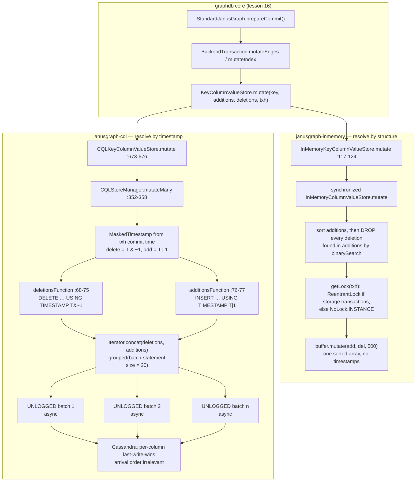
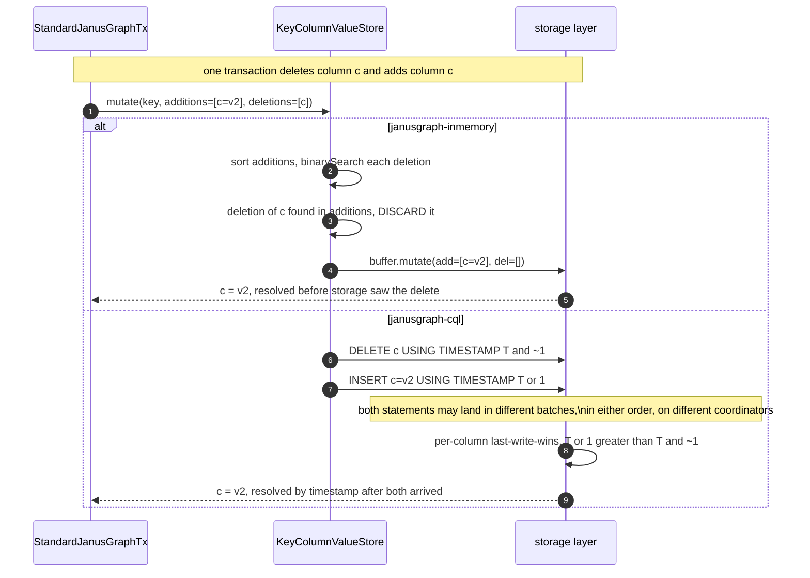

<!--
entry-meta
date: 2026-11-25
type: lesson
track: JanusGraph
lesson: 27
category: Database Internals
title: The CQL backend — CQLKeyColumnValueStore against the in-memory store
slug: janusgraph-cql-store-vs-inmemory
-->

# The CQL backend — `CQLKeyColumnValueStore` against the in-memory store

**2026-11-25 · JanusGraph Track · Lesson 27 of 28**

## Where This Fits

- **Lesson 26** read the mixed-index SPI and `ElasticSearchIndex`, and the finding was that the index SPI is the only write path in JanusGraph that is **not idempotent by construction** — `LIST` add appends a duplicate on a second application, and the fix was a core SPI change (`IndexMutation.completeDocument`) plus a single bulk item per document. That lesson ended by handing this one a question: why does a `KeyColumnValueStore` mutation need none of that machinery?
- **This lesson answers it from the other side.** `CQLKeyColumnValueStore` and `InMemoryKeyColumnValueStore` implement the same five-method interface lesson 02 established, and they produce the same observable semantics — but they get there by two completely different mechanisms, and the difference is the whole lesson. The in-memory store resolves a delete-then-add of the same column **structurally**, by filtering client-side under a lock. CQL resolves it **temporally**, by writing both and relying on one bit of the commit timestamp. That one bit is also what makes every CQL write idempotent, which is why none of lesson 26's §4 narrowing machinery exists here.
- It also discharges four debts the track has been carrying: lesson 18's feature-builder classification (does `CQLStoreManager` set `.locking(...)`, and so does `ConsistentKeyLocker` run), lesson 16's question about whether CQL batch ordering is explicit or implicit in client-side timestamps, lesson 20's `setDirectColumnByStartOnlyAllowed` flag (its only consumer is in the CQL module), and the shape of the worst case lesson 22 predicted for an unfitted ordered query on a real backend.
- **It sets up lesson 28** — transaction log, CDC and stale-index repair — with three things: the `storage.cql.cdc` divergence check, the `gc_grace_seconds` / tombstone window, and the fact that a CQL mutation's atomicity unit is a batch of 20 statements per key, not a transaction.

### Provenance of every line number in this entry

Read at the pinned commit `a59ae8d8024207598eada34998d867617df51adf` through `mcp__github__get_file_contents`, written to local disk, and verified by **git blob SHA identity** against the blob SHAs the API's own directory listing reported — the method lesson 25 established and lesson 26 extended. All ten matched on the first attempt:

| File | Bytes | Lines | Blob SHA | Verified |
|---|---|---|---|---|
| `CQLKeyColumnValueStore.java` | 47,914 | 873 | `f11ea637` | ✔ |
| `CQLStoreManager.java` | 18,740 | 374 | `09f7b055` | ✔ |
| `CQLConfigOptions.java` | 48,346 | — | `2f1adabe` | ✔ |
| `CQLStoreFeaturesBuilder.java` | 7,091 | 129 | `a13eacac` | ✔ |
| `CQLTransaction.java` | 2,609 | 60 | `349bf72b` | ✔ |
| `CQLColValGetter.java` | 2,423 | 65 | `66ea2658` | ✔ |
| `AbstractCQLMutateManyFunction.java` | 5,614 | 100 | `ea850c4e` | ✔ |
| `CQLMutateManyUnloggedFunction.java` | 6,189 | 125 | `7d3d3ee6` | ✔ |
| `CQLMutateManyLoggedFunction.java` | 4,860 | 106 | `8a9a9f7d` | ✔ |
| `InMemoryKeyColumnValueStore.java` | 19,258 | 471 | `83650bf4` | ✔ |

Three further files came back **inline, without line numbers**, so they are cited **by member name only** and never by line — the rule lesson 26 adopted: `InMemoryColumnValueStore.java` (`5569f1a0`), `DistributedStoreManager.java` (`89ed24d5`), `CQLSliceQueryUtil.java` (`2efd226b`).

**Not re-raised, deliberately.** The pin review happened at the Part V/VI boundary (lesson 24) and the pin stayed for the fifth time. Lesson 27 is mid-Part. The next review is after lesson 28, or at the capstone.

---

## 1. The table is three blobs, and that is the whole translation

`buildCreateTable` (`CQLKeyColumnValueStore:503-523`) is the shortest honest statement of what JanusGraph is:

```java
CreateTableWithOptions createTable = createTable(keyspaceName, tableName)
        .ifNotExists()
        .withPartitionKey(KEY_COLUMN_NAME, DataTypes.BLOB)      // "key"
        .withClusteringColumn(COLUMN_COLUMN_NAME, DataTypes.BLOB) // "column1"
        .withColumn(VALUE_COLUMN_NAME, DataTypes.BLOB);           // "value"
```

Three columns, all `blob`, names fixed as constants at `:123-127`. The partition key is the row key lesson 08's `IDManager` derives; the clustering column is the byte string lesson 10's `EdgeSerializer.writeRelation` produces; the value is the rest of the relation. **Cassandra does not know anything about graphs.** Every structure the last nineteen lessons built — vertex-centric indexes, sort keys, signatures, composite index entries — is carried entirely in the byte order of `column1`, which is why `EdgeSerializer`'s column layout had to be order-preserving.

The in-memory store's equivalent is one line, `InMemoryKeyColumnValueStore:99`:

```java
this.kcv = new ConcurrentSkipListMap<>();
```

A `ConcurrentNavigableMap<StaticBuffer, InMemoryColumnValueStore>` (`:94`). The partition key becomes a map key; the sorted column range becomes a sorted array inside `InMemoryColumnValueStore`, paged at `DEF_PAGE_SIZE = 500` entries into a `MultiPageEntryBuffer`. Both stores are *the same data structure* — a map from key to a sorted sequence of (column, value) — one of them distributed and persisted, the other not.

### The table options, which are not decoration

`buildCreateTable` is explicitly **package-private and side-effect free** (`:499-504`) "so the table options (including Cassandra CDC) can be asserted in unit tests without a live Cassandra cluster" — a testability shape worth noticing, because it is the pattern a contribution adding a table option should follow. Four option helpers run over it:

| Helper | Lines | Config option | Default |
|---|---|---|---|
| `compactionOptions` | `:547-567` | `storage.cql.compaction-strategy`, `…-options` | unset → no clause |
| `compressionOptions` | `:525-545` | `storage.cql.compression`, `…-type`, `…-block-size` | on |
| `gcGraceSeconds` | `:569-575` | `storage.cql.gc-grace-seconds` | unset → server default |
| `speculativeRetryOptions` | `:577-583` | `storage.cql.speculative-retry` | unset → server default |

`compressionOptions` carries a real version fork. Cassandra 5 renamed the compression sub-options, so for major version ≥ 5 the map is `{"class": …, "chunk_length_in_kb": …}` and below it is `{"sstable_compression": …, "chunk_length_kb": …}` (`:539-542`); and disabling compression is `{"enabled": false}` on 5+ because "Cassandra 5+ rejects `{'sstable_compression': ''}`" (`:529-531`). The version comes from `getCassandraMajorVersion` (`:482-491`), which runs `SELECT release_version FROM system.local`, parses the first dotted component, and **returns 0 on any exception** — so a service that hides `system.local` silently takes the pre-5 branch.

`CDC` is the one option scoped by table name. `storage.cql.cdc` defaults to `false` (`CQLConfigOptions:47-55`) and `withCDC(true)` is applied only when the table is the edgestore (`:516-520`), on the stated reasoning that "Composite-index data (graphindex) and system stores are not relevant to mixed-index synchronization."

---

## 2. `mutate`: the same semantics, two mechanisms

This is the finding. Take the simplest interesting mutation: **a transaction that deletes column `c` and adds column `c` with a new value.** It happens on every single-cardinality property update — lesson 15's added/deleted relation containers both hold an entry for the same column.

### 2.1 The in-memory store resolves it structurally, before the data is touched

`InMemoryColumnValueStore.mutate` is `synchronized`, and its first act is to sort the additions and then **drop any deletion that is also an addition**:

```java
for (StaticBuffer deletion : deletions) {
    Entry delEntry = StaticArrayEntry.of(deletion);
    if (Arrays.binarySearch(add, delEntry) >= 0) continue;   // add wins, delete discarded
    del[pos++] = delEntry;
}
```

The comment above it is `//Filter out deletions that are also added`. The deletion never reaches the buffer. "Add wins over delete for the same column" is therefore a **client-side decision, taken once, under a lock, with the whole mutation in hand** — the same shape as lesson 26's `IndexMutation.consolidate()`, and for the same reason: the storage layer below has no way to break the tie itself, because `buffer.mutate(add, del, pageSize)` applies both arrays to one sorted sequence with no notion of time.

The locking is layered and conditional. `mutate` is `synchronized` on the row object *and* acquires a `Lock` from `getLock(txh)`, which returns a lazily-created `ReentrantLock` when the transaction carries `storage.transactions`, and `NoLock.INSTANCE` otherwise. Two locks for one mutation is redundant on the face of it; the `synchronized` covers the array preparation that happens before the lock is taken, and the `Lock` is the one `getSlice` also takes, so readers are excluded from the buffer mutation but not from the preparation. Which is correct, and also means the `synchronized` serialises writers to a row twice over.

### 2.2 CQL resolves it temporally, and the mechanism is one bit

`CQLKeyColumnValueStore.mutate` (`:673-676`) does no resolution at all. It wraps the call and hands it straight up:

```java
public void mutate(final StaticBuffer key, final List<Entry> additions,
                   final List<StaticBuffer> deletions, final StoreTransaction txh) throws BackendException {
    this.storeManager.mutateMany(
        Collections.singletonMap(this.tableName,
            Collections.singletonMap(key, new KCVMutation(additions, deletions))), txh);
}
```

`CQLStoreManager.mutateMany` (`:352-358`) delegates to an `executeManyFunction` chosen at construction, and the statement-building lives in `AbstractCQLMutateManyFunction`'s constructor (`:59-91`), which installs **two different pairs of closures depending on whether timestamps are assigned**:

```java
this.deletionsFunction = (commitTime, keyMutations, columnValueStore, key) -> {
    if (keyMutations.hasWholeRowDeletion()) {
        return Iterator.of(columnValueStore.deleteRow(key, commitTime.getDeletionTime(times)));
    }
    return Iterator.of(commitTime.getDeletionTime(times))
        .flatMap(deleteTime -> Iterator.ofAll(keyMutations.getDeletions())
            .map(deletion -> columnValueStore.deleteColumn(key, deletion, deleteTime)));
};
this.additionsFunction = (commitTime, keyMutations, columnValueStore, key) ->
    Iterator.of(commitTime.getAdditionTime(times))
        .flatMap(addTime -> Iterator.ofAll(keyMutations.getAdditions())
            .map(addition -> columnValueStore.insertColumn(key, addition, addTime)));
```

Every delete carries `getDeletionTime`, every insert carries `getAdditionTime`, and both come from one `MaskedTimestamp` built once per `mutateMany` from the transaction's commit time. The definition of those two methods, in `DistributedStoreManager.MaskedTimestamp`, is the mechanism:

```java
public long getDeletionTime(TimestampProvider times) {
    return times.getTime(t)   & 0xFFFFFFFFFFFFFFFEL; // zero the LSB
}
public long getAdditionTime(TimestampProvider times) {
    return (times.getTime(t)   & 0xFFFFFFFFFFFFFFFEL) | 1L; // force the LSB to 1
}
```

**The addition time is the deletion time with the low bit set, so it is always exactly one greater.** Not "one microsecond earlier for the delete" — one *unit* of the provider's resolution, carved out of the timestamp itself by reserving its least significant bit as a delete/add discriminator. The class javadoc states the requirement plainly: "It needs to be ensured that the deletion time is prior to the addition time since some storage backends use the time to resolve conflicts." `DistributedStoreManager.sleepAfterWrite` asserts it (`assert mustPass.getDeletionTime(times) < mustPass.getAdditionTime(times)`), which is an assertion, so off in production — but it is an invariant of bit arithmetic, not of program flow, so nothing can violate it.

Those timestamps reach CQL as a bound `USING TIMESTAMP` marker. `addUsingTimestamp` has two overloads (`:399-411`), one for `DeleteSelection` and one for `Insert`, and each adds `usingTimestamp(bindMarker(TIMESTAMP_BINDING))` **only when `storeManager.isAssignTimestamp()`**. So the prepared statements themselves differ by configuration: with timestamps assigned, `deleteColumn` is `DELETE FROM … USING TIMESTAMP ? WHERE key = ? AND column1 = ?`; without, the clause is absent and the coordinator stamps the write.

Cassandra then resolves the pair. Its architecture documentation is explicit that resolution is **per column, by mutation timestamp**: "Cassandra applies separate mutation timestamps to every column of every row within a CQL partition", and "each column in a row resolves concurrent mutations according to last-write-wins conflict resolution" — the model is described as "a Last-Write-Wins Element-Set conflict-free replicated data type for each CQL row". The insert at `T|1` beats the tombstone at `T&~1`. Add wins over delete, exactly as in the in-memory store, with no client-side filtering anywhere.

### 2.3 Why this matters more than it looks

The in-memory mechanism needs the whole mutation in one place at one time. The CQL mechanism does not — and that is the point, because the CQL mutation **is not sent as one thing**:



A single key's deletions and additions are concatenated and then `.grouped(this.batchSize)` (`CQLMutateManyUnloggedFunction:122-123`), with `batchSize` defaulting to **20** (`CQLConfigOptions:105-110`). Each group becomes its own `UNLOGGED` `BatchStatement` fired with `session.executeAsync` (`:96-109`), and all of them are awaited together at the end (`CompletableFutureUtil.awaitAll(resultList)`, `:88`). So:

> **A mutation of a single row key with more than 20 column operations is sent to Cassandra as several independent, concurrent requests whose arrival order is unspecified — and the result is still deterministic, because the delete/add ordering lives in the timestamps rather than in the request sequence.**

That is the answer to lesson 16's inherited question, and the answer is **implicit in client-side timestamps, not explicit in batch ordering.** The batches carry no ordering guarantee and need none.

### 2.4 Whole-row deletion is a separate statement, and `optimizedWholeRowDeletion` is why

Both closures branch on `keyMutations.hasWholeRowDeletion()` and emit a single `deleteRow` instead of per-column deletes. `deleteRow` (`:641-652`) binds only the partition key, so it is `DELETE FROM … USING TIMESTAMP ? WHERE key = ?` — one row-level tombstone instead of N cell tombstones. The core only sets that flag because `CQLStoreFeaturesBuilder:65` declares `fb.optimizedWholeRowDeletion(true)`. The in-memory store has the matching package-private `deleteRow(StaticBuffer key)` at `InMemoryKeyColumnValueStore:127-129`, which is simply `kcv.remove(key)`.

---

## 3. Idempotence: why a KCVS write needs none of lesson 26's machinery

Lesson 26's `retainUnappliedDocuments` exists because an Elasticsearch bulk request can partially apply and a `LIST` add is not safe to replay. Nothing of that kind exists in `janusgraph-cql`. The reason is stated, in prose, in the javadoc of `withWriteIdempotence` (`CQLKeyColumnValueStore:387-394`) — and it is worth quoting because it is the cleanest sentence in the module:

> "The query builder marks an INSERT or a DELETE without conditions idempotent. A write is idempotent only while it binds its timestamp, though: sent again, it then writes the same cells with the same timestamp. A write without one leaves the timestamp to the driver or the server."

A cell write at a fixed `(key, column1, timestamp)` is a **pure assignment**. Applying it twice is applying it once. A JSON array append is not. The entire difference between lesson 26's write path and this one reduces to that.

The flag is computed in two places, and they agree:

| Where | Expression | Effect |
|---|---|---|
| `CQLKeyColumnValueStore:305` | `storeManager.isAssignTimestamp() && configuration.get(IDEMPOTENT_WRITES)` | passed to `withWriteIdempotence` for each prepared statement |
| `AbstractCQLMutateManyFunction:63` | `assignTimestamp && idempotentWrites ? Boolean.TRUE : null` | `batchIdempotence`, set on every batch |

`withWriteIdempotence` (`:395-397`) is `write.setIdempotent(idempotentWrites ? Boolean.TRUE : null)` — **`null`, not `FALSE`**, so when the condition fails the statement falls back to the driver's `basic.request.default-idempotence` rather than being forced non-idempotent. `storage.cql.idempotent-writes` defaults to **`true`** (`CQLConfigOptions:120-130`), and `graph.assign-timestamp` defaults to `true`, so on a stock graph every CQL write is marked idempotent.

The one detail that is easy to miss, and that both javadocs call out: **a batch does not inherit the idempotence of its statements.** `AbstractCQLMutateManyFunction:39-40` — "A batch doesn't take the idempotence of its statements, and the driver reads only the batch's flag." Hence the duplicated computation: `withWriteIdempotence` for a statement executed on its own, `batchIdempotence` for the batch. Setting one without the other would silently lose retry eligibility for everything that goes through `mutateMany`, which is everything.

What the flag buys, per the option's own description (`CQLConfigOptions:123-128`), is that the driver "may send a write again, to the same node or another one, after a closed connection, an overloaded node or a server error, ask its retry policy about a write which timed out, and run speculative executions of it." And the one documented leak in the abstraction, also from that description: **"an insert with a TTL sent again can expire later."** A replayed `INSERT … USING TIMESTAMP t USING TTL n` writes the same cell at the same timestamp but restarts the TTL clock from the moment of the replay. Idempotent in value, not in lifetime.

---

## 4. Two batch strategies, and only one of them is atomic

`CQLStoreManager` picks the mutate function through `CQLMutateManyFunctionBuilder` (`:104`, `:157-158`). The choice is `storage.cql.atomic-batch-mutate`, default **`false`** (`CQLConfigOptions:113-118`).

| | `CQLMutateManyUnloggedFunction` (default) | `CQLMutateManyLoggedFunction` |
|---|---|---|
| Batch type | `DefaultBatchType.UNLOGGED` (`:100`) | `DefaultBatchType.LOGGED` (`:71`) |
| Grouping | per table, per key, `.grouped(20)` (`:122-123`) | **one batch for every table and every key** (`:75-85`) |
| Execution | `session.executeAsync`, all futures awaited (`:84`, `:88`) | `session.execute`, blocking (`:98`) |
| Back-pressure permits | one per batch, released on completion (`:97`, `:104`) | one for the whole mutation, released in `finally` (`:95`, `:102`) |
| Atomicity | none across batches | Cassandra batchlog: all mutations eventually apply |
| Isolation | none | none — partition-level only |
| Failure shape | some batches applied, some not | batchlog replays the remainder |

The unlogged path's error handling is worth reading closely. `execAsyncUnlogged` (`:96-109`) acquires a permit *before* building the statement and releases it in `whenComplete`, with a `catch (RuntimeException)` that releases the permit and rethrows — the same acquire/release-on-both-paths shape as `CQLPagingIterator.fetchPage` (`:840-849`). A leaked permit would throttle the store permanently, so the duplication is deliberate.

The logged path's single batch is the more interesting hazard: it accumulates **every statement for every table and every key** into one `BatchStatementBuilder` with no size bound at all. A commit touching many vertices produces one enormous `LOGGED` batch, which Cassandra will reject once it exceeds `batch_size_fail_threshold`. There is no client-side split, and no warning.

Note also what `LOGGED` does and does not promise. It promises that all mutations in the batch eventually apply, by writing them to the batchlog on two other nodes first. It promises nothing about isolation: another reader can observe half the batch. For JanusGraph that is survivable precisely because of §2 — the timestamps make any observable interleaving converge to the same final state.

---

## 5. Locking: `acquireLock` is a no-op, and one option decides whether anything locks at all

This settles the classification lesson 18 owed. `CQLStoreFeaturesBuilder.build` (`:58-67`) is the whole feature declaration:

```java
final Boolean useExternalLocking = configuration.get(USE_EXTERNAL_LOCKING);
final StandardStoreFeatures.Builder fb = new StandardStoreFeatures.Builder();

fb.batchMutation(true).distributed(true);
fb.timestamps(true).cellTTL(true);
fb.keyConsistent((onlyUseLocalConsistency ? local : global), local);
fb.locking(useExternalLocking);      // <-- :63
fb.optimisticLocking(true);
fb.optimizedWholeRowDeletion(true);
fb.multiQuery(true);
```

`storage.cql.use-external-locking` defaults to **`false`** (`CQLConfigOptions:91-102`). So on a stock CQL graph `hasLocking()` is `false`, and by lesson 18's wiring `Backend` wraps the store in `ExpectedValueCheckingStore`, so **`ConsistentKeyLocker` does run on CQL.** That is the answer: JanusGraph's own three-phase locker is the default on Cassandra, exactly as it is on any store that does not advertise native locking.

Now read what happens when you flip the option (`CQLKeyColumnValueStore:678-684`):

```java
@Override
public void acquireLock(final StaticBuffer key, final StaticBuffer column,
                        final StaticBuffer expectedValue, final StoreTransaction txh) throws BackendException {
    final boolean hasLocking = this.storeManager.getFeatures().hasLocking();
    if (!hasLocking) {
        throw new UnsupportedOperationException(String.format("%s doesn't support locking", getClass()));
    }
}
```

**The method has no body beyond the guard.** When `hasLocking()` is `false` it throws — which is correct, because core never calls it in that configuration; `ExpectedValueCheckingStore` is in the way. When `hasLocking()` is `true` it **returns, having done nothing at all.** There is no CQL statement, no lightweight transaction, no lease. So:

> `storage.cql.use-external-locking=true` does not switch JanusGraph from its own locking to Cassandra's. It switches locking **off**, and asserts that something outside JanusGraph is doing it.

The option's description says as much, at length and without euphemism (`CQLConfigOptions:94-100`): failure to employ an external algorithm that "locks all columns that participate in a transaction upfront and unlocks them when the transaction ends, will result in a 'read uncommitted' transaction isolation level guarantee", and "side effects such as dirty/non-repeatable/phantom reads should be expected." That is honest documentation of a foot-gun, and it is the kind of thing worth knowing before reading an issue that blames JanusGraph for a lost uniqueness constraint.

The in-memory store is blunter. `InMemoryKeyColumnValueStore.acquireLock` (`:131-134`) throws `UnsupportedOperationException` unconditionally, and `InMemoryStoreManager` does not declare `locking`, so the locker path is the only one that exists there.

`fb.optimisticLocking(true)` (`:64`) is the other half, and it is independent of the above: it tells core that the store's consistency model is optimistic, which is what makes lesson 18's expected-value check meaningful in the first place.

### Consistency levels, which are the real durability knob

`CQLTransaction` (`:30-47`) is sixty lines and does one thing: translate two configuration strings into driver `ConsistencyLevel` values, once per transaction, read from `getCustomOption` so a transaction can override the graph default. `storage.cql.read-consistency-level` and `…-write-consistency-level` both default to `QUORUM` (`CQLConfigOptions:64-76`). `getTransaction(txh)` (`CQLTransaction:49-53`) is a `Preconditions.checkArgument` downcast, and every read and write path calls it — `setConsistencyLevel(getTransaction(txh).getReadConsistencyLevel())` on each scan statement (`CQLKeyColumnValueStore:714`, `:748`, `:799`), `getWriteConsistencyLevel()` on each batch (`CQLMutateManyUnloggedFunction:102`, `CQLMutateManyLoggedFunction:72`).

The feature builder's `keyConsistent(global, local)` call (`:62`) carries a second, separate pair: `QUORUM`/`QUORUM` for the global configuration and `LOCAL_QUORUM`/`LOCAL_QUORUM` for the local one, with `storage.cql.only-use-local-consistency-for-system-operations` (default `false`, `CQLConfigOptions:85-89`) deciding which becomes the global. That pair is what lesson 18's locker and lesson 13's schema writes use, which is why those operations can be pinned to `LOCAL_QUORUM` independently of ordinary reads.

Cassandra's own documentation is the right reference for what `QUORUM` buys, and it is narrower than it sounds: "Write operations are always sent to all replicas, regardless of consistency level. The consistency level simply controls how many responses the coordinator waits for before responding to the client." The guarantee that acknowledged writes are visible to later reads is the overlap condition `W + R > RF`, not the consistency level alone — `QUORUM`/`QUORUM` satisfies it, and a graph tuned down to `ONE`/`ONE` does not.

---

## 6. Reads: one key, many keys, and the `IN`-grouping that mostly cannot fire

The four read entry points (`CQLKeyColumnValueStore:595-625`) all funnel into one service and differ only in shape:

| Method | Lines | Delegates to |
|---|---|---|
| `getSlice(KeySliceQuery, txh)` | `:595-602` | `asyncQueryExecutionService.executeSingleKeySingleSlice(…).get()` |
| `getSlice(List<StaticBuffer>, SliceQuery, txh)` | `:604-611` | `executeMultiKeySingleSlice` then `CompletableFutureUtil.unwrap` |
| `getMultiSlices(MultiKeysQueryGroups, txh)` | `:618-625` | `executeMultiKeyMultiSlice` then `unwrapMapOfMaps` |
| `getKeys(List<StaticBuffer>, SliceQuery, txh)` | `:686-695` | `CQLMapKeyIterator` over `CQLSubsetIterator` chunked by `getKeysSize()` |

The service is `GroupingAsyncQueryExecutionService`, constructed at `:332-333` with both column-value getters and the two query decorators. The comment above `getMultiSlices` (`:613-617`) states the two reasons it exists rather than using `KeyColumnValueStoreUtil.getMultiRangeSliceNonOptimized`: all slice queries go out in parallel instead of blocking one at a time, and "if `sliceGroupingAllowed` is `true` it may also group some of the Slice queries together and perform `IN` operator instead of multiple range queries."

Contrast the in-memory store, where the multi-key read is a `for` loop (`:109-114`):

```java
Map<StaticBuffer,EntryList> result = Maps.newHashMap();
for (StaticBuffer key : keys) result.put(key, getSlice(new KeySliceQuery(key, query), txh));
return result;
```

Sequential, and correct, because there is no round trip to amortise. Every bit of the CQL read machinery is there to pay for network latency, and nothing else.

### 6.1 The `setDirectColumnByStartOnlyAllowed` flag, and the grouping rule

Lesson 20 found `SliceQuery.setDirectColumnByStartOnlyAllowed(boolean)` and could not say who consumed it. The answer: it is **set** by `EdgeSerializer.getQuery` (via `isDirectColumnByStartOnlyAllowed(type)`) and **read** in exactly one place in the codebase, `CQLSliceQueryUtil.getQueriesGroupedByDirectEqualityQueries`. A slice query whose range is provably one column — a `SINGLE`-cardinality property read, whose `sliceEnd` is `nextBiggerBuffer(sliceStart)` — can be expressed as `column1 = ?` rather than `column1 >= ? AND column1 <= ?`, and only equality predicates can be combined with `IN`.

The grouping rule itself has a constraint that is easy to read past:

```java
final int groupSize = query.hasLimit()
    ? Math.max(1, Math.min(sliceGroupingLimit, query.getLimit()))
    : sliceGroupingLimit;
List<SliceQuery> directEqualityQueries = openGroupsByLimit.get(query.getLimit());
if (directEqualityQueries == null || directEqualityQueries.size() >= groupSize) { … new group … }
```

Groups are keyed by the queries' **shared limit**, and a group holds at most `min(storage.cql.grouping.slice-limit, limit)` queries. The javadoc gives the reason: the merged query "asks for that many columns, and a query whose column was cut off would be cached with an incomplete result." CQL's `LIMIT` applies to the whole result set, not per `IN` element, so grouping *k* queries that each want *L* columns under one `LIMIT L` is only sound while *k ≤ L*.

**The consequence, which follows directly from the arithmetic: a direct-equality query with `limit = 1` yields `groupSize = 1`, so it forms a group of one and nothing is grouped.** `storage.cql.grouping.slice-allowed` defaults to `true` and `slice-limit` to `20` (`CQLConfigOptions:844-862`), so the feature is on by default — but it can only merge single-column reads that are unlimited or carry a limit above 1. **What I did not verify this run** is which limit the common `SINGLE`-cardinality property read actually carries when it reaches this code; `CQLSliceQueryUtilTest` constructs both shapes (`column(int, int)` with `Query.NO_LIMIT` and with an explicit limit), which says both are expected, not which is typical. That is a reachability question, not a defect claim, and it is the cheapest open item this lesson produces.

### 6.2 `CQLColValGetter` and the multi-key row-key tax

Rows come back as `Tuple3<StaticBuffer, StaticBuffer, Row>` and are turned into `Entry` objects by `CQLColValGetter` (`:26-64`), whose only real work is `getMetaData`: `TIMESTAMP` reads the `writetime` alias, `TTL` the `ttl` alias, and `ROW_KEY` the raw `key` column, with `rawKey == null` mapping to a shared empty buffer (`:59-60`).

Two getters are built, not one (`CQLKeyColumnValueStore:217-222`):

```java
EntryMetaData[] defaultEntryMetadata = storeManager.getMetaDataSchema(this.tableName);
this.singleKeyGetter = new CQLColValGetter(defaultEntryMetadata);
EntryMetaData[] multiKeyEntryMetadata = new EntryMetaData[defaultEntryMetadata.length+1];
System.arraycopy(defaultEntryMetadata, 0, multiKeyEntryMetadata, 0, defaultEntryMetadata.length);
multiKeyEntryMetadata[multiKeyEntryMetadata.length-1] = EntryMetaData.ROW_KEY;
this.multiKeysGetter = new CQLColValGetter(multiKeyEntryMetadata);
```

The multi-key schema is the single-key schema plus `ROW_KEY`, because a query that batches several partition keys into one `IN` cannot tell which row a returned cell belongs to without selecting the key back. `storage.cql.grouping.keys-allowed`'s description states the cost directly: "any CQL query grouped with more than 1 key will require to return a row key for any column fetched." That is the trade — fewer round trips, one extra blob per cell on the wire.

The `writetime` and `ttl` columns only appear when asked for. `addTimestampFunction` (`:413-424`) and `addTTLFunction` (`:432-437`) are per-table, gated on `STORE_META_TIMESTAMPS` and `STORE_META_TTL` from `getStorageConfig().get(option, this.tableName)`, and they are applied to every scan statement before preparation (`:358`, `:367`) and passed as method references into the execution service (`:332-333`).

---

## 7. Scans: token ranges, a pushdown that may be refused, and one-page lookahead

Scans are where CQL and the in-memory store diverge most, because a `ConcurrentSkipListMap` scan is `kcv.entrySet().iterator()` (`InMemoryKeyColumnValueStore:142-144`) and a Cassandra scan is a distributed problem.

### 7.1 Which scans exist at all is decided by the partitioner

`CQLStoreFeaturesBuilder:88-119` switches on the short partitioner name:

| Partitioner | `keyOrdered` | `orderedScan` | `unorderedScan` | `scanKeyOrder` | Deployment |
|---|---|---|---|---|---|
| `Murmur3Partitioner` | false | false | true | `TokenOrderKeyComparator` (if token map present) | `REMOTE` |
| `RandomPartitioner` | false | false | true | — | `REMOTE` |
| `DefaultPartitioner` (Amazon Keyspaces) | false | false | true | — | `REMOTE` |
| `ByteOrderedPartitioner` | true | true | true | — | `LOCAL` if single local host, else `REMOTE` |
| anything else | — | — | — | — | `IllegalArgumentException` |

The partitioner is cross-checked: a configured `storage.cql.partitioner-name` that disagrees with the server's throws `IllegalArgumentException` (`:80-83`), and if neither is available the store refuses to open (`:84-87`).

`scanKeyOrder` is the subtle one, and the comment at `:94-100` explains what it buys: declaring that Murmur3 ring order is client-computable "puts multi-query scans (e.g. a reindex) on the lossless merge-join strategy instead of the bounded-buffer one, whose recovery from writes concurrent with the scan is capped." It is set **only** for `Murmur3Partitioner`, and the comment says why `RandomPartitioner` is deliberately excluded although its order would be computable the same way: "no CI covers it and an undetected deviation would fail every multi-query scan via the framework's order verification." That is a maintainer choosing an absent feature over an untested one, and it is a useful signal about what a PR touching this code would be asked for.

The store constructor then prepares statements to match the declared features: `getKeysRanged` only if `hasOrderedScan()` (`:248-263`), `getKeysAll` and `getKeysRangedToken` only if `hasUnorderedScan()` (`:265-303`). All of them carry `.allowFiltering()`, which is the honest admission that a JanusGraph full scan is a full scan.

### 7.2 Three ways a backend can refuse, and all three degrade instead of failing

The constructor contains three independent graceful-degradation paths, and the reasoning in each comment is the same: a scan-only optimisation must not fail store open, because store open is graph open.

1. **Token-range statement rejected** (`:291-299`). `prepareScanStatement(getKeysRangedTokenSelect)` is wrapped in `try/catch (QueryValidationException)`; on failure `getKeysRangedToken` becomes `null` with a `log.warn`, and "token-range-parallel scans are disabled for this store."
2. **`PER PARTITION LIMIT` rejected** (`prepareScanStatement`, `:355-368`). The clause is attempted first; on `QueryValidationException` the instance field `scanPerPartitionLimitEnabled` is flipped to `false`, a warning names the option path, and the statement is re-prepared without it. Named culprit: Amazon Keyspaces. The clause needs Cassandra 3.6+ or ScyllaDB.
3. **Non-Murmur3 partitioner** (`:336-338`). `parallelScanSupported = getKeysRangedToken != null && isMurmur3Partitioner()`, with the comment: token-range parallel scan "is only correct for the Murmur3 partitioner, whose tokens are plain longs that tile `[Long.MIN_VALUE, Long.MAX_VALUE]`; for any other partitioner we keep the single scan."

The `PER PARTITION LIMIT` pushdown is worth understanding because it is a large win for exactly one caller. `storage.cql.scan-per-partition-limit-enabled` defaults to `true` (`CQLConfigOptions:267-280`) and the description states the problem it solves: scan jobs "issue a grounding (key-existence) query with a per-key limit of 1; without the pushdown every cell of every row slice is streamed to the client and discarded there, so the grounding query alone transfers the whole table (including adjacency data irrelevant to the job)." The binding is `perPartitionLimit(query)` (`:370-379`), which returns `Integer.MAX_VALUE` for a query with no limit **or a limit below 1**, because the clause must be strictly positive — and the javadoc notes the equivalence carefully: `Integer.MAX_VALUE` is "semantically equivalent to omitting the clause", so "a limit-0 query still yields keys with zero entries." `scanStatementBuilder` (`:802-813`) checks `scanStatement.getVariableDefinitions().contains(PER_PARTITION_LIMIT_BINDING)` before binding, so a statement prepared after the fallback is handled without a separate flag.

### 7.3 Parallel scans are two different things, and only one is parallel

`getKeys(SliceQuery, txh)` (`:718-750`) splits the ring when `parallelScanSupported && parallelScanTokenRanges > 1`, builds one `CQLPagingIterator` per range, and concatenates them with `io.vavr Iterator.concat`. The comment at `:731-737` is unusually careful about what that does and does not give:

> "Each per-range pager issues only its FIRST page on construction (concurrently across ranges); `io.vavr Iterator.concat` then drains the ranges back-to-back on the single scan thread, so deeper paging is sequential range-by-range rather than fully parallel. Concatenating in ring order preserves global token order, which the multi-query scan merge in `StandardScannerExecutor` relies on. For true end-to-end parallelism the scan-job framework requests each range separately via `getKeysForSplit` and drains them on dedicated threads."

So there are two consumers of the same tiling. An ordinary caller of `getKeys` gets **bounded coordinator scans in ring order** — the benefit is that no single coordinator funnels the whole table, not extra client parallelism. The scan-job framework, through `SplittableScanStore`, gets real parallelism: `getUnorderedScanSplitCount()` (`:752-755`) returns the range count, and `getKeysForSplit` (`:757-774`) hands out one range with two `Preconditions.checkArgument` guards on the split index. `storage.cql.parallel-scan-token-ranges` defaults to **1** (`CQLConfigOptions:237-251`), and the description's advice is "a small multiple of the cluster's node count."

`tokenRangesFor` (`:776-789`) memoizes the tiling in a `volatile long[][]` keyed implicitly by array length, with an explicit note that the benign race is harmless because `CQLTokenRangeSplitter.splitMurmur3Ring` is pure and "the array length encodes the split count." The reason for memoizing is given as complexity, not microseconds: "a scan requests the same tiling once per (split, slice query), so without memoization the total allocation cost would grow quadratically with the split count."

Note the asymmetry in the range predicates, which is how the ring tiles exactly once: the *token-bounded* scan uses `token(key) > start AND token(key) <= end` (`:284-285`), while the *key-range* scan on an ordered partitioner uses `token(key) >= start AND token(key) < end` (`:255-256`). Half-open in both cases, opposite ends.

### 7.4 `CQLPagingIterator`: one page of lookahead, one permit at a time

`CQLPagingIterator` (`:829-872`) is thirty lines and does something precise. The constructor fires the first page immediately. `hasNext` (`:851-863`) then, on exhausting the current page, **starts the fetch of page N+1 before draining page N**:

```java
final AsyncResultSet resultSet = CompletableFutureUtil.get(pendingResultSet);
// Start downloading the next page before this one is drained.
pendingResultSet = resultSet.hasMorePages() ? fetchPage(resultSet::fetchNextPage) : null;
currentPageIterator = resultSet.currentPage().iterator();
```

The class javadoc (`:820-828`) states the invariant that makes this safe: "A page fetch holds one back-pressure permit only while it is in flight (released on completion), so the lookahead never holds more concurrent permits than the previous drain-then-fetch implementation — it merely overlaps the network wait with client-side row processing instead of alternating between them." That is the right way to describe a latency optimisation: unchanged concurrency, overlapped waits.

Page size comes from `storage.cql.scan-page-size`, default **0** meaning "fall back to `storage.page-size`" (`:339-340`, `CQLConfigOptions:253-265`). The description's reasoning: scans stream many rows per request, so a page size several times larger than the OLTP-oriented `storage.page-size` "usually cuts scan round trips (and total scan time) substantially at the cost of slightly larger response payloads held in memory per scan thread." **Transactional slice reads keep using `storage.page-size`** — the two paths are separately tunable, which they were not before this option.

### 7.5 What both stores refuse

`getKeys(MultiSlicesQuery, txh)` throws `UnsupportedOperationException` in both implementations — `CQLKeyColumnValueStore:815-818` and `InMemoryKeyColumnValueStore:146-149`. `getLocalKeyPartition()` throws it in `CQLStoreManager:346-349`. Multi-slice key iteration is declared on the interface and implemented by neither of the two stores this track has read.

---

## 8. Error classification: two permanent cases, everything else temporary

`EXCEPTION_MAPPER` (`:141-154`) is a static `Function<Throwable, BackendException>` and it is the single funnel for the module — every public method wraps its body and applies it, and `CQLStoreManager.mutateMany` reaches across to use it too (`:356`).

```java
cause = CompletableFutureUtil.unwrapExecutionException(cause);
if (cause instanceof InterruptedException || cause.getCause() instanceof InterruptedException) {
    Thread.currentThread().interrupt();
    return new PermanentBackendException(…);
}
if (cause instanceof BackendException || cause.getCause() instanceof BackendException) {
    return (BackendException) (…);                       // pass through, do not re-wrap
}
return Match(cause).of(
    Case($(instanceOf(QueryValidationException.class)), PermanentBackendException::new),
    Case($(CQLKeyColumnValueStore::isKeySizeTooLarge),  PermanentBackendException::new),
    Case($(),                                            TemporaryBackendException::new));
```

Four behaviours worth naming. It unwraps one level of `ExecutionException` first, because everything on the read path arrives through a `CompletableFuture`. It **restores the interrupt flag** before returning, which a mapper that merely classified would forget. It passes an existing `BackendException` through rather than nesting it. And the default is **temporary**, so anything unrecognised is retried by core — which is the right default only because of §3.

`isKeySizeTooLarge` (`:156-170`) is the most specific piece of code in the file and its comment explains exactly why it exists: CQL keys are limited to 64k, and on ScyllaDB a query filtering on an over-long key "will produce a `ServerError` … perhaps due to a bug, rather than an `InvalidQueryException`." The predicate digs an `AllNodesFailedException` out of the chain with `ExceptionUtils.throwableOfType` and matches `error.getMessage().startsWith("Key size too large:")` across every node's errors. A **string prefix match on a server error message**, load-bearing for retry classification. It is also exactly the kind of thing that breaks silently when the upstream message changes, and it is worth knowing it is there.

---

## 9. The comparison, in one table

| Concern | `InMemoryKeyColumnValueStore` | `CQLKeyColumnValueStore` |
|---|---|---|
| Row container | `ConcurrentSkipListMap` (`:99`) | Cassandra partition, 3 blob columns (`:505-509`) |
| Column container | sorted array, paged at 500 | clustering column, server-side sorted |
| Delete + add of same column | deletion **filtered out** client-side (`InMemoryColumnValueStore.mutate`) | both written; `T&~1` vs `T|1` decides (`AbstractCQLMutateManyFunction:68-77`) |
| Mutation atomicity | one `synchronized` call per row | 1..n `UNLOGGED` batches of ≤ 20, or one `LOGGED` batch |
| Mutation durability | none | consistency level, default `QUORUM` |
| Idempotent writes | n/a (local) | yes, iff timestamps assigned (`:305`, `:395-397`) |
| `acquireLock` | unconditional throw (`:131-134`) | **no-op** when `hasLocking()`, else throw (`:678-684`) |
| Native locking declared | no | `use-external-locking`, default `false` (`CQLStoreFeaturesBuilder:63`) |
| Multi-key read | sequential `for` loop (`:109-114`) | parallel futures + optional `IN` grouping |
| Ordered scan | `kcv.subMap(start, end)` (`:137-139`) | only on `ByteOrderedPartitioner` |
| Unordered scan | `kcv.entrySet().iterator()` (`:142-144`) | token-range tiling, `allowFiltering`, paged |
| `getKeys(MultiSlicesQuery)` | throws (`:146-149`) | throws (`:815-818`) |
| Error classification | propagates | `EXCEPTION_MAPPER`, temporary by default (`:141-154`) |
| TTL | not supported | `cellTTL(true)`, separate prepared statement (`:323-328`) |

---

## 10. The two resolution mechanisms, side by side



---

## Hands-On

Four experiments, in increasing cost. **A** and **B** need nothing but the repository and a JDK; **C** needs Docker; **D** is the one that puts a number on lesson 22's prediction.

### A — See the LSB mask with your own eyes (two minutes, no build)

`MaskedTimestamp` is pure arithmetic, so you can reproduce it in `jshell`:

```java
jshell> long t = System.currentTimeMillis() * 1000;   // micros, as the MICRO provider does
jshell> long del = t & 0xFFFFFFFFFFFFFFFEL;
jshell> long add = (t & 0xFFFFFFFFFFFFFFFEL) | 1L;
jshell> add - del
jshell> // now do it for t and t+1 and compare the two (del, add) pairs
jshell> long t2 = t + 1;
jshell> ((t2 & 0xFFFFFFFFFFFFFFFEL) == del) + " / " + (((t2 & 0xFFFFFFFFFFFFFFFEL) | 1L) == add)
```

**What to look for:** `add - del` is always exactly `1`. And `t` and `t+1` — two commits one microsecond apart — produce the **identical** `(del, add)` pair whenever `t` is even. The masking halves the usable timestamp resolution. That is the input to Hands-On C.

### B — Assert the table options without a cluster (ten minutes, build required)

`buildCreateTable` and `tableHasCdcEnabled` are package-private and side-effect free precisely so this is possible. Write a test next to the existing CQL unit tests:

```bash
mvn -pl janusgraph-cql -am -DskipTests install
mvn -pl janusgraph-cql -Dtest=CQLStoreTest test     # replace with the class you add
```

In the test, build a `Configuration` with `storage.cql.cdc=true` and call
`CQLKeyColumnValueStore.buildCreateTable("ks", "edgestore", config, 5)`, then the same with
`"graphindex"`, and render each with `.build().getQuery()`.

**What to look for:** `cdc = true` appears for `edgestore` and **not** for `graphindex` — the table-name scoping at `:518`. Then flip the major version between `4` and `5` with compression disabled and watch `{'sstable_compression': ''}` become `{'enabled': false}`. These are the cheapest possible regression tests for a storage-option change, and a PR that adds a table option without one is the PR that gets review comments.

### C — Does the halved resolution actually collide? (one hour, Docker)

This is the experiment that decides whether §2's elegance has a sharp edge.

```bash
docker run --rm -d --name cas -p 9042:9042 cassandra:5
# wait for CQL to come up
docker exec cas cqlsh -e "SELECT release_version FROM system.local"
```

Then, from a Gremlin console or a small Java harness against `storage.backend=cql`:

1. Open a graph, add one vertex with a `SINGLE`-cardinality property, commit.
2. In a tight loop, commit **N updates to that same property** as fast as possible, from a single thread — no sleeps.
3. Query the final value, then read the cells directly:

```sql
SELECT key, column1, value, writetime(value), ttl(value)
  FROM janusgraph.edgestore WHERE key = 0x…;
```

**What to look for:** two things. First, whether any two consecutive commits produced the **same** `writetime` — that is the collision the LSB mask makes possible, and it is where a delete at `T` from one commit and an insert at `T` from another would have to be broken by Cassandra's tie-break rather than by ordering. Second, whether the final property value is ever *not* the last one written. If it never is, the window is narrower than the clock resolution and this is a curiosity; if it is, it is a real finding. **Note what I could not verify this run:** Cassandra's documented architecture page states last-write-wins by mutation timestamp but gives **no tie-break rule for equal timestamps** — so this experiment is the only way to settle it, and no claim about equal-timestamp behaviour belongs in this lesson until it has run.

### D — Put a number on the unfitted ordered query (one hour, Docker, after C)

Lesson 22 predicted that an unfitted ordered query on a real backend is the worst case in the tree: `PreSortingIterator` reads the **whole** result before throwing if it exceeds `MAX_SORT_ITERATION = 1_000_000` *per sub-query*, and `LimitAdjustingIterator`'s cursor-less doubling re-reads from the start on each enlargement. On the in-memory store that is cheap. On CQL it is a page-by-page network read, repeated.

Against the same container:

1. Load ~200k vertices with a property that has **no index**.
2. Run `g.V().has("prop", gt(x)).order().by("other").limit(50).profile()` and record the total.
3. Re-run with `query.batch.limited=false` and compare.
4. Re-run with `storage.cql.scan-page-size` set to 10× `storage.page-size` and compare again.

**What to look for:** the ratio between step 2 and the equivalent query on `inmemory` with the same data, and whether step 4 moves it at all. Step 4 should **not** help a transactional slice read — `scan-page-size` governs `getKeys`-style iteration only — and confirming that it does not is as useful as confirming that it does.

---

## Where This Breaks Down

- **The timestamp mechanism is only as good as the clocks.** Cassandra's own documentation says so: "Cassandra's correctness does depend on these clocks, so make sure a proper time synchronization process is running such as NTP." JanusGraph assigns timestamps **client-side**, from the committing JVM, so with `graph.assign-timestamp=true` the ordering of two transactions on two application servers is decided by *those two machines' clocks*, not by Cassandra. A backward clock step on one node makes its writes lose to older data, silently and permanently, until something overwrites them at a higher timestamp. There is no detection and no repair.
- **Turning timestamps off changes the correctness argument, not just the performance.** With `assignTimestamp` false, `AbstractCQLMutateManyFunction:78-90` installs closures that emit deletes and inserts with **no timestamp at all**, and `addUsingTimestamp` omits the clause from the prepared statements. The delete and the insert for the same column are then stamped independently by the coordinator, and — because the unlogged path splits them into separate concurrent batches at `.grouped(20)` — their relative order is no longer guaranteed. The §2 argument does not survive that. **I did not verify** whether any guard prevents the combination, or whether the grouping happens to keep a delete and its matching insert in the same batch in practice; the code as written does not promise it. This is the single most promising defect-shaped thing in the module and it is a reachability question, not a confirmed bug.
- **`use-external-locking=true` is locking off, not locking elsewhere.** Documented honestly in the option description, but the mechanism — an `acquireLock` whose body is empty — means there is nothing to misconfigure and nothing to see. The failure mode is a uniqueness constraint that simply does not hold.
- **The `LOGGED` batch is unbounded.** `CQLMutateManyLoggedFunction.mutateMany` accumulates every statement for every table and key with no split. A large commit under `storage.cql.atomic-batch-mutate=true` fails at the server's batch-size threshold, and the only client-side signal is the resulting exception.
- **`isKeySizeTooLarge` matches a server error message by string prefix.** `"Key size too large:"`. It works, it is commented, and it will stop working the day that message changes, degrading a permanent failure into an infinitely retried temporary one.
- **`getCassandraMajorVersion` returns 0 on any failure**, which silently selects the pre-Cassandra-5 compression option names. On a managed service that restricts `system.local`, table creation takes the legacy branch with no warning.
- **Three graceful degradations are warnings, not errors.** Token-range scans off, `PER PARTITION LIMIT` off, parallel scan off — each logs at `warn` once at store open and then behaves differently forever. On Amazon Keyspaces all three can fire, and the resulting scan performance is an order-of-magnitude question that nothing surfaces at query time.
- **`IN`-grouping cannot help the queries most likely to be numerous.** `groupSize = min(slice-limit, limit)` means a limit-1 direct-equality query groups with nothing. Whether that describes the common property read is §6.1's open question.
- **A latent `NullPointerException` in the in-memory store's instrumentation.** `InMemoryColumnValueStore.getLock(txh)` creates the `ReentrantLock` lazily **only** when the transaction carries `storage.transactions`; but `numPages`, `numEntries`, `createFragmentationReport` and `quickDefragment` each call `this.lock.lock()` **directly**, bypassing `getLock`. On a store whose mutations all ran with transactions off, `lock` is still `null` and those four methods throw. **Unverified:** the default of `storage.transactions` (I did not read it this run) and whether the fragmentation-report entry points are reachable in that configuration. If the default is `true`, this is a configuration-specific latent fault, not a live one.

---

## Further Study

- [Cassandra: Dynamo — Data Versioning](https://cassandra.apache.org/doc/latest/cassandra/architecture/dynamo.html#data-versioning) — the authoritative statement of per-column last-write-wins and the LWW-Element-Set framing.
- [Cassandra: Dynamo — Tunable Consistency](https://cassandra.apache.org/doc/latest/cassandra/architecture/dynamo.html#tunable-consistency) — why "writes are always sent to all replicas" and `W + R > RF` is the real guarantee.
- [`CQLConfigOptions.java` at the pinned commit](https://github.com/JanusGraph/janusgraph/blob/a59ae8d8024207598eada34998d867617df51adf/janusgraph-cql/src/main/java/org/janusgraph/diskstorage/cql/CQLConfigOptions.java) — 48 KB of option descriptions that are better documentation than the documentation.
- [`CQLTokenRangeSplitter.java`](https://github.com/JanusGraph/janusgraph/blob/a59ae8d8024207598eada34998d867617df51adf/janusgraph-cql/src/main/java/org/janusgraph/diskstorage/cql/CQLTokenRangeSplitter.java) — not read this run; the pure function that tiles the Murmur3 ring.
- [`GroupingAsyncQueryExecutionService`](https://github.com/JanusGraph/janusgraph/blob/a59ae8d8024207598eada34998d867617df51adf/janusgraph-cql/src/main/java/org/janusgraph/diskstorage/cql/service) — not read this run; where the `IN`-grouping decisions of §6 are actually executed.

---

## Next Steps

1. **Settle the `assignTimestamp=false` question** (Where This Breaks Down, item 2). Read `GraphDatabaseConfiguration.ASSIGN_TIMESTAMP` for its default and any validation, and check whether `CQLMutateManyUnloggedFunction.toGroupedBatchableStatementsSequenceIterator` can put a delete and its matching insert into different groups — `Iterator.concat(deletions, additions).grouped(20)` says it can whenever a key has more than 20 operations. This is one file read plus one arithmetic argument.
2. **Run Hands-On C.** It is the only way to settle equal-timestamp behaviour, which the Cassandra documentation does not state.
3. **Answer §6.1's reachability question**: which limit a `SINGLE`-cardinality property read carries by the time it reaches `CQLSliceQueryUtil`. One read of `EdgeSerializer.getQuery` and `BasicVertexCentricQueryBuilder`'s limit assignment.
4. **Carried from lesson 20, still open:** `BasicVertexCentricQueryBuilder:711`'s `Preconditions.checkArgument(bestCandidate != null, …)` — is it reachable? This lesson settled the other half of lesson 20's debt (`setDirectColumnByStartOnlyAllowed`, §6.1) but not this.
5. **Run the eleven outstanding Hands-On experiments** from lessons 24, 25 and 26. Three register candidates are gated behind them and must not be filed upstream first. Lesson 26's Hands-On B remains the cheapest — `inmemory`, one unique composite index, `DISABLE_INDEX`, re-profile — and it settles a question carried since lesson 23.
6. **For lesson 28**, this lesson hands over three things: the `storage.cql.cdc` divergence check (`:234-244`, `:450-480`) and *why* it exists — the option is applied only at `CREATE TABLE`, so a pre-existing edgestore silently captures nothing; `storage.cql.gc-grace-seconds` as the tombstone window within which a delete can still be resurrected by an un-repaired replica; and the fact that a CQL mutation's atomicity unit is a batch of ≤ 20 statements, so "the edgestore and the graphindex disagree" has a third cause beyond lesson 26's two — a partially applied multi-batch mutation.

---

## Sources

Read this run. Source permalinks are at the pinned commit `a59ae8d8024207598eada34998d867617df51adf`.

**Cited by line number** (blob-SHA verified against the API's directory listing):

- [`CQLKeyColumnValueStore.java`](https://github.com/JanusGraph/janusgraph/blob/a59ae8d8024207598eada34998d867617df51adf/janusgraph-cql/src/main/java/org/janusgraph/diskstorage/cql/CQLKeyColumnValueStore.java) — 873 lines, `f11ea637`; the whole file read. Key spans: [`:141-170` exception mapping](https://github.com/JanusGraph/janusgraph/blob/a59ae8d8024207598eada34998d867617df51adf/janusgraph-cql/src/main/java/org/janusgraph/diskstorage/cql/CQLKeyColumnValueStore.java#L141-L170), [`:211-343` constructor](https://github.com/JanusGraph/janusgraph/blob/a59ae8d8024207598eada34998d867617df51adf/janusgraph-cql/src/main/java/org/janusgraph/diskstorage/cql/CQLKeyColumnValueStore.java#L211-L343), [`:355-397` scan prepare and idempotence](https://github.com/JanusGraph/janusgraph/blob/a59ae8d8024207598eada34998d867617df51adf/janusgraph-cql/src/main/java/org/janusgraph/diskstorage/cql/CQLKeyColumnValueStore.java#L355-L397), [`:493-583` table creation](https://github.com/JanusGraph/janusgraph/blob/a59ae8d8024207598eada34998d867617df51adf/janusgraph-cql/src/main/java/org/janusgraph/diskstorage/cql/CQLKeyColumnValueStore.java#L493-L583), [`:673-684` mutate and acquireLock](https://github.com/JanusGraph/janusgraph/blob/a59ae8d8024207598eada34998d867617df51adf/janusgraph-cql/src/main/java/org/janusgraph/diskstorage/cql/CQLKeyColumnValueStore.java#L673-L684), [`:718-813` scans](https://github.com/JanusGraph/janusgraph/blob/a59ae8d8024207598eada34998d867617df51adf/janusgraph-cql/src/main/java/org/janusgraph/diskstorage/cql/CQLKeyColumnValueStore.java#L718-L813), [`:820-872` paging iterator](https://github.com/JanusGraph/janusgraph/blob/a59ae8d8024207598eada34998d867617df51adf/janusgraph-cql/src/main/java/org/janusgraph/diskstorage/cql/CQLKeyColumnValueStore.java#L820-L872)
- [`CQLStoreManager.java`](https://github.com/JanusGraph/janusgraph/blob/a59ae8d8024207598eada34998d867617df51adf/janusgraph-cql/src/main/java/org/janusgraph/diskstorage/cql/CQLStoreManager.java) — 374 lines, `09f7b055`; [`:311-358` features, openDatabase, mutateMany](https://github.com/JanusGraph/janusgraph/blob/a59ae8d8024207598eada34998d867617df51adf/janusgraph-cql/src/main/java/org/janusgraph/diskstorage/cql/CQLStoreManager.java#L311-L358)
- [`CQLStoreFeaturesBuilder.java`](https://github.com/JanusGraph/janusgraph/blob/a59ae8d8024207598eada34998d867617df51adf/janusgraph-cql/src/main/java/org/janusgraph/diskstorage/cql/builder/CQLStoreFeaturesBuilder.java) — 129 lines, `a13eacac`; [`:39-123` the whole build method](https://github.com/JanusGraph/janusgraph/blob/a59ae8d8024207598eada34998d867617df51adf/janusgraph-cql/src/main/java/org/janusgraph/diskstorage/cql/builder/CQLStoreFeaturesBuilder.java#L39-L123)
- [`CQLConfigOptions.java`](https://github.com/JanusGraph/janusgraph/blob/a59ae8d8024207598eada34998d867617df51adf/janusgraph-cql/src/main/java/org/janusgraph/diskstorage/cql/CQLConfigOptions.java) — `2f1adabe`; [`:47-130` cdc, consistency, external locking, batch size, idempotent writes](https://github.com/JanusGraph/janusgraph/blob/a59ae8d8024207598eada34998d867617df51adf/janusgraph-cql/src/main/java/org/janusgraph/diskstorage/cql/CQLConfigOptions.java#L47-L130), [`:237-280` scan options](https://github.com/JanusGraph/janusgraph/blob/a59ae8d8024207598eada34998d867617df51adf/janusgraph-cql/src/main/java/org/janusgraph/diskstorage/cql/CQLConfigOptions.java#L237-L280), [`:844-870` grouping options](https://github.com/JanusGraph/janusgraph/blob/a59ae8d8024207598eada34998d867617df51adf/janusgraph-cql/src/main/java/org/janusgraph/diskstorage/cql/CQLConfigOptions.java#L844-L870)
- [`AbstractCQLMutateManyFunction.java`](https://github.com/JanusGraph/janusgraph/blob/a59ae8d8024207598eada34998d867617df51adf/janusgraph-cql/src/main/java/org/janusgraph/diskstorage/cql/function/mutate/AbstractCQLMutateManyFunction.java) — 100 lines, `ea850c4e`; [`:35-91` idempotence javadoc and both closure pairs](https://github.com/JanusGraph/janusgraph/blob/a59ae8d8024207598eada34998d867617df51adf/janusgraph-cql/src/main/java/org/janusgraph/diskstorage/cql/function/mutate/AbstractCQLMutateManyFunction.java#L35-L91)
- [`CQLMutateManyUnloggedFunction.java`](https://github.com/JanusGraph/janusgraph/blob/a59ae8d8024207598eada34998d867617df51adf/janusgraph-cql/src/main/java/org/janusgraph/diskstorage/cql/function/mutate/CQLMutateManyUnloggedFunction.java) — 125 lines, `7d3d3ee6`; [`:71-124` mutateMany, execAsyncUnlogged, grouping](https://github.com/JanusGraph/janusgraph/blob/a59ae8d8024207598eada34998d867617df51adf/janusgraph-cql/src/main/java/org/janusgraph/diskstorage/cql/function/mutate/CQLMutateManyUnloggedFunction.java#L71-L124)
- [`CQLMutateManyLoggedFunction.java`](https://github.com/JanusGraph/janusgraph/blob/a59ae8d8024207598eada34998d867617df51adf/janusgraph-cql/src/main/java/org/janusgraph/diskstorage/cql/function/mutate/CQLMutateManyLoggedFunction.java) — 106 lines, `8a9a9f7d`; [`:65-104` the single logged batch](https://github.com/JanusGraph/janusgraph/blob/a59ae8d8024207598eada34998d867617df51adf/janusgraph-cql/src/main/java/org/janusgraph/diskstorage/cql/function/mutate/CQLMutateManyLoggedFunction.java#L65-L104)
- [`CQLTransaction.java`](https://github.com/JanusGraph/janusgraph/blob/a59ae8d8024207598eada34998d867617df51adf/janusgraph-cql/src/main/java/org/janusgraph/diskstorage/cql/CQLTransaction.java) — 60 lines, `349bf72b`
- [`CQLColValGetter.java`](https://github.com/JanusGraph/janusgraph/blob/a59ae8d8024207598eada34998d867617df51adf/janusgraph-cql/src/main/java/org/janusgraph/diskstorage/cql/CQLColValGetter.java) — 65 lines, `66ea2658`
- [`InMemoryKeyColumnValueStore.java`](https://github.com/JanusGraph/janusgraph/blob/a59ae8d8024207598eada34998d867617df51adf/janusgraph-inmemory/src/main/java/org/janusgraph/diskstorage/inmemory/InMemoryKeyColumnValueStore.java) — 471 lines, `83650bf4`; [`:85-158` the store surface](https://github.com/JanusGraph/janusgraph/blob/a59ae8d8024207598eada34998d867617df51adf/janusgraph-inmemory/src/main/java/org/janusgraph/diskstorage/inmemory/InMemoryKeyColumnValueStore.java#L85-L158)

**Read inline, so cited by member name only:**

- [`InMemoryColumnValueStore.java`](https://github.com/JanusGraph/janusgraph/blob/a59ae8d8024207598eada34998d867617df51adf/janusgraph-inmemory/src/main/java/org/janusgraph/diskstorage/inmemory/InMemoryColumnValueStore.java) — `5569f1a0`; `mutate`, `getLock`, `numPages`, `numEntries`, `createFragmentationReport`, `quickDefragment`
- [`DistributedStoreManager.java`](https://github.com/JanusGraph/janusgraph/blob/a59ae8d8024207598eada34998d867617df51adf/janusgraph-core/src/main/java/org/janusgraph/diskstorage/common/DistributedStoreManager.java) — `89ed24d5`; `MaskedTimestamp.getDeletionTime`, `getAdditionTime`, `sleepAfterWrite`, `Deployment`
- [`CQLSliceQueryUtil.java`](https://github.com/JanusGraph/janusgraph/blob/a59ae8d8024207598eada34998d867617df51adf/janusgraph-cql/src/main/java/org/janusgraph/diskstorage/cql/util/CQLSliceQueryUtil.java) — `2efd226b`; `getQueriesGroupedByDirectEqualityQueries`, `findTokenRange`
- [`SliceQuery.java`](https://github.com/JanusGraph/janusgraph/blob/a59ae8d8024207598eada34998d867617df51adf/janusgraph-core/src/main/java/org/janusgraph/diskstorage/keycolumnvalue/SliceQuery.java) and [`EdgeSerializer.java`](https://github.com/JanusGraph/janusgraph/blob/a59ae8d8024207598eada34998d867617df51adf/janusgraph-core/src/main/java/org/janusgraph/graphdb/database/EdgeSerializer.java) — seen only as `search_code` fragments this run (`setDirectColumnByStartOnlyAllowed` setter and its one caller); not read in full, so nothing here is cited from them beyond those fragments. The third match was [`CQLSliceQueryUtilTest.java`](https://github.com/JanusGraph/janusgraph/blob/a59ae8d8024207598eada34998d867617df51adf/janusgraph-cql/src/test/java/org/janusgraph/diskstorage/cql/CQLSliceQueryUtilTest.java).

**External, fetched this run:**

- [Apache Cassandra — Dynamo (architecture)](https://cassandra.apache.org/doc/latest/cassandra/architecture/dynamo.html) — last-write-wins per column, client-or-coordinator timestamps, the NTP warning, `QUORUM`/`LOCAL_QUORUM` definitions, "writes are always sent to all replicas", `W + R > RF`. **Equal-timestamp tie-break is not stated on that page**, and no other page was read for it, so no claim about it appears above.

---

## Takeaways

- **The whole CQL backend is three blob columns and one bit.** `key`/`column1`/`value`, and the least significant bit of the commit timestamp, reserved to mark a write as a deletion or an addition. Every graph semantic above it is byte order in `column1`; every write ordering below it is that one bit.
- **Add-wins-over-delete is implemented twice, by different means.** The in-memory store filters the delete out client-side under a lock, with the whole mutation in hand. CQL writes both and lets per-column last-write-wins settle it. Same observable behaviour; one needs the mutation to be atomic and local, the other does not.
- **That is exactly why CQL writes need none of lesson 26's machinery.** A cell write at a fixed `(key, column, timestamp)` is an assignment, so replaying it is free — which is what `storage.cql.idempotent-writes` (default `true`) tells the driver. A JSON array append is not an assignment, which is why the index SPI needed `completeDocument` and `retainUnappliedDocuments`. The dividing line is not "distributed vs local"; it is "assignment vs accumulation".
- **A mutation is not one request.** Default `UNLOGGED`, grouped at 20 statements per key, fired concurrently, awaited together. There is no atomicity across groups and no ordering between them — and nothing needs either.
- **`storage.cql.use-external-locking=true` turns locking off.** `acquireLock` has an empty body. The default is `false`, so `ConsistentKeyLocker` is what runs on Cassandra — the answer lesson 18 was owed.
- **The module degrades rather than failing.** Token-range scans, `PER PARTITION LIMIT`, parallel scan, Cassandra-5 compression names, CDC on a pre-existing table: five places where an unsupported backend produces a `warn` at open and a quietly different store for the rest of its life. Reading those five comments is the fastest way to understand what "CQL-compatible" actually costs.
