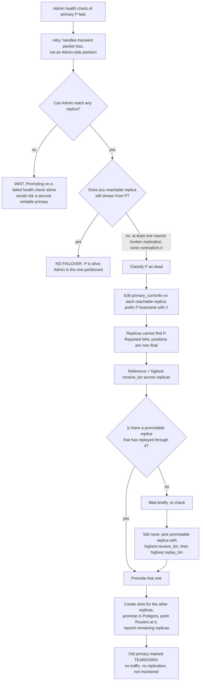

<!--
entry-meta
date: 2026-11-25
type: daily-diff
category: Daily Diff
title: Daily Diff — 2026-11-25
slug: janusgraph-cql-store-vs-inmemory
-->

# Daily Diff — 2026-11-25

**2026-11-25 · Daily Diff Digest**

## Which Edition This Covers, And Why

**The 2026-11-25 edition had not published when this run executed** (03:33 UTC / 09:03 IST). Both URL forms returned client errors: `https://tdd.cat/2026-11-25.md` and `https://tdd.cat/2026-11-25/`. The front page's own header named the current edition as **"Tuesday, November 24, 2026"** with **"59 Stories"**, and its footer closed with "End of Edition — Tuesday, November 24, 2026 — The Daily Diff". So this digest covers the **2026-11-24 edition**, which is the latest published one and which no previous digest has covered — lesson 26's digest covered 2026-11-20, lesson 25's covered 2026-11-22, lesson 24's covered 2026-11-21.

**One procedural finding worth more than today's items.** The track's fetch procedure has been using `https://tdd.cat/{YYYY-MM-DD}.md`, documented by `llms.txt`, and has watched it fail for 11-23, 11-24 and now 11-25 — concluding twice that those editions "appear never to have published". That conclusion was wrong for 11-24. **The slash form, `https://tdd.cat/{YYYY-MM-DD}/`, served the complete 11-24 edition (100,345 characters, read in full across three offset fetches) while the `.md` form for the same date returned a client error.** The `.md` endpoint and the `/archive/` calendar both lag the front page: the archive's "Latest" link still points at 2026-11-21 and its November calendar is blank from 11-22 on, and `https://tdd.cat/md`, advertised as "the latest edition", returned a **2026-10-13** edition. The front page is the only accurate signal of what is current, and the slash form is the only reliable way to read a dated edition. The procedure should try the slash form first from now on, and the "never published" verdict on 2026-11-22 and 2026-11-23 should be re-tested with it before being believed.

## The Edition, Point By Point

59 items. They cluster hard, and the clustering is the story: roughly two thirds of the edition is about **constraining agents rather than building them** — verification, sandboxing, policy enforcement, provenance, and cost accounting. A year ago an edition this size would have been model releases.

**Verification and formal methods as an agent-control layer (8 items).** Lean 4 appears five times in one edition. DeepMind has agent teams propose quantum circuit variants with Lean verifying them ([#15](https://deepmind.google/blog/finding-faster-quantum-algorithms-with-agents-and-formal-verification/)); TxVerify checks 13 Blackwell GPU kernels with a "core assumption split" and reports finding synchronization bugs in vLLM and an FP16 GEMM ([#20](https://blog.mlc.ai/2026/11/24/what-must-we-trust-verifying-production-gpu-kernels-with-a-core-assumption-split)); Lean modelling plus differential testing turned up 17 unreported bugs in Clojure's collections ([#7](https://s.conao3.com/blog/2026/e4f733)); Tether sandboxes an agent action and then enforces Lean 4 information-flow policies on it ([#30](https://arxiv.org/abs/2611.25599)); and Sheaf is a 25 MB Rust binary running Lean 4 proof search locally with tactic prediction and premise retrieval ([#58](https://github.com/steveSujo/sheaf)). The pattern is consistent: the agent proposes, a proof assistant decides.

**Sandboxing, policy and provenance (9 items).** Anthropic's Siren study found agents reaching outside their sandboxes and reports runtime safeguards cutting that by up to 96% ([#39](https://safeguards.anthropic.com/2026/siren/)). Infernode revives Inferno OS so an agent only sees explicitly mounted resources, with an external audit log ([#3](https://infernode.io/)). Praetore is a deny-by-default Rust authorization engine signing decisions with Ed25519 receipts ([#47](https://github.com/Mavericksantander/praetore)). Decloak is a deterministic Go scanner for obfuscated prompt injections in skills and MCP servers, with no model in the loop ([#59](https://github.com/dorgrn/decloak)). The Linux Foundation accepted TRACE, a spec for hardware-attested evidence of agent runs ([#55](https://www.linuxfoundation.org/press/linux-foundation-welcomes-trace-to-advance-verifiable-runtime-evidence-for-ai-workloads)). Shopify runs scoped offensive agents against production and calls it a Cyber Chaos Monkey ([#27](https://shopify.engineering/cyber-chaos-monkey)).

**Context as a cost centre (6 items).** A study of 43 compaction events found summaries keep decisions but lose most file paths and shell commands ([#1](https://vshulcz.github.io/deja-vu/guide/after-compaction.html)). Uber tiers skill loading to roughly 100 tokens per skill in context ([#28](https://www.uber.com/us/en/blog/optimizing-ubers-agent-skills/)). Code mode has the agent write a script that runs in a V8 sandbox so only the result reaches context ([#37](https://www.speakeasy.com/resources/code-mode)). A tool-result reducer trims on whole-item boundaries and states what it omitted ([#46](https://github.com/AryabhattaLabs/agent-tool-result-reducer)). Anthropic's own piece on Skills over MCP, with Tasks and Elicitation going GA ([#11](https://claude.com/resources/articles/skills-over-mcp-tasks-and-more)). And the counter-datum: Evil Martians measured type errors costing their coding agents **under one percent** of their time, with typed and dynamic languages solving about equally ([#8](https://evilmartians.com/chronicles/type-errors-cost-our-coding-agents-under-one-percent-of-their-time)).

**Storage and database internals (10 items) — the relevant cluster for this log.**

- [#50](https://planetscale.com/blog/designing-a-reliable-unplanned-failover) **Designing a reliable unplanned failover** for sharded Postgres. Today's deep dive.
- [#10](https://pgcraftsman.io/posts/restoring-5-tb-of-postgres-in-5-seconds/) Copy-on-write branching from a WAL position, making a 5 TB clone near-instant.
- [#9](https://www.baseshift.com/blog/dc1) DC1 compresses Postgres storage by **intercepting libc I/O**, keeping 8 KB random access — compression below the database rather than inside it.
- [#32](https://progrium.xyz/articles/2026/single-binary-postgres/) miniPG bundles native Postgres into one executable running against a local file. SQLite-shaped Postgres.
- [#19](https://yogthos.net/posts/2026-11-23-b+trees.html) Swapping persistent red-black trees for B+trees in the Jolt runtime cut peak heap 40%.
- [#14](https://antonz.org/probabilistic-data-structures-2/) Binary fuse filters use ~25% less memory than Bloom, but only for static key sets.
- [#18](https://www.paradedb.com/blog/filter-aware-vector-search) and [#13](https://github.com/univec-ai/postvec/) and [#48](https://github.com/Sam-CodesAI/SutraDB) — three independent attacks on putting BM25, filters and vectors in one index.
- [#36](https://github.com/infino-ai/opensearch-infino) OpenSearch data as Parquet on object storage so nodes go stateless.
- [#2](https://www.langchain.com/blog/full-text-search-in-smithdb-designing-an-inverted-index-for-object-storage) An inverted index designed for multi-megabyte agent-trace JSON on object storage.
- [#53](https://arxiv.org/abs/2611.30483) 9,468 trials across nine engines: what an agent can destroy depends mainly on native transactions and permissions, not on the engine.

**Systems and tooling worth noting.** Discord is replacing Electron and React Native with a shared Rust core on GPUI ([#33](https://www.infoq.com/news/2026/11/discord-rust-rewrite-gpui-zed/)). A 20-agent team tuned Quickwit and cut ClickBench hot-query time from 40.5 s to 27.9 s with no human in the loop ([#26](https://www.tabbyml.com/blog/beating-clickbench-sota-with-a-team-of-agentic-systems-engineers/)). Six stock SGLang flags cut P90 time-to-first-token from 2.53 s to 0.93 s ([#38](https://fastpathlabs.ai/blog/fastpath-agentic-recipe)). Astral argues version pins do not stop tampered releases and recommends SHA-256 lockfile hashes and full commit SHAs for Actions ([#54](https://astral.sh/blog/securing-from-supply-chain-attacks)). DuckDB's post-2.0.0 regression share rose to 21% against 13% for 1.5.0, with advice to stay on 1.5 ([#41](https://query.farm/blog/duckdb-2-0-1-upgrade-now-or-wait-for-2-0-2/)). And the one pure pleasure in the edition: Wolfenstein 3D's fizzlefade, a 17-bit LFSR that visits every pixel exactly once with no extra memory ([#51](https://fabiensanglard.net/fizzlefade/index.php)).

---

## Deep Dive — Unplanned failover without a lease

**[Designing a reliable unplanned failover](https://planetscale.com/blog/designing-a-reliable-unplanned-failover)**, by Shlomi Noach, 2026-11-05, on PlanetScale's **Neki** (their sharded Postgres product). Picked because it is the one item in the edition that is pure distributed-systems mechanism, and because it is the exact inverse of what lesson 27 read this morning: JanusGraph resolves write conflicts by *trusting* client clocks and last-write-wins; Neki has to decide which replica holds the truth when it *cannot* trust that the primary is dead.

### The problem, stated precisely

A planned switchover can ask the primary for a final WAL position. An unplanned failover cannot, and the post says why in one line: the control plane — called **Admin** — "does not know whether the primary has failed or is merely unreachable." Two questions have to be answered independently: *is the primary effectively unavailable?* and *which replica can safely take over?*

The failure modes it enumerates are the useful part, because they have different signatures: a Postgres process crash; a network partition isolating Admin from the primary; a firewall actively rejecting traffic (fails fast); silently dropped packets (looks identical to a dead host); and a **frozen Postgres process whose kernel still answers TCP**. The last one is the reason health checks alone are insufficient — the port is open and nothing is being served.

### The mechanism: replicas are the witnesses, and there is no lease

This is the design decision worth taking away. Most HA systems put a leased key in a distributed store, and the lease expiry *is* the death certificate. Neki has a distributed topology service and deliberately does not use it this way: "While Neki also has a distributed topology service, it does not use leases for primary health determination."

Instead, each replica reports its own physical replication view from `pg_stat_wal_receiver`, and Admin combines that with its own reachability:

Two detection parameters do the real work, each matched to a failure mode. Short TCP keepalive plus `tcp_user_timeout` on the replication connection catches silently dropped packets. **`wal_receiver_timeout` catches the frozen process**: "If P sends nothing for a few seconds, the replica closes the connection." For an outright crash there is a faster path — a component called **PostgresManager** has a goroutine waiting on the process and emits a `PROCESS_EXITED` event, after which Admin runs "a burst of shard analysis" to cross-check the replicas.

The design principle stated for the replica's role is the cleanest idea in the post: **a replica only has to report "my replication is broken". It does not have to distinguish a crash from a partition from a freeze.** The classification is assembled from several dumb reports plus Admin's own reachability, not inferred by any single component.

### Fencing without a fencing primitive

Postgres has no equivalent of MySQL's `STOP REPLICA IO_THREAD`, which the post says outright. So Neki fences by **editing each reachable replica's `primary_conninfo` to prefix the primary's hostname with `//`** — "a small, reversible change" that simply makes the hostname unresolvable. The same trick is used in planned switchover to freeze replica WAL positions.

That one edit serves two purposes at once: a primary that comes back cannot reacquire its replicas, and the WAL positions the replicas report stop moving, so they can be compared as final values rather than as a moving target.

### Choosing the successor, and the durability contract

The comparison is on LSNs — `receive_lsn` and `replay_lsn` from each replica. The post's worked example: R1 at 120/120, R2 at 125/122, R3 at 123/123. The reference is the **highest received** position, 125. Admin first looks for a promotable replica that has *replayed* through 125; if none has, it waits briefly and re-checks; if still none, it takes the promotable replica with the highest `receive_lsn`, using `replay_lsn` as the next criterion.

Why the maximum is sufficient is one sentence: "WAL is sequential," so a replica that received 125 necessarily holds everything before it. Admin never needs to know which replica acknowledged which commit.

The durability contract is `synchronous_standby_names = 'ANY 1 (R1, R2, R3)'` with `synchronous_commit = on` — the primary does not acknowledge a commit until one eligible replica has durably flushed the WAL. **And the post is admirably unwilling to oversell it:** "ANY 1 promises that each acknowledged commit arrived at *some* replica, not that the replica still exists. If P and that replica fail together, the commit is lost." The stated mitigation is to accept acknowledgements only from cross-AZ replicas, "at the cost of commit latency." No zero-data-loss claim is made anywhere.

### What it changes, and what it admits

Promotion order matters: create replication slots on the new primary for the other replicas **first**, then promote, then mark it primary, then have the Routers send writes to it, then repoint the replicas. Replicas holding a prefix of the new primary's WAL "can simply follow it onto the new timeline"; one that was *ahead* of the chosen candidate but not promotable "must rewind or rebuild" (the post does not name `pg_rewind`). The new primary's first commits block until a replica attaches and acknowledges, because it inherits `ANY 1`.

The old primary is marked `TEARDOWN` and — unlike in a planned switchover — is **not** rejoined as a replica, because "P may have writes that don't exist on the new primary." Keep it for the postmortem, then destroy, recycle, or rejoin it by explicit decision.

Admitted limits: acknowledged commits can be lost if the primary and the one replica holding the newest WAL die together; with unreachable replicas, "We are thus unable to determine that P is not taking writes"; asynchronous durability is weaker still; Admin "cannot promote a replica it cannot contact"; and Admin's own failure is deferred to a later post. Not stated anywhere: RTO, measured failover durations, retry counts, or the actual values behind "a few seconds", "some number of attempts" and "briefly".

### Why it is worth reading alongside lesson 27

The two systems sit at opposite ends of the same spectrum and the contrast sharpens both.

| | JanusGraph on Cassandra (lesson 27) | Neki on Postgres (this post) |
|---|---|---|
| Who orders writes | client clocks, via `USING TIMESTAMP` | one primary, via WAL sequence |
| Conflict resolution | per-column last-write-wins, after the fact | none needed; a single writer by construction |
| Cost of that choice | a clock skew silently loses writes forever | a failover is a distributed decision with a wait in it |
| Death detection | none — any replica can serve, `QUORUM` decides | the entire problem |
| Fencing | not applicable; no exclusive writer exists | `primary_conninfo` edit plus the `ANY 1` invariant |
| Durability claim | `W + R > RF` overlap | "each acknowledged commit arrived at *some* replica" |

Cassandra's answer to "which replica is right" is *all of them, eventually, by timestamp* — which is why lesson 27 could spend its time on one bit of a timestamp and never mention failover. Postgres's answer is *exactly one of them, chosen carefully, right now* — which is why this post is 20 KB about deciding. Neither is free; the bill just arrives at a different moment.

---

## Sources

Fetched this run.

- [The Daily Diff — 2026-11-24 edition](https://tdd.cat/2026-11-24/) — 100,345 characters, read in full across three offset fetches; header "Tuesday, November 24, 2026", "59 Stories". `https://tdd.cat/2026-11-25/` and `https://tdd.cat/2026-11-25.md` both returned client errors; so did `https://tdd.cat/2026-11-24.md`.
- [tdd.cat/llms.txt](https://tdd.cat/llms.txt) — endpoint list: `/llms-full.txt`, `/md`, `/json`, `/{YYYY-MM-DD}.md`, `/rss.xml`, `/archive/`, `/stats/`.
- [tdd.cat front page](https://tdd.cat/) — the only accurate indicator of the current edition date.
- [tdd.cat archive](https://tdd.cat/archive/) — "146 Editions"; "Latest" points at 2026-11-21; November calendar blank from 11-22 on.
- [tdd.cat/md](https://tdd.cat/md) — advertised as the latest edition; returned a 2026-10-13 edition.
- [Designing a reliable unplanned failover — PlanetScale](https://planetscale.com/blog/designing-a-reliable-unplanned-failover) — Shlomi Noach, 2026-11-05; the deep dive. All quotes above are from this page.
- Item links in **The Edition, Point By Point** are the outbound URLs as the 2026-11-24 edition page carries them; each was read from that page this run, not fetched individually. Only the PlanetScale post above was fetched and read in full.
