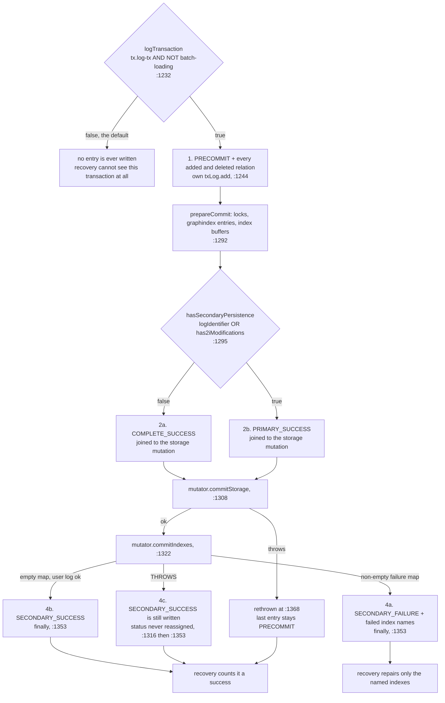
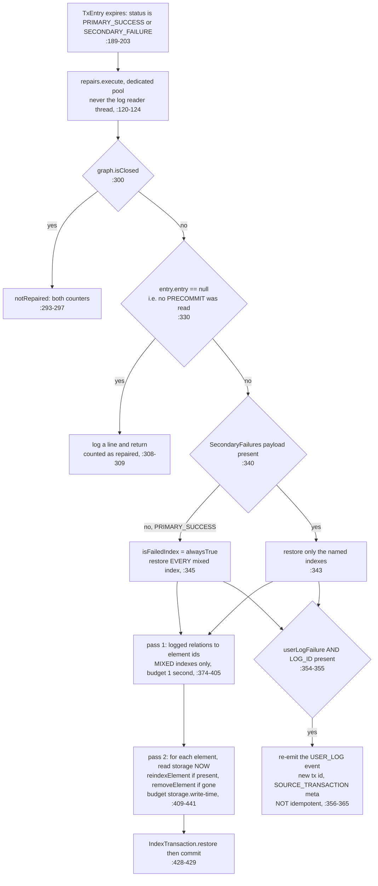

<!--
entry-meta
date: 2026-11-26
type: lesson
track: JanusGraph
lesson: 28
category: Database Internals
title: The transaction log, and what repairs a stale mixed index
slug: janusgraph-tx-log-stale-index-repair
-->

# The transaction log, and what repairs a stale mixed index

**2026-11-26 · JanusGraph Track · Lesson 28 of 28**

## Where This Fits

- **Lesson 27** established that the CQL backend's whole write-ordering guarantee is one bit of the commit timestamp — `getDeletionTime` is `times.getTime(t) & 0xFFFF...FEL`, `getAdditionTime` the same with `| 1L` — and that a key's mutations are split by `.grouped(20)` into *several concurrent unlogged batches*. It closed with candidate 74: what happens when `graph.assign-timestamp` is `false`. See [`2026-11-25-janusgraph-cql-store-vs-inmemory`](../2026-11-25-janusgraph-cql-store-vs-inmemory/README.md).
- **This lesson** reads the write-ahead transaction log — its byte layout, its five statuses, where in `commit` each one is written, and the recovery processor that turns a status into an index repair. It then reads the two stale-entry removers side by side, and settles the ninefold debt Parts V and VI handed forward.
- **The capstone** assembles Parts I–VI end to end. What this lesson leaves it is a precise statement of JanusGraph's *actual* durability contract, which turns out to be narrower than the one the comments claim.

The one sentence that organises everything below: **the edgestore is the truth and a mixed index is a cache of it, so every repair path in JanusGraph re-derives the index from storage rather than replaying the mutation that failed.** Once you see that, the log's job stops being "undo" and becomes "a list of element ids worth re-deriving".

---

## 1. The log record: six statuses, one header, three content shapes

`LogTxStatus` ([32 lines, blob `3f5ba38c`](https://github.com/JanusGraph/janusgraph/blob/a59ae8d8024207598eada34998d867617df51adf/janusgraph-core/src/main/java/org/janusgraph/graphdb/database/log/LogTxStatus.java#L22)) is the whole vocabulary:

```java
PRECOMMIT, PRIMARY_SUCCESS, COMPLETE_SUCCESS, SECONDARY_SUCCESS, SECONDARY_FAILURE, USER_LOG;
```

with two helpers at [`:24-30`](https://github.com/JanusGraph/janusgraph/blob/a59ae8d8024207598eada34998d867617df51adf/janusgraph-core/src/main/java/org/janusgraph/graphdb/database/log/LogTxStatus.java#L24-L30) — `isPrimarySuccess()` (`PRIMARY_SUCCESS` or `COMPLETE_SUCCESS`) and `isSuccess()` (those two plus `SECONDARY_SUCCESS`). **Neither helper is used by the recovery processor**, which switches on the enum directly; they are API surface for callers reading the log themselves.

Every entry is written by one of four `serialize*` methods on `TransactionLogHeader` ([282 lines, 12,329 bytes, blob `5bc78140`](https://github.com/JanusGraph/janusgraph/blob/a59ae8d8024207598eada34998d867617df51adf/janusgraph-core/src/main/java/org/janusgraph/graphdb/database/log/TransactionLogHeader.java)), and all four funnel through one private `serializeHeader` at [`:146-161`](https://github.com/JanusGraph/janusgraph/blob/a59ae8d8024207598eada34998d867617df51adf/janusgraph-core/src/main/java/org/janusgraph/graphdb/database/log/TransactionLogHeader.java#L146-L161). The layout is fixed and small:

| offset | field | written at | notes |
|---|---|---|---|
| 0 | **8 bytes**, `putLong(times.getTime(txTimestamp))` | [`:149`](https://github.com/JanusGraph/janusgraph/blob/a59ae8d8024207598eada34998d867617df51adf/janusgraph-core/src/main/java/org/janusgraph/graphdb/database/log/TransactionLogHeader.java#L149) | the provider's units, **microseconds**, not nanos |
| 8 | `VariableLong.writePositive(transactionId)` | [`:150`](https://github.com/JanusGraph/janusgraph/blob/a59ae8d8024207598eada34998d867617df51adf/janusgraph-core/src/main/java/org/janusgraph/graphdb/database/log/TransactionLogHeader.java#L150) | variable width; `> 0` enforced in the ctor at [`:58`](https://github.com/JanusGraph/janusgraph/blob/a59ae8d8024207598eada34998d867617df51adf/janusgraph-core/src/main/java/org/janusgraph/graphdb/database/log/TransactionLogHeader.java#L58) |
| … | `writeObjectNotNull(status)` | [`:151`](https://github.com/JanusGraph/janusgraph/blob/a59ae8d8024207598eada34998d867617df51adf/janusgraph-core/src/main/java/org/janusgraph/graphdb/database/log/TransactionLogHeader.java#L151) | the `LogTxStatus` through the full serializer |
| … | **1 byte** meta count | [`:154`](https://github.com/JanusGraph/janusgraph/blob/a59ae8d8024207598eada34998d867617df51adf/janusgraph-core/src/main/java/org/janusgraph/graphdb/database/log/TransactionLogHeader.java#L154) | guarded by `meta.size() < Byte.MAX_VALUE` at [`:153`](https://github.com/JanusGraph/janusgraph/blob/a59ae8d8024207598eada34998d867617df51adf/janusgraph-core/src/main/java/org/janusgraph/graphdb/database/log/TransactionLogHeader.java#L153) |
| … | per meta entry: **1 byte ordinal**, then the value | [`:157-158`](https://github.com/JanusGraph/janusgraph/blob/a59ae8d8024207598eada34998d867617df51adf/janusgraph-core/src/main/java/org/janusgraph/graphdb/database/log/TransactionLogHeader.java#L157-L158) | `LogTxMeta.ordinal()` — **position in the enum is the wire format** |
| … | content | — | status-dependent, see below |

Two things in that table are load-bearing and easy to miss.

**The meta key is an enum ordinal.** [`:157`](https://github.com/JanusGraph/janusgraph/blob/a59ae8d8024207598eada34998d867617df51adf/janusgraph-core/src/main/java/org/janusgraph/graphdb/database/log/TransactionLogHeader.java#L157) writes `metaEntry.getKey().ordinal()` and `parse` reads it back as `LogTxMeta.values()[...]` at [`:172`](https://github.com/JanusGraph/janusgraph/blob/a59ae8d8024207598eada34998d867617df51adf/janusgraph-core/src/main/java/org/janusgraph/graphdb/database/log/TransactionLogHeader.java#L172). `LogTxMeta` ([90 lines, blob `5ba2f284`](https://github.com/JanusGraph/janusgraph/blob/a59ae8d8024207598eada34998d867617df51adf/janusgraph-core/src/main/java/org/janusgraph/graphdb/database/log/LogTxMeta.java)) declares exactly three constants in this order: `GROUPNAME` (0), `LOG_ID` (1), `SOURCE_TRANSACTION` (2). **Inserting or reordering a constant silently reinterprets every log entry written by an older instance** — and the transaction log is read by a *different* process than the one that wrote it, possibly a different version. There is no version byte anywhere in the header. This is the same positional-contract smell lesson 25 found in the mixed-index status (last slot of a `Parameter[]`, behind an `assert`), one layer down and on the wire instead of in the schema.

**`SOURCE_TRANSACTION` is write-only from the transaction's side.** Its `getValue(txConfig)` returns `null` unconditionally at [`:66-68`](https://github.com/JanusGraph/janusgraph/blob/a59ae8d8024207598eada34998d867617df51adf/janusgraph-core/src/main/java/org/janusgraph/graphdb/database/log/LogTxMeta.java#L66-L68) and its `setValue` is an empty body at [`:70-73`](https://github.com/JanusGraph/janusgraph/blob/a59ae8d8024207598eada34998d867617df51adf/janusgraph-core/src/main/java/org/janusgraph/graphdb/database/log/LogTxMeta.java#L70-L73). So the `serializeHeader(…, TransactionConfiguration)` overload at [`:132-143`](https://github.com/JanusGraph/janusgraph/blob/a59ae8d8024207598eada34998d867617df51adf/janusgraph-core/src/main/java/org/janusgraph/graphdb/database/log/TransactionLogHeader.java#L132-L143), which loops `LogTxMeta.values()` and skips nulls, can never emit it. It is put into the map **by hand**, only by `serializeUserLog` at [`:101`](https://github.com/JanusGraph/janusgraph/blob/a59ae8d8024207598eada34998d867617df51adf/janusgraph-core/src/main/java/org/janusgraph/graphdb/database/log/TransactionLogHeader.java#L101), which is how a replayed user-log event says which original transaction it came from.

### The three content shapes

- **`serializeModifications`** ([`:76-84`](https://github.com/JanusGraph/janusgraph/blob/a59ae8d8024207598eada34998d867617df51adf/janusgraph-core/src/main/java/org/janusgraph/graphdb/database/log/TransactionLogHeader.java#L76-L84), `PRECOMMIT` or `USER_LOG` only) writes `logRelations(added)` then `logRelations(deleted)`. `logRelations` ([`:86-93`](https://github.com/JanusGraph/janusgraph/blob/a59ae8d8024207598eada34998d867617df51adf/janusgraph-core/src/main/java/org/janusgraph/graphdb/database/log/TransactionLogHeader.java#L86-L93)) writes a positive count, then per relation the out-vertex id via `IDHandler.writeVertexId(out, …, true)` and **the exact same `Entry` the edgestore gets**, from `tx.getEdgeSerializer().writeRelation(rel, 0, tx)`. The log therefore carries lesson 10's column layout verbatim — no second encoding. Capacity is pre-sized `256 + (added + deleted) * 40` at [`:80`](https://github.com/JanusGraph/janusgraph/blob/a59ae8d8024207598eada34998d867617df51adf/janusgraph-core/src/main/java/org/janusgraph/graphdb/database/log/TransactionLogHeader.java#L80), i.e. 40 bytes budgeted per relation.
  **The added/removed distinction is purely positional.** `getContentAsModifications` at [`:227-236`](https://github.com/JanusGraph/janusgraph/blob/a59ae8d8024207598eada34998d867617df51adf/janusgraph-core/src/main/java/org/janusgraph/graphdb/database/log/TransactionLogHeader.java#L227-L236) calls `readModifications(Change.ADDED, …)` and then `readModifications(Change.REMOVED, …)` against the same buffer, in that order. Nothing in the bytes says which list is which; the first count encountered is additions *because the reader says so*.
- **`serializePrimary`** ([`:107-111`](https://github.com/JanusGraph/janusgraph/blob/a59ae8d8024207598eada34998d867617df51adf/janusgraph-core/src/main/java/org/janusgraph/graphdb/database/log/TransactionLogHeader.java#L107-L111)) writes **header only, no content**, with a capacity of 30 bytes ([`:128-130`](https://github.com/JanusGraph/janusgraph/blob/a59ae8d8024207598eada34998d867617df51adf/janusgraph-core/src/main/java/org/janusgraph/graphdb/database/log/TransactionLogHeader.java#L128-L130)) and an empty meta map — so a `PRIMARY_SUCCESS` entry carries *no* `LOG_ID`, which matters in §5.
- **`serializeSecondary`** ([`:113-126`](https://github.com/JanusGraph/janusgraph/blob/a59ae8d8024207598eada34998d867617df51adf/janusgraph-core/src/main/java/org/janusgraph/graphdb/database/log/TransactionLogHeader.java#L113-L126)) writes a boolean then an `int` count then the failed index names. Note the polarity flip: the wire carries `userLogSuccess` ([`:118`](https://github.com/JanusGraph/janusgraph/blob/a59ae8d8024207598eada34998d867617df51adf/janusgraph-core/src/main/java/org/janusgraph/graphdb/database/log/TransactionLogHeader.java#L118)) and `SecondaryFailures` reads it as `userLogFailure = !in.getBoolean()` ([`:258`](https://github.com/JanusGraph/janusgraph/blob/a59ae8d8024207598eada34998d867617df51adf/janusgraph-core/src/main/java/org/janusgraph/graphdb/database/log/TransactionLogHeader.java#L258)). Also: the count is a **full 4-byte `putInt`** for a value that is bounded by the number of configured index backends — the only fixed-width integer in a header that uses `VariableLong` for the transaction id.
  For `SECONDARY_SUCCESS` the body is skipped entirely and replaced by `assert userLogSuccess && indexFailures.isEmpty()` at [`:124`](https://github.com/JanusGraph/janusgraph/blob/a59ae8d8024207598eada34998d867617df51adf/janusgraph-core/src/main/java/org/janusgraph/graphdb/database/log/TransactionLogHeader.java#L124) — an assertion, so off in production. Hold that thought until §3.

### The row key is a hash, not a time

[`:60`](https://github.com/JanusGraph/janusgraph/blob/a59ae8d8024207598eada34998d867617df51adf/janusgraph-core/src/main/java/org/janusgraph/graphdb/database/log/TransactionLogHeader.java#L60):

```java
logKey = HashingUtil.hashPrefixKey(HashingUtil.HashLength.SHORT, BufferUtil.getLongBuffer(transactionId));
```

All four entries of one transaction share that key, so they land in one row and are read together. But the key is a **hash prefix of the transaction id**, so consecutive transactions scatter across the ring. The log is not a time-ordered structure at the storage level at all; its ordering comes from `KCVSLog`'s own bucketing and the timestamp *inside* each entry. `log.num-buckets` defaults to **1** ([`GraphDatabaseConfiguration:1330-1332`](https://github.com/JanusGraph/janusgraph/blob/a59ae8d8024207598eada34998d867617df51adf/janusgraph-core/src/main/java/org/janusgraph/graphdb/configuration/GraphDatabaseConfiguration.java#L1330-L1332)) and `log.read-threads` to **1** ([`:1350-1352`](https://github.com/JanusGraph/janusgraph/blob/a59ae8d8024207598eada34998d867617df51adf/janusgraph-core/src/main/java/org/janusgraph/graphdb/configuration/GraphDatabaseConfiguration.java#L1350-L1352)), so by default **one thread reads one bucket**, however many instances are writing.

---

## 2. Where the four entries are written in a commit

All of this is `StandardJanusGraph.commit`, [1,490 lines, 80,408 bytes, blob `f650acb2`](https://github.com/JanusGraph/janusgraph/blob/a59ae8d8024207598eada34998d867617df51adf/janusgraph-core/src/main/java/org/janusgraph/graphdb/database/StandardJanusGraph.java). The gate is one line, [`:1232`](https://github.com/JanusGraph/janusgraph/blob/a59ae8d8024207598eada34998d867617df51adf/janusgraph-core/src/main/java/org/janusgraph/graphdb/database/StandardJanusGraph.java#L1232):

```java
final boolean logTransaction = config.hasLogTransactions() && !tx.getConfiguration().hasEnabledBatchLoading();
```

**Two defaults worth stating plainly.** `tx.log-tx` is `GLOBAL` and defaults to **`false`** ([`GraphDatabaseConfiguration:259-261`](https://github.com/JanusGraph/janusgraph/blob/a59ae8d8024207598eada34998d867617df51adf/janusgraph-core/src/main/java/org/janusgraph/graphdb/configuration/GraphDatabaseConfiguration.java#L259-L261)) — so **on a stock graph none of this machinery runs and an index failure is permanent and unrecorded**. And `storage.batch-loading` *silently disables* the log for the transactions that enable it. That second conjunct deserves a stare: batch loading is the mode used to ingest bulk data, which is the mode that writes the most index documents, under the most backend pressure, and it is the one mode with no write-ahead record.

With the gate open, the sequence is:

| # | entry | where | committed how |
|---|---|---|---|
| 1 | `PRECOMMIT` + the whole modification list | [`:1244`](https://github.com/JanusGraph/janusgraph/blob/a59ae8d8024207598eada34998d867617df51adf/janusgraph-core/src/main/java/org/janusgraph/graphdb/database/StandardJanusGraph.java#L1244) | its own `txLog.add(...)`, **before** `prepareCommit` |
| 2 | `PRIMARY_SUCCESS`, or `COMPLETE_SUCCESS` if there is no secondary work | [`:1302-1304`](https://github.com/JanusGraph/janusgraph/blob/a59ae8d8024207598eada34998d867617df51adf/janusgraph-core/src/main/java/org/janusgraph/graphdb/database/StandardJanusGraph.java#L1302-L1304) | passed `mutator.getTxLogPersistor()`, so it joins the **storage mutation** |
| 3 | `USER_LOG` into `ulog_<identifier>` | [`:1334`](https://github.com/JanusGraph/janusgraph/blob/a59ae8d8024207598eada34998d867617df51adf/janusgraph-core/src/main/java/org/janusgraph/graphdb/database/StandardJanusGraph.java#L1334) | separate log, only when `logIdentifier != null` |
| 4 | `SECONDARY_SUCCESS` or `SECONDARY_FAILURE` | [`:1353`](https://github.com/JanusGraph/janusgraph/blob/a59ae8d8024207598eada34998d867617df51adf/janusgraph-core/src/main/java/org/janusgraph/graphdb/database/StandardJanusGraph.java#L1353), in a `finally` | its own `txLog.add(...)`, exceptions swallowed |

Entry 2 is the interesting one. `hasSecondaryPersistence` at [`:1295`](https://github.com/JanusGraph/janusgraph/blob/a59ae8d8024207598eada34998d867617df51adf/janusgraph-core/src/main/java/org/janusgraph/graphdb/database/StandardJanusGraph.java#L1295) is `logTxIdentifier != null || commitSummary.has2iModifications` — so **a transaction that touches no mixed index and writes no user log records `COMPLETE_SUCCESS` and is never a recovery candidate**, which is exactly right and is why composite-only workloads pay nothing.

The in-source comment at [`:1299-1300`](https://github.com/JanusGraph/janusgraph/blob/a59ae8d8024207598eada34998d867617df51adf/janusgraph-core/src/main/java/org/janusgraph/graphdb/database/StandardJanusGraph.java#L1299-L1300) states the design:

> Add success message to tx log which will be committed atomically with all transactional changes so that we can recover secondary failures

That is the whole correctness argument of the recovery system, and §3 is about the fact that it is **not true on the backend most JanusGraph deployments use**.

Two more details on this path:

- **`commitStorage` is wrapped and rethrown without touching the log** ([`:1307-1313`](https://github.com/JanusGraph/janusgraph/blob/a59ae8d8024207598eada34998d867617df51adf/janusgraph-core/src/main/java/org/janusgraph/graphdb/database/StandardJanusGraph.java#L1307-L1313)). So a storage failure leaves `PRECOMMIT` as the last entry — and §4 shows recovery treats that as a *success*. Defensible: if the primary write did not land, there is nothing in the edgestore for the index to diverge from.
- **`userlogSuccess` is pessimistic by construction**: set `false` at [`:1332`](https://github.com/JanusGraph/janusgraph/blob/a59ae8d8024207598eada34998d867617df51adf/janusgraph-core/src/main/java/org/janusgraph/graphdb/database/StandardJanusGraph.java#L1332) *before* the attempt and back to `true` at [`:1342`](https://github.com/JanusGraph/janusgraph/blob/a59ae8d8024207598eada34998d867617df51adf/janusgraph-core/src/main/java/org/janusgraph/graphdb/database/StandardJanusGraph.java#L1342) only after `env.get()` has returned. A thrown `Future` unwraps its `ExecutionException` cause at [`:1338-1339`](https://github.com/JanusGraph/janusgraph/blob/a59ae8d8024207598eada34998d867617df51adf/janusgraph-core/src/main/java/org/janusgraph/graphdb/database/StandardJanusGraph.java#L1338-L1339) so the error that reaches the log is the real one. But note `if (env.isDone())` at [`:1335`](https://github.com/JanusGraph/janusgraph/blob/a59ae8d8024207598eada34998d867617df51adf/janusgraph-core/src/main/java/org/janusgraph/graphdb/database/StandardJanusGraph.java#L1335): a user-log write that has **not** completed yet is reported as a success without ever being awaited. With `log.send-delay` defaulting to **1000 ms** ([`GraphDatabaseConfiguration:1342-1344`](https://github.com/JanusGraph/janusgraph/blob/a59ae8d8024207598eada34998d867617df51adf/janusgraph-core/src/main/java/org/janusgraph/graphdb/configuration/GraphDatabaseConfiguration.java#L1342-L1344)), `isDone()` is *normally false*, so the normal path records `userlogSuccess = true` for a message still sitting in a local buffer. The `MAX_COMMIT_TIME` javadoc acknowledges this obliquely — it says a user-log write counts toward the commit budget "up to `log.user.max-write-time` **when `log.user.send-delay` is 0**" ([`:278-280`](https://github.com/JanusGraph/janusgraph/blob/a59ae8d8024207598eada34998d867617df51adf/janusgraph-core/src/main/java/org/janusgraph/graphdb/configuration/GraphDatabaseConfiguration.java#L278-L280)).



---

## 3. The atomicity claim, and the backend where it does not hold

The recovery system rests on this: a `PRIMARY_SUCCESS` entry exists **if and only if** the storage mutation landed. That is what makes "`PRIMARY_SUCCESS` with no secondary status" a sound trigger for repair — it means the edgestore has the data and the index may not.

The mechanism is `mutator.getTxLogPersistor()` at [`:1304`](https://github.com/JanusGraph/janusgraph/blob/a59ae8d8024207598eada34998d867617df51adf/janusgraph-core/src/main/java/org/janusgraph/graphdb/database/StandardJanusGraph.java#L1304): instead of writing the entry itself, the log hands it to the backend transaction, which commits it together with everything else. JanusGraph is **borrowing the storage backend's own atomicity** rather than implementing any.

Now put lesson 27's findings next to it.

- The transaction log is a **different store** (`system_txlog`, `TRANSACTION_LOG = "tx"` at [`GraphDatabaseConfiguration:1316`](https://github.com/JanusGraph/janusgraph/blob/a59ae8d8024207598eada34998d867617df51adf/janusgraph-core/src/main/java/org/janusgraph/graphdb/configuration/GraphDatabaseConfiguration.java#L1316)) from the edgestore and the graphindex.
- Its row key is `hashPrefixKey(SHORT, transactionId)` — **unrelated** to any edgestore row key, so it is a different partition on any ring.
- On CQL with the shipped default `storage.cql.atomic-batch-mutate=false`, a mutation is `Iterator.concat(deletions, additions).grouped(20)` fired as **several independent async `UNLOGGED` batches**, and an `UNLOGGED` batch spanning several partitions is not atomic in the first place.

**So on the default CQL configuration the sentence "committed atomically with all transactional changes" is false.** The `PRIMARY_SUCCESS` entry and the edgestore rows are separate writes to separate partitions, which can succeed and fail independently. Two consequences, in opposite directions:

- **Entry lands, storage does not** → recovery sees `PRIMARY_SUCCESS` with no secondary status, expires the transaction, and runs a repair. The repair re-derives from storage (§5), finds the element unchanged or absent, and writes documents that match current truth. **Harmless**, because the repair is a re-derivation and not a replay. This is the single best argument for the re-derivation design.
- **Storage lands, entry does not** → the last entry is `PRECOMMIT`, recovery counts a success ([`StandardTransactionLogProcessor:200-202`](https://github.com/JanusGraph/janusgraph/blob/a59ae8d8024207598eada34998d867617df51adf/janusgraph-core/src/main/java/org/janusgraph/graphdb/log/StandardTransactionLogProcessor.java#L200-L202)), and **a subsequent index failure in that same transaction is never repaired**. The edgestore and the mixed index diverge permanently, silently, with the write-ahead log enabled and reporting success.

The asymmetry is the finding: **the design is safe against a lost storage write and unsafe against a lost log write**, and on CQL both are possible for the same reason.

**Candidate 74, settled.** `ASSIGN_TIMESTAMP` is defined at [`GraphDatabaseConfiguration:769-774`](https://github.com/JanusGraph/janusgraph/blob/a59ae8d8024207598eada34998d867617df51adf/janusgraph-core/src/main/java/org/janusgraph/graphdb/configuration/GraphDatabaseConfiguration.java#L769-L774) as `ConfigOption.Type.LOCAL`, `Boolean.class`, default **`true`**, with no verifier. Three things follow:

1. **The default is `true`, so lesson 27's timestamp argument holds out of the box** — the delete/add LSB discriminator is in force and candidate 74's hazard is not the shipped behaviour.
2. The option's own description *is* lesson 27's finding in prose: *"JanusGraph assigns one timestamp to all insertions and another slightly earlier timestamp to all deletions in the same batch"*. "Slightly earlier" is the `& …FEL` versus `| 1L` pair, one microsecond apart.
3. **But the type is `LOCAL`, not `GLOBAL`.** It is a per-instance setting with no cluster-wide agreement, so two instances writing the same Cassandra table may disagree about whether mutations carry `USING TIMESTAMP` at all. That is a *sharper* version of candidate 74 than the one lesson 27 posed, and it costs nothing to reach — one instance with a stale properties file. **Candidate 74 is therefore narrowed, not closed**: the default is safe, the mixed-fleet case is not, and whether anything detects the disagreement is unread.

As a freebie from the same file: **candidate 78's gate is also settled** — `STORAGE_TRANSACTIONAL` (`storage.transactions`) is `MASKABLE` with default **`true`** ([`:765-767`](https://github.com/JanusGraph/janusgraph/blob/a59ae8d8024207598eada34998d867617df51adf/janusgraph-core/src/main/java/org/janusgraph/graphdb/configuration/GraphDatabaseConfiguration.java#L765-L767)), so the `InMemoryColumnValueStore` NPE is configuration-specific rather than live on a default graph. Candidate 78 drops in priority accordingly.

---

## 4. The recovery processor: the log's read position is the clock

`StandardTransactionLogProcessor` ([585 lines, 27,719 bytes, blob `300d11dd`](https://github.com/JanusGraph/janusgraph/blob/a59ae8d8024207598eada34998d867617df51adf/janusgraph-core/src/main/java/org/janusgraph/graphdb/log/StandardTransactionLogProcessor.java)) is a Caffeine cache with an unusual ticker, plus a thread pool.

It refuses to start without the log: `Preconditions.checkArgument(graph.getConfiguration().hasLogTransactions(), "Transaction logging must be enabled for recovery to work")` at [`:135-136`](https://github.com/JanusGraph/janusgraph/blob/a59ae8d8024207598eada34998d867617df51adf/janusgraph-core/src/main/java/org/janusgraph/graphdb/log/StandardTransactionLogProcessor.java#L135-L136).

### The ticker is the log's read progress

[`:166-168`](https://github.com/JanusGraph/janusgraph/blob/a59ae8d8024207598eada34998d867617df51adf/janusgraph-core/src/main/java/org/janusgraph/graphdb/log/StandardTransactionLogProcessor.java#L166-L168):

```java
this.txCache = Caffeine.newBuilder()
    .initialCapacity(100)
    .ticker(() -> tick.accumulateAndGet(epochNanos(readProgress(startTime)), Math::max))
```

The cache's notion of "now" is **how far the log has been read**, not wall-clock time, with `tick` an `AtomicLong` seeded at `Long.MIN_VALUE` ([`:165`](https://github.com/JanusGraph/janusgraph/blob/a59ae8d8024207598eada34998d867617df51adf/janusgraph-core/src/main/java/org/janusgraph/graphdb/log/StandardTransactionLogProcessor.java#L165)) and `accumulateAndGet(…, Math::max)` making it monotonic by force. The comment at [`:149-151`](https://github.com/JanusGraph/janusgraph/blob/a59ae8d8024207598eada34998d867617df51adf/janusgraph-core/src/main/java/org/janusgraph/graphdb/log/StandardTransactionLogProcessor.java#L149-L151) gives the reason:

> A transaction is given up on once the log has been read and processed up to max-commit-time past its first entry, rather than after some time spent waiting, so that it gets all it may write within max-commit-time however far apart and however slowly the log is read

This is the right call and it is not the obvious one. A wall-clock deadline would condemn transactions whenever the *reader* fell behind — exactly when a cluster is unhealthy and transactions are most likely to be fine. Tying the deadline to read position makes the decision depend only on log content.

`nanosUntilExpiry` ([`:240-247`](https://github.com/JanusGraph/janusgraph/blob/a59ae8d8024207598eada34998d867617df51adf/janusgraph-core/src/main/java/org/janusgraph/graphdb/log/StandardTransactionLogProcessor.java#L240-L247)) does the arithmetic:

```java
final long longest = GraphDatabaseConfiguration.LONGEST_RECOVERY_WAIT.toNanos();
final long wait = Durations.min(maxTxLength, GraphDatabaseConfiguration.LONGEST_RECOVERY_WAIT).toNanos();
final long ahead = epochNanos(firstEntryTime) - readProgress;
final long remaining = ahead > longest ? longest : ahead + wait + 1;
return Math.max(0, Math.min(remaining, longest));
```

Three deliberate details: the `+ 1` nanosecond is there because read progress is **exclusive** and log timestamps are **microseconds**, so one nanosecond past the deadline is unreachable by any entry ([`:230-233`](https://github.com/JanusGraph/janusgraph/blob/a59ae8d8024207598eada34998d867617df51adf/janusgraph-core/src/main/java/org/janusgraph/graphdb/log/StandardTransactionLogProcessor.java#L230-L233)); the `ahead > longest` branch exists only to stop the sum wrapping; and `LONGEST_RECOVERY_WAIT = Duration.ofNanos(Long.MAX_VALUE >>> 1)` ([`GraphDatabaseConfiguration:1844`](https://github.com/JanusGraph/janusgraph/blob/a59ae8d8024207598eada34998d867617df51adf/janusgraph-core/src/main/java/org/janusgraph/graphdb/configuration/GraphDatabaseConfiguration.java#L1844)) is ≈ 4.61 × 10¹⁸ ns, about **146 years** — a half-range bound so that two of them can be added without overflow, which is precisely what `ahead + wait + 1` needs.

`expireAfterUpdate` returns `currentDuration` unchanged at [`:176-179`](https://github.com/JanusGraph/janusgraph/blob/a59ae8d8024207598eada34998d867617df51adf/janusgraph-core/src/main/java/org/janusgraph/graphdb/log/StandardTransactionLogProcessor.java#L176-L179), and so does `expireAfterRead`. **A later entry for the same transaction does not extend its deadline** — the clock starts at the *first* entry read and nothing resets it. Combined with `TxEntry(message.getTimestamp())` at [`:504`](https://github.com/JanusGraph/janusgraph/blob/a59ae8d8024207598eada34998d867617df51adf/janusgraph-core/src/main/java/org/janusgraph/graphdb/log/StandardTransactionLogProcessor.java#L504) — the *message's* timestamp, not the header's, with the comment at [`:502-503`](https://github.com/JanusGraph/janusgraph/blob/a59ae8d8024207598eada34998d867617df51adf/janusgraph-core/src/main/java/org/janusgraph/graphdb/log/StandardTransactionLogProcessor.java#L502-L503) noting that *"a transaction's commit time can be set by hand and be long past"* — the window is well defined even for a transaction with a forged `txTimestamp`.

### The eviction listener is the decision point

[`:189-203`](https://github.com/JanusGraph/janusgraph/blob/a59ae8d8024207598eada34998d867617df51adf/janusgraph-core/src/main/java/org/janusgraph/graphdb/log/StandardTransactionLogProcessor.java#L189-L203):

| status at expiry | action |
|---|---|
| `SECONDARY_FAILURE` | `repairs.execute(() -> repair(key, entry))` |
| `PRIMARY_SUCCESS` | same |
| `PRECOMMIT` (nothing after it) | `successTxCounter.incrementAndGet()` |
| `COMPLETE_SUCCESS` | same |
| `SECONDARY_SUCCESS` | same |

It is an **eviction** listener, not a removal listener, precisely so the handover happens *during* `cleanUp()` — the comment at [`:187-188`](https://github.com/JanusGraph/janusgraph/blob/a59ae8d8024207598eada34998d867617df51adf/janusgraph-core/src/main/java/org/janusgraph/graphdb/log/StandardTransactionLogProcessor.java#L187-L188) says the cleaner's final pass at shutdown relies on that. And it asserts its own precondition hard: `Preconditions.checkArgument(cause == RemovalCause.EXPIRED, …)` at [`:190-191`](https://github.com/JanusGraph/janusgraph/blob/a59ae8d8024207598eada34998d867617df51adf/janusgraph-core/src/main/java/org/janusgraph/graphdb/log/StandardTransactionLogProcessor.java#L190-L191) — size-based eviction would be a bug, and the cache is deliberately unbounded.

Repairs run on a dedicated `ThreadPoolExecutor` ([`:158-162`](https://github.com/JanusGraph/janusgraph/blob/a59ae8d8024207598eada34998d867617df51adf/janusgraph-core/src/main/java/org/janusgraph/graphdb/log/StandardTransactionLogProcessor.java#L158-L162)) sized by `tx.recovery.repair-pool-size` or, unset, `ForkJoinPool.getCommonPoolParallelism()` ([`:155-157`](https://github.com/JanusGraph/janusgraph/blob/a59ae8d8024207598eada34998d867617df51adf/janusgraph-core/src/main/java/org/janusgraph/graphdb/log/StandardTransactionLogProcessor.java#L155-L157)), with `allowCoreThreadTimeOut(true)` and a 1-minute keep-alive ([`GraphDatabaseConfiguration:300-303`](https://github.com/JanusGraph/janusgraph/blob/a59ae8d8024207598eada34998d867617df51adf/janusgraph-core/src/main/java/org/janusgraph/graphdb/configuration/GraphDatabaseConfiguration.java#L300-L303)). The reason is in the comment at [`:120-123`](https://github.com/JanusGraph/janusgraph/blob/a59ae8d8024207598eada34998d867617df51adf/janusgraph-core/src/main/java/org/janusgraph/graphdb/log/StandardTransactionLogProcessor.java#L120-L123): a repair *writes backends* for up to `storage.write-time`, so it must not run on the thread that expired the entry — which would be a common-pool thread, the cleaner, or the log reader. A repair blocking the log reader would stall the ticker, which would stop further expiries: a self-deadlock the pool exists to prevent.

### Two defects in the bookkeeping

**(a) A dead precondition.** [`:137-140`](https://github.com/JanusGraph/janusgraph/blob/a59ae8d8024207598eada34998d867617df51adf/janusgraph-core/src/main/java/org/janusgraph/graphdb/log/StandardTransactionLogProcessor.java#L137-L140):

```java
Duration maxTxLength = graph.getConfiguration().getMaxCommitTime();
if (maxTxLength.compareTo(MIN_TX_LENGTH)<0) maxTxLength= MIN_TX_LENGTH;
Preconditions.checkArgument(maxTxLength != null && !maxTxLength.isZero(),
        "Max transaction time cannot be 0");
```

The floor runs **before** the check. If `getMaxCommitTime()` returned `null`, line 138 would already have thrown `NullPointerException`; if it returned zero, line 138 replaced it with `MIN_TX_LENGTH` (5 s). So the precondition at `:139-140` **cannot fail** — it is satisfied or already bypassed by a different exception. Harmless, but it is a guard that reads as protection and provides none, and the fix is to swap the two statements.

**(b) An unrepaired transaction counts as repaired.** `repair` ([`:299-318`](https://github.com/JanusGraph/janusgraph/blob/a59ae8d8024207598eada34998d867617df51adf/janusgraph-core/src/main/java/org/janusgraph/graphdb/log/StandardTransactionLogProcessor.java#L299-L318)) sets `repaired = true` immediately after `fixSecondaryFailure` returns without throwing. But `fixSecondaryFailure` has an early return at [`:330-333`](https://github.com/JanusGraph/janusgraph/blob/a59ae8d8024207598eada34998d867617df51adf/janusgraph-core/src/main/java/org/janusgraph/graphdb/log/StandardTransactionLogProcessor.java#L330-L333):

```java
if (entry.entry==null) {
    logRecoveryMsg("Trying to repair expired or unpersisted transaction [%s] (Ignore in startup)", txId);
    return;
}
```

`entry.entry` is only set by the `PRECOMMIT` case of `TxEntry.update` ([`:526-529`](https://github.com/JanusGraph/janusgraph/blob/a59ae8d8024207598eada34998d867617df51adf/janusgraph-core/src/main/java/org/janusgraph/graphdb/log/StandardTransactionLogProcessor.java#L526-L529)) — the only entry that carries the modification list. So a transaction whose `PRECOMMIT` entry was never read (expired under the log TTL, or the reader started after it) but whose `PRIMARY_SUCCESS` or `SECONDARY_FAILURE` *was* read reaches `repair`, does nothing, and is counted in `failureTxCounter` but **not** in `failureTxRepairExceptionCounter`. `getStatistics()` ([`:254-256`](https://github.com/JanusGraph/janusgraph/blob/a59ae8d8024207598eada34998d867617df51adf/janusgraph-core/src/main/java/org/janusgraph/graphdb/log/StandardTransactionLogProcessor.java#L254-L256)) returns `{success, failure, failureRepairException}`, so an operator reading those three numbers sees "failed, and repaired cleanly" for a transaction that was not repaired at all. The ordering comment at [`:313-314`](https://github.com/JanusGraph/janusgraph/blob/a59ae8d8024207598eada34998d867617df51adf/janusgraph-core/src/main/java/org/janusgraph/graphdb/log/StandardTransactionLogProcessor.java#L313-L314) shows real care was taken that the third number never exceeds the second — which makes the gap in what it *means* more conspicuous, not less.

And this is not a corner case, because of §6's TTL: the `PRECOMMIT` entry is the one carrying content, and content is what expires.

---

## 5. What a repair actually does: re-derivation, not replay

`fixSecondaryFailure` ([`:328-367`](https://github.com/JanusGraph/janusgraph/blob/a59ae8d8024207598eada34998d867617df51adf/janusgraph-core/src/main/java/org/janusgraph/graphdb/log/StandardTransactionLogProcessor.java#L328-L367)) has two halves, and a neat piece of defaulting at [`:335-346`](https://github.com/JanusGraph/janusgraph/blob/a59ae8d8024207598eada34998d867617df51adf/janusgraph-core/src/main/java/org/janusgraph/graphdb/log/StandardTransactionLogProcessor.java#L335-L346): if there is no `SecondaryFailures` payload — which is the `PRIMARY_SUCCESS` case, where the commit never got far enough to say what failed — then `isFailedIndex = Predicates.alwaysTrue()` and `userLogFailure = true`. **Absence of information is treated as total failure**, so every mixed index and the user log are both restored. With a payload, only the named indexes are.

### Half I — the index restore

`restoreExternalIndexes` ([`:371-442`](https://github.com/JanusGraph/janusgraph/blob/a59ae8d8024207598eada34998d867617df51adf/janusgraph-core/src/main/java/org/janusgraph/graphdb/log/StandardTransactionLogProcessor.java#L371-L442)) is two passes.

**Pass 1 — work out which elements and which indexes** ([`:374-405`](https://github.com/JanusGraph/janusgraph/blob/a59ae8d8024207598eada34998d867617df51adf/janusgraph-core/src/main/java/org/janusgraph/graphdb/log/StandardTransactionLogProcessor.java#L374-L405)). The logged modifications are turned back into relations by `ModificationDeserializer.parseRelation`, and for each one:

- every **mixed** index on the relation's type whose element category is `VERTEX` contributes an `IndexRestore` for `rel.getVertex(0).id()` ([`:381-387`](https://github.com/JanusGraph/janusgraph/blob/a59ae8d8024207598eada34998d867617df51adf/janusgraph-core/src/main/java/org/janusgraph/graphdb/log/StandardTransactionLogProcessor.java#L381-L387)) — with `assert rel.isProperty()`, since only a property can put a vertex into a vertex index;
- every mixed index on the relation's **own** property keys whose category matches contributes an `IndexRestore` for `rel.id()`, asserted to be a `RelationIdentifier` ([`:390-399`](https://github.com/JanusGraph/janusgraph/blob/a59ae8d8024207598eada34998d867617df51adf/janusgraph-core/src/main/java/org/janusgraph/graphdb/log/StandardTransactionLogProcessor.java#L390-L399)).

`getMixedIndexes` ([`:481-489`](https://github.com/JanusGraph/janusgraph/blob/a59ae8d8024207598eada34998d867617df51adf/janusgraph-core/src/main/java/org/janusgraph/graphdb/log/StandardTransactionLogProcessor.java#L481-L489)) returns empty for anything that is not a property key, and filters by `MIXED_INDEX_FILTER = IndexType::isMixedIndex`. **That filter is the answer to the lesson's title question.** Composite index entries live in the `graphindex` store, which is written by the *same* `commitStorage` as the edgestore and is therefore covered by `PRIMARY_SUCCESS`; the write-ahead log exists only for the backends that commit *after* storage. So "the edgestore and a mixed index disagree" is a category of its own, and it is the only category the log addresses.

**Pass 2 — restore, per backing index** ([`:409-441`](https://github.com/JanusGraph/janusgraph/blob/a59ae8d8024207598eada34998d867617df51adf/janusgraph-core/src/main/java/org/janusgraph/graphdb/log/StandardTransactionLogProcessor.java#L409-L441)). For each `IndexRestore`, in a **fresh transaction**:

```java
JanusGraphElement element = restore.retrieve(tx);
if (element!=null) {
    graph.getIndexSerializer().reindexElement(element,index,restoredDocs);
} else { //Element is deleted
    graph.getIndexSerializer().removeElement(restore.elementId,index,restoredDocs);
}
indexTx.restore(restoredDocs);
indexTx.commit();
```

This is the heart of it. **The log is used only for the list of element ids. The document content comes from reading storage now.** The repair never replays the logged mutation, which is why:

- it is **idempotent** — running it twice writes the same documents;
- it is **convergent** — two failed transactions touching one element produce one correct document, not two conflicting replays;
- it is **order-independent** — repairs can run concurrently on the pool with no ordering between them;
- and it is **correct even when the log entry is wrong**, which is what rescues the §3 case where a `PRIMARY_SUCCESS` entry landed but the storage write did not.

It is also why `IndexRestore.equals`/`hashCode` ([`:460-471`](https://github.com/JanusGraph/janusgraph/blob/a59ae8d8024207598eada34998d867617df51adf/janusgraph-core/src/main/java/org/janusgraph/graphdb/log/StandardTransactionLogProcessor.java#L460-L471)) can safely key on `(elementId, indexId)` and ignore `elementCategory` — within one index the category is fixed, so it adds nothing. Deduplication through the `HashMultimap` ([`:373`](https://github.com/JanusGraph/janusgraph/blob/a59ae8d8024207598eada34998d867617df51adf/janusgraph-core/src/main/java/org/janusgraph/graphdb/log/StandardTransactionLogProcessor.java#L373)) means an element with five changed indexed properties is re-derived once.

The two passes get **very different retry budgets**, and only one is configurable: pass 1 runs under `readTime`, a **hard-coded `Duration.ofSeconds(1)`** ([`:99`](https://github.com/JanusGraph/janusgraph/blob/a59ae8d8024207598eada34998d867617df51adf/janusgraph-core/src/main/java/org/janusgraph/graphdb/log/StandardTransactionLogProcessor.java#L99), used at [`:405`](https://github.com/JanusGraph/janusgraph/blob/a59ae8d8024207598eada34998d867617df51adf/janusgraph-core/src/main/java/org/janusgraph/graphdb/log/StandardTransactionLogProcessor.java#L405)), while pass 2 gets `persistenceTime` = `storage.write-time`, default **100 s** ([`:146`](https://github.com/JanusGraph/janusgraph/blob/a59ae8d8024207598eada34998d867617df51adf/janusgraph-core/src/main/java/org/janusgraph/graphdb/log/StandardTransactionLogProcessor.java#L146), used at [`:437`](https://github.com/JanusGraph/janusgraph/blob/a59ae8d8024207598eada34998d867617df51adf/janusgraph-core/src/main/java/org/janusgraph/graphdb/log/StandardTransactionLogProcessor.java#L437)). Pass 1 opens a transaction, deserialises every logged relation and resolves every type's index list — schema reads that can miss the cache — and `storage.read-time` (default 10 s) is *not* what bounds it. A one-second budget for the read half of a repair whose write half gets a hundred is the kind of asymmetry that only shows up under the exact conditions recovery runs in: a backend that has just been failing.

### Half II — the user log

[`:353-366`](https://github.com/JanusGraph/janusgraph/blob/a59ae8d8024207598eada34998d867617df51adf/janusgraph-core/src/main/java/org/janusgraph/graphdb/log/StandardTransactionLogProcessor.java#L353-L366): if `userLogFailure` and the `PRECOMMIT` entry's metadata carries `LogTxMeta.LOG_ID`, a **new** `TransactionLogHeader` is built with `txCounter.incrementAndGet()` as its id and the current time, and `serializeUserLog` re-emits the original content tagged with `SOURCE_TRANSACTION`. Consumers registered through `StandardLogProcessorFramework` ([290 lines, blob `45d5072f`](https://github.com/JanusGraph/janusgraph/blob/a59ae8d8024207598eada34998d867617df51adf/janusgraph-core/src/main/java/org/janusgraph/graphdb/log/StandardLogProcessorFramework.java)) then see it through `MsgReaderConverter.readRelations` ([`:229-245`](https://github.com/JanusGraph/janusgraph/blob/a59ae8d8024207598eada34998d867617df51adf/janusgraph-core/src/main/java/org/janusgraph/graphdb/log/StandardLogProcessorFramework.java#L229-L245)), which special-cases `BaseKey.VertexExists` into vertex add/remove events and drops invisible relations.

**And here the re-derivation property runs out.** A user-log event is not a document to be made equal to storage; it is a message delivered to application code. Recovery **re-sends** it, so a `ChangeProcessor` can see the same transaction twice: once from the commit path at [`StandardJanusGraph:1334`](https://github.com/JanusGraph/janusgraph/blob/a59ae8d8024207598eada34998d867617df51adf/janusgraph-core/src/main/java/org/janusgraph/graphdb/database/StandardJanusGraph.java#L1334) and again from recovery. Given §2's finding that `userlogSuccess` is recorded `true` for a message merely *queued*, the duplicate is the normal case whenever recovery decides a transaction failed — and combined with `setRetryAttempts` in the framework's builder ([`:178-182`](https://github.com/JanusGraph/janusgraph/blob/a59ae8d8024207598eada34998d867617df51adf/janusgraph-core/src/main/java/org/janusgraph/graphdb/log/StandardLogProcessorFramework.java#L178-L182)), **a `ChangeProcessor` must be idempotent and nothing in the API says so.** This is exactly the assignment-versus-accumulation line lesson 27 drew, now at the application boundary: index documents are assignments and survive replay; user-log events are deliveries and do not.

It is also why the `MAX_COMMIT_TIME` javadoc singles this case out: *"A transaction which writes a user log … is exposed for longer: until recovery has read its final status, an expiry makes recovery send its user-log event again"* ([`GraphDatabaseConfiguration:278-280`](https://github.com/JanusGraph/janusgraph/blob/a59ae8d8024207598eada34998d867617df51adf/janusgraph-core/src/main/java/org/janusgraph/graphdb/configuration/GraphDatabaseConfiguration.java#L278-L280)).



---

## 6. The two stale-entry removers, side by side

`REINDEX` adds and never removes; stale-entry removal removes and never adds. That was lesson 25's debt (a), and the source now states it outright in `StaleIndexEntryRemoveJob`'s javadoc ([`:53-59`](https://github.com/JanusGraph/janusgraph/blob/a59ae8d8024207598eada34998d867617df51adf/janusgraph-core/src/main/java/org/janusgraph/graphdb/olap/job/StaleIndexEntryRemoveJob.java#L53-L59)):

> a repair (reindex) restores missing entries for existing elements but never removes entries, while this job removes entries of deleted elements but never adds entries

There are **two** implementations of "remove entries of deleted elements", and they share no code:

| | `StaleIndexEntryRemoveJob` (composite) | `MixedIndexStaleEntryRemover` (mixed) |
|---|---|---|
| file | [9,898 B, blob `5e29ea40`](https://github.com/JanusGraph/janusgraph/blob/a59ae8d8024207598eada34998d867617df51adf/janusgraph-core/src/main/java/org/janusgraph/graphdb/olap/job/StaleIndexEntryRemoveJob.java) | [13,523 B, blob `d44cd26b`](https://github.com/JanusGraph/janusgraph/blob/a59ae8d8024207598eada34998d867617df51adf/janusgraph-core/src/main/java/org/janusgraph/graphdb/olap/job/MixedIndexStaleEntryRemover.java) |
| machinery | `IndexUpdateJob implements ScanJob` — the storage scan framework | a bare daemon `Thread` ([`:94-108`](https://github.com/JanusGraph/janusgraph/blob/a59ae8d8024207598eada34998d867617df51adf/janusgraph-core/src/main/java/org/janusgraph/graphdb/olap/job/MixedIndexStaleEntryRemover.java#L94-L108)) wrapped in a `CompletableScanJobFuture` ([`:109`](https://github.com/JanusGraph/janusgraph/blob/a59ae8d8024207598eada34998d867617df51adf/janusgraph-core/src/main/java/org/janusgraph/graphdb/olap/job/MixedIndexStaleEntryRemover.java#L109)) so it *looks* like a scan job |
| enumeration | one `SliceQuery(zeroBuffer(1), oneBuffer(128))` over `graphindex` ([`:211-214`](https://github.com/JanusGraph/janusgraph/blob/a59ae8d8024207598eada34998d867617df51adf/janusgraph-core/src/main/java/org/janusgraph/graphdb/olap/job/StaleIndexEntryRemoveJob.java#L211-L214)) plus a key filter on the index id ([`:216-227`](https://github.com/JanusGraph/janusgraph/blob/a59ae8d8024207598eada34998d867617df51adf/janusgraph-core/src/main/java/org/janusgraph/graphdb/olap/job/StaleIndexEntryRemoveJob.java#L216-L227)) | one **exists query per indexed field** against the index backend: `PredicateCondition(field, Cmp.NOT_EQUAL, null)` ([`:144-146`](https://github.com/JanusGraph/janusgraph/blob/a59ae8d8024207598eada34998d867617df51adf/janusgraph-core/src/main/java/org/janusgraph/graphdb/olap/job/MixedIndexStaleEntryRemover.java#L144-L146)) |
| existence check | `checkTx.getVertex` / `findEdge` / `findProperty` ([`:183-200`](https://github.com/JanusGraph/janusgraph/blob/a59ae8d8024207598eada34998d867617df51adf/janusgraph-core/src/main/java/org/janusgraph/graphdb/olap/job/StaleIndexEntryRemoveJob.java#L183-L200)) | the same three calls, duplicated ([`:230-240`](https://github.com/JanusGraph/janusgraph/blob/a59ae8d8024207598eada34998d867617df51adf/janusgraph-core/src/main/java/org/janusgraph/graphdb/olap/job/MixedIndexStaleEntryRemover.java#L230-L240)) |
| tx recycle threshold | `EXISTENCE_CHECKS_PER_TX = 10_000`, **hard-coded** ([`:80-85`](https://github.com/JanusGraph/janusgraph/blob/a59ae8d8024207598eada34998d867617df51adf/janusgraph-core/src/main/java/org/janusgraph/graphdb/olap/job/StaleIndexEntryRemoveJob.java#L80-L85)) | the caller's `batchSize` ([`:163-167`](https://github.com/JanusGraph/janusgraph/blob/a59ae8d8024207598eada34998d867617df51adf/janusgraph-core/src/main/java/org/janusgraph/graphdb/olap/job/MixedIndexStaleEntryRemover.java#L163-L167)) |
| write | `mutator.mutateIndex(key, KCVSCache.NO_ADDITIONS, staleEntries)` ([`:160-162`](https://github.com/JanusGraph/janusgraph/blob/a59ae8d8024207598eada34998d867617df51adf/janusgraph-core/src/main/java/org/janusgraph/graphdb/olap/job/StaleIndexEntryRemoveJob.java#L160-L162)) | `IndexTransaction.restore(documentsPerStore)` ([`:177-187`](https://github.com/JanusGraph/janusgraph/blob/a59ae8d8024207598eada34998d867617df51adf/janusgraph-core/src/main/java/org/janusgraph/graphdb/olap/job/MixedIndexStaleEntryRemover.java#L177-L187)) |
| status gate | the index **vertex**'s status must be in `REMOVE_STALE_ENTRIES.getApplicableStatus()` ([`:136-141`](https://github.com/JanusGraph/janusgraph/blob/a59ae8d8024207598eada34998d867617df51adf/janusgraph-core/src/main/java/org/janusgraph/graphdb/olap/job/StaleIndexEntryRemoveJob.java#L136-L141)) | **per field**, plus "at least one field is queryable" ([`:205-228`](https://github.com/JanusGraph/janusgraph/blob/a59ae8d8024207598eada34998d867617df51adf/janusgraph-core/src/main/java/org/janusgraph/graphdb/olap/job/MixedIndexStaleEntryRemover.java#L205-L228)) |

Exactly the composite/mixed status split lesson 25 found in `ManagementSystem`, reappearing in the cleanup jobs: one status for a composite index, N statuses for a mixed one.

Four things are worth pulling out.

**The 128-byte slice bound is a provable upper bound, not a guess.** The comment at [`:72-78`](https://github.com/JanusGraph/janusgraph/blob/a59ae8d8024207598eada34998d867617df51adf/janusgraph-core/src/main/java/org/janusgraph/graphdb/olap/job/StaleIndexEntryRemoveJob.java#L72-L78) argues it: index entry columns start with a zero marker byte, so no column can sort beyond a run of 128 `0xFF` bytes. `getQueries()` returns a single slice from `zeroBuffer(1)` to `oneBuffer(128)` — the whole column space of a composite index row in one query, the same bound `IndexRemoveJob` uses.

**The composite job reads the element id out of the entry's *value*, not its column.** `readElementId` ([`:173-181`](https://github.com/JanusGraph/janusgraph/blob/a59ae8d8024207598eada34998d867617df51adf/janusgraph-core/src/main/java/org/janusgraph/graphdb/olap/job/StaleIndexEntryRemoveJob.java#L173-L181)) does `readBuffer.movePositionTo(entry.getValuePosition())` and then `IDHandler.readVertexId` or `bytebuffer2RelationId`. Lesson 17's graphindex layout, read back.

**The mixed remover can only see documents it can ask for.** Enumeration is `has(field)` per field. A field whose backend has no exists query is skipped with a `log.warn` ([`:215-220`](https://github.com/JanusGraph/janusgraph/blob/a59ae8d8024207598eada34998d867617df51adf/janusgraph-core/src/main/java/org/janusgraph/graphdb/olap/job/MixedIndexStaleEntryRemover.java#L215-L220)) and the run continues; it fails only when **no** field is queryable ([`:225-226`](https://github.com/JanusGraph/janusgraph/blob/a59ae8d8024207598eada34998d867617df51adf/janusgraph-core/src/main/java/org/janusgraph/graphdb/olap/job/MixedIndexStaleEntryRemover.java#L225-L226)). So on a multi-field index, **a stale document whose only values are in non-queryable fields is permanently invisible to the cleanup** — and the only signal is one warning line naming the field, not the gap. Note also that `supportsExistsQuery` is asked of `IndexSerializer`, not `IndexFeatures` — lesson 26 corrected the handover on exactly this point and the correction holds.

**The memory bounding is half-done.** The code goes to real trouble to bound the *element cache*: `checkTx` is a separate read-only transaction, recycled every `batchSize` checks, with the reason spelled out at [`:160-162`](https://github.com/JanusGraph/janusgraph/blob/a59ae8d8024207598eada34998d867617df51adf/janusgraph-core/src/main/java/org/janusgraph/graphdb/olap/job/MixedIndexStaleEntryRemover.java#L160-L162). But `removedIds` ([`:138`](https://github.com/JanusGraph/janusgraph/blob/a59ae8d8024207598eada34998d867617df51adf/janusgraph-core/src/main/java/org/janusgraph/graphdb/olap/job/MixedIndexStaleEntryRemover.java#L138)) is an unbounded `HashSet<Object>` holding **every stale element id for the whole run**, allocated whenever the index has more than one queryable field, and nothing bounds or clears it. On the index this job exists for — one that went stale during a long outage — that set is the run's peak footprint, and it is the one allocation with no limit. The reasoning for why it is needed is sound and documented ([`:134-137`](https://github.com/JanusGraph/janusgraph/blob/a59ae8d8024207598eada34998d867617df51adf/janusgraph-core/src/main/java/org/janusgraph/graphdb/olap/job/MixedIndexStaleEntryRemover.java#L134-L137)); the reasoning for why it is safe to grow without limit is absent.

The design note at [`:80-83`](https://github.com/JanusGraph/janusgraph/blob/a59ae8d8024207598eada34998d867617df51adf/janusgraph-core/src/main/java/org/janusgraph/graphdb/olap/job/MixedIndexStaleEntryRemover.java#L80-L83) is the clearest statement in the file and generalises to the whole subsystem:

> This is safe because the job only ever deletes documents of elements which no longer exist — a partially cleaned index remains consistent — and the action can simply be re-run to remove the remaining stale documents.

Monotone work plus a re-runnable action is why a daemon thread killed by JVM shutdown is acceptable here and would not be for a reindex.

### The 7-day ceiling on all of it

[`GraphDatabaseConfiguration:1320`](https://github.com/JanusGraph/janusgraph/blob/a59ae8d8024207598eada34998d867617df51adf/janusgraph-core/src/main/java/org/janusgraph/graphdb/configuration/GraphDatabaseConfiguration.java#L1320):

```java
public static final Duration TRANSACTION_LOG_DEFAULT_TTL = Duration.ofDays(7);
```

Recovery is started with an explicit `Instant startTime` and reads forward from it, so **the write-ahead log is useful only within its TTL window**. A failure discovered eight days later has no record left, and the only tools remaining are a full `REINDEX` plus a full stale-entry removal — two complete passes over different stores, which is lesson 25's debt (a) in its final form.

There is a known twist here that is already filed upstream and which this lesson cites rather than claims: [issue #5051](https://github.com/JanusGraph/janusgraph/issues/5051), *"PRIMARY_SUCCESS/COMPLETE_SUCCESS system transaction log entries bypass TTLKCVSManager and don't get a ttl"*. If that holds, the entries that **carry the content a repair needs** (`PRECOMMIT`) expire while the status entries do not — which is precisely the `entry.entry == null` path of §4(b), reached by design rather than by accident. The two observations fit together too well to be a coincidence, and the honest statement is that §4(b) is the *consequence* of #5051 and not an independent finding.

---

## 7. The nine inherited debts

Parts V and VI handed this lesson nine items. Settled:

- **(a) the deletion window** — settled, and now quotable from the source: `StaleIndexEntryRemoveJob`'s own javadoc at [`:53-59`](https://github.com/JanusGraph/janusgraph/blob/a59ae8d8024207598eada34998d867617df51adf/janusgraph-core/src/main/java/org/janusgraph/graphdb/olap/job/StaleIndexEntryRemoveJob.java#L53-L59). Add the 7-day TTL above as the hard ceiling.
- **(e) `REMOVE_STALE_ENTRIES` routes mixed indexes elsewhere** — confirmed: two separate classes, no shared code, and the mixed one is not a scan job at all.
- **(g) the CQL batch atomicity unit** — this is §3, and it is stronger than the handover suggested: it undermines not only the edgestore/graphindex pair but the `PRIMARY_SUCCESS` entry itself.
- **(h) the `storage.cql.cdc` divergence check** — unchanged and still correct, and §6's TTL explains why the in-source phrase *"cdc-only mixed indexes simply go stale"* is accurate rather than alarmist: a CDC-only index has no write-ahead path at all, so the TTL is irrelevant to it and `REINDEX` is the only repair.
- **(i) `gc-grace-seconds`** — the tombstone-expiry side; unchanged, and note it is a *different* window from the log TTL, with nothing in JanusGraph relating the two.
- **Candidate 74** — narrowed, not closed; see §3.
- **Candidate 78's gate** — settled; see §3.

Not settled, and deliberately not guessed:

- **(b), (c), (d)** — the `PreSortingIterator` eager/lazy removal asymmetry, `MultiDistinctOrderedIterator`'s assert, and `JanusGraphStep:118`'s order assert. Nothing in the log subsystem touches them. (d) remains the sharpest of the three: **a stale mixed index is exactly the condition that makes two branch queries return differently-ordered results**, and the only guard is an assertion that is off in production. The capstone should either run it or record it as open.
- **(f) the three schema/index divergence causes from lesson 26** — the `register` side effect, the retried `LIST` bulk item, and shape C's split requests. §5 adds a *fourth* that none of the lesson-26 three covers: a repair's `restore` writes documents derived from storage **as of the repair**, so an element changed between the failure and the repair is indexed at its newer state. Correct, but it means a mixed index can skip an intermediate value entirely — which for a `LIST`-cardinality field is a visible difference, not just a timing one.
- **The four `mixed-index-*` scan metrics and `MIXED_INDEX_REINDEX_BATCH_*`** — still not reached. `MixedIndexStaleEntryRemover` takes its `batchSize` as a plain parameter ([`:90-91`](https://github.com/JanusGraph/janusgraph/blob/a59ae8d8024207598eada34998d867617df51adf/janusgraph-core/src/main/java/org/janusgraph/graphdb/olap/job/MixedIndexStaleEntryRemover.java#L90-L91)) and uses `StaleIndexEntryRemoveJob`'s metric names ([`:155`](https://github.com/JanusGraph/janusgraph/blob/a59ae8d8024207598eada34998d867617df51adf/janusgraph-core/src/main/java/org/janusgraph/graphdb/olap/job/MixedIndexStaleEntryRemover.java#L155), [`:176`](https://github.com/JanusGraph/janusgraph/blob/a59ae8d8024207598eada34998d867617df51adf/janusgraph-core/src/main/java/org/janusgraph/graphdb/olap/job/MixedIndexStaleEntryRemover.java#L176)), so the caller in `ManagementSystem` is where the option is read. One `search_code` for the capstone.

---

## Hands-On

### A — Watch the four log entries appear, in order (no Docker)

The only setup that matters is enabling the log, which is off by default:

```bash
cd ~/janusgraph
mvn -q clean install -pl janusgraph-inmemory -am -DskipTests
```

```java
// jshell --class-path "$(find ~/.m2 -name 'janusgraph-*.jar' | tr '\n' ':')"
import org.janusgraph.core.*;
JanusGraph g = JanusGraphFactory.open(new java.util.HashMap<String,Object>() {{
    put("storage.backend", "inmemory");
    put("tx.log-tx", true);
    put("tx.max-commit-time", "PT10S");
}});
```

Then, with a breakpoint or a `log4j` line at `DEBUG` on `org.janusgraph.diskstorage.log.kcvs.KCVSLog`, commit a transaction that touches no mixed index and one that does.

**What to look for.** The first commits **two** entries, `PRECOMMIT` then `COMPLETE_SUCCESS`, because `hasSecondaryPersistence` is false at `StandardJanusGraph:1295`. The second commits **three**, with `PRIMARY_SUCCESS` and then `SECONDARY_SUCCESS`. Then set `storage.batch-loading=true` and commit again: **zero** entries, from the `&& !hasEnabledBatchLoading()` conjunct at `:1232`. That third case is the one worth internalising.

### B — Reproduce the dead precondition in four lines

No graph needed; this is pure reading verified by arithmetic, and it takes a minute in `jshell`:

```java
import java.time.Duration;
Duration MIN_TX_LENGTH = Duration.ofSeconds(5);
Duration maxTxLength = Duration.ZERO;                 // pretend getMaxCommitTime() returned zero
if (maxTxLength.compareTo(MIN_TX_LENGTH) < 0) maxTxLength = MIN_TX_LENGTH;
maxTxLength != null && !maxTxLength.isZero()          // the precondition at :139
```

**What to look for.** `true`, for every input that reaches it. Now set `maxTxLength = null` and re-run: the `compareTo` throws `NullPointerException` at line 138, so the `!= null` half never gets to fire either. Both halves of the guard at `:139-140` are unreachable as written. Swap statements 138 and 139 and the guard becomes real.

### C — Prove the `nanosUntilExpiry` overflow guard is load-bearing

`nanosUntilExpiry` is `static` and package-private, which is deliberate — it is written to be unit-testable without a graph. Add a throwaway test in `janusgraph-core`:

```java
// src/test/java/org/janusgraph/graphdb/log/ExpiryArithmeticTest.java
@Test
public void firstEntryFarAheadOfProgressDoesNotWrap() {
    long longest = GraphDatabaseConfiguration.LONGEST_RECOVERY_WAIT.toNanos();
    Instant farFuture = Instant.ofEpochSecond(4_000_000_000L);
    long r = StandardTransactionLogProcessor.nanosUntilExpiry(farFuture, Duration.ofSeconds(300), 0L);
    assertTrue(r > 0 && r <= longest);
}
```

```bash
mvn -pl janusgraph-core -Dtest=ExpiryArithmeticTest test
```

**What to look for.** It passes. Then delete the `ahead > longest ? longest :` branch at `:245` and run it again: `ahead + wait + 1` overflows to a negative, `Math.max(0, …)` clamps it to **0**, and the entry expires immediately — which would hand a still-committing transaction to a repair. The guard converts an overflow into the *conservative* answer rather than the dangerous one, and the test shows which direction the mistake would go. **Do not commit the deletion.**

### D — Settle whether `batchSize` bounds the index request (needs Elasticsearch)

`MixedIndexStaleEntryRemover` calls `restore(documentsPerStore)` every `batchSize` deletions ([`:177-181`](https://github.com/JanusGraph/janusgraph/blob/a59ae8d8024207598eada34998d867617df51adf/janusgraph-core/src/main/java/org/janusgraph/graphdb/olap/job/MixedIndexStaleEntryRemover.java#L177-L181)) and then once more at the end, but the enclosing `tx.commit()` is a single call at [`:189`](https://github.com/JanusGraph/janusgraph/blob/a59ae8d8024207598eada34998d867617df51adf/janusgraph-core/src/main/java/org/janusgraph/graphdb/olap/job/MixedIndexStaleEntryRemover.java#L189). **Whether those repeated `restore` calls flush to the backend or merely accumulate in one `IndexTransaction` buffer is unresolved — `IndexTransaction` was not read this run.** It decides whether `batchSize` is a memory knob or a request-size knob.

Run a single-node Elasticsearch and a `berkeleyje` graph, build a mixed index over two keys, insert ~10 k vertices, `DISABLE_INDEX`, delete half the vertices, re-enable, then invoke stale-entry removal with `batchSize = 10`. **What to look for:** the count of `_bulk` requests in the Elasticsearch slow/HTTP log. ~1000 requests means `restore` flushes; one giant request means it buffers, and `batchSize` is misleadingly named.

---

## Where This Breaks Down

- **It is off.** `tx.log-tx` defaults to `false`. Everything in this lesson is opt-in, and it is `GLOBAL`, so turning it on is a schema-level change, not a client flag.
- **It does not cover batch loading.** The single mode most likely to leave indexes behind is excluded by the gate at `StandardJanusGraph:1232`.
- **It only repairs mixed indexes.** `MIXED_INDEX_FILTER` at `StandardTransactionLogProcessor:489`. Composite entries ride on the storage commit and have no write-ahead path — which is fine when storage is atomic and is the §3 problem when it is not.
- **The atomicity it relies on is the backend's, and CQL's default configuration does not provide it.** §3. The failure direction that matters — log entry lost, storage write kept — produces a permanent silent divergence that the log reports as a success.
- **The repair window is the log's TTL, 7 days by default**, and per [#5051](https://github.com/JanusGraph/janusgraph/issues/5051) the content-bearing entry may be the only one that actually expires.
- **Repair is re-derivation, so it cannot reconstruct history.** An element changed twice between failure and repair is indexed once, at its latest value. For `SINGLE` cardinality that is indistinguishable from correct; for `LIST` it is a lost intermediate.
- **A `ChangeProcessor` can see a transaction twice** and the API never says it must be idempotent. §5.
- **One thread, one bucket, by default.** `log.num-buckets = 1` and `log.read-threads = 1`; the recovery reader is a single consumer for an entire cluster's commits.
- **An index failure never aborts the transaction.** That is deliberate and is filed as [#281](https://github.com/JanusGraph/janusgraph/issues/281), open since 2017. The write-ahead log is the *compensation* for that decision, which is why its own gaps matter more than they would in a system that aborted.
- **`mvn` is still the only verification route available here** — no run in this track has executed JanusGraph, so every Hands-On above is a design, not a result. Fifteen outstanding experiments became nineteen with this entry.

---

## Further Study

- [JanusGraph issue #281 — *Index mutation failures don't cause transaction abort*](https://github.com/JanusGraph/janusgraph/issues/281) — the design decision the whole log subsystem compensates for, open since 2017, labelled `kind/enhancement` / `area/core`.
- [JanusGraph issue #5051 — *PRIMARY_SUCCESS/COMPLETE_SUCCESS system transaction log entries bypass TTLKCVSManager and don't get a ttl*](https://github.com/JanusGraph/janusgraph/issues/5051) — filed 2026-10-11, `kind/bug/possible`; the asymmetric-expiry twist on §6.
- [JanusGraph issue #913 — *transaction log uses QUORUM rather than LOCAL_QUORUM*](https://github.com/JanusGraph/janusgraph/issues/913) — the §3 atomicity question from the consistency-level direction.
- [JanusGraph issue #2176 — *Deleting vertex followed by adding property in nested transactions leads to wrong index entry*](https://github.com/JanusGraph/janusgraph/issues/2176) — a divergence that arises without any backend failure at all.
- [JanusGraph issue #600 — *Indexes not complete*](https://github.com/JanusGraph/janusgraph/issues/600) — the user-visible shape of all of the above.
- [`StandardLogProcessorFramework`](https://github.com/JanusGraph/janusgraph/blob/a59ae8d8024207598eada34998d867617df51adf/janusgraph-core/src/main/java/org/janusgraph/graphdb/log/StandardLogProcessorFramework.java) — read only at `:175-250` this run; the `ReadMarker` selection at `:185-196` and the retry loop at `:247` onward are the parts the capstone would need.

---

## Next Steps

1. **Read `BackendTransaction.commitIndexes`.** It decides whether candidate 79 below is live. Its contract — collect per-index exceptions into a map rather than throw — is asserted by a comment at `StandardJanusGraph:1321` and by nothing else.
2. **Read `IndexTransaction.restore`.** It is the single primitive both repair paths use (`StandardTransactionLogProcessor:428` and `MixedIndexStaleEntryRemover:178`) and it was not read. Hands-On D turns on it.
3. **One `search_code` for `MIXED_INDEX_REINDEX_BATCH_SIZE`** to find who passes `batchSize` into `MixedIndexStaleEntryRemover.submit` and close the lesson-26 metrics debt.
4. **Run Hands-On B.** Four lines, no build, and it converts candidate 80 from "read" to "reproduced".
5. **Settle debt (d)** — `JanusGraphStep:118`'s order assert — or record it as open in the capstone. A stale mixed index is its trigger condition, so this lesson is where it stops being hypothetical.
6. **Capstone:** assemble Parts I–VI, and state the durability contract as narrowly as §3 requires rather than as the comments do.

---

## Sources

Read this run with `mcp__github__get_file_contents` at pinned commit `a59ae8d8024207598eada34998d867617df51adf`, each file blob-SHA verified against the API's own directory listing before being cited by line number:

- [`graphdb/log/StandardTransactionLogProcessor.java`](https://github.com/JanusGraph/janusgraph/blob/a59ae8d8024207598eada34998d867617df51adf/janusgraph-core/src/main/java/org/janusgraph/graphdb/log/StandardTransactionLogProcessor.java) — 585 lines, 27,719 bytes, blob `300d11dd`
- [`graphdb/database/log/TransactionLogHeader.java`](https://github.com/JanusGraph/janusgraph/blob/a59ae8d8024207598eada34998d867617df51adf/janusgraph-core/src/main/java/org/janusgraph/graphdb/database/log/TransactionLogHeader.java) — 282 lines, 12,329 bytes, blob `5bc78140`
- [`graphdb/database/log/LogTxStatus.java`](https://github.com/JanusGraph/janusgraph/blob/a59ae8d8024207598eada34998d867617df51adf/janusgraph-core/src/main/java/org/janusgraph/graphdb/database/log/LogTxStatus.java) — 32 lines, 1,069 bytes, blob `3f5ba38c`
- [`graphdb/database/log/LogTxMeta.java`](https://github.com/JanusGraph/janusgraph/blob/a59ae8d8024207598eada34998d867617df51adf/janusgraph-core/src/main/java/org/janusgraph/graphdb/database/log/LogTxMeta.java) — 90 lines, 2,584 bytes, blob `5ba2f284`
- [`graphdb/database/StandardJanusGraph.java`](https://github.com/JanusGraph/janusgraph/blob/a59ae8d8024207598eada34998d867617df51adf/janusgraph-core/src/main/java/org/janusgraph/graphdb/database/StandardJanusGraph.java) — 1,490 lines, 80,408 bytes, blob `f650acb2` (read at `:1225-1400`)
- [`graphdb/olap/job/MixedIndexStaleEntryRemover.java`](https://github.com/JanusGraph/janusgraph/blob/a59ae8d8024207598eada34998d867617df51adf/janusgraph-core/src/main/java/org/janusgraph/graphdb/olap/job/MixedIndexStaleEntryRemover.java) — 241 lines, 13,523 bytes, blob `d44cd26b`
- [`graphdb/olap/job/StaleIndexEntryRemoveJob.java`](https://github.com/JanusGraph/janusgraph/blob/a59ae8d8024207598eada34998d867617df51adf/janusgraph-core/src/main/java/org/janusgraph/graphdb/olap/job/StaleIndexEntryRemoveJob.java) — 233 lines, 9,898 bytes, blob `5e29ea40`
- [`graphdb/configuration/GraphDatabaseConfiguration.java`](https://github.com/JanusGraph/janusgraph/blob/a59ae8d8024207598eada34998d867617df51adf/janusgraph-core/src/main/java/org/janusgraph/graphdb/configuration/GraphDatabaseConfiguration.java) — 2,192 lines, 137,928 bytes, blob `4d5a9167`
- [`graphdb/log/StandardLogProcessorFramework.java`](https://github.com/JanusGraph/janusgraph/blob/a59ae8d8024207598eada34998d867617df51adf/janusgraph-core/src/main/java/org/janusgraph/graphdb/log/StandardLogProcessorFramework.java) — 290 lines, 11,929 bytes, blob `45d5072f` (read at `:175-250` only)

Directory listings with `fields: ["name","sha","size"]`, at the same commit:

- [`graphdb/log/`](https://github.com/JanusGraph/janusgraph/tree/a59ae8d8024207598eada34998d867617df51adf/janusgraph-core/src/main/java/org/janusgraph/graphdb/log) · [`graphdb/database/log/`](https://github.com/JanusGraph/janusgraph/tree/a59ae8d8024207598eada34998d867617df51adf/janusgraph-core/src/main/java/org/janusgraph/graphdb/database/log) · [`graphdb/database/management/`](https://github.com/JanusGraph/janusgraph/tree/a59ae8d8024207598eada34998d867617df51adf/janusgraph-core/src/main/java/org/janusgraph/graphdb/database/management) · [`graphdb/olap/job/`](https://github.com/JanusGraph/janusgraph/tree/a59ae8d8024207598eada34998d867617df51adf/janusgraph-core/src/main/java/org/janusgraph/graphdb/olap/job)

Also this run: one `mcp__github__search_code` query (`MixedIndexStaleEntryRemover`, two results), one `mcp__github__search_issues` query (six open issues, all linked above), and one `mcp__github__list_commits` on `master` for the Part VI re-pin review.

---

## Takeaways

- **The edgestore is the truth; a mixed index is a cache of it.** Every repair path re-derives the index from storage. The write-ahead log supplies element ids, never document content — which is what makes repair idempotent, convergent, concurrent-safe, and correct even when the log entry itself is wrong.
- **The log's correctness rests on one borrowed guarantee**: `PRIMARY_SUCCESS` is written into the storage mutation itself, so it exists iff the storage write landed. On default CQL that is a different partition in a different unlogged batch, and the guarantee does not hold.
- **The two failure directions are not symmetric.** Losing the storage write is harmless, because repair reads current truth. Losing the log entry is permanent, because `PRECOMMIT` alone is counted as a success.
- **The expiry clock is the log's read position, not the wall clock** — so a slow or lagging reader delays decisions rather than making wrong ones. The best idea in the file, and the `+1` nanosecond and the overflow guard are what make it exact.
- **Mixed indexes have N lifecycles and N cleanups**, composite indexes one. That split, found in `ManagementSystem` at lesson 25, reaches all the way down into the stale-entry removers, which share the same three existence checks and no code.
- **Monotone work is what makes best-effort acceptable.** The mixed stale-entry remover runs on a daemon thread that JVM shutdown can kill, and that is sound only because it exclusively deletes documents of elements that no longer exist. A reindex could not be built that way.
- **Enabling the write-ahead log is not the same as being covered by it**: not under batch loading, not for composite indexes, not beyond seven days, and not if the index failure arrived as a thrown exception rather than a returned map.
