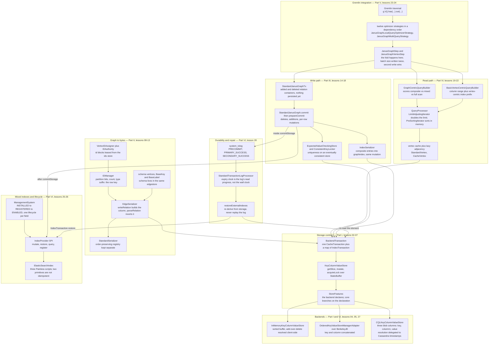
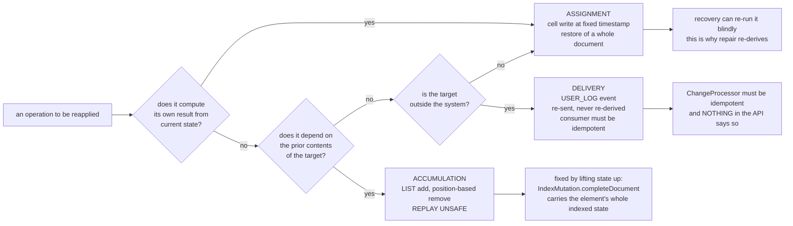

<!--
entry-meta
date: 2026-11-27
type: capstone
track: JanusGraph
lesson: —
category: Open Source Contribution
title: JanusGraph Capstone — A Property Graph Folded Onto Sorted Rows, and the One Guarantee It Borrows
slug: janusgraph-capstone
pinned-commit: a59ae8d8024207598eada34998d867617df51adf
-->

# JanusGraph Capstone — A Property Graph Folded Onto Sorted Rows, and the One Guarantee It Borrows

**2026-11-27 · JanusGraph Track · Capstone · Lessons 01–28 assembled · reading at `a59ae8d8`**

## Where This Fits

- **Lesson 28** ([`2026-11-26-janusgraph-tx-log-stale-index-repair`](../2026-11-26-janusgraph-tx-log-stale-index-repair/README.md)) closed Part VI with the write-ahead transaction log and the two stale-index removers, and established that the recovery system's correctness rests on a *borrowed* atomicity which default CQL does not supply.
- **This capstone** assembles Parts I–VI into one object: the translation stack from a Gremlin step down to a Cassandra blob column and back, four end-to-end traversals through it, and the four cross-cutting tradeoffs that only become visible once the layers sit side by side. It also performs the three reads lesson 28 told it to spend its budget on, which **settle candidate 79 and answer the `batchSize` question** that lessons 26 and 28 both left open.
- **It sets up nothing in this track** — the track closes here. The paused **PostgreSQL Internals** track resumes tomorrow at lesson 11 (the heavyweight lock manager): this run restored its full state into the root [`TRACK.md`](../../../TRACK.md) and deleted the `tracks/postgresql.md` pointer file, exactly as that file's own "How to resume" instructions required. The PR-candidate registers ([volume 1, frozen](../../../tracks/janusgraph-registers.md) and [volume 2](../../../tracks/janusgraph-registers-2.md)) stay where they are, because they are the track's actual output.
- **Pin.** `list_commits` on `JanusGraph/janusgraph` `master` was run again this morning and returned the same three newest commits as at lessons 13, 18, 22, 24 and 28: `a59ae8d8` and `9a30ff14` (both 2026-10-28) and `5e3e7bc7` *JanusGraph release 1.2.0* (2026-10-24). **Thirty days without a commit on master.** Every line number in this document and in all 28 lessons is therefore mutually comparable.

---

## 1. The thesis in one paragraph

JanusGraph is not a graph database in the sense that it stores a graph. It stores **one sorted row per vertex** in a BigTable-shaped store (`key → sorted (column, value) cells`), and *every* graph concept is an encoding decision on top of that: a vertex is a row key derived by bit arithmetic from a counter block, an edge or property is a single cell whose **column** carries the type id, direction, sort keys and the neighbour's id and whose **value** carries the rest, a composite index is another row in another store written in the same mutation, and a Gremlin traversal is a tree of steps folded down into a set of `SliceQuery` column ranges. The only genuinely distributed-systems machinery in the whole system sits in four places — the ID authority's block allocation, `ConsistentKeyLocker`'s uniqueness protocol, the write-ahead transaction log, and the mixed-index SPI — and three of the four exist for exactly one reason: **a mixed index commits *after* storage and therefore outside storage's atomicity, so something has to be able to put it back.** That "something" never replays the log. It re-derives from the edgestore, because the edgestore is the truth and an index is a cache of it.

---

## 2. Every lesson, and the mechanism it pinned down

| # | Lesson | The mechanism it actually established | Primary file |
|---|---|---|---|
| 01 | Setup and the data model | edgestore rows are vertices; relation columns are the unit of storage | `docs/advanced-topics/data-model.md` |
| 02 | `KeyColumnValueStore` | the whole backend contract is `getSlice`/`mutate`/`acquireLock` over `StaticBuffer` | `KeyColumnValueStore` |
| 03 | `StoreFeatures` | a backend *declares* capabilities; core branches on the declaration, not on the class | `StoreFeatures`, `StandardStoreManager` |
| 04 | `InMemoryKeyColumnValueStore` | a slice query is a binary search over a sorted buffer; add-over-delete resolved client-side | `InMemoryKeyColumnValueStore`, `InMemoryColumnValueStore` |
| 05 | `OrderedKeyValueStoreManagerAdapter` | key-column-value is *faked* on an ordered KV store by concatenating key+column | `BerkeleyJEKeyValueStore` |
| 06 | The test harness | backend suites ship from `src/main/java` of a testutils module so downstream backends can extend them | `JanusGraphTest`, `InMemoryGraphTest` |
| 07 | `Backend` / `BackendTransaction` | five logical stores (edgestore, graphindex, system_properties, ids, logs) and the cache/locker wrappers | `Backend`, `BackendTransaction` |
| 08 | `IDManager` | a vertex id is partition bits ‖ count ‖ type suffix; the row key is derived by shifting, not by hashing | `IDManager` |
| 09 | `VertexIDAssigner` | ids come from **blocks** leased from the `ids` store, so inserts need no coordination | `VertexIDAssigner`, `IDAuthority` |
| 10 | `EdgeSerializer.writeRelation` | the column layout: type id, direction, sort keys; the value: signature and remaining properties | `EdgeSerializer` |
| 11 | `parseRelation` / `RelationCache` | decoding is the exact inverse, and the cache is per-slice rather than per-element | `EdgeSerializer`, `RelationCache` |
| 12 | `StandardSerializer` | order-preserving encodings are a *separate* registry from the general ones | `StandardSerializer` |
| 13 | System types and schema storage | schema is vertices in the same edgestore, reached through `BaseKey`/`BaseLabel` | `BaseKey`, `BaseLabel` |
| 14 | `JanusGraphFactory.open` | local vs global config, and `fixed`/`masked` option scopes decided at open | `GraphDatabaseConfiguration` |
| 15 | `StandardJanusGraphTx` | added/deleted relation containers plus a vertex cache; nothing reaches storage until commit | `StandardJanusGraphTx` |
| 16 | `commit` / `prepareCommit` | deletes then additions, emitted per row, with the index writes riding along | `StandardJanusGraph` |
| 17 | Composite indexes on write | a graphindex row is built by `IndexSerializer` **in the same storage mutation** | `IndexSerializer` |
| 18 | Locking | `ExpectedValueCheckingStore` + `ConsistentKeyLocker`: uniqueness on an eventually consistent store | `ConsistentKeyLocker` |
| 19 | Vertex caches | adjacency is loaded lazily per slice; two cache levels, transaction and database | `StandardVertex`, `CacheVertex` |
| 20 | `BasicVertexCentricQueryBuilder` | `v.edges(...)` becomes a column range; a vertex-centric index is a sort-key prefix | `BasicVertexCentricQueryBuilder` |
| 21 | `GraphCentricQueryBuilder` | index selection scores candidates; composites and mixed indexes compete, full scan loses | `GraphCentricQueryBuilder` |
| 22 | `QueryProcessor` | limits double on re-request; sub-queries merge; sorting happens in memory when the index cannot order | `QueryProcessor`, `LimitAdjustingIterator` |
| 23 | The strategy layer | twelve rewrites in a dependency order, and the compile happens before the profiler exists | `JanusGraphLocalQueryOptimizerStrategy` |
| 24 | `JanusGraphStep` / `JanusGraphVertexStep` | the fold is executed in one place; batch size is written twice and the second write wins | `JanusGraphStep` |
| 25 | `ManagementSystem` and the index lifecycle | most indexes skip INSTALLED→REGISTERED→ENABLED entirely; a mixed index is N lifecycles, one per field | `ManagementSystem` |
| 26 | Mixed indexes and the `IndexProvider` SPI | the only non-idempotent write path in the system, and `LIST` cardinality is the whole reason | `ElasticSearchIndex`, `IndexMutation` |
| 27 | The CQL backend | write ordering is **one bit** of the commit timestamp; the in-memory store reaches the same semantics by the opposite route | `CQLKeyColumnValueStore` |
| 28 | Transaction log and stale-index repair | the log borrows storage's atomicity for one entry; repair is re-derivation, not replay | `StandardTransactionLogProcessor` |

---

## 3. The system map

Every layer the track covered, with the lesson that covered it. Read it top-down for a write and bottom-up for a read.



The three edges at the bottom are the whole argument of Part VI. `COMMIT → TXLOG` is **inside** the storage mutation. `COMMIT → SPI` is **after** it. `REPAIR → BT` is why the second one is survivable.

---

## 4. The three reads this capstone was told to perform

Lesson 28 named three reads in priority order and this run performed all three. Two of them change a conclusion the track had been carrying.

### 4.1 `BackendTransaction.commitIndexes()` — **candidate 79 is dead, by reading alone**

Read in full this run at the pin ([`BackendTransaction.java`](https://github.com/JanusGraph/janusgraph/blob/a59ae8d8024207598eada34998d867617df51adf/janusgraph-core/src/main/java/org/janusgraph/diskstorage/BackendTransaction.java), 23,301 bytes, blob `5a77c331`). The method, verbatim:

```java
public Map<String,Throwable> commitIndexes() {
    final Map<String,Throwable> exceptions = new HashMap<>(indexTx.size());
    for (Map.Entry<String,IndexTransaction> indexTransactionEntry : indexTx.entrySet()) {
        try {
            indexTransactionEntry.getValue().commit();
        } catch (Throwable e) {
            exceptions.put(indexTransactionEntry.getKey(),e);
        }
    }
    return exceptions;
}
```

**Candidate 79's entire premise was that a *thrown* `commitIndexes()` would let `StandardJanusGraph.commit` write `SECONDARY_SUCCESS` for a transaction whose index writes had failed, so the transaction would never be repaired.** The premise is false and the signature says so before the body does:

- The method is declared **with no `throws` clause at all** — not even `BackendException`, which every other write method on this class declares.
- It catches **`Throwable`**, not `Exception`, so an `Error` from one index transaction is captured too rather than propagated.
- The catch is **inside** the loop, so one failing index does not prevent the remaining ones from being attempted.
- The only statements outside the try are `new HashMap<>(indexTx.size())` and the iteration itself, over a field assigned in the constructor and never reassigned.

So `commitIndexes()` **reports** failures as map entries; it cannot signal them by throwing. Candidate 79 must not be filed, and the filing gate lesson 28 placed on it is discharged by closing it rather than by opening it. What *is* real, and is a narrower claim worth keeping, is this: the returned map is the only channel, so the caller's handling of a **non-empty map** is now the whole question — and that is `StandardJanusGraph.commit`'s business, not this method's.

Two further facts from the same read, both relevant to Parts I and III:

- **`commit()` and `commitIndexes()` are different contracts on the same object.** The `LoggableTransaction` override is `storeTx.commit(); for (IndexTransaction itx : indexTx.values()) itx.commit();` — no try, so **the first failing index aborts the rest and propagates**. The logged commit path deliberately uses `commitStorage()` plus `commitIndexes()` instead, which is where the asymmetry between the two failure directions comes from.
- **`rollback()` is the careful one.** It rolls back every index transaction inside a try, keeps only the *last* `Throwable` in a local, rolls back storage unconditionally, and only then rethrows — wrapping a non-`BackendException` in `PermanentBackendException("Unexpected exception", …)`. The in-source comment states the priority rule: *"If exceptions occur, the storage exception takes priority on re-throw."* Note the consequence: with two failing index rollbacks, **the first exception is silently discarded** — the local is overwritten, not accumulated. That is a smaller, cleaner candidate than 79 was.
- **`getTxLogPersistor()` returns `new ExternalCachePersistor(txLogStore, storeTx)`** — a fresh object per call, over the `txLogStore` field. This is the mechanical reason lesson 28's "borrowed atomicity" argument is about a *store*, not about a special code path: the log entry is written through the same `CacheTransaction` as the edgestore rows, and `system_txlog` is simply a different `KCVSCache`.

### 4.2 `IndexTransaction.restore` — the primitive both repair paths funnel into

Read in full this run at the pin ([`IndexTransaction.java`](https://github.com/JanusGraph/janusgraph/blob/a59ae8d8024207598eada34998d867617df51adf/janusgraph-core/src/main/java/org/janusgraph/diskstorage/indexing/IndexTransaction.java), 10,268 bytes, blob `733342c7`, 238 lines; transcribed to local disk and **blob-SHA verified**). Lines 153–170, verbatim:

```java
public void restore(Map<String, Map<String, List<IndexEntry>>> documents) throws BackendException {
    //restore writes whole documents, so a reattempt is safe. Run it through BackendOperation as flushInternal does
    //for mutate, so that a failure the provider classified as temporary is reattempted within the write time
    //instead of failing the reindex or recovery batch outright. executeDirect keeps the checked exception the
    //callers handle
    BackendOperation.executeDirect(new Callable<Void>() {
        @Override
        public Void call() throws BackendException {
            index.restore(documents, keyInformation, indexTx);
            return null;
        }

        @Override
        public String toString() {
            return "IndexRestore";
        }
    }, maxWriteTime);
}
```

Four things the track had been guessing at, now settled:

1. **The comment states the idempotence argument in the source itself.** *"restore writes whole documents, so a reattempt is safe."* Lesson 26 derived this from `ElasticSearchIndex.restore` having no scripts and no narrowing; it is in fact a documented precondition of the core-side wrapper, which is a stronger position for a PR to argue from.
2. **`restore` is retried; `commit` is not.** `restore` goes through `BackendOperation.executeDirect(…, maxWriteTime)`. `commit()` (line 173) is bare — `flushInternal(); indexTx.commit();` — and the retry sits one level *down*, inside `flushInternal` (lines 193/204), around `index.mutate(...)` with `toString()` of `"IndexMutation"`. **So the buffered mutate is reattempted under `storage.write-time`, but the provider's own `indexTx.commit()` is neither retried nor time-bounded.** That is a real gap in the commit path Parts III and VI both depend on, and it is visible only by reading these two methods adjacently.
3. **`executeDirect` rather than `execute`, deliberately.** The comment's last clause — *"executeDirect keeps the checked exception the callers handle"* — is why both repair paths can distinguish a temporary from a permanent failure. `flushInternal` uses `BackendOperation.execute`, which does not.
4. **`batchSize` is a request-size knob, not a memory knob** — the question lesson 26 left open. `restore` takes `Map<store, Map<documentId, List<IndexEntry>>>` and hands it to the provider **in one call**. There is no internal chunking, no streaming, no per-document loop. Whatever the caller puts in that map becomes one provider request (for Elasticsearch, one bulk). So a larger batch grows the bulk request, and the memory cost is incidental to holding the documents while assembling it.

The surrounding class, for completeness: fields are `IndexProvider index`, `BaseTransaction indexTx`, `KeyInformation.IndexRetriever keyInformation`, `Duration maxWriteTime`, and the buffer `Map<String,Map<String,IndexMutation>> mutations` sized `DEFAULT_OUTER_MAP_SIZE = 3` / `DEFAULT_INNER_MAP_SIZE = 5`. The only inserter into that buffer is the private `getIndexMutation(store, documentId, isNew, isDeleted)` (line 109), which `computeIfAbsent`s both levels and — the detail worth keeping — calls `m.resetDelete()` when `isNew && m.isDeleted()`, so **delete-then-recreate in one transaction collapses into a plain update** before the provider ever sees it. `registerCompleteDocument` (line 82) and `needsCompleteDocument` (line 99) never create an entry; they operate on an existing mutation only, which is how `IndexMutation.completeDocument` stays consistent with the element's state at commit. `rollback()` (line 179) is `mutations=null; indexTx.rollback();` and `flushInternal` ends with the same `mutations=null`, so `logMutations` (line 210) **NPEs after either** — a sequencing constraint with no guard.

### 4.3 `MIXED_INDEX_REINDEX_BATCH_SIZE` — the callers, and what the option actually is

One `search_code` at the pin returned six files; four are the answer (paths and fragments from the tool result this run, files not read in full):

| Caller | What it does with the value |
|---|---|
| `GraphDatabaseConfiguration` | declares it: namespace `SCHEMA_REINDEX`, key **`mixed-index-batch-size`**, described as *"Number of graph elements a mixed-index reindex worker should process before flushing restored documents to the index backend. Larger values can improve Elasticsearch bulk restore throughput at the cost …"* |
| `ManagementSystem` | **two** call sites: `MixedIndexStaleEntryRemover.submit(graph, indexId.indexName, …BATCH_SIZE)`, and `builder.setWorkBlockSize(…BATCH_SIZE)` on the reindex scan job, both gated on `MIXED_INDEX_REINDEX_BATCH_ENABLED` |
| `IndexRepairJob` | `mixedIndexBatchSize = …BATCH_SIZE` when batching is enabled, **`-1` otherwise** — the sentinel that means "flush per page" |
| `IndexSerializerTest`, `MgmtOlapJobBenchmark`, `ReindexThroughputBenchmark` | the option is exercised by a unit test *and* by two JMH benchmarks, which is the shape a PR touching it is expected to follow |

So the metrics debt lesson 26 recorded is closed: the same option feeds **three** different consumers — a scan job's work-block size, `IndexRepairJob`'s flush threshold, and the stale-entry remover's transaction-recycling interval — and §4.2 establishes that in all three it ends up sizing one `restore` call, i.e. one Elasticsearch bulk request. `MIXED_INDEX_REINDEX_BATCH_ENABLED` is `ConfigOption.Type.MASKABLE` and defaults `true`.

---

## 5. Four traversals, end to end

### 5.1 A property update commits (the common case)

```
g.V(id).property("name","b").iterate(); tx.commit()
  → StandardJanusGraphTx.addProperty            [15]  added/deleted relation containers only
  → StandardJanusGraph.commit                   [16]
      → prepareCommit: deletes first, then additions, grouped per row key
          → EdgeSerializer.writeRelation        [10]  one column per relation
          → IndexSerializer                     [17]  graphindex entries, SAME mutation
          → ConsistentKeyLocker (if unique)     [18]  before anything is written
      → log PRECOMMIT into system_txlog         [28]  only if tx.log-tx, default FALSE
      → BackendTransaction.commitStorage()      [07]  storeTx.commit()
          → CQLKeyColumnValueStore.mutate       [27]  no conflict resolution here
              → AbstractCQLMutateManyFunction: deletion time = t & ~1, addition = t | 1
              → .grouped(20) UNLOGGED batches, fired async, awaited together
      → PRIMARY_SUCCESS via getTxLogPersistor() [28]  inside the storage mutation
      → BackendTransaction.commitIndexes()      [§4.1] AFTER storage; returns a map, cannot throw
          → IndexTransaction.commit → flushInternal → BackendOperation.execute(index.mutate)
      → SECONDARY_SUCCESS if that map is empty  [28]
```

The single-cardinality property update is where lesson 27's finding lives: the delete of the old cell and the add of the new one are **the same `(key, column)` at timestamps differing in the low bit**, so Cassandra's last-write-wins resolves it with no coordination, while the in-memory store resolves the identical case by dropping the tombstone client-side with a `binarySearch`. Two opposite implementations, one observable semantics.

### 5.2 A vertex-centric read

```
v.out("knows").has("since", gt(2020))
  → JanusGraphLocalQueryOptimizerStrategy       [23]  folds has/limit/order into the step
  → JanusGraphVertexStep                        [24]  batch size = 2500 on defaults, not tx-cache-size
  → BasicVertexCentricQueryBuilder              [20]  → SliceQuery over a COLUMN RANGE
      the vertex-centric index is nothing but a sort-key prefix of that range
  → CacheVertex.loadRelations                   [19]  lazy, per slice, cached per transaction
  → BackendTransaction.edgeStoreMultiQuery      [07]  one call if hasMultiQuery(), else a thread per key
  → EdgeSerializer.parseRelation + RelationCache [11] decode columns back to relations
```

The branch at the bottom is the clearest example of Part I's declaration principle: `storeFeatures.hasMultiQuery()` decides between **one backend call** and **`MIN_TASKS_TO_PARALLELIZE = 2`-gated thread-per-key fan-out** with a `CountDownLatch`, an `AtomicInteger failureCount`, and a `JanusGraphException` if any individual query failed. CQL declares `multiQuery(true)`; the in-memory store's multi-key read is a sequential `for` loop. Same core code, two completely different execution shapes, selected by a boolean the backend sets.

### 5.3 A graph-centric read against a mixed index

```
g.V().has("name", textContains("x")).order().by("age").limit(10)
  → JanusGraphStep                              [24]  the fold
  → GraphCentricQueryBuilder                    [21]  score candidates: composite / mixed / full scan
      → IndexSelectionUtil.indexCoversOrder     [26]  three tests per order key
          supportsOrdering(index, field) is FALSE for a STRING key with a custom analyzer
      → candidacy filter: supportNotQueryNormalForm() under a top-level Or
  → QueryProcessor                              [22]  LimitAdjustingIterator doubles on re-request
  → ElasticSearchIndex.query                    [26]  setDisableSourceRetrieval(true) → "_source": false
      → paging: adaptive_point_in_time, max page 500, limited-result max page 250
  → ids come back as document ids → edgestore multi-slice to materialise the vertices
```

The capstone-level observation: **the order fold and the index selection are decided in different layers from the thing that makes them possible.** Whether an order can be pushed down depends on a *mapping parameter on a property key* set months earlier through `ManagementSystem` — adding `ParameterType.STRING_ANALYZER` to a `STRING` key silently turns `supportsOrdering` false, which turns the fold off, which turns `PreSortingIterator` on, which reads the whole result set. No error, no warning, no log line. One schema parameter, three layers away from the symptom.

### 5.4 Recovery, when the index missed a commit

```
StandardTransactionLogProcessor                 [28]
  → read system_txlog; expiry clock = txLog.getReadProgress(), forced monotonic by accumulateAndGet(Math::max)
  → a tx with PRECOMMIT but no SECONDARY_SUCCESS, older than nanosUntilExpiry → repair
  → restoreExternalIndexes, MIXED_INDEX_FILTER
      pass 1: one hard-coded second
      pass 2: storage.write-time (100 s)
          → for each element id in the entry:
              retrieve(tx)  → present?  reindexElement   : removeElement
              ^^^ RE-DERIVATION FROM THE EDGESTORE, not a replay of the log
      → IndexTransaction.restore                [§4.2]  one whole-document request, retried under write-time
  → USER_LOG events: re-SENT with a new tx id and a SOURCE_TRANSACTION meta — a delivery, not an assignment
```

This is the one place where "the log does not carry data" pays off completely. Because the entry carries **element ids** and not documents, every repair is an assignment of current truth: idempotent, convergent, order-independent, and **correct even if the log entry itself is wrong**. A log that carried document content would have none of those four properties.

---

## 6. The cross-cutting tradeoffs

### 6.1 Idempotence, in three kinds — the best idea the track produced

The track converged on a taxonomy that turns out to explain almost every durability decision in the codebase, and the dividing line is **not** distributed-versus-local:

| Kind | Example | Replay is | Why |
|---|---|---|---|
| **Assignment** | a cell write at a fixed `(key, column, timestamp)` | free | writing the same value at the same timestamp is the identity |
| **Assignment by construction** | a mixed-index document rewritten whole from storage (`restore`) | free | the document is re-derived, so the second application computes the same bytes |
| **Accumulation** | a `LIST` field script append, `ctx._source[f].add(v)` | **unsafe** | appends a duplicate |
| **Deletion by position** | `remove(indexOf(value))` on `LIST`/`SET` | **unsafe** | removes another occurrence or none |
| **Delivery** | a `USER_LOG` event | **unsafe, and unavoidable** | recovery re-sends with a new tx id; duplicates are the normal case |



The fix for the accumulation case is the structurally interesting part, and it is the single best piece of design in Part VI: **the repair did not happen in the backend, it happened in the core.** `IndexMutation` gained a `completeDocument` field carrying the element's whole indexed state at commit, which lets `ElasticSearchIndex` send *one* bulk item per document whose script-and-upsert pair is simultaneously "apply the delta" and "recreate whole". The non-idempotent primitive still exists in the Painless script; it is simply never the only thing applied.

### 6.2 Atomicity is borrowed, never built

JanusGraph has no two-phase commit, no distributed transaction coordinator, and no consensus anywhere. What it has is **one place where it borrows the storage backend's atomicity and then uses the borrowed fact as evidence**: `PRIMARY_SUCCESS` is handed to `mutator.getTxLogPersistor()` so that it commits *inside* the storage mutation, which is what makes it mean "the storage write landed".

Everything that follows is downstream of that single trick:

- Composite indexes need **no** write-ahead path, because `IndexSerializer`'s graphindex entries ride the same `commitStorage()`. `MIXED_INDEX_FILTER` in the recovery processor is the code-level statement of this.
- Mixed indexes need one, because they commit after storage.
- The user log is the one consumer for which re-derivation is impossible, so it gets a **re-send** and an unstated idempotence requirement on `ChangeProcessor`.

**And on default CQL the borrowed atomicity is not there.** The log is a different store (`system_txlog`), its row key is `hashPrefixKey(SHORT, transactionId)` and therefore a different partition, and `storage.cql.atomic-batch-mutate` defaults **`false`**, so the mutation goes out as several independent async `UNLOGGED` batches of 20. The two failure directions are **not symmetric**:

| Direction | What recovery does | Outcome |
|---|---|---|
| log entry lands, storage does not | repair re-derives from storage, writes documents matching current truth | **harmless** |
| storage lands, log entry does not | last entry is `PRECOMMIT`; the eviction listener counts it in `successTxCounter`; a later index failure in that transaction is never repaired | **permanent silent divergence that the write-ahead log reports as a success** |

That asymmetry is the most consequential single finding of the track, and §4.1 narrows it further: because `commitIndexes()` cannot throw, the only route to the dangerous direction is the *missing log entry*, not a thrown index commit.

### 6.3 The backend declares; the core branches

`StoreFeatures` is the system's entire extensibility story, and the capstone-level point is how much *semantics* rides on a boolean:

- `optimizedWholeRowDeletion(true)` is what makes core set `hasWholeRowDeletion()`, which is what turns N `deleteColumn`s into one `deleteRow`.
- `hasMultiQuery()` chooses between one backend call and a thread-per-key fan-out (§5.2).
- `locking(useExternalLocking)` with `storage.cql.use-external-locking` defaulting `false` means **setting the option *disables* locking rather than delegating it** — the description names the result: *"read uncommitted"*, *"dirty/non-repeatable/phantom reads"*.
- The **partitioner** decides which scans exist at all: `Murmur3Partitioner` → unordered scan only, and it is the *only* partitioner that gets `scanKeyOrder(new TokenOrderKeyComparator(tokenMap))`, which puts multi-query scans on the lossless merge-join strategy instead of the bounded-buffer one. `RandomPartitioner` is **deliberately excluded** because no CI covers it.

And the three graceful degradations in `CQLKeyColumnValueStore` all follow one stated principle: **a scan-only optimisation must not fail store open.** Token-range statement rejected → `getKeysRangedToken = null` and a warning. `PER PARTITION LIMIT` rejected → re-prepare without the clause. Non-Murmur3 → `parallelScanSupported = false`. Three silent capability losses, three `log.warn`s, zero failures.

### 6.4 Assertions as documentation, and the cost of that

A striking amount of this codebase's correctness argument is written in a form that **does not run in production**:

- `MaskedTimestamp`'s ordering invariant is asserted in `sleepAfterWrite` — but it cannot be violated anyway, because it is bit arithmetic (`t & ~1` versus `t | 1`), not program flow. The assertion is redundant and the invariant is unbreakable. That is the good case.
- `assert mutation.isConsolidated()` in `ElasticSearchIndex.mutate` is the bad case: off in production, and a non-consolidated mutation reaching shape C produces a different document.
- `IndexMutation.determineTTL()` enforces a **uniform** TTL across additions with a `checkArgument` plus `assert ttl >= 0` — a check no Elasticsearch path can act on, since `supportsDocumentTTL` is `false` for every ES version (all four compat classes produce identical features, so `"_all"` is unreachable too — candidate 71).
- The per-field `SchemaStatus` of a mixed index is held as the last slot of each `INDEX_FIELD` edge's `Parameter[]` **behind an `assert`**.

The transferable lesson for a contributor: in this codebase, an `assert` marks a place where someone knew an invariant and chose not to pay for it. Each one is either a candidate for a real check or a candidate for deletion, and telling which requires exactly the reachability argument that candidates 78, 79 and 80 all turned on.

### 6.5 Configuration scope is a correctness property, not an ergonomics one

The track kept running into the same shape: an option whose *scope* matters more than its value.

- `graph.assign-timestamp` defaults **`true`** but is `ConfigOption.Type.LOCAL`, so two instances writing one Cassandra table can disagree about it through nothing but configuration drift — a cheaper route to lesson 27's timestamp hazard than setting it `false` (candidate 74, narrowed).
- `tx.log-tx` is **`GLOBAL`** and defaults `false`, so on a stock graph none of Part VI's recovery machinery runs at all. And the gate is `hasLogTransactions() && !hasEnabledBatchLoading()` — **batch loading silently disables the write-ahead log**, which is the one mode most likely to leave indexes behind.
- `tx.max-commit-time` is `GLOBAL` at 300 s and `storage.write-time` is 100 s, and `warnIfMaxCommitTimeIsTooShort` requires `max-commit-time` to **exceed** `write-time × (1 + indexBackends)`. **The shipped defaults are safe for exactly one index backend and warn at two.** The javadoc states the consequence in its own words: recovery can *"restore the index documents of a transaction which is still committing, underneath the index writes that commit has yet to make."*

### 6.6 The statistics gap

Lessons 21–24 established that `GraphCentricQueryBuilder` scores index candidates with no notion of column correlation, and that `JanusGraphLocalQueryOptimizerStrategy` and `JanusGraphMultiQueryStrategy` can overwrite each other's decisions, with `query.force-index` as the only escape hatch. That is a weaker position than a cost-based planner, and today's Daily Diff deep dive is the same gap in PostgreSQL 19, being closed by a hint extension rather than by better statistics — see [`daily-diff.md`](daily-diff.md). The symmetry is worth noticing precisely because the PostgreSQL track resumes tomorrow.

---

## 7. The numbers that bound everything

Every value below was read from source at the pin during lessons 24–28 and is recorded here so the track's conclusions can be checked against a single table.

| Option / constant | Default | Scope | Why it matters |
|---|---|---|---|
| `tx.log-tx` | **false** | GLOBAL | all of Part VI's recovery is off on a stock graph |
| `tx.max-commit-time` | **300 s** | GLOBAL | must exceed `write-time × (1 + indexBackends)` |
| `storage.write-time` | **100 s** | — | retry budget for `index.mutate` and repair pass 2 |
| `TRANSACTION_LOG_DEFAULT_TTL` | **7 days** | — | status entries bypass it ([#5051](https://github.com/JanusGraph/janusgraph/issues/5051)) |
| `log.num-buckets` / `log.read-threads` | **1 / 1** | — | recovery reads the log single-threaded |
| `log.send-delay` | **1000 ms** | — | why a queued user-log message is "successful" before it is sent |
| `graph.assign-timestamp` | **true** | **LOCAL** | drift between instances reaches the timestamp hazard |
| `storage.transactions` | **true** | — | makes candidate 78's NPE configuration-specific, not live |
| `storage.cql.atomic-batch-mutate` | **false** | — | the mutation is several independent UNLOGGED batches |
| `storage.cql.batch-statement-size` | **20** | — | the group size of those batches |
| `storage.cql.idempotent-writes` | **true** | — | set on the batch, not inherited from statements |
| `storage.cql.use-external-locking` | **false** | — | `true` *disables* locking rather than delegating it |
| `storage.cql.parallel-scan-token-ranges` | **1** | — | parallel ring scan off by default |
| `storage.cql.scan-page-size` | **0** | — | 0 means fall back to `storage.page-size` |
| `query.batch.limited` + batch size | **true / 2500** | — | overwrites `cache.tx-cache-size` for vertex-step batching |
| ES `limited-result-max-page-size` | **250** | — | sized once, not doubled; the doubling is `LimitAdjustingIterator`'s |
| ES `adaptive-point-in-time-max-page-size` | **500** | — | PIT kept up with a scroll to 500 hits, not 1,000 |
| `index.max_result_window` | 10,000 | ES-side | JanusGraph lifts it only on indexes it creates |
| `MIXED_INDEX_REINDEX_BATCH_ENABLED` | **true** | MASKABLE | gates the three consumers in §4.3 |
| `EXISTENCE_CHECKS_PER_TX` | **10,000** | hard-coded | `StaleIndexEntryRemoveJob`'s transaction recycling |
| `MIN_TASKS_TO_PARALLELIZE` | **2** | hard-coded | floor for thread-per-key multi-query fan-out |
| `LONGEST_RECOVERY_WAIT` | `Long.MAX_VALUE >>> 1` ns (~146 y) | hard-coded | half-range so `ahead + wait + 1` cannot overflow |

---

## 8. Where This Breaks Down

The honest qualifications on the whole track, strongest first.

1. **Not one run in this track ever executed JanusGraph.** Every finding above is *read*, not reproduced. Nineteen Hands-On experiments across lessons 24–28 are outstanding, plus this capstone's. This is the single largest qualification on all 28 lessons, and nothing in the depth of the reading substitutes for it.
2. **Line numbers are only as good as the pin.** They are all at `a59ae8d8`, which has not moved in 30 days — convenient, and also a warning: a reader working from `master` three months from now must re-verify by blob SHA before trusting a single `:NNN` in this repository.
3. **Reachability is the recurring weak spot.** The track repeatedly established *what* code does and could not establish *whether a production path reaches it*. Still open: whether any path passes a real limit to `QueryUtil.processIntersectingRetrievals` (candidate 51); whether `BatchProcessingQueue.removeLast()` has a caller (`HasStepBatchFetcher` and `DropStepBatchFetcher` unread, so it **must not** be called dead code); whether `BasicVertexCentricQueryBuilder:711`'s `Preconditions.checkArgument(bestCandidate != null, …)` can fire — **lesson 20's debt, which this capstone did not settle and records as open rather than guessing**; and which core call sites invoke `IndexMutation.setCompleteDocument`, i.e. whether shape C is reachable for a real update.
4. **Three files that gate real conclusions were never read.** `TransientFailures` (blob `6aba13b8`) and `ElasticSearchBulkFailureException` (`e52ae410`) decide whether a bulk failure can report an item as failed *after* it applied — which decides whether lesson 26's shape B has a residual duplication hazard. `CQLTokenRangeSplitter` (`e0b2b2cd`) and the whole `cql/service` package are unread.
5. **The equal-timestamp tie-break is not established.** Cassandra's Dynamo documentation states last-write-wins per column, per CQL row, modelled as an LWW-element-set CRDT, and that *"Cassandra's correctness does depend on these clocks"* — but it does **not** state the tie-break rule for equal timestamps. Since `MaskedTimestamp` halves the effective resolution (two commits whose provider timestamps differ only in the low bit produce the identical `(deletion, addition)` pair), the reachability of that window is lesson 27's Hands-On C and remains unrun. No claim about it belongs anywhere in this repository until it does.
6. **The index lifecycle has a state with no coded recovery.** `INSTALLED → REGISTERED` is an unpersisted callback in the issuing JVM's heap. If that JVM dies, the index is stranded at `INSTALLED` and nothing in the codebase recovers it. The track found the state; it did not find or write the fix.
7. **A stale mixed-index document whose values sit only in non-queryable fields is permanently invisible** to `MixedIndexStaleEntryRemover`, which enumerates by one exists-query per indexed field. The gap is signalled by a single `log.warn` naming the field rather than by naming the gap.

---

## 9. Hands-On — the project-scale exercise

One project, four stages, each producing a thing a maintainer could review. It is deliberately ordered so that **stage 1 needs no build at all** and each later stage reuses the previous one's harness. Temporary logging must never be committed.

### Stage 0 — clear the cheap debts first (≈30 minutes, no Docker)

These were ranked cheapest-first by lesson 28 and nothing has changed:

```bash
cd ~/janusgraph && git fetch upstream && git log -1 --format=%H upstream/master
# must print a59ae8d8024207598eada34998d867617df51adf for the line numbers in this repo to apply
jshell
```

```java
// 1. Candidate 80's precondition: prove the floor runs before the check, so the check cannot fail.
//    Reproduce the two expressions from StandardTransactionLogProcessor around :135-140 with
//    the shipped defaults and show the guarded branch is unreachable.
// 2. Lesson 27's LSB mask, two lines:
long t = System.currentTimeMillis() * 1000L;
long del = t & 0xFFFFFFFFFFFFFFFEL, add = del | 1L;
System.out.println(add - del);        // 1, always, by construction
System.out.println((t & 1L) == 0 ? "t was even" : "t was odd and del < t");
```

**What to look for:** that `add - del` is `1` for every `t`, and that `del <= t` always — i.e. the addition time is *not* `t + 1`, it is `(t | 1)`, which for an odd `t` equals `t`. That distinction is the one a PR description has to get right.

### Stage 1 — a unit test for `nanosUntilExpiry` (≈1 hour, no Docker)

`nanosUntilExpiry` is package-private in `janusgraph-core`. Write a test in the same package asserting the three properties the track derived by reading: the one-nanosecond addition (read progress is exclusive, log timestamps are microseconds), that a later entry never extends the deadline (`expireAfterUpdate` returns `currentDuration`), and that the `LONGEST_RECOVERY_WAIT` half-range bound makes `ahead + wait + 1` overflow-free at `Long.MAX_VALUE >>> 1`.

```bash
mvn -pl janusgraph-core -Dtest=StandardTransactionLogProcessorTest test
```

**What to look for:** whether such a test class already exists at the pin. If it does not, that absence is itself the PR — a package-private arithmetic helper with an overflow argument in its constant and no test is the most reviewable gap in Part VI.

### Stage 2 — settle candidate 72 against the in-memory backend (≈2 hours, no Docker)

Lesson 26's Hands-On B, which gates candidate 72: open an `inmemory` graph with **one unique composite index**, profile a query that should use it, then `DISABLE_INDEX` it and re-profile.

```bash
mvn -pl janusgraph-inmemory -Dtest=InMemoryGraphTest test     # confirm the harness runs first
```

Then a small `main` that builds the schema through `ManagementSystem`, awaits `ENABLED`, and compares `.profile()` output across the two states.

**What to look for:** the `Index Used` / fitted-and-sorted annotations in the profile, and whether the disabled index still appears as a *candidate*. Lesson 25 established that `canIndexBeEnabled` writes `ENABLED` directly when every key is new in the same management transaction — so this exercise also verifies that the index never passes through `REGISTERED` at all, which is the claim most likely to surprise a reviewer.

### Stage 3 — the real project: a differential harness for the two store implementations (a weekend, Docker for the CQL half)

Build one test that drives `InMemoryKeyColumnValueStore` and `CQLKeyColumnValueStore` through an identical mutation sequence and asserts identical `getSlice` results. The track established that they reach the same semantics by **opposite** mechanisms (client-side tombstone filtering versus Cassandra timestamp resolution), which is exactly the condition under which a differential test earns its keep.

Sequence to drive, in this order, because each step isolates one of the track's findings:

1. add `c`, then in a second transaction delete `c` and add `c` with a new value — the single-cardinality property update of §5.1.
2. the same, but both in **one** transaction — exercises the in-memory `binarySearch` filter and the CQL `(t & ~1, t | 1)` pair.
3. a whole-row deletion — exercises `optimizedWholeRowDeletion` versus `kcv.remove(key)`.
4. a slice with `limit = 1` — must produce **no** `IN` grouping on CQL, because `groupSize = max(1, min(sliceGroupingLimit, limit))`.
5. a `getKeys(MultiSlicesQuery, txh)` — must throw `UnsupportedOperationException` on **both**.
6. `acquireLock` — must throw unconditionally on the in-memory store and **return silently** on CQL with default features.

**What to look for:** step 6 is the one that should make a reader uncomfortable, and it is the most promising PR in the list. A store whose `acquireLock` returns having done nothing, under a feature flag whose default means "use `ConsistentKeyLocker` instead", is correct — but it is indistinguishable at the call site from a store that locked. Whether that deserves a comment, an assertion, or nothing is a question for the mailing list, and asking it well requires exactly this harness.

---

## 10. The open-items ledger

**Experiments outstanding: 20** — lesson 24's three, 25's four, 26's four, 27's four, 28's four, and this capstone's Stage 3. Nothing in this track has been reproduced.

**Candidate register state.** Volume 1 is frozen at 1–64 ([`tracks/janusgraph-registers.md`](../../../tracks/janusgraph-registers.md)); volume 2 holds 65–83 with 84 next free ([`tracks/janusgraph-registers-2.md`](../../../tracks/janusgraph-registers-2.md)).

| Candidate | Gate | Status after this capstone |
|---|---|---|
| 65 | lesson 24's Hands-On B | still gated |
| 70 | lesson 25's Hands-On D | still gated |
| 72 | lesson 26's Hands-On B | still gated — Stage 2 above is the experiment |
| 74 | two-instance configuration drift demonstrated | still gated, now a *configuration-drift* claim rather than an explicit-`false` claim |
| 78 | `storage.transactions` default | configuration-specific, not live |
| 79 | `BackendTransaction.commitIndexes` readable | **CLOSED — premise disproved, §4.1. Do not file.** |
| 80 | provable by reading alone | **the one candidate ready to file today; a two-line diff** |
| 81, 82, 83 | — | open as filed by lesson 28 |
| *new* | `rollback()` discards all but the last index-rollback `Throwable` (§4.1) | **worth filing as 84** |
| *new* | `IndexTransaction.commit` is neither retried nor time-bounded while `restore` and `flushInternal` both are (§4.2) | **worth filing as 85** |

**Questions still open across the whole track**, deliberately not filled in: (a) a real limit into `QueryUtil.processIntersectingRetrievals`; (b) `BackendQueryHolder`'s duplicated `isFitted` in `hashCode`; (c) `IndexCandidateGroup.getTotalScore()`'s `Double.NEGATIVE_INFINITY` sentinel colliding with `IndexCandidate`'s default score; (d) lesson 23's §2.2 strategy-ordering question; (e) whether `BatchProcessingQueue.removeLast()` has any caller; (f) whether `ElasticSearchBulkFailureException` can report an item as failed after it applied; (g) which core call sites invoke `IndexMutation.setCompleteDocument`; (h) `BasicVertexCentricQueryBuilder:711`'s precondition reachability — **unowned since lesson 27 and still open**; (i) lesson 24's `JanusGraphStep:118` order assert, whose trigger condition is precisely a stale mixed index, making it the one open item with a demonstrated route to wrong *results* rather than wrong *metrics*.

**Open upstream issues confirmed this run** that the track's reading bears on directly:

| Issue | Title | How the track's reading relates |
|---|---|---|
| [#913](https://github.com/JanusGraph/janusgraph/issues/913) | *transaction log uses QUORUM rather than LOCAL_QUORUM* (open since 2018, `kind/bug/possible`, unassigned) | lesson 27 established both consistency pairs and the `only-use-local-consistency-for-system-operations` option that selects them (default `false`); lesson 28 established that the log is a separate store. This is the exact intersection of the two, and the track has read every file needed to argue it. |
| [#5051](https://github.com/JanusGraph/janusgraph/issues/5051) | *PRIMARY_SUCCESS/COMPLETE_SUCCESS system transaction log entries bypass TTLKCVSManager and don't get a ttl* (open, filed 2026-10-11) | lesson 28's candidate 82 path is reachable *by design* because of this; §6.2's dangerous direction is made durable by it. |
| [#600](https://github.com/JanusGraph/janusgraph/issues/600) | *Indexes not complete* (open since 2017) | the symptom class Part VI explains end to end. |
| [#3127](https://github.com/JanusGraph/janusgraph/issues/3127) | *ManagementSystem::printIndexes should display mappings for mixed index* (`good first issue`, `area/index`) | lesson 25 established that a mixed index's status is **one per field**, held in each `INDEX_FIELD` edge's `Parameter[]`; lesson 26 established `mapKey2Field` and the `key__STRING` dual mapping. Both are what this issue asks to display. **The best first PR in the list.** |
| [#3126](https://github.com/JanusGraph/janusgraph/issues/3126) | *Create JanusGraphIndex::describe method to include more information* (`good first issue`) | same two lessons supply the content; this is the API-shaped version of #3127. |

---

## 11. Further Study

- [`BackendTransaction.java` at the pin](https://github.com/JanusGraph/janusgraph/blob/a59ae8d8024207598eada34998d867617df51adf/janusgraph-core/src/main/java/org/janusgraph/diskstorage/BackendTransaction.java) — read in full this run; the `commit()` versus `commitStorage()`+`commitIndexes()` asymmetry is on one screen.
- [`IndexTransaction.java` at the pin](https://github.com/JanusGraph/janusgraph/blob/a59ae8d8024207598eada34998d867617df51adf/janusgraph-core/src/main/java/org/janusgraph/diskstorage/indexing/IndexTransaction.java) — 238 lines, read in full this run; the shortest file in the codebase that explains Part VI.
- [JanusGraph issue #913](https://github.com/JanusGraph/janusgraph/issues/913) and [#5051](https://github.com/JanusGraph/janusgraph/issues/5051) — the two open issues the track is best positioned to argue.
- [`tracks/janusgraph-registers.md`](../../../tracks/janusgraph-registers.md) and [`tracks/janusgraph-registers-2.md`](../../../tracks/janusgraph-registers-2.md) — 83 PR candidates with their gates; this is the track's real deliverable.
- The SQLite capstone, for contrast: [`2026/10/2026-10-19-sqlite-capstone/README.md`](../../../2026/10/2026-10-19-sqlite-capstone/README.md). One file, one writer, a bytecode interpreter in the middle — the opposite architecture, and reading the two capstones adjacently is the cheapest way to see what "borrowed atomicity" costs.

## 12. Next Steps

1. **File candidate 80.** It is provable by reading alone, it is a two-line diff, and it is the only item in the register with no outstanding gate.
2. **Run Stage 0 and Stage 1 of §9.** Thirty minutes and an hour respectively, no Docker, and together they convert two read-only claims into reproduced ones.
3. **Take [#3127](https://github.com/JanusGraph/janusgraph/issues/3127).** `good first issue`, unassigned, open since 2022, and lessons 25 and 26 already established every fact the fix needs. This is the intended destination of the whole track — the January 2027 LFX Mentorship applications want a merged PR, not a reading list.
4. **Read the three gating files** — `TransientFailures`, `ElasticSearchBulkFailureException`, `BackendQueryHolder` — which between them close (f), (b) and the residual duplication question.
5. **Settle (h) or retire it.** `BasicVertexCentricQueryBuilder:711` has been unowned since lesson 27. One file read answers it.
6. **Do not reopen the mode question.** It was closed on 2026-11-03 and sessions 01–04's `## My Notes` remain Aryant's to fill at any time.

## 13. Sources

Read with `mcp__github__get_file_contents` at the pinned commit `a59ae8d8024207598eada34998d867617df51adf` during this run, and blob-SHA verified:

- [`janusgraph-core/src/main/java/org/janusgraph/diskstorage/BackendTransaction.java`](https://github.com/JanusGraph/janusgraph/blob/a59ae8d8024207598eada34998d867617df51adf/janusgraph-core/src/main/java/org/janusgraph/diskstorage/BackendTransaction.java) — 23,301 bytes, blob `5a77c331fc1648748edcff69e3c9ebb3f930e48f`.
- [`janusgraph-core/src/main/java/org/janusgraph/diskstorage/indexing/IndexTransaction.java`](https://github.com/JanusGraph/janusgraph/blob/a59ae8d8024207598eada34998d867617df51adf/janusgraph-core/src/main/java/org/janusgraph/diskstorage/indexing/IndexTransaction.java) — 10,268 bytes, blob `733342c792c924eb6f2251fc3a19cb1feed3ab26`, verified `10268 733342c792c924eb6f2251fc3a19cb1feed3ab26`.
- Directory listings with `fields: ["name","sha","size","type"]` for `janusgraph-core/.../diskstorage/` and `.../diskstorage/indexing/`, which supplied those blob SHAs independently of the file reads.

Confirmed this run by `mcp__github__search_code` at the same commit — **path and quoted fragment seen, file not read in full**, so no line numbers are cited for these:

- `janusgraph-core/src/main/java/org/janusgraph/graphdb/configuration/GraphDatabaseConfiguration.java` — the `MIXED_INDEX_REINDEX_BATCH_SIZE` declaration and its description.
- `janusgraph-core/src/main/java/org/janusgraph/graphdb/olap/job/IndexRepairJob.java` — the `-1` sentinel.
- `janusgraph-core/src/main/java/org/janusgraph/graphdb/database/management/ManagementSystem.java` — the two call sites.
- `janusgraph-benchmark/src/main/java/org/janusgraph/MgmtOlapJobBenchmark.java`, `janusgraph-benchmark/src/main/java/org/janusgraph/ReindexThroughputBenchmark.java`, `janusgraph-test/src/test/java/org/janusgraph/graphdb/database/IndexSerializerTest.java` — the test and benchmark call sites.

Open issues read this run with `mcp__github__search_issues`:

- [#913](https://github.com/JanusGraph/janusgraph/issues/913), [#5051](https://github.com/JanusGraph/janusgraph/issues/5051), [#600](https://github.com/JanusGraph/janusgraph/issues/600), [#3127](https://github.com/JanusGraph/janusgraph/issues/3127), [#3126](https://github.com/JanusGraph/janusgraph/issues/3126), [#3013](https://github.com/JanusGraph/janusgraph/issues/3013), [#1573](https://github.com/JanusGraph/janusgraph/issues/1573).

Pin verification: `mcp__github__list_commits` on `JanusGraph/janusgraph` `master`, newest three — `a59ae8d8024207598eada34998d867617df51adf` *Restore 1.3.0-SNAPSHOT version CTR* (2026-10-28), `9a30ff149a7a11a7ed564c695046287f36fb1681` (2026-10-28), `5e3e7bc76e3a1db983cd55475a9bc51e09bcaf23` *JanusGraph release 1.2.0* (2026-10-24).

Everything else in this document is carried from lessons 01–28 of this track, whose own `## Sources` sections hold the permalinks for the files each of them read. The Cassandra documentation quotations in §8 item 5 were read during lesson 27 and are not re-cited here, because this run did not re-fetch them.

## 14. Takeaways

- **A property graph on a sorted-row store is an encoding problem, not a distributed-systems problem** — until you add a second store that commits at a different time. Then it is entirely a distributed-systems problem, and JanusGraph's answer is to re-derive rather than to replay.
- **Atomicity is borrowed, once, in one place**, and the whole recovery design is downstream of that single trick. On default CQL the loan does not clear, and the dangerous direction — storage lands, log entry does not — is counted as a success.
- **Idempotence splits three ways** — assignment, accumulation, delivery — and the dividing line has nothing to do with whether the system is distributed. The one genuinely non-idempotent primitive in the codebase was fixed by lifting state *up* into the core (`IndexMutation.completeDocument`), not by making the backend smarter.
- **`StoreFeatures` is the real extension point**, and a single boolean there changes execution shape, not just performance: one backend call versus a thread per key, one `deleteRow` versus N `deleteColumn`s, `ConsistentKeyLocker` versus read-uncommitted.
- **An `assert` in this codebase marks a known invariant someone declined to pay for.** Three of the track's 83 candidates are assertions; telling a redundant one from a load-bearing one requires a reachability argument, which is also the track's weakest skill.
- **Candidate 79 died to a method signature.** The lesson is older than this codebase: read the declaration before building an argument on the body. `public Map<String,Throwable> commitIndexes()` — no `throws` — was the whole answer, and it took one read of a file that had been named three lessons in a row.
- **Twenty-eight lessons, zero executions.** The reading is deep and the pin is honest, but the track's own ledger says the next useful thing is not another file. It is `mvn test`.
