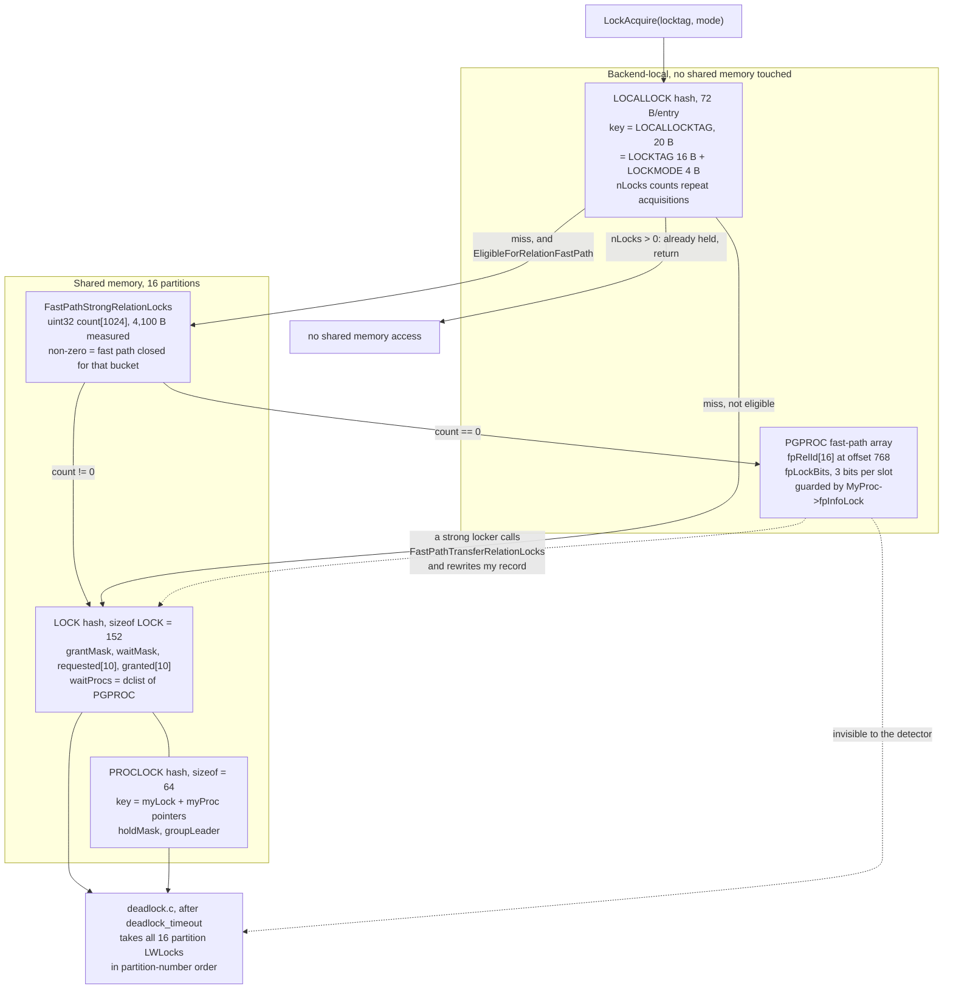
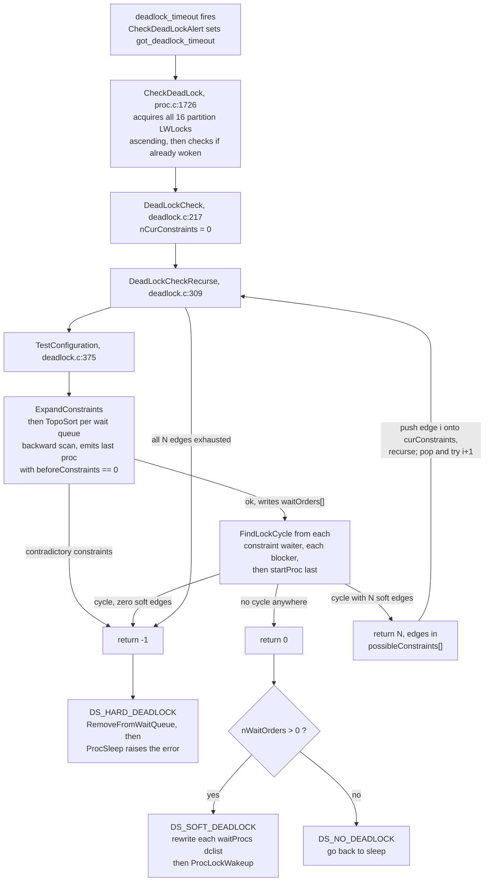

<!--
entry-meta
date: 2026-11-28
type: lesson
track: PostgreSQL
lesson: 11
category: Database Internals
title: The heavyweight lock manager — LOCKTAG, 16 partitions, 16 fast-path slots, and a detector that charges one second
slug: postgres-heavyweight-lock-manager
-->

# The heavyweight lock manager — `LOCKTAG`, 16 partitions, 16 fast-path slots, and a detector that charges one second

**2026-11-28 · PostgreSQL Track · Lesson 11 of 35**

## Where This Fits

- [Lesson 10](../../10/2026-10-29-postgres-pins-content-locks-lwlock/README.md) ended on an absence: LWLocks have **no deadlock detection, no timeout, no fairness counter and no ordering enforcement**, and the only protection is convention written in comments. It also borrowed a safety argument it could not justify — the cleanup-lock protocol is safe against two concurrent VACUUMs only because a *relation-level* `ShareUpdateExclusiveLock` stops them overlapping.
- This lesson is the layer that supplies both: `LOCKTAG` (what can be locked), the eight-mode conflict table (what excludes what), a 16-way partitioned shared hash (where it is recorded), a 16-slot per-backend bypass (how the common case avoids that hash entirely), and `deadlock.c` (what happens when the graph closes). It also pays off lesson 10's `ShareUpdateExclusiveLock` IOU, and explains why `pg_stat_activity` printed `Lock | transactionid` and `Lock | tuple` in that lesson's workload A without explaining them.
- It does **not** re-explain pins, content locks or the LWLock implementation. LWLocks appear here only as the thing the lock manager is *built out of*: 16 of them in `MainLWLockArray` at offset 176, plus one `fpInfoLock` per backend.
- Lesson 12 takes tuple locks — the four strengths, the conflict table at row granularity, and the `LockTuple` / `XactLockTableWait` protocol that produced the `Lock | transactionid` waits measured here at 1,000 ms.

**Environment.** PostgreSQL 16.15 (Ubuntu 16.15-0ubuntu0.24.04.1), x86_64, gcc 13.3.0, Linux 6.18, ext4, 2 vCPU / 8 GB RAM. `shared_buffers` 128 MB (16,384 buffers), `max_connections` 100, `deadlock_timeout` 1000 ms, `max_locks_per_transaction` 64, `max_prepared_transactions` 0, `block_size` 8192. Source read from `apt-get source postgresql-16`, version 16.15-0ubuntu0.24.04.1 — the exact build the cluster runs. **Patch check done per file:** of the 14 patches in `debian/patches/series`, none touches `src/backend/storage/lmgr/*` or `src/include/storage/{lock,proc,lwlock}.h`. The two patches that touch backend C files reach `storage/buffer/bufmgr.c`, `storage/ipc/procsignal.c`, `tcop/postgres.c`, `utils/activity/pgstat_database.c`, `commands/extension.c`, `utils/fmgr/dfmgr.c`, `utils/misc/guc_tables.c` and `jit/llvm/llvmjit.c`. **Every line quoted below is upstream verbatim.** Struct sizes and macro values were printed by a 40-line C program compiled against `postgresql-server-dev-16`, not derived.

## 1. One lock, three representations

A single `LockAcquire()` can touch three completely different data structures, and which one it lands in is the whole performance story.

| Structure | Where | Size (measured) | Scope | Visible in `pg_locks`? |
|---|---|---|---|---|
| `LOCALLOCK` | backend-private hash, unpartitioned | **72 B**, key `LOCALLOCKTAG` = **20 B** | one backend, one `(LOCKTAG, LOCKMODE)` pair | no |
| `PGPROC.fpRelId[16]` + `fpLockBits` | shared memory, but written only by its owner | 16 × `Oid` at **offset 768**; bits at **offset 760** | one backend, up to 16 weak relation locks | yes, `fastpath = true` |
| `LOCK` + `PROCLOCK` | partitioned shared hashes | **152 B** and **64 B** | cluster-wide | yes, `fastpath = false` |

The ordering is strict and it is a cost ladder:

1. **`LOCALLOCK` hit.** `LockAcquire` looks in the backend's own hash first. If `nLocks > 0` the lock is already held, `nLocks++`, return. **No shared memory is touched at all.** This is why `SELECT` on the same table twice in a transaction costs one lock acquisition, not two — and why `LOCALLOCK` carries `int64 nLocks` plus a resizable `lockOwners` array: release has to be per-`ResourceOwner`, so the counting cannot live in shared memory.
2. **Fast path.** If the tag is a non-shared relation in the current database and the mode is weaker than `ShareUpdateExclusiveLock`, the lock may go into the backend's own 16-slot array.
3. **The shared hash.** Everything else — and everything the fast path rejected.

`LOCALLOCK` is 72 bytes for a 20-byte key, and the comment on it is worth reading because it describes a hazard, not a layout:

```c
 * Caution: a locallock object can be left over from a failed lock acquisition
 * attempt.  In this case its lock/proclock fields are untrustworthy, since
 * the shared lock object is neither held nor awaited, and hence is available
 * to be reclaimed.  If nLocks > 0 then these pointers must either be valid or
 * NULL, but when nLocks == 0 they should be considered garbage.
```

## 2. `LOCKTAG` is the lock manager's entire type system

```c
typedef struct LOCKTAG
{
	uint32		locktag_field1; /* a 32-bit ID field */
	uint32		locktag_field2; /* a 32-bit ID field */
	uint32		locktag_field3; /* a 32-bit ID field */
	uint16		locktag_field4; /* a 16-bit ID field */
	uint8		locktag_type;	/* see enum LockTagType */
	uint8		locktag_lockmethodid;	/* lockmethod indicator */
} LOCKTAG;
```

**Measured: `sizeof(LOCKTAG) == 16`**, with `locktag_field4` at offset 12, `locktag_type` at 14, `locktag_lockmethodid` at 15 — no padding anywhere. That is deliberate and `lock.h` says why, in a sentence that is half a design note and half a threat:

> The LOCKTAG struct is defined with malice aforethought to fit into 16 bytes with no padding. Note that this would need adjustment if we were to widen Oid, BlockNumber, or TransactionId to more than 32 bits.

The reason padding is fatal rather than merely wasteful is in `storage/lmgr/README`: the tag is the **hash key**, so `It is critical that any alignment-padding bytes the compiler might insert in the struct be zeroed out, else the hash computation will be random.` Three `uint32`s then a `uint16` then two `uint8`s is the only layout that spends all 16 bytes.

Twelve types exist (`LOCKTAG_LAST_TYPE == 11`), and the four generic fields are reinterpreted per type by a `SET_LOCKTAG_*` macro:

| `locktag_type` | `LockTagTypeNames[]` | field1 | field2 | field3 | field4 |
|---|---|---|---|---|---|
| 0 `LOCKTAG_RELATION` | `relation` | db OID (0 = shared) | rel OID | — | — |
| 1 `LOCKTAG_RELATION_EXTEND` | `extend` | db OID | rel OID | — | — |
| 2 `LOCKTAG_DATABASE_FROZEN_IDS` | `frozenid` | db OID | — | — | — |
| 3 `LOCKTAG_PAGE` | `page` | db OID | rel OID | `BlockNumber` | — |
| 4 `LOCKTAG_TUPLE` | `tuple` | db OID | rel OID | `BlockNumber` | `OffsetNumber` |
| 5 `LOCKTAG_TRANSACTION` | `transactionid` | `TransactionId` | — | — | — |
| 6 `LOCKTAG_VIRTUALTRANSACTION` | `virtualxid` | `backendId` | `localTransactionId` | — | — |
| 7 `LOCKTAG_SPECULATIVE_TOKEN` | `spectoken` | `TransactionId` | token | — | — |
| 8 `LOCKTAG_OBJECT` | `object` | db OID | class OID | obj OID | objsubid |
| 9 `LOCKTAG_USERLOCK` | `userlock` | *(reserved, dead)* | | | |
| 10 `LOCKTAG_ADVISORY` | `advisory` | id1 | id2 | id3 | id4 |
| 11 `LOCKTAG_APPLY_TRANSACTION` | `applytransaction` | db OID | sub OID | xid | objid |

Note that `LOCKTAG_TUPLE` is a **physical** tuple address — `(dboid, reloid, blocknum, offnum)` — so it is invalidated by any update that moves the tuple. That constraint is lesson 12's entire problem statement.

### The two places that single array surfaces

`LockTagTypeNames[]` is defined once, in `backend/utils/adt/lockfuncs.c:29`, with a static assertion tying its length to the enum:

```c
StaticAssertDecl(lengthof(LockTagTypeNames) == (LOCKTAG_LAST_TYPE + 1),
				 "array length mismatch");
```

It feeds **both** user-visible renderings of a heavyweight lock, and this closes a question lesson 10 left open:

- `pg_locks.locktype` — `lockfuncs.c:236`, `locktypename = LockTagTypeNames[instance->locktag.locktag_type];`
- `pg_stat_activity.wait_event` for a `Lock` wait. `proc.c:1328` waits with the event ID `PG_WAIT_LOCK | locallock->tag.lock.locktag_type`, which is `0x03000000` ORed with **the tag type byte itself**; `wait_event.c:148` resolves it with `GetLockNameFromTagType(eventId)`, and `lmgr.c:1307` is `return LockTagTypeNames[locktag_type];`.

So lesson 10's workload A — 823 samples on `Lock | transactionid` and 111 on `Lock | tuple` — was reading `locktag_type == 5` and `locktag_type == 4` out of the wait event ID. The wait event name for a heavyweight lock is not a separate taxonomy; **it is the low byte of the `LOCKTAG`.** Verified live in this run: a backend blocked on `LOCK TABLE ... ACCESS EXCLUSIVE` reported `wait_event_type = Lock`, `wait_event = relation`.

## 3. The conflict table, and why it is a table

Lock modes are not a strength ordering, they are a symmetric relation stored as eight bitmasks in `LockConflicts[]`. Computed from the source array (`lock.c:65-105`) — `X` means the row's mode conflicts with the column's:

```
mode                      n  mask     1 2 3 4 5 6 7 8
AccessShareLock           1  0x100    . . . . . . . X
RowShareLock              2  0x180    . . . . . . X X
RowExclusiveLock          3  0x1e0    . . . . X X X X
ShareUpdateExclusiveLock  4  0x1f0    . . . X X X X X
ShareLock                 5  0x1d8    . . X X . X X X
ShareRowExclusiveLock     6  0x1f8    . . X X X X X X
ExclusiveLock             7  0x1fc    . X X X X X X X
AccessExclusiveLock       8  0x1fe    X X X X X X X X
```

The relation is symmetric — I checked all 64 pairs programmatically and found **zero asymmetric pairs**. But it is **not monotone in the mode number**, and the two rows that break monotonicity are rows 4 and 5:

- `ShareUpdateExclusiveLock` (4) **self-conflicts** and permits `RowExclusiveLock` (3).
- `ShareLock` (5) does **not** self-conflict and **blocks** `RowExclusiveLock` (3).

Neither mask is a superset of the other: modes 4 and 5 are genuinely **incomparable**. There is no total order here, which is exactly why the lock manager carries `conflictTab` rather than a `>=` comparison. And this is lesson 10's IOU, discharged: VACUUM takes `ShareUpdateExclusiveLock` precisely because it is the one mode that excludes a *second copy of itself* while still letting concurrent `INSERT`/`UPDATE`/`DELETE` (mode 3) proceed. The cleanup-lock protocol's "only one VACUUM at a time" guarantee is the `X` at (4,4) in that matrix and nothing else.

Both lock methods — `DEFAULT_LOCKMETHOD` and `USER_LOCKMETHOD` (advisory locks) — point at the *same* `LockConflicts` array and the same `lock_mode_names`. The only thing `USER_LOCKMETHOD` changes is its trace flag. `MAX_LOCKMODES` is 10 and `MaxLockMode` is 8, so two mode slots are unused; `MAX_LOCKMODES cannot be larger than the # of bits in LOCKMASK` and `sizeof(LOCKMASK) == 4`, so there is room for 31.

## 4. Sixteen partitions, and a rule that makes LWLock deadlock impossible

Before 8.2 one `LockMgrLock` covered everything; `README` records the outcome in five words — `this became a contention bottleneck.` The fix:

```c
#define LOG2_NUM_LOCK_PARTITIONS  4
#define NUM_LOCK_PARTITIONS  (1 << LOG2_NUM_LOCK_PARTITIONS)
#define LockHashPartition(hashcode) ((hashcode) % NUM_LOCK_PARTITIONS)
#define LockHashPartitionLock(hashcode) \
	(&MainLWLockArray[LOCK_MANAGER_LWLOCK_OFFSET + LockHashPartition(hashcode)].lock)
```

**Measured: `NUM_LOCK_PARTITIONS` = 16, `LOCK_MANAGER_LWLOCK_OFFSET` = 176** — matching the offsets lesson 10 printed from `lwlock.h`. The partition number is the low 4 bits of the dynahash hash of the `LOCKTAG`, which means a lock's partition is a deterministic function of what it locks, not of who takes it.

Three consequences worth holding onto:

- **`PROCLOCK` needs a doctored hash function.** A `PROCLOCK`'s key is `(LOCK *myLock, PGPROC *myProc)` — two pointers, 16 bytes — but it must land in the *same* partition as its `LOCK`. `proclock_hash` forces this by XOR-ing the proc pointer in **above** the partition bits: `lockhash ^= ((uint32) procptr) << LOG2_NUM_LOCK_PARTITIONS;` (`lock.c:541`). Shifting left by 4 leaves the low 4 bits — the partition — untouched.
- **A `PGPROC`'s lock list is itself partitioned**: `dlist_head myProcLocks[NUM_LOCK_PARTITIONS]` at offset 184. `README` says why, and the reason is the fast path: `(This rule allows one backend to manipulate another backend's PROCLOCK lists, which was not originally necessary but is now required in connection with fast-path locking; see below.)`
- **Multi-partition work takes locks in partition-number order.** `To prevent LWLock deadlock, we establish the rule that any backend needing to lock more than one partition at once must lock them in partition-number order.` This is the convention lesson 10 identified as LWLocks' only protection, applied to the one subsystem that routinely needs more than one.

The deadlock detector is the main offender, and `README` refuses to optimise it on principle:

> It's possible that deadlock checking could be done without touching every partition in typical cases, but since in a properly functioning system deadlock checking should not occur often enough to be performance-critical, trying to make this work does not seem a productive use of effort.

## 5. The fast path: 16 slots, 3 bits each, and 1,024 counters

Partitioning 16 ways does not help when the contention is on *one* tag. `README` is blunt about the limit:

> Thus, if many short queries are accessing the same relation, the lock manager partition lock for that partition becomes a contention bottleneck. This effect is measurable even on 2-core servers, and becomes very pronounced as core count increases.

The 9.2 answer was to stop recording those locks centrally. Eligibility is four predicates:

```c
#define EligibleForRelationFastPath(locktag, mode) \
	((locktag)->locktag_lockmethodid == DEFAULT_LOCKMETHOD && \
	(locktag)->locktag_type == LOCKTAG_RELATION && \
	(locktag)->locktag_field1 == MyDatabaseId && \
	MyDatabaseId != InvalidOid && \
	(mode) < ShareUpdateExclusiveLock)
```

That last clause is a **numeric** comparison on the set §3 just showed is not totally ordered. It is correct only because modes 1–3 happen to be exactly the three weak DML modes, and `ConflictsWithRelationFastPath` uses the mirror-image `(mode) > ShareUpdateExclusiveLock`. Mode 4 itself is in neither set: `ShareUpdateExclusiveLock` can neither be taken via the fast path nor trigger a transfer.

The storage is 16 slots in `PGPROC`, **measured** `FP_LOCK_SLOTS_PER_BACKEND = 16`, `fpRelId[16]` at offset 768 and `fpLockBits` at 760 — three bits per slot encoding which of modes 1–3 is held:

```c
#define FAST_PATH_BITS_PER_SLOT			3
#define FAST_PATH_LOCKNUMBER_OFFSET		1
#define FAST_PATH_BIT_POSITION(n, l) \
	(... ((l) - FAST_PATH_LOCKNUMBER_OFFSET + FAST_PATH_BITS_PER_SLOT * (n)))
```

16 slots × 3 bits = 48 bits, inside one `uint64`. `FAST_PATH_LOCKNUMBER_OFFSET = 1` is what makes mode 1 land on bit 0.

### The part that cannot use a lock to check whether it needs a lock

A weak locker must verify that no conflicting strong lock exists — without taking a shared lock, or the bottleneck just moves. `README` states the requirement and then the trick:

> A key point of this algorithm is that it must be possible to verify the absence of possibly conflicting locks without fighting over a shared LWLock or spinlock. Otherwise, this effort would simply move the contention bottleneck from one place to another.

```c
#define FAST_PATH_STRONG_LOCK_HASH_BITS			10
#define FAST_PATH_STRONG_LOCK_HASH_PARTITIONS	(1 << FAST_PATH_STRONG_LOCK_HASH_BITS)
typedef struct { slock_t mutex; uint32 count[FAST_PATH_STRONG_LOCK_HASH_PARTITIONS]; }
	FastPathStrongRelationLockData;
```

**Measured in shared memory, not derived:**

```
name                                 size   allocated_size
Fast Path Strong Relation Lock Data  4100   4224
```

4,100 bytes = 1,024 × 4-byte counters + one 4-byte `slock_t`. A 1,024-way coarse partitioning of the *entire* lock-tag space, sitting in front of the 16-way fine one, read with no lock at all. The correctness argument is pure memory ordering:

> each backend's fast-path lock queue is protected by an LWLock. A backend wishing to acquire a fast-path lock grabs this LWLock before examining FastPathStrongRelationLocks to check for the presence of a conflicting strong lock. And the backend attempting to acquire a strong lock ... will acquire every LWLock protecting a backend fast-path queue in turn. So, if we examine FastPathStrongRelationLocks and see a zero, then either the value is truly zero, or if it is a stale value, the strong locker has yet to acquire the per-backend LWLock we now hold

A stale zero is *safe* because the strong locker has not yet started scanning, and when it does it will see the lock this backend just took. The whole scheme rests on lesson 10's observation that `LWLockAcquire` doubles as a memory barrier — there, it was a comment justifying a redundant CAS; here it is load-bearing for a lock-free read.

### Measured: the 16th slot, and a backend rewriting another backend's lock

**Exercise 1 — slot exhaustion.** One transaction read 20 one-page tables:

```
 fastpath |      mode       | count
----------+-----------------+-------
 f        | AccessShareLock |     4
 t        | AccessShareLock |    16
```

Exactly 16 fast-path, exactly 4 spilled. `FP_LOCK_SLOTS_PER_BACKEND` is not a soft target; it is a hard cliff, and relation #17 onward pays the full partitioned-hash price.

A 64-partition partitioned table makes that worse than it looks. One `SELECT count(*) FROM pg11_part WHERE v = 0` took:

```
  locktype  |      mode       | n  | fastpath_t | fastpath_f
------------+-----------------+----+------------+------------
 relation   | AccessShareLock | 66 |         16 |         50
 virtualxid | ExclusiveLock   |  1 |          1 |          0
```

**66 relation locks for one query; 50 of them through the shared hash.** The parent, 64 partitions and an index are all locked at plan time, and the fast path covers less than a quarter of them.

**Exercise 2 — the transfer.** Backend A (pid 927) held a fast-path `AccessShareLock` on `pg11_fp1`. Backend B then requested `ACCESS EXCLUSIVE` on the same table. Before B arrived, A's row read `fastpath = t`. Three seconds after B queued:

```
 pid |        mode         | granted | fastpath
-----+---------------------+---------+----------
 927 | AccessShareLock     | t       | f
 932 | AccessExclusiveLock | f       | f
```

A's lock record was **moved out of A's `PGPROC` into the shared hash by a different process**, while A sat inside `pg_sleep()` doing nothing. `BeginStrongLockAcquire` bumps `count[fasthashcode]`, then `FastPathTransferRelationLocks` walks every backend's fast-path array under that backend's `fpInfoLock` and materialises every match. This is the only place in PostgreSQL where one backend edits another's `PGPROC` lock state, and it is why `myProcLocks[]` had to be partitioned.

The payoff is stated in one sentence in `README`: `Deadlock detection does not need to examine the fast-path data structures, because any lock that could possibly be involved in a deadlock must have been transferred to the main tables beforehand.` The detector gets to read one authoritative structure because the transfer already happened.

Note also that `ShareLock` rows in exercise 3 below show `fastpath = f` — a strong mode is never eligible, so `LOCK TABLE ... IN SHARE MODE` goes straight to the hash.

## 6. The wait queue, and the deadlock that does not wait

`LOCK.waitProcs` is a `dclist_head` of `PGPROC`s, and `ProcSleep` normally appends. Rule 2 in `README` is the exception, and it exists to dodge a full second of latency:

> if the process already holds locks on this same lockable object that conflict with the request of any pending waiter, then the process will be inserted in the wait queue just ahead of the first such waiter. (If we did not make this check, the deadlock detection code would adjust the queue order to resolve the conflict, but it's relatively cheap to make the check in ProcSleep and avoid a deadlock timeout delay in this case.)

The loop that implements it (`proc.c:1104-1156`) asks two questions per waiter — *must he wait for me?* then *must I wait for him?* — and if both are yes, it has found a two-node cycle without building any graph:

```c
			/* Must he wait for me? */
			if (lockMethodTable->conflictTab[proc->waitLockMode] & myHeldLocks)
			{
				/* Must I wait for him ? */
				if (lockMethodTable->conflictTab[lockmode] & proc->heldLocks)
				{
					RememberSimpleDeadLock(MyProc, lockmode, lock, proc);
					early_deadlock = true;
					break;
				}
```

**Exercise 3 — the early deadlock, measured.** Two sessions each took `ShareLock` on a table, then each tried to upgrade to `ExclusiveLock`. S1 queued. S2's upgrade returned:

```
ERROR:  deadlock detected
DETAIL:  Process 997 waits for ExclusiveLock on relation 16512 of database 16384; blocked by process 998.
Process 998 waits for ExclusiveLock on relation 16512 of database 16384; blocked by process 997.
Time: 0.265 ms
```

**0.265 ms.** `deadlock_timeout` is 1,000 ms and `deadlock.c` never ran. The two-node lock-upgrade deadlock — by far the most common one in real applications — is caught by two bitmask ANDs inside `ProcSleep`, roughly **3,800× faster** than the path everyone assumes they are on. Note the `DETAIL` lists the relation by raw OID, because `RememberSimpleDeadLock` fills `deadlockDetails[]` from the tag without a catalog lookup.

## 7. `deadlock.c`: optimistic waiting, soft edges, and a topological sort that tries not to help

Everything else waits a second first. `CheckDeadLockAlert` (`proc.c:1812`) just sets `got_deadlock_timeout`; the real work happens back in `ProcSleep`'s loop at `proc.c:1331`. `CheckDeadLock` then takes all 16 partition LWLocks ascending and — crucially — checks whether it was woken while the timer was firing:

```c
	for (i = 0; i < NUM_LOCK_PARTITIONS; i++)
		LWLockAcquire(LockHashPartitionLockByIndex(i), LW_EXCLUSIVE);
	...
	if (MyProc->links.prev == NULL ||
		MyProc->links.next == NULL)
		goto check_done;
```

Release is in **reverse** order, for two reasons the comment spells out: so a process needing several partitions is not starved midway, and `(2) This avoids O(N^2) behavior inside LWLockRelease.` — which is lesson 10's `held_lwlocks[]` backward search, surfacing as a release-order rule two layers up.

### Hard and soft edges

The waits-for graph has two kinds of edge, and only one of them is fatal:

- **Hard edge** — B already holds a lock conflicting with A's request. Found by `FindLockCycleRecurseMember` scanning `lock->procLocks` and testing `proclock->holdMask & conflictMask`.
- **Soft edge** — A is *behind* B in the same wait queue and their requests conflict, so `ProcLockWakeup` can never wake A first. `README`: `We call these "soft" edges, as opposed to the "hard" edges induced by locks already held.`

A soft cycle can be broken by **reordering a wait queue** instead of killing anyone, and `README` is candid about the price: `Checking for such possible rearrangements is the trickiest part of the algorithm.`

The search is a genuine backtracking search over hypothetical futures:

- `DeadLockCheckRecurse` pushes one candidate soft-edge reversal onto `curConstraints[]`, recurses, pops, tries the next.
- `TestConfiguration` calls `ExpandConstraints`, which runs `TopoSort` per affected queue to produce a *proposed* order into `waitOrders[]`, then runs `FindLockCycle` from **every** constraint's waiter and blocker and from `startProc` last — `We check startProc last because if it has a soft cycle still to be dealt with, we want to deal with that first.`
- `FindLockCycle` reads `waitOrders[]` in preference to reality. From its header: `the routine pays attention to the table of hypothetical queue orders in waitOrders[]. These orders will be believed in preference to the actual ordering seen in the locktable.`

`TopoSort` is deliberately the *wrong* algorithm, and says so:

```c
 * This is a lot simpler and slower than, for example, the topological sort
 * algorithm shown in Knuth's Volume 1.  However, Knuth's method doesn't
 * try to minimize the damage to the existing order.
```

It scans `topoProcs[]` **backwards** and emits the last proc with `beforeConstraints[j] == 0`, which preserves arrival order for everyone not implicated. A sort *failure* is information, not an error — it means the newest reversal contradicts an earlier one, and `README` explains that detecting it is what stops the search looping: `otherwise, we might try a reversal, find that it still leads to a cycle, then try to un-reverse the reversal while trying to get rid of that cycle, etc etc.`

Tom Lane's 2001 design note defends the combinatorics explicitly — verbatim, from the message: `it's better to spend some time to guarantee that we've checked all possible escape routes`.

### Nothing can fail for an incidental reason

Every workspace array is `palloc`'d once at backend startup by `InitDeadLockChecking`, into `TopMemoryContext`, for a stated reason:

```c
 * We want to allocate the
 * space at startup because (a) the deadlock checker might be invoked when
 * there's no free memory left, and (b) the checker is normally run inside a
 * signal handler, which is a very dangerous place to invoke palloc from.
```

With `MaxBackends = 122` on this cluster (100 + 3 autovacuum + 1 + 8 workers + 10 wal senders) and `sizeof(EDGE) = 40`:

| Array | Size | Bytes here |
|---|---|---|
| `visitedProcs` / `topoProcs` *(aliased)* | `MaxBackends` × ptr | 976 |
| `deadlockDetails` | `MaxBackends` × `DEADLOCK_INFO` | ~2,928 |
| `beforeConstraints`, `afterConstraints` | `MaxBackends` × int each | 488 each |
| `waitOrders` | `MaxBackends/2` × `WAIT_ORDER` | ~1,464 |
| `waitOrderProcs` | `MaxBackends` × ptr | 976 |
| `curConstraints` | `MaxBackends` × `EDGE` | 4,880 |
| `possibleConstraints` | **4 ×** `MaxBackends` × `EDGE` | 19,520 |

About 31 KB per backend, forever, for a routine that most backends never run once. And `maxCurConstraints = MaxBackends` is doing double duty as a recursion limit — `NOTE that this number limits the maximum recursion depth of DeadLockCheckRecurse. Making it really big might potentially allow a stack-overflow problem.` The honest comment next to it is my favourite line in the file:

```c
	 * Allow at most MaxBackends distinct constraints in a configuration. (Is
	 * this enough?  In practice it seems it should be, but I don't quite see
	 * how to prove it.  If we run out, we might fail to find a workable wait
	 * queue rearrangement even though one exists.)
```

`TestConfiguration` returning `-1` for *either* a hard deadlock *or* a self-inconsistent constraint set means a resource shortfall is reported as a deadlock. The detector is allowed to abort a transaction it could in principle have saved.

### Measured: the one-second charge, and who pays it

**Exercise 4.** Two transactions, cross-ordered row updates. From the server log, verbatim:

```
03:41:16.546 [970] LOG:  process 970 still waiting for ShareLock on transaction 769 after 1000.221 ms
03:41:16.546 [970] DETAIL:  Process holding the lock: 971. Wait queue: 970.
03:41:17.550 [971] LOG:  process 971 detected deadlock while waiting for ShareLock on transaction 768 after 1000.182 ms
03:41:17.550 [971] ERROR:  deadlock detected
03:41:17.550 [971] DETAIL:  Process 971 waits for ShareLock on transaction 768; blocked by process 970.
	Process 970 waits for ShareLock on transaction 769; blocked by process 971.
03:41:17.550 [970] LOG:  process 970 acquired ShareLock on transaction 769 after 2004.709 ms
```

Three things in those five lines:

1. **Process 970 ran the full deadlock check and found nothing.** Its timer fired at `:16.546`, one second after it began waiting — and at that instant 971 had not yet waited, so the cycle did not exist. `README` misc note 1: `A deadlock cycle in the WFG is formed when the last edge in the cycle is added; therefore the last process in the cycle to wait ... is certain to detect and resolve the cycle when it later runs CheckDeadLock.` This run is that proof executing: the *first* waiter paid 16 partition LWLock acquisitions and a graph walk for nothing, and the *second* waiter was the victim.
2. **Detection cost 1000.182 ms and 1000.736 ms client-side** — within 0.74 ms of `deadlock_timeout`. The detector's own runtime is unmeasurable at this scale; the latency *is* the timer.
3. **Both edges are `LOCKTAG_TRANSACTION`, not relation locks.** Neither transaction ever requested a lock on `pg11_dl`'s tuples by name; they queued on *each other's xids*. That mechanism — a row lock implemented as a wait on a transaction lock — is lesson 12.

And the survivor waited **2,004.709 ms**: one second for its own useless check, then another for the victim's.

## 8. Diagrams

One `LockAcquire` and its three destinations:



The detector's backtracking search, with every return path:



## Hands-On

Recipe C from the track notes still holds: `pg_lsclusters` showed `16 main` present and down, so `pg_ctlcluster 16 main start` was the only setup step. Put every scratch SQL file somewhere world-readable (`/var/tmp/lab`, `chmod 777`) — the scratchpad path is not readable by the `postgres` user. Use `pg11_*` table names.

```bash
sudo -u postgres psql -X -q -c "CREATE DATABASE pg11lab;"
sudo -u postgres psql -X -q -d pg11lab -c "ALTER SYSTEM SET log_lock_waits = on;"
sudo -u postgres psql -X -q -d pg11lab -c "SELECT pg_reload_conf();"
```

### A. Find the 17th relation (the fast-path cliff)

```sql
BEGIN;
-- after SELECTing from 20 separate one-page tables:
SELECT fastpath, mode, count(*) FROM pg_locks
 WHERE pid = pg_backend_pid() AND locktype = 'relation'
 GROUP BY 1,2 ORDER BY 1,2;
COMMIT;
```

**What to look for:** `fastpath = t` capped at exactly **16**, regardless of how many more tables you add. Then build a 64-partition table and run one query across it — you should see ~66 relation locks of which 16 are fast-path. Partitioning multiplies your lock count by the partition count and the fast path does not scale with it.

### B. Watch another backend rewrite your lock record

Two shells. In the first:

```sql
BEGIN; SELECT count(*) FROM pg11_fp1; SELECT pg_backend_pid(); SELECT pg_sleep(25);
```

In the second, note the pid from above and run, *before* and *after* starting a third shell on `BEGIN; LOCK TABLE pg11_fp1 IN ACCESS EXCLUSIVE MODE;`:

```sql
SELECT pid, mode, granted, fastpath FROM pg_locks
 WHERE locktype='relation' AND relation::regclass::text = 'pg11_fp1'
 ORDER BY granted DESC;
```

**What to look for:** the sleeping backend's `fastpath` flips `t` → `f` while it executes nothing at all. That flip is `FastPathTransferRelationLocks` running inside the *strong* locker, reaching into a stranger's `PGPROC`. It is the only thing in the server that does this.

### C. The 0.265 ms deadlock versus the 1,000 ms one

Drive two backends through FIFOs so the interleaving is exact:

```bash
mkfifo f1 f2; chmod 777 f1 f2
sudo -u postgres psql -X -q -At -d pg11lab < f1 > o1 2>&1 &
sudo -u postgres psql -X -q -At -d pg11lab < f2 > o2 2>&1 &
exec 3>f1; exec 4>f2
echo "\timing on" >&3; echo "\timing on" >&4
# --- EARLY deadlock: lock upgrade ---
echo "BEGIN; LOCK TABLE pg11_dl IN SHARE MODE;" >&3
echo "BEGIN; LOCK TABLE pg11_dl IN SHARE MODE;" >&4
sleep 1; echo "LOCK TABLE pg11_dl IN EXCLUSIVE MODE;" >&3
sleep 1; echo "LOCK TABLE pg11_dl IN EXCLUSIVE MODE;" >&4
```

Then the same harness for the timeout path:

```bash
echo "BEGIN; UPDATE pg11_dl SET v=v+1 WHERE id=1;" >&3
echo "BEGIN; UPDATE pg11_dl SET v=v+1 WHERE id=2;" >&4
sleep 1; echo "UPDATE pg11_dl SET v=v+1 WHERE id=2;" >&3
sleep 1; echo "UPDATE pg11_dl SET v=v+1 WHERE id=1;" >&4
```

**What to look for:** the `\timing` figure on the failing statement. The upgrade case reports well under a millisecond; the cross-update case reports ~1,000 ms. Same error message, two entirely different code paths — `ProcSleep` versus `deadlock.c`. Then read the server log with `log_lock_waits = on` and find the `still waiting ... after 1000 ms` line belonging to the **surviving** backend: that is a full deadlock check that found nothing, billed to the wrong process.

### D. Prove `max_locks_per_transaction` is not a per-transaction limit

```sql
BEGIN;
SELECT count(pg_advisory_xact_lock(g)) FROM generate_series(1,5000) g;
SELECT count(*) FROM pg_locks WHERE pid = pg_backend_pid() AND locktype = 'advisory';
COMMIT;
```

**What to look for:** with `max_locks_per_transaction = 64`, this succeeds and reports **5,000**. Bisect upward to find the real wall. Here it sat between **12,812 and 12,929** — about **1.64× `NLOCKENTS()`**, which is `max_locks_per_xact × (MaxBackends + max_prepared_xacts)` = 64 × 122 = **7,808**, plus the 10% safety margin in `LockShmemSize` and dynahash slack. The failure is `ERROR: out of shared memory / HINT: You might need to increase max_locks_per_transaction.` The GUC sizes a **cluster-wide pool**; it caps no individual transaction, and one transaction can eat the whole pool.

## Where This Breaks Down

- **The fast path is 16 slots and partitioning is multiplicative.** 66 locks for one query on a 64-partition table, 50 through the shared hash. A query touching 500 partitions puts ~485 locks through 16 partition LWLocks, every time it runs. This is the known upstream bottleneck; a 2025–26 pgsql-hackers thread on scalability with many partitions is linked below.
- **The lock manager's own contention is invisible at any practical sampling rate.** I ran 16 clients on a prepared, runtime-pruned query against 64 partitions: **61,272 tps, 0.261 ms mean latency**, ~4 million lock acquisitions per second, and a 40 ms `pg_stat_activity` sampler caught **zero** `LWLock | LockManager` waits in 36 active samples — the sampler is 150× slower than the transaction it is trying to observe. A slower scan-bound workload on the same tables (347 tps) did show `LWLock | LockManager` in 9 of 159 non-idle samples. This is lesson 10's thesis reconfirmed from the other side: partition LWLocks are held for tens of instructions, so **the workload where contention matters most is the one where sampling can see it least**. Anyone sizing `NUM_LOCK_PARTITIONS` from `pg_stat_activity` is reading an instrument that cannot resolve the signal.
- **`deadlock_timeout` is charged to processes that are not deadlocked.** Exercise 4's survivor paid a full second, acquired all 16 partition locks exclusively, walked the graph, and found nothing — purely because it happened to wait first. Lower `deadlock_timeout` and every innocent lock wait longer than that value pays 16 exclusive LWLock acquisitions; raise it and real deadlocks sit longer. There is no setting that charges only the guilty.
- **`DS_HARD_DEADLOCK` conflates "cycle" with "out of workspace".** `TestConfiguration` returns `-1` both for a genuine hard deadlock and when `nPossibleConstraints + MaxBackends > maxPossibleConstraints`, and `InitDeadLockChecking`'s own comment admits `Is this enough? ... I don't quite see how to prove it.` A transaction can be aborted for a rescuable soft deadlock because the search ran out of statically-allocated room. Nothing counts this.
- **`LOCKTAG_TUPLE` names a physical address.** `(dboid, reloid, blocknum, offnum)` stops identifying the same logical row the moment the tuple moves, which is why row locking cannot be built on it alone.
- **The relation extension lock is excluded from the graph by fiat.** `FindLockCycleRecurseMember` returns immediately for `LOCKTAG_RELATION_EXTEND`, justified by an invariant enforced only by an `Assert` in `LockAcquireExtended` (`IsRelationExtensionLockHeld`). In a non-assert build, a code path that took a heavyweight lock while holding an extension lock would create a cycle the detector refuses to look at.
- **Fast-path locks are structurally invisible until something conflicts.** `pg_locks` shows them, but the detector cannot use them; a lock only becomes deadlock-relevant by being transferred. There is no window in which a fast-path lock participates in a cycle, which is correct — but it also means the transfer is on the critical path of every strong lock acquisition, scanning *every* backend's array.

## Further Study

- [Tom Lane, "Deadlock reimplementation notes (kinda long)", pgsql-hackers, 2001-01-19](https://postgresql.org/message-id/5946.979867205@sss.pgh.pa.us) — the design document for `deadlock.c`, written before the code. `storage/lmgr/README`'s deadlock section is this message, committed.
- [Tomas Vondra, "Fast-path locking improvements in PostgreSQL 18", PGConf.EU 2025 slides](https://www.postgresql.eu/events/pgconfeu2025/sessions/session/6891/slides/759/fast-path-locking-pg18-pgconfeu-2025.pdf) — what happens to `FP_LOCK_SLOTS_PER_BACKEND = 16` after 16.
- ["scalability bottlenecks with (many) partitions (and more)", pgsql-hackers thread](https://www.postgresql.org/message-id/9266c8df-0df7-4605-ba5a-b204c5e52586%40enterprisedb.com) — the mailing-list discussion behind exercise A's 66-lock result.
- [AWS: "Diagnose and mitigate lock manager contention"](https://aws.amazon.com/blogs/database/improve-postgresql-performance-diagnose-and-mitigate-lock-manager-contention) — the operational view of §4 and §5.
- [`lock.c` on doxygen.postgresql.org](https://doxygen.postgresql.org/lock_8c_source.html) and [`deadlock.c`](https://doxygen.postgresql.org/deadlock_8c_source.html) — cross-referenced master, useful for checking whether a 16.15 line still exists.
- [`deadlock.c` coverage report](https://coverage.postgresql.org/src/backend/storage/lmgr/deadlock.c.gcov.html) — which branches of the backtracking search the regression suite actually reaches. Worth a look before trusting any of it.

## Next Steps

1. **Confirm the partition hash is content-addressed, not caller-addressed.** `LockHashPartition` is the low 4 bits of the dynahash hash of a 16-byte tag. Build 16 relations whose OIDs land in distinct partitions, then check whether `LWLock | LockManager` contention tracks tag distribution rather than client count. Needs a compiled probe calling `LockTagHashCode` — `postgresql-server-dev-16` makes that routine.
2. **Measure `FastPathTransferRelationLocks`'s cost as a function of `max_connections`.** It scans every backend's array under every backend's `fpInfoLock`. At `max_connections = 1000` a single `ALTER TABLE` should take ~1,000 LWLocks. Time one `LOCK TABLE ... ACCESS EXCLUSIVE` at 100 versus 1000 connections.
3. **Force a `DS_SOFT_DEADLOCK` and catch the reordering.** Exercise 3 fired `early_deadlock` instead; a genuine soft deadlock needs three or more waiters in one queue with a reorderable conflict pattern. `log_lock_waits` will not show the rearrangement — `DEBUG_DEADLOCK` and `PrintLockQueue` would. Worth a rebuild.
4. **Instrument the useless check.** Exercise 4 showed the non-victim running a full `DeadLockCheck` for nothing, counted nowhere. The same accounting gap as lesson 09's `GetVictimBuffer` retries and lesson 10's skipped cleanup locks — now three instances, which is a pattern and arguably a patch.
5. **Resolve whether `maxPossibleConstraints` exhaustion is reachable.** Either construct a configuration that hits it, or demonstrate the bound is safe. The source itself says the proof is unknown.
6. For lesson 12: the four tuple-lock strengths and their own conflict table, and why `Lock | transactionid` rather than `Lock | tuple` dominated lesson 10's workload A.

## Sources

Primary source read locally from `apt-get source postgresql-16` (16.15-0ubuntu0.24.04.1) — the local tree is evidence, not a citation, and the files read are listed in `TRACK.md`. The links below are pages actually fetched or seen in search results during this run:

- [Tom Lane, "Deadlock reimplementation notes (kinda long)", pgsql-hackers, 2001-01-19](https://postgresql.org/message-id/5946.979867205@sss.pgh.pa.us)
- [PostgreSQL source browser: `src/backend/storage/lmgr/lock.c`](https://doxygen.postgresql.org/lock_8c_source.html)
- [PostgreSQL source browser: `src/backend/storage/lmgr/deadlock.c`](https://doxygen.postgresql.org/deadlock_8c_source.html)
- [`struct FastPathStrongRelationLockData`](https://doxygen.postgresql.org/structFastPathStrongRelationLockData.html)
- [LCOV coverage report for `deadlock.c`](https://coverage.postgresql.org/src/backend/storage/lmgr/deadlock.c.gcov.html)
- [Tomas Vondra, "Fast-path locking improvements in PostgreSQL 18", PGConf.EU 2025](https://www.postgresql.eu/events/pgconfeu2025/sessions/session/6891/slides/759/fast-path-locking-pg18-pgconfeu-2025.pdf)
- [pgsql-hackers: "scalability bottlenecks with (many) partitions (and more)"](https://www.postgresql.org/message-id/9266c8df-0df7-4605-ba5a-b204c5e52586%40enterprisedb.com)
- [pgsql-committers: "Increase the number of fast-path lock slots"](https://www.postgresql.org/message-id/E1ss4gX-000IvX-63@gemulon.postgresql.org)
- [AWS Database Blog: "Improve PostgreSQL performance: diagnose and mitigate lock manager contention"](https://aws.amazon.com/blogs/database/improve-postgresql-performance-diagnose-and-mitigate-lock-manager-contention)

## Takeaways

- **`LOCKTAG` is 16 bytes with no padding because it is a hash key, and its low byte is the `locktype` column in `pg_locks` *and* the `wait_event` string in `pg_stat_activity`.** One array, `LockTagTypeNames[]`, defines both. Lesson 10's `Lock | transactionid` was `locktag_type == 5`.
- **The eight lock modes are not a strength ordering.** `ShareUpdateExclusiveLock` self-conflicts and allows DML; `ShareLock` does the opposite; neither conflict mask contains the other. That incomparability is the whole mechanism behind "only one VACUUM at a time, concurrently with writes" — the `X` at (4,4).
- **The fast path is a hard cliff at 16, and partitioning walks straight off it.** One query on a 64-partition table took 66 relation locks: 16 fast-path, 50 through the 16-partition shared hash.
- **A strong lock acquisition reaches into other backends' `PGPROC` structures and rewrites their lock records.** Measured: a sleeping backend's `fastpath` flag flipped `t` → `f` with that backend executing nothing. That is also what buys the detector a single authoritative structure to read.
- **Two deadlock paths exist and differ by ~3,800×.** The two-node lock-upgrade deadlock is caught by two bitmask ANDs in `ProcSleep` in **0.265 ms**; everything else waits the full `deadlock_timeout` and ran at **1000.736 ms** measured.
- **The one-second charge lands on whoever waited first, not on whoever is guilty.** The surviving transaction ran a complete 16-partition deadlock check that found nothing, then waited another second for the victim: 2,004.709 ms total. Nothing counts that wasted check.
- **`max_locks_per_transaction` is a pool-sizing GUC, not a per-transaction cap.** At 64, a single transaction took 5,000 advisory locks comfortably and failed between 12,812 and 12,929 — 1.64× `NLOCKENTS()` = 7,808.
- **The detector is 31 KB of statically-allocated workspace per backend and cannot distinguish "deadlocked" from "out of room".** Both return `-1`, and the source admits the bound is unproven.
