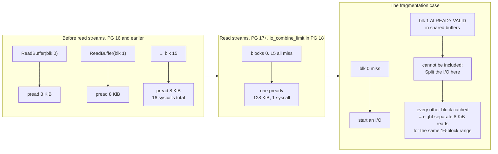

<!--
entry-meta
date: 2026-11-28
type: daily-diff
category: Daily Diff
title: Daily Diff — 2026-11-28
slug: postgres-heavyweight-lock-manager
-->

# Daily Diff — 2026-11-28

**2026-11-28 · Daily Diff Digest**

## Which edition this is, and why

**There is no 2026-11-28 edition, and no 2026-11-27 one either.** Both `https://tdd.cat/2026-11-28/` and `https://tdd.cat/2026-11-27/` returned `client_error`. The full procedure was run:

| Endpoint | Result |
|---|---|
| `https://tdd.cat/2026-11-28/` | `client_error`, no content |
| `https://tdd.cat/` (front page) | HTTP 200, names **Thursday, November 26, 2026**, header **"46 Stories"**, `published_time` 2026-11-26 |
| `https://tdd.cat/archive/` | HTTP 200, **151 editions**, marks `/2026-11-26/` as **"Latest"**, November calendar ends at 11-26 |
| `https://tdd.cat/2026-11-27/` | `client_error`, no content |
| `https://tdd.cat/2026-11-26/` | HTTP 200, serves the edition |

So the maximum fetchable edition is **2026-11-26** — and the previous run already digested it. Both indexes agree for once, and both agree the newest edition is two days old.

**This run therefore takes the fallback-pool path, which is the existing rule, not a new one.** The track's log records 11-23 (54 stories) as published, readable and **never digested** — it was skipped when a later run took the maximum and jumped past it. The repository convention is explicit that a whole uncovered edition outranks a single spent item from a covered one, so this digest covers **the 2026-11-23 edition in full**. Editions still uncovered after today: **none before 11-27**; 11-27 onward have not published.

## The 2026-11-23 edition — Monday, November 23, 2026

Page states **54 Stories**. **24 items were recovered verbatim with their outbound URLs** from the first ~40 KB of a 89.7 KB page; a further 28 came from a model-summarised tail whose own count was internally inconsistent (it claimed 31 rows and listed 29, one duplicating a verbatim item). **Recovered: ~52 of 54 distinct items; 24 of them verbatim.** The summarised tail is treated below as leads, not as text, and nothing from it is quoted.

### Verbatim items

**Systems and storage**

- **"How shared buffer hits fragment read combining in Postgres"** — Fernando Simões, [frn.sh/postgres-io](https://frn.sh/postgres-io/). History of Postgres read streams and why a cache hit in the middle of a range splits a combined read. *Today's deep dive.*
- **"Zstandard releases version 1.6.0 to address critical vulnerabilities"** — terrelln, [github.com/meta/zstd](https://github.com/meta/zstd/releases/tag/v1.6.0). Fixes a multithreaded-compression corruption bug, decompression memory exposures, and out-of-bounds dictionary reads.
- **"Binary fuse filters save more space than Bloom filters"** — Anton Zhiyanov, [antonz.org](https://antonz.org/probabilistic-data-structures-2/). ~9 bits/key versus 12 for a tuned Bloom at 0.39% FPR — for immutable sets only.
- **"Stalwart becomes a drop-in replacement for Microsoft Exchange"** — Mauro D., [stalw.art](https://stalw.art/blog/microsoft-exchange-replacement/). 1.2.0 adds MAPI over HTTP, EWS, ActiveSync and Autodiscover to its Rust server.
- **"Simulating sequential linear scan register allocation inside declarative Datalog"** — Max Bernstein et al., [bernsteinbear.com](https://bernsteinbear.com/blog/lsra-datalog/). Linear-scan register allocation encoded in Datalog, with the stateful parts emulated.
- **"Comparing mechanics of four somewhat homomorphic encryption schemes"** — Sefik Ilkin Serengil, [sefiks.com](https://sefiks.com/2026/11/22/comparing-somewhat-homomorphic-encryption-algorithms-bgn-freeman-bv-and-ghv/). BGN, Freeman, BV, GHV degree-2 schemes side by side.

**Security**

- **"Upstream HTTP/1.1 is inherently insecure and must be replaced"** — James Kettle, [portswigger.net/research](https://portswigger.net/research/http1-must-die). Argues HTTP/1.1's delimiter parsing keeps regenerating request smuggling, and that the fix is upstream replacement rather than more patching.
- **"Bypassing VirtualBox process hardening using dotnet assembly loading"** — [projectzero.google](https://projectzero.google/2026/11/virtualbox-process-hardening.html). `Assembly.Load` from memory sidesteps DLL-load checks in a hardened host.
- **"Comparing sandboxing primitives and trade-offs for coding agents"** — Nils Amiet, [kudelskisecurity.com](https://kudelskisecurity.com/research/sandboxing-coding-agents). microVM versus OS-primitive sandboxes.
- **"Shirudo protects live Linux systems without requiring service restarts"** — [openai.com](https://openai.com/index/introducing-shirudo/). Open-source runtime guards that block exploits without restarting services.

**Formal methods — an unusually heavy showing**

- **"VP does not equal VNP over every field"** — [github.com/anthropics/formal-math](https://github.com/anthropics/formal-math/tree/main/vp-vnp). AI-generated paper with a Lean 4 formalisation.
- **"Translating Zig functions into executable Lean models for verification"** — okcontract, [github.com/okcontract/zean](https://github.com/okcontract/zean). Lean 4 models emitted from Zig's Analyzed IR.
- **"Verifying Erlang programs using automated translation to Lean"** — José Valim, [github.com/josevalim/lynx](https://github.com/josevalim/lynx). Core Erlang to Lean by shallow embedding.

**Agents and models**

- **"AI coding agents spend most of their time waiting"** — Juraj Blahunka, [jurajb.dev](https://jurajb.dev/coding-agents-mostly-waiting/). Model generation was 26% of a 14.6-hour run; the rest was waiting on tests and tools.
- **"Autonomous agents optimize code using hypothesis driven algorithm engineering"** — [chszlab.github.io](https://chszlab.github.io/AgenticAlgorithmEngineering/). Agents make falsifiable predictions; 1.6×–8.9× speedups on VieCut and KaHIP.
- **"Handing software delivery to agents eliminates pull request bottlenecks"** — Alejandro Alvarez, [runway.com](https://runway.com/news/engineering/building-a-software-factory). Agents handled 38% of merged PRs; median first-approval wait fell from >2 hours to 5 minutes.
- **"Eliminating nondeterminism in llm inference using integer-only arithmetic"** — [nathan.rs](https://nathan.rs/posts/detllm/). Integer-only arithmetic for bit-identical output across hardware.
- **"Accessibility trees improve how models control desktop interfaces"** — Ruban SK, [greptile.com](https://www.greptile.com/blog/trex-computer-use). Screenshots versus accessibility trees for computer-use agents.
- **"Models can detect prior concept injections through latent introspection"** — [arxiv.org/abs/2602.20031](https://arxiv.org/abs/2602.20031). Logit-lens probing finds injection-detection signal in the residual stream.
- **"NariQ matches full precision performance on long agent tasks"** — [huggingface.co/nari-labs](https://huggingface.co/nari-labs/Qwen3.8-27B-NariQ-GGUF). Trellis-coded PTQ, 27B to 3 bits / ~10 GB.
- **"Bison-1 delivers single-pass calibrated probabilities across multiple questions"** — [huggingface.co/baselabs](https://huggingface.co/baselabs/bison-1). A 31B model scoring several classification questions in one forward pass.
- **"Harness adapters improve agent efficiency through safe reinforcement learning"** — [huggingface.co/blog/harness-hub](https://huggingface.co/blog/harness-hub/harness-adapters). LoRA adapters trained inside OpenCode and Hermes harnesses.
- **"Porting AI code audit skills to local laptop models"** — Pauli Olavi Ojala, [getstream.io](https://getstream.io/blog/local-video-audit-skill/). Agent skills as strict tool contracts for small local models.
- **"Treasure Map supplies firmware facts for agent analysis"** — [tmap.tools](https://tmap.tools/). Ghidra/BinExport/BinDiff facts in SQLite, served over MCP.
- **"Astra generated Breakout weights rely on classic exploit engineering"** — Shahar Shechter, [cyera.com](https://www.cyera.com/research/sparks-of-weight-space-programming-or-just-exploit-engineering). Disassembly claims the generated weights reduce to a lookup table plus threshold gates.

### Unverified tail

The remaining ~28 items were recovered only through a model summary of the page tail and are **not quoted or relied on here**. Notable leads worth a direct fetch another day: a Jolt-runtime post on replacing persistent red-black trees with B+trees (claimed 40% peak-heap reduction), ParadeDB on filter-aware vector search inside Postgres, a kernel-QUIC-sockets proposal, Armin Ronacher on lock poisoning, and a Redis post on pending-entry IDs referencing trimmed stream entries. Two tail URLs looked anomalous enough that they should be verified before anyone follows them.

## Deep dive: cache hits are what break read combining

Source followed: [https://frn.sh/postgres-io/](https://frn.sh/postgres-io/) (Fernando Simões, dated Nov 22 2026, read in full — 7,066 characters).

This is the right item to go deep on today for a reason beyond topic: it is the **inverse** of the lesson's finding. Lesson 11 showed a backend-local cache (`LOCALLOCK`) making the common path free. This post shows a shared cache (`shared_buffers`) making a *different* common path worse.

### The mechanism

- Postgres reads heap pages in `BLCKSZ` units — 8 KiB here, as `block_size` confirms. Historically each page was its own `pread`, so a 16-block sequential stretch cost **16 syscalls**.
- **Read streams** (PG 17, from Thomas Munro's 2023 thread) coalesce adjacent block requests into a single `preadv`. PG 18 bounds the coalescing with `io_combine_limit`. 16 adjacent blocks become **one 128 KiB read**.
- The coalescing is built block-by-block: the stream holds a pending I/O and keeps extending it while the next block is both adjacent and *not already valid in shared buffers*.
- **A cached block in the middle of the range terminates the pending I/O.** The source's own comment, quoted verbatim from the post:

  > "Otherwise we already have an I/O to perform, but this block can't be included as it is already valid. Split the I/O here."

- Worst case given in the post: with **every other page already cached**, that same 16-block range needs **eight separate 8 KiB reads**. A *warmer* cache produces *more* syscalls for the same logical scan than a colder one would.

### Why it matters

The pathology is not "cache misses are slow". It is that **partial cache residency is worse than either extreme** for syscall count, and partial residency is the normal state of a working set larger than `shared_buffers`. 128 MB of buffers against a 293 MB table — exactly lesson 10's workload B configuration — is precisely the regime that fragments combining. A benchmark run on a cold cache measures one syscall pattern and a benchmark run on a hot one measures another; neither measures production.

### What changed, from the post's own history

- Heikki's buffer-ring idea merged in **8.3.0**.
- Greg Stark added `posix_fadvise` prefetch and `effective_io_concurrency` in **8.4**.
- Look-ahead distance used to grow by doubling on a miss and shrink by 1 on a hit, which made the common miss-then-hit pattern thrash. Andres Freund changed it in **April 2026** so that, quoted from the post, `"a miss followed by a hit will never have the distance grow beyond 2"` — a fix aimed at what he had earlier described as `"the - very common - case of a bunch of "buffer misses" followed by a "buffer hit""`.

**Caveat, stated by the source and worth repeating:** the post is the author's own tests plus mailing-list reading. I did not verify its claims against the PostgreSQL source or release notes in this run, and its numbers are reported here as the post's, not as measured.

### The follow-up this earns

The track's own instrument for this is already established: lesson 08 used `strace -f -tt -p <pid> -e trace=pread64,preadv` on a named backend via the FIFO harness. On this 16.15 cluster there are no read streams at all, so a straight `pread` count per block is the baseline. The experiment worth running when lessons 21–25 bring `pg_waldump` and I/O back into scope: scan a table cold, scan it with alternating pages prewarmed via `pg_prewarm`, and count syscalls both times. On 16 the counts should be identical; the post's claim is that on 18 the second is eight times the first.

## Sources

- [https://tdd.cat/](https://tdd.cat/) — front page, names the 2026-11-26 edition, 46 Stories
- [https://tdd.cat/archive/](https://tdd.cat/archive/) — 151 editions, `/2026-11-26/` marked "Latest"
- [https://tdd.cat/2026-11-26/](https://tdd.cat/2026-11-26/) — fetched, already covered by the previous run
- [https://tdd.cat/2026-11-23/](https://tdd.cat/2026-11-23/) — the edition digested here, 54 Stories stated
- [https://frn.sh/postgres-io/](https://frn.sh/postgres-io/) — deep-dive source, read in full

All item links in the verbatim sections above are outbound URLs read from the 2026-11-23 page in this run. `https://tdd.cat/2026-11-28/` and `https://tdd.cat/2026-11-27/` both returned `client_error` and served nothing.
